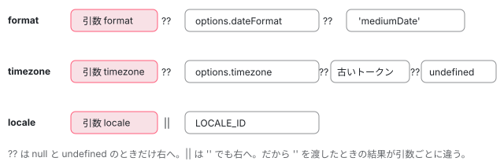

[目次](../README.md) › [common の内側](README.md) › 第 9 回 / 全 20 回

# DatePipe：transform から formatDate まで

> DatePipe のコンストラクタが LOCALE\_ID・DATE\_PIPE\_DEFAULT\_TIMEZONE・DATE\_PIPE\_DEFAULT\_OPTIONS を受け取る行、transform が null・空・NaN を null にし、format・timezone・locale の既定を決めて formatDate を呼び、例外を invalidPipeArgumentError に包む流れ。DatePipeConfig と provide の書き方。ページの上で本物の DatePipe と formatDate に値を渡すデモ。

angular/angular · 読了 約 12 分 · 基礎 · [サイトで読む（デモが動きます）](https://angular-deep-dive-cyan.vercel.app/chapter/cmn-date-pipe)

---

`{{ d | date }}` と書いたとき、`DatePipe` は自分では日付を書きません。コンストラクタで 3 つのトークンを受け取り、`transform` で「書式・タイムゾーン・ロケール」を 1 つずつ決めて `formatDate` に渡し、出た例外を包み直すだけです。この章では、その「決め方」を行ごとに追い、`DATE_PIPE_DEFAULT_OPTIONS` を provide すると何が変わり、何が変わらないのかを確かめます。

読む対象は `packages/common/src/pipes/date_pipe.ts`（280 行）と `date_pipe_config.ts`（26 行）、spec は `packages/common/test/pipes/date_pipe_spec.ts` です。

1. [1. 全体像](01-cmn-overview.md)
2. [2. NgClass と NgStyle](02-cmn-ng-class-style.md)
3. [3. NgForOf](03-cmn-ng-for-of.md)
4. [4. NgIf と NgSwitch](04-cmn-ng-if-switch.md)
5. [5. outlet](05-cmn-outlets.md)
6. [6. pipe の仕組み](06-cmn-pipe-mechanism.md)
7. [7. 小さな pipe](07-cmn-simple-pipes.md)
8. [8. KeyValuePipe](08-cmn-keyvalue-pipe.md)
9. **9. DatePipe**（この章）
10. [10. 日付の書式](10-cmn-format-date.md)
11. [11. 日付の部品](11-cmn-date-getters.md)
12. [12. 数の書式](12-cmn-format-number.md)
13. [13. NgOptimizedImage](13-cmn-image-overview.md)
14. [14. srcset と sizes](14-cmn-image-srcset.md)
15. [15. 画像のローダー](15-cmn-image-loaders.md)
16. [16. LCP と preload](16-cmn-image-lcp-preload.md)
17. [17. Location](17-cmn-location.md)
18. [18. テスト用の Location](18-cmn-location-testing.md)
19. [19. ViewportScroller](19-cmn-viewport-scroller.md)
20. [20. issue と PR を読む](20-cmn-issues.md)

## 1. 2 つのトークンと DatePipeConfig

ファイルの先頭に、`DatePipe` の既定値を差し替えるためのトークンが 2 つあります。古いほうから見ます。

📄 `angular/packages/common/src/pipes/date_pipe.ts` L16–25 （▶ の行: 17–18, 20, 22–23）

```ts
16 │ /**
17 ▶  * Optionally-provided default timezone to use for all instances of `DatePipe` (such as `'+0430'`).
18 ▶  * If the value isn't provided, the `DatePipe` will use the end-user's local system timezone.
19 │  *
20 ▶  * @deprecated use DATE_PIPE_DEFAULT_OPTIONS token to configure DatePipe
21 │  */
22 ▶ export const DATE_PIPE_DEFAULT_TIMEZONE = new InjectionToken<string>(
23 ▶   typeof ngDevMode !== 'undefined' && ngDevMode ? 'DATE_PIPE_DEFAULT_TIMEZONE' : '',
24 │ );
25 │ 
```

17〜18 行目のとおり、`DATE_PIPE_DEFAULT_TIMEZONE` は「すべての `DatePipe` の既定のタイムゾーン」を 1 つの文字列で渡すトークンです。20 行目で `@deprecated`、代わりは次の `DATE_PIPE_DEFAULT_OPTIONS` です。23 行目の `ngDevMode ? '…' : ''` は、本番ビルドでトークンの説明の文字列を消すための書き方です（トークンそのものは [di-injection-token](../di/06-di-injection-token.md)）。どちらのトークンにも `factory` がありません。**誰も provide しなければ、inject しても値が無い**トークンです。

📄 `angular/packages/common/src/pipes/date_pipe.ts` L26–59 （▶ の行: 29–32, 46, 53, 57）

````ts
26 │ /**
27 │  * DI token that allows to provide default configuration for the `DatePipe` instances in an
28 │  * application. The value is an object which can include the following fields:
29 ▶  * - `dateFormat`: configures the default date format. If not provided, the `DatePipe`
30 ▶  * will use the 'mediumDate' as a value.
31 ▶  * - `timezone`: configures the default timezone. If not provided, the `DatePipe` will
32 ▶  * use the end-user's local system timezone.
33 │  *
34 │  * @see {@link DatePipeConfig}
35 │  *
36 │  * @usageNotes
37 │  *
38 │  * Various date pipe default values can be overwritten by providing this token with
39 │  * the value that has this interface.
40 │  *
41 │  * For example:
42 │  *
43 │  * Override the default date format by providing a value using the token:
44 │  * ```ts
45 │  * providers: [
46 ▶  *   {provide: DATE_PIPE_DEFAULT_OPTIONS, useValue: {dateFormat: 'shortDate'}}
47 │  * ]
48 │  * ```
49 │  *
50 │  * Override the default timezone by providing a value using the token:
51 │  * ```ts
52 │  * providers: [
53 ▶  *   {provide: DATE_PIPE_DEFAULT_OPTIONS, useValue: {timezone: '-1200'}}
54 │  * ]
55 │  * ```
56 │  */
57 ▶ export const DATE_PIPE_DEFAULT_OPTIONS = new InjectionToken<DatePipeConfig>(
58 │   typeof ngDevMode !== 'undefined' && ngDevMode ? 'DATE_PIPE_DEFAULT_OPTIONS' : '',
59 │ );
````

29〜32 行目のとおり、値はオブジェクトで、`dateFormat` と `timezone` の 2 つを持てます。46 行目と 53 行目が provide の書き方の例です。型は次の `DatePipeConfig` です。

📄 `angular/packages/common/src/pipes/date_pipe_config.ts` L9–26 （▶ の行: 17–19, 26）

```ts
 9 │ /**
10 │  * An interface that describes the date pipe configuration, which can be provided using the
11 │  * `DATE_PIPE_DEFAULT_OPTIONS` token.
12 │  *
13 │  * @see {@link DATE_PIPE_DEFAULT_OPTIONS}
14 │  *
15 │  * @publicApi
16 │  */
17 ▶ export interface DatePipeConfig {
18 ▶   dateFormat?: string;
19 ▶   timezone?: string;
20 │ }
21 │ 
22 │ /**
23 │  * The default date format of Angular date pipe, which corresponds to the following format:
24 │  * `'MMM d,y'` (e.g. `Jun 15, 2015`)
25 │  */
26 ▶ export const DEFAULT_DATE_FORMAT = 'mediumDate';
```

17〜20 行目、どちらの項目も `?` 付きで、片方だけ書けます。**`locale` の項目はありません**。26 行目の `DEFAULT_DATE_FORMAT = 'mediumDate'` が、何も指定しないときの書式です （23〜24 行目のコメントは `'MMM d,y'` と書いていますが、`'mediumDate'` の中身はロケールのデータが決めます。[第 10 回](10-cmn-format-date.md)）。

> [!NOTE]
> **ポイント**
>
> 「`DATE_PIPE_DEFAULT_OPTIONS` に `locale` も足したい」という issue #70488（2026-08）は、Not planned で閉じられています。日付だけ別のロケールにしたいときは、パイプの 4 つめの引数で渡すか、`LOCALE_ID` を provide した子のインジェクタの下で使います（5 節）。

## 2. コンストラクタ：3 つを inject する

📄 `angular/packages/common/src/pipes/date_pipe.ts` L221–230 （▶ の行: 221–222, 226–228）

```ts
221 ▶ @Pipe({
222 ▶   name: 'date',
223 │ })
224 │ export class DatePipe implements PipeTransform {
225 │   constructor(
226 ▶     @Inject(LOCALE_ID) private locale: string,
227 ▶     @Inject(DATE_PIPE_DEFAULT_TIMEZONE) @Optional() private defaultTimezone?: string | null,
228 ▶     @Inject(DATE_PIPE_DEFAULT_OPTIONS) @Optional() private defaultOptions?: DatePipeConfig | null,
229 │   ) {}
230 │ 
```

1. **221〜223 行目：`@Pipe({name: 'date'})`**

   `pure` を書いていないので、既定の pure パイプです。引数が前と同じなら `transform` は呼ばれません （その仕組みは [第 6 回](06-cmn-pipe-mechanism.md)）。下の 3 節のドキュメントの 67〜73 行目が「`Date` を書き換えても出し直されない」と書いているのは、この pure のためです。
2. **226 行目：`LOCALE_ID`（必ずある）**

   `LOCALE_ID` は factory を持つトークンなので、provide しなくても `'en-US'` などが入ります（決まり方は [loc-locale-data](../loc/12-loc-locale-data.md)）。`@Optional()` は付いていません。
3. **227〜228 行目：残りの 2 つは `@Optional()`**

   provide されていなければ `null` が入ります。型も `string | null`・`DatePipeConfig | null` です。

この 3 つの引数は、コンパイラが作るファクトリ（`ɵfac`）で inject されます。手元の Node で `@angular/compiler` を読み込んでから `DatePipe.ɵfac.toString()` を出すと、次の形でした（JIT の別名 `jit___directiveInject_1` などを読みやすい名前に直しています）。

📄 `DatePipe.ɵfac（22.1.6 を JIT で出したもの。名前だけ直した）`

```
function DatePipe_Factory(__ngFactoryType__) {
  return new (__ngFactoryType__ || DatePipe)(
    ɵɵdirectiveInject(LOCALE_ID, 16),
    ɵɵdirectiveInject(DATE_PIPE_DEFAULT_TIMEZONE, 24),
    ɵɵdirectiveInject(DATE_PIPE_DEFAULT_OPTIONS, 24));
}
```

数字はフラグです。16 は `InternalInjectFlags.ForPipe`（`packages/core/src/di/interface/injector.ts` を grep すると `ForPipe = 0b10000`）、24 はそれに `Optional`（8）を足したものです。226〜228 行目の `@Optional()` の有無が、そのまま 16 と 24 の違いになっています。`ForPipe` を見ているのは core の中では `ChangeDetectorRef` を作る行だけです（[di-special-tokens](../di/13-di-special-tokens.md)）。

## 3. ドキュメントが約束していること

📄 `angular/packages/common/src/pipes/date_pipe.ts` L66–82 （▶ の行: 67, 72–73, 75, 79–82）

```ts
66 │  *
67 ▶  * `DatePipe` is executed only when it detects a pure change to the input value.
68 │  * A pure change is either a change to a primitive input value
69 │  * (such as `String`, `Number`, `Boolean`, or `Symbol`),
70 │  * or a changed object reference (such as `Date`, `Array`, `Function`, or `Object`).
71 │  *
72 ▶  * Note that mutating a `Date` object does not cause the pipe to be rendered again.
73 ▶  * To ensure that the pipe is executed, you must create a new `Date` object.
74 │  *
75 ▶  * Only the `en-US` locale data comes with Angular. To localize dates
76 │  * in another language, you must import the corresponding locale data.
77 │  * See the [I18n guide](guide/i18n/format-data-locale) for more information.
78 │  *
79 ▶  * The time zone of the formatted value can be specified either by passing it in as the second
80 ▶  * parameter of the pipe, or by setting the default through the `DATE_PIPE_DEFAULT_OPTIONS`
81 ▶  * injection token. The value that is passed in as the second parameter takes precedence over
82 ▶  * the one defined using the injection token.
```

67〜73 行目は 2 節の pure の話、75〜77 行目は「en-US 以外は自分でロケールのデータを入れる」（[loc-locale-data](../loc/12-loc-locale-data.md)）です。79〜82 行目が、この章で確かめる約束です。「引数で渡したタイムゾーンが、トークンで決めたものより優先される」。

📄 `angular/packages/common/src/pipes/date_pipe.ts` L92–108 （▶ の行: 96–98, 101, 105）

```ts
 92 │  *
 93 │  * ### Pre-defined format options
 94 │  *
 95 │  * | Option        | Equivalent to                       | Examples (given in `en-US` locale)              |
 96 ▶  * |---------------|-------------------------------------|-------------------------------------------------|
 97 ▶  * | `'short'`     | `'M/d/yy, h:mm a'`                  | `6/15/15, 9:03 AM`                              |
 98 ▶  * | `'medium'`    | `'MMM d, y, h:mm:ss a'`             | `Jun 15, 2015, 9:03:01 AM`                      |
 99 │  * | `'long'`      | `'MMMM d, y, h:mm:ss a z'`          | `June 15, 2015 at 9:03:01 AM GMT+1`             |
100 │  * | `'full'`      | `'EEEE, MMMM d, y, h:mm:ss a zzzz'` | `Monday, June 15, 2015 at 9:03:01 AM GMT+01:00` |
101 ▶  * | `'shortDate'` | `'M/d/yy'`                          | `6/15/15`                                       |
102 │  * | `'mediumDate'`| `'MMM d, y'`                        | `Jun 15, 2015`                                  |
103 │  * | `'longDate'`  | `'MMMM d, y'`                       | `June 15, 2015`                                 |
104 │  * | `'fullDate'`  | `'EEEE, MMMM d, y'`                 | `Monday, June 15, 2015`                         |
105 ▶  * | `'shortTime'` | `'h:mm a'`                          | `9:03 AM`                                       |
106 │  * | `'mediumTime'`| `'h:mm:ss a'`                       | `9:03:01 AM`                                    |
107 │  * | `'longTime'`  | `'h:mm:ss a z'`                     | `9:03:01 AM GMT+1`                              |
108 │  * | `'fullTime'`  | `'h:mm:ss a zzzz'`                  | `9:03:01 AM GMT+01:00`                          |
```

書式の名前の表です。`DatePipe` 自身はこの名前を何も解釈しません。`'short'` を `'M/d/yy, h:mm a'` に展開するのは `formatDate` の中の `getNamedFormat` で、ロケールのデータから引きます（[第 10 回](10-cmn-format-date.md)）。

> [!WARNING]
> **ハマりどころ**
>
> 98 行目の例 `June 15, 2015 at 9:03:01 AM GMT+1` は、今の en-US のデータの出力と違います。format\_date\_spec.ts の it `should format with pattern aliases` は `/June 15, 2015, 9:03:01 AM GMT(\+|-)\d/`、つまり `at` ではなく `,` を期待しています。下のデモで `long` を選ぶと確かめられます。表は CLDR が変わる前のまま残っています（main でも同じ。2026-11-05 に確認）。

## 4. transform：null を返す道と、3 つの既定

📄 `angular/packages/common/src/pipes/date_pipe.ts` L263–280 （▶ の行: 269, 272–277）

```ts
263 │   transform(
264 │     value: Date | string | number | null | undefined,
265 │     format?: string,
266 │     timezone?: string,
267 │     locale?: string,
268 │   ): string | null {
269 ▶     if (value == null || value === '' || value !== value) return null;
270 │ 
271 │     try {
272 ▶       const _format = format ?? this.defaultOptions?.dateFormat ?? DEFAULT_DATE_FORMAT;
273 ▶       const _timezone =
274 ▶         timezone ?? this.defaultOptions?.timezone ?? this.defaultTimezone ?? undefined;
275 ▶       return formatDate(value, _format, locale || this.locale, _timezone);
276 ▶     } catch (error) {
277 ▶       throw invalidPipeArgumentError(DatePipe, (error as Error).message);
278 │     }
279 │   }
280 │ }
```

1. **269 行目：`null`・`undefined`・`''`・`NaN` は `null`**

   `value == null` が `null` と `undefined`、`value === ''` が空文字、`value !== value` が `NaN`（自分自身と等しくない値は JavaScript では `NaN` だけ）です。ここで返すので `formatDate` は呼ばれず、例外にもなりません。`' '`（空白だけ）は `''` ではないので通り、`formatDate` の `toDate` で例外になります。`new Date('x')` のような無効な `Date` も 269 行目では止まりません（`Date` はオブジェクトなので `value !== value` は `false`）。
2. **272 行目：書式は「引数 → `dateFormat` → `'mediumDate'`」**

   `??` は左が `null` か `undefined` のときだけ右を使います。だから `date:''` と空文字を渡すと、既定に戻らず `''` がそのまま `formatDate` に渡り、結果は空文字です。
3. **273〜274 行目：タイムゾーンは「引数 → `timezone` → 古いトークン → `undefined`」**

   ここも `??` です。新しい `DATE_PIPE_DEFAULT_OPTIONS.timezone` が、古い `DATE_PIPE_DEFAULT_TIMEZONE` より先に来ます。引数に `''` を渡すと、**どちらの既定も使われず**`''` が渡り、`formatDate` の `if (timezone)` で「タイムゾーンなし（端末の時刻）」になります（spec の `should support an empty string for the timezone`）。最後の `?? undefined` は、`this.defaultTimezone` が `null`（Optional で入らなかった）のときに `undefined` にそろえるためです。
4. **275 行目：ロケールだけは `||`**

   `locale || this.locale` なので、`''` を渡しても `LOCALE_ID` に戻ります。書式とタイムゾーンは `??`、ロケールは `||`。空文字を渡したときの振る舞いが、引数ごとに違います。
5. **276〜277 行目：例外を包み直す**

   `formatDate` が投げたエラーの `message` を `invalidPipeArgumentError(DatePipe, …)` に渡し、`NG02100: InvalidPipeArgument: '…' for pipe 'DatePipe'` の形にします（`invalidPipeArgumentError` の中身は [第 6 回](06-cmn-pipe-mechanism.md)）。元のエラーコード（例えば `NG02311`）は、文字列として中に残ります。元のエラーのオブジェクトはつながりません（`cause` は付けていない）。



*transform が 3 つの値を決める順（272〜275 行目）*

決めた 3 つは、`DatePipeConfig` の外にある `LOCALE_ID` も含めて、すべて `formatDate(value, _format, locale, _timezone)` の 1 回の呼び出しに入ります。中身は次の 3 回で追います。

- 👤 `{{ d | date:'short' }}` — あなたのテンプレート — *引数が変わったときだけ（pure）*
  - `DatePipe.transform(value, format, timezone, locale)` — pipes/date\_pipe.ts 263
    - `value == null || value === '' || value !== value` — 269 — *null を返して終わり*
    - `formatDate(value, _format, locale || this.locale, _timezone)` — 275 → i18n/format\_date.ts 87 — *[第 10 回](10-cmn-format-date.md)*
      - `toDate` → `getNamedFormat` → `DATE_FORMATS_SPLIT` のループ
      - `getDateFormatter(part)(date, locale, offset)` — *[第 11 回](11-cmn-date-getters.md)*
    - `throw invalidPipeArgumentError(DatePipe, message)` — 277 — *例外のときだけ*

## 5. provide の書き方と、効く範囲

📄 `src/app/app.config.ts（例）`

```
// app.config.ts（読者が書くアプリの例）
export const appConfig: ApplicationConfig = {
  providers: [
    {provide: LOCALE_ID, useValue: 'ja'},
    {provide: DATE_PIPE_DEFAULT_OPTIONS, useValue: {dateFormat: 'yyyy/MM/dd', timezone: '+0900'}},
  ],
};
```

`DatePipe` はテンプレートの中で、そのコンポーネントの*ノードのインジェクタ*から 3 つを探します（2 節のファクトリの `ɵɵdirectiveInject`）。だから `DATE_PIPE_DEFAULT_OPTIONS` は、アプリ全体（上の例）にも、1 つのコンポーネントの `providers` にも置けます。spec にその 2 通りがそのまま書かれています（6 節）。パイプのインスタンスはテンプレートの中の使う場所ごと（ビューごと）に作られ、作るときに 1 回だけ inject します。あとから provide の値を変えても、作られたパイプには届きません。

> **🧪 DEMO — 本物の DatePipe を、章の中の小さなインジェクタで作って呼ぶ**
>
> 「transform を呼ぶ」を押すと、`Injector.create` で章の中だけのインジェクタを作り（親はこのサイトの `EnvironmentInjector`）、下で選んだ `LOCALE_ID`・`DATE_PIPE_DEFAULT_OPTIONS`・`DATE_PIPE_DEFAULT_TIMEZONE` を入れます。そこから 2 節のファクトリと同じ 3 つを `get` して、このサイトの本物の `DatePipe`（@angular/common 22.1.6）を `new` し、`transform` を呼びます。「決まった値」の列だけは 272〜275 行目を表示用に移植したもので、「formatDate を直接」は同じ値で本物の `formatDate` を呼んだ結果です。ロケールの ja・fr・de は、押したときにこの章で `registerLocaleData` します。エラーの文の中のクラス名は、このサイトの開発ビルドでは `'_DatePipe'` と出ます（ビルドの道具がクラスの名前を変えるため。本家の spec の文では `'DatePipe'`）。
>
> dateFormat・timezone を空にすると、その項目はオブジェクトに入れません。
>
> 試すと分かること：`DATE_PIPE_DEFAULT_OPTIONS` の timezone `-1200` と古いトークン `+0500` を両方入れると `-1200` が勝つ（273〜274 行目）。timezone に `''` を渡すと、どちらの既定も使われない。format に `''` を渡すと結果は空文字。`'tomorrow'` は `NG02311` を中に持つ `NG02100`。`'y'` × 257 は `NG02300`（第 10 回）。`YYYY/MM/dd` は開発モードの検査で例外です。
>
> ▶ [このデモはサイトで動かせます](https://angular-deep-dive-cyan.vercel.app/chapter/cmn-date-pipe)

## テストと直し方

### spec と describe

| spec | describe / it | bazel のターゲット |
| --- | --- | --- |
| common/test/pipes/date\_pipe\_spec.ts | describe `DatePipe`（15 行目）の中に `supports`（28 行目、it 11）と `transform`（73 行目、it 15）、その外に it `should be available as a standalone pipe`（214 行目）。2026-05 の書式の長さの it `should reject date formats that are too long`（80 行目）もここです。 | `//packages/common/test:test`（Node。ブラウザだけの分岐はない） |

📄 `angular/packages/common/test/pipes/date_pipe_spec.ts` L48–70 （▶ の行: 49, 53, 57, 61, 69）

```ts
48 │     it('should return null for empty string', () => {
49 ▶       expect(pipe.transform('')).toEqual(null);
50 │     });
51 │ 
52 │     it('should return null for NaN', () => {
53 ▶       expect(pipe.transform(Number.NaN)).toEqual(null);
54 │     });
55 │ 
56 │     it('should return null for null', () => {
57 ▶       expect(pipe.transform(null)).toEqual(null);
58 │     });
59 │ 
60 │     it('should return null for undefined', () => {
61 ▶       expect(pipe.transform(undefined)).toEqual(null);
62 │     });
63 │ 
64 │     it('should support ISO string without time', () => {
65 │       expect(() => pipe.transform(isoStringWithoutTime)).not.toThrow();
66 │     });
67 │ 
68 │     it('should not support other objects', () => {
69 ▶       expect(() => pipe.transform({} as any)).toThrowError(/InvalidPipeArgument/);
70 │     });
```

49・53・57・61 行目が 269 行目の 4 つの条件を 1 つずつ確かめています。69 行目は、`{}` が 277 行目で包まれて `InvalidPipeArgument` になることです。

📄 `angular/packages/common/test/pipes/date_pipe_spec.ts` L86–102 （▶ の行: 90–91, 101）

```ts
 86 │     it('should use format provided in component as default format when no format is passed in', async () => {
 87 │       @Component({
 88 │         selector: 'test-component',
 89 │         imports: [DatePipe],
 90 ▶         template: '{{ value | date }}',
 91 ▶         providers: [{provide: DATE_PIPE_DEFAULT_OPTIONS, useValue: {dateFormat: 'shortDate'}}],
 92 │       })
 93 │       class TestComponent {
 94 │         value = '2017-01-11T10:14:39+0000';
 95 │       }
 96 │ 
 97 │       const fixture = TestBed.createComponent(TestComponent);
 98 │       await fixture.whenStable();
 99 │ 
100 │       const content = fixture.nativeElement.textContent;
101 ▶       expect(content).toBe('1/11/17');
102 │     });
```

91 行目でコンポーネントの `providers` に `DATE_PIPE_DEFAULT_OPTIONS` を置き、90 行目の `{{ value | date }}`（書式なし）が 101 行目で `shortDate` の形になることを見ています。すぐ下の it（`should use format provided in module …`）は、同じことを `TestBed.configureTestingModule` の `providers` で確かめています。

📄 `angular/packages/common/test/pipes/date_pipe_spec.ts` L152–172 （▶ の行: 153, 157, 165–166, 170–171）

```ts
152 │     it('should take timezone into account with timezone offset', () => {
153 ▶       expect(pipe.transform('2017-01-11T00:00:00', 'mediumDate', '-1200')).toEqual('Jan 10, 2017');
154 │     });
155 │ 
156 │     it('should support an empty string for the timezone', () => {
157 ▶       expect(pipe.transform('2017-01-11T00:00:00', 'mediumDate', '')).toEqual('Jan 11, 2017');
158 │     });
159 │ 
160 │     it('should take timezone into account', () => {
161 │       expect(pipe.transform('2017-01-11T00:00:00', 'mediumDate', '-1200')).toEqual('Jan 10, 2017');
162 │     });
163 │ 
164 │     it('should take the default timezone into account when no timezone is passed in', () => {
165 ▶       pipe = new DatePipe('en-US', '-1200');
166 ▶       expect(pipe.transform('2017-01-11T00:00:00', 'mediumDate')).toEqual('Jan 10, 2017');
167 │     });
168 │ 
169 │     it('should give precedence to the passed in timezone over the default one', () => {
170 ▶       pipe = new DatePipe('en-US', '-1200');
171 ▶       expect(pipe.transform('2017-01-11T00:00:00', 'mediumDate', '+0100')).toEqual('Jan 11, 2017');
172 │     });
```

165 行目と 170 行目は `new DatePipe('en-US', '-1200')`、つまりコンストラクタの 2 つめ（古い `DATE_PIPE_DEFAULT_TIMEZONE`）に直接入れています。171 行目が 3 節の 79〜82 行目の約束（引数が勝つ）です。157 行目が 4 節の「`''` はタイムゾーンなし」です。**`DATE_PIPE_DEFAULT_OPTIONS.timezone` と古いトークンを両方入れたときにどちらが勝つか**を確かめる it は、この spec にはありません（grep で `new DatePipe(` の 3 つめの引数を渡している行は 0 件）。

### 手元で走らせた結果

📄 `ターミナル（../angular で）`

```
cd ~/angular-research/angular
pnpm bazel test //packages/common/test:test \
  --nocache_test_results --test_output=all '--test_arg=--filter=^DatePipe '
```

📄 `出力（2026-11-05 に実行。抜粋。ログは scratchpad/cmn-logs/c-date-pipe.log）`

```
Ran 27 of 667 specs
27 specs, 0 failures
Finished in 0.047 seconds
//packages/common/test:test                                              PASSED in 0.8s
```

- 27 件 = describe `DatePipe` の it の全部（supports 11・transform 15・standalone 1）。フィルタの末尾の空白は、`DatePipe` で始まる別の describe を拾わないためです。
- timezone の it は「その日付が端末のタイムゾーンでどう見えるか」に左右されない値（`'-1200'` で前の日になる）を選んであるので、このマシン（Asia/Tokyo）でも通ります。

### 直すとしたら

- 既定の決まり方は `DatePipe.transform` の 272〜275 行目だけです。足す it は `describe('transform')` に、`new DatePipe('en-US', '+0500', {timezone: '-1200'})` のように 3 つめの引数まで渡す形で書けます。
- 例外の文の形を変えたいなら、それは `pipes/utils.ts` の `invalidPipeArgumentError` で、`DecimalPipe` など他のパイプにも効きます（[第 6 回](06-cmn-pipe-mechanism.md)）。
- issue #70488（`DatePipeConfig` に `locale`）は 2026-08-31 に Not planned。提案の差分は 17〜20 行目と 275 行目でしたが、`LOCALE_ID` を子のインジェクタで provide すれば同じことができる、という整理です。タイムゾーンの名前（`Asia/Tokyo`）が使えない #48279 は [第 11 回](11-cmn-date-getters.md)、書式の長さの修正 eeb03f4ea31 は [第 10 回](10-cmn-format-date.md)、issue の読み方は [第 20 回](20-cmn-issues.md)。
- 本家に PR を出すことは勧めません。「なぜ既定が効かないのか」という issue を読むとき、引数が `''` なのか `undefined` なのかを最初に確かめる、という手がかりにします。

## 聞かれそうな質問

**Q. DATE\_PIPE\_DEFAULT\_OPTIONS で timezone を決めたのに、ある画面だけ効きません。**

その画面で `date:'short':''` のように timezone に空文字を渡していないか見ます。273〜274 行目は `??` なので、`''` は「渡した」扱いになり、既定は使われません。その `''` が `formatDate` の `if (timezone)` で偽になり、端末のタイムゾーンで書かれます。もう 1 つは、別のコンポーネントの `providers` で上書きされている場合です（5 節。近いノードのインジェクタが勝ちます）。

**Q. date パイプに null を渡すとエラーになりますか？**

なりません。269 行目で `null` を返し、テンプレートには何も出ません。`undefined`・`''`・`NaN` も同じです（spec の 48〜62 行目）。無効な `Date` オブジェクトや `' '` は 269 行目を通り抜け、例外になります。

**Q. Date を setHours で書き換えたのに表示が変わりません。**

221〜223 行目で `pure` を書いていない（既定の pure）ので、同じ `Date` の参照のままだと `transform` が呼ばれません。ドキュメントの 72〜73 行目のとおり、新しい `Date` を作って渡します（pure の判定は [第 6 回](06-cmn-pipe-mechanism.md)）。

**Q. DATE\_PIPE\_DEFAULT\_TIMEZONE と DATE\_PIPE\_DEFAULT\_OPTIONS を両方 provide したら？**

274 行目の順で、`DATE_PIPE_DEFAULT_OPTIONS.timezone` が先です。`DATE_PIPE_DEFAULT_OPTIONS` に `timezone` が無い（`dateFormat` だけ）なら、古いトークンの値が使われます。デモで両方入れて確かめられます。

**Q. エラーの文に NG02100 と NG02311 の 2 つが出るのはなぜ？**

277 行目で、`formatDate` の例外（`toDate` の `NG02311` など）の `message` を文字列として `invalidPipeArgumentError` に渡し、パイプ用の `NG02100` のエラーを作り直すからです。外側が `DatePipe` の、内側が `formatDate` のコードです。

## 読み終えて

- `DatePipe` は 3 つを inject し（226〜228 行目）、`transform` で書式・タイムゾーン・ロケールを決めて `formatDate` を 1 回呼ぶだけ。
- 269 行目の 4 つ（null・undefined・空文字・NaN）は `null`。それ以外の不正な値は例外を包み直す（277 行目）。
- 書式とタイムゾーンは `??`、ロケールは `||`。空文字を渡したときの結果が違う。
- 新しい `DATE_PIPE_DEFAULT_OPTIONS` は古い `DATE_PIPE_DEFAULT_TIMEZONE` より先に見られ、`locale` の項目は無い。

---

← 前: [KeyValuePipe：オブジェクトと Map を並べる](08-cmn-keyvalue-pipe.md)  
次: [formatDate の書式の読み方：toDate・名前つきの書式・DATE\_FORMATS\_SPLIT](10-cmn-format-date.md) →
