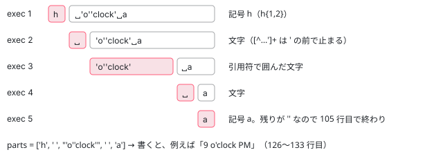

[目次](../README.md) › [common の内側](README.md) › 第 10 回 / 全 20 回

# formatDate の書式の読み方：toDate・名前つきの書式・DATE\_FORMATS\_SPLIT

> toDate が数・ISO 8601 の文字列・Date を Date に直す行（isoStringToDate）、getNamedFormat が 'short' や 'medium' をロケールの書式に展開してキャッシュする行、DATE\_FORMATS\_SPLIT の正規表現で書式を部品に切って 1 つずつ書く formatDate のループ。2026 年 5〜7 月の修正（書式の長さの上限 eeb03f4ea31、formatDateTime のプロトタイプ汚染 1ec125276d8、キャッシュの prototype の参照 359fb503b8f）。

angular/angular · 読了 約 13 分 · 発展 · [サイトで読む（デモが動きます）](https://angular-deep-dive-cyan.vercel.app/chapter/cmn-format-date)

---

`formatDate(value, 'EEEE, MMM d', 'en-US')` は、書式の文字列を左から 1 つの正規表現で少しずつ切り、切った部品ごとに「書く関数」を引いてつなげます。この章では、値を `Date` に直す `toDate`、`'short'` のような名前をロケールの書式に展開する `getNamedFormat`、書式を部品に切る `DATE_FORMATS_SPLIT` のループを順に読み、2026 年 5〜7 月に入った 3 つの修正が、そのどこを直したのかを確かめます。

読む対象は `packages/common/src/i18n/format_date.ts`（1003 行）の 33〜283 行目と 912〜1003 行目、spec は `packages/common/test/i18n/format_date_spec.ts` です。部品ごとの「書く関数」の中身は [第 11 回](11-cmn-date-getters.md)で読みます。

1. [1. 全体像](01-cmn-overview.md)
2. [2. NgClass と NgStyle](02-cmn-ng-class-style.md)
3. [3. NgForOf](03-cmn-ng-for-of.md)
4. [4. NgIf と NgSwitch](04-cmn-ng-if-switch.md)
5. [5. outlet](05-cmn-outlets.md)
6. [6. pipe の仕組み](06-cmn-pipe-mechanism.md)
7. [7. 小さな pipe](07-cmn-simple-pipes.md)
8. [8. KeyValuePipe](08-cmn-keyvalue-pipe.md)
9. [9. DatePipe](09-cmn-date-pipe.md)
10. **10. 日付の書式**（この章）
11. [11. 日付の部品](11-cmn-date-getters.md)
12. [12. 数の書式](12-cmn-format-number.md)
13. [13. NgOptimizedImage](13-cmn-image-overview.md)
14. [14. srcset と sizes](14-cmn-image-srcset.md)
15. [15. 画像のローダー](15-cmn-image-loaders.md)
16. [16. LCP と preload](16-cmn-image-lcp-preload.md)
17. [17. Location](17-cmn-location.md)
18. [18. テスト用の Location](18-cmn-location-testing.md)
19. [19. ViewportScroller](19-cmn-viewport-scroller.md)
20. [20. issue と PR を読む](20-cmn-issues.md)

## 1. ファイルの先頭の 4 つ

📄 `angular/packages/common/src/i18n/format_date.ts` L33–41 （▶ の行: 33–35, 37–40）

```ts
33 ▶ export const ISO8601_DATE_REGEX =
34 ▶   /^(\d{4,})-?(\d\d)-?(\d\d)(?:T(\d\d)(?::?(\d\d)(?::?(\d\d)(?:\.(\d+))?)?)?(Z|([+-])(\d\d):?(\d\d))?)?$/;
35 ▶ //    1        2       3         4          5          6          7          8  9     10      11
36 │ // tslint:disable-next-line:no-toplevel-property-access
37 ▶ const NAMED_FORMATS: {[localeId: string]: {[format: string]: string}} = Object.create(null);
38 ▶ const DATE_FORMATS_SPLIT =
39 ▶   /((?:[^BEGHLMOSWYZabcdhmswyz']+)|(?:'(?:[^']|'')*')|(?:G{1,5}|y{1,4}|Y{1,4}|M{1,5}|L{1,5}|w{1,2}|W{1}|d{1,2}|E{1,6}|c{1,6}|a{1,5}|b{1,5}|B{1,5}|h{1,2}|H{1,2}|m{1,2}|s{1,2}|S{1,3}|z{1,4}|Z{1,5}|O{1,4}))([\s\S]*)/;
40 ▶ const MAX_DATE_FORMAT_LENGTH = 256;
41 │ 
```

- 33〜35 行目 `ISO8601_DATE_REGEX`：ISO 8601 の文字列を読む正規表現。35 行目のコメントが、かっこの番号（1 が年、8 が `Z` かオフセット全体、9〜11 がオフセットの符号・時・分）です。6 節で使います。
- 37 行目 `NAMED_FORMATS`：`'short'` などを展開した結果のキャッシュ。`Object.create(null)` なのは 359fb503b8f の修正です（7 節）。
- 38〜39 行目 `DATE_FORMATS_SPLIT`：書式を部品に切る正規表現。3 節で 1 文字ずつ読みます。
- 40 行目 `MAX_DATE_FORMAT_LENGTH = 256`：書式の長さの上限。eeb03f4ea31 の修正です（7 節）。

## 2. formatDate の全体

📄 `angular/packages/common/src/i18n/format_date.ts` L87–117 （▶ の行: 93–96, 100–101, 103–105, 108, 110, 116）

```ts
 87 │ export function formatDate(
 88 │   value: string | number | Date,
 89 │   format: string,
 90 │   locale: string,
 91 │   timezone?: string,
 92 │ ): string {
 93 ▶   let date = toDate(value);
 94 ▶   assertValidDateFormatLength(format);
 95 ▶   const namedFormat = getNamedFormat(locale, format);
 96 ▶   format = namedFormat || format;
 97 │ 
 98 │   let parts: string[] = [];
 99 │   let match;
100 ▶   while (format) {
101 ▶     match = DATE_FORMATS_SPLIT.exec(format);
102 │     if (match) {
103 ▶       parts = parts.concat(match.slice(1));
104 ▶       const part = parts.pop();
105 ▶       if (!part) {
106 │         break;
107 │       }
108 ▶       format = part;
109 │     } else {
110 ▶       parts.push(format);
111 │       break;
112 │     }
113 │   }
114 │ 
115 │   if (typeof ngDevMode === 'undefined' || ngDevMode) {
116 ▶     assertValidDateFormat(parts);
117 │   }
```

1. **93 行目：値を `Date` に**

   `toDate`（6 節）。ここで直せなければ例外です。
2. **94 行目：長さの検査**

   名前の展開より前、つまり*利用者が渡した文字列*の長さを見ます（7 節）。
3. **95〜96 行目：名前なら展開**

   `getNamedFormat` が `''` 以外を返したら、それで `format` を置き換えます。`'short'` は en-US なら `'M/d/yy, h:mm a'` になります（4 節）。
4. **100〜113 行目：部品に切るループ**

   101 行目で正規表現を当て、103 行目で「かっこ 1（今切った部品）」と「かっこ 2（残り）」を `parts` の後ろに足し、104 行目ですぐ「残り」を取り出します。残りが空なら 105〜106 行目で終わり、空でなければ 108 行目で残りを次の `format` にして繰り返します。当たらなければ 110 行目で、残りを丸ごと 1 つの部品にして終わります。
5. **115〜117 行目：開発モードだけの検査**

   `Y` の使い方の検査（5 節）。本番のビルドでは呼ばれません。

その次の 5 行はタイムゾーンの調整で、[第 11 回](11-cmn-date-getters.md)で読みます。そのあとが部品を書く行です。

📄 `angular/packages/common/src/i18n/format_date.ts` L124–136 （▶ の行: 126–132）

```ts
124 │ 
125 │   let text = '';
126 ▶   parts.forEach((value) => {
127 ▶     const dateFormatter = getDateFormatter(value);
128 ▶     text += dateFormatter
129 ▶       ? dateFormatter(date, locale, dateTimezoneOffset)
130 ▶       : value === "''"
131 ▶         ? "'"
132 ▶         : value.replace(/(^'|'$)/g, '').replace(/''/g, "'");
133 │   });
134 │ 
135 │   return text;
136 │ }
```

1. **127〜129 行目：記号なら関数で書く**

   `getDateFormatter(value)` が関数を返せば、それに日付・ロケール・オフセットを渡します（[第 11 回](11-cmn-date-getters.md)）。
2. **130〜131 行目：`''` だけなら `'`**

   引用符を 2 つ並べた部品は、1 つの `'` を書く決まりです。
3. **132 行目：そのほかは文字のまま**

   先頭と末尾の `'` を 1 つずつ外し（`/(^'|'$)/g`）、中の `''` を `'` に戻します。`'o''clock'` は `o'clock` になります。

## 3. DATE\_FORMATS\_SPLIT を 1 つずつ

38〜39 行目の正規表現は、外側が `(部品)([\s\S]*)` の 2 つのかっこで、部品は 3 つの選択肢のどれかです。

| 選択肢 | 当たるもの | 例 |
| --- | --- | --- |
| `(?:[^BEGHLMOSWYZabcdhmswyz']+)` | 記号に使う 21 文字と `'` 以外が 1 文字以上続いたもの | `, `・`/`・`年`・`T`・`x` |
| `(?:'(?:[^']\|'')*')` | 引用符で囲んだ文字。中では `''` が 1 つの `'` | `'at'`・`'o''clock'`・`''` |
| `(?:G{1,5}\|y{1,4}\|…\|O{1,4})` | 同じ記号の並び。長さの上限は記号ごと | `yyyy`・`MMM`・`EEEE`・`a` |



*h 'o''clock' a を切るループ（100〜113 行目）。かっこ 1 が parts に残り、かっこ 2 が次の入力になる*

> [!NOTE]
> **さらに深く**
>
> この正規表現の先頭には `^` がありません。だから 101 行目の `exec` は、`format` の先頭で当たらなければ、*後ろのほうで当たる場所*を探します。103 行目の `match.slice(1)` はかっこの中身だけなので、当たった場所より前の文字は `parts` に入らず、黙って消えます。先頭で当たらないのは、閉じていない `'` のときだけです（記号でも `'` でもない文字は 1 つめの選択肢が、記号はどれも 3 つめが拾う）。このサイトの本物（22.1.6）で `formatDate(d, "xy'z", 'en-US', 'UTC')` は `'x2026GMT+0'`、つまり `'` だけが消え、`z` はタイムゾーンとして書かれました。デモの `xy'z` と `'abc` で確かめられます。

## 4. getNamedFormat：名前をロケールの書式に

📄 `angular/packages/common/src/i18n/format_date.ts` L203–224 （▶ の行: 204–205, 207–208, 212–214）

```ts
203 │ function getNamedFormat(locale: string, format: string): string {
204 ▶   const localeId = getLocaleId(locale);
205 ▶   NAMED_FORMATS[localeId] ??= Object.create(null);
206 │ 
207 ▶   if (NAMED_FORMATS[localeId][format]) {
208 ▶     return NAMED_FORMATS[localeId][format];
209 │   }
210 │ 
211 │   let formatValue = '';
212 ▶   switch (format) {
213 ▶     case 'shortDate':
214 ▶       formatValue = getLocaleDateFormat(locale, FormatWidth.Short);
215 │       break;
216 │     case 'mediumDate':
217 │       formatValue = getLocaleDateFormat(locale, FormatWidth.Medium);
218 │       break;
219 │     case 'longDate':
220 │       formatValue = getLocaleDateFormat(locale, FormatWidth.Long);
221 │       break;
222 │     case 'fullDate':
223 │       formatValue = getLocaleDateFormat(locale, FormatWidth.Full);
224 │       break;
```

1. **204 行目：キャッシュのキーはロケールのデータの ID**

   `getLocaleId(locale)` は、ロケールのデータの先頭（`LocaleDataIndex.LocaleId`）を返します（データの探し方は [loc-locale-data](../loc/12-loc-locale-data.md)）。このサイトの本物で `getLocaleId('en-US')` は `'en'` でした。`'en-US'` と `'en'` は同じ箱を使います。
2. **205 行目：ロケールごとの箱を作る**

   `??=` は「無ければ代入」。箱も `Object.create(null)` です（7 節）。
3. **207〜209 行目：あればそれを返す**

   同じロケールで同じ名前なら、2 回目からは switch に入りません。
4. **212〜215 行目から：8 つの `…Date`・`…Time`**

   `getLocaleDateFormat`・`getLocaleTimeFormat` が、ロケールのデータの書式の配列から幅（Short〜Full）で 1 つ引きます。

📄 `angular/packages/common/src/i18n/format_date.ts` L237–252 （▶ の行: 238–242）

```ts
237 │     case 'short':
238 ▶       const shortTime = getNamedFormat(locale, 'shortTime');
239 ▶       const shortDate = getNamedFormat(locale, 'shortDate');
240 ▶       formatValue = formatDateTime(getLocaleDateTimeFormat(locale, FormatWidth.Short), [
241 ▶         shortTime,
242 ▶         shortDate,
243 │       ]);
244 │       break;
245 │     case 'medium':
246 │       const mediumTime = getNamedFormat(locale, 'mediumTime');
247 │       const mediumDate = getNamedFormat(locale, 'mediumDate');
248 │       formatValue = formatDateTime(getLocaleDateTimeFormat(locale, FormatWidth.Medium), [
249 │         mediumTime,
250 │         mediumDate,
251 │       ]);
252 │       break;
```

`'short'` だけは組み立てです。238〜239 行目で自分自身（`getNamedFormat`）を `'shortTime'`・`'shortDate'` で呼び、240 行目でロケールの「日付と時刻のつなぎ方」（en-US は `'{1}, {0}'`、ja は `'{1} {0}'`）に、241〜242 行目の配列 `[時刻, 日付]` を差し込みます。`{0}` が時刻、`{1}` が日付です。`'medium'`・`'long'`・`'full'` も、このすぐ下に同じ形で続きます。

📄 `angular/packages/common/src/i18n/format_date.ts` L266–283 （▶ の行: 270–271, 273, 278–279）

```ts
266 │         fullDate,
267 │       ]);
268 │       break;
269 │   }
270 ▶   if (formatValue) {
271 ▶     NAMED_FORMATS[localeId][format] = formatValue;
272 │   }
273 ▶   return formatValue;
274 │ }
275 │ 
276 │ function formatDateTime(str: string, opt_values: string[]) {
277 │   if (opt_values) {
278 ▶     str = str.replace(/\{([^}]+)}/g, function (match, key) {
279 ▶       return Object.hasOwn(opt_values, key) ? opt_values[key] : match;
280 │     });
281 │   }
282 │   return str;
283 │ }
```

270〜272 行目、展開できたときだけキャッシュに入れます。`'yyyy-MM-dd'` のような名前でない書式は switch のどこにも当たらず、`''` のまま 273 行目で返り、キャッシュされません。278〜279 行目の `formatDateTime` は `{…}` を見つけるたびに、`Object.hasOwn(opt_values, key)` なら配列の要素に置き換え、そうでなければ元の `{…}` のまま残します。

## 5. 2 つの検査

📄 `angular/packages/common/src/i18n/format_date.ts` L138–169 （▶ の行: 139–141, 143, 154, 162, 164, 166）

```ts
138 │ function assertValidDateFormatLength(format: string) {
139 ▶   if (format.length > MAX_DATE_FORMAT_LENGTH) {
140 ▶     throw new RuntimeError(
141 ▶       RuntimeErrorCode.SUSPICIOUS_DATE_FORMAT,
142 │       ngDevMode &&
143 ▶         `Date format is too long. Exceeded maximum length of ${MAX_DATE_FORMAT_LENGTH} characters.`,
144 │     );
145 │   }
146 │ }
147 │ 
148 │ /**
149 │  * Asserts that the given date format is free from common mistakes.  Throws an
150 │  * error if one is found (except for the case of all "Y", in which case we just
151 │  * log a warning).  This should only be called in development mode.
152 │  */
153 │ function assertValidDateFormat(parts: string[]) {
154 ▶   if (parts.some((part) => /^Y+$/.test(part)) && !parts.some((part) => /^w+$/.test(part))) {
155 │     // "Y" indicates "week-based year", which differs from the actual calendar
156 │     // year for a few days around Jan 1 most years.  Unless "w" is also
157 │     // present (e.g. a date like "2024-W52") this is likely a mistake.  Users
158 │     // probably meant "y" instead.
159 │     const message = `Suspicious use of week-based year "Y" in date pattern "${parts.join(
160 │       '',
161 │     )}". Did you mean to use calendar year "y" instead?`;
162 ▶     if (parts.length === 1) {
163 │       // NOTE: allow "YYYY" with just a warning, since it's used in tests.
164 ▶       console.error(formatRuntimeError(RuntimeErrorCode.SUSPICIOUS_DATE_FORMAT, message));
165 │     } else {
166 ▶       throw new RuntimeError(RuntimeErrorCode.SUSPICIOUS_DATE_FORMAT, message);
167 │     }
168 │   }
169 │ }
```

- 139〜145 行目：長さが 256 を超えたら `RuntimeError`。コードは 141 行目の `SUSPICIOUS_DATE_FORMAT`（`NG02300`）です。コミットの説明文は「`INVALID_DATE_FORMAT` を投げる」と書いていますが、入った行は `SUSPICIOUS_DATE_FORMAT` でした（`git show eeb03f4ea31` で確認）。
- 154 行目：部品に `Y` だけの並び（週の数え方の年）があり、`w`（週の番号）が無ければ「`y` の間違いでは？」。162〜164 行目、部品が 1 つだけ（`'YYYY'`）なら `console.error` で済ませ、166 行目、ほかの部品と一緒（`'YYYY/MM/dd'`）なら例外です。この検査は 74cceba5871（2025-01、「suspicious date patterns」）で入りました。115 行目で `ngDevMode` のときだけ呼ばれるので、**本番では `'YYYY/MM/dd'` がそのまま書かれます**。

## 6. toDate：値を Date に直す 5 つの道

📄 `angular/packages/common/src/i18n/format_date.ts` L912–947 （▶ の行: 925–926, 929–930, 934, 936, 944–945）

```ts
912 │ /**
913 │  * Converts a value to date.
914 │  *
915 │  * Supported input formats:
916 │  * - `Date`
917 │  * - number: timestamp
918 │  * - string: numeric (e.g. "1234"), ISO and date strings in a format supported by
919 │  *   [Date.parse()](https://developer.mozilla.org/en-US/docs/Web/JavaScript/Reference/Global_Objects/Date/parse).
920 │  *   Note: ISO strings without time return a date without timeoffset.
921 │  *
922 │  * Throws if unable to convert to a date.
923 │  */
924 │ export function toDate(value: string | number | Date): Date {
925 ▶   if (isDate(value)) {
926 ▶     return value;
927 │   }
928 │ 
929 ▶   if (typeof value === 'number' && !isNaN(value)) {
930 ▶     return new Date(value);
931 │   }
932 │ 
933 │   if (typeof value === 'string') {
934 ▶     value = value.trim();
935 │ 
936 ▶     if (/^(\d{4}(-\d{1,2}(-\d{1,2})?)?)$/.test(value)) {
937 │       /* For ISO Strings without time the day, month and year must be extracted from the ISO String
938 │       before Date creation to avoid time offset and errors in the new Date.
939 │       If we only replace '-' with ',' in the ISO String ("2015,01,01"), and try to create a new
940 │       date, some browsers (e.g. IE 9) will throw an invalid Date error.
941 │       If we leave the '-' ("2015-01-01") and try to create a new Date("2015-01-01") the timeoffset
942 │       is applied.
943 │       Note: ISO months are 0 for January, 1 for February, ... */
944 ▶       const [y, m = 1, d = 1] = value.split('-').map((val: string) => +val);
945 ▶       return createDate(y, m - 1, d);
946 │     }
947 │ 
```

1. **925〜927 行目：有効な `Date` ならそのまま**

   `isDate`（1001〜1003 行目）は「`Date` で、しかも `NaN` でない」。無効な `Date` はここを通らず、最後の 961 行目へ行きます。
2. **929〜931 行目：`NaN` でない数は ms**

   `new Date(value)`。1970-01-01T00:00:00Z からのミリ秒です。
3. **934・936 行目：前後の空白を取り、`yyyy`・`yyyy-M`・`yyyy-M-d` だけの形か**

   944 行目で `-` で切って数にし、月と日が無ければ 1。945 行目の `createDate` で**端末のタイムゾーンの 0 時**にします。`new Date('2015-01-01')` は UTC の 0 時になるので、それを避けるためです（937〜943 行目のコメント）。

📄 `angular/packages/common/src/i18n/format_date.ts` L171–201 （▶ の行: 174, 186, 194, 198）

```ts
171 │ /**
172 │  * Create a new Date object with the given date value, and the time set to midnight.
173 │  *
174 ▶  * We cannot use `new Date(year, month, date)` because it maps years between 0 and 99 to 1900-1999.
175 │  * See: https://github.com/angular/angular/issues/40377
176 │  *
177 │  * Note that this function returns a Date object whose time is midnight in the current locale's
178 │  * timezone. In the future we might want to change this to be midnight in UTC, but this would be a
179 │  * considerable breaking change.
180 │  */
181 │ function createDate(year: number, month: number, date: number): Date {
182 │   // The `newDate` is set to midnight (UTC) on January 1st 1970.
183 │   // - In PST this will be December 31st 1969 at 4pm.
184 │   // - In GMT this will be January 1st 1970 at 1am.
185 │   // Note that they even have different years, dates and months!
186 ▶   const newDate = new Date(0);
187 │ 
188 │   // `setFullYear()` allows years like 0001 to be set correctly. This function does not
189 │   // change the internal time of the date.
190 │   // Consider calling `setFullYear(2019, 8, 20)` (September 20, 2019).
191 │   // - In PST this will now be September 20, 2019 at 4pm
192 │   // - In GMT this will now be September 20, 2019 at 1am
193 │ 
194 ▶   newDate.setFullYear(year, month, date);
195 │   // We want the final date to be at local midnight, so we reset the time.
196 │   // - In PST this will now be September 20, 2019 at 12am
197 │   // - In GMT this will now be September 20, 2019 at 12am
198 ▶   newDate.setHours(0, 0, 0);
199 │ 
200 │   return newDate;
201 │ }
```

`new Date(year, month, date)` を使わない理由は 174 行目です。年が 0〜99 だと 1900 年代にされてしまう（issue #40377）。186 行目で 1970 年の `Date` を作り、194 行目の `setFullYear` で年月日を入れ（0001 年もそのまま入る）、198 行目で時刻を 0 にします。

📄 `angular/packages/common/src/i18n/format_date.ts` L948–969 （▶ の行: 948, 951–952, 956–957, 961–963, 965）

```ts
948 ▶     const parsedNb = parseFloat(value);
949 │ 
950 │     // any string that only contains numbers, like "1234" but not like "1234hello"
951 ▶     if (!isNaN((value as any) - parsedNb)) {
952 ▶       return new Date(parsedNb);
953 │     }
954 │ 
955 │     let match: RegExpMatchArray | null;
956 ▶     if ((match = value.match(ISO8601_DATE_REGEX))) {
957 ▶       return isoStringToDate(match);
958 │     }
959 │   }
960 │ 
961 ▶   const date = new Date(value as any);
962 ▶   if (!isDate(date)) {
963 ▶     throw new RuntimeError(
964 │       RuntimeErrorCode.INVALID_TO_DATE_CONVERSION,
965 ▶       ngDevMode && `Unable to convert "${value}" into a date`,
966 │     );
967 │   }
968 │   return date;
969 │ }
```

1. **948〜953 行目：数字だけの文字列も ms**

   `value - parsedNb` は、文字列全体が数として読めれば数、`'1234hello'` のように後ろにごみがあれば `NaN` です。`new Date(parsedNb)` なので `'1730815629000'` は ms として読まれます。**`'20261105'` も、ここで「数」になります**。ISO 8601 の正規表現（956 行目）は `-` 無しの `20261105` も読める形ですが、その前の 951 行目で返ってしまい、このサイトの本物では 1970-01-01 の 14:37 になりました。
2. **956〜958 行目：ISO 8601 なら `isoStringToDate`**

   次の引用です。
3. **961〜968 行目：それ以外はブラウザの `new Date` に任せる**

   `'Nov 5, 2026'` や、空白区切りの `'2026-11-05 14:07:09'` はここで、ブラウザ（や Node）の読み方次第です。読めなければ `INVALID_TO_DATE_CONVERSION`（`NG02311`）。`' '` は 934 行目で `''` になってからここへ来るので、エラーの文は `Unable to convert "" into a date` です。

📄 `angular/packages/common/src/i18n/format_date.ts` L971–1003 （▶ の行: 981–982, 985–987, 989–991, 996–997）

```ts
 971 │ /**
 972 │  * Converts a date in ISO8601 to a Date.
 973 │  * Used instead of `Date.parse` because of browser discrepancies.
 974 │  */
 975 │ export function isoStringToDate(match: RegExpMatchArray): Date {
 976 │   const date = new Date(0);
 977 │   let tzHour = 0;
 978 │   let tzMin = 0;
 979 │ 
 980 │   // match[8] means that the string contains "Z" (UTC) or a timezone like "+01:00" or "+0100"
 981 ▶   const dateSetter = match[8] ? date.setUTCFullYear : date.setFullYear;
 982 ▶   const timeSetter = match[8] ? date.setUTCHours : date.setHours;
 983 │ 
 984 │   // if there is a timezone defined like "+01:00" or "+0100"
 985 ▶   if (match[9]) {
 986 ▶     tzHour = Number(match[9] + match[10]);
 987 ▶     tzMin = Number(match[9] + match[11]);
 988 │   }
 989 ▶   dateSetter.call(date, Number(match[1]), Number(match[2]) - 1, Number(match[3]));
 990 ▶   const h = Number(match[4] || 0) - tzHour;
 991 ▶   const m = Number(match[5] || 0) - tzMin;
 992 │   const s = Number(match[6] || 0);
 993 │   // The ECMAScript specification (https://www.ecma-international.org/ecma-262/5.1/#sec-15.9.1.11)
 994 │   // defines that `DateTime` milliseconds should always be rounded down, so that `999.9ms`
 995 │   // becomes `999ms`.
 996 ▶   const ms = Math.floor(parseFloat('0.' + (match[7] || 0)) * 1000);
 997 ▶   timeSetter.call(date, h, m, s, ms);
 998 │   return date;
 999 │ }
1000 │ 
1001 │ export function isDate(value: any): value is Date {
1002 │   return value instanceof Date && !isNaN(value.valueOf());
1003 │ }
```

1. **981〜982 行目：`Z` かオフセットがあれば UTC の setter**

   かっこ 8 が無ければ `setFullYear`・`setHours`、つまり端末のタイムゾーンとして読みます（spec の `should not assume UTC for iso strings in Safari if the timezone is not defined`）。
2. **985〜988 行目：オフセットを符号つきの時と分に**

   `+09:00` なら `tzHour = 9`・`tzMin = 0`。
3. **990〜991 行目：オフセットを引いて UTC に**

   14 時 +09:00 は、UTC の 5 時です。`setUTCHours` は負の時や 24 以上を前後の日に繰り越すので、日付の境もまたげます。
4. **996 行目：小数の秒は切り捨て**

   `.9999` は 999ms。四捨五入しないのは 993〜995 行目のとおり ECMAScript の決まりに合わせるためです（date\_pipe\_spec.ts の it `should round milliseconds down to the nearest millisecond`）。

## 7. 2026 年の 3 つの修正

どれも、利用者から来た文字列（URL の値や、サーバーで描く [SSR](../platform/03-ssr-platform-server.md) のリクエスト）が書式に入る場合を考えた修正です。`git -C ../angular show <hash>` で差分を読みました。

| コミット | 前 | 後 | 足した spec |
| --- | --- | --- | --- |
| eeb03f4ea31（2026-05-30）<br>Limits date format string length | どんなに長い書式でも 100〜113 行目のループに入った。ループは 1 回ごとに `parts.concat` で配列を作り直すので、長い書式は時間とメモリを食う。 | 40 行目の定数と 138〜146 行目の関数を足し、94 行目で呼ぶ。名前を展開する前の長さを見る。 | format\_date\_spec.ts の `should throw if the date format exceeds 256 characters to prevent DoS`（354 行目）と date\_pipe\_spec.ts の `should reject date formats that are too long`（80 行目） |
| 1ec125276d8（2026-05-29）<br>prevent prototype pollution in formatDateTime | 279 行目が `opt_values != null && key in opt_values`。`in` は prototype をたどるので、`Object.prototype` に足された名前も「ある」と答える。 | `Object.hasOwn(opt_values, key)`。配列そのものが持つもの（`'0'`・`'1'`・`length`）だけ。 | 足していない（差分は 1 行だけ） |
| 359fb503b8f（2026-07-14）<br>avoid prototype lookups in date format caches | 37 行目・205 行目と、第 11 回で読む `DATE_FORMATS` のキャッシュが `{}`。`'__proto__'` という書式で 207 行目の `NAMED_FORMATS[localeId]['__proto__']` が `Object.prototype`（真）を返し、それが「展開した書式」として使われた。部品の側でも `DATE_FORMATS['__proto__']` が関数でないものを返し、128〜129 行目で呼んで落ちた。 | 3 つとも `Object.create(null)`。prototype が無いので、本当に入れたものしか返らない。 | `should treat format tokens that collide with Object.prototype members as literals`（364 行目） |

> [!NOTE]
> **ポイント**
>
> 閉じた issue #69863（2026-07）は「`format` に配列 `['y'.repeat(300)]` を渡すと、139 行目の `format.length` は 1 なので長さの検査をすり抜ける」というものでした。PR #69864 とともに「型（`format: string`）が契約。ほかのものを渡したら自己責任」として Not planned で閉じられています。元の DoS の報告 #69534 も、修正が入ったあと Not planned で閉じています。このサイトの 22.1.6 には 3 つの修正がすべて入っていました（node\_modules の `_common_module-chunk.mjs` で `MAX_DATE_FORMAT_LENGTH`・`Object.hasOwn(opt_values`・`Object.create(null)` を確認）。

> **🧪 DEMO — 書式を部品に切って、本物の formatDate と並べる**
>
> 「書く」を押すと、このサイトの本物の `formatDate`（@angular/common 22.1.6）で全体を書きます。「名前の展開」は `getNamedFormat` の switch を移植したもの（中の `getLocaleDateFormat` などは本物）、「exec の列」「部品」は 38〜39 行目の正規表現と 100〜113 行目のループを移植したものです。部品の「出力」は、記号なら*その部品 1 つだけ*を本物の `formatDate` に渡した結果、文字なら 130〜132 行目を移植した結果です。ja だけは extra（`B`・`b` の時間帯）も `registerLocaleData` します。en-US の extra は入れていないので、`B` は `NG02303` になります。
>
> ▶ [このデモはサイトで動かせます](https://angular-deep-dive-cyan.vercel.app/chapter/cmn-format-date)

- 👤 `formatDate(value, format, locale, timezone)` — i18n/format\_date.ts 87 — *DatePipe からも直接でも*
  - `toDate(value)` — 924 — *Date・数・yyyy-MM-dd・数字の文字列・ISO 8601・new Date*
    - `isoStringToDate(match)` — 975 — *ISO 8601 のときだけ*
  - `assertValidDateFormatLength(format)` — 138 — *256 文字まで*
  - `getNamedFormat(locale, format)` — 203 — *NAMED\_FORMATS にキャッシュ*
    - `formatDateTime(getLocaleDateTimeFormat(…), [time, date])` — 276 — *short・medium・long・full*
  - `DATE_FORMATS_SPLIT.exec(format)` を残りが空になるまで — 100〜113
  - `assertValidDateFormat(parts)` — 153 — *開発モードだけ*
  - `timezoneToOffset`・`convertTimezoneToLocal` — タイムゾーンの調整 — *[第 11 回](11-cmn-date-getters.md)*
  - `getDateFormatter(part)(date, locale, offset)` か、文字のまま — 126〜133

## テストと直し方

### spec と describe

| spec | describe / it | bazel のターゲット |
| --- | --- | --- |
| common/test/i18n/format\_date\_spec.ts | describe `Format date`（19 行目）の中に `toDate`（20 行目、it 11）と `formatDate`（66 行目、it 27）。2026 年の 2 つは `should throw if the date format exceeds 256 characters to prevent DoS`（354）・`should treat format tokens that collide with Object.prototype members as literals`（364）。 | `//packages/common/test:test`（Node） |

📄 `angular/packages/common/test/i18n/format_date_spec.ts` L37–63 （▶ の行: 42, 46, 50, 54, 58, 62）

```ts
37 │     it('should support ISO string', () => {
38 │       expect(isDate(toDate('2015-06-15T21:43:11Z'))).toBeTruthy();
39 │     });
40 │ 
41 │     it('should support strings with a 5-digit date', () => {
42 ▶       expect(isDate(toDate('22015-06-15'))).toBeTruthy();
43 │     });
44 │ 
45 │     it('should throw for empty string', () => {
46 ▶       expect(() => toDate('')).toThrow();
47 │     });
48 │ 
49 │     it('should throw for alpha numeric strings', () => {
50 ▶       expect(() => toDate('123456789 hello')).toThrow();
51 │     });
52 │ 
53 │     it('should throw for NaN', () => {
54 ▶       expect(() => toDate(Number.NaN)).toThrow();
55 │     });
56 │ 
57 │     it('should support ISO string without time', () => {
58 ▶       expect(isDate(toDate('2015-01-01'))).toBeTruthy();
59 │     });
60 │ 
61 │     it('should throw for objects', () => {
62 ▶       expect(() => toDate({} as any)).toThrow();
63 │     });
```

42 行目は 5 桁の年（`22015-06-15`。33 行目の `\d{4,}` で読む）、46 行目は 961 行目の `new Date('')` が無効になること、50 行目は 951 行目の「後ろにごみ」、54 行目は 929 行目の `!isNaN` を外れた `NaN` が最後に例外になること、58 行目は 936 行目の道です。

📄 `angular/packages/common/test/i18n/format_date_spec.ts` L354–371 （▶ の行: 356, 359, 369–370）

```ts
354 │     it('should throw if the date format exceeds 256 characters to prevent DoS', () => {
355 │       const expectedError = /Exceeded maximum length of 256 characters/;
356 ▶       expect(() => formatDate(date, 'y'.repeat(257), ɵDEFAULT_LOCALE_ID)).toThrowError(
357 │         expectedError,
358 │       );
359 ▶       expect(() => formatDate(date, "'literal'".repeat(257), ɵDEFAULT_LOCALE_ID)).toThrowError(
360 │         expectedError,
361 │       );
362 │     });
363 │ 
364 │     it('should treat format tokens that collide with Object.prototype members as literals', () => {
365 │       // A format token that matches an inherited property name (e.g. `__proto__`) must not
366 │       // resolve to a value off the prototype of the internal format caches. Before the caches
367 │       // were given a null prototype, `__proto__` read back `Object.prototype`, garbling the
368 │       // named-format lookup and crashing the token lookup (it was invoked as a formatter).
369 ▶       expect(formatDate(date, '__proto__', ɵDEFAULT_LOCALE_ID)).toEqual('__proto__');
370 ▶       expect(formatDate(date, 'y__proto__', ɵDEFAULT_LOCALE_ID)).toEqual('2015__proto__');
371 │     });
```

359 行目は、引用符で囲んだ文字（3 節の 2 つめの選択肢）の繰り返しでも 94 行目で止まることを見ています。369〜370 行目が 359fb503b8f の確かめで、`__proto__` は記号の文字を含まないので 1 つの文字の部品になり、そのまま書かれます。

📄 `angular/packages/common/test/i18n/format_date_spec.ts` L437–455 （▶ の行: 438, 441–442, 444, 452–453）

```ts
437 │     it('should remove bidi control characters', () =>
438 ▶       expect(formatDate(date, 'MM/dd/yyyy', ɵDEFAULT_LOCALE_ID)!.length).toEqual(10));
439 │ 
440 │     it(`should format the date correctly in various locales`, () => {
441 ▶       expect(formatDate(date, 'short', 'de')).toEqual('15.06.15, 09:03');
442 ▶       expect(formatDate(date, 'short', 'ar')).toEqual('15‏/6‏/2015، 9:03 ص');
443 │       expect(formatDate(date, 'dd-MM-yy', 'th')).toEqual('15-06-15');
444 ▶       expect(formatDate(date, 'a', 'hu')).toEqual('de.');
445 │       expect(formatDate(date, 'a', 'sr')).toEqual('AM');
446 │ 
447 │       // TODO(ocombe): activate this test when we support local numbers
448 │       // expect(formatDate(date, 'hh', 'mr')).toEqual('०९');
449 │     });
450 │ 
451 │     it('should throw if we use getExtraDayPeriods without loading extra locale data', () => {
452 ▶       expect(() => formatDate(date, 'b', 'de')).toThrowError(
453 ▶         /Missing extra locale data for the locale "de"/,
454 │       );
455 │     });
```

441〜442 行目は 4 節の `'short'` の組み立てを de と ar で（ar はつなぎ方が `'{1}، {0}'`）。438 行目は en-US の `MM/dd/yyyy` が 10 文字、つまり方向を変える見えない文字が入らないこと。452〜453 行目は extra を入れていない de で `b` を使うと例外になることです（第 11 回）。

### 手元で走らせた結果

📄 `ターミナル（../angular で）`

```
cd ~/angular-research/angular
pnpm bazel test //packages/common/test:test \
  --nocache_test_results --test_output=all '--test_arg=--filter=^Format date '
```

📄 `出力（2026-11-05 に実行。抜粋。ログは scratchpad/cmn-logs/c-format-date.log）`

```
Ran 38 of 667 specs
38 specs, 0 failures
Finished in 0.025 seconds
//packages/common/test:test                                              PASSED in 0.7s
```

- 38 件 = `toDate` の 11 と `formatDate` の 27。端末のタイムゾーンに左右される it `should not assume UTC for iso strings in Safari …` は、中で `getTimezoneOffset() !== 0` のときだけ確かめる作りです。

### 直すとしたら

- 書式の読み方は `formatDate` の 100〜113 行目と 38〜39 行目、名前は `getNamedFormat`、値は `toDate`・`isoStringToDate` です。it は `describe('formatDate')` に `expectDateFormatAs(date, pattern, output)`（spec の `describe('formatDate')` の先頭の補助関数）の形で足せます。
- 3 節の「閉じていない `'` が消える」は、手元の木と main（2026-11-05 に `gh api` で取得して比べたら同じ）の両方で同じでした。gh の検索で同じ issue は見つかりませんでした。CLDR の書式としても閉じていない引用符は誤りなので、「消える」のと「例外」のどちらがよいかは決まっていません。issue を読む・書く前に、まず `expectDateFormatAs(date, "xy'z", …)` の形で今の振る舞いを確かめるところまでにします。
- 2026 年の 3 つは、どれも差分が数行で、spec が 1〜2 個です。修正の形（定数・`Object.hasOwn`・`Object.create(null)`）を覚えておくと、ほかのファイルの同じ形の issue を読むときの手がかりになります（[第 20 回](20-cmn-issues.md)）。
- 本家に PR を出すことは勧めません。

## 聞かれそうな質問

**Q. 'short' と 'M/d/yy, h:mm a' は同じですか？**

en-US では同じ文字列になります。ただし `'short'` は 238〜243 行目でロケールのデータから組み立てるので、ja では `'y/MM/dd H:mm'` になります。`'M/d/yy, h:mm a'` と直接書くと、どのロケールでもその並びです（月の名前などの言葉だけがロケールで変わる）。

**Q. '2026-11-05' を渡すと、UTC の 0 時ですか？**

端末のタイムゾーンの 0 時です。936 行目の形に当たり、945 行目の `createDate` が `setHours(0, 0, 0)` します。`'2026-11-05T00:00:00Z'` と書けば 981 行目で UTC として読みます。

**Q. 文字をそのまま出したいときは？**

`'at'` のように `'` で囲みます（3 節の 2 つめの選択肢）。`'` 自身は `''`。記号に使う 21 文字（`BEGHLMOSWYZabcdhmswyz`）を含まない文字なら囲まなくても文字のままですが、`at` の `a` は午前・午後になります。

**Q. 書式の 256 文字の上限は、'short' を展開した後の長さですか？**

前です。94 行目は 95〜96 行目の展開より先で、渡された `format` の `length` を見ます。展開後の長さは見ていません（ロケールのデータの書式は短いので問題になりません）。

**Q. '20261105' を渡したら 1970 年になりました。**

951〜953 行目で「数字だけの文字列」として ms に読まれるからです。ISO 8601 の正規表現（956 行目）より先にこの判定があります。`'2026-11-05'` と `-` を入れるか、`Date` にしてから渡します。

## 読み終えて

- formatDate は「toDate → 長さ → 名前の展開 → 正規表現で切る → (開発モードの検査) → タイムゾーン → 部品ごとに書く」の順。
- 名前は getNamedFormat がロケールのデータから引き、short・medium・long・full は formatDateTime で組み立ててキャッシュする。
- DATE\_FORMATS\_SPLIT は記号・引用符・それ以外の 3 つ。先頭に ^ が無いので、閉じていない ' は黙って消える。
- 2026 年の 3 つの修正は、長さの上限・Object.hasOwn・Object.create(null)。どれも外から来た書式を想定したもの。

---

← 前: [DatePipe：transform から formatDate まで](09-cmn-date-pipe.md)  
次: [日付の部品とタイムゾーン：dateGetter から convertTimezoneToLocal まで](11-cmn-date-getters.md) →
