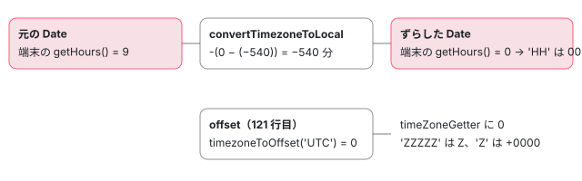

[目次](../README.md) › [common の内側](README.md) › 第 11 回 / 全 20 回

# 日付の部品とタイムゾーン：dateGetter から convertTimezoneToLocal まで

> getDateFormatter が y・M・d・E・a・h・Z・w などの記号を dateGetter・dateStrGetter・timeZoneGetter・weekGetter に結び付ける表、ロケールのデータから曜日や月の名前を引く getDateTranslation、ISO の週番号（getThursdayThisIsoWeek）、timezone の '+0900' を分に直す timezoneToOffset と convertTimezoneToLocal。IANA のタイムゾーン名が使えない理由（#48279）。

angular/angular · 読了 約 13 分 · 発展 · [サイトで読む（デモが動きます）](https://angular-deep-dive-cyan.vercel.app/chapter/cmn-date-getters)

---

[第 10 回](10-cmn-format-date.md)で、`formatDate` が書式を `'yyyy'`・`'MMM'`・`'Z'` のような部品に切るところまで読みました。この章はその先です。部品 1 つに 1 つの関数を返す `getDateFormatter` の表、その関数を作る 5 種類の工場（`dateGetter`・`dateStrGetter`・`timeZoneGetter`・`weekGetter`・`weekNumberingYearGetter`）、そして `timezone` の `'+0900'` が日付をどう動かすのかを、行ごとに追います。`Asia/Tokyo` を渡すとどうなるかも、実物で確かめます。

読む対象は `packages/common/src/i18n/format_date.ts` の 119〜123・285〜910 行目と、`locale_data_api.ts` の一部です。

1. [1. 全体像](01-cmn-overview.md)
2. [2. NgClass と NgStyle](02-cmn-ng-class-style.md)
3. [3. NgForOf](03-cmn-ng-for-of.md)
4. [4. NgIf と NgSwitch](04-cmn-ng-if-switch.md)
5. [5. outlet](05-cmn-outlets.md)
6. [6. pipe の仕組み](06-cmn-pipe-mechanism.md)
7. [7. 小さな pipe](07-cmn-simple-pipes.md)
8. [8. KeyValuePipe](08-cmn-keyvalue-pipe.md)
9. [9. DatePipe](09-cmn-date-pipe.md)
10. [10. 日付の書式](10-cmn-format-date.md)
11. **11. 日付の部品**（この章）
12. [12. 数の書式](12-cmn-format-number.md)
13. [13. NgOptimizedImage](13-cmn-image-overview.md)
14. [14. srcset と sizes](14-cmn-image-srcset.md)
15. [15. 画像のローダー](15-cmn-image-loaders.md)
16. [16. LCP と preload](16-cmn-image-lcp-preload.md)
17. [17. Location](17-cmn-location.md)
18. [18. テスト用の Location](18-cmn-location-testing.md)
19. [19. ViewportScroller](19-cmn-viewport-scroller.md)
20. [20. issue と PR を読む](20-cmn-issues.md)

## 1. getDateFormatter：記号 → 関数の表

📄 `angular/packages/common/src/i18n/format_date.ts` L572–603 （▶ の行: 572, 575, 580, 582–583, 586, 591, 602）

```ts
572 ▶ type DateFormatter = (date: Date, locale: string, offset: number) => string;
573 │ 
574 │ // tslint:disable-next-line:no-toplevel-property-access
575 ▶ const DATE_FORMATS: {[format: string]: DateFormatter} = Object.create(null);
576 │ 
577 │ // Based on CLDR formats:
578 │ // See complete list: http://www.unicode.org/reports/tr35/tr35-dates.html#Date_Field_Symbol_Table
579 │ // See also explanations: http://cldr.unicode.org/translation/date-time
580 ▶ // TODO(ocombe): support all missing cldr formats: U, Q, D, F, e, j, J, C, A, v, V, X, x
581 │ function getDateFormatter(format: string): DateFormatter | null {
582 ▶   if (DATE_FORMATS[format]) {
583 ▶     return DATE_FORMATS[format];
584 │   }
585 │   let formatter;
586 ▶   switch (format) {
587 │     // Era name (AD/BC)
588 │     case 'G':
589 │     case 'GG':
590 │     case 'GGG':
591 ▶       formatter = dateStrGetter(TranslationType.Eras, TranslationWidth.Abbreviated);
592 │       break;
593 │     case 'GGGG':
594 │       formatter = dateStrGetter(TranslationType.Eras, TranslationWidth.Wide);
595 │       break;
596 │     case 'GGGGG':
597 │       formatter = dateStrGetter(TranslationType.Eras, TranslationWidth.Narrow);
598 │       break;
599 │ 
600 │     // 1 digit representation of the year, e.g. (AD 1 => 1, AD 199 => 199)
601 │     case 'y':
602 ▶       formatter = dateGetter(DateType.FullYear, 1, 0, false, true);
603 │       break;
```

1. **572 行目：関数の形は 1 つ**

   `(date, locale, offset) => string`。`offset` は 3 節のタイムゾーンの分で、使うのは `timeZoneGetter` だけです。
2. **575・582〜584 行目：作った関数はキャッシュ**

   記号ごとに 1 回だけ作り、887 行目で入れます。キャッシュが `Object.create(null)` なのは [第 10 回](10-cmn-format-date.md)の 359fb503b8f です。
3. **580 行目：まだ無い記号**

   `U, Q, D, F, e, j, J, C, A, v, V, X, x` は TODO です。`Q`（四半期）や `D`（年の何日目）を書いても、第 10 回の正規表現の 1 つめの選択肢（記号でない文字）に当たり、文字のまま出ます。

📄 `angular/packages/common/src/i18n/format_date.ts` L636–656 （▶ の行: 637–639, 643, 648, 651, 654）

```ts
636 │     // Month of the year (1-12), numeric
637 ▶     case 'M':
638 ▶     case 'L':
639 ▶       formatter = dateGetter(DateType.Month, 1, 1);
640 │       break;
641 │     case 'MM':
642 │     case 'LL':
643 ▶       formatter = dateGetter(DateType.Month, 2, 1);
644 │       break;
645 │ 
646 │     // Month of the year (January, ...), string, format
647 │     case 'MMM':
648 ▶       formatter = dateStrGetter(TranslationType.Months, TranslationWidth.Abbreviated);
649 │       break;
650 │     case 'MMMM':
651 ▶       formatter = dateStrGetter(TranslationType.Months, TranslationWidth.Wide);
652 │       break;
653 │     case 'MMMMM':
654 ▶       formatter = dateStrGetter(TranslationType.Months, TranslationWidth.Narrow);
655 │       break;
656 │ 
```

📄 `angular/packages/common/src/i18n/format_date.ts` L727–755 （▶ の行: 728–731, 734, 747, 750）

```ts
727 │     // Day of the Week
728 ▶     case 'E':
729 ▶     case 'EE':
730 ▶     case 'EEE':
731 ▶       formatter = dateStrGetter(TranslationType.Days, TranslationWidth.Abbreviated);
732 │       break;
733 │     case 'EEEE':
734 ▶       formatter = dateStrGetter(TranslationType.Days, TranslationWidth.Wide);
735 │       break;
736 │     case 'EEEEE':
737 │       formatter = dateStrGetter(TranslationType.Days, TranslationWidth.Narrow);
738 │       break;
739 │     case 'EEEEEE':
740 │       formatter = dateStrGetter(TranslationType.Days, TranslationWidth.Short);
741 │       break;
742 │ 
743 │     // Generic period of the day (am-pm)
744 │     case 'a':
745 │     case 'aa':
746 │     case 'aaa':
747 ▶       formatter = dateStrGetter(TranslationType.DayPeriods, TranslationWidth.Abbreviated);
748 │       break;
749 │     case 'aaaa':
750 ▶       formatter = dateStrGetter(TranslationType.DayPeriods, TranslationWidth.Wide);
751 │       break;
752 │     case 'aaaaa':
753 │       formatter = dateStrGetter(TranslationType.DayPeriods, TranslationWidth.Narrow);
754 │       break;
755 │ 
```

📄 `angular/packages/common/src/i18n/format_date.ts` L812–843 （▶ の行: 814, 817, 822, 826, 831, 842）

```ts
812 │     // Hour in AM/PM, (1-12)
813 │     case 'h':
814 ▶       formatter = dateGetter(DateType.Hours, 1, -12);
815 │       break;
816 │     case 'hh':
817 ▶       formatter = dateGetter(DateType.Hours, 2, -12);
818 │       break;
819 │ 
820 │     // Hour of the day (0-23)
821 │     case 'H':
822 ▶       formatter = dateGetter(DateType.Hours, 1);
823 │       break;
824 │     // Hour in day, padded (00-23)
825 │     case 'HH':
826 ▶       formatter = dateGetter(DateType.Hours, 2);
827 │       break;
828 │ 
829 │     // Minute of the hour (0-59)
830 │     case 'm':
831 ▶       formatter = dateGetter(DateType.Minutes, 1);
832 │       break;
833 │     case 'mm':
834 │       formatter = dateGetter(DateType.Minutes, 2);
835 │       break;
836 │ 
837 │     // Second of the minute (0-59)
838 │     case 's':
839 │       formatter = dateGetter(DateType.Seconds, 1);
840 │       break;
841 │     case 'ss':
842 ▶       formatter = dateGetter(DateType.Seconds, 2);
843 │       break;
```

📄 `angular/packages/common/src/i18n/format_date.ts` L856–889 （▶ の行: 860, 864, 871, 875, 880, 882, 885, 887）

```ts
856 │     // Timezone ISO8601 short format (-0430)
857 │     case 'Z':
858 │     case 'ZZ':
859 │     case 'ZZZ':
860 ▶       formatter = timeZoneGetter(ZoneWidth.Short);
861 │       break;
862 │     // Timezone ISO8601 extended format (-04:30)
863 │     case 'ZZZZZ':
864 ▶       formatter = timeZoneGetter(ZoneWidth.Extended);
865 │       break;
866 │ 
867 │     // Timezone GMT short format (GMT+4)
868 │     case 'O':
869 │     case 'OO':
870 │     case 'OOO':
871 ▶     // Should be location, but fallback to format O instead because we don't have the data yet
872 │     case 'z':
873 │     case 'zz':
874 │     case 'zzz':
875 ▶       formatter = timeZoneGetter(ZoneWidth.ShortGMT);
876 │       break;
877 │     // Timezone GMT long format (GMT+0430)
878 │     case 'OOOO':
879 │     case 'ZZZZ':
880 ▶     // Should be location, but fallback to format O instead because we don't have the data yet
881 │     case 'zzzz':
882 ▶       formatter = timeZoneGetter(ZoneWidth.Long);
883 │       break;
884 │     default:
885 ▶       return null;
886 │   }
887 ▶   DATE_FORMATS[format] = formatter;
888 │   return formatter;
889 │ }
```

表にすると、こうなります（全部の case を読んで作りました）。同じ関数を返す記号が多いのが分かります。例えば 637〜638 行目の `M` と `L`、728〜730 行目の `E`・`EE`・`EEE`、872〜874 行目の `z`（871 行目のコメントのとおり、地名のデータが無いので `O` と同じ）です。885 行目、表に無い記号は `null` を返し、`formatDate` の側で文字のまま書かれます（[第 10 回](10-cmn-format-date.md)の 2 節）。

| 記号 | 工場 | 引数の意味 |
| --- | --- | --- |
| y yy yyy yyyy | `dateGetter(FullYear, 桁, 0, trim, negWrap=true)` | yy だけ trim（下 2 桁）。0 年以下は 1 BC として数える |
| Y YY YYY YYYY | `weekNumberingYearGetter(桁, trim)` | ISO の週の木曜日の年（5 節） |
| M MM / L LL | `dateGetter(Month, 桁, 1)` | `getMonth()` に 1 を足す |
| MMM MMMM MMMMM / LLL… | `dateStrGetter(Months, 幅[, Standalone])` | ロケールの月の名前（2 節） |
| w ww / W | `weekGetter(桁[, monthBased])` | ISO の週番号／月の何週目（5 節） |
| d dd | `dateGetter(Date, 桁)` | 日 |
| c cc / ccc… | `dateGetter(Day, 1)` / `dateStrGetter(Days, 幅, Standalone)` | 曜日の番号（日曜 0）／単独形の曜日名 |
| E〜EEE EEEE EEEEE EEEEEE | `dateStrGetter(Days, 幅)` | Abbreviated・Wide・Narrow・Short |
| a〜aaaaa | `dateStrGetter(DayPeriods, 幅)` | AM・PM |
| b〜bbbbb / B〜BBBBB | `dateStrGetter(DayPeriods, 幅, Standalone/Format, extended=true)` | 朝・昼・夜など（extra のデータが要る。2 節） |
| G〜GGGGG | `dateStrGetter(Eras, 幅)` | AD・BC |
| h hh / H HH | `dateGetter(Hours, 桁, -12)` / `dateGetter(Hours, 桁)` | 1〜12 ／ 0〜23 |
| m mm / s ss / S SS SSS | `dateGetter(Minutes\|Seconds\|FractionalSeconds, 桁)` | S は切り捨て（`formatFractionalSeconds`） |
| Z ZZ ZZZ / ZZZZZ | `timeZoneGetter(Short)` / `(Extended)` | +0900 ／ +09:00（0 なら Z） |
| O OO OOO z zz zzz | `timeZoneGetter(ShortGMT)` | GMT+9 |
| OOOO ZZZZ zzzz | `timeZoneGetter(Long)` | GMT+09:00 |

## 2. 数を書く dateGetter と、言葉を引く dateStrGetter

📄 `angular/packages/common/src/i18n/format_date.ts` L316–343 （▶ の行: 327–329, 333–334, 337, 340–341）

```ts
316 │ /**
317 │  * Returns a date formatter that transforms a date into its locale digit representation
318 │  */
319 │ function dateGetter(
320 │   name: DateType,
321 │   size: number,
322 │   offset: number = 0,
323 │   trim = false,
324 │   negWrap = false,
325 │ ): DateFormatter {
326 │   return function (date: Date, locale: string): string {
327 ▶     let part = getDatePart(name, date);
328 ▶     if (offset > 0 || part > -offset) {
329 ▶       part += offset;
330 │     }
331 │ 
332 │     if (name === DateType.Hours) {
333 ▶       if (part === 0 && offset === -12) {
334 ▶         part = 12;
335 │       }
336 │     } else if (name === DateType.FractionalSeconds) {
337 ▶       return formatFractionalSeconds(part, size);
338 │     }
339 │ 
340 ▶     const localeMinus = getLocaleNumberSymbol(locale, NumberSymbol.MinusSign);
341 ▶     return padNumber(part, size, localeMinus, trim, negWrap);
342 │   };
343 │ }
```

1. **327 行目：`getDatePart`**

   `getFullYear()`・`getMonth()`・`getHours()` などの*端末のタイムゾーンの* getter を呼びます（すぐ下の `getDatePart` の switch）。UTC の getter は 1 つも使いません。だから 3 節で日付そのものをずらします。
2. **328〜330 行目：offset を足す条件**

   月（offset 1）は `offset > 0` なので必ず足します。`h`（offset -12）は `part > 12` のときだけ 12 を引きます。13 時は 1、12 時は 12 のまま。333〜335 行目で 0 時を 12 にします。だから `h` は 1〜12 です。
3. **336〜337 行目：小数の秒**

   `formatFractionalSeconds` は ms を 3 桁にしてから頭の `size` 桁を取るので、四捨五入しません（311〜314 行目）。
4. **340〜341 行目：マイナスの記号もロケールから**

   `getLocaleNumberSymbol(locale, NumberSymbol.MinusSign)` の行は [loc-locale-data](../loc/12-loc-locale-data.md) で引用済みです。

📄 `angular/packages/common/src/i18n/format_date.ts` L285–314 （▶ の行: 293–295, 297–298, 302–303, 305–306）

```ts
285 │ function padNumber(
286 │   num: number,
287 │   digits: number,
288 │   minusSign = '-',
289 │   trim?: boolean,
290 │   negWrap?: boolean,
291 │ ): string {
292 │   let neg = '';
293 ▶   if (num < 0 || (negWrap && num <= 0)) {
294 ▶     if (negWrap) {
295 ▶       num = -num + 1;
296 │     } else {
297 ▶       num = -num;
298 ▶       neg = minusSign;
299 │     }
300 │   }
301 │   let strNum = String(num);
302 ▶   while (strNum.length < digits) {
303 ▶     strNum = '0' + strNum;
304 │   }
305 ▶   if (trim) {
306 ▶     strNum = strNum.slice(strNum.length - digits);
307 │   }
308 │   return neg + strNum;
309 │ }
310 │ 
311 │ function formatFractionalSeconds(milliseconds: number, digits: number): string {
312 │   const strMs = padNumber(milliseconds, 3);
313 │   return strMs.substring(0, digits);
314 │ }
```

302〜304 行目で左に `0` を詰め、305〜307 行目の `trim` で右から `digits` 桁だけ残します（`yy` の `2026` → `26`）。293〜295 行目の `negWrap` は年のためで、0 年を 1、-1 年を 2 にします。紀元前の数え方（0 年が無い）に合わせるためで、spec の `should wrap negative years` が `-1` 年を `'0002'` と確かめています。

📄 `angular/packages/common/src/i18n/format_date.ts` L371–400 （▶ の行: 380–381, 397–400）

```ts
371 │ /**
372 │  * Returns a date formatter that transforms a date into its locale string representation
373 │  */
374 │ function dateStrGetter(
375 │   name: TranslationType,
376 │   width: TranslationWidth,
377 │   form: FormStyle = FormStyle.Format,
378 │   extended = false,
379 │ ): DateFormatter {
380 ▶   return function (date: Date, locale: string): string {
381 ▶     return getDateTranslation(date, locale, name, width, form, extended);
382 │   };
383 │ }
384 │ 
385 │ /**
386 │  * Returns the locale translation of a date for a given form, type and width
387 │  */
388 │ function getDateTranslation(
389 │   date: Date,
390 │   locale: string,
391 │   name: TranslationType,
392 │   width: TranslationWidth,
393 │   form: FormStyle,
394 │   extended: boolean,
395 │ ) {
396 │   switch (name) {
397 ▶     case TranslationType.Months:
398 ▶       return getLocaleMonthNames(locale, form, width)[date.getMonth()];
399 ▶     case TranslationType.Days:
400 ▶       return getLocaleDayNames(locale, form, width)[date.getDay()];
```

月は 398 行目で `getLocaleMonthNames(locale, form, width)[date.getMonth()]`、曜日は 400 行目で `getLocaleDayNames(…)[date.getDay()]`。ロケールのデータの配列を、`Date` の getter の番号でそのまま引いています。`form`（Format と Standalone）と `width`（幅）で配列を選ぶのが `locale_data_api.ts` の側です。

📄 `angular/packages/common/src/i18n/locale_data_api.ts` L278–290 （▶ の行: 284–286, 288–289）

```ts
278 │ export function getLocaleDayPeriods(
279 │   locale: string,
280 │   formStyle: FormStyle,
281 │   width: TranslationWidth,
282 │ ): Readonly<[string, string]> {
283 │   const data = ɵfindLocaleData(locale);
284 ▶   const amPmData = <[string, string][][]>[
285 ▶     data[ɵLocaleDataIndex.DayPeriodsFormat],
286 ▶     data[ɵLocaleDataIndex.DayPeriodsStandalone],
287 │   ];
288 ▶   const amPm = getLastDefinedValue(amPmData, formStyle);
289 ▶   return getLastDefinedValue(amPm, width);
290 │ }
```

📄 `angular/packages/common/src/i18n/locale_data_api.ts` L742–752 （▶ の行: 743–745, 748）

```ts
742 │ function getLastDefinedValue<T>(data: T[], index: number): T {
743 ▶   for (let i = index; i > -1; i--) {
744 ▶     if (typeof data[i] !== 'undefined') {
745 ▶       return data[i];
746 │     }
747 │   }
748 ▶   throw new RuntimeError(
749 │     RuntimeErrorCode.LOCALE_DATA_UNDEFINED,
750 │     ngDevMode && 'Locale data API: locale data undefined',
751 │   );
752 │ }
```

284〜287 行目で Format と Standalone の 2 つの配列を並べ、288 行目と 289 行目で `getLastDefinedValue` を 2 回。743〜747 行目は「その番号から前へ戻りながら、最初に `undefined` でないもの」を返します。ロケールのデータは同じ値の繰り返しを `u`（`undefined`）にして小さくしてあるので、Standalone が無ければ Format、Short が無ければ Abbreviated、のように前の値を使います。

### 時間帯（b と B）：extra のデータ

📄 `angular/packages/common/src/i18n/format_date.ts` L401–430 （▶ の行: 404–407, 410–413, 424–425, 428）

```ts
401 │     case TranslationType.DayPeriods:
402 │       const currentHours = date.getHours();
403 │       const currentMinutes = date.getMinutes();
404 ▶       if (extended) {
405 ▶         const rules = getLocaleExtraDayPeriodRules(locale);
406 ▶         const dayPeriods = getLocaleExtraDayPeriods(locale, form, width);
407 ▶         const index = rules.findIndex((rule) => {
408 │           if (Array.isArray(rule)) {
409 │             // morning, afternoon, evening, night
410 ▶             const [from, to] = rule;
411 ▶             const afterFrom = currentHours >= from.hours && currentMinutes >= from.minutes;
412 ▶             const beforeTo =
413 ▶               currentHours < to.hours || (currentHours === to.hours && currentMinutes < to.minutes);
414 │             // We must account for normal rules that span a period during the day (e.g. 6am-9am)
415 │             // where `from` is less (earlier) than `to`. But also rules that span midnight (e.g.
416 │             // 10pm - 5am) where `from` is greater (later!) than `to`.
417 │             //
418 │             // In the first case the current time must be BOTH after `from` AND before `to`
419 │             // (e.g. 8am is after 6am AND before 10am).
420 │             //
421 │             // In the second case the current time must be EITHER after `from` OR before `to`
422 │             // (e.g. 4am is before 5am but not after 10pm; and 11pm is not before 5am but it is
423 │             // after 10pm).
424 ▶             if (from.hours < to.hours) {
425 ▶               if (afterFrom && beforeTo) {
426 │                 return true;
427 │               }
428 ▶             } else if (afterFrom || beforeTo) {
429 │               return true;
430 │             }
```

📄 `angular/packages/common/src/i18n/format_date.ts` L431–446 （▶ の行: 433, 439–440, 444, 446）

```ts
431 │           } else {
432 │             // noon or midnight
433 ▶             if (rule.hours === currentHours && rule.minutes === currentMinutes) {
434 │               return true;
435 │             }
436 │           }
437 │           return false;
438 │         });
439 ▶         if (index !== -1) {
440 ▶           return dayPeriods[index];
441 │         }
442 │       }
443 │       // if no rules for the day periods, we use am/pm by default
444 ▶       return getLocaleDayPeriods(locale, form, <TranslationWidth>width)[currentHours < 12 ? 0 : 1];
445 │     case TranslationType.Eras:
446 ▶       return getLocaleEraNames(locale, <TranslationWidth>width)[date.getFullYear() <= 0 ? 0 : 1];
```

📄 `angular/packages/common/src/i18n/locale_data_api.ts` L663–673 （▶ の行: 665–666, 669, 671）

```ts
663 │ export function getLocaleExtraDayPeriodRules(locale: string): (Time | [Time, Time])[] {
664 │   const data = ɵfindLocaleData(locale);
665 ▶   checkFullData(data);
666 ▶   const rules = data[ɵLocaleDataIndex.ExtraData][ɵExtraLocaleDataIndex.ExtraDayPeriodsRules] || [];
667 │   return rules.map((rule: string | [string, string]) => {
668 │     if (typeof rule === 'string') {
669 ▶       return extractTime(rule);
670 │     }
671 ▶     return [extractTime(rule[0]), extractTime(rule[1])];
672 │   });
673 │ }
```

1. **405 行目 → 665 行目：extra が無ければ例外**

   `checkFullData`（同じ locale\_data\_api.ts の、すぐ上の関数）は、データの `ExtraData` の欄が空なら `MISSING_EXTRA_LOCALE_DATA_FOR_LOCALE`（`NG02303`）を投げます。extra は `registerLocaleData(localeJa, 'ja', localeJaExtra)` の 3 つめの引数で入ります（[loc-locale-data](../loc/12-loc-locale-data.md)）。en-US でも、`@angular/common/locales/extra/en` を登録しないと `B` は例外です。
2. **666〜672 行目：規則は `'04:00'` か `['04:00', '12:00']`**

   このサイトの node\_modules の ja の extra は `["00:00", "12:00", ["04:00", "12:00"], ["12:00", "16:00"], ["16:00", "19:00"], ["19:00", "23:00"], ["23:00", "04:00"]]` でした。最初の 2 つが「ちょうどの時刻」（真夜中・正午）、残りが範囲です。
3. **407〜438 行目：最初に当たった規則の番号**

   `findIndex` なので、0 時 0 分は 433 行目の「ちょうど 00:00」が先に当たり、範囲 `["23:00", "04:00"]`（夜中）より前の「真夜中」になります。424〜430 行目は、`from < to` の普通の範囲なら「両方」、0 時をまたぐ範囲（`23:00`〜`04:00`）なら「どちらか」で判定します（414〜423 行目のコメント）。
4. **444 行目：規則が無い・当たらないときは AM/PM**

   12 時より前なら 0 番（AM）、後なら 1 番（PM）。`a` はいつもここです。

> [!NOTE]
> **さらに深く**
>
> 411 行目の `currentHours >= from.hours && currentMinutes >= from.minutes` は、時と分を別々に比べています。`from` が `04:30` なら 05:10 は「10 &gt;= 30 が偽」で外れます。このサイトの node\_modules にある extra の .js（742 個）を grep したら、分が `00` でない規則は 1 つもありませんでした。だから今のデータでは結果に出ません。

## 3. timezone：日付をずらしてから、ずらした分を Z に書く

[第 10 回](10-cmn-format-date.md)の `formatDate` で飛ばした 5 行です。

📄 `angular/packages/common/src/i18n/format_date.ts` L119–123 （▶ の行: 119–122）

```ts
119 ▶   let dateTimezoneOffset = date.getTimezoneOffset();
120 ▶   if (timezone) {
121 ▶     dateTimezoneOffset = timezoneToOffset(timezone, dateTimezoneOffset);
122 ▶     date = convertTimezoneToLocal(date, timezone, true);
123 │   }
```

📄 `angular/packages/common/src/i18n/format_date.ts` L891–910 （▶ の行: 894–896, 906–909）

```ts
891 │ function timezoneToOffset(timezone: string, fallback: number): number {
892 │   // Support: IE 11 only, Edge 13-15+
893 │   // IE/Edge do not "understand" colon (`:`) in timezone
894 ▶   timezone = timezone.replace(/:/g, '');
895 ▶   const requestedTimezoneOffset = Date.parse('Jan 01, 1970 00:00:00 ' + timezone) / 60000;
896 ▶   return isNaN(requestedTimezoneOffset) ? fallback : requestedTimezoneOffset;
897 │ }
898 │ 
899 │ function addDateMinutes(date: Date, minutes: number) {
900 │   date = new Date(date.getTime());
901 │   date.setMinutes(date.getMinutes() + minutes);
902 │   return date;
903 │ }
904 │ 
905 │ function convertTimezoneToLocal(date: Date, timezone: string, reverse: boolean): Date {
906 ▶   const reverseValue = reverse ? -1 : 1;
907 ▶   const dateTimezoneOffset = date.getTimezoneOffset();
908 ▶   const timezoneOffset = timezoneToOffset(timezone, dateTimezoneOffset);
909 ▶   return addDateMinutes(date, reverseValue * (timezoneOffset - dateTimezoneOffset));
910 │ }
```

1. **119 行目：まず端末のオフセット**

   `getTimezoneOffset()` は「UTC − 端末の時刻」を分で返します。日本は `-540` です（東が負）。*その日付の*オフセットなので、夏時間のある地域では日付によって変わります。
2. **895 行目：`Date.parse` に読ませる**

   `'Jan 01, 1970 00:00:00 +0900'` を `Date.parse` すると、その瞬間の UTC の ms（-32400000）が返り、60000 で割って `-540`。`getTimezoneOffset()` と同じ向きの数になります。894 行目で `:` を消すので `'+09:00'` も同じです。
3. **896 行目：読めなければ黙って端末のオフセット**

   `NaN` なら `fallback`、つまり 119 行目の値です。**例外も警告もありません**。`Date.parse` が何を読めるかはブラウザ（JavaScript のエンジン）次第で、Node 24 の V8 では `UTC`・`Z`・`EST`・`PST`・`UTC+1` は読めて、`Asia/Tokyo`・`JST`・`CET` は `NaN` でした（TZ=UTC で実行して確認）。
4. **906〜909 行目：差の分だけ日付を動かす**

   `reverse` は 122 行目で必ず `true` なので、動かす量は `-(指定のオフセット − その日付の端末のオフセット)` です（`false` で呼ぶ行は packages の中に 1 つもありません）。端末が日本（-540）で `'UTC'`（0）なら `-(0 + 540)` = 540 分戻します。戻した `Date` の*端末の* getter（2 節の 327 行目）が、UTC の壁の時計の数字を返すようになります。
5. **121 行目：書くときのオフセットは指定のほう**

   `dateTimezoneOffset` も指定のオフセットに置き換え、それが部品を書く行（第 10 回の 2 節）で、全部の部品の関数の 3 つめの引数になります。`Z` を書くのは次の `timeZoneGetter` です。



*端末が日本で timezone='UTC' のとき（2026-11-05T00:07:09Z）*

📄 `angular/packages/common/src/i18n/format_date.ts` L465–497 （▶ の行: 467, 469, 473–475, 478, 488–489）

```ts
465 │ function timeZoneGetter(width: ZoneWidth): DateFormatter {
466 │   return function (date: Date, locale: string, offset: number) {
467 ▶     const zone = -1 * offset;
468 │     const minusSign = getLocaleNumberSymbol(locale, NumberSymbol.MinusSign);
469 ▶     const hours = zone > 0 ? Math.floor(zone / 60) : Math.ceil(zone / 60);
470 │     switch (width) {
471 │       case ZoneWidth.Short:
472 │         return (
473 ▶           (zone >= 0 ? '+' : '') +
474 ▶           padNumber(hours, 2, minusSign) +
475 ▶           padNumber(Math.abs(zone % 60), 2, minusSign)
476 │         );
477 │       case ZoneWidth.ShortGMT:
478 ▶         return 'GMT' + (zone >= 0 ? '+' : '') + padNumber(hours, 1, minusSign);
479 │       case ZoneWidth.Long:
480 │         return (
481 │           'GMT' +
482 │           (zone >= 0 ? '+' : '') +
483 │           padNumber(hours, 2, minusSign) +
484 │           ':' +
485 │           padNumber(Math.abs(zone % 60), 2, minusSign)
486 │         );
487 │       case ZoneWidth.Extended:
488 ▶         if (offset === 0) {
489 ▶           return 'Z';
490 │         } else {
491 │           return (
492 │             (zone >= 0 ? '+' : '') +
493 │             padNumber(hours, 2, minusSign) +
494 │             ':' +
495 │             padNumber(Math.abs(zone % 60), 2, minusSign)
496 │           );
497 │         }
```

467 行目で向きを戻し（-540 → +540 分）、469 行目で時にします。正なら `floor`、負なら `ceil`、つまり 0 に向かって切ります。-330 分（-05:30）は `ceil(-5.5) = -5`、分は 475 行目の `Math.abs(zone % 60)` で 30。473 行目の `+` は 0 以上のときだけで、負の符号は 474 行目の `padNumber` が付けます（293〜298 行目）。488〜489 行目、`ZZZZZ` だけは 0 のとき `Z` と書きます。

> [!WARNING]
> **ハマりどころ**
>
> -1〜-59 分のオフセットでは、469 行目の `Math.ceil` が `-0` を返し、`padNumber(-0)` の 293 行目 `num < 0` が偽、473 行目の `zone >= 0` も偽なので、**符号がどこにも付きません**。このサイトの本物で `formatDate('2026-11-05T12:00:00Z', 'Z', 'en-US', '-0030')` は `'0030'`、`'O'` は `'GMT0'` でした（`'+0030'` は `'+0030'`）。今の実在のタイムゾーンに -00:xx は無いので、ふつうの使い方では出ません。

### IANA の名前と夏時間：#48279

open の issue #48279（2022-11、「IANA のタイムゾーンを日付の書式で使いたい」）は、ここまでの行で説明できます。`timezone: 'Asia/Tokyo'` は 895 行目の `Date.parse` で `NaN` になり、896 行目で端末のオフセットに戻り、906〜909 行目の動かす量は 0 になります。結果は「timezone を渡さなかったとき」と同じで、日本の端末なら日本の時刻が出るので、**手元では動いているように見えます**。ほかの国の端末で初めて違いに気づきます。

もう 1 つは夏時間です。895 行目は 1970 年 1 月 1 日に固定した文字列なので、指定のオフセットは 1 つの数です。一方 907 行目の端末のオフセットは日付ごとに変わります。TZ=Europe/Prague で `formatDate('2022-03-27T01:00:00Z', 'HH:mm', 'en-US', '+0100')` を本物で走らせると `'03:00'`（正しくは `'02:00'`）でした。動かした先の「端末の 2 時台」がプラハの夏時間の切り替えで存在しないため、`setMinutes`（901 行目）が 3 時にずらすからです。これは閉じた #49540（Duplicate）の報告と同じで、#49540 のコメントでも同じ説明がされています。IANA の名前を受け付ける PR #48482 は 2024-02 に閉じられ、2024-02 のコメントで「`Intl` に乗り換える」#54470 で検討中とされました。Temporal の対応の #69899（2026-07、open）も、`formatDate` ごと対応が要る、と範囲が広げられました。

## 4. ISO の週番号

📄 `angular/packages/common/src/i18n/format_date.ts` L507–533 （▶ の行: 510, 514, 523, 526, 528）

```ts
507 │ const JANUARY = 0;
508 │ const THURSDAY = 4;
509 │ function getFirstThursdayOfYear(year: number) {
510 ▶   const firstDayOfYear = createDate(year, JANUARY, 1).getDay();
511 │   return createDate(
512 │     year,
513 │     0,
514 ▶     1 + (firstDayOfYear <= THURSDAY ? THURSDAY : THURSDAY + 7) - firstDayOfYear,
515 │   );
516 │ }
517 │ 
518 │ /**
519 │  *  ISO Week starts on day 1 (Monday) and ends with day 0 (Sunday)
520 │  */
521 │ export function getThursdayThisIsoWeek(datetime: Date) {
522 │   // getDay returns 0-6 range with sunday as 0.
523 ▶   const currentDay = datetime.getDay();
524 │ 
525 │   // On a Sunday, read the previous Thursday since ISO weeks start on Monday.
526 ▶   const deltaToThursday = currentDay === 0 ? -3 : THURSDAY - currentDay;
527 │ 
528 ▶   return createDate(
529 │     datetime.getFullYear(),
530 │     datetime.getMonth(),
531 │     datetime.getDate() + deltaToThursday,
532 │   );
533 │ }
```

1. **509〜516 行目：その年の最初の木曜日**

   1 月 1 日の曜日が木曜以前なら `1 + 4 − 曜日`、金・土なら `1 + 11 − 曜日`。ISO 8601 では「最初の木曜日を含む週」が第 1 週です。
2. **521〜533 行目：その日の週の木曜日**

   月曜始まりなので、日曜（0）は 526 行目で -3（前の木曜）、それ以外は `4 − 曜日`。`createDate`（第 10 回の 6 節）で 0 時の `Date` にします。

📄 `angular/packages/common/src/i18n/format_date.ts` L535–570 （▶ の行: 540, 542, 544, 547, 549, 561–562）

```ts
535 │ function weekGetter(size: number, monthBased = false): DateFormatter {
536 │   return function (date: Date, locale: string) {
537 │     let result;
538 │     if (monthBased) {
539 │       const nbDaysBefore1stDayOfMonth =
540 ▶         new Date(date.getFullYear(), date.getMonth(), 1).getDay() - 1;
541 │       const today = date.getDate();
542 ▶       result = 1 + Math.floor((today + nbDaysBefore1stDayOfMonth) / 7);
543 │     } else {
544 ▶       const thisThurs = getThursdayThisIsoWeek(date);
545 │       // Some days of a year are part of next year according to ISO 8601.
546 │       // Compute the firstThurs from the year of this week's Thursday
547 ▶       const firstThurs = getFirstThursdayOfYear(thisThurs.getFullYear());
548 │       const diff = thisThurs.getTime() - firstThurs.getTime();
549 ▶       result = 1 + Math.round(diff / 6.048e8); // 6.048e8 ms per week
550 │     }
551 │ 
552 │     return padNumber(result, size, getLocaleNumberSymbol(locale, NumberSymbol.MinusSign));
553 │   };
554 │ }
555 │ 
556 │ /**
557 │  * Returns a date formatter that provides the week-numbering year for the input date.
558 │  */
559 │ function weekNumberingYearGetter(size: number, trim = false): DateFormatter {
560 │   return function (date: Date, locale: string) {
561 ▶     const thisThurs = getThursdayThisIsoWeek(date);
562 ▶     const weekNumberingYear = thisThurs.getFullYear();
563 │     return padNumber(
564 │       weekNumberingYear,
565 │       size,
566 │       getLocaleNumberSymbol(locale, NumberSymbol.MinusSign),
567 │       trim,
568 │     );
569 │   };
570 │ }
```

1. **544〜549 行目：`w`**

   「この週の木曜日」と「*その木曜日の年の*最初の木曜日」の差を、1 週の ms（6.048e8）で割って丸めます。547 行目で年を木曜日のほうから取るので、2013-12-31 は 2014 年の第 1 週になります（spec 498 行目）。`Math.round` で丸めるので、2 つの `Date`（どちらも端末の 0 時）の差が夏時間で 1 時間ずれても、週の数は変わりません。
2. **559〜570 行目：`Y`**

   同じ木曜日の `getFullYear()`。`YYYY 'W'ww` と組で使う年です。`yyyy` と違うのは年末年始の数日だけです。`w` なしの `Y` を開発モードで止める検査は第 10 回の 5 節です。
3. **538〜542 行目：`W`（月の何週目）**

   540 行目は月の 1 日の曜日から 1 を引き、542 行目で `(日 + それ) / 7` を切り捨てて 1 を足します。日曜で週が変わる数え方で、ロケールの週の始まり（`getLocaleFirstDayOfWeek`）は見ません。

> [!WARNING]
> **ハマりどころ**
>
> 540 行目だけ `createDate` ではなく `new Date(date.getFullYear(), date.getMonth(), 1)` です。第 10 回の 6 節（`createDate` のコメント）のとおり、この形は 0〜99 年を 1900 年代にします。このサイトの本物で `formatDate('0099-03-07', 'EEE W', 'en-US')` は `'Sat 2'`、翌日の `'0099-03-08'` は `'Sun 2'`（土曜と日曜が同じ週）でした。0099-03-01 は日曜ですが、1999-03-01 は月曜なので、540 行目が 1 日ずれた値を使っています。`2099-03-07` は `'Sat 1'` で正しい形です。0〜99 年の日付でしか出ません。

> **🧪 DEMO — 1 つの日付を、記号ごと・timezone ごとに本物の formatDate で書く**
>
> 「表を作る」を押すと、このサイトの本物の `formatDate`（@angular/common 22.1.6）を、表の行の記号 1 つ × 列の timezone 1 つごとに呼びます。`Y` だけは開発モードの検査（第 10 回の 5 節）に止められないよう `YYYY 'W'ww` で呼びます。下の「timezone の数字」は 895 行目と 909 行目を表示用に移植した計算で、この端末の `Date.parse` を使います。最後の列の名前は自由に変えられます。ja だけ extra（`B`）を登録します。en-US・fr・de の `B` は `NG02303` です。
>
> ▶ [このデモはサイトで動かせます](https://angular-deep-dive-cyan.vercel.app/chapter/cmn-date-getters)

- `formatDate(value, format, locale, timezone)` — format\_date.ts 87 — *[第 10 回](10-cmn-format-date.md)*
  - `date.getTimezoneOffset()` — 119 — *その日付の端末のオフセット*
  - `timezoneToOffset(timezone, fallback)` — 891 — *Date.parse。読めなければ fallback*
  - `convertTimezoneToLocal(date, timezone, true)` — 905 — *差の分だけ Date を動かす*
  - `getDateFormatter(part)` — 581 — *DATE\_FORMATS にキャッシュ*
    - `dateGetter` → `getDatePart` → `padNumber` — 319・345・285
    - `dateStrGetter` → `getDateTranslation` → `getLocaleMonthNames` など — 374・388・locale\_data\_api.ts
    - `timeZoneGetter(width)(date, locale, offset)` — 465
    - `weekGetter` → `getThursdayThisIsoWeek`・`getFirstThursdayOfYear` — 535・521・509

## テストと直し方

### spec と describe

| spec | describe / it | bazel のターゲット |
| --- | --- | --- |
| common/test/i18n/format\_date\_spec.ts | describe `Format date` › `formatDate` の it のうち、部品の関数を確かめるもの：`should format each component correctly`（93 行目。記号ごとの期待値の表 `dateFixtures` と、0 時をまたぐ `midnightCrossingPeriods`）・ `should format with timezones`（288）・`should return correct ISO 8601 week-numbering year …`（474）・`should return correct ISO 8601 week number …`（495）・`should support timezones`（534）・`should return thursday date of the same week`（544）など 10 個 | `//packages/common/test:test`（Node） |

📄 `angular/packages/common/test/i18n/format_date_spec.ts` L288–308 （▶ の行: 293–294, 298, 304）

```ts
288 │     it('should format with timezones', () => {
289 │       const dateFixtures: any = {
290 │         z: /GMT(\+|-)\d/,
291 │         zz: /GMT(\+|-)\d/,
292 │         zzz: /GMT(\+|-)\d/,
293 ▶         zzzz: /GMT(\+|-)\d{2}\:30/,
294 ▶         Z: /(\+|-)\d{2}30/,
295 │         ZZ: /(\+|-)\d{2}30/,
296 │         ZZZ: /(\+|-)\d{2}30/,
297 │         ZZZZ: /GMT(\+|-)\d{2}\:30/,
298 ▶         ZZZZZ: /(\+|-)\d{2}\:30/,
299 │         O: /GMT(\+|-)\d/,
300 │         OOOO: /GMT(\+|-)\d{2}\:30/,
301 │       };
302 │ 
303 │       Object.keys(dateFixtures).forEach((pattern: string) => {
304 ▶         expect(formatDate(date, pattern, ɵDEFAULT_LOCALE_ID, '+0430')).toMatch(
305 │           dateFixtures[pattern],
306 │         );
307 │       });
308 │     });
```

304 行目で timezone `'+0430'` を渡し、293・294・298 行目で 3 節の Long・Short・Extended の形を正規表現で見ています。`(\+|-)` と符号を必ず求めるので、-00:30 の件（3 節）はこの it の形で足せます。

📄 `angular/packages/common/test/i18n/format_date_spec.ts` L495–507 （▶ の行: 498, 501, 503, 505）

```ts
495 │     it('should return correct ISO 8601 week number close to year end/beginning', () => {
496 │       expect(formatDate('2013-12-27', 'w', 'en')).toEqual('52');
497 │       expect(formatDate('2013-12-29', 'w', 'en')).toEqual('52');
498 ▶       expect(formatDate('2013-12-31', 'w', 'en')).toEqual('1');
499 │ 
500 │       // Dec. 31st is a Sunday, last day of the last week of 2023
501 ▶       expect(formatDate('2023-12-31', 'w', 'en')).toEqual('52');
502 │ 
503 ▶       expect(formatDate('2010-01-02', 'w', 'en')).toEqual('53');
504 │       expect(formatDate('2010-01-04', 'w', 'en')).toEqual('1');
505 ▶       expect(formatDate('0049-01-01', 'w', 'en')).toEqual('53');
506 │       expect(formatDate('0049-01-04', 'w', 'en')).toEqual('1');
507 │     });
```

年末年始の日付だけを並べています。`W`（月の何週目）を確かめているのは、it `should format each component correctly` の表の `W: '3'`（2015-06-15）1 つだけでした。

📄 `angular/packages/common/test/i18n/format_date_spec.ts` L534–553 （▶ の行: 537–538, 540–541, 546）

```ts
534 │     it('should support timezones', () => {
535 │       const isoDate = '2024-02-17T12:00:00Z';
536 │ 
537 ▶       const dateEst = formatDate(isoDate, 'long', 'en', 'EST');
538 ▶       expect(dateEst).toBe('February 17, 2024, 7:00:00 AM GMT-5');
539 │ 
540 ▶       const dateOffset = formatDate(isoDate, 'long', 'en', '+0500');
541 ▶       expect(dateOffset).toBe('February 17, 2024, 5:00:00 PM GMT+5');
542 │     });
543 │ 
544 │     it('should return thursday date of the same week', () => {
545 │       // Dec. 31st is a Sunday, last day of the last week of 2023
546 ▶       expect(getThursdayThisIsoWeek(new Date(2023, 11, 31))).toEqual(new Date(2023, 11, 28));
547 │ 
548 │       // Dec. 29th is a Thursday
549 │       expect(getThursdayThisIsoWeek(new Date(2022, 11, 29))).toEqual(new Date(2022, 11, 29));
550 │ 
551 │       // Jan 01st is a Monday
552 │       expect(getThursdayThisIsoWeek(new Date(2024, 0, 1))).toEqual(new Date(2024, 0, 4));
553 │     });
```

537 行目は `'EST'` を渡しています。2024-08 の 32ddac1fd6d（docs）で「略号を使える」という説明は消されましたが、895 行目の `Date.parse` が読めるので、Node の V8 ではこの it は通ります。「使えると文書に書いていないが、エンジンが読めるので動く」状態です。

### 手元で走らせた結果

📄 `ターミナル（../angular で）`

```
cd ~/angular-research/angular
pnpm bazel test //packages/common/test:test --nocache_test_results --test_output=all \
  '--test_arg=--filter=^Format date formatDate should (format each component|format with timezones|support timezones|return correct ISO 8601|return thursday|show the correct time|wrap negative|support years|format date with year)'
```

📄 `出力（2026-11-05 に実行。抜粋。ログは scratchpad/cmn-logs/c-date-getters.log）`

```
Ran 10 of 667 specs
10 specs, 0 failures
Finished in 0.024 seconds
//packages/common/test:test                                              PASSED in 0.7s
```

- 10 件 = フィルタの正規表現に当たった it の数（上の表の 6 つと、`should show the correct time when the timezone is fixed`・`should wrap negative years`・`should support years < 1000`・`should format date with year between 0 and 99 correctly`）。このマシンは Asia/Tokyo です。

### 直すとしたら

- 記号の追加・幅の違いは `getDateFormatter`（581〜889 行目）、数の書き方は `dateGetter`・`padNumber`、言葉は `getDateTranslation`、タイムゾーンは `timezoneToOffset`・`convertTimezoneToLocal`・`timeZoneGetter`。it は `should format each component correctly` の表に 1 行足すか、288 行目の形です。
- この章で見つけた 2 つ（-00:30 の符号、0〜99 年の `W`）は、どちらも 1 行で直せる形（469 行目の 0 の扱い、540 行目を `createDate` に）ですが、実在の使い方で出にくいものです。gh の検索（2026-11-05）では同じ issue は見つかりませんでした。見つけた振る舞いは、まず spec の形（`expect(formatDate('0099-03-07', 'W', 'en')).toEqual('1')` が今は落ちる）で手元に書いて確かめるところまでにします。
- IANA の名前（#48279）と夏時間（#49540）は、895 行目が「1 つの数のオフセット」しか持てない作りから来ています。`Intl` に乗り換える #54470 の議論を読むと、直し方の大きさが分かります（[第 20 回](20-cmn-issues.md)）。
- 本家に PR を出すことは勧めません。

## 聞かれそうな質問

**Q. date:'short':'Asia/Tokyo' と書いたら、日本では正しく出ました。問題ありますか？**

あります。895 行目の `Date.parse` が `Asia/Tokyo` を読めず、896 行目で端末のオフセットに戻るので、「timezone を渡さない」のと同じです。日本の端末だから日本の時刻に見えているだけで、ほかの国の端末ではその国の時刻になります。例外も警告も出ません。`'+0900'` と書きます。

**Q. 'h' で 0 時は何と出ますか？**

`12` です。`dateGetter(Hours, 1, -12)` の 328〜330 行目は 12 より大きいときだけ 12 を引き、333〜335 行目で 0 を 12 にします。0〜23 にしたいなら `H` です。

**Q. 'w' と 'W' の違いは？**

`w` は ISO 8601 の年の週番号（月曜始まり、最初の木曜日を含む週が 1。544〜549 行目）、`W` は月の何週目（日曜で変わる。538〜542 行目）です。`W` はロケールの週の始まりを見ません。

**Q. B を使ったら Missing extra locale data と言われました。**

`b`・`B` は 405 行目で extra の規則を引き、665 行目の `checkFullData` が extra の欄を確かめます。`registerLocaleData(locale, id, extra)` の 3 つめに `@angular/common/locales/extra/…` を渡します。`a`（AM/PM）は 444 行目だけなので extra は要りません。

**Q. 夏時間のある国で timezone を指定すると、1 時間ずれることがあるのはなぜ？**

907 行目の端末のオフセットは日付ごとに変わりますが、895 行目の指定のオフセットは 1970-01-01 の 1 つの数です。差の分だけ動かした `Date` が、端末の夏時間の切り替えで存在しない時刻に当たると、901 行目の `setMinutes` が前後にずらします（#49540）。端末のタイムゾーンを UTC にすると起きません。

## 読み終えて

- getDateFormatter は記号ごとに 5 種類の工場のどれかで関数を作り、DATE\_FORMATS にキャッシュする。表に無い記号は文字のまま。
- 部品の関数は端末の getter しか使わない。timezone は「日付を動かす」ことで実現している（906〜909 行目）。
- timezone は Date.parse で読む。IANA の名前は NaN になり、黙って端末のオフセットに戻る（#48279）。
- 月・曜日・時間帯の言葉はロケールのデータの配列を getMonth()・getDay() の番号で引くだけ。b・B だけ extra が要る。
- ISO の週は木曜日で決める。Y と w は組で使う。

---

← 前: [formatDate の書式の読み方：toDate・名前つきの書式・DATE\_FORMATS\_SPLIT](10-cmn-format-date.md)  
次: [数の書式：DecimalPipe・CurrencyPipe と formatNumber の中](12-cmn-format-number.md) →
