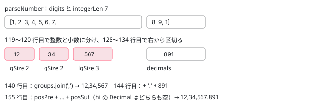

[目次](../README.md) › [common の内側](README.md) › 第 12 回 / 全 20 回

# 数の書式：DecimalPipe・CurrencyPipe と formatNumber の中

> DecimalPipe・PercentPipe・CurrencyPipe が strToNumber で入力を数に直して formatNumber・formatPercent・formatCurrency を呼ぶ行、getCurrencySymbol と currencies.ts、DEFAULT\_CURRENCY\_CODE。formatNumberToLocaleString の中の parseNumberFormat（#,##0.00 の読み方）・parseNumber・roundNumber と digitsInfo の正規表現、2026 年の修正（digitsInfo の上限 dfdfbe34a57、ロケールの NaN の記号 7596548e9b8）。

angular/angular · 読了 約 13 分 · 発展 · [サイトで読む（デモが動きます）](https://angular-deep-dive-cyan.vercel.app/chapter/cmn-format-number)

---

`{{ x | number:'1.2-2' }}` の結果は、`Number.prototype.toFixed` でも `Intl.NumberFormat` でもなく、Angular が自分で数を 1 桁ずつの配列にして丸め、ロケールの書式（`#,##0.###`）で区切りを入れて作っています。この章では、3 つのパイプが入力を数に直して `formatNumber`・`formatPercent`・`formatCurrency` を呼ぶ行から、`formatNumberToLocaleString` の中の `parseNumberFormat`・`parseNumber`・`roundNumber` までを 1 ステップずつ読みます。

読む対象は `packages/common/src/pipes/number_pipe.ts`（336 行）、`packages/common/src/i18n/format_number.ts`（544 行）、`locale_data_api.ts` の通貨の関数と、生成されたファイル `currencies.ts` です。

1. [1. 全体像](01-cmn-overview.md)
2. [2. NgClass と NgStyle](02-cmn-ng-class-style.md)
3. [3. NgForOf](03-cmn-ng-for-of.md)
4. [4. NgIf と NgSwitch](04-cmn-ng-if-switch.md)
5. [5. outlet](05-cmn-outlets.md)
6. [6. pipe の仕組み](06-cmn-pipe-mechanism.md)
7. [7. 小さな pipe](07-cmn-simple-pipes.md)
8. [8. KeyValuePipe](08-cmn-keyvalue-pipe.md)
9. [9. DatePipe](09-cmn-date-pipe.md)
10. [10. 日付の書式](10-cmn-format-date.md)
11. [11. 日付の部品](11-cmn-date-getters.md)
12. **12. 数の書式**（この章）
13. [13. NgOptimizedImage](13-cmn-image-overview.md)
14. [14. srcset と sizes](14-cmn-image-srcset.md)
15. [15. 画像のローダー](15-cmn-image-loaders.md)
16. [16. LCP と preload](16-cmn-image-lcp-preload.md)
17. [17. Location](17-cmn-location.md)
18. [18. テスト用の Location](18-cmn-location-testing.md)
19. [19. ViewportScroller](19-cmn-viewport-scroller.md)
20. [20. issue と PR を読む](20-cmn-issues.md)

## 1. 3 つのパイプ：入口はどれも同じ形

📄 `angular/packages/common/src/pipes/number_pipe.ts` L89–125 （▶ の行: 93, 114, 116, 119–120, 122）

```ts
 89 │ @Pipe({
 90 │   name: 'number',
 91 │ })
 92 │ export class DecimalPipe implements PipeTransform {
 93 ▶   constructor(@Inject(LOCALE_ID) private _locale: string) {}
 94 │ 
 95 │   /**
 96 │    * @param value The value to be formatted.
 97 │    * @param digitsInfo Sets digit and decimal representation.
 98 │    * [See more](#digitsinfo).
 99 │    * @param locale Specifies what locale format rules to use.
100 │    * [See more](#locale).
101 │    */
102 │   transform(value: number | string, digitsInfo?: string, locale?: string): string | null;
103 │   transform(value: null | undefined, digitsInfo?: string, locale?: string): null;
104 │   transform(
105 │     value: number | string | null | undefined,
106 │     digitsInfo?: string,
107 │     locale?: string,
108 │   ): string | null;
109 │   transform(
110 │     value: number | string | null | undefined,
111 │     digitsInfo?: string,
112 │     locale?: string,
113 │   ): string | null {
114 ▶     if (!isValue(value)) return null;
115 │ 
116 ▶     locale ||= this._locale;
117 │ 
118 │     try {
119 ▶       const num = strToNumber(value);
120 ▶       return formatNumber(num, locale, digitsInfo);
121 │     } catch (error) {
122 ▶       throw invalidPipeArgumentError(DecimalPipe, (error as Error).message);
123 │     }
124 │   }
125 │ }
```

1. **93 行目：`LOCALE_ID` だけ inject**

   `DatePipe`（[第 9 回](09-cmn-date-pipe.md)）と違い、既定のオプションのトークンはありません。
2. **114 行目：`isValue` が偽なら `null`**

   317〜319 行目（3 節）。`null`・`undefined`・`''`・`NaN` の 4 つで、`DatePipe`（第 9 回の 4 節）と同じ条件です。
3. **116 行目：ロケールは `||=`**

   `''` でも `LOCALE_ID` に戻ります。
4. **119〜122 行目：数に直して `formatNumber`。例外は包み直す**

   包み方は `DatePipe` と同じ `invalidPipeArgumentError`（[第 6 回](06-cmn-pipe-mechanism.md)）。`formatNumber` 本体は [loc-locale-data](../loc/12-loc-locale-data.md) で引用済みで、ロケールの Decimal の書式を `parseNumberFormat` に通してから 5 節の関数を呼ぶだけです。

`PercentPipe` は、この 120 行目が `formatPercent` になっただけの同じ形です。`CurrencyPipe` だけは引数が多く、もう 1 つトークンを inject します。

📄 `angular/packages/common/src/pipes/number_pipe.ts` L217–224 （▶ の行: 222–223）

```ts
217 │ @Pipe({
218 │   name: 'currency',
219 │ })
220 │ export class CurrencyPipe implements PipeTransform {
221 │   constructor(
222 ▶     @Inject(LOCALE_ID) private _locale: string,
223 ▶     @Inject(DEFAULT_CURRENCY_CODE) private _defaultCurrencyCode: string = 'USD',
224 │   ) {}
```

223 行目の `DEFAULT_CURRENCY_CODE` は factory を持つトークンで、既定は `'USD'`（[loc-locale-data](../loc/12-loc-locale-data.md) の 2 節）。`= 'USD'` は、`new CurrencyPipe('en-US')` と手で作ったときのための既定です。

📄 `angular/packages/common/src/pipes/number_pipe.ts` L279–315 （▶ の行: 281–282, 290, 292, 296, 299–302, 304, 310）

```ts
279 │   transform(
280 │     value: number | string | null | undefined,
281 ▶     currencyCode: string = this._defaultCurrencyCode,
282 ▶     display: 'code' | 'symbol' | 'symbol-narrow' | string | boolean = 'symbol',
283 │     digitsInfo?: string,
284 │     locale?: string,
285 │   ): string | null {
286 │     if (!isValue(value)) return null;
287 │ 
288 │     locale ||= this._locale;
289 │ 
290 ▶     if (typeof display === 'boolean') {
291 │       if (typeof ngDevMode === 'undefined' || ngDevMode) {
292 ▶         console.warn(
293 │           `Warning: the currency pipe has been changed in Angular v5. The symbolDisplay option (third parameter) is now a string instead of a boolean. The accepted values are "code", "symbol" or "symbol-narrow".`,
294 │         );
295 │       }
296 ▶       display = display ? 'symbol' : 'code';
297 │     }
298 │ 
299 ▶     let currency: string = currencyCode || this._defaultCurrencyCode;
300 ▶     if (display !== 'code') {
301 ▶       if (display === 'symbol' || display === 'symbol-narrow') {
302 ▶         currency = getCurrencySymbol(currency, display === 'symbol' ? 'wide' : 'narrow', locale);
303 │       } else {
304 ▶         currency = display;
305 │       }
306 │     }
307 │ 
308 │     try {
309 │       const num = strToNumber(value);
310 ▶       return formatCurrency(num, locale, currency, currencyCode, digitsInfo);
311 │     } catch (error) {
312 │       throw invalidPipeArgumentError(CurrencyPipe, (error as Error).message);
313 │     }
314 │   }
315 │ }
```

1. **281〜282 行目：引数の既定**

   通貨コードは `DEFAULT_CURRENCY_CODE`、表示は `'symbol'`。*JavaScript の引数の既定*なので、効くのは `undefined` のときだけです。
2. **290〜297 行目：`true`・`false` は v4 の書き方**

   開発モードなら 292 行目で `console.warn` し、296 行目で `true` → `'symbol'`、`false` → `'code'` に読み替えます。
3. **299〜306 行目：表に出す通貨の文字**

   299 行目で通貨コードを決め、`'code'` ならそのまま（`USD`）、`'symbol'`・`'symbol-narrow'` なら 302 行目で `getCurrencySymbol`（2 節）。それ以外の文字列は 304 行目で*その文字列そのもの*を通貨の文字にします。`''` なら通貨の文字が消えます（8 節の 216 行目の `trim`）。
4. **310 行目：`formatCurrency` には 2 つの通貨を渡す**

   3 つめの `currency` は「表に出す文字」（`¥`）、4 つめの `currencyCode` は「小数の桁を決めるコード」（`JPY` → 0 桁）です。**4 つめは 299 行目の `currency` ではなく、引数の `currencyCode` そのまま**です（下の警告）。

> [!WARNING]
> **ハマりどころ**
>
> `currencyCode` に `null` か `''` を渡すと、281 行目の既定は効きません（`undefined` ではないので）。299 行目の `||` は既定に戻すので、*表に出す文字*は `DEFAULT_CURRENCY_CODE` のものになりますが、310 行目は `null` のまま渡すので、*桁*は 2 節の `getNumberOfCurrencyDigits(null)` の既定 2 になります。このサイトの本物で `new CurrencyPipe('en-US', 'JPY')` に `transform(1234.5)` は `'¥1,235'`、`transform(1234.5, null)` は `'¥1,234.50'` でした。同じ「既定の通貨を使って」のつもりで、円に銭が付きます。2021 年の PR #40505（`DEFAULT_CURRENCY_CODE` を桁にも使う）はマージされずに閉じ、その後に入った 281 行目の引数の既定が `undefined` のときだけを直した形です。

## 2. 通貨の記号と桁：getCurrencySymbol と currencies.ts

📄 `angular/packages/common/src/i18n/locale_data_api.ts` L797–832 （▶ の行: 798–799, 801–802, 805, 809, 827, 829, 831）

```ts
797 │ export function getCurrencySymbol(code: string, format: 'wide' | 'narrow', locale = 'en'): string {
798 ▶   const currency = getLocaleCurrencies(locale)[code] || CURRENCIES_EN[code] || [];
799 ▶   const symbolNarrow = currency[ɵCurrencyIndex.SymbolNarrow];
800 │ 
801 ▶   if (format === 'narrow' && typeof symbolNarrow === 'string') {
802 ▶     return symbolNarrow;
803 │   }
804 │ 
805 ▶   return currency[ɵCurrencyIndex.Symbol] || code;
806 │ }
807 │ 
808 │ // Most currencies have cents, that's why the default is 2
809 ▶ const DEFAULT_NB_OF_CURRENCY_DIGITS = 2;
810 │ 
811 │ /**
812 │  * Reports the number of decimal digits for a given currency.
813 │  * The value depends upon the presence of cents in that particular currency.
814 │  *
815 │  * @param code The currency code.
816 │  * @returns The number of decimal digits, typically 0 or 2.
817 │  * @see [Internationalization (i18n) Guide](guide/i18n)
818 │  *
819 │  * @publicApi
820 │  *
821 │  * @deprecated 18.0
822 │  * Angular recommends relying on the `Intl` API for i18n.
823 │  * This function should not be used anymore. Let `Intl.NumberFormat` determine the number of digits to display for the currency
824 │  */
825 │ export function getNumberOfCurrencyDigits(code: string): number {
826 │   let digits;
827 ▶   const currency = CURRENCIES_EN[code];
828 │   if (currency) {
829 ▶     digits = currency[ɵCurrencyIndex.NbOfDigits];
830 │   }
831 ▶   return typeof digits === 'number' ? digits : DEFAULT_NB_OF_CURRENCY_DIGITS;
832 │ }
```

📄 `angular/packages/common/src/i18n/locale_data_api.ts` L604–613 （▶ の行: 611–612）

```ts
604 │ /**
605 │  * Retrieves the currency values for a given locale.
606 │  * @param locale A locale code for the locale format rules to use.
607 │  * @returns The currency values.
608 │  * @see [Internationalization (i18n) Guide](guide/i18n)
609 │  */
610 │ function getLocaleCurrencies(locale: string): {[code: string]: CurrenciesSymbols} {
611 ▶   const data = ɵfindLocaleData(locale);
612 ▶   return data[ɵLocaleDataIndex.Currencies];
613 │ }
```

1. **798 行目：ロケールの表 → 英語の表 → 空**

   まずロケールのデータの `Currencies` の欄（610〜613 行目）を見ます。ja のデータには `{"CNY": ["元", "￥"], "JPY": ["￥"], …}` のように「そのロケールで英語と違うものだけ」が入っています（このサイトの node\_modules の ja.js で確認）。無ければ `CURRENCIES_EN` です。これは `packages/common/src/i18n/currencies.ts` の、1 行に全部の通貨を並べた生成物です（ファイルの先頭のコメントは `THIS CODE IS GENERATED - DO NOT MODIFY.`）。要素は `[記号, 狭い記号, 桁]` で、例えば `"JPY":["¥",undefined,0]`・`"CAD":["CA$","$",2]`・`"BHD":[undefined,undefined,3]` の形です（grep で確認）。
2. **801〜805 行目：narrow は 2 つめが文字列なら**

   そうでなければ 1 つめ（wide）、それも無ければ通貨コードそのもの。`getCurrencySymbol('CAD', 'wide')` は `CA$`、`'narrow'` は `$`。
3. **825〜832 行目：桁は英語の表だけを見る**

   827 行目は `CURRENCIES_EN[code]` だけで、ロケールは引数にもありません。3 つめの数が無ければ 809 行目の 2。`JPY` は 0、`BHD` は 3、知らないコードは 2 です。

この節の関数はすべて `@deprecated 18.0` で、821〜823 行目などのとおり `Intl.NumberFormat` を使うよう勧めています。パイプの中からは今も呼ばれています。

## 3. strToNumber：文字列を数に

📄 `angular/packages/common/src/pipes/number_pipe.ts` L317–336 （▶ の行: 318, 326–327, 329–332）

```ts
317 │ function isValue(value: number | string | null | undefined): value is number | string {
318 ▶   return !(value == null || value === '' || value !== value);
319 │ }
320 │ 
321 │ /**
322 │  * Transforms a string into a number (if needed).
323 │  */
324 │ function strToNumber(value: number | string): number {
325 │   // Convert strings to numbers
326 ▶   if (typeof value === 'string' && !isNaN(Number(value) - parseFloat(value))) {
327 ▶     return Number(value);
328 │   }
329 ▶   if (typeof value !== 'number') {
330 ▶     throw new RuntimeError(
331 ▶       RuntimeErrorCode.VALUE_NOT_A_NUMBER,
332 ▶       ngDevMode && `${value} is not a number`,
333 │     );
334 │   }
335 │   return value;
336 │ }
```

1. **326 行目：`Number(value) - parseFloat(value)` が `NaN` でなければ**

   `Number` は文字列全体を数として読み（読めなければ `NaN`）、`parseFloat` は頭から読めるところまで読みます。両方とも数になれば差は数、どちらかが `NaN` なら差も `NaN` です。`'1,234'` は `Number` が `NaN` なので 329 行目へ進み、`NG02309: 1,234 is not a number` です。
2. **327 行目：`Number(value)` を返す**

   `parseFloat` ではなく `Number` の値です。だから `'0x1A'`（`Number` は 26、`parseFloat` は 0、差は 26）は 26 として通り、このサイトの本物の `CurrencyPipe` で `'$26.00'` でした。`' 12 '` は両方が 12 なので通ります。反対に `'Infinity'` は両方が `Infinity` で、差 `Infinity - Infinity` が `NaN` になるので、*数の*`Infinity` は通るのに文字列は例外です。
3. **329〜333 行目：数でも文字列でもなければ例外**

   `true` や `{}` は `VALUE_NOT_A_NUMBER`（`NG02309`）。

## 4. ロケールの書式を読む：parseNumberFormat

📄 `angular/packages/common/src/i18n/locale_data_api.ts` L518–547 （▶ の行: 522–527, 545–546）

```ts
518 │  * Here are the special characters used in number patterns:
519 │  *
520 │  * | Symbol | Meaning |
521 │  * |--------|---------|
522 ▶  * | . | Replaced automatically by the character used for the decimal point. |
523 ▶  * | , | Replaced by the "grouping" (thousands) separator. |
524 ▶  * | 0 | Replaced by a digit (or zero if there aren't enough digits). |
525 ▶  * | # | Replaced by a digit (or nothing if there aren't enough). |
526 ▶  * | ¤ | Replaced by a currency symbol, such as $ or USD. |
527 ▶  * | % | Marks a percent format. The % symbol may change position, but must be retained. |
528 │  * | E | Marks a scientific format. The E symbol may change position, but must be retained. |
529 │  * | ' | Special characters used as literal characters are quoted with ASCII single quotes. |
530 │  *
531 │  * @param locale A locale code for the locale format rules to use.
532 │  * @param type The type of numeric value to be formatted (such as `Decimal` or `Currency`.)
533 │  * @returns The localized format string.
534 │  * @see {@link NumberFormatStyle}
535 │  * @see [CLDR website](http://cldr.unicode.org/translation/number-patterns)
536 │  * @see [Internationalization (i18n) Guide](guide/i18n)
537 │  *
538 │  * @publicApi
539 │  *
540 │  * @deprecated 18.0
541 │  * Angular recommends relying on the `Intl` API for i18n.
542 │  * Let `Intl.NumberFormat` determine the number format instead
543 │  */
544 │ export function getLocaleNumberFormat(locale: string, type: NumberFormatStyle): string {
545 ▶   const data = ɵfindLocaleData(locale);
546 ▶   return data[ɵLocaleDataIndex.NumberFormats][type];
547 │ }
```

ロケールのデータには、Decimal・Percent・Currency・Scientific の 4 つの書式の文字列があり、545〜546 行目で番号で引きます。このサイトの本物で en-US は `#,##0.###`・`#,##0%`・`¤#,##0.00`、fr は `#,##0.###`・`#,##0 %`・`#,##0.00 ¤`、hi の Decimal は `#,##,##0.###` でした。522〜527 行目のとおり、`.` や `,` は「そのロケールの小数点・区切りに置き換える印」です。

📄 `angular/packages/common/src/i18n/format_number.ts` L307–335 （▶ の行: 309–311, 320–322, 325–326, 328–329, 334）

```ts
307 │ function parseNumberFormat(format: string, minusSign = '-'): ParsedNumberFormat {
308 │   const p = {
309 ▶     minInt: 1,
310 ▶     minFrac: 0,
311 ▶     maxFrac: 0,
312 │     posPre: '',
313 │     posSuf: '',
314 │     negPre: '',
315 │     negSuf: '',
316 │     gSize: 0,
317 │     lgSize: 0,
318 │   };
319 │ 
320 ▶   const patternParts = format.split(PATTERN_SEP);
321 ▶   const positive = patternParts[0];
322 ▶   const negative = patternParts[1];
323 │ 
324 │   const positiveParts =
325 ▶       positive.indexOf(DECIMAL_SEP) !== -1
326 ▶         ? positive.split(DECIMAL_SEP)
327 │         : [
328 ▶             positive.substring(0, positive.lastIndexOf(ZERO_CHAR) + 1),
329 ▶             positive.substring(positive.lastIndexOf(ZERO_CHAR) + 1),
330 │           ],
331 │     integer = positiveParts[0],
332 │     fraction = positiveParts[1] || '';
333 │ 
334 ▶   p.posPre = integer.substring(0, integer.indexOf(DIGIT_CHAR));
335 │ 
```

📄 `angular/packages/common/src/i18n/format_number.ts` L336–363 （▶ の行: 338–341, 343, 347–349, 355–356, 358–359）

```ts
336 │   for (let i = 0; i < fraction.length; i++) {
337 │     const ch = fraction.charAt(i);
338 ▶     if (ch === ZERO_CHAR) {
339 ▶       p.minFrac = p.maxFrac = i + 1;
340 ▶     } else if (ch === DIGIT_CHAR) {
341 ▶       p.maxFrac = i + 1;
342 │     } else {
343 ▶       p.posSuf += ch;
344 │     }
345 │   }
346 │ 
347 ▶   const groups = integer.split(GROUP_SEP);
348 ▶   p.gSize = groups[1] ? groups[1].length : 0;
349 ▶   p.lgSize = groups[2] || groups[1] ? (groups[2] || groups[1]).length : 0;
350 │ 
351 │   if (negative) {
352 │     const trunkLen = positive.length - p.posPre.length - p.posSuf.length,
353 │       pos = negative.indexOf(DIGIT_CHAR);
354 │ 
355 ▶     p.negPre = negative.substring(0, pos).replace(/'/g, '');
356 ▶     p.negSuf = negative.slice(pos + trunkLen).replace(/'/g, '');
357 │   } else {
358 ▶     p.negPre = minusSign + p.posPre;
359 ▶     p.negSuf = p.posSuf;
360 │   }
361 │ 
362 │   return p;
363 │ }
```

`#,##0.###` を 1 行ずつ通します。

1. **309〜311 行目：既定は `minInt 1`・`minFrac 0`・`maxFrac 0`**

   `minInt` を書式から読む行はありません。どのロケールでも 1 です。
2. **320〜322 行目：`;` の前が正、後ろが負**

   en-US には `;` が無く、`negative` は `undefined`。ar の Currency には `;` があります。
3. **325〜326 行目：`.` で整数と小数に**

   `integer = '#,##0'`、`fraction = '###'`。`.` の無い Percent（`#,##0%`）は 328〜329 行目で最後の `0` の後ろで切り、`fraction = '%'` になります。
4. **334 行目：最初の `#` より前が接頭辞**

   `¤#,##0.00` なら `posPre = '¤'`。
5. **336〜345 行目：小数の部分を 1 文字ずつ**

   `0` は「必ず出す桁」で `minFrac` と `maxFrac` を、`#` は「出してよい桁」で `maxFrac` だけを、その位置まで伸ばします。`###` で `maxFrac 3`。それ以外の文字（`%`・` ¤`）は接尾辞です。
6. **347〜349 行目：区切りの幅**

   `'#,##0'.split(',')` は `['#', '##0']`。`gSize`（繰り返しの幅）は 2 つめの長さ 3、`lgSize`（小数点のすぐ左の幅）は 3 つめが無いので 2 つめの 3。hi の `#,##,##0` は `['#', '##', '##0']` で `gSize 2`・`lgSize 3`。インドの `12,34,567` の形はこの 2 つの数から作られます。
7. **351〜360 行目：負の形**

   `;` が無ければ 358〜359 行目で「マイナスの記号 + 正の接頭辞」と「正の接尾辞」。ロケールのマイナスの記号は呼び出し側（`formatNumber` など）が `getLocaleNumberSymbol` で引いて渡します（194 行目・241 行目も同じ）。

パイプの文書の 55 行目「`maxFractionDigits` の既定は 3」は、この `###` から来ています。

📄 `angular/packages/common/src/pipes/number_pipe.ts` L36–65 （▶ の行: 42, 47, 51, 55, 57, 60, 63）

````ts
36 │  * ### digitsInfo
37 │  *
38 │  * The value's decimal representation is specified by the `digitsInfo`
39 │  * parameter, written in the following format:<br>
40 │  *
41 │  * ```
42 ▶  * {minIntegerDigits}.{minFractionDigits}-{maxFractionDigits}
43 │  * ```
44 │  *
45 │  *  - `minIntegerDigits`:
46 │  * The minimum number of integer digits before the decimal point.
47 ▶  * Default is 1.
48 │  *
49 │  * - `minFractionDigits`:
50 │  * The minimum number of digits after the decimal point.
51 ▶  * Default is 0.
52 │  *
53 │  *  - `maxFractionDigits`:
54 │  * The maximum number of digits after the decimal point.
55 ▶  * Default is 3.
56 │  *
57 ▶  * If the formatted value is truncated it will be rounded using the "to-nearest" method:
58 │  *
59 │  * ```
60 ▶  * {{3.6 | number: '1.0-0'}}
61 │  * <!--will output '4'-->
62 │  *
63 ▶  * {{-3.6 | number:'1.0-0'}}
64 │  * <!--will output '-4'-->
65 │  * ```
````

47 行目の 1 は 309 行目、51 行目の 0 と 55 行目の 3 は 336〜345 行目で書式から読んだ値です。57〜63 行目の「to-nearest」が 7 節の `roundNumber` です（`-3.6` → `-4`）。

## 5. formatNumberToLocaleString：digitsInfo を当てる

📄 `angular/packages/common/src/i18n/format_number.ts` L20–29 （▶ の行: 20–21）

```ts
20 ▶ export const NUMBER_FORMAT_REGEXP = /^(\d+)?\.((\d+)(-(\d+))?)?$/;
21 ▶ const MAX_DIGITS = 22;
22 │ const DECIMAL_SEP = '.';
23 │ const ZERO_CHAR = '0';
24 │ const PATTERN_SEP = ';';
25 │ const GROUP_SEP = ',';
26 │ const DIGIT_CHAR = '#';
27 │ const CURRENCY_CHAR = '¤';
28 │ const PERCENT_CHAR = '%';
29 │ 
```

📄 `angular/packages/common/src/i18n/format_number.ts` L33–61 （▶ の行: 45–47, 49, 52, 54–55, 58–60）

```ts
33 │ function formatNumberToLocaleString(
34 │   value: number,
35 │   pattern: ParsedNumberFormat,
36 │   locale: string,
37 │   groupSymbol: NumberSymbol,
38 │   decimalSymbol: NumberSymbol,
39 │   digitsInfo?: string,
40 │   isPercent = false,
41 │ ): string {
42 │   let formattedText = '';
43 │   let isZero = false;
44 │ 
45 ▶   if (!isFinite(value)) {
46 ▶     // `Number.isNaN` (not `!isFinite`) so NaN uses the locale NaN symbol, not Infinity.
47 ▶     formattedText = getLocaleNumberSymbol(
48 │       locale,
49 ▶       Number.isNaN(value) ? NumberSymbol.NaN : NumberSymbol.Infinity,
50 │     );
51 │   } else {
52 ▶     let parsedNumber = parseNumber(value);
53 │ 
54 ▶     if (isPercent) {
55 ▶       parsedNumber = toPercent(parsedNumber);
56 │     }
57 │ 
58 ▶     let minInt = pattern.minInt;
59 ▶     let minFraction = pattern.minFrac;
60 ▶     let maxFraction = pattern.maxFrac;
61 │ 
```

1. **45〜50 行目：`NaN` と `Infinity` はロケールの記号だけ**

   2026-08-25 の 7596548e9b8 で、49 行目の `Number.isNaN(value) ? NumberSymbol.NaN : NumberSymbol.Infinity` になりました。その前は `NumberSymbol.Infinity` だけで、`formatNumber(NaN, 'en-US')` が `'∞'` でした。足した it は `should format NaN and Infinity with locale symbols` です（下の spec の 41〜49 行目）。**パイプからはこの行に `NaN` は届きません**。114 行目の `isValue` が先に `null` を返すからです。
2. **52・54〜56 行目：数を桁の配列に。パーセントなら 100 倍**

   `parseNumber` と `toPercent`（6 節）。
3. **58〜60 行目：まず書式の値**

   4 節の `minInt`・`minFrac`・`maxFrac`。digitsInfo があれば次で上書きします。

📄 `angular/packages/common/src/i18n/format_number.ts` L62–98 （▶ の行: 63–64, 66, 70–72, 74, 81–82, 86, 88–90, 93）

```ts
62 │     if (digitsInfo) {
63 ▶       const parts = digitsInfo.match(NUMBER_FORMAT_REGEXP);
64 ▶       if (parts === null) {
65 │         throw new RuntimeError(
66 ▶           RuntimeErrorCode.INVALID_DIGIT_INFO,
67 │           ngDevMode && `${digitsInfo} is not a valid digit info`,
68 │         );
69 │       }
70 ▶       const minIntPart = parts[1];
71 ▶       const minFractionPart = parts[3];
72 ▶       const maxFractionPart = parts[5];
73 │       if (minIntPart != null) {
74 ▶         minInt = parseIntAutoRadix(minIntPart);
75 │       }
76 │       if (minFractionPart != null) {
77 │         minFraction = parseIntAutoRadix(minFractionPart);
78 │       }
79 │       if (maxFractionPart != null) {
80 │         maxFraction = parseIntAutoRadix(maxFractionPart);
81 ▶       } else if (minFractionPart != null && minFraction > maxFraction) {
82 ▶         maxFraction = minFraction;
83 │       }
84 │ 
85 │       // Prevent DoS via resource exhaustion by capping the maximum padding iterations
86 ▶       const MAX_ALLOWED_DIGITS = 100;
87 │       if (
88 ▶         minInt > MAX_ALLOWED_DIGITS ||
89 ▶         minFraction > MAX_ALLOWED_DIGITS ||
90 ▶         maxFraction > MAX_ALLOWED_DIGITS
91 │       ) {
92 │         throw new RuntimeError(
93 ▶           RuntimeErrorCode.INVALID_DIGIT_INFO,
94 │           ngDevMode &&
95 │             `${digitsInfo} is not a valid digit info. Exceeded maximum limits of ${MAX_ALLOWED_DIGITS} digits.`,
96 │         );
97 │       }
98 │     }
```

1. **63 行目：`NUMBER_FORMAT_REGEXP`**

   20 行目の `/^(\d+)?\.((\d+)(-(\d+))?)?$/` です。`.` は必須で、かっこ 1 が `minInt`、3 が `minFrac`、5 が `maxFrac`。`'3.'`・`'.4'`・`'1.2-2'` は当たり、`'1'`（`.` が無い）・`'1.-2'`・`'abc'` は 64〜69 行目で `INVALID_DIGIT_INFO`（`NG02306`）です。
2. **73〜80 行目：書いた部分だけ上書き**

   `'.4'` なら `minFrac` だけが 4。`parseIntAutoRadix`（ファイルの最後の関数）は `parseInt` で、`NaN` なら例外ですが、正規表現が数字だけを通すのでここでは起きません。
3. **81〜82 行目：`maxFrac` を書かずに `minFrac` が大きければ揃える**

   `'1.4'` と書くと、書式の `maxFrac 3` を 4 に上げます。`'1.4-2'` のように両方書いて矛盾しているときは、7 節の 462〜468 行目で例外です。
4. **86〜97 行目：100 桁の上限**

   2026-05-21 の dfdfbe34a57（add upper bounds for digitsInfo）で入りました。コミットの説明は「`roundNumber` が大きな配列を作らないように」で、`'1.0-20000000'` のような digitsInfo で 7 節の 509 行目の `digits.push(0)` や 109〜111 行目の `unshift(0)` が何千万回も回るのを、手前で止めます。エラーのコードは正規表現に当たらないときと同じ `INVALID_DIGIT_INFO` で、文が 95 行目の `Exceeded maximum limits of 100 digits.` です。足した it は `should throw if minInt, minFraction, or maxFraction exceeds 100 to prevent DoS`（spec の 57〜67 行目）。

## 6. 数を桁の配列に：parseNumber と toPercent

📄 `angular/packages/common/src/i18n/format_number.ts` L397–423 （▶ の行: 399, 402, 409–410, 414, 416–418, 421）

```ts
397 │ /**
398 │  * Parses a number.
399 ▶  * Significant bits of this parse algorithm came from https://github.com/MikeMcl/big.js/
400 │  */
401 │ function parseNumber(num: number): ParsedNumber {
402 ▶   let numStr = Math.abs(num) + '';
403 │   let exponent = 0,
404 │     digits,
405 │     integerLen;
406 │   let i, j, zeros;
407 │ 
408 │   // Decimal point?
409 ▶   if ((integerLen = numStr.indexOf(DECIMAL_SEP)) > -1) {
410 ▶     numStr = numStr.replace(DECIMAL_SEP, '');
411 │   }
412 │ 
413 │   // Exponential form?
414 ▶   if ((i = numStr.search(/e/i)) > 0) {
415 │     // Work out the exponent.
416 ▶     if (integerLen < 0) integerLen = i;
417 ▶     integerLen += +numStr.slice(i + 1);
418 ▶     numStr = numStr.substring(0, i);
419 │   } else if (integerLen < 0) {
420 │     // There was no decimal point or exponent so it is an integer.
421 ▶     integerLen = numStr.length;
422 │   }
423 │ 
```

📄 `angular/packages/common/src/i18n/format_number.ts` L424–455 （▶ の行: 425, 429, 431–432, 436, 439, 442–443, 448–451）

```ts
424 │   // Count the number of leading zeros.
425 ▶   for (i = 0; numStr.charAt(i) === ZERO_CHAR; i++) {
426 │     /* empty */
427 │   }
428 │ 
429 ▶   if (i === (zeros = numStr.length)) {
430 │     // The digits are all zero.
431 ▶     digits = [0];
432 ▶     integerLen = 1;
433 │   } else {
434 │     // Count the number of trailing zeros
435 │     zeros--;
436 ▶     while (numStr.charAt(zeros) === ZERO_CHAR) zeros--;
437 │ 
438 │     // Trailing zeros are insignificant so ignore them
439 ▶     integerLen -= i;
440 │     digits = [];
441 │     // Convert string to array of digits without leading/trailing zeros.
442 ▶     for (j = 0; i <= zeros; i++, j++) {
443 ▶       digits[j] = Number(numStr.charAt(i));
444 │     }
445 │   }
446 │ 
447 │   // If the number overflows the maximum allowed digits then use an exponent.
448 ▶   if (integerLen > MAX_DIGITS) {
449 ▶     digits = digits.splice(0, MAX_DIGITS - 1);
450 ▶     exponent = integerLen - 1;
451 ▶     integerLen = 1;
452 │   }
453 │ 
454 │   return {digits, exponent, integerLen};
455 │ }
```

1. **402 行目：絶対値を文字列に**

   符号は 5 節の最後（152〜156 行目）で付け直すので、ここでは捨てます。数の文字列化は JavaScript の `Number` の `toString` そのものです。399 行目のとおり、big.js から持ってきた考え方です。
2. **409〜411 行目：小数点の位置を覚えて消す**

   `'1234.5'` は `integerLen 4`・`'12345'`。
3. **414〜418 行目：指数表記**

   `1e21` の文字列は `'1e+21'`。`e` の位置 1 を `integerLen` にして、指数 21 を足して 22。`1e-7` は `'1e-7'` で 1 − 7 = −6、つまり小数点が 6 桁左です。
4. **425〜445 行目：前後の 0 を落として 1 桁ずつの配列に**

   `'00005'`（0.0005）は前の 0 が 4 つで `integerLen` が 1 − 4 = −3、`digits [5]`。全部 0 なら 429〜432 行目で `[0]`。
5. **448〜452 行目：22 桁を超えたら指数**

   21 行目の `MAX_DIGITS = 22`。`integerLen` が 22 を超えると、頭の 21 桁だけ残して `exponent` にし、5 節の 147〜149 行目で `E+23` のように書きます。`1e21` はちょうど 22 なので指数にならず `1,000,000,000,000,000,000,000`、`1e100` は spec の 38 行目のとおり `1E+100` です。

📄 `angular/packages/common/src/i18n/format_number.ts` L374–395 （▶ の行: 377, 383–384, 386–389, 391）

```ts
374 │ // Transforms a parsed number into a percentage by multiplying it by 100
375 │ function toPercent(parsedNumber: ParsedNumber): ParsedNumber {
376 │   // if the number is 0, don't do anything
377 ▶   if (parsedNumber.digits[0] === 0) {
378 │     return parsedNumber;
379 │   }
380 │ 
381 │   // Getting the current number of decimals
382 │   const fractionLen = parsedNumber.digits.length - parsedNumber.integerLen;
383 ▶   if (parsedNumber.exponent) {
384 ▶     parsedNumber.exponent += 2;
385 │   } else {
386 ▶     if (fractionLen === 0) {
387 ▶       parsedNumber.digits.push(0, 0);
388 ▶     } else if (fractionLen === 1) {
389 ▶       parsedNumber.digits.push(0);
390 │     }
391 ▶     parsedNumber.integerLen += 2;
392 │   }
393 │ 
394 │   return parsedNumber;
395 │ }
```

掛け算はしません。`integerLen` を 2 増やす（小数点を 2 桁右へ動かす）だけです。386〜390 行目で、小数の桁が足りなければ 0 を足します。だから `0.1 * 100` が `10.000000000000002` になる浮動小数点の誤差は出ません。

## 7. 丸めと桁上がり：roundNumber

📄 `angular/packages/common/src/i18n/format_number.ts` L457–494 （▶ の行: 462, 471–472, 475–476, 480, 483–484, 488–491）

```ts
457 │ /**
458 │  * Round the parsed number to the specified number of decimal places
459 │  * This function changes the parsedNumber in-place
460 │  */
461 │ function roundNumber(parsedNumber: ParsedNumber, minFrac: number, maxFrac: number) {
462 ▶   if (minFrac > maxFrac) {
463 │     throw new RuntimeError(
464 │       RuntimeErrorCode.INVALID_NUMBER_OF_DIGITS_AFTER_FRACTION,
465 │       ngDevMode &&
466 │         `The minimum number of digits after fraction (${minFrac}) is higher than the maximum (${maxFrac}).`,
467 │     );
468 │   }
469 │ 
470 │   let digits = parsedNumber.digits;
471 ▶   let fractionLen = digits.length - parsedNumber.integerLen;
472 ▶   const fractionSize = Math.min(Math.max(minFrac, fractionLen), maxFrac);
473 │ 
474 │   // The index of the digit to where rounding is to occur
475 ▶   let roundAt = fractionSize + parsedNumber.integerLen;
476 ▶   let digit = digits[roundAt];
477 │ 
478 │   if (roundAt > 0) {
479 │     // Drop fractional digits beyond `roundAt`
480 ▶     digits.splice(Math.max(parsedNumber.integerLen, roundAt));
481 │ 
482 │     // Set non-fractional digits beyond `roundAt` to 0
483 ▶     for (let j = roundAt; j < digits.length; j++) {
484 ▶       digits[j] = 0;
485 │     }
486 │   } else {
487 │     // We rounded to zero so reset the parsedNumber
488 ▶     fractionLen = Math.max(0, fractionLen);
489 ▶     parsedNumber.integerLen = 1;
490 ▶     digits.length = Math.max(1, (roundAt = fractionSize + 1));
491 ▶     digits[0] = 0;
492 │     for (let i = 1; i < roundAt; i++) digits[i] = 0;
493 │   }
494 │ 
```

1. **472 行目：何桁残すか**

   今の小数の桁数を `minFrac` 以上・`maxFrac` 以下に収めた数。`1.005` を `'1.2-2'` なら、小数 3 桁を 2 桁に。
2. **475〜476 行目：切る位置と、その位置の数字**

   `roundAt = 2 + 1 = 3`、`digit = digits[3] = 5`。この 1 桁だけで上げるか決めます。
3. **480〜485 行目：切る**

   小数の切る位置から後ろを捨てます。整数の部分にかかるとき（`roundAt` が `integerLen` より左）は、捨てずに 0 にします。
4. **486〜493 行目：全部切れたら 0 から**

   `0.0005` を `'1.0-0'` のように、残す桁より数が小さいときです。`digits` を 0 で作り直します。

📄 `angular/packages/common/src/i18n/format_number.ts` L495–533 （▶ の行: 495–496, 501, 504, 509, 511, 516, 518, 521–522, 527, 529–530）

```ts
495 ▶   if (digit >= 5) {
496 ▶     if (roundAt - 1 < 0) {
497 │       for (let k = 0; k > roundAt; k--) {
498 │         digits.unshift(0);
499 │         parsedNumber.integerLen++;
500 │       }
501 ▶       digits.unshift(1);
502 │       parsedNumber.integerLen++;
503 │     } else {
504 ▶       digits[roundAt - 1]++;
505 │     }
506 │   }
507 │ 
508 │   // Pad out with zeros to get the required fraction length
509 ▶   for (; fractionLen < Math.max(0, fractionSize); fractionLen++) digits.push(0);
510 │ 
511 ▶   let dropTrailingZeros = fractionSize !== 0;
512 │   // Minimal length = nb of decimals required + current nb of integers
513 │   // Any number besides that is optional and can be removed if it's a trailing 0
514 │   const minLen = minFrac + parsedNumber.integerLen;
515 │   // Do any carrying, e.g. a digit was rounded up to 10
516 ▶   const carry = digits.reduceRight(function (carry, d, i, digits) {
517 │     d = d + carry;
518 ▶     digits[i] = d < 10 ? d : d - 10; // d % 10
519 │     if (dropTrailingZeros) {
520 │       // Do not keep meaningless fractional trailing zeros (e.g. 15.52000 --> 15.52)
521 ▶       if (digits[i] === 0 && i >= minLen) {
522 ▶         digits.pop();
523 │       } else {
524 │         dropTrailingZeros = false;
525 │       }
526 │     }
527 ▶     return d >= 10 ? 1 : 0; // Math.floor(d / 10);
528 │   }, 0);
529 ▶   if (carry) {
530 ▶     digits.unshift(carry);
531 │     parsedNumber.integerLen++;
532 │   }
533 │ }
```

1. **495〜506 行目：5 以上なら 1 つ前を +1**

   四捨五入（0.5 は上へ）です。`2.5` を `'1.0-0'` は `3`、`-2.5` は絶対値で丸めるので `-3`。銀行の丸め（偶数へ）ではありません。
2. **509 行目：`minFrac` まで 0 を足す**

   `'1.2-2'` の `123` は `123.00`。100 桁の上限（5 節）はこの行のためです。
3. **516〜528 行目：右から桁上がり**

   `reduceRight` で右から 1 桁ずつ、10 になったら 0 にして左へ 1 を送ります。`9.995` を `'1.2-2'` は `[9, 9, 10]` → `[1, 0, 0, 0]`（529〜532 行目で頭に 1、`integerLen` が 2）で `10.00`。同じ回で、`minLen`（514 行目）より右の意味のない 0 を 521〜522 行目で落とします（`15.52000` → `15.52`）。

> [!NOTE]
> **ポイント**
>
> 丸めは「数を 10 進の文字列にした桁」で行います。`(1.005).toFixed(2)` は 2 進の誤差で `'1.00'` ですが、`1.005 + ''` は `'1.005'` なので、このサイトの本物の `formatNumber(1.005, 'en-US', '1.2-2')` は `'1.01'` でした。

### 区切りを入れて、接頭辞と接尾辞を付ける

📄 `angular/packages/common/src/i18n/format_number.ts` L100–124 （▶ の行: 100, 106, 109–110, 114, 119–120, 122–123）

```ts
100 ▶     roundNumber(parsedNumber, minFraction, maxFraction);
101 │ 
102 │     let digits = parsedNumber.digits;
103 │     let integerLen = parsedNumber.integerLen;
104 │     const exponent = parsedNumber.exponent;
105 │     let decimals = [];
106 ▶     isZero = digits.every((d) => !d);
107 │ 
108 │     // pad zeros for small numbers
109 ▶     for (; integerLen < minInt; integerLen++) {
110 ▶       digits.unshift(0);
111 │     }
112 │ 
113 │     // pad zeros for small numbers
114 ▶     for (; integerLen < 0; integerLen++) {
115 │       digits.unshift(0);
116 │     }
117 │ 
118 │     // extract decimals digits
119 ▶     if (integerLen > 0) {
120 ▶       decimals = digits.splice(integerLen, digits.length);
121 │     } else {
122 ▶       decimals = digits;
123 ▶       digits = [0];
124 │     }
```

📄 `angular/packages/common/src/i18n/format_number.ts` L126–159 （▶ の行: 128–129, 132–133, 137, 140, 144, 148, 152–153, 155）

```ts
126 │     // format the integer digits with grouping separators
127 │     const groups = [];
128 ▶     if (digits.length >= pattern.lgSize) {
129 ▶       groups.unshift(digits.splice(-pattern.lgSize, digits.length).join(''));
130 │     }
131 │ 
132 ▶     while (digits.length > pattern.gSize) {
133 ▶       groups.unshift(digits.splice(-pattern.gSize, digits.length).join(''));
134 │     }
135 │ 
136 │     if (digits.length) {
137 ▶       groups.unshift(digits.join(''));
138 │     }
139 │ 
140 ▶     formattedText = groups.join(getLocaleNumberSymbol(locale, groupSymbol));
141 │ 
142 │     // append the decimal digits
143 │     if (decimals.length) {
144 ▶       formattedText += getLocaleNumberSymbol(locale, decimalSymbol) + decimals.join('');
145 │     }
146 │ 
147 │     if (exponent) {
148 ▶       formattedText += getLocaleNumberSymbol(locale, NumberSymbol.Exponential) + '+' + exponent;
149 │     }
150 │   }
151 │ 
152 ▶   if (value < 0 && !isZero) {
153 ▶     formattedText = pattern.negPre + formattedText + pattern.negSuf;
154 │   } else {
155 ▶     formattedText = pattern.posPre + formattedText + pattern.posSuf;
156 │   }
157 │ 
158 │   return formattedText;
159 │ }
```

1. **106 行目：丸めた結果が 0 か**

   `-0.0001` を `'1.0-2'` で丸めると全部 0 です。152 行目の `!isZero` で、`-0` ではなく `0` と書きます。
2. **109〜116 行目：整数の桁を `minInt` まで、小数点の左に 0 を**

   `'3.'` の `1` は `001`。`integerLen` が負（0.0005）なら、0 を足して 0 にします。
3. **119〜124 行目：整数と小数に分ける**

   整数が無ければ `[0]`。
4. **128〜138 行目：右から `lgSize`、あとは `gSize` ずつ**

   `1234567` を en-US（3・3）なら `567` → `234` → `1`、hi（2・3）なら `567` → `34` → `12`。140 行目でロケールの区切り（en-US は `,`、fr は狭い空白 U+202F、de は `.`）でつなぎます。小数点も 144 行目でロケールの記号です。
5. **152〜156 行目：符号で接頭辞を選ぶ**

   4 節の `negPre`・`posPre` と `negSuf`・`posSuf`。



*formatNumber(1234567.891, 'hi') の桁の配列（52 行目〜140 行目）。hi の書式は gSize 2・lgSize 3*

## 8. formatCurrency と formatPercent の後始末

📄 `angular/packages/common/src/i18n/format_number.ts` L186–218 （▶ の行: 193–194, 196–197, 203–204, 209, 211, 216）

```ts
186 │ export function formatCurrency(
187 │   value: number,
188 │   locale: string,
189 │   currency: string,
190 │   currencyCode?: string,
191 │   digitsInfo?: string,
192 │ ): string {
193 ▶   const format = getLocaleNumberFormat(locale, NumberFormatStyle.Currency);
194 ▶   const pattern = parseNumberFormat(format, getLocaleNumberSymbol(locale, NumberSymbol.MinusSign));
195 │ 
196 ▶   pattern.minFrac = getNumberOfCurrencyDigits(currencyCode!);
197 ▶   pattern.maxFrac = pattern.minFrac;
198 │ 
199 │   const res = formatNumberToLocaleString(
200 │     value,
201 │     pattern,
202 │     locale,
203 ▶     NumberSymbol.CurrencyGroup,
204 ▶     NumberSymbol.CurrencyDecimal,
205 │     digitsInfo,
206 │   );
207 │   return (
208 │     res
209 ▶       .replace(CURRENCY_CHAR, currency)
210 │       // if we have 2 time the currency character, the second one is ignored
211 ▶       .replace(CURRENCY_CHAR, '')
212 │       // If there is a spacing between currency character and the value and
213 │       // the currency character is suppressed by passing an empty string, the
214 │       // spacing character would remain as part of the string. Then we
215 │       // should remove it.
216 ▶       .trim()
217 │   );
218 │ }
```

1. **196〜197 行目：小数の桁は通貨で決める**

   ロケールの Currency の書式の `.00` ではなく、2 節の `getNumberOfCurrencyDigits(currencyCode)` で `minFrac` と `maxFrac` を上書きします。digitsInfo があれば、さらに 5 節で上書きです。
2. **203〜204 行目：区切りは通貨用の記号**

   `CurrencyGroup`・`CurrencyDecimal`。無いロケールは普通の記号に戻ります（その行は loc-locale-data で引用済み）。
3. **209〜216 行目：`¤` を通貨の文字に**

   1 つめの `¤` を置き換え、2 つめがあれば消し、最後に `trim`。`display` が `''` のとき `#,##0.00 ¤`（fr）の後ろに残る空白は、この `trim` で消えます。

📄 `angular/packages/common/src/i18n/format_number.ts` L239–255 （▶ の行: 249, 251–253）

```ts
239 │ export function formatPercent(value: number, locale: string, digitsInfo?: string): string {
240 │   const format = getLocaleNumberFormat(locale, NumberFormatStyle.Percent);
241 │   const pattern = parseNumberFormat(format, getLocaleNumberSymbol(locale, NumberSymbol.MinusSign));
242 │   const res = formatNumberToLocaleString(
243 │     value,
244 │     pattern,
245 │     locale,
246 │     NumberSymbol.Group,
247 │     NumberSymbol.Decimal,
248 │     digitsInfo,
249 ▶     true,
250 │   );
251 ▶   return res.replace(
252 ▶     new RegExp(PERCENT_CHAR, 'g'),
253 ▶     getLocaleNumberSymbol(locale, NumberSymbol.PercentSign),
254 │   );
255 │ }
```

249 行目の `true` が 54 行目の `isPercent` です。最後に書式の `%` を、ロケールの `PercentSign` に置き換えます（ar では前後に方向の印が付いた `‎%‎`）。

- 👤 `{{ price | currency:'JPY' }}` — あなたのテンプレート
  - `CurrencyPipe.transform(value, currencyCode, display, digitsInfo, locale)` — pipes/number\_pipe.ts 279
    - `getCurrencySymbol(currency, 'wide', locale)` — i18n/locale\_data\_api.ts 797 — *表に出す文字*
    - `strToNumber(value)` — number\_pipe.ts 324
    - `formatCurrency(num, locale, currency, currencyCode, digitsInfo)` — i18n/format\_number.ts 186
      - `getLocaleNumberFormat(locale, Currency)` → `parseNumberFormat` — 544・307
      - `getNumberOfCurrencyDigits(currencyCode)` — locale\_data\_api.ts 825 — *桁*
      - `formatNumberToLocaleString(…)` — 33
        - `parseNumber` → (`toPercent`) → digitsInfo → `roundNumber` — 401・375・62・461
        - 区切り（`lgSize`・`gSize`）→ 小数点 → 接頭辞・接尾辞 — 126〜156
      - `.replace('¤', currency).replace('¤', '').trim()` — 209〜216

> **🧪 DEMO — 本物の 3 つのパイプと 3 つの関数に、同じ値を渡す**
>
> 「書く」を押すと、このサイトの本物（@angular/common 22.1.6）の `DecimalPipe`・`PercentPipe`・`CurrencyPipe` を `new` して value を*文字列のまま*渡し、`formatNumber`・`formatPercent`・`formatCurrency` には `Number(value)` を渡します。「書式を読んだ結果」は 307〜363 行目、「parseNumber」は 401〜455 行目を表示用に移植した関数の結果で、書式の文字列そのものは本物の `getLocaleNumberFormat` から取ります。ja・fr・de・hi・ar は押したときにこの章で `registerLocaleData` します。display に `true`・`false` は入れられません（292 行目の `console.warn` が出るため）。
>
> 試すと分かること：`NaN` はパイプでは例外（3 節）、関数では `'NaN'`（45〜50 行目）。`''` はパイプでは `null`、`Number('')` は 0。currencyCode に `JPY`、DEFAULT\_CURRENCY\_CODE に `JPY` として 3 行目と 4 行目を比べると、1 節の警告の違いが出ます。
>
> ▶ [このデモはサイトで動かせます](https://angular-deep-dive-cyan.vercel.app/chapter/cmn-format-number)

## テストと直し方

### spec と describe

| spec | describe / it | bazel のターゲット |
| --- | --- | --- |
| common/test/i18n/format\_number\_spec.ts | describe `Format number`（16 行目）› `Number`・`Percent`・`Currency`。it 12。2026 年の 2 つは `should format NaN and Infinity with locale symbols`（41）と `should throw if minInt, minFraction, or maxFraction exceeds 100 to prevent DoS`（57） | `//packages/common/test:test`（Node） |
| common/test/pipes/number\_pipe\_spec.ts | describe `Number pipes`（19 行目）› `DecimalPipe`・`PercentPipe`・`CurrencyPipe`。it 23 |   |
| common/test/i18n/locale\_data\_api\_spec.ts | describe `locale data api` › `getting currency symbol`（41 行目）・`getNbOfCurrencyDigits`（59 行目）。it 2 |   |

📄 `angular/packages/common/test/i18n/format_number_spec.ts` L28–67 （▶ の行: 30–31, 33, 35, 38, 42–43, 52, 64）

```ts
28 │       it('should return correct value for numbers', () => {
29 │         expect(formatNumber(12345, ɵDEFAULT_LOCALE_ID)).toEqual('12,345');
30 ▶         expect(formatNumber(123, ɵDEFAULT_LOCALE_ID, '.2')).toEqual('123.00');
31 ▶         expect(formatNumber(1, ɵDEFAULT_LOCALE_ID, '3.')).toEqual('001');
32 │         expect(formatNumber(1.1, ɵDEFAULT_LOCALE_ID, '3.4-5')).toEqual('001.1000');
33 ▶         expect(formatNumber(1.123456, ɵDEFAULT_LOCALE_ID, '3.4-5')).toEqual('001.12346');
34 │         expect(formatNumber(1.1234, ɵDEFAULT_LOCALE_ID)).toEqual('1.123');
35 ▶         expect(formatNumber(1.123456, ɵDEFAULT_LOCALE_ID, '.2')).toEqual('1.123');
36 │         expect(formatNumber(1.123456, ɵDEFAULT_LOCALE_ID, '.4')).toEqual('1.1235');
37 │ 
38 ▶         expect(formatNumber(1e100, ɵDEFAULT_LOCALE_ID)).toEqual('1E+100');
39 │       });
40 │ 
41 │       it('should format NaN and Infinity with locale symbols', () => {
42 ▶         expect(formatNumber(NaN, ɵDEFAULT_LOCALE_ID)).toEqual('NaN');
43 ▶         expect(formatNumber(Infinity, ɵDEFAULT_LOCALE_ID)).toEqual('∞');
44 │         expect(formatNumber(-Infinity, ɵDEFAULT_LOCALE_ID)).toEqual('-∞');
45 │         expect(formatPercent(NaN, ɵDEFAULT_LOCALE_ID)).toEqual('NaN%');
46 │         expect(formatPercent(Infinity, ɵDEFAULT_LOCALE_ID)).toEqual('∞%');
47 │         expect(formatCurrency(NaN, ɵDEFAULT_LOCALE_ID, '$')).toEqual('$NaN');
48 │         expect(formatCurrency(Infinity, ɵDEFAULT_LOCALE_ID, '$')).toEqual('$∞');
49 │       });
50 │ 
51 │       it('should throw if minFractionDigits is explicitly higher than maxFractionDigits', () => {
52 ▶         expect(() => formatNumber(1.1, ɵDEFAULT_LOCALE_ID, '3.4-2')).toThrowError(
53 │           /is higher than the maximum/,
54 │         );
55 │       });
56 │ 
57 │       it('should throw if minInt, minFraction, or maxFraction exceeds 100 to prevent DoS', () => {
58 │         const expectedError = /Exceeded maximum limits of 100 digits/;
59 │         expect(() => formatNumber(1.1, ɵDEFAULT_LOCALE_ID, '101.4-5')).toThrowError(expectedError);
60 │         expect(() => formatNumber(1.1, ɵDEFAULT_LOCALE_ID, '3.101-105')).toThrowError(
61 │           expectedError,
62 │         );
63 │         expect(() => formatNumber(1.1, ɵDEFAULT_LOCALE_ID, '3.4-101')).toThrowError(expectedError);
64 ▶         expect(() => formatNumber(1.1, ɵDEFAULT_LOCALE_ID, '1.2000000000-20000000')).toThrowError(
65 │           expectedError,
66 │         );
67 │       });
```

31 行目は `'3.'`（109〜111 行目）、33 行目は `'3.4-5'` の丸め、35 行目は `'.2'` で `minFrac` だけ 2 にしても `maxFrac` は書式の 3 のまま（81 行目の条件に当たらない）なので `1.123`。42 行目が 7596548e9b8、64 行目が dfdfbe34a57 の、それぞれの確かめです。

📄 `angular/packages/common/test/pipes/number_pipe_spec.ts` L159–186 （▶ の行: 164, 166–167, 172, 179, 184–185）

```ts
159 │       it('should return correct value for numbers', () => {
160 │         expect(pipe.transform(123)).toEqual('$123.00');
161 │         expect(pipe.transform(12, 'EUR', 'code', '.1')).toEqual('EUR12.0');
162 │         expect(pipe.transform(5.1234, 'USD', 'code', '.0-3')).toEqual('USD5.123');
163 │         expect(pipe.transform(5.1234, 'USD', 'code')).toEqual('USD5.12');
164 ▶         expect(pipe.transform(5.1234, 'USD', '')).toEqual('5.12');
165 │         expect(pipe.transform(5.1234, 'USD', 'symbol')).toEqual('$5.12');
166 ▶         expect(pipe.transform(5.1234, 'CAD', 'symbol')).toEqual('CA$5.12');
167 ▶         expect(pipe.transform(5.1234, 'CAD', 'symbol-narrow')).toEqual('$5.12');
168 │         expect(pipe.transform(5.1234, 'CAD', 'symbol-narrow', '5.2-2')).toEqual('$00,005.12');
169 │         expect(pipe.transform(5.1234, 'CAD', 'symbol-narrow', '5.2-2', 'fr')).toEqual(
170 │           '00\u202f005,12 $',
171 │         );
172 ▶         expect(pipe.transform(5, 'USD', 'symbol', '', 'fr')).toEqual('5,00 $US');
173 │         expect(pipe.transform(123456789, 'EUR', 'symbol', '', 'de-at')).toEqual('€ 123.456.789,00');
174 │         expect(pipe.transform(5.1234, 'EUR', '', '', 'de-at')).toEqual('5,12');
175 │         expect(pipe.transform(5.1234, 'DKK', '', '', 'da')).toEqual('5,12');
176 │ 
177 │         // CLP doesn't have a subdivision, so it should not display decimals unless explicitly
178 │         // told so
179 ▶         expect(pipe.transform(5.1234, 'CLP', '')).toEqual('5');
180 │         expect(pipe.transform(5.1234, 'CLP', '', '2.0-3')).toEqual('05.123');
181 │       });
182 │ 
183 │       it('should use the injected default currency code if none is provided', () => {
184 ▶         const clpPipe = new CurrencyPipe('en-US', 'CLP');
185 ▶         expect(clpPipe.transform(1234)).toEqual('CLP1,234');
186 │       });
```

164 行目は display `''`（304 行目で通貨の文字が空）、166〜167 行目は wide と narrow、179 行目は `CLP`（桁 0）、184〜185 行目は `DEFAULT_CURRENCY_CODE` をコンストラクタに `'CLP'` で入れて、通貨コードを省略した形です。**省略ではなく `null` を渡す it はありません**（1 節の警告の形）。

📄 `angular/packages/common/test/i18n/locale_data_api_spec.ts` L41–66 （▶ の行: 47–48, 51, 53, 55, 62–64）

```ts
41 │   describe('getting currency symbol', () => {
42 │     it('should return the correct symbol', () => {
43 │       expect(getCurrencySymbol('USD', 'wide')).toEqual('$');
44 │       expect(getCurrencySymbol('USD', 'narrow')).toEqual('$');
45 │       expect(getCurrencySymbol('AUD', 'wide')).toEqual('A$');
46 │       expect(getCurrencySymbol('AUD', 'narrow')).toEqual('$');
47 ▶       expect(getCurrencySymbol('CRC', 'wide')).toEqual('CRC');
48 ▶       expect(getCurrencySymbol('CRC', 'narrow')).toEqual('₡');
49 │       expect(getCurrencySymbol('unexisting_ISO_code', 'wide')).toEqual('unexisting_ISO_code');
50 │       expect(getCurrencySymbol('unexisting_ISO_code', 'narrow')).toEqual('unexisting_ISO_code');
51 ▶       expect(getCurrencySymbol('USD', 'wide', 'en-AU')).toEqual('USD');
52 │       expect(getCurrencySymbol('USD', 'narrow', 'en-AU')).toEqual('$');
53 ▶       expect(getCurrencySymbol('AUD', 'wide', 'en-AU')).toEqual('$');
54 │       expect(getCurrencySymbol('AUD', 'narrow', 'en-AU')).toEqual('$');
55 ▶       expect(getCurrencySymbol('USD', 'wide', 'fr')).toEqual('$US');
56 │     });
57 │   });
58 │ 
59 │   describe('getNbOfCurrencyDigits', () => {
60 │     it('should return the correct value', () => {
61 │       expect(getNumberOfCurrencyDigits('USD')).toEqual(2);
62 ▶       expect(getNumberOfCurrencyDigits('GNF')).toEqual(0);
63 ▶       expect(getNumberOfCurrencyDigits('BHD')).toEqual(3);
64 ▶       expect(getNumberOfCurrencyDigits('unexisting_ISO_code')).toEqual(2);
65 │     });
66 │   });
```

47〜48 行目は wide が無く narrow だけある `CRC`、51・53 行目は en-AU のロケールの表が `CURRENCIES_EN` より先に見られること（AUD が `$`）、55 行目は fr の `$US`、62〜64 行目が 827〜831 行目です。

### 手元で走らせた結果

📄 `ターミナル（../angular で）`

```
cd ~/angular-research/angular
pnpm bazel test //packages/common/test:test --nocache_test_results --test_output=all \
  '--test_arg=--filter=^(Number pipes|Format number|locale data api getting currency|locale data api getNbOfCurrencyDigits)'
```

📄 `出力（2026-11-05 に実行。抜粋。ログは scratchpad/cmn-logs/c-format-number.log）`

```
Ran 37 of 667 specs
37 specs, 0 failures
Finished in 0.041 seconds
//packages/common/test:test                                              PASSED in 0.8s
```

- 37 件 = format\_number\_spec の 12、number\_pipe\_spec の 23、locale\_data\_api\_spec の通貨の 2。

### 直すとしたら

- 入力の受け方は `strToNumber`・`isValue`（number\_pipe.ts 317〜336 行目）、通貨の選び方は `CurrencyPipe.transform` の 299〜310 行目、桁と丸めは format\_number.ts の `roundNumber`、書式は `parseNumberFormat` です。it はそれぞれ number\_pipe\_spec の `describe('CurrencyPipe')`・format\_number\_spec の `describe('Number')` に、`expect(…).toEqual('…')` を 1 行足す形です。
- 1 節の「`currencyCode` に `null`」は、310 行目の 4 つめを 299 行目の `currency` と同じ決め方にすれば揃う形です。2021 年の PR #40505 が同じ問題（当時は省略でも起きた）を扱い、マージされずに閉じました。その後に入った 281 行目の引数の既定で「省略」は直りましたが、`null`・`''` は残っています。gh の検索（2026-11-05）で、今の形の issue は見つかりませんでした。
- 3 節の `'0x1A'` が 26 になるのは 326〜327 行目の作りどおりで、spec にも「数字の文字列」しか無いので、意図かどうかは読み取れません。issue を読むときの手がかりにとどめます。
- 2026 年の 2 つ（dfdfbe34a57・7596548e9b8）は、どちらも 1 か所の条件と spec 1 つです。修正の大きさの目安になります（[第 20 回](20-cmn-issues.md)）。本家に PR を出すことは勧めません。

## 聞かれそうな質問

**Q. number:'1.0-0' は四捨五入ですか、切り捨てですか？**

四捨五入（0.5 は上）です。roundNumber の 495〜506 行目は、切る位置の 1 桁が 5 以上なら 1 つ前を +1 します。符号は 402 行目で捨ててから丸めるので、`-2.5` は `-3`。文書の 57〜63 行目の「to-nearest」もこの意味です。

**Q. '1,234' を number パイプに渡すとエラーになります。**

326 行目の `Number('1,234')` が `NaN` なので、329〜333 行目で `NG02309` です。区切りの入った文字列は受け付けません。数にしてから渡します。

**Q. currency:'JPY' で小数が出ないのはなぜ？**

formatCurrency の 196〜197 行目が、ロケールの書式の `.00` を `getNumberOfCurrencyDigits('JPY')`（`CURRENCIES_EN` の 3 つめが 0）で上書きするからです。出したいなら digitsInfo で `'1.2-2'` を渡します（5 節で再び上書き）。

**Q. locale を 'fr' にしたのに EUR になりません。**

通貨コードはロケールから決めません。281 行目の既定は `DEFAULT_CURRENCY_CODE`（既定 USD）です。ロケールが変えるのは、記号（798 行目のロケールの表）と区切り・小数点・記号の位置（4 節の書式）だけです。

**Q. {{ 0.1 | percent:'1.0-20' }} でも 10.000000000000002% になりませんか？**

なりません。`toPercent`（375〜395 行目）は掛け算をせず、桁の配列の `integerLen` を 2 増やすだけなので、`0.1` の文字列 `'0.1'` の桁 `[1]` がそのまま `10` になります。

## 読み終えて

- 3 つのパイプは isValue → strToNumber → format\* → 例外を包む、の同じ形。CurrencyPipe だけ表に出す文字と桁のコードを別々に渡す（310 行目）。
- ロケールの書式 #,##0.### を parseNumberFormat が minInt・minFrac・maxFrac・gSize・lgSize・接頭辞・接尾辞に読む。minInt は常に 1。
- 数は 10 進の文字列から 1 桁ずつの配列にして、文字列の桁で四捨五入する。パーセントは掛け算せず小数点を動かす。
- 2026 年の修正は digitsInfo の 100 桁の上限と NaN の記号。パイプからは NaN は formatNumber に届かない。

---

← 前: [日付の部品とタイムゾーン：dateGetter から convertTimezoneToLocal まで](11-cmn-date-getters.md)  
次: [NgOptimizedImage の全体：入力・検査・img に書く属性](13-cmn-image-overview.md) →
