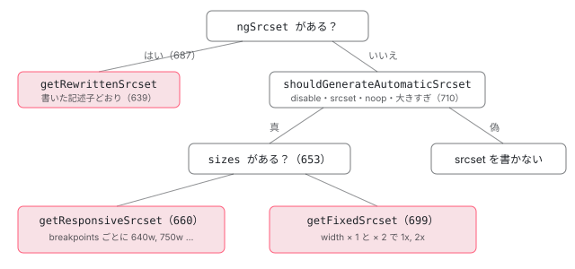

[目次](../README.md) › [common の内側](README.md) › 第 14 回 / 全 20 回

# srcset と sizes：自動で作る候補の幅

> updateSrcAndSrcset が getRewrittenSrcset（ngSrcset）・getResponsiveSrcset（sizes があるとき。config の breakpoints の幅の候補。sizes がちょうど 100vw なら VIEWPORT\_BREAKPOINT\_CUTOFF の 640 未満を捨てる）・getFixedSrcset（sizes が無いとき。DENSITY\_SRCSET\_MULTIPLIERS の 1x・2x）に分かれる行と、自動で作らない 4 つの条件、ngSrcset の書式と密度の上限、fill のときの sizes の既定、遅延読み込みの sizes="auto, …" と destroy で loading を外す修正（c1312da1832）。ページの上で、本物の NgOptimizedImage に幅と sizes を渡して srcset を見るデモ。

angular/angular · 読了 約 13 分 · 発展 · [サイトで読む（デモが動きます）](https://angular-deep-dive-cyan.vercel.app/chapter/cmn-image-srcset)

---

`srcset` は「同じ画像の大きさ違いの候補」を並べる属性で、`sizes` は「この画像は画面でどれくらいの幅に描かれるか」をブラウザに伝える属性です。ブラウザはこの 2 つと画面の密度から、どの候補を取りに行くかを決めます。`NgOptimizedImage` は、ローダーがあれば `srcset` を自分で作ります。この章では、`ngSrcset`・`sizes`・`fill`・`width` のどれがあるかで、どの関数の分かれを通り、どの幅の候補ができるのかを行で追います。

読む対象は `packages/common/src/directives/ng_optimized_image/ng_optimized_image.ts` の 62〜113 行目の定数と 627〜722 行目の関数、core の `packages/core/src/application/application_tokens.ts` の既定の breakpoints、spec の `ng_optimized_image_spec.ts` です。

1. [1. 全体像](01-cmn-overview.md)
2. [2. NgClass と NgStyle](02-cmn-ng-class-style.md)
3. [3. NgForOf](03-cmn-ng-for-of.md)
4. [4. NgIf と NgSwitch](04-cmn-ng-if-switch.md)
5. [5. outlet](05-cmn-outlets.md)
6. [6. pipe の仕組み](06-cmn-pipe-mechanism.md)
7. [7. 小さな pipe](07-cmn-simple-pipes.md)
8. [8. KeyValuePipe](08-cmn-keyvalue-pipe.md)
9. [9. DatePipe](09-cmn-date-pipe.md)
10. [10. 日付の書式](10-cmn-format-date.md)
11. [11. 日付の部品](11-cmn-date-getters.md)
12. [12. 数の書式](12-cmn-format-number.md)
13. [13. NgOptimizedImage](13-cmn-image-overview.md)
14. **14. srcset と sizes**（この章）
15. [15. 画像のローダー](15-cmn-image-loaders.md)
16. [16. LCP と preload](16-cmn-image-lcp-preload.md)
17. [17. Location](17-cmn-location.md)
18. [18. テスト用の Location](18-cmn-location-testing.md)
19. [19. ViewportScroller](19-cmn-viewport-scroller.md)
20. [20. issue と PR を読む](20-cmn-issues.md)

[第 13 回](13-cmn-image-overview.md)で、`setHostAttributes` が width・height・loading・fetchpriority・decoding を書いたあと、最後に `updateSrcAndSrcset` を呼ぶところまで読みました。ここはその続きです。候補の URL を作るのは `IMAGE_LOADER` の関数で、その中身は[第 15 回](15-cmn-image-loaders.md)です。この章では「どの幅でローダーを呼ぶか」だけを見ます。

## 1. 定数と既定の breakpoints

📄 `angular/packages/common/src/directives/ng_optimized_image/ng_optimized_image.ts` L62–95 （▶ の行: 66, 72, 79, 85, 90, 95）

```ts
62 │ /**
63 │  * RegExpr to determine whether a src in a srcset is using width descriptors.
64 │  * Should match something like: "100w, 200w".
65 │  */
66 ▶ const VALID_WIDTH_DESCRIPTOR_SRCSET = /^((\s*\d+w\s*(,|$)){1,})$/;
67 │ 
68 │ /**
69 │  * RegExpr to determine whether a src in a srcset is using density descriptors.
70 │  * Should match something like: "1x, 2x, 50x". Also supports decimals like "1.5x, 1.50x".
71 │  */
72 ▶ const VALID_DENSITY_DESCRIPTOR_SRCSET = /^((\s*\d+(\.\d+)?x\s*(,|$)){1,})$/;
73 │ 
74 │ /**
75 │  * Srcset values with a density descriptor higher than this value will actively
76 │  * throw an error. Such densities are not permitted as they cause image sizes
77 │  * to be unreasonably large and slow down LCP.
78 │  */
79 ▶ export const ABSOLUTE_SRCSET_DENSITY_CAP = 3;
80 │ 
81 │ /**
82 │  * Used only in error message text to communicate best practices, as we will
83 │  * only throw based on the slightly more conservative ABSOLUTE_SRCSET_DENSITY_CAP.
84 │  */
85 ▶ export const RECOMMENDED_SRCSET_DENSITY_CAP = 2;
86 │ 
87 │ /**
88 │  * Used in generating automatic density-based srcsets
89 │  */
90 ▶ const DENSITY_SRCSET_MULTIPLIERS = [1, 2];
91 │ 
92 │ /**
93 │  * Used to determine which breakpoints to use on full-width images
94 │  */
95 ▶ const VIEWPORT_BREAKPOINT_CUTOFF = 640;
```

📄 `angular/packages/common/src/directives/ng_optimized_image/ng_optimized_image.ts` L101–113 （▶ の行: 112–113）

```ts
101 │ /**
102 │  * Used to determine whether the image has been requested at an overly
103 │  * large size compared to the actual rendered image size (after taking
104 │  * into account a typical device pixel ratio). In pixels.
105 │  */
106 │ const OVERSIZED_IMAGE_TOLERANCE = 1000;
107 │ 
108 │ /**
109 │  * Used to limit automatic srcset generation of very large sources for
110 │  * fixed-size images. In pixels.
111 │  */
112 ▶ const FIXED_SRCSET_WIDTH_LIMIT = 1920;
113 ▶ const FIXED_SRCSET_HEIGHT_LIMIT = 1080;
```

- 66 行目 `VALID_WIDTH_DESCRIPTOR_SRCSET`：`"100w, 200w"` のような「幅の記述子」だけの並び。72 行目は `"1x, 1.5x"` のような「密度の記述子」だけの並び。`ngSrcset` の書式の検査と、分かれ（3 節）に使います。
- 79 行目：密度が 3 を超える `ngSrcset` は例外。85 行目の 2 は例外の文の中で勧める値です（6 節）。
- 90 行目：`sizes` が無いときに自動で作る密度の候補は 1x と 2x。
- 95 行目：`sizes="100vw"` のときは 640px 未満の候補を捨てる境目（4 節）。
- 112〜113 行目：`sizes` が無いとき、width が 1920 か height が 1080 を超える画像は自動の srcset を作らない（5 節）。

📄 `angular/packages/core/src/application/application_tokens.ts` L161–173 （▶ の行: 162, 169–170）

```ts
161 │ export type ImageConfig = {
162 ▶   breakpoints?: number[];
163 │   placeholderResolution?: number;
164 │   disableImageSizeWarning?: boolean;
165 │   disableImageLazyLoadWarning?: boolean;
166 │ };
167 │ 
168 │ export const IMAGE_CONFIG_DEFAULTS: ImageConfig = {
169 ▶   breakpoints: [16, 32, 48, 64, 96, 128, 256, 384, 640, 750, 828, 1080, 1200, 1920, 2048, 3840],
170 ▶   placeholderResolution: 30,
171 │   disableImageSizeWarning: false,
172 │   disableImageLazyLoadWarning: false,
173 │ };
```

📄 `angular/packages/common/src/directives/ng_optimized_image/ng_optimized_image.ts` L786–795 （▶ の行: 791–792, 794）

```ts
786 │ /**
787 │  * Sorts provided config breakpoints and uses defaults.
788 │  */
789 │ function processConfig(config: ImageConfig): ImageConfig {
790 │   let sortedBreakpoints: {breakpoints?: number[]} = {};
791 ▶   if (config.breakpoints) {
792 ▶     sortedBreakpoints.breakpoints = config.breakpoints.sort((a, b) => a - b);
793 │   }
794 ▶   return Object.assign({}, IMAGE_CONFIG_DEFAULTS, config, sortedBreakpoints);
795 │ }
```

169 行目の 16 個が既定の breakpoints（幅の候補）です。`IMAGE_CONFIG` で `breakpoints` を渡すと、792 行目で小さい順に並べ、794 行目で既定・利用者の設定・並べた breakpoints の順に重ねます。`processConfig` は 274 行目（[第 13 回](13-cmn-image-overview.md)の引用）でディレクティブのインスタンスごとに呼ばれます。792 行目の `sort` は渡された配列そのものを並べ替えます（新しい配列を作らない）。`IMAGE_CONFIG` のトークンの作りは[第 15 回](15-cmn-image-loaders.md)です。

## 2. updateSrcAndSrcset：src を書き、srcset を選ぶ

📄 `angular/packages/common/src/directives/ng_optimized_image/ng_optimized_image.ts` L676–697 （▶ の行: 677, 680, 683–684, 687–690, 693–694, 696）

```ts
676 │   private updateSrcAndSrcset(forceSrcRecalc = false): string | undefined {
677 ▶     if (forceSrcRecalc) {
678 │       // Reset cached value, so that the followup `getRewrittenSrc()` call
679 │       // will recalculate it and update the cache.
680 ▶       this._renderedSrc = null;
681 │     }
682 │ 
683 ▶     const rewrittenSrc = this.getRewrittenSrc();
684 ▶     this.setHostAttribute('src', rewrittenSrc);
685 │ 
686 │     let rewrittenSrcset: string | undefined = undefined;
687 ▶     if (this.ngSrcset) {
688 ▶       rewrittenSrcset = this.getRewrittenSrcset();
689 ▶     } else if (this.shouldGenerateAutomaticSrcset()) {
690 ▶       rewrittenSrcset = this.getAutomaticSrcset();
691 │     }
692 │ 
693 ▶     if (rewrittenSrcset) {
694 ▶       this.setHostAttribute('srcset', rewrittenSrcset);
695 │     }
696 ▶     return rewrittenSrcset;
697 │   }
```

📄 `angular/packages/common/src/directives/ng_optimized_image/ng_optimized_image.ts` L627–658 （▶ の行: 628–632, 634, 640–641, 643, 645–647, 649, 653–654, 656）

```ts
627 │   private getRewrittenSrc(): string {
628 ▶     // ImageLoaderConfig supports setting a width property. However, we're not setting width here
629 ▶     // because if the developer uses rendered width instead of intrinsic width in the HTML width
630 ▶     // attribute, the image requested may be too small for 2x+ screens.
631 ▶     if (!this._renderedSrc) {
632 ▶       const imgConfig = {src: this.ngSrc};
633 │       // Cache calculated image src to reuse it later in the code.
634 ▶       this._renderedSrc = this.callImageLoader(imgConfig);
635 │     }
636 │     return this._renderedSrc;
637 │   }
638 │ 
639 │   private getRewrittenSrcset(): string {
640 ▶     const widthSrcSet = VALID_WIDTH_DESCRIPTOR_SRCSET.test(this.ngSrcset);
641 ▶     const finalSrcs = this.ngSrcset
642 │       .split(',')
643 ▶       .filter((src) => src !== '')
644 │       .map((srcStr) => {
645 ▶         srcStr = srcStr.trim();
646 ▶         const width = widthSrcSet ? parseFloat(srcStr) : parseFloat(srcStr) * this.width!;
647 ▶         return `${this.callImageLoader({src: this.ngSrc, width})} ${srcStr}`;
648 │       });
649 ▶     return finalSrcs.join(', ');
650 │   }
651 │ 
652 │   private getAutomaticSrcset(): string {
653 ▶     if (this.sizes) {
654 ▶       return this.getResponsiveSrcset();
655 │     } else {
656 ▶       return this.getFixedSrcset();
657 │     }
658 │   }
```

1. **683〜684 行目：src は幅なしでローダーを 1 回呼ぶ**

   `getRewrittenSrc`（631〜636 行目）は `{src: this.ngSrc}` だけでローダーを呼び、結果を `_renderedSrc` に覚えます。628〜630 行目のコメントのとおり、幅を入れないのは 「利用者が width に描く幅（本来の画像の幅でなく）を書いていると、2 倍の画面で小さすぎる画像になる」からです。`src` は srcset を使えないブラウザのための予備です。
2. **687〜688 行目：`ngSrcset` があればそれを使う**

   `getRewrittenSrcset`（639〜650 行目）は 642 行目でカンマで割り、643 行目で空を捨て（末尾のカンマを許す）、646 行目で幅を決めます。幅の記述子なら `parseFloat("200w")` の 200、密度の記述子なら `parseFloat("1.5x") * width`。どちらも 647 行目で「ローダーの URL + 元の記述子」にします。
3. **689〜690 行目：無ければ、作ってよいときだけ自動で作る**

   `shouldGenerateAutomaticSrcset`（5 節）が真なら `getAutomaticSrcset`（652〜658 行目）。`sizes` があれば 4 節の `getResponsiveSrcset`、無ければ 5 節の `getFixedSrcset` です。
4. **693〜696 行目：できたときだけ書く**

   空なら `srcset` 属性は書きません。返した値は、サーバーで preload の `<link imagesrcset>` に使います（[第 16 回](16-cmn-image-lcp-preload.md)）。677〜681 行目は `ngSrc` が変わったとき（第 13 回の `ngOnChanges` から `updateSrcAndSrcset(true)`）に覚えた src を捨てる分かれです。



*updateSrcAndSrcset の分かれ。ngSrcset が最優先。無ければ shouldGenerateAutomaticSrcset で作るかを決め、sizes の有無で幅の候補か密度の候補かに分かれる。*

## 3. ngSrcset の書式と密度の上限

📄 `angular/packages/common/src/directives/ng_optimized_image/ng_optimized_image.ts` L969–992 （▶ の行: 973–974, 976–977, 979–980, 983–985）

```ts
969 │ /**
970 │  * Verifies that the `ngSrcset` is in a valid format, e.g. "100w, 200w" or "1x, 2x".
971 │  */
972 │ export function assertValidNgSrcset(dir: NgOptimizedImage, value: unknown) {
973 ▶   if (value == null) return;
974 ▶   assertNonEmptyInput(dir, 'ngSrcset', value);
975 │   const stringVal = value as string;
976 ▶   const isValidWidthDescriptor = VALID_WIDTH_DESCRIPTOR_SRCSET.test(stringVal);
977 ▶   const isValidDensityDescriptor = VALID_DENSITY_DESCRIPTOR_SRCSET.test(stringVal);
978 │ 
979 ▶   if (isValidDensityDescriptor) {
980 ▶     assertUnderDensityCap(dir, stringVal);
981 │   }
982 │ 
983 ▶   const isValidSrcset = isValidWidthDescriptor || isValidDensityDescriptor;
984 ▶   if (!isValidSrcset) {
985 ▶     throw new RuntimeError(
986 │       RuntimeErrorCode.INVALID_INPUT,
987 │       `${imgDirectiveDetails(dir.ngSrc)} \`ngSrcset\` has an invalid value (\`${value}\`). ` +
988 │         `To fix this, supply \`ngSrcset\` using a comma-separated list of one or more width ` +
989 │         `descriptors (e.g. "100w, 200w") or density descriptors (e.g. "1x, 2x").`,
990 │     );
991 │   }
992 │ }
```

📄 `angular/packages/common/src/directives/ng_optimized_image/ng_optimized_image.ts` L994–1010 （▶ の行: 995–999）

```ts
 994 │ function assertUnderDensityCap(dir: NgOptimizedImage, value: string) {
 995 ▶   const underDensityCap = value
 996 ▶     .split(',')
 997 ▶     .every((num) => num === '' || parseFloat(num) <= ABSOLUTE_SRCSET_DENSITY_CAP);
 998 ▶   if (!underDensityCap) {
 999 ▶     throw new RuntimeError(
1000 │       RuntimeErrorCode.INVALID_INPUT,
1001 │       `${imgDirectiveDetails(dir.ngSrc)} the \`ngSrcset\` contains an unsupported image density:` +
1002 │         `\`${value}\`. NgOptimizedImage generally recommends a max image density of ` +
1003 │         `${RECOMMENDED_SRCSET_DENSITY_CAP}x but supports image densities up to ` +
1004 │         `${ABSOLUTE_SRCSET_DENSITY_CAP}x. The human eye cannot distinguish between image densities ` +
1005 │         `greater than ${RECOMMENDED_SRCSET_DENSITY_CAP}x - which makes them unnecessary for ` +
1006 │         `most use cases. Images that will be pinch-zoomed are typically the primary use case for ` +
1007 │         `${ABSOLUTE_SRCSET_DENSITY_CAP}x images. Please remove the high density descriptor and try again.`,
1008 │     );
1009 │   }
1010 │ }
```

- 973 行目：`null` と `undefined` は検査しない（`ngSrcset` は省略できる）。974 行目で空の文字列は拒みます。
- 976〜977 行目：66 行目と 72 行目の正規表現の**どちらか一方に全体が合う**こと（983 行目）。`"100w, 2x"` のように混ぜると、どちらにも合わず 984 行目で例外です。
- 979〜980 行目 → 995〜997 行目：密度の記述子なら、カンマで割った各値の `parseFloat` が 3 以下であること。`"1x, 4x"` は 998 行目で例外です。
- この検査は[第 13 回](13-cmn-image-overview.md)の `ngOnInit` の 428 行目から呼ばれるので、開発モードだけです。

## 4. getResponsiveSrcset：sizes があるとき

📄 `angular/packages/common/src/directives/ng_optimized_image/ng_optimized_image.ts` L660–674 （▶ の行: 661, 663–664, 667, 670–671, 673）

```ts
660 │   private getResponsiveSrcset(): string {
661 ▶     const {breakpoints} = this.config;
662 │ 
663 ▶     let filteredBreakpoints = breakpoints!;
664 ▶     if (this.sizes?.trim() === '100vw') {
665 │       // Since this is a full-screen-width image, our srcset only needs to include
666 │       // breakpoints with full viewport widths.
667 ▶       filteredBreakpoints = breakpoints!.filter((bp) => bp >= VIEWPORT_BREAKPOINT_CUTOFF);
668 │     }
669 │ 
670 ▶     const finalSrcs = filteredBreakpoints.map(
671 ▶       (bp) => `${this.callImageLoader({src: this.ngSrc, width: bp})} ${bp}w`,
672 │     );
673 ▶     return finalSrcs.join(', ');
674 │   }
```

1. **661 行目：breakpoints は `IMAGE_CONFIG` から**

   1 節の 794 行目で既定と重ねたものなので、利用者が何も渡さなければ 169 行目の 16 個です。
2. **664〜668 行目：`sizes` がちょうど `100vw` なら 640 未満を捨てる**

   画面いっぱいの画像なら、640px より狭い候補は（携帯の画面でも）使われない、という考えです。比べは `this.sizes?.trim() === '100vw'` の**完全一致**なので、`(max-width: 768px) 100vw, 100vw` のような書き方では捨てずに 16 個とも使います。
3. **670〜673 行目：breakpoint ごとにローダーを呼び、`bp + "w"` を付ける**

   幅の候補なので、ブラウザが `sizes` の幅と画面の密度から 1 つ選びます。`width` の入力は幅としては使いません（縦横比から高さを出すのには使う。[第 15 回](15-cmn-image-loaders.md)の `callImageLoader`）。

## 5. getFixedSrcset と、作らない条件

📄 `angular/packages/common/src/directives/ng_optimized_image/ng_optimized_image.ts` L699–722 （▶ の行: 700, 704–705, 712–714, 717–720）

```ts
699 │   private getFixedSrcset(): string {
700 ▶     const finalSrcs = DENSITY_SRCSET_MULTIPLIERS.map(
701 │       (multiplier) =>
702 │         `${this.callImageLoader({
703 │           src: this.ngSrc,
704 ▶           width: this.width! * multiplier,
705 ▶         })} ${multiplier}x`,
706 │     );
707 │     return finalSrcs.join(', ');
708 │   }
709 │ 
710 │   private shouldGenerateAutomaticSrcset(): boolean {
711 │     let oversizedImage = false;
712 ▶     if (!this.sizes) {
713 ▶       oversizedImage =
714 ▶         this.width! > FIXED_SRCSET_WIDTH_LIMIT || this.height! > FIXED_SRCSET_HEIGHT_LIMIT;
715 │     }
716 │     return (
717 ▶       !this.disableOptimizedSrcset &&
718 ▶       !this.srcset &&
719 ▶       this.imageLoader !== noopImageLoader &&
720 ▶       !oversizedImage
721 │     );
722 │   }
```

1. **700〜707 行目：width × 1 と width × 2**

   `sizes` が無い画像は「描く幅は width で決まっている」とみなし、90 行目の `[1, 2]` を掛けた幅でローダーを呼び、`1x`・`2x` を付けます。
2. **712〜715 行目：sizes が無くて大きすぎる画像は作らない**

   width &gt; 1920 か height &gt; 1080 なら 2 倍の候補が大きくなりすぎるので、自動の srcset を作りません（src だけ）。`sizes` があればこの比べはしないので、幅の候補で作ります。
3. **717〜720 行目：ほかに作らない 3 つ**

   `disableOptimizedSrcset` が真（717 行目）、利用者が `srcset` を書いた（718 行目。ただし `ngSrcset` なしで `srcset` を書いても、[第 13 回](13-cmn-image-overview.md)の検査は `ngSrcset` があるときしか見ない）、ローダーが既定の `noopImageLoader`（719 行目。どの幅でも同じ URL が返るので候補にならない）。

## 6. sizes を書く：fill の既定と auto

📄 `angular/packages/common/src/directives/ng_optimized_image/ng_optimized_image.ts` L488–491 （▶ の行: 489–490）

```ts
488 │     // only be reflected and not found by the browser)
489 ▶     if (this.fill) {
490 ▶       this.sizes ||= '100vw';
491 │     } else {
```

📄 `angular/packages/common/src/directives/ng_optimized_image/ng_optimized_image.ts` L504–522 （▶ の行: 506, 508–510, 512, 516–518, 520）

```ts
504 │     // The `src` and `srcset` attributes should be set last since other attributes
505 │     // could affect the image's loading behavior.
506 ▶     const rewrittenSrcset = this.updateSrcAndSrcset();
507 │ 
508 ▶     if (this.sizes) {
509 ▶       if (this.getLoadingBehavior() === 'lazy') {
510 ▶         this.setHostAttribute('sizes', 'auto, ' + this.sizes);
511 │       } else {
512 ▶         this.setHostAttribute('sizes', this.sizes);
513 │       }
514 │     } else {
515 │       if (
516 ▶         this.ngSrcset &&
517 ▶         VALID_WIDTH_DESCRIPTOR_SRCSET.test(this.ngSrcset) &&
518 ▶         this.getLoadingBehavior() === 'lazy'
519 │       ) {
520 ▶         this.setHostAttribute('sizes', 'auto, 100vw');
521 │       }
522 │     }
```

1. **489〜490 行目：fill なら sizes の既定は 100vw**

   `updateSrcAndSrcset`（506 行目）より**前**に `this.sizes` を埋めるので、fill の画像は必ず 4 節の幅の候補になり、しかも 664 行目の `100vw` の分かれで 640 以上の 8 個だけになります。`||=` なので、利用者が `sizes` を書いていればそちらが残ります。
2. **508〜513 行目：遅延読み込みなら頭に `auto, `**

   HTML の `sizes="auto"` は「`loading="lazy"` の画像なら、描かれた幅をそのまま使って」という指定です。分からないブラウザは `auto` を飛ばして次の値を使います。`loading` は第 13 回の `getLoadingBehavior` の答えなので、何も書かない画像は `auto, 50vw` のようになり、priority や `loading="eager"` なら書いた値のままです。
3. **515〜521 行目：sizes が無くても、幅の記述子の ngSrcset で遅延なら `auto, 100vw`**

   幅の記述子は `sizes` が無いとブラウザが `100vw` とみなすので、その前に `auto` を足して描かれた幅を使わせます。密度の記述子（`1x, 2x`）では書きません。

📄 `angular/packages/common/src/directives/ng_optimized_image/ng_optimized_image.ts` L848–862 （▶ の行: 853–854）

```ts
848 │ /**
849 │  * Verifies that the 'sizes' only includes responsive values.
850 │  */
851 │ function assertNoComplexSizes(dir: NgOptimizedImage) {
852 │   let sizes = dir.sizes;
853 ▶   if (sizes?.match(/((\)|,)\s|^)\d+px/)) {
854 ▶     throw new RuntimeError(
855 │       RuntimeErrorCode.INVALID_INPUT,
856 │       `${imgDirectiveDetails(dir.ngSrc, false)} \`sizes\` was set to a string including ` +
857 │         `pixel values. For automatic \`srcset\` generation, \`sizes\` must only include responsive ` +
858 │         `values, such as \`sizes="50vw"\` or \`sizes="(min-width: 768px) 50vw, 100vw"\`. ` +
859 │         `To fix this, modify the \`sizes\` attribute, or provide your own \`ngSrcset\` value directly.`,
860 │     );
861 │   }
862 │ }
```

853 行目の正規表現は、先頭か `) `・`, ` の直後に来る `数字px` を探します。`(min-width: 768px) 500px, 100vw` の `) 500px` が当たり、例外になります（条件の中の `768px` は `: ` の後なので当たらない）。自動の srcset は breakpoints の幅しか作らないので、px の固定の幅を書くなら自分で `ngSrcset` を書いて、という意味です。[第 13 回](13-cmn-image-overview.md)の 458〜460 行目のとおり、`ngSrcset` があるときはこの検査をしません。

## 7. destroy のときに loading を外す（c1312da1832）

📄 `angular/packages/common/src/directives/ng_optimized_image/ng_optimized_image.ts` L410–419 （▶ の行: 411–413, 416–417）

```ts
410 │ 
411 ▶     // Browsers might re-evaluate the image during DOM teardown when using `sizes="auto"`
412 ▶     // with `loading="lazy"`, potentially triggering an unnecessary image fetch.
413 ▶     // This is expected behavior per the HTML spec
414 │     // See: https://html.spec.whatwg.org/multipage/images.html#sizes-attributes
415 │     // See also: https://github.com/angular/angular/issues/67055#issuecomment-3898513831
416 ▶     this.destroyRef.onDestroy(() => {
417 ▶       this.renderer.removeAttribute(this.imgElement, 'loading');
418 │     });
419 │   }
```

コンストラクタで `DestroyRef.onDestroy` に「`loading` 属性を外す」を登録します。開発モードに関係なく、本番でも走ります。issue #67055（2026-02）は「`sizes="auto, …"` の画像があるコンポーネントから別のルートに移ると、Chromium が `100vw` に合う大きな候補を取りに行く」という報告でした。HTML の仕様では `auto` は「auto-sizes を許す画像（`loading="lazy"`）が描かれているとき」だけ使われ、そうでないときは無視されて次の値（ここでは `100vw`）になります。issue のコメントでは `eager` では起きないと確かめられていて、c1312da1832（2026-03-17）は、破棄のときに 417 行目で `loading` を外す 9 行を足しました。spec は足していません。

> **🧪 DEMO — 本物の NgOptimizedImage に width・sizes・ngSrcset・fill を渡して、srcset と sizes を見る**
>
> 「作る」を押すと、`` を 1 つ持つ小さなコンポーネントを `createComponent` で作り、このサイトの本物の `NgOptimizedImage`（22.1.6）に属性を書かせて読み、すぐ destroy します（画面には描きません。読み込みが始まる前に片付けるので、読み込み後の検査も通信も起きません）。`IMAGE_LOADER` は、受け取った `config` を記録して、その大きさの SVG を `data:` の URL で返す関数に差し替えています。「ローダーが受け取った config」の表は、本物のディレクティブが渡した値そのものです。「通った分かれ」だけは、入力から条件を言葉にした移植です（ディレクティブの中は覗けないため）。
>
> ▶ [このデモはサイトで動かせます](https://angular-deep-dive-cyan.vercel.app/chapter/cmn-image-srcset)

試すと良い組：「sizes="50vw"」と「sizes="100vw"」で候補の数が 16 と 8 に変わります（664 行目）。「sizes に条件」は `100vw` を含んでいても 16 個です（完全一致でないため）。「width 2000（大きすぎ）」は srcset なし、「width 2000 + sizes」は幅の候補ができます（712〜714 行目）。「ngSrcset="1x, 1.5x, 2x"」はローダーの width が 400・600・800 になります（646 行目）。breakpoints に `1280, 320, 640` と入れて「sizes="50vw"」で作ると、候補は 320・640・1280 の順に並びます（792 行目の並べ替え）。どの組でも、destroy の後の loading は「なし」です（417 行目）。ローダーの config に height が入っているのは、width と height の比から `callImageLoader` が足した値です（第 15 回）。

## 8. ここまでを 1 本に

- 👤 `` — あなたのテンプレート（ローダーあり）
- `setHostAttributes()` — L486 — *第 13 回*
  - `updateSrcAndSrcset()` — L676
    - `getRewrittenSrc()` → `loader({src})` — L627-637 — *src*
    - `shouldGenerateAutomaticSrcset()` → true — L710-722
    - `getAutomaticSrcset()` → `getResponsiveSrcset()` — L652-674 — *16 個の breakpoints で loader({src, width: bp})*
    - `setAttribute('srcset', '… 16w, … 32w, …')` — L694
  - `setAttribute('sizes', 'auto, 50vw')` — L510 — *loading が lazy なので*
- 👤 `ルートを離れる` — ブラウザ
  - `destroyRef.onDestroy` → `removeAttribute('loading')` — L416-418 — *c1312da1832*

## テストと直し方

### spec と describe

| spec | describe / it | どこで走るか |
| --- | --- | --- |
| common/test/directives/ng\_optimized\_image\_spec.ts | describe `fill mode`（1018 行目。sizes の既定と auto）、describe `loaders`（1733 行目）の中の `` `ngSrcset` values ``（2191）・`sizes attribute`（2351）・`automatic srcset generation`（2420）、describe `setup error handling` の中の ``invalid `ngSrcset` values``（519） | Node でも走る（`isBrowser` で止める行が無い） |

📄 `angular/packages/common/test/directives/ng_optimized_image_spec.ts` L2440–2454 （▶ の行: 2444, 2451–2452）

```ts
2440 │       it('should add a responsive srcset to the img element if sizes attribute exists', async () => {
2441 │         setupTestingModule({imageLoader});
2442 │ 
2443 │         const template = `
2444 ▶       
2445 │     `;
2446 │         const fixture = createTestComponent(template);
2447 │         await fixture.whenStable();
2448 │ 
2449 │         const nativeElement = fixture.nativeElement as HTMLElement;
2450 │         const img = nativeElement.querySelector('img')!;
2451 ▶         expect(img.getAttribute('srcset')).toBe(
2452 ▶           `${IMG_BASE_URL}/img?w=640 640w, ${IMG_BASE_URL}/img?w=750 750w, ${IMG_BASE_URL}/img?w=828 828w, ${IMG_BASE_URL}/img?w=1080 1080w, ${IMG_BASE_URL}/img?w=1200 1200w, ${IMG_BASE_URL}/img?w=1920 1920w, ${IMG_BASE_URL}/img?w=2048 2048w, ${IMG_BASE_URL}/img?w=3840 3840w`,
2453 │         );
2454 │       });
```

📄 `angular/packages/common/test/directives/ng_optimized_image_spec.ts` L2472–2486 （▶ の行: 2476, 2483–2484）

```ts
2472 │       it('should add a fixed srcset to the img element if sizes attribute does not exist', async () => {
2473 │         setupTestingModule({imageLoader});
2474 │ 
2475 │         const template = `
2476 ▶       
2477 │     `;
2478 │         const fixture = createTestComponent(template);
2479 │         await fixture.whenStable();
2480 │ 
2481 │         const nativeElement = fixture.nativeElement as HTMLElement;
2482 │         const img = nativeElement.querySelector('img')!;
2483 ▶         expect(img.getAttribute('srcset')).toBe(
2484 ▶           `${IMG_BASE_URL}/img?w=100 1x, ${IMG_BASE_URL}/img?w=200 2x`,
2485 │         );
2486 │       });
```

2444 行目の `sizes="100vw"` で 640w からの 8 個（4 節の 664〜667 行目）、2476 行目の `sizes` なしで `?w=100 1x, ?w=200 2x`（5 節の 700〜707 行目）を確かめています。

📄 `angular/packages/common/test/directives/ng_optimized_image_spec.ts` L2369–2384 （▶ の行: 2374, 2381–2382）

```ts
2369 │       it('should prepend sizes="auto" to a lazy-loaded image', async () => {
2370 │         setupTestingModule();
2371 │ 
2372 │         const template =
2373 │           '';
2375 │         const fixture = createTestComponent(template);
2376 │         await fixture.whenStable();
2377 │ 
2378 │         const nativeElement = fixture.nativeElement as HTMLElement;
2379 │         const img = nativeElement.querySelector('img')!;
2380 │ 
2381 ▶         expect(img.getAttribute('sizes')).toBe(
2382 ▶           'auto, (max-width: 768px) 100vw, (max-width: 1200px) 50vw, 33vw',
2383 │         );
2384 │       });
```

📄 `angular/packages/common/test/directives/ng_optimized_image_spec.ts` L1101–1111 （▶ の行: 1104, 1110）

```ts
1101 │     it('should add auto sizes to default in fill mode when lazy', async () => {
1102 │       setupTestingModule();
1103 │ 
1104 ▶       const template = '';
1105 │ 
1106 │       const fixture = createTestComponent(template);
1107 │       await fixture.whenStable();
1108 │       const nativeElement = fixture.nativeElement as HTMLElement;
1109 │       const img = nativeElement.querySelector('img')!;
1110 ▶       expect(img.getAttribute('sizes')).toBe('auto, 100vw');
1111 │     });
```

2381〜2382 行目は 6 節の 510 行目、1110 行目は 490 行目と 510 行目の組み合わせ（fill で sizes が無い → `100vw` → 遅延なので `auto, 100vw`）です。

### 手元で走らせた結果

📄 `ターミナル（../angular で）`

```
cd ~/angular-research/angular
pnpm bazel test //packages/common/test:test --nocache_test_results --test_output=all \
  "--test_arg=--filter=Image directive (fill mode|loaders .ngSrcset. values|loaders sizes attribute|loaders automatic srcset generation)"
```

📄 `出力（2026-11-05 に実行。抜粋。ログは scratchpad/cmn-logs/e-ss.log）`

```
Ran 36 of 667 specs
36 specs, 0 failures
Finished in 0.13 seconds
//packages/common/test:test                                              PASSED in 0.8s
```

- 36 件 = `fill mode` 11 件 ＋ `` `ngSrcset` values `` 9 件 ＋ `sizes attribute` 5 件 ＋ `automatic srcset generation` 11 件。どれも Node の DOM で属性を読むだけなので、Node で中身まで走ります。
- ブラウザ（`//packages/common/test:test_web_chromium`）でも common の spec を全部走らせ、この章の spec は失敗に入っていません（676 件成功。失敗 2 件は DatePipe と formatDate の日付のずれ。[第 13 回](13-cmn-image-overview.md)）。

### 直すとしたら

- 候補の作り方は `getRewrittenSrcset`・`getResponsiveSrcset`・`getFixedSrcset`（639〜708 行目）、作るかどうかは `shouldGenerateAutomaticSrcset`（710〜722 行目）、sizes は 508〜522 行目です。spec は describe `automatic srcset generation` の形（ローダーを渡して `img.getAttribute('srcset')` を比べる）で足します。
- **手元の木より新しい修正**：issue #49335（2023 年。`disableOptimizedSrcset` と `[srcset]` のバインドを一緒に使うと srcset が付かない）は、main の 2cecc4aa608（2026-09-29 にマージ）で閉じました。`[srcset]` は第 13 回で見た `@internal` の `srcset` の入力に入ってしまい `img` に届かないので、`updateSrcAndSrcset` の 693〜695 行目の `if (rewrittenSrcset)` に 「`else if (this.disableOptimizedSrcset && this.srcset)` なら利用者の値をそのまま書く」を足し、spec を 16 行足しています。手元の木（8576f161ae4、2026-09-06）にも、このサイトの 22.1.6 にも入っていません。
- c1312da1832（7 節）は spec を足していない修正です。destroy の後に `loading` 属性が無いことを見る it は、describe `sizes attribute` に「描いて `fixture.destroy()` して `img.hasAttribute('loading')` を見る」形で書けます（DEMO の「destroy の後」の列が同じことを見ています）。
- open の issue：#59495（`assertNoComplexSizes` を外してほしい）、#57145（自分で書いた srcset と一緒に使いたい）、#54100（大きさが分からない画像で密度の候補を柔軟に）、#51261（`ngSrcset` が偽のときに既定に戻る）。どれも 6 節と 2 節の分かれのどこを変える話かを当ててから読むと速く読めます（[第 20 回](20-cmn-issues.md)）。
- 本家に PR を出すことは勧めません。issue を読むときに、DEMO で同じ入力を入れて「どの分かれを通ったか」を先に確かめる手がかりにします。

## 聞かれそうな質問

**Q. ローダーを入れていないのに srcset が付きません。なぜ？**

719 行目で、ローダーが既定の `noopImageLoader` なら自動の srcset を作らないからです。どの幅で呼んでも同じ URL が返るので、候補にする意味がありません（spec の it `should not generate a srcset if the default noop loader is used`）。

**Q. sizes を書くと何が変わりますか？**

候補が「密度の 1x・2x」（699〜708 行目）から「breakpoints の幅」（660〜674 行目）に変わります。653 行目の分かれです。さらに遅延読み込みなら、書いた値の頭に `auto, ` が付きます（510 行目）。

**Q. fill の画像の srcset が 640w からなのはなぜ？**

490 行目で `sizes` の既定が `100vw` になり、664〜667 行目で 95 行目の 640 未満を捨てるからです。fill でも `sizes="50vw"` などを書けば 16 個とも使います。

**Q. width="2400" の画像に srcset が付きません。**

`sizes` が無いと 712〜714 行目で 112 行目の 1920 を超えるので、自動で作りません。表示の幅を `sizes` に書けば、幅の候補で作ります（spec の it `should add a responsive srcset to the img element if width is too large`）。

**Q. ngSrcset="1x, 3x" は書けますか？4x は？**

3x までは書けます。995〜997 行目は 79 行目の 3 以下かを見るので、4x は例外です（開発モードだけ）。例外の文は 85 行目の 2x までを勧めます。

## 読み終えて

- src は幅なしでローダーを 1 回呼ぶ。srcset は `ngSrcset` → 自動の順で決まる。
- 自動の srcset は、`sizes` があれば breakpoints の幅の候補、無ければ width の 1x・2x。`sizes` がちょうど `100vw` なら 640 未満を捨てる。
- 作らないのは、disable・`srcset` あり・noop のローダー・`sizes` なしで大きすぎる、の 4 つ。
- fill は `sizes` の既定を `100vw` にする。遅延読み込みの画像の sizes には `auto, ` が付き、destroy では `loading` を外す。

---

← 前: [NgOptimizedImage の全体：入力・検査・img に書く属性](13-cmn-image-overview.md)  
次: [IMAGE\_LOADER と組み込みのローダー：URL を作る関数](15-cmn-image-loaders.md) →
