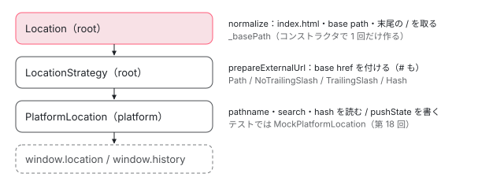

[目次](../README.md) › [common の内側](README.md) › 第 17 回 / 全 20 回

# Location：URL を正規化して読み書きする

> Location の path・prepareExternalUrl・normalize と、util.ts の joinWithSlash・stripTrailingSlash・normalizeQueryParams、\_stripBasePath・\_stripIndexHtml（2026 年 5 月の修正 d109bf90d50）、onUrlChange と subscribe の違い、2025 年 12 月に入った末尾のスラッシュを書くときだけ揃える LocationStrategy（8bbe6dc46c9）。読む側（normalize）と書く側（prepareExternalUrl）で規則が違うこと。ルーターの章で読んだ範囲はリンク。ページの上で、MockPlatformLocation の上に置いた本物の Location に URL を渡して正規化を見るデモ。

angular/angular · 読了 約 12 分 · 中核 · [サイトで読む（デモが動きます）](https://angular-deep-dive-cyan.vercel.app/chapter/cmn-location)

---

`Location` は、ルーターが URL を読み書きするときに通るサービスです。この章では、`location.path()` が base href（アプリを置いた場所の頭の部分。`<base href="/my/app/">` など）と末尾のスラッシュを取り除く行、`location.go('/foo')` が base href を付け直して `history.pushState` に届くまでの行を、1 つずつ追います。読む側（normalize）と書く側（prepareExternalUrl）が別の関数で、同じ規則ではないことを、行と本物の動きで説明できるようにします。

読む対象は `packages/common/src/location/` の `location.ts`（343 行）・`util.ts`（59 行）・`location_strategy.ts`（230 行）・`platform_location.ts`（185 行）です。

1. [1. 全体像](01-cmn-overview.md)
2. [2. NgClass と NgStyle](02-cmn-ng-class-style.md)
3. [3. NgForOf](03-cmn-ng-for-of.md)
4. [4. NgIf と NgSwitch](04-cmn-ng-if-switch.md)
5. [5. outlet](05-cmn-outlets.md)
6. [6. pipe の仕組み](06-cmn-pipe-mechanism.md)
7. [7. 小さな pipe](07-cmn-simple-pipes.md)
8. [8. KeyValuePipe](08-cmn-keyvalue-pipe.md)
9. [9. DatePipe](09-cmn-date-pipe.md)
10. [10. 日付の書式](10-cmn-format-date.md)
11. [11. 日付の部品](11-cmn-date-getters.md)
12. [12. 数の書式](12-cmn-format-number.md)
13. [13. NgOptimizedImage](13-cmn-image-overview.md)
14. [14. srcset と sizes](14-cmn-image-srcset.md)
15. [15. 画像のローダー](15-cmn-image-loaders.md)
16. [16. LCP と preload](16-cmn-image-lcp-preload.md)
17. **17. Location**（この章）
18. [18. テスト用の Location](18-cmn-location-testing.md)
19. [19. ViewportScroller](19-cmn-viewport-scroller.md)
20. [20. issue と PR を読む](20-cmn-issues.md)

ルーターが `Location` をどう呼ぶか（`replaceState` と `go` の使い分け、state に入れるもの）は [ルーターと URL の章](../router/16-router-browser-url.md)、クリックから `history.pushState` までの全体は [SPA の画面遷移の章](../boot/13-boot-spa-navigation.md)、`HashLocationStrategy` の中は [同じルーターと URL の章の 6 節](../router/16-router-browser-url.md)で読んでいます。この章は `Location` の側から見ます。

## 1. 3 段の重なり：Location・LocationStrategy・PlatformLocation

📄 `angular/packages/common/src/location/location_strategy.ts` L39–53 （▶ の行: 39, 41–42, 44, 48–49, 51–52）

```ts
39 ▶ @Injectable({providedIn: 'root', useFactory: () => inject(PathLocationStrategy)})
40 │ export abstract class LocationStrategy {
41 ▶   abstract path(includeHash?: boolean): string;
42 ▶   abstract prepareExternalUrl(internal: string): string;
43 │   abstract getState(): unknown;
44 ▶   abstract pushState(state: any, title: string, url: string, queryParams: string): void;
45 │   abstract replaceState(state: any, title: string, url: string, queryParams: string): void;
46 │   abstract forward(): void;
47 │   abstract back(): void;
48 ▶   historyGo?(relativePosition: number): void {
49 ▶     throw new Error(ngDevMode ? 'Not implemented' : '');
50 │   }
51 ▶   abstract onPopState(fn: LocationChangeListener): void;
52 ▶   abstract getBaseHref(): string;
53 │ }
```

📄 `angular/packages/common/src/location/platform_location.ts` L106–123 （▶ の行: 107–108, 117–118, 121–122）

```ts
106 │ @Injectable({
107 ▶   providedIn: 'platform',
108 ▶   useFactory: () => new BrowserPlatformLocation(),
109 │ })
110 │ export class BrowserPlatformLocation extends PlatformLocation {
111 │   private _location: Location;
112 │   private _history: History;
113 │   private _doc = inject(DOCUMENT);
114 │ 
115 │   constructor() {
116 │     super();
117 ▶     this._location = window.location;
118 ▶     this._history = window.history;
119 │   }
120 │ 
121 ▶   override getBaseHrefFromDOM(): string {
122 ▶     return getDOM().getBaseHref(this._doc)!;
123 │   }
```

- 39 行目：`LocationStrategy` は抽象クラスですが、`providedIn: 'root'` の `useFactory` で `PathLocationStrategy` を返します。何も provide しなければ path の戦略です。
- 41〜52 行目：戦略が約束するのは、今の URL を読む `path`、アプリの中の URL を外に書く形にする `prepareExternalUrl`、履歴を書く `pushState`・`replaceState`、戻る・進む、`onPopState`、`getBaseHref` です。
- 48〜50 行目：`historyGo` だけは `?` 付きの任意のメソッドで、本体は「Not implemented」を投げます。6 節の 222 行目が `?.()` で呼ぶ理由です。
- 107〜108 行目：`BrowserPlatformLocation` は `providedIn: 'platform'`。アプリの木より上の、プラットフォームの injector に 1 つです。
- 117〜118 行目：コンストラクタで `window.location` と `window.history` を握ります。121〜122 行目、`getBaseHrefFromDOM` は `getDOM().getBaseHref`（`<base href>` の値を読む関数）に任せます。



*Location は文字列の規則（正規化）、LocationStrategy は base href と # の付け方、PlatformLocation は DOM の API。下の段ほどブラウザに近い。*

## 2. コンストラクタ：\_basePath を 1 回だけ作る

📄 `angular/packages/common/src/location/location_strategy.ts` L116–139 （▶ の行: 123, 127–131）

```ts
116 │ @Injectable({providedIn: 'root'})
117 │ export class PathLocationStrategy extends LocationStrategy implements OnDestroy {
118 │   private _baseHref: string;
119 │   private _removeListenerFns: (() => void)[] = [];
120 │ 
121 │   constructor(
122 │     private _platformLocation: PlatformLocation,
123 ▶     @Optional() @Inject(APP_BASE_HREF) href?: string,
124 │   ) {
125 │     super();
126 │ 
127 ▶     this._baseHref =
128 ▶       href ??
129 ▶       this._platformLocation.getBaseHrefFromDOM() ??
130 ▶       inject(DOCUMENT).location?.origin ??
131 ▶       '';
132 │   }
133 │ 
134 │   /** @docs-private */
135 │   ngOnDestroy(): void {
136 │     while (this._removeListenerFns.length) {
137 │       this._removeListenerFns.pop()!();
138 │     }
139 │   }
```

先に、`Location` が受け取る戦略の側です。127〜131 行目で、`PathLocationStrategy` の `_baseHref` は **APP\_BASE\_HREF（123 行目、`@Optional`）→ `<base href>` の値 → `document.location.origin` → 空文字** の順に、最初に `null` でも `undefined` でもないものになります。`??` なので、`APP_BASE_HREF` に空文字を入れると空文字が勝ちます。

📄 `angular/packages/common/src/location/location.ts` L57–85 （▶ の行: 59, 61, 65, 70–71, 78–79, 81–82）

```ts
57 │ export class Location implements OnDestroy {
58 │   /** @internal */
59 ▶   _subject = new Subject<PopStateEvent>();
60 │   /** @internal */
61 ▶   _basePath: string;
62 │   /** @internal */
63 │   _locationStrategy: LocationStrategy;
64 │   /** @internal */
65 ▶   _urlChangeListeners: ((url: string, state: unknown) => void)[] = [];
66 │   /** @internal */
67 │   _urlChangeSubscription: SubscriptionLike | null = null;
68 │ 
69 │   constructor(locationStrategy: LocationStrategy) {
70 ▶     this._locationStrategy = locationStrategy;
71 ▶     const baseHref = this._locationStrategy.getBaseHref();
72 │     // Note: This class's interaction with base HREF does not fully follow the rules
73 │     // outlined in the spec https://www.freesoft.org/CIE/RFC/1808/18.htm.
74 │     // Instead of trying to fix individual bugs with more and more code, we should
75 │     // investigate using the URL constructor and providing the base as a second
76 │     // argument.
77 │     // https://developer.mozilla.org/en-US/docs/Web/API/URL/URL#parameters
78 ▶     this._basePath = _stripOrigin(stripTrailingSlash(_stripIndexHtml(baseHref)));
79 ▶     this._locationStrategy.onPopState((ev) => {
80 │       const popStateEvent: PopStateEvent = {
81 ▶         'url': this.path(true),
82 ▶         'pop': true,
83 │         'state': ev.state,
84 │         'type': ev.type,
85 │       };
```

📄 `angular/packages/common/src/location/location.ts` L312–343 （▶ の行: 313, 317, 320–322, 324, 328, 337, 339–340）

```ts
312 │ export function createLocation() {
313 ▶   return new Location(ɵɵinject(LocationStrategy as any));
314 │ }
315 │ 
316 │ function _stripBasePath(basePath: string, url: string): string {
317 ▶   if (!basePath || !url.startsWith(basePath)) {
318 │     return url;
319 │   }
320 ▶   const strippedUrl = url.substring(basePath.length);
321 ▶   if (strippedUrl === '' || ['/', ';', '?', '#'].includes(strippedUrl[0])) {
322 ▶     return strippedUrl;
323 │   }
324 ▶   return url;
325 │ }
326 │ 
327 │ function _stripIndexHtml(url: string): string {
328 ▶   return url.replace(/\/index\.html$/, '');
329 │ }
330 │ 
331 │ function _stripOrigin(baseHref: string): string {
332 │   // DO NOT REFACTOR! Previously, this check looked like this:
333 │   // `/^(https?:)?\/\//.test(baseHref)`, but that resulted in
334 │   // syntactically incorrect code after Closure Compiler minification.
335 │   // This was likely caused by a bug in Closure Compiler, but
336 │   // for now, the check is rewritten to use `new RegExp` instead.
337 ▶   const isAbsoluteUrl = new RegExp('^(https?:)?//').test(baseHref);
338 │   if (isAbsoluteUrl) {
339 ▶     const [, pathname] = baseHref.split(/\/\/[^\/]+/);
340 ▶     return pathname;
341 │   }
342 │   return baseHref;
343 │ }
```

1. **71 行目：戦略から base href を 1 回だけもらう**

   313 行目の `createLocation` が `LocationStrategy` を inject して `new Location(...)` します。71 行目の `getBaseHref()` は、`PathLocationStrategy` なら上の 127〜131 行目で決めた値です。
2. **78 行目：3 つの関数を内側から順に**

   まず 328 行目の `_stripIndexHtml` が末尾の `/index.html` を消し、次に `stripTrailingSlash`（3 節の util.ts 40〜48 行目）が末尾の `/` を消し、最後に 337〜340 行目の `_stripOrigin` が `http://`・`https://`・`//` で始まるときだけ、`//ホスト名` で割った後ろ（パスの部分）を残します。`/my/app/` は `/my/app` に、`https://example.com/en/` は `/en` になります。
3. **79〜85 行目：戻る・進むを 1 本の Subject に流す**

   戦略の `onPopState` に関数を渡し、届いたイベントを `PopStateEvent` に詰め直します。81 行目の `url` は `this.path(true)`、つまり**正規化した後の**今の URL（# の後ろ付き）、82 行目で `pop: true`。続く行（`hasUAVisualTransition` と `_subject.next`）は [View Transitions の章](../router/19-router-view-transitions.md)で読んでいます。

> [!WARNING]
> **ハマりどころ**
>
> `_basePath` は 78 行目で作り直した値、戦略の `_baseHref` は元の値のままです。`APP_BASE_HREF` が `/en/index.html` なら、`Location` は `/en` を外して読みますが、戦略は書くときに `/en/index.html` をそのまま頭に付けます（4 節の 153 行目）。下の DEMO で、base href を `/en/index.html` にすると確かめられます。

## 3. 読む側：path・normalize・isCurrentPathEqualTo

📄 `angular/packages/common/src/location/location.ts` L99–131 （▶ の行: 108–109, 129–130）

```ts
 99 │   /**
100 │    * Normalizes the URL path for this location.
101 │    *
102 │    * @param includeHash True to include an anchor fragment in the path.
103 │    *
104 │    * @returns The normalized URL path.
105 │    */
106 │   // TODO: vsavkin. Remove the boolean flag and always include hash once the deprecated router is
107 │   // removed.
108 ▶   path(includeHash: boolean = false): string {
109 ▶     return this.normalize(this._locationStrategy.path(includeHash));
110 │   }
111 │ 
112 │   /**
113 │    * Reports the current state of the location history.
114 │    * @returns The current value of the `history.state` object.
115 │    */
116 │   getState(): unknown {
117 │     return this._locationStrategy.getState();
118 │   }
119 │ 
120 │   /**
121 │    * Normalizes the given path and compares to the current normalized path.
122 │    *
123 │    * @param path The given URL path.
124 │    * @param query Query parameters.
125 │    *
126 │    * @returns True if the given URL path is equal to the current normalized path, false
127 │    * otherwise.
128 │    */
129 ▶   isCurrentPathEqualTo(path: string, query: string = ''): boolean {
130 ▶     return this.path() == this.normalize(path + normalizeQueryParams(query));
131 │   }
```

📄 `angular/packages/common/src/location/location_strategy.ts` L141–161 （▶ の行: 141–144, 153, 156–160）

```ts
141 ▶   override onPopState(fn: LocationChangeListener): void {
142 ▶     this._removeListenerFns.push(
143 ▶       this._platformLocation.onPopState(fn),
144 ▶       this._platformLocation.onHashChange(fn),
145 │     );
146 │   }
147 │ 
148 │   override getBaseHref(): string {
149 │     return this._baseHref;
150 │   }
151 │ 
152 │   override prepareExternalUrl(internal: string): string {
153 ▶     return joinWithSlash(this._baseHref, internal);
154 │   }
155 │ 
156 ▶   override path(includeHash: boolean = false): string {
157 ▶     const pathname =
158 ▶       this._platformLocation.pathname + normalizeQueryParams(this._platformLocation.search);
159 ▶     const hash = this._platformLocation.hash;
160 ▶     return hash && includeHash ? `${pathname}${hash}` : pathname;
161 │   }
```

📄 `angular/packages/common/src/location/location.ts` L133–159 （▶ の行: 140–141, 154–158）

```ts
133 │   /**
134 │    * Normalizes a URL path by stripping any trailing slashes.
135 │    *
136 │    * @param url String representing a URL.
137 │    *
138 │    * @returns The normalized URL string.
139 │    */
140 ▶   normalize(url: string): string {
141 ▶     return Location.stripTrailingSlash(_stripBasePath(this._basePath, _stripIndexHtml(url)));
142 │   }
143 │ 
144 │   /**
145 │    * Normalizes an external URL path.
146 │    * If the given URL doesn't begin with a leading slash (`'/'`), adds one
147 │    * before normalizing. Adds a hash if `HashLocationStrategy` is
148 │    * in use, or the `APP_BASE_HREF` if the `PathLocationStrategy` is in use.
149 │    *
150 │    * @param url String representing a URL.
151 │    *
152 │    * @returns  A normalized platform-specific URL.
153 │    */
154 ▶   prepareExternalUrl(url: string): string {
155 ▶     if (url && url[0] !== '/') {
156 ▶       url = '/' + url;
157 ▶     }
158 ▶     return this._locationStrategy.prepareExternalUrl(url);
159 │   }
```

📄 `angular/packages/common/src/location/util.ts` L40–59 （▶ の行: 43, 47, 58）

```ts
40 │ export function stripTrailingSlash(url: string): string {
41 │   // Find the index of the first occurrence of `#`, `?`, or the end of the string.
42 │   // This marks the start of the query string, fragment, or the end of the URL path.
43 ▶   const pathEndIdx = url.search(/#|\?|$/);
44 │   // Check if the character before `pathEndIdx` is a trailing slash.
45 │   // If it is, remove the trailing slash and return the modified URL.
46 │   // Otherwise, return the URL as is.
47 ▶   return url[pathEndIdx - 1] === '/' ? url.slice(0, pathEndIdx - 1) + url.slice(pathEndIdx) : url;
48 │ }
49 │ 
50 │ /**
51 │  * Normalizes URL parameters by prepending with `?` if needed.
52 │  *
53 │  * @param  params String of URL parameters.
54 │  *
55 │  * @returns The normalized URL parameters string.
56 │  */
57 │ export function normalizeQueryParams(params: string): string {
58 ▶   return params && params[0] !== '?' ? `?${params}` : params;
59 │ }
```

1. **109 行目 → 156〜160 行目：戦略が生の URL を組み立てる**

   `PathLocationStrategy.path` は `pathname` に `search`（`?` から後ろ）を足し、`includeHash` が `true` のときだけ `hash` も足します。158 行目の `normalizeQueryParams` は util.ts 58 行目、空でなく `?` で始まっていなければ `?` を付ける 1 行です。
2. **141 行目：3 つを内側から順に**

   `_stripIndexHtml`（328 行目）→ `_stripBasePath`（316〜325 行目）→ `stripTrailingSlash` です。`_stripBasePath` は 317 行目で「base path で始まるか」を見たうえで、321 行目で**外した後ろが空か、`/`・`;`・`?`・`#` で始まるときだけ**外します。base path が `/en` のとき、`/enigma` は 324 行目でそのまま返ります（単語の途中で切らない）。
3. **43〜47 行目：末尾の / は「パスの終わり」で見る**

   43 行目で最初の `#` か `?`（無ければ文字列の終わり）の位置を探し、47 行目でその直前が `/` なら 1 文字だけ消します。`/foo/?x=1` は `/foo?x=1` に、`/foo/#top` は `/foo#top` になり、クエリやフラグメントの中の `/` は残ります。
4. **130 行目：比べる前に両方を正規化する**

   `isCurrentPathEqualTo` は、今の `path()`（# の後ろ無し）と、渡された `path` にクエリを付けて `normalize` したものを `==` で比べます。`normalize` は先頭に `/` を足さないので、`'foo?x=1'` を渡すと、今が `/foo?x=1` でも `false` です（DEMO の 2 行目）。

## 4. 書く側：prepareExternalUrl と go

📄 `angular/packages/common/src/location/location.ts` L171–177 （▶ の行: 172–174）

```ts
171 │   go(path: string, query: string = '', state: any = null): void {
172 ▶     this._locationStrategy.pushState(state, '', path, query);
173 ▶     this._notifyUrlChangeListeners(
174 ▶       this.prepareExternalUrl(path + normalizeQueryParams(query)),
175 │       state,
176 │     );
177 │   }
```

📄 `angular/packages/common/src/location/location_strategy.ts` L163–169 （▶ の行: 164–165）

```ts
163 │   override pushState(state: any, title: string, url: string, queryParams: string) {
164 ▶     const externalUrl = this.prepareExternalUrl(url + normalizeQueryParams(queryParams));
165 ▶     this._platformLocation.pushState(state, title, externalUrl);
166 │   }
167 │ 
168 │   override replaceState(state: any, title: string, url: string, queryParams: string) {
169 │     const externalUrl = this.prepareExternalUrl(url + normalizeQueryParams(queryParams));
```

📄 `angular/packages/common/src/location/util.ts` L18–29 （▶ の行: 20, 22, 24–25, 28）

```ts
18 │ export function joinWithSlash(start: string, end: string) {
19 │   // If `start` is an empty string, return `end` as the result.
20 ▶   if (!start) return end;
21 │   // If `end` is an empty string, return `start` as the result.
22 ▶   if (!end) return start;
23 │   // If `start` ends with a slash, remove the leading slash from `end`.
24 ▶   if (start.endsWith('/')) {
25 ▶     return end.startsWith('/') ? start + end.slice(1) : start + end;
26 │   }
27 │   // If `start` doesn't end with a slash, add one if `end` doesn't start with a slash.
28 ▶   return end.startsWith('/') ? start + end : `${start}/${end}`;
29 │ }
```

1. **172 行目：渡された path を、そのまま戦略へ**

   `Location.go` は正規化をしません。`path` と `query` を分けたまま、戦略の `pushState` に渡します。
2. **164 行目 → 153 行目 → util.ts 18〜29 行目：base href と 1 本の / でつなぐ**

   `PathLocationStrategy.prepareExternalUrl`（3 節の引用の 152〜154 行目）は `joinWithSlash(this._baseHref, internal)` だけです。`joinWithSlash` は、どちらかが空ならもう片方（20・22 行目）、前が `/` で終わり後ろが `/` で始まるなら 1 つ落とし（24〜25 行目）、どちらにも無ければ 1 つ足します（28 行目）。**後ろがすでに base href で始まっているかは見ません**。`/my/app/` のアプリで `go('/my/app/bar')` と書くと、書かれる URL は `/my/app/my/app/bar` です。
3. **165 行目：PlatformLocation へ**

   ブラウザなら `BrowserPlatformLocation.pushState` が `history.pushState` を呼びます（[SPA の画面遷移の章の 4 節](../boot/13-boot-spa-navigation.md)）。
4. **173〜174 行目：自分の listener に知らせる（URL は外向きの形）**

   `onUrlChange` の listener（7 節）には、`Location.prepareExternalUrl`（154〜159 行目）で作った URL を渡します。こちらは 155〜157 行目で先頭に `/` を足してから戦略に渡すので、`go('foo')` でも listener は `/my/app/foo` を受け取ります。**base href 付き**（Hash なら `#` 付き）の形です。

> [!NOTE]
> **ポイント**
>
> `replaceState` は `go` と同じ形で、戦略の `replaceState` を呼ぶだけです。行は [ルーターと URL の章の 3 節](../router/16-router-browser-url.md)で引用しています。

> [!NOTE]
> **さらに深く**
>
> `location.go('https://www.google.com')` は外のサイトへ行きません（issue #20167、2017 年から open、P4）。`joinWithSlash` は文字列をつなぐだけなので、base href が `/` のアプリでは `/https://www.google.com` という同じオリジンのパスを `history.pushState` に書きます。2020 年のコメントで、`Location` は SPA の中の URL を扱うもので外の URL は扱わない、文書を直すか `https://` で始まるものに警告を出すか、という 2 つの案が書かれたまま、PR は付いていません。

## 5. 末尾のスラッシュを書くときだけ揃える戦略（8bbe6dc46c9）

📄 `angular/packages/common/src/location/location_strategy.ts` L197–230 （▶ の行: 198, 200–202, 204, 216, 218–220, 222, 227–229）

```ts
197 │ @Injectable({providedIn: 'root'})
198 ▶ export class NoTrailingSlashPathLocationStrategy extends PathLocationStrategy {
199 │   override prepareExternalUrl(internal: string): string {
200 ▶     const path = extractUrlPath(internal);
201 ▶     if (path.endsWith('/') && path.length > 1) {
202 ▶       internal = path.slice(0, -1) + internal.slice(path.length);
203 │     }
204 ▶     return super.prepareExternalUrl(internal);
205 │   }
206 │ }
207 │ 
208 │ /**
209 │  * A `LocationStrategy` that ensures URLs always have a trailing slash.
210 │  * This strategy only affects the URL written to the browser.
211 │  * `Location.path()` and `Location.normalize()` will continue to strip trailing slashes when reading the URL.
212 │  *
213 │  * @publicApi
214 │  */
215 │ @Injectable({providedIn: 'root'})
216 ▶ export class TrailingSlashPathLocationStrategy extends PathLocationStrategy {
217 │   override prepareExternalUrl(internal: string): string {
218 ▶     const path = extractUrlPath(internal);
219 ▶     if (!path.endsWith('/')) {
220 ▶       internal = path + '/' + internal.slice(path.length);
221 │     }
222 ▶     return super.prepareExternalUrl(internal);
223 │   }
224 │ }
225 │ 
226 │ function extractUrlPath(url: string): string {
227 ▶   const questionMarkOrHashIndex = url.search(/[?#]/);
228 ▶   const pathEnd = questionMarkOrHashIndex > -1 ? questionMarkOrHashIndex : url.length;
229 ▶   return url.slice(0, pathEnd);
230 │ }
```

1. **226〜230 行目：パスの部分だけを取り出す**

   最初の `?` か `#` の手前までを「パス」とみなします。クエリとフラグメントは触りません。
2. **199〜205 行目：NoTrailingSlashPathLocationStrategy は 1 文字を落とす**

   パスが `/` で終わり、しかも 2 文字以上のときだけ最後の `/` を落とします（`/` だけのルートは残す）。そのあと 204 行目で親の `prepareExternalUrl`（`joinWithSlash`）へ。
3. **217〜223 行目：TrailingSlashPathLocationStrategy は 1 文字を足す**

   パスが `/` で終わっていなければ足します。`foo?x=1` は `foo/?x=1` になります。

どちらも `PathLocationStrategy` を継承して `prepareExternalUrl` だけを上書きしています。上書きしたのは**書く側だけ**なので、読む側の `Location.normalize`（141 行目）は相変わらず末尾の `/` を消します。ルーターから見える URL は今までと同じで、アドレスバーに書かれる形だけが変わります。

`git -C ../angular show 8bbe6dc46c9`（2025-12-29、Andrew Scott、v21.2.0-next.1 から）で入りました。足したのは location\_strategy.ts の 45 行・公開 API の golden・guide と、router 側の `packages/router/test/trailing_slash_integration.spec.ts`（178 行）です。commit の説明には、ルーターに設定を足す別の 2 案（#66452・#66423）と比べて「末尾のスラッシュはルーターの状態ではなく、プラットフォームに書く形の問題」として戦略の側に閉じた、とあります（fixes #16051）。なお、ルーターに `trailingSlash` の設定を足す 12fccc5e99c は 2026-01-08 に入り、同じ日に a2b94299922 で revert されています。

## 6. 戻る・進む・historyGo

📄 `angular/packages/common/src/location/location.ts` L195–223 （▶ の行: 199, 206, 222）

```ts
195 │   /**
196 │    * Navigates forward in the platform's history.
197 │    */
198 │   forward(): void {
199 ▶     this._locationStrategy.forward();
200 │   }
201 │ 
202 │   /**
203 │    * Navigates back in the platform's history.
204 │    */
205 │   back(): void {
206 ▶     this._locationStrategy.back();
207 │   }
208 │ 
209 │   /**
210 │    * Navigate to a specific page from session history, identified by its relative position to the
211 │    * current page.
212 │    *
213 │    * @param relativePosition  Position of the target page in the history relative to the current
214 │    *     page.
215 │    * A negative value moves backwards, a positive value moves forwards, e.g. `location.historyGo(2)`
216 │    * moves forward two pages and `location.historyGo(-2)` moves back two pages. When we try to go
217 │    * beyond what's stored in the history session, we stay in the current page. Same behaviour occurs
218 │    * when `relativePosition` equals 0.
219 │    * @see https://developer.mozilla.org/en-US/docs/Web/API/History_API#Moving_to_a_specific_point_in_history
220 │    */
221 │   historyGo(relativePosition: number = 0): void {
222 ▶     this._locationStrategy.historyGo?.(relativePosition);
223 │   }
```

199・206 行目は戦略に渡すだけです。222 行目は 1 節の 48 行目のとおり `historyGo` が任意のメソッドなので `?.()` で呼びます（戦略が持っていなければ何もしない）。ここでは listener に知らせません。ブラウザが `popstate` を出し、2 節の 79〜85 行目の関数が `_subject` に流したときに、7 節の道で知らせます。

## 7. onUrlChange と subscribe は何が違うか

📄 `angular/packages/common/src/location/location.ts` L255–278 （▶ の行: 258–259, 273）

```ts
255 │   /**
256 │    * Subscribes to the platform's `popState` events.
257 │    *
258 ▶    * Note: `Location.go()` does not trigger the `popState` event in the browser. Use
259 ▶    * `Location.onUrlChange()` to subscribe to URL changes instead.
260 │    *
261 │    * @param value Event that is triggered when the state history changes.
262 │    * @param exception The exception to throw.
263 │    *
264 │    * @see [onpopstate](https://developer.mozilla.org/en-US/docs/Web/API/WindowEventHandlers/onpopstate)
265 │    *
266 │    * @returns Subscribed events.
267 │    */
268 │   subscribe(
269 │     onNext: (value: PopStateEvent) => void,
270 │     onThrow?: ((exception: any) => void) | null,
271 │     onReturn?: (() => void) | null,
272 │   ): SubscriptionLike {
273 ▶     return this._subject.subscribe({
274 │       next: onNext,
275 │       error: onThrow ?? undefined,
276 │       complete: onReturn ?? undefined,
277 │     });
278 │   }
```

📄 `angular/packages/common/src/location/location.ts` L225–253 （▶ の行: 233, 235–236, 241, 243–245, 252）

```ts
225 │   /**
226 │    * Registers a URL change listener. Use to catch updates performed by the Angular
227 │    * framework that are not detectible through "popstate" or "hashchange" events.
228 │    *
229 │    * @param fn The change handler function, which take a URL and a location history state.
230 │    * @returns A function that, when executed, unregisters a URL change listener.
231 │    */
232 │   onUrlChange(fn: (url: string, state: unknown) => void): VoidFunction {
233 ▶     this._urlChangeListeners.push(fn);
234 │ 
235 ▶     this._urlChangeSubscription ??= this.subscribe((v) => {
236 ▶       this._notifyUrlChangeListeners(v.url, v.state);
237 │     });
238 │ 
239 │     return () => {
240 │       const fnIndex = this._urlChangeListeners.indexOf(fn);
241 ▶       this._urlChangeListeners.splice(fnIndex, 1);
242 │ 
243 ▶       if (this._urlChangeListeners.length === 0) {
244 ▶         this._urlChangeSubscription?.unsubscribe();
245 ▶         this._urlChangeSubscription = null;
246 │       }
247 │     };
248 │   }
249 │ 
250 │   /** @internal */
251 │   _notifyUrlChangeListeners(url: string = '', state: unknown) {
252 ▶     this._urlChangeListeners.forEach((fn) => fn(url, state));
253 │   }
```

|   | `subscribe`（268〜278 行目） | `onUrlChange`（232〜248 行目） |
| --- | --- | --- |
| 入れ物 | `_subject`（RxJS の Subject） | `_urlChangeListeners`（関数の配列） |
| `go`・`replaceState` | 来ない（258〜259 行目のコメントのとおり） | 来る（4 節の 173 行目）。URL は base href 付き |
| 戻る・進む（popstate・hashchange） | 来る。URL は `path(true)`（正規化済み） | 来る（235〜236 行目で `subscribe` を 1 回だけ張る）。URL は同じく正規化済み |
| やめ方 | 返った `SubscriptionLike` の `unsubscribe()` | 返った関数を呼ぶ。最後の 1 つを外すと 243〜246 行目で購読も外す |

235 行目の `??=` は「まだ無ければ代入」です。listener がいくつあっても `_subject` の購読は 1 本で、252 行目でその 1 回を全員に配ります。

> [!WARNING]
> **ハマりどころ**
>
> 表の 2 行目と 3 行目で、listener が受け取る URL の形が違います。base href が `/my/app/` のとき、`go('/foo')` では `/my/app/foo`、そのあと戻るで `/` に戻ると `''`（正規化済み）です。また、`PathLocationStrategy.onPopState`（141〜146 行目）は同じ関数を `popstate` と `hashchange` の両方に付けるので、# の後ろが変わる戻るでは listener が 2 回呼ばれます。どちらも下の DEMO の「go のとき」「back のとき」の列で見えます。この 2 つを扱う issue は、`gh search issues "onUrlChange"` では見つかりませんでした（2026-11-05）。

> **🧪 DEMO — 本物の Location に URL を渡す**
>
> 「実行」を押すと、1 行ごとに章の中だけの小さな DI の木（`Injector.create`）を作ります。中身は、本物の `MockPlatformLocation`（`@angular/common/testing`。開始 URL は `http://example.com/`）、選んだ本物の `LocationStrategy`、本物の `Location`（22.1.6）、入れるなら `APP_BASE_HREF` です。その `Location` で `normalize`・`prepareExternalUrl` を呼び、`go` して `path()` を読み、最後に `back()` します。`MockPlatformLocation` は履歴を配列に持つだけなので、このページの URL と履歴は変わりません。空文字を試すときは `''` と書きます。
>
> ▶ [このデモはサイトで動かせます](https://angular-deep-dive-cyan.vercel.app/chapter/cmn-location)

- `/foo/`：書かれる URL は `/my/app/foo/`（末尾の `/` が残る）、`path()` は `/foo`。戦略を `NoTrailingSlashPathLocationStrategy` にすると書かれる URL だけが `/my/app/foo` に変わります。
- `/my/app/bar`：`normalize` は `/bar` ですが、書かれる URL は `/my/app/my/app/bar` です（4 節）。読む側と書く側で規則が違う、の一番短い例です。
- `/my/app/index.html`：`path()` が `/my/app` になります。書かれた `/my/app/my/app/index.html` から 328 行目で `/index.html`、317〜322 行目で頭の `/my/app` を 1 回だけ外した結果です。
- チェックを外して `APP_BASE_HREF` を入れないと、127〜131 行目で `MockPlatformLocation` の `getBaseHrefFromDOM`（空文字）が使われ、`https://www.google.com` は `joinWithSlash` の 20 行目でそのまま `pushState` に渡ります。書かれた URL が `/` になるのは `MockPlatformLocation` がホストを捨ててパスだけを持つためで（[第 18 回](18-cmn-location-testing.md)）、ブラウザの `history.pushState` は別のオリジンの URL を受け付けず例外を投げます。

## ここまでの呼び出し

- 👤 `location.go('/foo')` — あなたのコード（ふつうはルーター）
  - `Location.go` — location.ts 171 — *正規化しない*
    - `PathLocationStrategy.pushState` — location\_strategy.ts 163
      - `prepareExternalUrl → joinWithSlash(_baseHref, url)` — location\_strategy.ts 152 / util.ts 18
      - `BrowserPlatformLocation.pushState → history.pushState` — platform\_location.ts
    - `_notifyUrlChangeListeners(Location.prepareExternalUrl(...))` — location.ts 173 / 251 — *base href 付きの URL*
- `location.path()` — location.ts 108
  - `PathLocationStrategy.path` — location\_strategy.ts 156 — *pathname + search（+ hash）*
  - `normalize → _stripIndexHtml → _stripBasePath → stripTrailingSlash` — location.ts 140

## テストと直し方

### spec と describe

| spec | describe / it | bazel のターゲット |
| --- | --- | --- |
| common/test/location/location\_spec.ts | describe `Location Class`（22 行目）の中に、`stripTrailingSlash`（23）・`location.getState()`（50）・`location.onUrlChange()`（142）・ `location.normalize(url) should return only route`（252）・`location.normalize(url) should return properly normalized url`（303） | `//packages/common/test:test`（Node） |
| router/test/trailing\_slash\_integration.spec.ts | describe `Trailing Slash Integration`（32 行目）の it 8 つ。`RouterTestingHarness` で移動して `PlatformLocation.pathname` を見る | `//packages/router/test:test`（Node） |

📄 `angular/packages/common/test/location/location_spec.ts` L303–321 （▶ の行: 305–306, 315–320）

```ts
303 │   describe('location.normalize(url) should return properly normalized url', () => {
304 │     it('in case url starts with the substring equals APP_BASE_HREF', () => {
305 ▶       const baseHref = '/en';
306 ▶       const path = '/enigma';
307 │       const queryParams = '?param1=123';
308 │       const matrixParams = ';param1=123';
309 │       const fragment = '#anchor1';
310 │ 
311 │       TestBed.configureTestingModule({providers: [{provide: APP_BASE_HREF, useValue: baseHref}]});
312 │ 
313 │       const location = TestBed.inject(Location);
314 │ 
315 ▶       expect(location.normalize(path)).toBe(path);
316 ▶       expect(location.normalize(baseHref)).toBe('');
317 ▶       expect(location.normalize(baseHref + path)).toBe(path);
318 ▶       expect(location.normalize(baseHref + queryParams)).toBe(queryParams);
319 ▶       expect(location.normalize(baseHref + matrixParams)).toBe(matrixParams);
320 ▶       expect(location.normalize(baseHref + fragment)).toBe(fragment);
321 │     });
```

305〜306 行目の `/en` と `/enigma` が、3 節の 321 行目（外した後ろの 1 文字目を見る）を確かめています。315 行目は 324 行目で残る場合、316 行目は空になる場合、318〜320 行目は `?`・`;`・`#` で外す場合です。この describe は `PlatformLocation` を差し替えず、`APP_BASE_HREF` だけを入れて `normalize` を呼んでいます。`normalize` は今の URL を読まないので、それで足ります。

📄 `angular/packages/common/test/location/location_spec.ts` L336–348 （▶ の行: 345–347）

```ts
336 │     it('should only strip a literal /index.html suffix, not arbitrary characters', () => {
337 │       const baseHref = '/en';
338 │ 
339 │       TestBed.configureTestingModule({providers: [{provide: APP_BASE_HREF, useValue: baseHref}]});
340 │ 
341 │       const location = TestBed.inject(Location);
342 │ 
343 │       // The `.` in the strip regex must be escaped; otherwise it would match any
344 │       // character and turn e.g. `/foo/indexXhtml` into `/foo`.
345 ▶       expect(location.normalize('/en/page/indexXhtml')).toBe('/page/indexXhtml');
346 ▶       expect(location.normalize('/en/page/index_html')).toBe('/page/index_html');
347 ▶       expect(location.normalize('/en/page/index.html')).toBe('/page');
348 │     });
```

📄 `angular/packages/router/test/trailing_slash_integration.spec.ts` L52–68 （▶ の行: 57, 62, 65–66）

```ts
52 │   describe('TrailingSlashPathLocationStrategy', () => {
53 │     it('should add trailing slashes and match full path', async () => {
54 │       TestBed.configureTestingModule({
55 │         providers: [
56 │           provideRouter([{path: 'a', pathMatch: 'full', component: HomeCmp}]),
57 ▶           {provide: LocationStrategy, useClass: TrailingSlashPathLocationStrategy},
58 │         ],
59 │       });
60 │ 
61 │       const harness = await RouterTestingHarness.create();
62 ▶       const location = TestBed.inject(PlatformLocation);
63 │ 
64 │       // Navigate to /a
65 ▶       await harness.navigateByUrl('/a');
66 ▶       expect(location.pathname).toBe('/a/');
67 │       expect(harness.routeNativeElement?.textContent).toBe('home');
68 │     });
```

66 行目は、ルーターに `/a` と頼むと、書かれた `pathname` が `/a/` になることを確かめています。`RouterTestingHarness` の形は [ルーターのテストの章](../testing/19-testing-router-harness.md)で読んでいます。

### 手元で走らせた結果

📄 `ターミナル（../angular で）`

```
cd ~/angular-research/angular
pnpm bazel test //packages/common/test:test \
  --nocache_test_results --test_output=all \
  '--test_arg=--filter=Location Class|provideLocationMocks'
pnpm bazel test //packages/router/test:test \
  --nocache_test_results --test_output=all \
  '--test_arg=--filter=Trailing Slash Integration'
```

📄 `出力（2026-11-05 に実行。抜粋。ログは scratchpad/cmn-logs/d-location.log・d-trailing.log）`

```
Ran 23 of 667 specs
23 specs, 0 failures
Finished in 0.032 seconds
//packages/common/test:test                                              PASSED in 0.8s

Ran 8 of 1170 specs
8 specs, 0 failures
Finished in 0.084 seconds
//packages/router/test:test                                              PASSED in 1.0s
```

- common の 23 件は、`Location Class` の 22 件と `provideLocationMocks() function` の 1 件です（フィルタを分けて走らせて確かめた）。
- router の `Trailing Slash Integration` だけに絞ると 8 件です。

### 直すとしたら

- 読む側の規則は location.ts の `normalize`（140〜142 行目）と `_stripBasePath`・`_stripIndexHtml`・`_stripOrigin`（316〜343 行目）です。it は describe `location.normalize(url) should return properly normalized url`（303 行目）に、`APP_BASE_HREF` を入れて `normalize` の答えを見る形で足します。
- 最近の修正 d109bf90d50（2026-05-29、fix(common): only strip a literal /index.html suffix from URLs）は、328 行目の正規表現の `.` を `\.` にした 1 文字の修正です。前は `/\/index.html$/` で、`.` が「どの 1 文字でも」に当たるので、`/foo/indexXhtml` や `/foo/index_html` も `/foo` に縮んでいました。足した spec が上の 336〜348 行目です。
- 書く側の規則は location\_strategy.ts の `prepareExternalUrl`（152〜154・199〜205・217〜223 行目）です。末尾のスラッシュの組み合わせは router 側の trailing\_slash\_integration.spec.ts に足されています。
- 開いている issue：#20167（外の URL に `go` できない。4 節）、#50733（`LocationStrategy.onPopState` が base href の外の URL の変化も流してよいか。マイクロフロントエンドで、子のアプリのルーターが親の URL の変化に反応してしまう。2 節の 79〜85 行目は URL で絞っていない）。表と読み方は [第 20 回](20-cmn-issues.md)です。
- 本家に PR を出すことは勧めません。URL の issue を読むときに、「読む側（normalize）」と「書く側（prepareExternalUrl）」のどちらの話かを、DEMO で同じ入力を流して見分ける手がかりにします。

## 聞かれそうな質問

**Q. APP\_BASE\_HREF と index.html の &lt;base href&gt; は、どちらが勝ちますか？**

`APP_BASE_HREF` です。location\_strategy.ts 127〜131 行目の `??` の並びで、`APP_BASE_HREF`（123 行目、任意）が先、`getBaseHrefFromDOM()` が次です。どちらも無ければ `document.location.origin`、それも無ければ空文字です。

**Q. location.path() に base href が含まれないのはなぜ？**

108〜110 行目で戦略の生の URL を `normalize` に通し、141 行目の `_stripBasePath` が頭の `_basePath` を外すからです。`_basePath` はコンストラクタの 78 行目で、base href から `/index.html`・末尾の `/`・オリジンを取ったものです。

**Q. location.subscribe で location.go を拾えないのはなぜ？**

`subscribe` は `_subject` を購読するだけで（273 行目）、`_subject` に流すのはコンストラクタの 79〜85 行目（戦略の `onPopState`）だけだからです。`go` は 173 行目で `onUrlChange` の listener だけに知らせます。258〜259 行目のコメントも同じことを書いています。

**Q. TrailingSlashPathLocationStrategy にすると、ルーターの URL にも / が付きますか？**

付きません。217〜223 行目で上書きしたのは `prepareExternalUrl`（書く側）だけで、`Location.normalize` の 141 行目は今までどおり `stripTrailingSlash` を通します。アドレスバーの形だけが変わります。

**Q. location.go('/my/app/x') と書いたら、アドレスが /my/app/my/app/x になりました。**

`go` は 172 行目で path をそのまま戦略に渡し、153 行目の `joinWithSlash` は頭に base href を付けるだけで「すでに付いているか」を見ないからです。`go` には base href を除いた形（`path()` が返す形）を渡します。

**Q. location.go('https://example.com') で外に出られますか？**

出られません。`Location` は SPA の中の URL を扱うもので、`joinWithSlash` が base href と文字列をつなぐだけです（issue #20167、open）。外へ出るのは `window.location.href` への代入など、`Location` の外の手段です。

## 読み終えて

- `Location`（正規化）→ `LocationStrategy`（base href と #）→ `PlatformLocation`（DOM）の 3 段。既定は `PathLocationStrategy` と `BrowserPlatformLocation`。
- 読む側は `normalize`：`/index.html` → base path → 末尾の `/` の順に外す。base path は単語の途中では外さない。
- 書く側は戦略の `prepareExternalUrl`：`joinWithSlash` で base href を付けるだけ。読む側と規則が対になっていない。
- `subscribe` は戻る・進むだけ、`onUrlChange` は `go`・`replaceState` も。受け取る URL の形は 2 つで違う。
- 末尾のスラッシュの 2 つの戦略（8bbe6dc46c9）は書く側だけを変える。

---

← 前: [LCP・preconnect・preload・placeholder：速く見せる仕組み](16-cmn-image-lcp-preload.md)  
次: [テスト用の Location：SpyLocation・MockPlatformLocation・provideLocationMocks](18-cmn-location-testing.md) →
