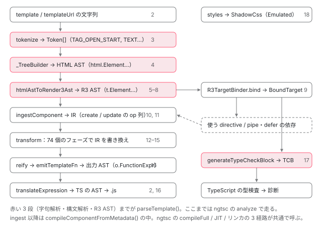

[目次](../README.md) › [テンプレートコンパイラの内側](README.md) › 第 1 回 / 全 18 回

# テンプレートが JS になるまで：パーサ・R3 AST・IR・74 個のフェーズの全体図

> 実際の ngc 出力を見ながら、テンプレート文字列 → トークン → HTML AST → R3 AST → IR → 74 個のフェーズ → 出力という全体図と、AOT・JIT・リンカが同じ compileComponentFromMetadata に合流することを押さえる。

angular/angular · 読了 約 13 分 · 発展 · [サイトで読む（デモが動きます）](https://angular-deep-dive-cyan.vercel.app/chapter/compiler)

---

テンプレートは実行時には存在しません。ビルド時に JavaScript の関数へ変換されています。この章では**実際に `ngc` を走らせた出力**を見てから、テンプレートの文字列がその形になるまでに通る段（字句解析 → 構文解析 → R3 AST → IR → 74 個のフェーズ → 出力）を 1 枚の図にし、1 つの小さなテンプレートが各段でどんな形をしているかを並べます。このシリーズの残り 17 回は、この図の 1 段ずつを詳しく読みます。

読む対象は `compiler/src/ml_parser/parser.ts`、`render3/r3_template_transform.ts`、`template/pipeline/src/ingest.ts`・`emit.ts`、`typecheck/type_check_block.ts`、`jit_compiler_facade.ts` と、実行時側の `core/src/render3/instructions/advance.ts` です。

1. **1. 全体図**（この章）
2. [2. コンパイラの入口](02-compiler-entry.md)
3. [3. HTML の字句解析](03-compiler-html-lexer.md)
4. [4. HTML の構文解析](04-compiler-html-parser.md)
5. [5. 式のパーサ](05-compiler-expression-parser.md)
6. [6. バインディングのパーサ](06-compiler-binding-parser.md)
7. [7. R3 AST](07-compiler-r3-ast.md)
8. [8. ブロック構文の解析](08-compiler-control-flow-blocks.md)
9. [9. ディレクティブの照合](09-compiler-binder.md)
10. [10. IR への写像](10-compiler-ingest.md)
11. [11. IR の構造](11-compiler-ir.md)
12. [12. decls・vars・advance](12-compiler-slots-vars.md)
13. [13. 変数とコンテキスト](13-compiler-variables.md)
14. [14. 定数配列と pure function](14-compiler-consts-pure.md)
15. [15. 制御フローのフェーズ](15-compiler-control-flow-phases.md)
16. [16. reify と出力](16-compiler-reify-emit.md)
17. [17. 型検査（TCB）](17-compiler-typecheck.md)
18. [18. スタイルのカプセル化](18-compiler-shadow-css.md)

## 1. まず出力を見る

下の 2 つは、このサイトの `node_modules` にある `ngc`（`@angular/compiler-cli` 22.1.6）に 実際に通した入力と出力です。読みやすいよう改行と字下げだけ整えています。

📄 `small.ts（入力）`

```
@Component({
  selector: 'app-small',
  template: `<p [title]="t">{{ n }}</p>`,
})
export class Small {
  t = 'hello';
  n = 1;
}
```
*この章で各段を追うのは、この 1 行のテンプレートです。*

📄 `small.js（ngc の出力から ɵcmp の部分）`

```
static ɵcmp = /*@__PURE__*/ i0.ɵɵdefineComponent({
  type: Small,
  selectors: [["app-small"]],
  decls: 2,
  vars: 2,
  consts: [[3, "title"]],
  template: function Small_Template(rf, ctx) {
    if (rf & 1) {
      i0.ɵɵdomElementStart(0, "p", 0);
      i0.ɵɵtext(1);
      i0.ɵɵdomElementEnd();
    }
    if (rf & 2) {
      i0.ɵɵdomProperty("title", ctx.t);
      i0.ɵɵadvance();
      i0.ɵɵtextInterpolate(ctx.n);
    }
  },
  encapsulation: 2
});
```

ここから読み取れることを、順に見ていきます。

### デコレータは消え、静的プロパティになる

`@Component` はどこにもありません。かわりに `ɵcmp` という**静的プロパティ**が足され、その値は `ɵɵdefineComponent({...})` の呼び出しです。`/*@__PURE__*/` が付いているので、どこからも使われていなければバンドラが丸ごと削除できます。この静的プロパティを TypeScript のクラスに書き足す場所は [第 2 回](02-compiler-entry.md)で読みます。

### 1 つの関数が二役をこなす

`Small_Template` の中に `if (rf & 1)` と `if (rf & 2)` があります。1 が**作成**（ビューが最初に作られるとき 1 回だけ）、2 が**更新**（変更検知のたび）です。更新のときは要素を作るコードを一切通りません。仮想 DOM のように「毎回作って差分を取る」のとは方針が違います。実行時に `rf` がどう渡されるかは [Ivy シリーズの template 関数の章](../ivy/03-ivy-template-function.md)で読みました。

### decls / vars / consts はコンパイラが数えた結果

`decls: 2` は作成ブロックの命令が使うスロットの数（`p` と、その中のテキスト）、`vars: 2` は更新ブロックのバインディングが前回の値を覚えておくスロットの数（`[title]` の値で 1、補間の `n` で 1）です。実行時はこの数ぶんの配列を最初に一度で確保します。`consts: [[3, "title"]]` は `p` の属性情報で、`domElementStart(0, "p", 0)` の 3 番目の引数 `0` がこの配列の 0 番を指しています。数え方の規則は [第 12 回](12-compiler-slots-vars.md)、定数配列の作り方は [第 14 回](14-compiler-consts-pure.md)です。

### 制御フローは別関数になる

もう少し大きなコンポーネントも通してみます。

📄 `demo.ts（入力）`

```
@Component({
  selector: 'app-demo',
  changeDetection: ChangeDetectionStrategy.OnPush,
  template: `
    <h1>{{ title() }}</h1>
    <p [title]="subtitle()">count = {{ double() }}</p>
    @if (count() > 2) { <span>big</span> }
    @for (n of items(); track n) { <li>{{ n }}</li> }
  `,
})
export class Demo {
  title = signal('hi');
  subtitle = signal('sub');
  count = signal(1);
  double = computed(() => this.count() * 2);
  items = signal([1, 2, 3]);
}
```

📄 `demo.js（ngc の出力から抜粋）`

```
function Demo_Conditional_4_Template(rf, ctx) {
  if (rf & 1) {
    i0.ɵɵdomElementStart(0, "span");
    i0.ɵɵtext(1, "big");
    i0.ɵɵdomElementEnd();
  }
}
function Demo_For_6_Template(rf, ctx) {
  if (rf & 1) {
    i0.ɵɵdomElementStart(0, "li");
    i0.ɵɵtext(1);
    i0.ɵɵdomElementEnd();
  }
  if (rf & 2) {
    const n_r1 = ctx.$implicit;
    i0.ɵɵadvance();
    i0.ɵɵtextInterpolate(n_r1);
  }
}
// ...（クラス本体）
static ɵcmp = /*@__PURE__*/ i0.ɵɵdefineComponent({
  type: Demo,
  selectors: [["app-demo"]],
  decls: 7,
  vars: 4,
  consts: [[3, "title"]],
  template: function Demo_Template(rf, ctx) {
    if (rf & 1) {
      i0.ɵɵdomElementStart(0, "h1");
      i0.ɵɵtext(1);
      i0.ɵɵdomElementEnd();
      i0.ɵɵdomElementStart(2, "p", 0);
      i0.ɵɵtext(3);
      i0.ɵɵdomElementEnd();
      i0.ɵɵconditionalCreate(4, Demo_Conditional_4_Template, 2, 0, "span");
      i0.ɵɵrepeaterCreate(5, Demo_For_6_Template, 2, 1, "li", null,
                          i0.ɵɵrepeaterTrackByIdentity);
    }
    if (rf & 2) {
      i0.ɵɵadvance();
      i0.ɵɵtextInterpolate(ctx.title());
      i0.ɵɵadvance();
      i0.ɵɵdomProperty("title", ctx.subtitle());
      i0.ɵɵadvance();
      i0.ɵɵtextInterpolate1("count = ", ctx.double());
      i0.ɵɵadvance();
      i0.ɵɵconditional(ctx.count() > 2 ? 4 : -1);
      i0.ɵɵadvance();
      i0.ɵɵrepeater(ctx.items());
    }
  },
  encapsulation: 2
});
```

`@if` と `@for` の中身は `Demo_Conditional_4_Template` / `Demo_For_6_Template` という **別の関数**になり、親は `conditionalCreate(4, Demo_Conditional_4_Template, 2, 0, "span")` のように 関数への参照と**その内部の decls / vars**（2 と 0）を渡します。`@if` の更新は `conditional(ctx.count() > 2 ? 4 : -1)` です。真なら「4 番のテンプレート」、偽なら「-1 = 何も出さない」。if 文が数値の選択に変換されています。この変換は [第 15 回](15-compiler-control-flow-phases.md)で追います。

`decls: 7` は h1・そのテキスト・p・そのテキストで 4、`@if` で 1、`@for` で 2 です。`@for` が 2 つ使うのは、5 番に繰り返しの管理データ、6 番に「1 件を描く関数」を置くからです （関数名の `_For_6_` はこの 6 番から来ています）。

### 開発モード専用のコード

出力には、テンプレートと関係のない書き換えも入っていました。

📄 `demo.js（クラスフィールド）`

```
title = signal('hi', /* @ts-ignore */
  ...(ngDevMode ? [{ debugName: "title" }] : /* istanbul ignore next */ []));
```

`ngDevMode` は本番ビルドで `false` に置き換わる定数なので、この配列は空になって消えます。Angular DevTools で signal の名前が見えるのはこの書き換えのおかげで、これはテンプレートコンパイラではなく ngtsc の別の変換が足しています（[signals シリーズ第 18 回](../signals/18-signals-debug.md)）。

## 2. 全体図：テンプレートの文字列が JS になるまで



*左の列が template 関数を作る本線、右の列が型検査の別枝。四角の右の番号はこのシリーズの回。R3 AST から IR へは BoundTarget を経由せず直接写す。BoundTarget は依存の決定と型検査に使われる。*

| 段 | 入力 → 出力 | 主なファイル・関数 | 回 |
| --- | --- | --- | --- |
| 入口 | @Component の引数 → テンプレート文字列 | compiler-cli の `resources.ts`（`extractTemplate`）、`view/template.ts`（`parseTemplate`） | 2 |
| 字句解析 | 文字列 → `Token[]` | `ml_parser/lexer.ts`（`tokenize` / `_Tokenizer`） | 3 |
| 構文解析 | `Token[]` → HTML AST | `ml_parser/parser.ts`（`_TreeBuilder`）、`html_tags.ts`、`html_whitespaces.ts` | 4 |
| 式 | 属性値・補間の文字列 → 式の AST | `expression_parser/lexer.ts`・`parser.ts` | 5 |
| バインディング | `[x]`・`(y)`・`*ngIf` の解釈 | `template_parser/binding_parser.ts` | 6 |
| R3 AST | HTML AST → R3 AST | `render3/r3_template_transform.ts`・`r3_ast.ts`・`r3_control_flow.ts` | 7, 8 |
| 照合 | R3 AST + セレクタ → `BoundTarget` | `render3/view/t2_binder.ts`（`R3TargetBinder`） | 9 |
| ingest | R3 AST → IR | `template/pipeline/src/ingest.ts`（`ingestComponent`） | 10, 11 |
| フェーズ | IR → IR（74 回の書き換え） | `template/pipeline/src/emit.ts`（`transform`）、`phases/*.ts` | 12–15 |
| 出力 | IR → 出力 AST → TS の AST | `phases/reify.ts`、`emit.ts`（`emitTemplateFn`）、compiler-cli の `translator/` | 16 |
| 型検査 | R3 AST + BoundTarget → TCB の TypeScript | `typecheck/type_check_block.ts`、compiler-cli の `typecheck/src/` | 17 |
| スタイル | CSS → 属性セレクタ付き CSS | `shadow_css.ts` | 18 |

> [!TIP]
> **新卒エンジニアへ**
>
> 用語を 3 つだけ。**トークン**は「意味を持つ最小の文字のかたまり」（タグ名、属性値など）。**AST**（抽象構文木）は、トークンを入れ子の構造に組んだ木。**IR**（中間表現）は、木でも出力コードでもない、変換しやすいように作ったコンパイラ内部の形で、Angular の IR は「ビューごとの create / update の命令の列」です。R3 は render3（Ivy の内部での呼び名。ソースのディレクトリ名 `render3/` にも残っている）の略で、R3 AST は「Ivy 向けの意味を付けたテンプレートの木」を指します。

## 3. 1 つのテンプレートを各段で見る

1 節の `<p [title]="t">{{ n }}</p>` が各段でどんな形をしているかを並べます。トークンと IR は angular リポジトリのソース（`lexer.ts` / `ingest.ts` / `emit.ts`）を束ねて実際に呼んだ結果、HTML AST と R3 AST は `@angular/compiler` 22.1.6 の `HtmlParser` / `parseTemplate` を呼んだ結果を写したものです。

1. **字句解析：11 個のトークン**

   📄 `tokenize() の結果（type と parts）`

   ```
   TAG_OPEN_START   ["", "p"]
   ATTR_NAME        ["", "[title]"]
   ATTR_QUOTE       ["\""]
   ATTR_VALUE_TEXT  ["t"]
   ATTR_QUOTE       ["\""]
   TAG_OPEN_END     []
   TEXT             [""]
   INTERPOLATION    ["{{", " n ", "}}"]
   TEXT             [""]
   TAG_CLOSE        ["", "p"]
   EOF              []
   ```

   `[title]` は 1 つの `ATTR_NAME` です。この段では「角括弧付きの名前」以上の意味はありません。補間 `{{ n }}` はこの段で `INTERPOLATION` として切り出されますが、中身の `" n "` はまだ文字列です。
2. **構文解析：要素の木**

   📄 `HtmlParser.parse() の結果`

   ```
   Element "p"
     attrs:    Attribute  [title] = "t"
     children: Text       "{{ n }}"（tokens: TEXT, INTERPOLATION, TEXT）
   ```

   ブラウザの DOM に近い形です。属性値もテキストもまだ文字列のまま。
3. **R3 AST：Angular の意味がつく**

   📄 `parseTemplate() の結果`

   ```
   Element "p"
     inputs:   BoundAttribute  name="title"  type=0（Property）  value=PropertyRead(t)
     children: BoundText       value=Interpolation [PropertyRead(n)]
   ```

   `[title]` は `BoundAttribute`（プロパティバインディング）に、テキストは `BoundText` に変わり、どちらも中身が式の AST（`PropertyRead`）になっています。
4. **IR：命令に近い op の列**

   📄 `ingestComponent() → transform() の結果（op の kind）`

   ```
   ingest 直後
     create: ElementStart("p"), I18nAttributes, Text, ElementEnd
     update: Binding("title"), InterpolateText
   transform 後（74 フェーズのうち Tmpl 用の 73 個を通過）
     create: Statement, Statement, Statement
     update: Statement, Statement, Statement
     decls = 2, vars = 2, consts = [[3, "title"]]
   ```

   ingest 直後は「要素の開始」「バインディング」といった抽象的な op です（`I18nAttributes` は i18n 用の下準備で、i18n の式が無いので後のフェーズ `removeUnusedI18nAttributesOps` が消します）。フェーズを全部通ると、すべての op が出力 AST の文を包んだ `Statement` になり、decls と vars が数え終わっています。
5. **出力：1 節の template 関数**

   create の 3 文が `domElementStart` / `text` / `domElementEnd`、update の 3 文が `domProperty` / `advance` / `textInterpolate` です。

## 4. 段と段のつなぎ目

図の本線を、つなぎ目の関数で確かめます。まず最初の 2 段。

📄 `angular/packages/compiler/src/ml_parser/parser.ts` L76–85 （▶ の行: 80–83）

```ts
76 │ export class Parser {
77 │   constructor(public getTagDefinition: (tagName: string) => TagDefinition) {}
78 │ 
79 │   parse(source: string, url: string, options?: TokenizeOptions): ParseTreeResult {
80 ▶     const tokenizeResult = tokenize(source, url, this.getTagDefinition, options);
81 ▶     const parser = new _TreeBuilder(tokenizeResult.tokens, this.getTagDefinition);
82 ▶     parser.build();
83 ▶     return new ParseTreeResult(parser.rootNodes, [...tokenizeResult.errors, ...parser.errors]);
84 │   }
85 │ }
```

80 行目で字句解析（`tokenize`）が文字列全体をトークンの配列にし、81〜82 行目でその配列を `_TreeBuilder` が木にします。**字句解析は構文解析より先に最後まで走りきる**ので、2 段は完全に分かれています。83 行目、どちらの段のエラーも投げずに配列に集めて返します。

📄 `angular/packages/compiler/src/render3/r3_template_transform.ts` L93–115 （▶ の行: 98–99, 102, 105）

```ts
 93 │ export function htmlAstToRender3Ast(
 94 │   htmlNodes: html.Node[],
 95 │   bindingParser: BindingParser,
 96 │   options: Render3ParseOptions,
 97 │ ): Render3ParseResult {
 98 ▶   const transformer = new HtmlAstToIvyAst(bindingParser, options);
 99 ▶   const ivyNodes = html.visitAll(transformer, htmlNodes, htmlNodes);
100 │ 
101 │   // Errors might originate in either the binding parser or the html to ivy transformer
102 ▶   const allErrors = bindingParser.errors.concat(transformer.errors);
103 │ 
104 │   const result: Render3ParseResult = {
105 ▶     nodes: ivyNodes,
106 │     errors: allErrors,
107 │     styleUrls: transformer.styleUrls,
108 │     styles: transformer.styles,
109 │     ngContentSelectors: transformer.ngContentSelectors,
110 │   };
111 │   if (options.collectCommentNodes) {
112 │     result.commentNodes = transformer.commentNodes;
113 │   }
114 │   return result;
115 │ }
```

HTML AST を R3 AST に変える入口です。98〜99 行目、`HtmlAstToIvyAst` というビジターで HTML AST を 1 回なめます。属性値や補間の中身を式としてパースするのは、このビジターから呼ばれる `bindingParser`（[第 6 回](06-compiler-binding-parser.md)）です。102 行目、ここでもエラーは集めるだけです。

📄 `angular/packages/compiler/src/template/pipeline/src/ingest.ts` L60–89 （▶ の行: 62, 74, 87–88）

```ts
60 │ export function ingestComponent(
61 │   componentName: string,
62 ▶   template: t.Node[],
63 │   constantPool: ConstantPool,
64 │   compilationMode: TemplateCompilationMode,
65 │   relativeContextFilePath: string,
66 │   i18nUseExternalIds: boolean,
67 │   deferMeta: R3ComponentDeferMetadata,
68 │   allDeferrableDepsFn: o.ReadVarExpr | null,
69 │   relativeTemplatePath: string | null,
70 │   enableDebugLocations: boolean,
71 │   legacyOptionalChaining: boolean,
72 │   foreignImports: R3ForeignComponentMetadata[] | null,
73 │ ): ComponentCompilationJob {
74 ▶   const job = new ComponentCompilationJob(
75 │     componentName,
76 │     constantPool,
77 │     compilationMode,
78 │     relativeContextFilePath,
79 │     i18nUseExternalIds,
80 │     deferMeta,
81 │     allDeferrableDepsFn,
82 │     relativeTemplatePath,
83 │     enableDebugLocations,
84 │     legacyOptionalChaining,
85 │     foreignImports,
86 │   );
87 ▶   ingestNodes(job.root, template);
88 ▶   return job;
89 │ }
```

62 行目、入力は R3 AST のノード配列（`t.Node[]`）です。74 行目で `ComponentCompilationJob`（IR の入れ物）を作り、87 行目で R3 AST のノードを順に IR の op に写します。ここで初めて、木だったテンプレートが**ビューごとの op の列**になります （[第 10 回](10-compiler-ingest.md)、[第 11 回](11-compiler-ir.md)）。

## 5. 74 個のフェーズ

IR から template 関数を作るまでの変換は、**順序付きの配列**としてそのまま書かれています。

📄 `angular/packages/compiler/src/template/pipeline/src/emit.ts` L112–130 （▶ の行: 112–113, 115–116）

```ts
112 ▶ const phases: Phase[] = [
113 ▶   {kind: Kind.Tmpl, fn: resolveForeignContent},
114 │   {kind: Kind.Tmpl, fn: removeContentSelectors},
115 ▶   {kind: Kind.Both, fn: optimizeRegularExpressions},
116 ▶   {kind: Kind.Host, fn: parseHostStyleProperties},
117 │   {kind: Kind.Tmpl, fn: emitNamespaceChanges},
118 │   {kind: Kind.Tmpl, fn: propagateI18nBlocks},
119 │   {kind: Kind.Tmpl, fn: wrapI18nIcus},
120 │   {kind: Kind.Both, fn: deduplicateTextBindings},
121 │   {kind: Kind.Both, fn: specializeStyleBindings},
122 │   {kind: Kind.Both, fn: specializeBindings},
123 │   {kind: Kind.Tmpl, fn: specializeControlProperties},
124 │   {kind: Kind.Both, fn: convertAnimations},
125 │   {kind: Kind.Both, fn: extractAttributes},
126 │   {kind: Kind.Tmpl, fn: createI18nContexts},
127 │   {kind: Kind.Both, fn: parseExtractedStyles},
128 │   {kind: Kind.Tmpl, fn: removeEmptyBindings},
129 │   {kind: Kind.Both, fn: collapseSingletonInterpolations},
130 │   {kind: Kind.Both, fn: orderOps},
```

ここでは冒頭だけを載せました。この配列は 186 行目まで続き、こう終わります。

📄 `angular/packages/compiler/src/template/pipeline/src/emit.ts` L176–187 （▶ の行: 176, 185–186）

```ts
176 ▶   {kind: Kind.Tmpl, fn: generateAdvance},
177 │   {kind: Kind.Both, fn: nameFunctionsAndVariables},
178 │   {kind: Kind.Tmpl, fn: resolveDeferDepsFns},
179 │   {kind: Kind.Tmpl, fn: mergeNextContextExpressions},
180 │   {kind: Kind.Tmpl, fn: generateNgContainerOps},
181 │   {kind: Kind.Tmpl, fn: collapseEmptyInstructions},
182 │   {kind: Kind.Tmpl, fn: attachSourceLocations},
183 │   {kind: Kind.Tmpl, fn: disableBindings},
184 │   {kind: Kind.Both, fn: extractPureFunctions},
185 ▶   {kind: Kind.Both, fn: reify},
186 ▶   {kind: Kind.Both, fn: chain},
187 │ ];
```

113〜186 行目で **74 個**です。どの要素も `kind` と `fn` の組で、`fn` は「IR を受け取って書き換える」関数です。`kind` は 3 種類で、数えると `Kind.Tmpl` が 45 個、`Kind.Host` が 1 個（116 行目の `parseHostStyleProperties`）、`Kind.Both` が 28 個です。

後半には、1 節で見た数字を作るフェーズが並んでいます。`allocateSlots`（166 行目）がスロット番号を振り、175 行目の `countVariables` が vars を数え、176 行目の `generateAdvance` が `advance()` を**この段階で初めて挿入します**。それまで各 op は絶対位置を持っていて、最後に相対移動へ変換されるのです。185 行目の `reify` が抽象的な op を実際の関数呼び出しの文に変え、186 行目の `chain` が `a(); b(); c();` を `a().b().c()` のように繋げてバイト数を削ります。

📄 `angular/packages/compiler/src/template/pipeline/src/emit.ts` L193–201 （▶ の行: 194–195, 198）

```ts
193 │ export function transform(job: CompilationJob, kind: Kind): void {
194 ▶   for (const phase of phases) {
195 ▶     if (phase.kind === kind || phase.kind === Kind.Both) {
196 │       // The type of `Phase` above ensures it is impossible to call a phase that doesn't support the
197 │       // job kind.
198 ▶       phase.fn(job as CompilationJob & ComponentCompilationJob & HostBindingCompilationJob);
199 │     }
200 │   }
201 │ }
```

実行する側は単純です。194 行目で配列を先頭から回し、195 行目で「ジョブの種類と同じか `Both`」のフェーズだけを 198 行目で呼びます。コンポーネントのテンプレートは `Tmpl` のジョブ（45 + 28 = 73 個を通る）、ホストバインディングは `Host` のジョブ（1 + 28 = 29 個を通る）です。

## 6. IR から template 関数へ

📄 `angular/packages/compiler/src/template/pipeline/src/emit.ts` L259–285 （▶ の行: 259–262, 276, 279–280）

```ts
259 ▶   const createCond = maybeGenerateRfBlock(1, createStatements);
260 ▶   const updateCond = maybeGenerateRfBlock(2, updateStatements);
261 ▶   return o.fn(
262 ▶     [new o.FnParam(RENDER_FLAGS, o.NUMBER_TYPE), new o.FnParam(CONTEXT_NAME, o.DYNAMIC_TYPE)],
263 │     [...createCond, ...updateCond],
264 │     /* type */ undefined,
265 │     /* sourceSpan */ undefined,
266 │     view.fnName,
267 │   );
268 │ }
269 │ 
270 │ function maybeGenerateRfBlock(flag: number, statements: o.Statement[]): o.Statement[] {
271 │   if (statements.length === 0) {
272 │     return [];
273 │   }
274 │ 
275 │   return [
276 ▶     o.ifStmt(
277 │       new o.BinaryOperatorExpr(
278 │         o.BinaryOperator.BitwiseAnd,
279 ▶         o.variable(RENDER_FLAGS),
280 ▶         o.literal(flag),
281 │       ),
282 │       statements,
283 │     ),
284 │   ];
285 │ }
```

フェーズを通り終えたビュー 1 つを関数にする `emitView` の後半です。259 行目で create の文の列を `rf & 1` の if で、260 行目で update の文の列を `rf & 2` の if で包みます （276〜280 行目の `maybeGenerateRfBlock`。文が 0 個なら if ごと出しません。1 節の `Demo_Conditional_4_Template` に `rf & 2` が無いのはこのためです）。261〜262 行目、引数は `rf` と `ctx` の 2 つ。**1 節の template 関数の骨組みはこの 10 行で決まっています**。ここで作られるのはまだ文字列ではなく、`output_ast.ts` の木（出力 AST）です。それを TypeScript の AST に直して .js に書き出すところは [第 2 回](02-compiler-entry.md)と [第 16 回](16-compiler-reify-emit.md)で読みます。

## 7. 別枝：型検査のための TypeScript

template 関数とは別に、ngtsc はテンプレートを**型検査専用の TypeScript コード**（Type-Check Block、TCB）にも変換します。TCB は実行されません。TypeScript の型検査器に読ませて、テンプレート内の式の型エラーを見つけるためだけのコードです。

📄 `angular/packages/compiler/src/typecheck/type_check_block.ts` L29–47 （▶ の行: 29, 36, 42）

```ts
29 ▶ export function generateTypeCheckBlock(
30 │   env: TcbEnvironment,
31 │   component: TcbComponentMetadata,
32 │   name: string,
33 │   meta: TcbTypeCheckBlockMetadata,
34 │   domSchemaChecker: DomSchemaChecker<unknown>,
35 │   oobRecorder: OutOfBandDiagnosticRecorder<unknown>,
36 ▶ ): string {
37 │   const tcb = new Context(
38 │     env,
39 │     domSchemaChecker,
40 │     oobRecorder,
41 │     meta.id,
42 ▶     meta.boundTarget,
43 │     meta.pipes,
44 │     meta.schemas,
45 │     meta.isStandalone,
46 │     meta.preserveWhitespaces,
47 │   );
```

29 行目、生成するのは `compiler` パッケージの `generateTypeCheckBlock` で、36 行目のとおり戻り値は**文字列**（TypeScript のソース）です。42 行目の `meta.boundTarget` が 9 回目の binder の結果で、「この要素にはどのディレクティブが付いたか」を使って input の型まで検査します。出力の形はテストで分かります。

📄 `angular/packages/compiler-cli/src/ngtsc/typecheck/test/type_check_block_spec.ts` L27–32 （▶ の行: 31）

```ts
27 │ describe('type check blocks', () => {
28 │   beforeEach(() => initMockFileSystem('Native'));
29 │ 
30 │   it('should generate a basic block for a binding', () => {
31 ▶     expect(tcb('{{hello}} {{world}}')).toContain('"" + (((this).hello)) + (((this).world));');
32 │   });
```

31 行目、`{{hello}} {{world}}` は `"" + (((this).hello)) + (((this).world));` という式文になります。`this` はコンポーネントの型なので、`hello` が存在しなければ TypeScript がエラーを出します。詳しくは [第 17 回](17-compiler-typecheck.md)です。

## 8. advance() の正体

1 節の更新ブロックでは、2 つ目以降の値を書き込む前に `ɵɵadvance()` が呼ばれていました。実行時側の定義を見ると、ドキュメントがそのまま説明になっています。

📄 `angular/packages/core/src/render3/instructions/advance.ts` L20–50 （▶ の行: 31, 34–35, 43, 48）

````ts
20 │ /**
21 │  * Advances to an element for later binding instructions.
22 │  *
23 │  * Used in conjunction with instructions like {@link property} to act on elements with specified
24 │  * indices, for example those created with {@link element} or {@link elementStart}.
25 │  *
26 │  * ```ts
27 │  * (rf: RenderFlags, ctx: any) => {
28 │  *   if (rf & 1) {
29 │  *     text(0, 'Hello');
30 │  *     text(1, 'Goodbye')
31 ▶  *     element(2, 'div');
32 │  *   }
33 │  *   if (rf & 2) {
34 ▶  *     advance(2); // Advance twice to the <div>.
35 ▶  *     property('title', 'test');
36 │  *   }
37 │  *  }
38 │  * ```
39 │  * @param delta Number of elements to advance forwards by.
40 │  *
41 │  * @codeGenApi
42 │  */
43 ▶ export function ɵɵadvance(delta: number = 1): void {
44 │   ngDevMode && assertGreaterThan(delta, 0, 'Can only advance forward');
45 │   selectIndexInternal(
46 │     getTView(),
47 │     getLView(),
48 ▶     getSelectedIndex() + delta,
49 │     !!ngDevMode && isInCheckNoChangesMode(),
50 │   );
````

31 行目で 2 番に div を作り、更新側の 34 行目で `advance(2)` して div まで移動してから、35 行目で `property` を設定しています。48 行目、中身は「いま選んでいるスロット番号 + delta」へ移るだけです。43 行目の既定値は 1。各命令が「何番のスロットか」を毎回引数で受け取ると生成コードに数値が並ぶので、多くの場合 1 つずつ進むだけの更新を 引数なしの `advance()` で済ませています。`Small_Template` の更新ブロックでは、最初の `domProperty` の前に advance が無いことにも注目してください。コンパイラの `generateAdvance` は「0 番（`p`）が選ばれた状態」から数え始めるので、0 番への書き込みには移動が要らないのです。この規則と、advance がフックを呼ぶタイミングは [第 12 回](12-compiler-slots-vars.md)で読みます。

## ここまでの呼び出し

- 👤 `@Component({ template: '<p [title]="t">…' })` — small.ts
  - `parseTemplate(template, url, options)` — compiler/src/render3/view/template.ts L140 — *第 2 回*
    - `new HtmlParser().parse()` → `Parser.parse()` — ml\_parser/parser.ts L79
      - `tokenize(source, url, getTagDefinition, options)` — ml\_parser/lexer.ts L109 — *第 3 回*
      - `new _TreeBuilder(tokens).build()` — ml\_parser/parser.ts L81-82 — *第 4 回*
    - `htmlAstToRender3Ast(rootNodes, bindingParser)` — render3/r3\_template\_transform.ts L93 — *第 5〜8 回*
  - `compileComponentFromMetadata(meta, constantPool, bindingParser)` — render3/view/compiler.ts L178 — *第 2 回*
    - `ingestComponent(name, meta.template.nodes, ...)` — template/pipeline/src/ingest.ts L60 — *第 10 回*
    - `transform(tpl, CompilationJobKind.Tmpl)` — template/pipeline/src/emit.ts L193 — *73 個のフェーズ。第 12〜16 回*
    - `emitTemplateFn(tpl, constantPool)` → `emitView(view)` — emit.ts L207 / L231 — *rf & 1 / rf & 2 の if を組む*
  - `generateTypeCheckBlock(env, component, name, meta, ...)` — compiler/src/typecheck/type\_check\_block.ts L29 — *別枝。第 17 回*

> **🧪 DEMO — parseTemplate を実際に呼んで R3 AST を数える**
>
> ボタンを押すと `@angular/compiler`（このサイトにインストールされている 22.1.6）をその場で読み込み、入力したテンプレートを `parseTemplate(text, 'demo.html', { preserveWhitespaces: false })` に通して、R3 AST のノードを種類ごとに数えます。空白だけのテキストは消えるので Text には数えられません。
>
> ▶ [このデモはサイトで動かせます](https://angular-deep-dive-cyan.vercel.app/chapter/compiler)

## 聞かれそうな質問

**Q. JIT と AOT でコンパイラは別物ですか？**

template 関数を作る本体は同じです。AOT（ngtsc）は `ComponentDecoratorHandler.compileFull` から `compileComponentFromMetadata` を呼びます（[第 2 回](02-compiler-entry.md)で handler.ts 1613 行目を読みます）。JIT はブラウザで `@Component` が評価されたときに `CompilerFacadeImpl` を通り、同じ関数に着きます。

📄 `angular/packages/compiler/src/jit_compiler_facade.ts` L386–400 （▶ の行: 393–394）

```ts
386 │   private compileComponentFromMeta(
387 │     angularCoreEnv: CoreEnvironment,
388 │     sourceMapUrl: string,
389 │     meta: R3ComponentMetadata<R3TemplateDependency>,
390 │   ): any {
391 │     const constantPool = new ConstantPool();
392 │     const bindingParser = makeBindingParser();
393 ▶     const res = compileComponentFromMetadata(meta, constantPool, bindingParser);
394 ▶     return this.jitExpression(
395 │       res.expression,
396 │       angularCoreEnv,
397 │       sourceMapUrl,
398 │       constantPool.statements,
399 │     );
400 │   }
```

393 行目が同じ `compileComponentFromMetadata` です。違うのは 394 行目で、出力 AST を TypeScript のファイルに書き出すのではなく `jitExpression` がその場で JavaScript として評価します。ライブラリの部分コンパイル結果（`ɵɵngDeclareComponent`）をアプリのビルド時に仕上げるリンカも同じ関数を呼びます。

📄 `angular/packages/compiler-cli/linker/src/file_linker/partial_linkers/partial_component_linker_1.ts` L81–88 （▶ の行: 86–87）

```ts
81 │   linkPartialDeclaration(
82 │     constantPool: ConstantPool,
83 │     metaObj: AstObject<R3PartialDeclaration, TExpression>,
84 │     version: string,
85 │   ): LinkedDefinition {
86 ▶     const meta = this.toR3ComponentMeta(metaObj, version);
87 ▶     return compileComponentFromMetadata(meta, constantPool, makeBindingParser());
88 │   }
```

87 行目。つまり AOT・JIT・リンカの 3 経路は、メタデータの集め方が違うだけで、ingest → 74 フェーズ → emit は共通です。

**Q. 74 個のフェーズは毎回全部走るのですか？**

ジョブの種類で絞ったあとは全部呼ばれます。`transform`（emit.ts 194〜199 行目）には kind 以外の条件分岐がありません。コンポーネントのテンプレートでは 73 個、ホストバインディングでは 29 個です。ホストバインディングは別のジョブとして同じ `transform` を通ります。

📄 `angular/packages/compiler/src/render3/view/compiler.ts` L488–509 （▶ の行: 488, 500, 509）

```ts
488 ▶   const hostJob = ingestHostBinding(
489 │     {
490 │       componentName: name,
491 │       componentSelector: selector,
492 │       properties: bindings,
493 │       events: eventBindings,
494 │       attributes: hostBindingsMetadata.attributes,
495 │       legacyOptionalChaining: legacyOptionalChaining,
496 │     },
497 │     bindingParser,
498 │     constantPool,
499 │   );
500 ▶   transform(hostJob, CompilationJobKind.Host);
501 │ 
502 │   definitionMap.set('hostAttrs', hostJob.root.attributes);
503 │ 
504 │   const varCount = hostJob.root.vars;
505 │   if (varCount !== null && varCount > 0) {
506 │     definitionMap.set('hostVars', o.literal(varCount));
507 │   }
508 │ 
509 ▶   return emitHostBindingFunction(hostJob);
```

488 行目で `ingestHostBinding` が別の IR を作り、500 行目で `CompilationJobKind.Host` を渡します。呼ばれたフェーズが実際に何かを書き換えるかどうかは、IR の中に対象の op があるかで決まります。たとえば 3 節の `removeUnusedI18nAttributesOps` は、i18n の式が無いテンプレートでは `I18nAttributes` を消すだけです。

**Q. テンプレートのエラーはどの段で出ますか？**

構文の誤りは parseTemplate の 3 段で見つかります。字句解析（閉じていない `{` など）と構文解析（対応しない閉じタグなど）のエラーは parser.ts 83 行目で、属性値・補間の式の誤りや未知のブロックは r3\_template\_transform.ts 102 行目で集められます。どれも例外ではなく配列で返るので、ngtsc はそのテンプレートの template 関数を作らず、型検査の段で `NG5002` の診断として報告します（[第 2 回](02-compiler-entry.md)）。式は正しく書けているが型が合わない（存在しないプロパティを読んでいる等）というエラーは、7 節の TCB を TypeScript が検査して初めて出ます。

**Q. テンプレートの `@if` は実行時に if 文として評価されるのですか？**

いいえ。1 節の出力のとおり、`@if` の中身は別関数（`Demo_Conditional_4_Template`）になり、更新ブロックでは `conditional(ctx.count() > 2 ? 4 : -1)` が「表示するテンプレートのスロット番号」を渡すだけです。条件式の評価は JavaScript の三項演算子で、テンプレートを解釈する処理は実行時にはありません。

## 読み終えて

- テンプレートは実行時に解釈されない。`ɵcmp` の `template` 関数（`rf & 1` で作成、`rf & 2` で更新）と decls / vars / consts に変換済み
- 本線は 文字列 → トークン → HTML AST → R3 AST（ここまで `parseTemplate`）→ IR → 74 フェーズ → 出力 AST。別枝で R3 AST + BoundTarget → TCB → 型検査
- 74 フェーズは emit.ts の配列の順に、ジョブの種類（Tmpl / Host / Both）で絞って全部呼ばれる。advance の挿入や vars の数えはその後半
- AOT・JIT・リンカの 3 経路は同じ `compileComponentFromMetadata` に合流する

---

← 前: [DevTools が signal のグラフを描ける理由：getSignalGraph と formatter](../signals/18-signals-debug.md)  
次: [コンパイラの入口：ngtsc の ComponentDecoratorHandler から compileComponentFromMetadata まで](02-compiler-entry.md) →
