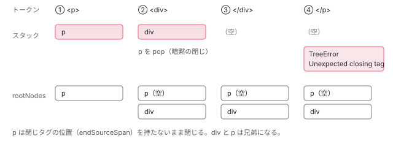

[目次](../README.md) › [テンプレートコンパイラの内側](README.md) › 第 4 回 / 全 18 回

# HTML の構文解析：トークンから要素の木へ、暗黙の閉じタグと空白の除去

> ml\_parser/parser.ts の \_TreeBuilder がトークンを読みながら要素のスタックを積み、閉じタグの無い要素（&lt;p&gt; の中の &lt;div&gt; など）を html\_tags.ts の定義で暗黙に閉じる行、void 要素、ブロック（@if { }）とその閉じ括弧、エラーの集め方（TreeError）。html\_whitespaces.ts の WhitespaceVisitor が preserveWhitespaces: false のとき何を消し、&ngsp; と ngPreserveWhitespaces で何を残すか。

angular/angular · 読了 約 14 分 · 中核 · [サイトで読む（デモが動きます）](https://angular-deep-dive-cyan.vercel.app/chapter/compiler-html-parser)

---

字句解析が作ったトークンの列は、まだ平らな配列です。それを要素の木（HTML AST）に組むのが構文解析器です。この章では `ml_parser/parser.ts` の `_TreeBuilder` がトークンを読みながら**要素のスタック**を積み下ろしする手順を追い、閉じタグの無い要素（`<p>` の中の `<div>` など）を `html_tags.ts` の定義で暗黙に閉じる行、void 要素、ブロック（`@if { }`）の開閉、エラーの集め方（`TreeError`）を読みます。最後に `html_whitespaces.ts` の `WhitespaceVisitor` が `preserveWhitespaces: false` のとき何を消し、`&ngsp;` と `ngPreserveWhitespaces` で何を残すかを確かめます。

読む対象は `compiler/src/ml_parser/parser.ts`・`html_tags.ts`・`html_whitespaces.ts`・`entities.ts` と、呼び出し元の `render3/view/template.ts` です。

1. [1. 全体図](01-compiler.md)
2. [2. コンパイラの入口](02-compiler-entry.md)
3. [3. HTML の字句解析](03-compiler-html-lexer.md)
4. **4. HTML の構文解析**（この章）
5. [5. 式のパーサ](05-compiler-expression-parser.md)
6. [6. バインディングのパーサ](06-compiler-binding-parser.md)
7. [7. R3 AST](07-compiler-r3-ast.md)
8. [8. ブロック構文の解析](08-compiler-control-flow-blocks.md)
9. [9. ディレクティブの照合](09-compiler-binder.md)
10. [10. IR への写像](10-compiler-ingest.md)
11. [11. IR の構造](11-compiler-ir.md)
12. [12. decls・vars・advance](12-compiler-slots-vars.md)
13. [13. 変数とコンテキスト](13-compiler-variables.md)
14. [14. 定数配列と pure function](14-compiler-consts-pure.md)
15. [15. 制御フローのフェーズ](15-compiler-control-flow-phases.md)
16. [16. reify と出力](16-compiler-reify-emit.md)
17. [17. 型検査（TCB）](17-compiler-typecheck.md)
18. [18. スタイルのカプセル化](18-compiler-shadow-css.md)

## 1. \_TreeBuilder の道具：トークンの位置とコンテナのスタック

[第 1 回](01-compiler.md) 4 節で見たとおり、`Parser.parse` は字句解析を最後まで済ませてから トークンの配列を `_TreeBuilder` に渡し、`build()` を呼びます。

📄 `angular/packages/compiler/src/ml_parser/parser.ts` L87–101 （▶ の行: 88, 90–91, 93–94, 100）

```ts
 87 │ class _TreeBuilder {
 88 ▶   private _index: number = -1;
 89 │   // `_peek` will be initialized by the call to `_advance()` in the constructor.
 90 ▶   private _peek!: Token;
 91 ▶   private _containerStack: NodeContainer[] = [];
 92 │ 
 93 ▶   rootNodes: html.Node[] = [];
 94 ▶   errors: TreeError[] = [];
 95 │ 
 96 │   constructor(
 97 │     private tokens: Token[],
 98 │     private tagDefinitionResolver: (tagName: string) => TagDefinition,
 99 │   ) {
100 ▶     this._advance();
101 │   }
```

状態は 4 つだけです。88 行目の `_index` と 90 行目の `_peek` が「いま見ているトークン」、91 行目の `_containerStack` が「まだ閉じていない要素・ブロックの列」、93 行目の `rootNodes` が木の根です。スタックの一番上が「いま中身を読んでいる親」で、新しいノードはその `children` に足されます（親がいなければ `rootNodes`）。

## 2. build：トークンの種類で振り分けるループ

📄 `angular/packages/compiler/src/ml_parser/parser.ts` L103–135 （▶ の行: 104–107, 109–111, 113, 118, 123–124, 127, 129–130, 132）

```ts
103 │   build(): void {
104 ▶     while (this._peek.type !== TokenType.EOF) {
105 ▶       if (
106 ▶         this._peek.type === TokenType.TAG_OPEN_START ||
107 ▶         this._peek.type === TokenType.INCOMPLETE_TAG_OPEN
108 │       ) {
109 ▶         this._consumeElementStartTag(this._advance());
110 ▶       } else if (this._peek.type === TokenType.TAG_CLOSE) {
111 ▶         this._consumeElementEndTag(this._advance());
112 │       } else if (this._peek.type === TokenType.CDATA_START) {
113 ▶         this._closeVoidElement();
114 │         this._consumeCdata(this._advance());
115 │       } else if (this._peek.type === TokenType.COMMENT_START) {
116 │         this._closeVoidElement();
117 │         this._consumeComment(this._advance());
118 ▶       } else if (
119 │         this._peek.type === TokenType.TEXT ||
120 │         this._peek.type === TokenType.RAW_TEXT ||
121 │         this._peek.type === TokenType.ESCAPABLE_RAW_TEXT
122 │       ) {
123 ▶         this._closeVoidElement();
124 ▶         this._consumeText(this._advance());
125 │       } else if (this._peek.type === TokenType.EXPANSION_FORM_START) {
126 │         this._consumeExpansion(this._advance());
127 ▶       } else if (this._peek.type === TokenType.BLOCK_OPEN_START) {
128 │         this._closeVoidElement();
129 ▶         this._consumeBlockOpen(this._advance());
130 ▶       } else if (this._peek.type === TokenType.BLOCK_CLOSE) {
131 │         this._closeVoidElement();
132 ▶         this._consumeBlockClose(this._advance());
133 │       } else if (this._peek.type === TokenType.INCOMPLETE_BLOCK_OPEN) {
134 │         this._closeVoidElement();
135 │         this._consumeIncompleteBlock(this._advance());
```

📄 `angular/packages/compiler/src/ml_parser/parser.ts` L136–167 （▶ の行: 136, 138, 151, 155, 157–158, 162）

```ts
136 ▶       } else if (this._peek.type === TokenType.LET_START) {
137 │         this._closeVoidElement();
138 ▶         this._consumeLet(this._advance());
139 │       } else if (this._peek.type === TokenType.INCOMPLETE_LET) {
140 │         this._closeVoidElement();
141 │         this._consumeIncompleteLet(this._advance());
142 │       } else if (
143 │         this._peek.type === TokenType.COMPONENT_OPEN_START ||
144 │         this._peek.type === TokenType.INCOMPLETE_COMPONENT_OPEN
145 │       ) {
146 │         this._consumeComponentStartTag(this._advance());
147 │       } else if (this._peek.type === TokenType.COMPONENT_CLOSE) {
148 │         this._consumeComponentEndTag(this._advance());
149 │       } else {
150 │         // Skip all other tokens...
151 ▶         this._advance();
152 │       }
153 │     }
154 │ 
155 ▶     for (const leftoverContainer of this._containerStack) {
156 │       // Unlike HTML elements, blocks aren't closed implicitly by the end of the file.
157 ▶       if (leftoverContainer instanceof html.Block) {
158 ▶         this.errors.push(
159 │           TreeError.create(
160 │             leftoverContainer.name,
161 │             leftoverContainer.sourceSpan,
162 ▶             `Unclosed block "${leftoverContainer.name}"`,
163 │           ),
164 │         );
165 │       }
166 │     }
167 │   }
```

1. **105〜111 行目：開始タグと閉じタグ**

   `TAG_OPEN_START`（書きかけの `INCOMPLETE_TAG_OPEN` も）なら 109 行目、`TAG_CLOSE` なら 111 行目。`_advance()` は「いまのトークンを返して 1 つ進む」ので、引数に渡るのは見ていたトークンそのものです。
2. **113・116・123 行目など：先に void 要素を閉じる**

   テキスト・コメント・ブロック・`@let` を足す前に、必ず `_closeVoidElement()` を呼びます。理由は 4 節。
3. **118〜124 行目：テキスト**

   `TEXT`・`RAW_TEXT`・`ESCAPABLE_RAW_TEXT` は、続く補間・文字参照のトークンと合わせて 1 つの `html.Text` になります。
4. **127〜135 行目：ブロック**

   開き・閉じ・書きかけの 3 種類（7 節）。
5. **151 行目：知らないトークンは飛ばす**

   属性のトークンなどは開始タグの処理の中で読み切っているので、ここに来るのは対応が崩れたときだけです。
6. **155〜166 行目：最後に残ったもの**

   EOF でスタックに残っているもののうち、**ブロックだけ**を 162 行目の「Unclosed block」エラーにします。156 行目のコメントのとおり、要素はファイルの終わりで暗黙に閉じたものとみなし、エラーにしません。

📄 `angular/packages/compiler/src/ml_parser/parser.ts` L55–67 （▶ の行: 55, 61, 65）

```ts
55 ▶ export class TreeError extends ParseError {
56 │   static create(elementName: string | null, span: ParseSourceSpan, msg: string): TreeError {
57 │     return new TreeError(elementName, span, msg);
58 │   }
59 │ 
60 │   constructor(
61 ▶     public elementName: string | null,
62 │     span: ParseSourceSpan,
63 │     msg: string,
64 │   ) {
65 ▶     super(span, msg);
66 │   }
67 │ }
```

構文解析のエラーは `TreeError` で、55 行目のとおり字句解析と同じ `ParseError` の仲間です。61 行目の `elementName`（どの要素のエラーか）が足されているだけで、どれも投げずに `errors` 配列に積みます。`Parser.parse` がこれを字句解析のエラーと 1 つの配列にまとめ、[第 2 回](02-compiler-entry.md) 5 節の経路で NG5002 になります。

## 3. 開始タグ：要素を作ってスタックに積む

📄 `angular/packages/compiler/src/ml_parser/parser.ts` L393–419 （▶ の行: 397, 399–400, 404, 406–407, 412, 416）

```ts
393 │   private _consumeElementStartTag(startTagToken: TagOpenStartToken | IncompleteTagOpenToken) {
394 │     const attrs: html.Attribute[] = [];
395 │     const directives: html.Directive[] = [];
396 │     const comments: html.StartTagComment[] = [];
397 ▶     this._consumeAttributesAndDirectives(attrs, directives, comments);
398 │ 
399 ▶     const fullName = this._getElementFullName(startTagToken, this._getClosestElementLikeParent());
400 ▶     const tagDef = this._getTagDefinition(fullName);
401 │     let selfClosing = false;
402 │     // Note: There could have been a tokenizer error
403 │     // so that we don't get a token for the end tag...
404 ▶     if (this._peek.type === TokenType.TAG_OPEN_END_VOID) {
405 │       this._advance();
406 ▶       selfClosing = true;
407 ▶       if (!(tagDef?.canSelfClose || getNsPrefix(fullName) !== null || tagDef?.isVoid)) {
408 │         this.errors.push(
409 │           TreeError.create(
410 │             fullName,
411 │             startTagToken.sourceSpan,
412 ▶             `Only void, custom and foreign elements can be self closed "${startTagToken.parts[1]}"`,
413 │           ),
414 │         );
415 │       }
416 ▶     } else if (this._peek.type === TokenType.TAG_OPEN_END) {
417 │       this._advance();
418 │       selfClosing = false;
419 │     }
```

1. **397 行目：属性を全部読む**

   `ATTR_NAME`・`ATTR_VALUE_*` のトークンを読んで `html.Attribute` にします。属性値の補間も、ここで 1 つの文字列に戻ります。
2. **399〜400 行目：名前空間付きの名前と、タグの定義**

   399 行目の `_getElementFullName` が `<svg>` の中の `<rect>` を `:svg:rect` のような名前にし（6 節）、400 行目でその名前の `HtmlTagDefinition` を引きます。
3. **404〜415 行目：`/>` で閉じた場合**

   407 行目、自己終了してよいのは定義で `canSelfClose` のもの・名前空間付き（SVG など）・void 要素だけです。`<div/>` は 412 行目の「Only void, custom and foreign elements can be self closed」になります。

📄 `angular/packages/compiler/src/ml_parser/parser.ts` L432–462 （▶ の行: 432, 441, 445–448, 450, 453–454, 457, 459）

```ts
432 ▶     const el = new html.Element(
433 │       fullName,
434 │       attrs,
435 │       directives,
436 │       [],
437 │       selfClosing,
438 │       span,
439 │       startSpan,
440 │       undefined,
441 ▶       tagDef?.isVoid ?? false,
442 │       undefined,
443 │       comments,
444 │     );
445 ▶     const parent = this._getContainer();
446 ▶     const isClosedByChild =
447 ▶       parent !== null && !!this._getTagDefinition(parent)?.isClosedByChild(el.name);
448 ▶     this._pushContainer(el, isClosedByChild);
449 │ 
450 ▶     if (selfClosing) {
451 │       // Elements that are self-closed have their `endSourceSpan` set to the full span, as the
452 │       // element start tag also represents the end tag.
453 ▶       this._popContainer(fullName, html.Element, span);
454 ▶     } else if (startTagToken.type === TokenType.INCOMPLETE_TAG_OPEN) {
455 │       // We already know the opening tag is not complete, so it is unlikely it has a corresponding
456 │       // close tag. Let's optimistically parse it as a full element and emit an error.
457 ▶       this._popContainer(fullName, html.Element, null);
458 │       this.errors.push(
459 ▶         TreeError.create(fullName, span, `Opening tag "${fullName}" not terminated.`),
460 │       );
461 │     }
462 │   }
```

1. **432〜444 行目：`html.Element` を作る**

   子は空の配列（436 行目）。441 行目で void かどうかを覚えます。
2. **445〜448 行目：*親が子によって閉じられるか*を尋ねてから積む**

   446〜447 行目、いまの親の定義に「この名前の子が来たら閉じる」（`isClosedByChild`）と書かれていれば、448 行目の `_pushContainer` は**親を先に下ろしてから**新しい要素を積みます（4 節）。これが暗黙の閉じタグです。
3. **450〜453 行目：自己終了ならすぐ下ろす**
4. **454〜460 行目：書きかけの開始タグ**

   `<div` のまま `>` が無かった場合も要素は作り、すぐ下ろして 459 行目で「not terminated」を記録します。木はできるだけ残します。

## 4. スタックの積み下ろしと閉じタグ

📄 `angular/packages/compiler/src/ml_parser/parser.ts` L578–602 （▶ の行: 579–580, 583–584, 590–591, 595, 598–600）

```ts
578 │   private _pushContainer(node: NodeContainer, isClosedByChild: boolean) {
579 ▶     if (isClosedByChild) {
580 ▶       this._containerStack.pop();
581 │     }
582 │ 
583 ▶     this._addToParent(node);
584 ▶     this._containerStack.push(node);
585 │   }
586 │ 
587 │   private _consumeElementEndTag(endTagToken: TagCloseToken) {
588 │     const fullName = this._getElementFullName(endTagToken, this._getClosestElementLikeParent());
589 │ 
590 ▶     if (this._getTagDefinition(fullName)?.isVoid) {
591 ▶       this.errors.push(
592 │         TreeError.create(
593 │           fullName,
594 │           endTagToken.sourceSpan,
595 ▶           `Void elements do not have end tags "${endTagToken.parts[1]}"`,
596 │         ),
597 │       );
598 ▶     } else if (!this._popContainer(fullName, html.Element, endTagToken.sourceSpan)) {
599 ▶       const errMsg = `Unexpected closing tag "${fullName}". It may happen when the tag has already been closed by another tag. For more info see https://www.w3.org/TR/html5/syntax.html#closing-elements-that-have-implied-end-tags`;
600 ▶       this.errors.push(TreeError.create(fullName, endTagToken.sourceSpan, errMsg));
601 │     }
602 │   }
```

`_pushContainer` は 3 行です。579〜580 行目、閉じるべきなら親を pop。583 行目で（新しい）親の子に足し、584 行目で自分を積みます。閉じタグ側は、590〜597 行目で `</br>` のような void 要素の閉じタグを「Void elements do not have end tags」にし、598 行目で `_popContainer` に対応する開始タグを探させます。見つからなければ 599〜600 行目の「Unexpected closing tag」です。

📄 `angular/packages/compiler/src/ml_parser/parser.ts` L604–639 （▶ の行: 616, 620, 624, 626–627, 631, 635, 638）

```ts
604 │   /**
605 │    * Closes the nearest element with the tag name `fullName` in the parse tree.
606 │    * `endSourceSpan` is the span of the closing tag, or null if the element does
607 │    * not have a closing tag (for example, this happens when an incomplete
608 │    * opening tag is recovered).
609 │    */
610 │   private _popContainer(
611 │     expectedName: string | null,
612 │     expectedType: NodeContainerConstructor,
613 │     endSourceSpan: ParseSourceSpan | null,
614 │   ): boolean {
615 │     let unexpectedCloseTagDetected = false;
616 ▶     for (let stackIndex = this._containerStack.length - 1; stackIndex >= 0; stackIndex--) {
617 │       const node = this._containerStack[stackIndex];
618 │       const nodeName = node instanceof html.Component ? node.fullName : node.name;
619 │ 
620 ▶       if ((nodeName === expectedName || expectedName === null) && node instanceof expectedType) {
621 │         // Record the parse span with the element that is being closed. Any elements that are
622 │         // removed from the element stack at this point are closed implicitly, so they won't get
623 │         // an end source span (as there is no explicit closing element).
624 ▶         node.endSourceSpan = endSourceSpan;
625 │         node.sourceSpan.end = endSourceSpan !== null ? endSourceSpan.end : node.sourceSpan.end;
626 ▶         this._containerStack.splice(stackIndex, this._containerStack.length - stackIndex);
627 ▶         return !unexpectedCloseTagDetected;
628 │       }
629 │ 
630 │       // Blocks and most elements are not self closing.
631 ▶       if (node instanceof html.Block || !this._getTagDefinition(node)?.closedByParent) {
632 │         // Note that we encountered an unexpected close tag but continue processing the element
633 │         // stack so we can assign an `endSourceSpan` if there is a corresponding start tag for this
634 │         // end tag in the stack.
635 ▶         unexpectedCloseTagDetected = true;
636 │       }
637 │     }
638 ▶     return false;
639 │   }
```

1. **616 行目：スタックを上から下へ**
2. **620〜627 行目：同じ名前を見つけたら、そこから上を全部下ろす**

   624 行目、見つけた要素にだけ閉じタグの位置（`endSourceSpan`）を記録します。626 行目の `splice` で、その要素と、それより上に積まれていた要素をまとめて下ろします。上にいた要素は閉じタグの位置を持たないまま閉じられます（622〜623 行目のコメント）。
3. **631〜636 行目：途中で飛ばした要素が「親で閉じてよい要素」でなければ印を付ける**

   `<li>` や `<p>` のように定義で `closedByParent` の要素なら、親の閉じタグで黙って閉じてよい。`<span>` などそうでない要素（とブロック）を飛ばしたら 635 行目で印を付け、627 行目で `false` を返します。呼び出し側（598 行目）は `false` を見て「Unexpected closing tag」を記録しますが、**木はすでに閉じた状態になっています**。
4. **638 行目：最後まで見つからなければ `false`**

   スタックには何もしません。閉じタグは無視されます。



*&lt;p&gt;&lt;div&gt;&lt;/div&gt;&lt;/p&gt; を読むときのスタックと木。② で div の親になるはずの p が isClosedByChild('div') で先に下ろされ、div は根に足される。④ の &lt;/p&gt; はスタックに p が無いのでエラーになる。*

📄 `angular/packages/compiler/src/ml_parser/parser.ts` L386–391 （▶ の行: 388–389）

```ts
386 │   private _closeVoidElement(): void {
387 │     const el = this._getContainer();
388 ▶     if (el !== null && this._getTagDefinition(el)?.isVoid) {
389 ▶       this._containerStack.pop();
390 │     }
391 │   }
```

void 要素（`<input>` など）も、開始タグの時点ではいったんスタックに積まれます。次に何かを足す前に、388〜389 行目で「一番上が void なら下ろす」ので、`<input><span>` の `<span>` は `<input>` の子ではなく兄弟になります。開始タグの場合は、次の節の `isClosedByChild` が void の親に対して常に `true` を返すことで同じ結果になります。

## 5. html\_tags.ts：どの要素が何で閉じるか

📄 `angular/packages/compiler/src/ml_parser/html_tags.ts` L45–59 （▶ の行: 45–46, 49–50, 54, 57–58）

```ts
45 ▶     if (closedByChildren && closedByChildren.length > 0) {
46 ▶       closedByChildren.forEach((tagName) => (this.closedByChildren[tagName] = true));
47 │     }
48 │     this.isVoid = isVoid;
49 ▶     this.closedByParent = closedByParent || isVoid;
50 ▶     this.implicitNamespacePrefix = implicitNamespacePrefix || null;
51 │     this.contentType = contentType;
52 │     this.ignoreFirstLf = ignoreFirstLf;
53 │     this.preventNamespaceInheritance = preventNamespaceInheritance;
54 ▶     this.canSelfClose = canSelfClose ?? isVoid;
55 │   }
56 │ 
57 ▶   isClosedByChild(name: string): boolean {
58 ▶     return this.isVoid || name.toLowerCase() in this.closedByChildren;
59 │   }
```

45〜46 行目、`closedByChildren` は「この名前の子が来たら閉じる」名前の表です。49 行目、void 要素は自動的に `closedByParent` にもなり、58 行目、void 要素は**どんな子が来ても閉じます**。54 行目、`canSelfClose` は未指定なら void と同じ値です。

📄 `angular/packages/compiler/src/ml_parser/html_tags.ts` L72–92 （▶ の行: 72–73, 78, 80, 85–86, 89）

```ts
72 ▶ // see https://www.w3.org/TR/html51/syntax.html#optional-tags
73 ▶ // This implementation does not fully conform to the HTML5 spec.
74 │ let TAG_DEFINITIONS!: {[key: string]: HtmlTagDefinition};
75 │ 
76 │ export function getHtmlTagDefinition(tagName: string): HtmlTagDefinition {
77 │   if (!TAG_DEFINITIONS) {
78 ▶     DEFAULT_TAG_DEFINITION = new HtmlTagDefinition({canSelfClose: true});
79 │     TAG_DEFINITIONS = Object.assign(Object.create(null), {
80 ▶       'base': new HtmlTagDefinition({isVoid: true}),
81 │       'meta': new HtmlTagDefinition({isVoid: true}),
82 │       'area': new HtmlTagDefinition({isVoid: true}),
83 │       'embed': new HtmlTagDefinition({isVoid: true}),
84 │       'link': new HtmlTagDefinition({isVoid: true}),
85 ▶       'img': new HtmlTagDefinition({isVoid: true}),
86 ▶       'input': new HtmlTagDefinition({isVoid: true}),
87 │       'param': new HtmlTagDefinition({isVoid: true}),
88 │       'hr': new HtmlTagDefinition({isVoid: true}),
89 ▶       'br': new HtmlTagDefinition({isVoid: true}),
90 │       'source': new HtmlTagDefinition({isVoid: true}),
91 │       'track': new HtmlTagDefinition({isVoid: true}),
92 │       'wbr': new HtmlTagDefinition({isVoid: true}),
```

📄 `angular/packages/compiler/src/ml_parser/html_tags.ts` L93–130 （▶ の行: 93–94, 99, 116, 122, 127–128）

```ts
 93 ▶       'p': new HtmlTagDefinition({
 94 ▶         closedByChildren: [
 95 │           'address',
 96 │           'article',
 97 │           'aside',
 98 │           'blockquote',
 99 ▶           'div',
100 │           'dl',
101 │           'fieldset',
102 │           'footer',
103 │           'form',
104 │           'h1',
105 │           'h2',
106 │           'h3',
107 │           'h4',
108 │           'h5',
109 │           'h6',
110 │           'header',
111 │           'hgroup',
112 │           'hr',
113 │           'main',
114 │           'nav',
115 │           'ol',
116 ▶           'p',
117 │           'pre',
118 │           'section',
119 │           'table',
120 │           'ul',
121 │         ],
122 ▶         closedByParent: true,
123 │       }),
124 │       'thead': new HtmlTagDefinition({closedByChildren: ['tbody', 'tfoot']}),
125 │       'tbody': new HtmlTagDefinition({closedByChildren: ['tbody', 'tfoot'], closedByParent: true}),
126 │       'tfoot': new HtmlTagDefinition({closedByChildren: ['tbody'], closedByParent: true}),
127 ▶       'tr': new HtmlTagDefinition({closedByChildren: ['tr'], closedByParent: true}),
128 ▶       'td': new HtmlTagDefinition({closedByChildren: ['td', 'th'], closedByParent: true}),
129 │       'th': new HtmlTagDefinition({closedByChildren: ['td', 'th'], closedByParent: true}),
130 │       'col': new HtmlTagDefinition({isVoid: true}),
```

73 行目のコメントのとおり、この表は HTML の仕様（optional tags）を参考にしていますが**完全には従っていません**。80〜92 行目が void 要素、93〜123 行目の `<p>` は `<div>`（99 行目）や `<p>`（116 行目）などの子が来たら閉じ、122 行目で親の閉じタグでも黙って閉じてよい要素です。127〜129 行目、`<tr>` は次の `<tr>`、`<td>` は次の `<td>` / `<th>` で閉じます。78 行目、表に無いタグの既定は `canSelfClose: true` の定義です。

📄 `angular/packages/compiler/src/ml_parser/html_tags.ts` L183–193 （▶ の行: 183–185, 191–192）

```ts
183 ▶     new DomElementSchemaRegistry().allKnownElementNames().forEach((knownTagName) => {
184 ▶       if (!TAG_DEFINITIONS[knownTagName] && getNsPrefix(knownTagName) === null) {
185 ▶         TAG_DEFINITIONS[knownTagName] = new HtmlTagDefinition({canSelfClose: false});
186 │       }
187 │     });
188 │   }
189 │   // We have to make both a case-sensitive and a case-insensitive lookup, because
190 │   // HTML tag names are case insensitive, whereas some SVG tags are case sensitive.
191 ▶   return (
192 ▶     TAG_DEFINITIONS[tagName] ?? TAG_DEFINITIONS[tagName.toLowerCase()] ?? DEFAULT_TAG_DEFINITION
193 │   );
```

183〜187 行目、DOM スキーマが知っている標準の要素名（`div`・`span` など）は `canSelfClose: false` の定義で埋めます。だから `<div/>` はエラーで、`<my-cmp/>` のような未知の名前（カスタム要素・コンポーネント）は 78 行目の既定定義に落ちて自己終了できます。191〜192 行目、定義を引くときは大文字小文字を区別しない検索もしますが、これは**定義を探すためだけ**で、要素の名前そのものは書かれたままです。

## 6. 名前空間：&lt;svg&gt; の子は :svg: になる

📄 `angular/packages/compiler/src/ml_parser/html_tags.ts` L131–146 （▶ の行: 131, 138, 141, 143）

```ts
131 ▶       'svg': new HtmlTagDefinition({implicitNamespacePrefix: 'svg'}),
132 │       'foreignObject': new HtmlTagDefinition({
133 │         // Usually the implicit namespace here would be redundant since it will be inherited from
134 │         // the parent `svg`, but we have to do it for `foreignObject`, because the way the parser
135 │         // works is that the parent node of an end tag is its own start tag which means that
136 │         // the `preventNamespaceInheritance` on `foreignObject` would have it default to the
137 │         // implicit namespace which is `html`, unless specified otherwise.
138 ▶         implicitNamespacePrefix: 'svg',
139 │         // We want to prevent children of foreignObject from inheriting its namespace, because
140 │         // the point of the element is to allow nodes from other namespaces to be inserted.
141 ▶         preventNamespaceInheritance: true,
142 │       }),
143 ▶       'math': new HtmlTagDefinition({implicitNamespacePrefix: 'math'}),
144 │       'li': new HtmlTagDefinition({closedByChildren: ['li'], closedByParent: true}),
145 │       'dt': new HtmlTagDefinition({closedByChildren: ['dt', 'dd']}),
146 │       'dd': new HtmlTagDefinition({closedByChildren: ['dt', 'dd'], closedByParent: true}),
```

📄 `angular/packages/compiler/src/ml_parser/parser.ts` L1001–1019 （▶ の行: 1006, 1008, 1013–1014）

```ts
1001 │     } else {
1002 │       prefix = token.parts[0];
1003 │       tagName = token.parts[1];
1004 │     }
1005 │ 
1006 ▶     prefix = prefix || this._getTagDefinition(tagName)?.implicitNamespacePrefix || '';
1007 │ 
1008 ▶     if (!prefix && parent) {
1009 │       const parentName = parent instanceof html.Element ? parent.name : parent.tagName;
1010 │       if (parentName !== null) {
1011 │         const parentTagName = splitNsName(parentName)[1];
1012 │         const parentTagDefinition = this._getTagDefinition(parentTagName);
1013 ▶         if (parentTagDefinition !== null && !parentTagDefinition.preventNamespaceInheritance) {
1014 ▶           prefix = getNsPrefix(parentName);
1015 │         }
1016 │       }
1017 │     }
1018 │ 
1019 │     return prefix;
```

131 行目、`<svg>` の定義は `implicitNamespacePrefix: 'svg'`。1006 行目、タグに接頭辞が無ければ定義の暗黙の接頭辞を使い、それも無ければ 1008〜1014 行目で**親の名前空間を受け継ぎます**。だから `<svg><rect>` の `rect` は `:svg:rect` という名前の要素になります（DEMO に `<svg><rect></rect></svg>` と入力すると見えます）。141 行目の `foreignObject` は受け継ぎを止める要素で、その中の `<div>` は普通の HTML に戻ります。

## 7. ブロック：@if { と }

📄 `angular/packages/compiler/src/ml_parser/parser.ts` L753–771 （▶ の行: 756, 758, 761, 769–770）

```ts
753 │   private _consumeBlockOpen(token: BlockOpenStartToken) {
754 │     const parameters: html.BlockParameter[] = [];
755 │ 
756 ▶     while (this._peek.type === TokenType.BLOCK_PARAMETER) {
757 │       const paramToken = this._advance<BlockParameterToken>();
758 ▶       parameters.push(new html.BlockParameter(paramToken.parts[0], paramToken.sourceSpan));
759 │     }
760 │ 
761 ▶     if (this._peek.type === TokenType.BLOCK_OPEN_END) {
762 │       this._advance();
763 │     }
764 │ 
765 │     const end = this._peek.sourceSpan.fullStart;
766 │     const span = new ParseSourceSpan(token.sourceSpan.start, end, token.sourceSpan.fullStart);
767 │     // Create a separate `startSpan` because `span` will be modified when there is an `end` span.
768 │     const startSpan = new ParseSourceSpan(token.sourceSpan.start, end, token.sourceSpan.fullStart);
769 ▶     const block = new html.Block(token.parts[0], parameters, [], span, token.sourceSpan, startSpan);
770 ▶     this._pushContainer(block, false);
771 │   }
```

ブロックも要素と同じスタックに積みます。756〜759 行目で `BLOCK_PARAMETER` を `html.BlockParameter`（中身は文字列のまま）にし、769 行目で `html.Block` を作り、770 行目で積みます。第 2 引数が `false` なので、**ブロックは親の要素を暗黙に閉じません**。

📄 `angular/packages/compiler/src/ml_parser/parser.ts` L773–802 （▶ の行: 776–778, 783–785, 792, 796–797）

```ts
773 │   private _consumeBlockClose(token: BlockCloseToken) {
774 │     const initialStackLength = this._containerStack.length;
775 │     const topNode = this._containerStack[initialStackLength - 1];
776 ▶     if (!this._popContainer(null, html.Block, token.sourceSpan)) {
777 ▶       if (this._containerStack.length < initialStackLength) {
778 ▶         const nodeName = topNode instanceof html.Component ? topNode.fullName : topNode.name;
779 │         this.errors.push(
780 │           TreeError.create(
781 │             null,
782 │             token.sourceSpan,
783 ▶             `Unexpected closing block. The block may have been closed earlier. ` +
784 ▶               `Did you forget to close the <${nodeName}> element? ` +
785 ▶               `If you meant to write the \`}\` character, you should use the "&#125;" ` +
786 │               `HTML entity instead.`,
787 │           ),
788 │         );
789 │         return;
790 │       }
791 │ 
792 ▶       this.errors.push(
793 │         TreeError.create(
794 │           null,
795 │           token.sourceSpan,
796 ▶           `Unexpected closing block. The block may have been closed earlier. ` +
797 ▶             `If you meant to write the \`}\` character, you should use the "&#125;" ` +
798 │             `HTML entity instead.`,
799 │         ),
800 │       );
801 │     }
802 │   }
```

`}` は 776 行目で `_popContainer(null, html.Block, ...)` を呼びます。名前が `null` なので「一番近いブロック」を探し、その上に積まれていた要素はまとめて閉じます（4 節）。途中に閉じていない `<div>` があれば、木は閉じた上で 777〜788 行目の 「Did you forget to close the &lt;div&gt; element?」を記録します。ブロックがどこにも無ければ 792〜800 行目のエラーで、メッセージは「`}` を文字として書きたいなら `&#125;` を使え」と教えます。

📄 `angular/packages/compiler/src/ml_parser/parser.ts` L804–830 （▶ の行: 816–817, 820, 826–827）

```ts
804 │   private _consumeIncompleteBlock(token: IncompleteBlockOpenToken) {
805 │     const parameters: html.BlockParameter[] = [];
806 │ 
807 │     while (this._peek.type === TokenType.BLOCK_PARAMETER) {
808 │       const paramToken = this._advance<BlockParameterToken>();
809 │       parameters.push(new html.BlockParameter(paramToken.parts[0], paramToken.sourceSpan));
810 │     }
811 │ 
812 │     const end = this._peek.sourceSpan.fullStart;
813 │     const span = new ParseSourceSpan(token.sourceSpan.start, end, token.sourceSpan.fullStart);
814 │     // Create a separate `startSpan` because `span` will be modified when there is an `end` span.
815 │     const startSpan = new ParseSourceSpan(token.sourceSpan.start, end, token.sourceSpan.fullStart);
816 ▶     const block = new html.Block(token.parts[0], parameters, [], span, token.sourceSpan, startSpan);
817 ▶     this._pushContainer(block, false);
818 │ 
819 │     // Incomplete blocks don't have children so we close them immediately and report an error.
820 ▶     this._popContainer(null, html.Block, null);
821 │ 
822 │     this.errors.push(
823 │       TreeError.create(
824 │         token.parts[0],
825 │         span,
826 ▶         `Incomplete block "${token.parts[0]}". If you meant to write the @ character, ` +
827 ▶           `you should use the "&#64;" HTML entity instead.`,
828 │       ),
829 │     );
830 │   }
```

字句解析で `INCOMPLETE_BLOCK_OPEN` になったもの（`{` の無い `@if (a)` や、`foo@for.com` の `@for`）は、816〜820 行目で空のブロックを積んですぐ下ろし、826〜827 行目の「Incomplete block ... use the "&#64;" HTML entity instead.」を記録します。ブロックの名前が正しいか（`@iff` を拒否するなど）や `@else` を前の `@if` につなぐのは、この段ではなく [第 8 回](08-compiler-control-flow-blocks.md)です。

## 8. テキスト：&lt;pre&gt; と &lt;textarea&gt; の最初の改行

📄 `angular/packages/compiler/src/ml_parser/parser.ts` L337–352 （▶ の行: 341, 344, 346–347, 349）

```ts
337 │   private _consumeText(token: InterpolatedTextToken) {
338 │     const tokens = [token];
339 │     const startSpan = token.sourceSpan;
340 │     let text = token.parts[0];
341 ▶     if (text.length > 0 && text[0] === '\n') {
342 │       const parent = this._getContainer();
343 │ 
344 ▶       if (
345 │         parent != null &&
346 ▶         parent.children.length === 0 &&
347 ▶         this._getTagDefinition(parent)?.ignoreFirstLf
348 │       ) {
349 ▶         text = text.substring(1);
350 │         tokens[0] = {type: token.type, sourceSpan: token.sourceSpan, parts: [text]} as typeof token;
351 │       }
352 │     }
```

テキストの最初の文字が改行で（341 行目）、親が子をまだ持たず（346 行目）、親の定義が `ignoreFirstLf`（347 行目）なら、349 行目でその改行を捨てます。`ignoreFirstLf` なのは `<pre>`・`<listing>`・`<textarea>` で、ブラウザの HTML パーサと同じ規則です。これは空白の除去（次の節）とは別で、`preserveWhitespaces: true` でも起きます。

## 9. 空白の除去：WhitespaceVisitor

📄 `angular/packages/compiler/src/render3/view/template.ts` L218–237 （▶ の行: 218, 230–232, 234）

```ts
218 ▶   if (!preserveWhitespaces) {
219 │     // Always preserve significant whitespace here because this is used to generate the `goog.getMsg`
220 │     // and `$localize` calls which should retain significant whitespace in order to render the
221 │     // correct output. We let this diverge from the message IDs generated earlier which might not
222 │     // have preserved significant whitespace.
223 │     //
224 │     // This should use `visitAllWithSiblings` to set `WhitespaceVisitor` context correctly, however
225 │     // there is an existing bug where significant whitespace is not properly retained in the JS
226 │     // output of leading/trailing whitespace for ICU messages due to the existing lack of context\
227 │     // in `WhitespaceVisitor`. Using `visitAllWithSiblings` here would fix that bug and retain the
228 │     // whitespace, however it would also change the runtime representation which we don't want to do
229 │     // right now.
230 ▶     rootNodes = html.visitAll(
231 ▶       new WhitespaceVisitor(
232 ▶         /* preserveSignificantWhitespace */ true,
233 │         /* originalNodeMap */ undefined,
234 ▶         /* requireContext */ false,
235 │       ),
236 │       rootNodes,
237 │     );
```

`parseTemplate` の中で、HTML AST ができた後に走ります。218 行目、`preserveWhitespaces` が `false` のときだけです（既定は `false`。Q&A 参照）。232 行目、`preserveSignificantWhitespace` には `true` が渡されている点に注意してください。`visitText` の中にある「テキストの前後の空白を切り詰める」分岐はこの値が `false` のときだけ働くので、テンプレートの解析では働きません。

📄 `angular/packages/compiler/src/ml_parser/html_whitespaces.ts` L14–36 （▶ の行: 14, 16, 20–22, 33, 35）

```ts
14 ▶ export const PRESERVE_WS_ATTR_NAME = 'ngPreserveWhitespaces';
15 │ 
16 ▶ const SKIP_WS_TRIM_TAGS = new Set(['pre', 'template', 'textarea', 'script', 'style']);
17 │ 
18 │ // Equivalent to \s with \u00a0 (non-breaking space) excluded.
19 │ // Based on https://developer.mozilla.org/en-US/docs/Web/JavaScript/Reference/Global_Objects/RegExp
20 ▶ const WS_CHARS = ' \f\n\r\t\v\u1680\u180e\u2000-\u200a\u2028\u2029\u202f\u205f\u3000\ufeff';
21 ▶ const NO_WS_REGEXP = new RegExp(`[^${WS_CHARS}]`);
22 ▶ const WS_REPLACE_REGEXP = new RegExp(`[${WS_CHARS}]{2,}`, 'g');
23 │ 
24 │ function hasPreserveWhitespacesAttr(attrs: html.Attribute[]): boolean {
25 │   return attrs.some((attr: html.Attribute) => attr.name === PRESERVE_WS_ATTR_NAME);
26 │ }
27 │ 
28 │ /**
29 │  * &ngsp; is a placeholder for non-removable space
30 │  * &ngsp; is converted to the 0xE500 PUA (Private Use Areas) unicode character
31 │  * and later on replaced by a space.
32 │  */
33 ▶ export function replaceNgsp(value: string): string {
34 │   // lexer is replacing the &ngsp; pseudo-entity with NGSP_UNICODE
35 ▶   return value.replace(new RegExp(NGSP_UNICODE, 'g'), ' ');
36 │ }
```

📄 `angular/packages/compiler/src/ml_parser/entities.ts` L2141–2146 （▶ の行: 2144, 2146）

```ts
2141 │ // The &ngsp; pseudo-entity is denoting a space.
2142 │ // 0xE500 is a PUA (Private Use Areas) unicode character
2143 │ // This is inspired by the Angular Dart implementation.
2144 ▶ export const NGSP_UNICODE = '\uE500';
2145 │ 
2146 ▶ NAMED_ENTITIES['ngsp'] = NGSP_UNICODE;
```

20 行目の空白文字の集合は `\s` から ` `（`&nbsp;`）を除いたものです。`&nbsp;` は消されません。21 行目の `NO_WS_REGEXP` は「空白以外の文字が 1 つでもあるか」、22 行目の `WS_REPLACE_REGEXP` は「空白が **2 文字以上**続く所」です。`&ngsp;` は entities.ts 2146 行目で普通の名前付き文字参照として登録されていて、字句解析器が私用領域の文字 ` `（2144 行目）に置き換えます。この文字は空白の集合に入っていないので消されず、最後に 33〜35 行目の `replaceNgsp` で半角空白 1 つに戻ります。

📄 `angular/packages/compiler/src/ml_parser/html_whitespaces.ts` L69–109 （▶ の行: 70, 75, 77, 94, 107–108）

```ts
 69 │   visitElement(element: html.Element, context: any): any {
 70 ▶     if (SKIP_WS_TRIM_TAGS.has(element.name) || hasPreserveWhitespacesAttr(element.attrs)) {
 71 │       // don't descent into elements where we need to preserve whitespaces
 72 │       // but still visit all attributes to eliminate one used as a market to preserve WS
 73 │       const newElement = new html.Element(
 74 │         element.name,
 75 ▶         visitAllWithSiblings(this, element.attrs),
 76 │         visitAllWithSiblings(this, element.directives),
 77 ▶         element.children,
 78 │         element.isSelfClosing,
 79 │         element.sourceSpan,
 80 │         element.startSourceSpan,
 81 │         element.endSourceSpan,
 82 │         element.isVoid,
 83 │         element.i18n,
 84 │         element.comments,
 85 │       );
 86 │       this.originalNodeMap?.set(newElement, element);
 87 │       return newElement;
 88 │     }
 89 │ 
 90 │     const newElement = new html.Element(
 91 │       element.name,
 92 │       element.attrs,
 93 │       element.directives,
 94 ▶       visitAllWithSiblings(this, element.children),
 95 │       element.isSelfClosing,
 96 │       element.sourceSpan,
 97 │       element.startSourceSpan,
 98 │       element.endSourceSpan,
 99 │       element.isVoid,
100 │       element.i18n,
101 │       element.comments,
102 │     );
103 │     this.originalNodeMap?.set(newElement, element);
104 │     return newElement;
105 │   }
106 │ 
107 ▶   visitAttribute(attribute: html.Attribute, context: any): any {
108 ▶     return attribute.name !== PRESERVE_WS_ATTR_NAME ? attribute : null;
109 │   }
```

要素では、70 行目で `pre`・`template`・`textarea`・`script`・`style`（16 行目）か、`ngPreserveWhitespaces` 属性を持つものなら、77 行目で**子をそのまま**残します。75 行目で属性だけは訪ね、108 行目で `ngPreserveWhitespaces` 属性そのものを消します（印なので DOM には出さない）。それ以外の要素は 94 行目で子を 1 つずつ訪ねます。

📄 `angular/packages/compiler/src/ml_parser/html_whitespaces.ts` L111–128 （▶ の行: 112–114, 124, 126–127）

```ts
111 │   visitText(text: html.Text, context: SiblingVisitorContext | null): any {
112 ▶     const isNotBlank = text.value.match(NO_WS_REGEXP);
113 ▶     const hasExpansionSibling =
114 ▶       context && (context.prev instanceof html.Expansion || context.next instanceof html.Expansion);
115 │ 
116 │     // Do not trim whitespace within ICU expansions when preserving significant whitespace.
117 │     // Historically, ICU whitespace was never trimmed and this is really a bug. However fixing it
118 │     // would change message IDs which we can't easily do. Instead we only trim ICU whitespace within
119 │     // ICU expansions when not preserving significant whitespace, which is the new behavior where it
120 │     // most matters.
121 │     const inIcuExpansion = this.icuExpansionDepth > 0;
122 │     if (inIcuExpansion && this.preserveSignificantWhitespace) return text;
123 │ 
124 ▶     if (isNotBlank || hasExpansionSibling) {
125 │       // Process the whitespace in the tokens of this Text node
126 ▶       const tokens = text.tokens.map((token) =>
127 ▶         token.type === TokenType.TEXT ? createWhitespaceProcessedTextToken(token) : token,
128 │       );
```

📄 `angular/packages/compiler/src/ml_parser/html_whitespaces.ts` L142–154 （▶ の行: 144–146, 148, 153）

```ts
142 │       // Process the whitespace of the value of this Text node. Also trim the leading/trailing
143 │       // whitespace when we don't need to preserve significant whitespace.
144 ▶       const processed = processWhitespace(text.value);
145 ▶       const value = this.preserveSignificantWhitespace
146 ▶         ? processed
147 │         : trimLeadingAndTrailingWhitespace(processed, context);
148 ▶       const result = new html.Text(value, text.sourceSpan, tokens, text.i18n);
149 │       this.originalNodeMap?.set(result, text);
150 │       return result;
151 │     }
152 │ 
153 ▶     return null;
154 │   }
```

📄 `angular/packages/compiler/src/ml_parser/html_whitespaces.ts` L323–356 （▶ の行: 324, 349–351）

```ts
323 │ function processWhitespace(text: string): string {
324 ▶   return replaceNgsp(text).replace(WS_REPLACE_REGEXP, ' ');
325 │ }
326 │ 
327 │ export function removeWhitespaces(
328 │   htmlAstWithErrors: ParseTreeResult,
329 │   preserveSignificantWhitespace: boolean,
330 │ ): ParseTreeResult {
331 │   return new ParseTreeResult(
332 │     visitAllWithSiblings(
333 │       new WhitespaceVisitor(preserveSignificantWhitespace),
334 │       htmlAstWithErrors.rootNodes,
335 │     ),
336 │     htmlAstWithErrors.errors,
337 │   );
338 │ }
339 │ 
340 │ interface SiblingVisitorContext {
341 │   prev: html.Node | undefined;
342 │   next: html.Node | undefined;
343 │ }
344 │ 
345 │ export function visitAllWithSiblings(visitor: WhitespaceVisitor, nodes: html.Node[]): any[] {
346 │   const result: any[] = [];
347 │ 
348 │   nodes.forEach((ast, i) => {
349 ▶     const context: SiblingVisitorContext = {prev: nodes[i - 1], next: nodes[i + 1]};
350 ▶     const astResult = ast.visit(visitor, context);
351 ▶     if (astResult) {
352 │       result.push(astResult);
353 │     }
354 │   });
355 │   return result;
356 │ }
```

1. **112 行目：空白以外の文字があるか**

   113〜114 行目、隣に ICU があるかも見ます。
2. **153 行目：空白だけのテキストは消す**

   `null` を返すと、349〜353 行目の `visitAllWithSiblings` が結果に入れません。改行と字下げだけのテキストに加えて、`<b>a</b> <i>b</i>` の間の**半角空白 1 つ**も、空白だけのテキストなので消えます。
3. **124〜148 行目：中身のあるテキストは詰める**

   144 行目の `processWhitespace`（324 行目）が `&ngsp;` を空白に戻し、2 文字以上続く空白を 1 つにします。232 行目で `preserveSignificantWhitespace` が `true` なので、145〜146 行目で前後は切り詰めません。`" x y "` は `" x y "` に、`"a\nb"` の改行 1 つはそのまま残ります。126〜127 行目でトークンの側も同じように詰めます。

> [!WARNING]
> **ハマりどころ**
>
> `<b>a</b> <i>b</i>` のように**インライン要素の間に空白 1 つだけ**を書くと、その空白は「空白だけのテキスト」なので 153 行目で消え、画面では `ab` がくっついて表示されます。ブラウザに同じ HTML を直接書いたときとは見た目が変わる、よくある落とし穴です。そこだけ `&ngsp;` にするか、要素に `ngPreserveWhitespaces` を付けます。

## ここまでの呼び出し

- 👤 `parseTemplate(template, url, options)` — render3/view/template.ts L140
  - `Parser.parse()` — ml\_parser/parser.ts L79 — *tokenize の後に木を組む*
    - `_TreeBuilder.build()` — parser.ts L103
      - `_consumeElementStartTag(token)` — parser.ts L393
        - `getHtmlTagDefinition(parent).isClosedByChild(name)` — html\_tags.ts L76 / L57
        - `_pushContainer(el, isClosedByChild)` — parser.ts L578 — *必要なら親を pop してから push*
      - `_consumeElementEndTag(token)` → `_popContainer(name, html.Element, span)` — parser.ts L587 / L610
      - `_consumeBlockOpen` / `_consumeBlockClose` → `_popContainer(null, html.Block, span)` — parser.ts L753 / L773
      - `_consumeText(token)` — parser.ts L337 — *ignoreFirstLf*
  - `html.visitAll(new WhitespaceVisitor(true, undefined, false), rootNodes)` — template.ts L230 — *preserveWhitespaces: false のときだけ*
    - `visitElement` → `visitAllWithSiblings` → `visitText` — html\_whitespaces.ts L69 / L345 / L111
  - `htmlAstToRender3Ast(rootNodes, ...)` — template.ts L256 — *第 7 回*

> **🧪 DEMO — HtmlParser と parseTemplate を実際に呼んで木を見る**
>
> ボタンを押すと `@angular/compiler`（このサイトにインストールされている 22.1.6）を読み込み、入力を解析して木を字下げで表示します。「HTML AST」は `new HtmlParser().parse()` の結果（この章の段）、「R3 AST」は `parseTemplate()` の結果（空白の除去の後）です。
>
> ▶ [このデモはサイトで動かせます](https://angular-deep-dive-cyan.vercel.app/chapter/compiler-html-parser)

## 聞かれそうな質問

**Q. 閉じタグを忘れるとどうなりますか？**

どこで気づくかで 3 通りです。(1) ファイルの終わりまで閉じなかった要素はエラーになりません（build の 155〜166 行目はブロックしか見ない）。木の上では、残った要素の子として後ろが全部入ります。(2) 外側の閉じタグが来た場合、`_popContainer`（620〜627 行目）が外側を見つけて内側ごと閉じますが、内側が `closedByParent` でない要素なら 635 行目で印が付き、「Unexpected closing tag」のエラーになります。`<div><span>a</div>b` では `b` は `div` の外に出ますが、エラーで NG5002 になりビルドは通りません。(3) `<li>`・`<p>`・`<td>` などの省略可能な閉じタグは、次の兄弟（`isClosedByChild`）か親の閉じタグで黙って閉じます。

**Q. preserveWhitespaces の既定は？**

📄 `angular/packages/compiler-cli/src/ngtsc/core/api/src/public_options.ts` L68–72 （▶ の行: 69–70, 72）

```ts
68 │   /**
69 ▶    * Whether to remove blank text nodes from compiled templates. It is `false` by default starting
70 ▶    * from Angular 6.
71 │    */
72 ▶   preserveWhitespaces?: boolean;
```

`false`（空白を消す）です。69〜70 行目のとおり Angular 6 からこの既定で、ngtsc は未指定なら `false` を使います （[第 2 回](02-compiler-entry.md) 1 節の compiler.ts 1520 行目）。`@Component({ preserveWhitespaces: true })` で コンポーネント単位に、`ngPreserveWhitespaces` 属性で要素単位に（70 行目）残せます。`<b>a</b> <i>b</i>` の間の空白 1 つが消えて表示がくっつくのを避けたいときは、そこだけ `&ngsp;` と書くのがいちばん小さな手当てです。

**Q. ブラウザの HTML パーサと同じですか？**

同じではありません。html\_tags.ts 73 行目のコメント自身が「HTML5 の仕様に完全には従っていない」と書いています。コードの上で分かる違いは次のとおりで、DEMO で確かめられます。

- `<p><div></div></p>`：`div` が来た時点で `p` は閉じ（93〜122 行目）、最後の `</p>` は対応する要素が無いので 599〜600 行目のエラー。ブラウザは空の `<p></p>` を足してエラーにしません
- 名前の比較は大文字小文字を区別します（620 行目の `===`）。`<DIV>x</div>` は「Unexpected closing tag "div"」。ブラウザは小文字にそろえます
- `<table><tr>` の間に `<tbody>` を補いません。木は書いたとおり `table > tr` です
- `<div/>` はエラー（407〜414 行目）。ブラウザは `/` を無視して開始タグとして扱います。逆に Angular では `<my-cmp/>` と書けます
- 閉じていない要素をファイルの終わりで黙って閉じる点、`<pre>` / `<textarea>` の最初の改行を捨てる点（349 行目）は同じです

テンプレートはブラウザの `innerHTML` に渡されるのではなく、この木から生成した `domElementStart` などの命令で 1 要素ずつ作られるので（[第 1 回](01-compiler.md)の出力）、ブラウザの補正は一切働きません。書いたとおり（とこのパーサの規則どおり）の DOM になります。

**Q. &lt;p&gt; の中に &lt;div&gt; を書くとどうなりますか？**

3 節の 446〜448 行目で `p` が先に閉じ、`div` は `p` の兄弟になります。閉じタグ `</p>` を書いていなければエラーにならず、書いていればそれが「Unexpected closing tag "p"」です。`<p>` の中にコンポーネントを置く場合は、その要素名が 93〜121 行目の表に無ければ閉じません。

## 読み終えて

- `_TreeBuilder` はトークンの種類で振り分け、開いた要素とブロックを `_containerStack` に積む。新しいノードはスタックの一番上の子になる
- 暗黙の閉じは 2 か所：開始タグのとき親の `isClosedByChild`（`<p>` に `<div>` など）、閉じタグのとき `_popContainer` が上に積まれた要素をまとめて下ろす
- void 要素は積んだ直後に下ろされ、閉じタグはエラー。自己終了は void・名前空間付き・未知の要素だけ
- ブロックは要素と同じスタックに積み、`}` は一番近いブロックを閉じる。閉じていないブロックだけが EOF でエラー。エラーはすべて `TreeError` として集める
- `preserveWhitespaces: false`（既定）では空白だけのテキストを消し、2 文字以上の空白を 1 つにする。`pre` 等と `ngPreserveWhitespaces` の中は残り、`&ngsp;` は空白 1 つとして残る

---

← 前: [HTML の字句解析：テンプレートの文字列がトークンの列になるまで](03-compiler-html-lexer.md)  
次: [式のパーサ：{{ a?.b | pipe }} が AST になるまで](05-compiler-expression-parser.md) →
