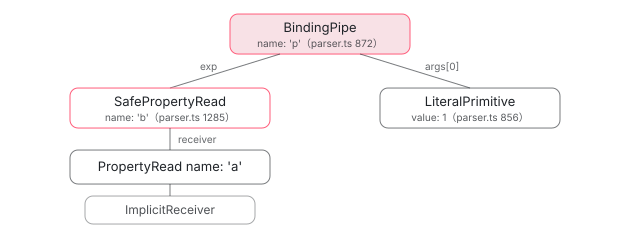

[目次](../README.md) › [テンプレートコンパイラの内側](README.md) › 第 5 回 / 全 18 回

# 式のパーサ：{{ a?.b | pipe }} が AST になるまで

> expression\_parser/lexer.ts が式を Token（識別子・キーワード・演算子・文字列・数値）に分け、parser.ts の \_ParseAST が優先順位ごとの関数（parsePipe → parseExpression → parseConditional → … → parsePrimary）で再帰下降する手順。パイプが一番弱い演算子である理由、?. の SafePropertyRead / SafeKeyedRead / SafeCall、テンプレートで使えない構文（代入の制限、new など）をどこで弾くか、エラーからの回復。

angular/angular · 読了 約 15 分 · 発展 · [サイトで読む（デモが動きます）](https://angular-deep-dive-cyan.vercel.app/chapter/compiler-expression-parser)

---

テンプレートの `{{ a?.b | pipe }}` や `(click)="save()"` の右辺は、HTML のパーサから見ればただの文字列です。この章では、その文字列を **Token の列に切る字句解析（lexer）**と、Token の列を **AST（抽象構文木。式の構造を表すオブジェクトの木）に組む構文解析（parser）**を 1 行ずつ追います。パイプがいちばん弱い演算子になる理由、`?.` が `SafePropertyRead` になる行、代入や `new` がどこで弾かれるか、エラーのあとどこまで読み飛ばすかを、行番号で説明できるようになります。

読む対象は `compiler/src/expression_parser/` の `lexer.ts`・`parser.ts`・`ast.ts` と、後段の `template/pipeline/src/phases/expand_safe_reads.ts` の数行です。

1. [1. 全体図](01-compiler.md)
2. [2. コンパイラの入口](02-compiler-entry.md)
3. [3. HTML の字句解析](03-compiler-html-lexer.md)
4. [4. HTML の構文解析](04-compiler-html-parser.md)
5. **5. 式のパーサ**（この章）
6. [6. バインディングのパーサ](06-compiler-binding-parser.md)
7. [7. R3 AST](07-compiler-r3-ast.md)
8. [8. ブロック構文の解析](08-compiler-control-flow-blocks.md)
9. [9. ディレクティブの照合](09-compiler-binder.md)
10. [10. IR への写像](10-compiler-ingest.md)
11. [11. IR の構造](11-compiler-ir.md)
12. [12. decls・vars・advance](12-compiler-slots-vars.md)
13. [13. 変数とコンテキスト](13-compiler-variables.md)
14. [14. 定数配列と pure function](14-compiler-consts-pure.md)
15. [15. 制御フローのフェーズ](15-compiler-control-flow-phases.md)
16. [16. reify と出力](16-compiler-reify-emit.md)
17. [17. 型検査（TCB）](17-compiler-typecheck.md)
18. [18. スタイルのカプセル化](18-compiler-shadow-css.md)

## 1. 入口は 3 つ：parseAction・parseBinding・parseInterpolation

式のパーサの公開クラスは `Parser` です。誰が呼ぶかは次章の [BindingParser](06-compiler-binding-parser.md) で読みます。ここでは「どの入口から入ると、何が違うのか」だけを見ます。違いを作るのはフラグ 1 つです。

📄 `angular/packages/compiler/src/expression_parser/parser.ts` L86–101 （▶ の行: 89, 95）

```ts
 86 │ /**
 87 │  * Represents the possible parse modes to be used as a bitmask.
 88 │  */
 89 ▶ export const enum ParseFlags {
 90 │   None = 0,
 91 │ 
 92 │   /**
 93 │    * Whether an output binding is being parsed.
 94 │    */
 95 ▶   Action = 1 << 0,
 96 │ }
 97 │ 
 98 │ function getLocation(span: ParseSourceSpan): string {
 99 │   return span.start.toString() || '(unknown)';
100 │ }
101 │ 
```

95 行目の `ParseFlags.Action` が立っているかどうか。立っていれば「イベントの右辺（action）」、立っていなければ「バインディングの右辺（binding）」として読みます。この 1 ビットが、後で見る「代入してよいか」「`;` で文を並べてよいか」「パイプを書いてよいか」を全部決めます。

📄 `angular/packages/compiler/src/expression_parser/parser.ts` L108–139 （▶ の行: 108, 114–116, 122, 126, 131, 137）

```ts
108 ▶   parseAction(
109 │     input: string,
110 │     parseSourceSpan: ParseSourceSpan,
111 │     absoluteOffset: number,
112 │   ): ASTWithSource {
113 │     const errors: ParseError[] = [];
114 ▶     this._checkNoInterpolation(errors, input, parseSourceSpan);
115 ▶     const {stripped: sourceToLex} = this._stripComments(input);
116 ▶     const tokens = this._lexer.tokenize(sourceToLex);
117 │     const ast = new _ParseAST(
118 │       input,
119 │       parseSourceSpan,
120 │       absoluteOffset,
121 │       tokens,
122 ▶       ParseFlags.Action,
123 │       errors,
124 │       0,
125 │       this._supportsDirectPipeReferences,
126 ▶     ).parseChain();
127 │ 
128 │     return new ASTWithSource(ast, input, getLocation(parseSourceSpan), absoluteOffset, errors);
129 │   }
130 │ 
131 ▶   parseBinding(
132 │     input: string,
133 │     parseSourceSpan: ParseSourceSpan,
134 │     absoluteOffset: number,
135 │   ): ASTWithSource {
136 │     const errors: ParseError[] = [];
137 ▶     const ast = this._parseBindingAst(input, parseSourceSpan, absoluteOffset, errors);
138 │     return new ASTWithSource(ast, input, getLocation(parseSourceSpan), absoluteOffset, errors);
139 │   }
```

📄 `angular/packages/compiler/src/expression_parser/parser.ts` L170–189 （▶ の行: 176–178, 184, 188）

```ts
170 │   private _parseBindingAst(
171 │     input: string,
172 │     parseSourceSpan: ParseSourceSpan,
173 │     absoluteOffset: number,
174 │     errors: ParseError[],
175 │   ): AST {
176 ▶     this._checkNoInterpolation(errors, input, parseSourceSpan);
177 ▶     const {stripped: sourceToLex} = this._stripComments(input);
178 ▶     const tokens = this._lexer.tokenize(sourceToLex);
179 │     return new _ParseAST(
180 │       input,
181 │       parseSourceSpan,
182 │       absoluteOffset,
183 │       tokens,
184 ▶       ParseFlags.None,
185 │       errors,
186 │       0,
187 │       this._supportsDirectPipeReferences,
188 ▶     ).parseChain();
189 │   }
```

1. **114 / 176 行目：`{{ }}` が混ざっていないか確かめる**

   `[x]="{{a}}"` のように書くと、ここで「Got interpolation ({{}}) where expression was expected」が積まれます。
2. **115〜116 / 177〜178 行目：`//` 以降のコメントを外し、`Lexer.tokenize` で Token の列にする**

   字句解析は 2 節で読みます。
3. **117〜126 / 179〜188 行目：`_ParseAST` を作って `parseChain()`**

   違いは 5 番目の引数だけです。`parseAction` は 122 行目で `ParseFlags.Action`、`parseBinding` は 184 行目で `ParseFlags.None`。木を組む手順（3 節以降）は同じ関数を通ります。

📄 `angular/packages/compiler/src/expression_parser/parser.ts` L255–292 （▶ の行: 255, 259, 266, 281, 286, 288, 290）

```ts
255 ▶     if (expressions.length === 0) return null;
256 │ 
257 │     const expressionNodes: AST[] = [];
258 │ 
259 ▶     for (let i = 0; i < expressions.length; ++i) {
260 │       // If we have a token for the specific expression, it's preferrable to use it because it
261 │       // allows us to produce more accurate error messages. The expressions are always at the odd
262 │       // indexes inside the tokens.
263 │       const expressionSpan = interpolatedTokens?.[i * 2 + 1]?.sourceSpan;
264 │       const expressionText = expressions[i].text;
265 │       const {stripped: sourceToLex, hasComments} = this._stripComments(expressionText);
266 ▶       const tokens = this._lexer.tokenize(sourceToLex);
267 │ 
268 │       if (hasComments && sourceToLex.trim().length === 0 && tokens.length === 0) {
269 │         // Empty expressions error are handled futher down, here we only take care of the comment case
270 │         errors.push(
271 │           getParseError(
272 │             'Interpolation expression cannot only contain a comment',
273 │             input,
274 │             `at column ${expressions[i].start} in`,
275 │             parseSourceSpan,
276 │           ),
277 │         );
278 │         continue;
279 │       }
280 │ 
281 ▶       const ast = new _ParseAST(
282 │         expressionSpan ? expressionText : input,
283 │         expressionSpan || parseSourceSpan,
284 │         absoluteOffset,
285 │         tokens,
286 ▶         ParseFlags.None,
287 │         errors,
288 ▶         offsets[i],
289 │         this._supportsDirectPipeReferences,
290 ▶       ).parseChain();
291 │       expressionNodes.push(ast);
292 │     }
```

3 つ目の入口 `parseInterpolation` は、テキストや属性値の `{{ }}` を扱います。先に `splitInterpolation` で「地の文」と「式」に切り分け、255 行目、式が 1 つも無ければ `null`（＝ただのテキスト）を返します。259 行目からは**式ごとに** 266 行目で字句解析し、281〜290 行目で `_ParseAST` を作り直します。286 行目のフラグは `None`、つまり補間の中身は binding と同じ規則で読まれます。288 行目の `offsets[i]` は、エラー位置を元のテンプレートの桁に合わせるためのずらし幅です。

📄 `angular/packages/compiler/src/expression_parser/parser.ts` L147–168 （▶ の行: 147–148, 155, 160）

```ts
147 ▶   // Host bindings parsed here
148 ▶   parseSimpleBinding(
149 │     input: string,
150 │     parseSourceSpan: ParseSourceSpan,
151 │     absoluteOffset: number,
152 │   ): ASTWithSource {
153 │     const errors: ParseError[] = [];
154 │     const ast = this._parseBindingAst(input, parseSourceSpan, absoluteOffset, errors);
155 ▶     const simplExpressionErrors = this.checkSimpleExpression(ast);
156 │ 
157 │     if (simplExpressionErrors.length > 0) {
158 │       errors.push(
159 │         getParseError(
160 ▶           `Host binding expression cannot contain ${simplExpressionErrors.join(' ')}`,
161 │           input,
162 │           '',
163 │           parseSourceSpan,
164 │         ),
165 │       );
166 │     }
167 │     return new ASTWithSource(ast, input, getLocation(parseSourceSpan), absoluteOffset, errors);
168 │   }
```

📄 `angular/packages/compiler/src/expression_parser/parser.ts` L1907–1913 （▶ の行: 1910–1911）

```ts
1907 │ class SimpleExpressionChecker extends RecursiveAstVisitor {
1908 │   errors: string[] = [];
1909 │ 
1910 ▶   override visitPipe() {
1911 ▶     this.errors.push('pipes');
1912 │   }
1913 │ }
```

もう 1 つ、`host: {'[x]': '…'}` のホストバインディング用に `parseSimpleBinding` があります（147 行目のコメント）。木の組み方は binding と同じで、155 行目で組んだ木を `SimpleExpressionChecker` に通し、1910〜1911 行目でパイプを見つけたら 160 行目の「Host binding expression cannot contain pipes」にします。

## 2. 字句解析：\_Scanner が 1 文字ずつ Token を作る

📄 `angular/packages/compiler/src/expression_parser/lexer.ts` L11–45 （▶ の行: 11, 13, 15–18, 21, 30, 41–44）

```ts
11 ▶ export enum TokenType {
12 │   Character,
13 ▶   Identifier,
14 │   PrivateIdentifier,
15 ▶   Keyword,
16 ▶   String,
17 ▶   Operator,
18 ▶   Number,
19 │   RegExpBody,
20 │   RegExpFlags,
21 ▶   Error,
22 │ }
23 │ 
24 │ export enum StringTokenKind {
25 │   Plain,
26 │   TemplateLiteralPart,
27 │   TemplateLiteralEnd,
28 │ }
29 │ 
30 ▶ const KEYWORDS = [
31 │   'var',
32 │   'let',
33 │   'as',
34 │   'null',
35 │   'undefined',
36 │   'true',
37 │   'false',
38 │   'if',
39 │   'else',
40 │   'this',
41 ▶   'typeof',
42 ▶   'void',
43 ▶   'in',
44 ▶   'instanceof',
45 │ ];
```

Token の種類は 11〜22 行目の 10 個です。中心は Identifier（13 行目）・Keyword（15 行目）・String（16 行目）・Operator（17 行目）・Number（18 行目）で、括弧やカンマのような 1 文字の記号は Character になります。読めない文字は Error（21 行目）という **Token として**列に入り、例外は投げません。30〜45 行目の `KEYWORDS` に `typeof` / `void` / `in` / `instanceof`（41〜44 行目）はありますが、**`new` はありません**。これが 5 節の伏線です。

📄 `angular/packages/compiler/src/expression_parser/lexer.ts` L260–291 （▶ の行: 267, 279–280, 284–285, 288–289）

```ts
260 │   private scanToken(): Token | null {
261 │     const input = this.input;
262 │     const length = this.length;
263 │     let peek = this.peek;
264 │     let index = this.index;
265 │ 
266 │     // Skip whitespace.
267 ▶     while (peek <= chars.$SPACE) {
268 │       if (++index >= length) {
269 │         peek = chars.$EOF;
270 │         break;
271 │       } else {
272 │         peek = input.charCodeAt(index);
273 │       }
274 │     }
275 │ 
276 │     this.peek = peek;
277 │     this.index = index;
278 │ 
279 ▶     if (index >= length) {
280 ▶       return null;
281 │     }
282 │ 
283 │     // Handle identifiers and numbers.
284 ▶     if (isIdentifierStart(peek)) {
285 ▶       return this.scanIdentifier();
286 │     }
287 │ 
288 ▶     if (chars.isDigit(peek)) {
289 ▶       return this.scanNumber(index);
290 │     }
291 │ 
```

1. **267〜274 行目：空白を飛ばす**

   文字コードが空白（32）以下ならすべて読み飛ばします。だから `a|p` と `a | p` は同じ Token 列になります。
2. **279〜281 行目：入力の終わりなら `null`**

   `scan()` はこの `null` でループを抜けます。
3. **284〜290 行目：識別子の先頭なら `scanIdentifier`、数字なら `scanNumber`**

   それ以外の記号は、次の `switch` で 1 文字目ごとに振り分けます。

📄 `angular/packages/compiler/src/expression_parser/lexer.ts` L292–325 （▶ の行: 294, 297, 301–302, 306, 308, 311, 318–320, 323, 325）

```ts
292 │     const start: number = index;
293 │     switch (peek) {
294 ▶       case chars.$PERIOD:
295 │         this.advance();
296 │ 
297 ▶         if (chars.isDigit(this.peek)) {
298 │           return this.scanNumber(start);
299 │         }
300 │ 
301 ▶         if (this.peek !== chars.$PERIOD) {
302 ▶           return newCharacterToken(start, this.index, chars.$PERIOD);
303 │         }
304 │ 
305 │         this.advance();
306 ▶         if (this.peek === chars.$PERIOD) {
307 │           this.advance();
308 ▶           return newOperatorToken(start, this.index, '...');
309 │         }
310 │         return this.error(`Unexpected character [${String.fromCharCode(peek)}]`, 0);
311 ▶       case chars.$LPAREN:
312 │       case chars.$RPAREN:
313 │       case chars.$LBRACKET:
314 │       case chars.$RBRACKET:
315 │       case chars.$COMMA:
316 │       case chars.$COLON:
317 │       case chars.$SEMICOLON:
318 ▶         return this.scanCharacter(start, peek);
319 ▶       case chars.$LBRACE:
320 ▶         return this.scanOpenBrace(start, peek);
321 │       case chars.$RBRACE:
322 │         return this.scanCloseBrace(start, peek);
323 ▶       case chars.$SQ:
324 │       case chars.$DQ:
325 ▶         return this.scanString();
```

📄 `angular/packages/compiler/src/expression_parser/lexer.ts` L326–365 （▶ の行: 326, 328–330, 335–337, 345–346, 352–353, 356–357, 363–364）

```ts
326 ▶       case chars.$BT:
327 │         this.advance();
328 ▶         return this.scanTemplateLiteralPart(start);
329 ▶       case chars.$HASH:
330 ▶         return this.scanPrivateIdentifier();
331 │       case chars.$PLUS:
332 │         return this.scanComplexOperator(start, '+', chars.$EQ, '=');
333 │       case chars.$MINUS:
334 │         return this.scanComplexOperator(start, '-', chars.$EQ, '=');
335 ▶       case chars.$SLASH:
336 ▶         return this.isStartOfRegex()
337 ▶           ? this.scanRegex(index)
338 │           : this.scanComplexOperator(start, '/', chars.$EQ, '=');
339 │       case chars.$PERCENT:
340 │         return this.scanComplexOperator(start, '%', chars.$EQ, '=');
341 │       case chars.$CARET:
342 │         return this.scanOperator(start, '^');
343 │       case chars.$STAR:
344 │         return this.scanStar(start);
345 ▶       case chars.$QUESTION:
346 ▶         return this.scanQuestion(start);
347 │       case chars.$LT:
348 │       case chars.$GT:
349 │         return this.scanComplexOperator(start, String.fromCharCode(peek), chars.$EQ, '=');
350 │       case chars.$BANG:
351 │         return this.scanComplexOperator(start, '!', chars.$EQ, '=', chars.$EQ, '=');
352 ▶       case chars.$EQ:
353 ▶         return this.scanEquals(start);
354 │       case chars.$AMPERSAND:
355 │         return this.scanComplexOperator(start, '&', chars.$AMPERSAND, '&', chars.$EQ, '=');
356 ▶       case chars.$BAR:
357 ▶         return this.scanComplexOperator(start, '|', chars.$BAR, '|', chars.$EQ, '=');
358 │       case chars.$NBSP:
359 │         while (chars.isWhitespace(this.peek)) this.advance();
360 │         return this.scanToken();
361 │     }
362 │ 
363 ▶     this.advance();
364 ▶     return this.error(`Unexpected character [${String.fromCharCode(peek)}]`, 0);
365 │   }
```

`.` は 3 通りに分かれます。297 行目、次が数字なら `.5` のような数値。301〜302 行目、次が `.` でなければ Character の `.`。306〜308 行目、`...` ならスプレッドの Operator です。311〜318 行目の括弧・カンマ・コロン・セミコロンは Character、323〜325 行目の `'``"` は文字列、326〜328 行目のバッククォートはテンプレートリテラルです。335〜337 行目、`/` は直前の Token を見て正規表現リテラルか割り算かを決めます。356〜357 行目、`|` は `scanComplexOperator` で `|`・`||`・`||=` のどれかの Operator になります。パイプの `|` も論理和の `||` も、ここでは同じ種類の Token です。どの `case` にも当たらなければ 363〜364 行目で Error Token です。

📄 `angular/packages/compiler/src/expression_parser/lexer.ts` L426–452 （▶ の行: 426, 432, 434–435, 437, 444, 447, 449–451）

```ts
426 ▶   private scanEquals(start: number): Token {
427 │     this.advance();
428 │     let str: string = '=';
429 │     if (this.peek === chars.$EQ) {
430 │       this.advance();
431 │       str += '=';
432 ▶     } else if (this.peek === chars.$GT) {
433 │       this.advance();
434 ▶       str += '>';
435 ▶       return newOperatorToken(start, this.index, str);
436 │     }
437 ▶     if (this.peek === chars.$EQ) {
438 │       this.advance();
439 │       str += '=';
440 │     }
441 │     return newOperatorToken(start, this.index, str);
442 │   }
443 │ 
444 ▶   private scanIdentifier(): Token {
445 │     const start: number = this.index;
446 │     this.advance();
447 ▶     while (isIdentifierPart(this.peek)) this.advance();
448 │     const str: string = this.input.substring(start, this.index);
449 ▶     return KEYWORDS.indexOf(str) > -1
450 ▶       ? newKeywordToken(start, this.index, str)
451 ▶       : newIdentifierToken(start, this.index, str);
452 │   }
```

`=` は 426〜442 行目で `=`・`==`・`===`・`=>` のどれかになります（432〜435 行目が矢印関数の `=>`）。識別子は 447 行目で続く限り読み、449〜451 行目で `KEYWORDS` に含まれていれば Keyword、そうでなければ Identifier です。

📄 `angular/packages/compiler/src/expression_parser/lexer.ts` L537–556 （▶ の行: 541–542, 546–547, 550, 552, 555）

```ts
537 │   private scanQuestion(start: number): Token {
538 │     this.advance();
539 │     let operator = '?';
540 │     // `a ?? b` or `a ??= b`.
541 ▶     if (this.peek === chars.$QUESTION) {
542 ▶       operator += '?';
543 │       this.advance();
544 │ 
545 │       // @ts-expect-error
546 ▶       if (this.peek === chars.$EQ) {
547 ▶         operator += '=';
548 │         this.advance();
549 │       }
550 ▶     } else if (this.peek === chars.$PERIOD) {
551 │       // `a?.b`
552 ▶       operator += '.';
553 │       this.advance();
554 │     }
555 ▶     return newOperatorToken(start, this.index, operator);
556 │   }
```

`?` は 541〜549 行目で `??` / `??=`、550〜554 行目で `?.`、どちらでもなければ三項演算子の `?` です。**`?.` は字句解析の段階で 1 つの Operator Token**になります。`a?.b | p:1` は次の 7 個です。

| # | 文字 | TokenType | どの行で作られたか |
| --- | --- | --- | --- |
| 0 | `a` | Identifier | 284〜285 → 444〜451 |
| 1 | `?.` | Operator | 345〜346 → 550〜555 |
| 2 | `b` | Identifier | 284〜285 |
| 3 | `\|` | Operator | 356〜357 |
| 4 | `p` | Identifier | 284〜285 |
| 5 | `:` | Character | 316〜318 |
| 6 | `1` | Number | 288〜289 |

## 3. 構文解析：優先順位ごとに 1 つの関数を降りていく

`_ParseAST` は**再帰下降パーサ**です。演算子の強さ（優先順位）ごとに関数が 1 つあり、弱い演算子の関数が、1 段強い演算子の関数を呼んで左右の項を作ります。「下に行くほど強く結びつく」階段です。まず全体の階段を表にします。

| 段 | 関数（parser.ts の行） | 扱う記法 | 項を作るために呼ぶ関数 |
| --- | --- | --- | --- |
| 0 | `parseChain`（783） | `a; b`（action のみ） | `parsePipe` |
| 1 | `parsePipe`（820） | `x \| name:arg` | `parseExpression` |
| 2 | `parseExpression`（887）→ `parseConditional`（891） | `c ? a : b` | `parseLogicalOr`（分岐の中は `parsePipe`） |
| 3 | `parseLogicalOr`（912） | `\|\|` | `parseLogicalAnd` |
| 4 | `parseLogicalAnd`（923） | `&&` | `parseNullishCoalescing` |
| 5 | `parseNullishCoalescing`（934） | `??` | `parseEquality` |
| 6 | `parseEquality`（945） | `==``===``!=``!==` | `parseRelational` |
| 7 | `parseRelational`（966） | `<``>``<=``>=``in``instanceof` | `parseAdditive` |
| 8 | `parseAdditive`（993） | `+``-` | `parseMultiplicative` |
| 9 | `parseMultiplicative`（1012） | `*``%``/` | `parseExponentiation` |
| 10 | `parseExponentiation`（1032） | `**` | `parsePrefix` |
| 11 | `parsePrefix`（1057） | 前置 `+``-``!``typeof``void` | `parseCallChain` |
| 12 | `parseCallChain`（1090） | `.b``?.b``[k]``(…)` 後置 `!` | `parsePrimary` |
| 13 | `parsePrimary`（1120） | 識別子・リテラル・`( )`・`[ ]`・`{ }`・矢印関数 | — |

📄 `angular/packages/compiler/src/expression_parser/parser.ts` L783–818 （▶ の行: 786–787, 790–792, 795, 797, 802–803, 807, 811, 816–817）

```ts
783 │   parseChain(): AST {
784 │     const exprs: AST[] = [];
785 │     const start = this.inputIndex;
786 ▶     while (this.index < this.tokens.length) {
787 ▶       const expr = this.parsePipe();
788 │       exprs.push(expr);
789 │ 
790 ▶       if (this.consumeOptionalCharacter(chars.$SEMICOLON)) {
791 ▶         if (!(this.parseFlags & ParseFlags.Action)) {
792 ▶           this.error('Binding expression cannot contain chained expression');
793 │         }
794 │         while (this.consumeOptionalCharacter(chars.$SEMICOLON)) {} // read all semicolons
795 ▶       } else if (this.index < this.tokens.length) {
796 │         const errorIndex = this.index;
797 ▶         this.error(`Unexpected token '${this.next}'`);
798 │         // The `error` call above will skip ahead to the next recovery point in an attempt to
799 │         // recover part of the expression, but that might be the token we started from which will
800 │         // lead to an infinite loop. If that's the case, break the loop assuming that we can't
801 │         // parse further.
802 ▶         if (this.index === errorIndex) {
803 ▶           break;
804 │         }
805 │       }
806 │     }
807 ▶     if (exprs.length === 0) {
808 │       // We have no expressions so create an empty expression that spans the entire input length
809 │       const artificialStart = this.offset;
810 │       const artificialEnd = this.offset + this.input.length;
811 ▶       return new EmptyExpr(
812 │         this.span(artificialStart, artificialEnd),
813 │         this.sourceSpan(artificialStart, artificialEnd),
814 │       );
815 │     }
816 ▶     if (exprs.length == 1) return exprs[0];
817 ▶     return new Chain(this.span(start), this.sourceSpan(start), exprs);
818 │   }
```

1. **786〜787 行目：Token が残っている間、`parsePipe()` で式を 1 つ読む**

   階段のいちばん上から下りはじめます。
2. **790〜793 行目：`;` が来たら、action でなければエラー**

   `(click)="a(); b()"` は通り、`[x]="a; b"` は「Binding expression cannot contain chained expression」です。
3. **795〜805 行目：式のあとに余計な Token があればエラー**

   802〜803 行目は、エラー回復（7 節）で 1 つも進めなかったときに無限ループを避ける脱出口です。
4. **807〜817 行目：結果の形を決める**

   式が 0 個なら `EmptyExpr`（811 行目）、1 個ならそのもの（816 行目）、2 個以上なら `Chain`（817 行目）です。

📄 `angular/packages/compiler/src/expression_parser/parser.ts` L820–835 （▶ の行: 820, 822–825, 828, 830）

```ts
820 ▶   private parsePipe(): AST {
821 │     const start = this.inputIndex;
822 ▶     let result = this.parseExpression();
823 ▶     if (this.consumeOptionalOperator('|')) {
824 ▶       if (this.parseFlags & ParseFlags.Action) {
825 ▶         this.error(`Cannot have a pipe in an action expression`);
826 │       }
827 │ 
828 ▶       do {
829 │         const nameStart = this.inputIndex;
830 ▶         let nameId = this.expectIdentifierOrKeyword();
831 │         let nameSpan: AbsoluteSourceSpan;
832 │         let fullSpanEnd: number | undefined = undefined;
833 │         if (nameId !== null) {
834 │           nameSpan = this.sourceSpan(nameStart);
835 │         } else {
```

📄 `angular/packages/compiler/src/expression_parser/parser.ts` L854–885 （▶ の行: 855–856, 862, 866, 869, 872, 875, 881）

```ts
854 │         const args: AST[] = [];
855 ▶         while (this.consumeOptionalCharacter(chars.$COLON)) {
856 ▶           args.push(this.parseExpression());
857 │ 
858 │           // If there are additional expressions beyond the name, then the artificial end for the
859 │           // name is no longer relevant.
860 │         }
861 │         let type: BindingPipeType;
862 ▶         if (this.supportsDirectPipeReferences) {
863 │           const charCode = nameId.charCodeAt(0);
864 │           type =
865 │             charCode === chars.$_ || (charCode >= chars.$A && charCode <= chars.$Z)
866 ▶               ? BindingPipeType.ReferencedDirectly
867 │               : BindingPipeType.ReferencedByName;
868 │         } else {
869 ▶           type = BindingPipeType.ReferencedByName;
870 │         }
871 │ 
872 ▶         result = new BindingPipe(
873 │           this.span(start),
874 │           this.sourceSpan(start, fullSpanEnd),
875 ▶           result,
876 │           nameId,
877 │           args,
878 │           type,
879 │           nameSpan,
880 │         );
881 ▶       } while (this.consumeOptionalOperator('|'));
882 │     }
883 │ 
884 │     return result;
885 │   }
```

1. **822 行目：まず `parseExpression()` で左側を全部読む**

   `a?.b | p:1` なら、`a?.b` が階段を下りて上がってきた木がここで `result` に入ります。`|` は階段のどの段も扱わない記号なので、下の段はそこで止まって戻ってきます。
2. **823〜826 行目：`|` があり、action なら「Cannot have a pipe in an action expression」**

   イベントの右辺でパイプが使えないのはこの行です。
3. **830 行目：パイプ名を読む**

   識別子でもキーワードでもよいので、`| void` のような名前も文法上は通ります。
4. **855〜856 行目：`:` のたびに引数を `parseExpression()` で 1 つ読む**

   引数は `parsePipe` ではなく `parseExpression` で読むので、引数の中に裸の `|` は入りません。`a | p:1 | q` の `| q` は、引数ではなく 881 行目のループで「次のパイプ」になります。
5. **862〜870 行目：パイプの参照のしかたを決める**

   `supportsDirectPipeReferences`（selectorless 用）が有効で、名前が大文字か `_` で始まれば `ReferencedDirectly`（クラスを直接指す）。それ以外は従来どおり `ReferencedByName` です。selectorless は [別章](../standalone/13-standalone-selectorless.md)で扱っています。
6. **872〜880 行目：`BindingPipe` で今までの `result` を包む**

   875 行目、`exp` に入るのは左側全体です。**パイプが木のいちばん外側（根）になる**のはこの行のためです。

📄 `angular/packages/compiler/src/expression_parser/parser.ts` L887–921 （▶ の行: 888, 893, 895–896, 898, 901, 904, 906, 915–918）

```ts
887 │   private parseExpression(): AST {
888 ▶     return this.parseConditional();
889 │   }
890 │ 
891 │   private parseConditional(): AST {
892 │     const start = this.inputIndex;
893 ▶     const result = this.parseLogicalOr();
894 │ 
895 ▶     if (this.consumeOptionalOperator('?')) {
896 ▶       const yes = this.parsePipe();
897 │       let no: AST;
898 ▶       if (!this.consumeOptionalCharacter(chars.$COLON)) {
899 │         const end = this.inputIndex;
900 │         const expression = this.input.substring(start, end);
901 ▶         this.error(`Conditional expression ${expression} requires all 3 expressions`);
902 │         no = new EmptyExpr(this.span(start), this.sourceSpan(start));
903 │       } else {
904 ▶         no = this.parsePipe();
905 │       }
906 ▶       return new Conditional(this.span(start), this.sourceSpan(start), result, yes, no);
907 │     } else {
908 │       return result;
909 │     }
910 │   }
911 │ 
912 │   private parseLogicalOr(): AST {
913 │     // '||'
914 │     const start = this.inputIndex;
915 ▶     let result = this.parseLogicalAnd();
916 ▶     while (this.consumeOptionalOperator('||')) {
917 ▶       const right = this.parseLogicalAnd();
918 ▶       result = new Binary(this.span(start), this.sourceSpan(start), '||', result, right);
919 │     }
920 │     return result;
921 │   }
```

888 行目、`parseExpression` の中身は `parseConditional` そのものです。893 行目で条件を `parseLogicalOr` で読み、895 行目で `?` が来たら、**896 行目と 904 行目で分岐の中身を `parsePipe()` で読みます**。階段を 1 段上に戻るので、`x ? a : b | p` は `Conditional(x, a, BindingPipe(b, p))` になります（デモで確かめられます）。898〜902 行目、`:` が無ければ「Conditional expression … requires all 3 expressions」です。912〜921 行目の `parseLogicalOr` が典型的な 1 段で、915 行目で 1 段下を呼んで左を作り、916 行目で `||` がある限り 917 行目で右を作って 918 行目で `Binary` に包みます。`a || b || c` は左から順に包まれるので `(a || b) || c` の形（左結合）になります。`parseLogicalAnd` 以下の段も同じ形です。

📄 `angular/packages/compiler/src/expression_parser/parser.ts` L1057–1088 （▶ の行: 1058, 1063, 1065–1067, 1071, 1074, 1076, 1080–1081, 1085, 1087）

```ts
1057 │   private parsePrefix(): AST {
1058 ▶     if (this.next.type == TokenType.Operator) {
1059 │       const start = this.inputIndex;
1060 │       const operator = this.next.strValue;
1061 │       let result: AST;
1062 │       switch (operator) {
1063 ▶         case '+':
1064 │           this.advance();
1065 ▶           result = this.parsePrefix();
1066 ▶           return Unary.createPlus(this.span(start), this.sourceSpan(start), result);
1067 ▶         case '-':
1068 │           this.advance();
1069 │           result = this.parsePrefix();
1070 │           return Unary.createMinus(this.span(start), this.sourceSpan(start), result);
1071 ▶         case '!':
1072 │           this.advance();
1073 │           result = this.parsePrefix();
1074 ▶           return new PrefixNot(this.span(start), this.sourceSpan(start), result);
1075 │       }
1076 ▶     } else if (this.next.isKeywordTypeof()) {
1077 │       const start = this.inputIndex;
1078 │       this.advance();
1079 │       const result = this.parsePrefix();
1080 ▶       return new TypeofExpression(this.span(start), this.sourceSpan(start), result);
1081 ▶     } else if (this.next.isKeywordVoid()) {
1082 │       const start = this.inputIndex;
1083 │       this.advance();
1084 │       const result = this.parsePrefix();
1085 ▶       return new VoidExpression(this.span(start), this.sourceSpan(start), result);
1086 │     }
1087 ▶     return this.parseCallChain();
1088 │   }
```

前置の `+``-`（1063〜1070 行目）は `Unary`、`!`（1071〜1074 行目）は `PrefixNot`、`typeof`（1076〜1080 行目）・`void`（1081〜1085 行目）は専用のノードです。どれも自分自身（`parsePrefix`）を呼ぶので `!!a` のように重ねられます。前置演算子が無ければ 1087 行目で 1 段下へ進みます。

📄 `angular/packages/compiler/src/expression_parser/parser.ts` L1090–1118 （▶ の行: 1092–1098, 1100–1102, 1104–1109, 1115）

```ts
1090 │   private parseCallChain(): AST {
1091 │     const start = this.inputIndex;
1092 ▶     let result = this.parsePrimary();
1093 ▶     while (true) {
1094 ▶       if (this.consumeOptionalCharacter(chars.$PERIOD)) {
1095 ▶         result = this.parseAccessMember(result, start, false);
1096 ▶       } else if (this.consumeOptionalOperator('?.')) {
1097 ▶         if (this.consumeOptionalCharacter(chars.$LPAREN)) {
1098 ▶           result = this.parseCall(result, start, true);
1099 │         } else {
1100 ▶           result = this.consumeOptionalCharacter(chars.$LBRACKET)
1101 ▶             ? this.parseKeyedReadOrWrite(result, start, true)
1102 ▶             : this.parseAccessMember(result, start, true);
1103 │         }
1104 ▶       } else if (this.consumeOptionalCharacter(chars.$LBRACKET)) {
1105 ▶         result = this.parseKeyedReadOrWrite(result, start, false);
1106 ▶       } else if (this.consumeOptionalCharacter(chars.$LPAREN)) {
1107 ▶         result = this.parseCall(result, start, false);
1108 ▶       } else if (this.consumeOptionalOperator('!')) {
1109 ▶         result = new NonNullAssert(this.span(start), this.sourceSpan(start), result);
1110 │       } else if (this.next.isTemplateLiteralEnd()) {
1111 │         result = this.parseNoInterpolationTaggedTemplateLiteral(result, start);
1112 │       } else if (this.next.isTemplateLiteralPart()) {
1113 │         result = this.parseTaggedTemplateLiteral(result, start);
1114 │       } else {
1115 ▶         return result;
1116 │       }
1117 │     }
1118 │   }
```

1092 行目で最初の項（`a` など）を読み、1093 行目の `while (true)` で後ろに付く記号を**繰り返し**食べます。`.` ならプロパティ読み（1094〜1095 行目）、`[` ならキー読み（1104〜1105 行目）、`(` なら呼び出し（1106〜1107 行目）、後置の `!` なら `NonNullAssert`（1108〜1109 行目）。`?.` の Token なら 1096 行目に入り、その次が `(` なら `SafeCall`（1097〜1098 行目）、`[` なら安全なキー読み（1100〜1101 行目）、それ以外は安全なプロパティ読み（1102 行目）です。どれでもなければ 1115 行目で上の段に返ります。`a.b(c)?.[d]!` は 1 回の `parseCallChain` の中で、ループを 4 周して組み上がります。

📄 `angular/packages/compiler/src/expression_parser/parser.ts` L1120–1159 （▶ の行: 1122–1128, 1134–1135, 1147, 1149–1150, 1152, 1154–1156）

```ts
1120 │   private parsePrimary(): AST {
1121 │     const start = this.inputIndex;
1122 ▶     if (this.isArrowFunction()) {
1123 ▶       return this.parseArrowFunction(start);
1124 ▶     } else if (this.consumeOptionalCharacter(chars.$LPAREN)) {
1125 ▶       this.rparensExpected++;
1126 ▶       const result = this.parsePipe();
1127 ▶       if (!this.consumeOptionalCharacter(chars.$RPAREN)) {
1128 ▶         this.error('Missing closing parentheses');
1129 │         // Calling into `error` above will attempt to recover up until the next closing paren.
1130 │         // If that's the case, consume it so we can partially recover the expression.
1131 │         this.consumeOptionalCharacter(chars.$RPAREN);
1132 │       }
1133 │       this.rparensExpected--;
1134 ▶       return new ParenthesizedExpression(this.span(start), this.sourceSpan(start), result);
1135 ▶     } else if (this.next.isKeywordNull()) {
1136 │       this.advance();
1137 │       return new LiteralPrimitive(this.span(start), this.sourceSpan(start), null);
1138 │     } else if (this.next.isKeywordUndefined()) {
1139 │       this.advance();
1140 │       return new LiteralPrimitive(this.span(start), this.sourceSpan(start), undefined);
1141 │     } else if (this.next.isKeywordTrue()) {
1142 │       this.advance();
1143 │       return new LiteralPrimitive(this.span(start), this.sourceSpan(start), true);
1144 │     } else if (this.next.isKeywordFalse()) {
1145 │       this.advance();
1146 │       return new LiteralPrimitive(this.span(start), this.sourceSpan(start), false);
1147 ▶     } else if (this.next.isKeywordThis()) {
1148 │       this.advance();
1149 ▶       return new ThisReceiver(this.span(start), this.sourceSpan(start));
1150 ▶     } else if (this.consumeOptionalCharacter(chars.$LBRACKET)) {
1151 │       return this.parseLiteralArray(start);
1152 ▶     } else if (this.next.isCharacter(chars.$LBRACE)) {
1153 │       return this.parseLiteralMap();
1154 ▶     } else if (this.next.isIdentifier()) {
1155 ▶       return this.parseAccessMember(
1156 ▶         new ImplicitReceiver(this.span(start), this.sourceSpan(start)),
1157 │         start,
1158 │         false,
1159 │       );
```

階段のいちばん下です。1122 行目、Token を先読みして矢印関数（`x => …` / `(a, b) => …`）なら専用の関数へ。1124〜1134 行目、`(` なら**中身を `parsePipe()` で読み直します**（1126 行目）。括弧の中は階段のいちばん上からやり直すので、パイプを含めて何でも書けます。1154〜1156 行目、ただの識別子 `a` は `ImplicitReceiver`（暗黙の受け手。後段でコンポーネントのインスタンスになる）の上の `parseAccessMember` として読まれます。つまり `a` は「`this.a`」と同じ `PropertyRead` の形になります。



*a?.b | p:1 の木。parsePipe が最後に BindingPipe で包むので、パイプが根になる。*

## 4. ?. は SafePropertyRead / SafeKeyedRead / SafeCall になる

📄 `angular/packages/compiler/src/expression_parser/parser.ts` L1268–1292 （▶ の行: 1270–1271, 1279–1280, 1282, 1285, 1289–1290）

```ts
1268 │   private parseAccessMember(readReceiver: AST, start: number, isSafe: boolean): AST {
1269 │     const nameStart = this.inputIndex;
1270 ▶     const id = this.withContext(ParseContextFlags.Writable, () => {
1271 ▶       const id = this.expectIdentifierOrKeyword() ?? '';
1272 │       if (id.length === 0) {
1273 │         this.error(`Expected identifier for property access`, readReceiver.span.end);
1274 │       }
1275 │       return id;
1276 │     });
1277 │     const nameSpan = this.sourceSpan(nameStart);
1278 │ 
1279 ▶     if (isSafe) {
1280 ▶       if (this.isAssignmentOperator(this.next)) {
1281 │         this.advance();
1282 ▶         this.error("The '?.' operator cannot be used in the assignment");
1283 │         return new EmptyExpr(this.span(start), this.sourceSpan(start));
1284 │       } else {
1285 ▶         return new SafePropertyRead(
1286 │           this.span(start),
1287 │           this.sourceSpan(start),
1288 │           nameSpan,
1289 ▶           readReceiver,
1290 ▶           id,
1291 │         );
1292 │       }
```

`parseAccessMember` は `.` と `?.` の両方の後ろを読みます。違いは 3 番目の引数 `isSafe` だけです。1279 行目で `isSafe` なら、1280〜1283 行目で直後が代入演算子かを確かめ（`a?.b = 1` は「The '?.' operator cannot be used in the assignment」）、そうでなければ 1285〜1291 行目で `SafePropertyRead` を作ります。1289 行目の `readReceiver` が `?.` の左側です。

📄 `angular/packages/compiler/src/expression_parser/ast.ts` L97–126 （▶ の行: 97, 102–103, 112, 117–118）

```ts
 97 ▶ export class PropertyRead extends ASTWithName {
 98 │   constructor(
 99 │     span: ParseSpan,
100 │     sourceSpan: AbsoluteSourceSpan,
101 │     nameSpan: AbsoluteSourceSpan,
102 ▶     public receiver: AST,
103 ▶     public name: string,
104 │   ) {
105 │     super(span, sourceSpan, nameSpan);
106 │   }
107 │   override visit(visitor: AstVisitor, context: any = null): any {
108 │     return visitor.visitPropertyRead(this, context);
109 │   }
110 │ }
111 │ 
112 ▶ export class SafePropertyRead extends ASTWithName {
113 │   constructor(
114 │     span: ParseSpan,
115 │     sourceSpan: AbsoluteSourceSpan,
116 │     nameSpan: AbsoluteSourceSpan,
117 ▶     public receiver: AST,
118 ▶     public name: string,
119 │   ) {
120 │     super(span, sourceSpan, nameSpan);
121 │   }
122 │   override visit(visitor: AstVisitor, context: any = null): any {
123 │     return visitor.visitSafePropertyRead(this, context);
124 │   }
125 │ }
126 │ 
```

ast.ts を見ると、`PropertyRead`（97 行目）と `SafePropertyRead`（112 行目）は**同じ形の別クラス**です。どちらも `receiver` と `name` を持ちます。継承関係は無いので、後段は `instanceof SafePropertyRead` で区別します。パーサの段階では「`?.` だった」と印を付けるだけで、undefined の確認はまだどこにもありません。

📄 `angular/packages/compiler/src/template/pipeline/src/phases/expand_safe_reads.ts` L206–220 （▶ の行: 206–214, 216–217）

```ts
206 ▶   const useNullSemantics =
207 ▶     ctx.job.legacyOptionalChaining ||
208 ▶     (flags & ir.VisitorContextFlag.InSafeNavigationMigration) !== 0;
209 ▶   if (!useNullSemantics) {
210 ▶     // Convert the intermediate IR safe-navigation nodes to output AST nodes with `isOptional=true`.
211 ▶     // This is the "native optional chaining" path: the output AST nodes carry the `?.` flag and
212 ▶     // are later translated to native JS/TS optional-chain syntax by the code generators.
213 ▶     if (e instanceof ir.SafePropertyReadExpr) {
214 ▶       return new o.ReadPropExpr(e.receiver, e.name, null, e.sourceSpan, [], true);
215 │     }
216 ▶     if (e instanceof ir.SafeKeyedReadExpr) {
217 ▶       return new o.ReadKeyExpr(e.receiver, e.index, null, e.sourceSpan, [], true);
218 │     }
219 │     return e;
220 │   }
```

その印を実際のコードにするのは、テンプレートパイプライン（[IR](11-compiler-ir.md) を書き換えるフェーズの列）の `expandSafeReads` です。既定（206〜209 行目で `legacyOptionalChaining` が偽）では、213〜217 行目で `isOptional = true` の読み取り式に変えます。210〜212 行目のコメントのとおり、これがコード生成でネイティブの `?.` として書き出されます。

## 5. テンプレートで書けない構文と、弾いている行

📄 `angular/packages/compiler/src/expression_parser/parser.ts` L1293–1322 （▶ の行: 1294, 1297–1300, 1302, 1309–1311）

```ts
1293 │     } else {
1294 ▶       if (this.isAssignmentOperator(this.next)) {
1295 │         const operation = this.next.strValue;
1296 │ 
1297 ▶         if (!(this.parseFlags & ParseFlags.Action)) {
1298 ▶           this.advance();
1299 ▶           this.error('Bindings cannot contain assignments');
1300 ▶           return new EmptyExpr(this.span(start), this.sourceSpan(start));
1301 │         }
1302 ▶         const receiver = new PropertyRead(
1303 │           this.span(start),
1304 │           this.sourceSpan(start),
1305 │           nameSpan,
1306 │           readReceiver,
1307 │           id,
1308 │         );
1309 ▶         this.advance();
1310 ▶         const value = this.parseConditional();
1311 ▶         return new Binary(this.span(start), this.sourceSpan(start), operation, receiver, value);
1312 │       } else {
1313 │         return new PropertyRead(
1314 │           this.span(start),
1315 │           this.sourceSpan(start),
1316 │           nameSpan,
1317 │           readReceiver,
1318 │           id,
1319 │         );
1320 │       }
1321 │     }
1322 │   }
```

代入の判定はプロパティ読みの直後にあります。1294 行目で次の Token が代入演算子（`=``+=``??=` など。ast.ts の `Binary.isAssignmentOperation`）なら、1297〜1300 行目で `ParseFlags.Action` が無ければ「Bindings cannot contain assignments」にして `EmptyExpr` を返します。action なら 1302〜1311 行目で、左辺を `PropertyRead`、右辺を 1310 行目の `parseConditional()` で読み、`Binary('=', 左, 右)` を作ります。**代入は専用のノードではなく `Binary` です**。

📄 `angular/packages/compiler/src/expression_parser/parser.ts` L1454–1485 （▶ の行: 1454, 1457, 1459, 1461, 1468–1469, 1478–1480）

```ts
1454 ▶       if (this.isAssignmentOperator(this.next)) {
1455 │         const operation = this.next.strValue;
1456 │ 
1457 ▶         if (isSafe) {
1458 │           this.advance();
1459 ▶           this.error("The '?.' operator cannot be used in the assignment");
1460 │         } else {
1461 ▶           const binaryReceiver = new KeyedRead(
1462 │             this.span(start),
1463 │             this.sourceSpan(start),
1464 │             receiver,
1465 │             key,
1466 │           );
1467 │           this.advance();
1468 ▶           const value = this.parseConditional();
1469 ▶           return new Binary(
1470 │             this.span(start),
1471 │             this.sourceSpan(start),
1472 │             operation,
1473 │             binaryReceiver,
1474 │             value,
1475 │           );
1476 │         }
1477 │       } else {
1478 ▶         return isSafe
1479 ▶           ? new SafeKeyedRead(this.span(start), this.sourceSpan(start), receiver, key)
1480 ▶           : new KeyedRead(this.span(start), this.sourceSpan(start), receiver, key);
1481 │       }
1482 │ 
1483 │       return new EmptyExpr(this.span(start), this.sourceSpan(start));
1484 │     });
1485 │   }
```

> [!WARNING]
> **ハマりどころ**
>
> キー読み `a[k]` の後ろの代入（1454〜1476 行目）には、1297 行目のような `ParseFlags.Action` の確認がありません。そのため、`parseBinding('a[0] = 1')` はこの関数ではエラーにならず `Binary('=')` になります（デモの入力欄で確かめられます）。「binding では代入できない」の判定は、パーサの中では 1297 行目の **プロパティ代入**に対するものです。

テンプレートで書けない主な構文と、止めている場所をまとめます。

| 書き方 | どこで止まるか | メッセージ |
| --- | --- | --- |
| `[x]="a.b = 1"` | parser.ts 1297〜1300 | Bindings cannot contain assignments |
| `[x]="a; b"` | parser.ts 790〜793 | Binding expression cannot contain chained expression |
| `(click)="x \| p"` | parser.ts 824〜826 | Cannot have a pipe in an action expression |
| `a?.b = 1` | parser.ts 1280〜1283（キー読みは 1457〜1459） | The '?.' operator cannot be used in the assignment |
| `new Date()` | `new` が `KEYWORDS`（lexer.ts 30〜45）に無いので識別子 `new` の `PropertyRead` になり、残った `Date` を parseChain の 795〜797 行目が拒否 | Unexpected token 'Date' |
| `x => { … }` | parser.ts 1723〜1727 | Multi-line arrow functions are not supported |
| `host: {'[x]': 'a \| p'}` | parser.ts 155〜160 と 1910〜1911 | Host binding expression cannot contain pipes |

📄 `angular/packages/compiler/src/expression_parser/parser.ts` L1720–1736 （▶ の行: 1720, 1723–1724, 1729–1732, 1735）

```ts
1720 ▶     this.expectOperator('=>');
1721 │     let body: AST;
1722 │ 
1723 ▶     if (this.next.isCharacter(chars.$LBRACE)) {
1724 ▶       this.error(
1725 │         'Multi-line arrow functions are not supported. If you meant to return an object literal, wrap it with parentheses.',
1726 │       );
1727 │       body = new EmptyExpr(this.span(start), this.sourceSpan(start));
1728 │     } else {
1729 ▶       const prevFlags = this.parseFlags;
1730 ▶       this.parseFlags = ParseFlags.Action; // Arrow function can contain assignments even in a binding context.
1731 ▶       body = this.parseExpression();
1732 ▶       this.parseFlags = prevFlags;
1733 │     }
1734 │ 
1735 ▶     return new ArrowFunction(this.span(start), this.sourceSpan(start), params, body);
1736 │   }
```

v22 の式パーサは矢印関数を読めます（`items.filter(i => i.on)`）。1723〜1727 行目のとおり本体は式 1 つだけで、`{` で始まる本体は拒否されます。1729〜1732 行目で本体を読む間だけ `parseFlags` を `Action` に切り替えるので、**binding の中でも矢印関数の本体では代入が書けます**（1730 行目のコメント）。この章のサイトがインストールしている 22.1.6 でも、デモの `parseBinding` は矢印関数を受け付けます。

## 6. AST の主なノード

📄 `angular/packages/compiler/src/expression_parser/ast.ts` L170–185 （▶ の行: 170, 174–177）

```ts
170 ▶ export class BindingPipe extends ASTWithName {
171 │   constructor(
172 │     span: ParseSpan,
173 │     sourceSpan: AbsoluteSourceSpan,
174 ▶     public exp: AST,
175 ▶     public name: string,
176 ▶     public args: AST[],
177 ▶     readonly type: BindingPipeType,
178 │     nameSpan: AbsoluteSourceSpan,
179 │   ) {
180 │     super(span, sourceSpan, nameSpan);
181 │   }
182 │   override visit(visitor: AstVisitor, context: any = null): any {
183 │     return visitor.visitPipe(this, context);
184 │   }
185 │ }
```

📄 `angular/packages/compiler/src/expression_parser/ast.ts` L310–338 （▶ の行: 310, 314–316, 324）

```ts
310 ▶ export class Binary extends AST {
311 │   constructor(
312 │     span: ParseSpan,
313 │     sourceSpan: AbsoluteSourceSpan,
314 ▶     public operation: BinaryOperation,
315 ▶     public left: AST,
316 ▶     public right: AST,
317 │   ) {
318 │     super(span, sourceSpan);
319 │   }
320 │   override visit(visitor: AstVisitor, context: any = null): any {
321 │     return visitor.visitBinary(this, context);
322 │   }
323 │ 
324 ▶   static isAssignmentOperation(op: string): op is AssignmentOperation {
325 │     return (
326 │       op === '=' ||
327 │       op === '+=' ||
328 │       op === '-=' ||
329 │       op === '*=' ||
330 │       op === '/=' ||
331 │       op === '%=' ||
332 │       op === '**=' ||
333 │       op === '&&=' ||
334 │       op === '||=' ||
335 │       op === '??='
336 │     );
337 │   }
338 │ }
```

| ノード | 主なフィールド | 作る行（parser.ts） |
| --- | --- | --- |
| `BindingPipe` | `exp`・`name`・`args`・`type` | 872 |
| `Conditional` | `condition`・`trueExp`・`falseExp` | 906 |
| `Binary` | `operation`・`left`・`right`（代入も含む） | 918 ほか / 代入 1311・1469 |
| `Unary` / `PrefixNot` | `operator`・`expr` / `expression` | 1066・1070 / 1074 |
| `PropertyRead` / `SafePropertyRead` | `receiver`・`name` | 1313 / 1285 |
| `KeyedRead` / `SafeKeyedRead` | `receiver`・`key` | 1480 / 1479 |
| `Call` / `SafeCall` | `receiver`・`args` | `parseCall`（1107 / 1098 から） |
| `NonNullAssert` | `expression` | 1109 |
| `ImplicitReceiver` / `ThisReceiver` | （なし） | 1156 / 1149 |
| `LiteralPrimitive` | `value` | 1137〜1146 ほか |
| `ParenthesizedExpression` | `expression` | 1134 |
| `Chain` / `EmptyExpr` | `expressions` / （なし） | 817 / 811 |
| `ASTWithSource` | `ast`・`source`・`errors` | 128・138（入口が最後に包む） |

## 7. エラーからの回復：error() と skip()

📄 `angular/packages/compiler/src/expression_parser/parser.ts` L1812–1827 （▶ の行: 1813–1814, 1816–1818, 1820, 1825–1826）

```ts
1812 │   /**
1813 ▶    * Records an error and skips over the token stream until reaching a recoverable point. See
1814 ▶    * `this.skip` for more details on token skipping.
1815 │    */
1816 ▶   private error(message: string, index = this.index) {
1817 ▶     this.errors.push(
1818 ▶       getParseError(message, this.input, this.getErrorLocationText(index), this.parseSourceSpan),
1819 │     );
1820 ▶     this.skip();
1821 │   }
1822 │ 
1823 │   private getErrorLocationText(index: number) {
1824 │     return index < this.tokens.length
1825 ▶       ? `at column ${this.tokens[index].index + 1} in`
1826 ▶       : `at the end of the expression`;
1827 │   }
```

式のパーサは**例外を投げません**。1817〜1819 行目でエラーを配列に積み、1820 行目の `skip()` で「続きを読める位置」まで Token を飛ばして、解析を続けます。1825 行目の「at column N」は Token の位置から作るので、エラーメッセージの桁はここで決まります。1813〜1814 行目のコメントのとおり「回復できる位置」まで飛ばしてから続けるので、エラーがあっても木（壊れた部分だけが `EmptyExpr`）が返ります。

📄 `angular/packages/compiler/src/expression_parser/parser.ts` L1859–1890 （▶ の行: 1866, 1869–1875, 1877–1878, 1887）

```ts
1859 │    *   - Assignment in a `Writable` context
1860 │    *     - In this context, we are able to recover after seeing the `=` operator, which
1861 │    *       signals the presence of an independent rvalue expression following the `=` operator.
1862 │    *
1863 │    * If a production expects one of these token it increments the corresponding nesting count,
1864 │    * and then decrements it just prior to checking if the token is in the input.
1865 │    */
1866 ▶   private skip() {
1867 │     let n = this.next;
1868 │     while (
1869 ▶       this.index < this.tokens.length &&
1870 ▶       !n.isCharacter(chars.$SEMICOLON) &&
1871 ▶       !n.isOperator('|') &&
1872 ▶       (this.rparensExpected <= 0 || !n.isCharacter(chars.$RPAREN)) &&
1873 ▶       (this.rbracesExpected <= 0 || !n.isCharacter(chars.$RBRACE)) &&
1874 ▶       (this.rbracketsExpected <= 0 || !n.isCharacter(chars.$RBRACKET)) &&
1875 ▶       (!(this.context & ParseContextFlags.Writable) || !this.isAssignmentOperator(n))
1876 │     ) {
1877 ▶       if (this.next.isError()) {
1878 ▶         this.errors.push(
1879 │           getParseError(
1880 │             this.next.toString()!,
1881 │             this.input,
1882 │             this.getErrorLocationText(this.next.index),
1883 │             this.parseSourceSpan,
1884 │           ),
1885 │         );
1886 │       }
1887 ▶       this.advance();
1888 │       n = this.next;
1889 │     }
1890 │   }
```

1. **1869〜1871 行目：入力の終わり、`;`、`|` では必ず止まる**

   `;` は `parseChain` が、`|` は `parsePipe` が待っている記号なので、そこから読み直せます。
2. **1872〜1874 行目：閉じ括弧は「誰かが待っているときだけ」止まる**

   `rparensExpected` などは、`(` を読んだ関数が増やし（parsePrimary の 1125 行目など）、閉じたら減らすカウンタです。`(a.) + 1` では `)` の手前で止まるので、括弧を閉じて `+ 1` まで読み進められます。待っている人がいない迷子の `)` は飛ばします。
3. **1875 行目：Writable の文脈なら代入演算子でも止まる**

   プロパティ名を読む間（1270 行目の `withContext`）に壊れても、`=` の右側から読み直せます。
4. **1877〜1886 行目：飛ばす途中の Error Token も報告する**

   2 節で字句解析が作った Error Token は、ここで初めてメッセージになります。

## 8. 実物のパーサで確かめる

> **🧪 DEMO — @angular/compiler の Lexer と Parser をブラウザで呼ぶ**
>
> 「解析」を押すと `@angular/compiler`（インストール版 22.1.6）を読み込み、`new Lexer().tokenize()` の結果と、`new Parser(new Lexer())` の `parseBinding` または `parseAction` が返す木を表示します。読み込みはボタンを押したときだけです。
>
> ▶ [このデモはサイトで動かせます](https://angular-deep-dive-cyan.vercel.app/chapter/compiler-expression-parser)

`binding: a?.b | p:1` では根が `BindingPipe`、`exp` の下に `SafePropertyRead` が来ます（3 節の図）。`binding: a = 1` は 1299 行目のエラーと `EmptyExpr`、`action: a = 1; b()` は `Chain` の下に `Binary('=')` と `Call` が並びます。`(a.) + 1` はエラーが 2 つ出ても、`Binary('+')` の木が最後まで返ることを見てください（7 節）。

## 呼び出しの流れ

- 👤 `[x]="a?.b | p:1"` — あなたのテンプレート
  - `BindingParser.parseBinding()` — template\_parser/binding\_parser.ts — *次章*
    - `Parser.parseBinding()` → `_parseBindingAst()` — expression\_parser/parser.ts L131 / L170 — *ParseFlags.None*
      - `Lexer.tokenize()` → `_Scanner.scanToken()` — expression\_parser/lexer.ts L48 / L260 — *7 個の Token*
      - `new _ParseAST(...).parseChain()` — parser.ts L783
        - `parsePipe()` — parser.ts L820
          - `parseExpression()` → … → `parseCallChain()` — parser.ts L887 → L1090
            - `parsePrimary()` → `parseAccessMember(ImplicitReceiver, a)` — parser.ts L1154 — *PropertyRead a*
            - `?.` → `parseAccessMember(…, isSafe = true)` — parser.ts L1096 / L1285 — *SafePropertyRead b*
          - `new BindingPipe(result, 'p', [1])` — parser.ts L872 — *パイプが根*
    - `new ASTWithSource(ast, …, errors)` — parser.ts L138
  - `expandSafeReads()` — template/pipeline/src/phases/expand\_safe\_reads.ts L213 — *出力の a?.b に*

## 聞かれそうな質問

**Q. パイプに括弧が要る場面と要らない場面があるのはなぜですか？**

パイプを読むのが階段のいちばん上の `parsePipe`（parser.ts 820 行目）だけだからです。822 行目で左側を全部読み終えてから `|` を見るので、パイプは最も弱く結びつきます。`a | p + 1` は、パイプ名 `p` のあとに `+` を扱う段が無いので parseChain の 797 行目で「Unexpected token '+'」になり、`(a | p) + 1` と書く必要があります。逆に、`parsePipe` を呼び直す場所――括弧の中（1126 行目）、三項演算子の分岐（896 / 904 行目）、関数の引数（`parseCallArguments`）、配列の要素――では括弧なしで書けます。パイプの引数は 856 行目で `parseExpression` なので、`a | p:(b | q)` のように引数にパイプを入れるときは括弧が要ります。

**Q. テンプレートで使えない JavaScript の構文は何で、どこで止まりますか？**

binding でのプロパティ代入は 1297〜1300 行目、binding での `;` は 790〜793 行目、action でのパイプは 824〜826 行目、`?.` への代入は 1280〜1283 行目で止まります。`new` は lexer.ts 30〜45 行目の `KEYWORDS` に無いので演算子として扱われず、ただの識別子として読まれたあと、残った Token が parseChain の 795〜797 行目で「Unexpected token」になります。`#priv` のような private 識別子は Token にはなる（lexer.ts 329〜330 行目）ものの、parsePrimary で報告されます。矢印関数は書けますが、本体は 1 つの式だけ（1723〜1727 行目）です。

**Q. `a?.b` の「undefined なら止める」処理はどこで入りますか？**

パーサではまだ入りません。lexer.ts 550〜554 行目で `?.` が 1 つの Token になり、parser.ts 1096 行目から `SafePropertyRead`（1285 行目）を作るだけです。実際のコードにするのは後段の `expandSafeReads` で、既定では expand\_safe\_reads.ts 213〜217 行目で `isOptional` 付きの読み取りにし、出力の JavaScript のネイティブな `?.` に任せます。206〜208 行目の `legacyOptionalChaining` を有効にしたときだけ、`null` を返す三項演算子の形に展開されます。

**Q. (click) と \[prop\] で式の読み方は何が違いますか？**

木を組む関数は同じで、違うのは `ParseFlags.Action`（95 行目）の 1 ビットだけです。`parseAction` が 122 行目で立て、`parseBinding` は 184 行目で立てません。このビットが、代入（1297 行目）・`;` の連結（791 行目）・パイプ（824 行目）の可否を切り替えます。

**Q. 式に文法エラーがあると、コンパイルはそこで止まりますか？**

式のパーサ自体は止まりません。`error()`（1816〜1821 行目）はエラーを配列に積んで `skip()` するだけで、`skip()` は 1869〜1875 行目の回復点まで Token を飛ばして解析を続けます。集まったエラーは `ASTWithSource.errors` に入って呼び出し元に返り、テンプレートのエラーとしてまとめて報告されます。

## 読み終えて

- 入口は `parseAction` / `parseBinding` / `parseInterpolation`。違いは `ParseFlags.Action` の 1 ビットと、補間の切り分けだけ
- 字句解析は 1 文字目で振り分け、`?.`・`??`・`=>` も 1 つの Operator Token にする。`new` はキーワードではない
- 構文解析は parseChain → parsePipe → parseConditional → … → parsePrimary の階段。パイプは最上段なので木の根になる
- `?.` はパーサでは `SafePropertyRead` などの印だけ。undefined の扱いは後段の `expandSafeReads`
- エラーは投げずに積み、`skip()` の回復点から読み続けるので、壊れた式からも木が返る

---

← 前: [HTML の構文解析：トークンから要素の木へ、暗黙の閉じタグと空白の除去](04-compiler-html-parser.md)  
次: [バインディングのパーサ：\[prop\]・(event)・\[attr.x\]・\[class.x\]・\[(x)\] と \*ngFor の微小構文](06-compiler-binding-parser.md) →
