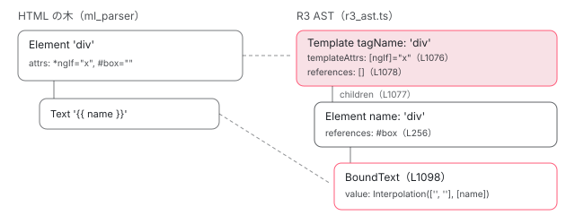

[目次](../README.md) › [テンプレートコンパイラの内側](README.md) › 第 7 回 / 全 18 回

# R3 AST：HTML の木を Angular の木に組み替える htmlAstToRender3Ast

> r3\_template\_transform.ts の HtmlAstToIvyAst が HTML の Element を r3\_ast.ts の Element / Template / Content / Text / BoundText に変える手順。&lt;ng-template&gt; と \* 付き要素が Template になる行、inputs / outputs / attributes / references / variables の振り分け、&lt;ng-content select&gt; の扱い、ngNonBindable、i18n メタデータの付き方。R3 AST の各ノードの形を表にまとめる。

angular/angular · 読了 約 14 分 · 中核 · [サイトで読む（デモが動きます）](https://angular-deep-dive-cyan.vercel.app/chapter/compiler-r3-ast)

---

[HTML の構文解析](04-compiler-html-parser.md)が作る木は、要素・属性・テキストという「HTML としての形」しか知りません。この章では、`htmlAstToRender3Ast` がその木を **Angular としての意味を持つ木（R3 AST）**に組み替える手順を追います。`*` 付きの要素と `<ng-template>` が `Template` になる行、属性が inputs / outputs / attributes / references / variables に振り分けられる行、`<ng-content>`・`ngNonBindable`・i18n の扱いを読み、R3 AST の各ノードの形を表にまとめます。

読む対象は `compiler/src/render3/r3_template_transform.ts`（`HtmlAstToIvyAst`）、`compiler/src/render3/r3_ast.ts`、`compiler/src/template_parser/template_preparser.ts`、`compiler/src/render3/view/i18n/meta.ts` です。属性 1 つ 1 つの解析は[前章](06-compiler-binding-parser.md)、`@if` などのブロックは[次章](08-compiler-control-flow-blocks.md)で扱います。

1. [1. 全体図](01-compiler.md)
2. [2. コンパイラの入口](02-compiler-entry.md)
3. [3. HTML の字句解析](03-compiler-html-lexer.md)
4. [4. HTML の構文解析](04-compiler-html-parser.md)
5. [5. 式のパーサ](05-compiler-expression-parser.md)
6. [6. バインディングのパーサ](06-compiler-binding-parser.md)
7. **7. R3 AST**（この章）
8. [8. ブロック構文の解析](08-compiler-control-flow-blocks.md)
9. [9. ディレクティブの照合](09-compiler-binder.md)
10. [10. IR への写像](10-compiler-ingest.md)
11. [11. IR の構造](11-compiler-ir.md)
12. [12. decls・vars・advance](12-compiler-slots-vars.md)
13. [13. 変数とコンテキスト](13-compiler-variables.md)
14. [14. 定数配列と pure function](14-compiler-consts-pure.md)
15. [15. 制御フローのフェーズ](15-compiler-control-flow-phases.md)
16. [16. reify と出力](16-compiler-reify-emit.md)
17. [17. 型検査（TCB）](17-compiler-typecheck.md)
18. [18. スタイルのカプセル化](18-compiler-shadow-css.md)

## 1. 入口：htmlAstToRender3Ast

📄 `angular/packages/compiler/src/render3/r3_template_transform.ts` L93–115 （▶ の行: 93, 98–99, 102, 105, 107–109）

```ts
 93 ▶ export function htmlAstToRender3Ast(
 94 │   htmlNodes: html.Node[],
 95 │   bindingParser: BindingParser,
 96 │   options: Render3ParseOptions,
 97 │ ): Render3ParseResult {
 98 ▶   const transformer = new HtmlAstToIvyAst(bindingParser, options);
 99 ▶   const ivyNodes = html.visitAll(transformer, htmlNodes, htmlNodes);
100 │ 
101 │   // Errors might originate in either the binding parser or the html to ivy transformer
102 ▶   const allErrors = bindingParser.errors.concat(transformer.errors);
103 │ 
104 │   const result: Render3ParseResult = {
105 ▶     nodes: ivyNodes,
106 │     errors: allErrors,
107 ▶     styleUrls: transformer.styleUrls,
108 ▶     styles: transformer.styles,
109 ▶     ngContentSelectors: transformer.ngContentSelectors,
110 │   };
111 │   if (options.collectCommentNodes) {
112 │     result.commentNodes = transformer.commentNodes;
113 │   }
114 │   return result;
115 │ }
```

`parseTemplate`（[コンパイラの入口](02-compiler-entry.md)）が、HTML の木と `BindingParser` を渡して呼ぶ関数です。98 行目で変換器 `HtmlAstToIvyAst` を作り、99 行目の `html.visitAll` で HTML の各ノードの `visit()` を呼ばせます。これは訪問者（visitor）パターンで、HTML の `Element` なら変換器の `visitElement`、`Text` なら `visitText` が呼ばれ、**その戻り値が R3 AST のノード**になります。102 行目、エラーは式・属性の解析（`BindingParser`）と変換器自身の 2 か所から集めます。107〜109 行目のとおり、ノードの木と一緒に、テンプレートの中にあった `<style>`・スタイルシートの URL・`<ng-content>` のセレクタの一覧も返します。

## 2. visitElement の前半：要素の種類を決め、属性を振り分ける

📄 `angular/packages/compiler/src/render3/r3_template_transform.ts` L138–165 （▶ の行: 139–142, 147, 149–152, 155–156, 158–159, 162–163）

```ts
138 │   visitElement(element: html.Element): t.Node | null {
139 ▶     const isI18nRootElement = isI18nRootNode(element.i18n);
140 ▶     if (isI18nRootElement) {
141 ▶       if (this.inI18nBlock) {
142 ▶         this.reportError(
143 │           'Cannot mark an element as translatable inside of a translatable section. Please remove the nested i18n marker.',
144 │           element.sourceSpan,
145 │         );
146 │       }
147 ▶       this.inI18nBlock = true;
148 │     }
149 ▶     const preparsedElement = preparseElement(element);
150 ▶     if (preparsedElement.type === PreparsedElementType.SCRIPT) {
151 ▶       return null;
152 ▶     } else if (preparsedElement.type === PreparsedElementType.STYLE) {
153 │       const contents = textContents(element);
154 │       if (contents !== null) {
155 ▶         this.styles.push(contents);
156 ▶       }
157 │       return null;
158 ▶     } else if (
159 ▶       preparsedElement.type === PreparsedElementType.STYLESHEET &&
160 │       isStyleUrlResolvable(preparsedElement.hrefAttr)
161 │     ) {
162 ▶       this.styleUrls.push(preparsedElement.hrefAttr);
163 ▶       return null;
164 │     }
165 │ 
```

1. **139〜148 行目：i18n の範囲に入ったかを覚える**

   `i18n` の付いた要素の中に、さらに `i18n` を付けると 142 行目のエラーです（7 節）。
2. **149 行目：`preparseElement` で要素の種類を決める**

   下の引用です。
3. **150〜164 行目：`<script>`・`<style>`・`<link rel="stylesheet">` は木から消す**

   `<script>` は 151 行目で `null`（何も残らない）。`<style>` は 155 行目で中身を `styles` に移し、`<link>` は 162 行目で URL を `styleUrls` に移して、どちらも `null` を返します。テンプレートに書いた `<style>` がコンポーネントのスタイルとして扱われるのはこの行のためです。

📄 `angular/packages/compiler/src/template_parser/template_preparser.ts` L22–61 （▶ の行: 29, 31–32, 37–39, 41, 47, 51–53, 55, 57）

```ts
22 │ export function preparseElement(ast: html.Element): PreparsedElement {
23 │   let selectAttr: string | null = null;
24 │   let hrefAttr: string | null = null;
25 │   let relAttr: string | null = null;
26 │   let nonBindable = false;
27 │   let projectAs = '';
28 │ 
29 ▶   for (const attr of ast.attrs) {
30 │     const lcAttrName = attr.name.toLowerCase();
31 ▶     if (lcAttrName == NG_CONTENT_SELECT_ATTR) {
32 ▶       selectAttr = attr.value;
33 │     } else if (lcAttrName == LINK_STYLE_HREF_ATTR) {
34 │       hrefAttr = attr.value;
35 │     } else if (lcAttrName == LINK_STYLE_REL_ATTR) {
36 │       relAttr = attr.value;
37 ▶     } else if (attr.name == NG_NON_BINDABLE_ATTR) {
38 ▶       nonBindable = true;
39 ▶     } else if (attr.name == NG_PROJECT_AS) {
40 │       if (attr.value.length > 0) {
41 ▶         projectAs = attr.value;
42 │       }
43 │     }
44 │   }
45 │ 
46 │   // Normalize selector to '*' if empty
47 ▶   selectAttr ||= '*';
48 │ 
49 │   const nodeName = ast.name.toLowerCase();
50 │   let type = PreparsedElementType.OTHER;
51 ▶   if (isNgContent(nodeName)) {
52 ▶     type = PreparsedElementType.NG_CONTENT;
53 ▶   } else if (STYLE_ELEMENT === nodeName) {
54 │     type = PreparsedElementType.STYLE;
55 ▶   } else if (SCRIPT_ELEMENTS.has(nodeName)) {
56 │     type = PreparsedElementType.SCRIPT;
57 ▶   } else if (nodeName == LINK_ELEMENT && relAttr == LINK_STYLE_REL_VALUE) {
58 │     type = PreparsedElementType.STYLESHEET;
59 │   }
60 │   return new PreparsedElement(type, selectAttr, hrefAttr, nonBindable, projectAs);
61 │ }
```

`preparseElement` は属性を 1 回なめて、29〜44 行目で `select`・`href`・`rel`・`ngNonBindable`・`ngProjectAs` だけを拾います。47 行目、`<ng-content>` に `select` が無ければ `'*'`（何でも受ける）です。51〜59 行目でタグ名から種類を決めます。

📄 `angular/packages/compiler/src/render3/r3_template_transform.ts` L166–190 （▶ の行: 167–178, 180, 183, 187, 189）

```ts
166 │     // Whether the element is a `<ng-template>`
167 ▶     const isTemplateElement = isNgTemplate(element.name);
168 ▶     const {
169 ▶       attributes,
170 ▶       boundEvents,
171 ▶       references,
172 ▶       variables,
173 ▶       templateVariables,
174 ▶       elementHasInlineTemplate,
175 ▶       parsedProperties,
176 ▶       templateParsedProperties,
177 ▶       i18nAttrsMeta,
178 ▶     } = this.prepareAttributes(element.attrs, isTemplateElement);
179 │ 
180 ▶     const directives = this.extractDirectives(element);
181 │     let children: t.Node[];
182 │ 
183 ▶     if (preparsedElement.nonBindable) {
184 │       // The `NonBindableVisitor` may need to return an array of nodes for blocks so we need
185 │       // to flatten the array here. Avoid doing this for the `HtmlAstToIvyAst` since `flat` creates
186 │       // a new array.
187 ▶       children = html.visitAll(NON_BINDABLE_VISITOR, element.children).flat(Infinity);
188 │     } else {
189 ▶       children = html.visitAll(this, element.children, element.children);
190 │     }
```

167 行目で `<ng-template>` かどうかを調べ、168〜178 行目の `prepareAttributes` で属性を 9 つの入れ物に振り分けます。183〜187 行目、`ngNonBindable` があれば子は別の訪問者 `NON_BINDABLE_VISITOR`（6 節）で、無ければ 189 行目で同じ `this` で再帰的に変換します。**子を先に変換してから、自分のノードを作る**順番です。

📄 `angular/packages/compiler/src/render3/r3_template_transform.ts` L643–665 （▶ の行: 644–651, 654, 656, 662–663）

```ts
643 │   private prepareAttributes(attrs: html.Attribute[], isTemplateElement: boolean) {
644 ▶     const parsedProperties: ParsedProperty[] = [];
645 ▶     const boundEvents: t.BoundEvent[] = [];
646 ▶     const variables: t.Variable[] = [];
647 ▶     const references: t.Reference[] = [];
648 ▶     const attributes: t.TextAttribute[] = [];
649 ▶     const i18nAttrsMeta: Record<string, i18n.I18nMeta> = {};
650 ▶     const templateParsedProperties: ParsedProperty[] = [];
651 ▶     const templateVariables: t.Variable[] = [];
652 │ 
653 │     // Whether the element has any *-attribute
654 ▶     let elementHasInlineTemplate = false;
655 │ 
656 ▶     for (const attribute of attrs) {
657 │       let hasBinding = false;
658 │ 
659 │       // `*attr` defines template bindings
660 │       let isTemplateBinding = false;
661 │ 
662 ▶       if (attribute.i18n) {
663 ▶         i18nAttrsMeta[attribute.name] = attribute.i18n;
664 │       }
665 │ 
```

📄 `angular/packages/compiler/src/render3/r3_template_transform.ts` L702–732 （▶ の行: 704, 715–717, 721, 727–729）

```ts
702 │       } else {
703 │         // Check for variables, events, property bindings, interpolation
704 ▶         hasBinding = this.parseAttribute(
705 │           isTemplateElement,
706 │           attribute,
707 │           [],
708 │           parsedProperties,
709 │           boundEvents,
710 │           variables,
711 │           references,
712 │         );
713 │       }
714 │ 
715 ▶       if (!hasBinding && !isTemplateBinding) {
716 ▶         // don't include the bindings as attributes as well in the AST
717 ▶         attributes.push(this.visitAttribute(attribute));
718 │       }
719 │     }
720 │ 
721 ▶     return {
722 │       attributes,
723 │       boundEvents,
724 │       references,
725 │       variables,
726 │       templateVariables,
727 ▶       elementHasInlineTemplate,
728 ▶       parsedProperties,
729 ▶       templateParsedProperties,
730 │       i18nAttrsMeta,
731 │     };
732 │   }
```

644〜651 行目が入れ物です。前半 5 つ（`parsedProperties`・`boundEvents`・`variables`・`references`・`attributes`）は要素自身の分、650〜651 行目の `templateParsedProperties` と `templateVariables` は `*` の微小構文の分です。656 行目からの属性ごとのループで、`*` で始まれば微小構文（[前章 6 節](06-compiler-binding-parser.md)）、それ以外は 704 行目の `parseAttribute`（前章 1 節）です。715〜718 行目、**どちらでもなかった属性だけが `attributes`（静的な `TextAttribute`）に入ります**。`[x]` は `attributes` には残りません（716 行目のコメント）。662〜664 行目は、属性ごとの i18n 情報を名前で引けるように控えておく行です。

| 属性の書き方 | 入る入れ物 | 最終的な R3 AST のフィールド |
| --- | --- | --- |
| `class="a"` | `attributes`（715〜718 行目） | `Element.attributes`（`TextAttribute`） |
| `[x]``title="{{…}}"``[attr.x]` … | `parsedProperties` | `Element.inputs`（`BoundAttribute`。3 節） |
| `(x)``on-x` | `boundEvents` | `Element.outputs`（`BoundEvent`） |
| `#r``ref-r` | `references` | `Element.references`（`Reference`） |
| `let-v`（`<ng-template>` のみ） | `variables` | `Template.variables`（`Variable`） |
| `*ngFor="…"` | `templateParsedProperties` / `templateVariables` | 外側の `Template.templateAttrs` / `Template.variables`（4 節） |

## 3. visitElement の後半：Content・Template・Element を作る

📄 `angular/packages/compiler/src/render3/r3_template_transform.ts` L192–230 （▶ の行: 193–197, 204, 206–207, 209, 215–219, 221, 223–224, 229）

```ts
192 │     let parsedElement: t.Content | t.Template | t.Element | undefined;
193 ▶     if (preparsedElement.type === PreparsedElementType.NG_CONTENT) {
194 ▶       const selector = preparsedElement.selectAttr;
195 ▶       const attrs: t.TextAttribute[] = element.attrs.map((attr) => this.visitAttribute(attr));
196 ▶       parsedElement = new t.Content(
197 ▶         selector,
198 │         attrs,
199 │         children,
200 │         element.isSelfClosing,
201 │         element.sourceSpan,
202 │         element.startSourceSpan,
203 │         element.endSourceSpan,
204 ▶         element.i18n,
205 │       );
206 ▶       this.ngContentSelectors.push(selector);
207 ▶     } else if (isTemplateElement) {
208 │       // `<ng-template>`
209 ▶       const attrs = this.categorizePropertyAttributes(
210 │         element.name,
211 │         parsedProperties,
212 │         i18nAttrsMeta,
213 │       );
214 │ 
215 ▶       parsedElement = new t.Template(
216 ▶         element.name,
217 ▶         attributes,
218 ▶         attrs.bound,
219 ▶         boundEvents,
220 │         directives,
221 ▶         [/* no template attributes */],
222 │         children,
223 ▶         references,
224 ▶         variables,
225 │         element.isSelfClosing,
226 │         element.sourceSpan,
227 │         element.startSourceSpan,
228 │         element.endSourceSpan,
229 ▶         element.i18n,
230 │       );
```

1. **193〜206 行目：`<ng-content>` は `Content`**

   194 行目でセレクタ（`select` の値。無ければ `'*'`）を取り、195 行目で**属性を全部 `TextAttribute` にします**。`<ng-content>` に `[x]` を書いても、バインディングとしては扱われません。206 行目で、セレクタをコンポーネント全体の一覧に足します（これが ɵcmp の `ngContentSelectors` になる。[コンテンツ投影の章](../template/02-projection.md)）。
2. **207〜230 行目：`<ng-template>` は `Template`**

   209 行目で `parsedProperties` を `BoundAttribute` に変え（[前章 3 節](06-compiler-binding-parser.md)の `categorizePropertyAttributes`）、215〜230 行目で `Template` を作ります。216 行目の `tagName` は `'ng-template'`、221 行目の `templateAttrs` は空、224 行目で `let-` の `variables` が入ります。

📄 `angular/packages/compiler/src/render3/r3_template_transform.ts` L231–264 （▶ の行: 232–233, 238, 240, 242, 249–256, 261–262）

```ts
231 │     } else {
232 ▶       const attrs = this.categorizePropertyAttributes(
233 ▶         element.name,
234 │         parsedProperties,
235 │         i18nAttrsMeta,
236 │       );
237 │ 
238 ▶       if (element.name === 'ng-container') {
239 │         for (const bound of attrs.bound) {
240 ▶           if (bound.type === BindingType.Attribute) {
241 │             this.reportError(
242 ▶               `Attribute bindings are not supported on ng-container. Use property bindings instead.`,
243 │               bound.sourceSpan,
244 │             );
245 │           }
246 │         }
247 │       }
248 │ 
249 ▶       parsedElement = new t.Element(
250 ▶         element.name,
251 ▶         attributes,
252 ▶         attrs.bound,
253 ▶         boundEvents,
254 ▶         directives,
255 ▶         children,
256 ▶         references,
257 │         element.isSelfClosing,
258 │         element.sourceSpan,
259 │         element.startSourceSpan,
260 │         element.endSourceSpan,
261 ▶         element.isVoid,
262 ▶         element.i18n,
263 │       );
264 │     }
```

それ以外の要素は 249〜263 行目の `Element` です。`<ng-container>` も特別なクラスにはならず、238 行目のとおり `name` が `'ng-container'` の `Element` です。ただし 240〜245 行目で `[attr.x]` だけはエラーにします（242 行目のメッセージは「property バインディングを使う」よう求めます）。250〜256 行目の並びが、R3 AST の `Element` のフィールドの並びそのものです（6 節の表）。

📄 `angular/packages/compiler/src/render3/r3_template_transform.ts` L266–288 （▶ の行: 272, 275–278, 284–285, 287）

```ts
266 │     if (this.options.collectCommentNodes) {
267 │       element.comments.forEach((comment) => {
268 │         this.commentNodes.push(new t.Comment(comment.value || '', comment.sourceSpan));
269 │       });
270 │     }
271 │ 
272 ▶     if (elementHasInlineTemplate) {
273 │       // If this node is an inline-template (e.g. has *ngFor) then we need to create a template
274 │       // node that contains this node.
275 ▶       parsedElement = this.wrapInTemplate(
276 ▶         parsedElement,
277 ▶         templateParsedProperties,
278 ▶         templateVariables,
279 │         i18nAttrsMeta,
280 │         isTemplateElement,
281 │         isI18nRootElement,
282 │       );
283 │     }
284 ▶     if (isI18nRootElement) {
285 ▶       this.inI18nBlock = false;
286 │     }
287 ▶     return parsedElement;
288 │   }
```

要素ができたあと、272 行目で `*` 付きだったかを見て、275 行目の `wrapInTemplate` で**作った要素を `Template` で包み直します**。287 行目で返すのは、包んだあとの外側の `Template` です。

## 4. wrapInTemplate：\* 付きの要素を Template で包む

📄 `angular/packages/compiler/src/render3/r3_template_transform.ts` L1016–1053 （▶ の行: 1017, 1021, 1032–1034, 1038–1040, 1042, 1048–1051）

```ts
1016 │   private filterAnimationAttributes(attributes: t.TextAttribute[]): t.TextAttribute[] {
1017 ▶     return attributes.filter((a) => !a.name.startsWith('animate.'));
1018 │   }
1019 │ 
1020 │   private filterAnimationInputs(attributes: t.BoundAttribute[]): t.BoundAttribute[] {
1021 ▶     return attributes.filter((a) => a.type !== BindingType.Animation);
1022 │   }
1023 │ 
1024 │   private wrapInTemplate(
1025 │     node: t.Element | t.Component | t.Content | t.Template,
1026 │     templateProperties: ParsedProperty[],
1027 │     templateVariables: t.Variable[],
1028 │     i18nAttrsMeta: Record<string, i18n.I18nMeta>,
1029 │     isTemplateElement: boolean,
1030 │     isI18nRootElement: boolean,
1031 │   ) {
1032 ▶     // We need to hoist the attributes of the node to the template for content projection purposes.
1033 ▶     const attrs = this.categorizePropertyAttributes(
1034 ▶       'ng-template',
1035 │       templateProperties,
1036 │       i18nAttrsMeta,
1037 │     );
1038 ▶     const templateAttrs: (t.TextAttribute | t.BoundAttribute)[] = [];
1039 ▶     attrs.literal.forEach((attr) => templateAttrs.push(attr));
1040 ▶     attrs.bound.forEach((attr) => templateAttrs.push(attr));
1041 │ 
1042 ▶     const hoistedAttrs = {
1043 │       attributes: [] as t.TextAttribute[],
1044 │       inputs: [] as t.BoundAttribute[],
1045 │       outputs: [] as t.BoundEvent[],
1046 │     };
1047 │ 
1048 ▶     if (node instanceof t.Element || node instanceof t.Component) {
1049 ▶       hoistedAttrs.attributes.push(...this.filterAnimationAttributes(node.attributes));
1050 ▶       hoistedAttrs.inputs.push(...this.filterAnimationInputs(node.inputs));
1051 ▶       hoistedAttrs.outputs.push(...node.outputs);
1052 │     }
1053 │ 
```

📄 `angular/packages/compiler/src/render3/r3_template_transform.ts` L1054–1088 （▶ の行: 1057, 1060, 1062–1063, 1065, 1068–1073, 1076–1079, 1081）

```ts
1054 │     // For <ng-template>s with structural directives on them, avoid passing i18n information to
1055 │     // the wrapping template to prevent unnecessary i18n instructions from being generated. The
1056 │     // necessary i18n meta information will be extracted from child elements.
1057 ▶     const i18n = isTemplateElement && isI18nRootElement ? undefined : node.i18n;
1058 │     let name: string | null;
1059 │ 
1060 ▶     if (node instanceof t.Component) {
1061 │       name = node.tagName;
1062 ▶     } else if (node instanceof t.Template) {
1063 ▶       name = null;
1064 │     } else {
1065 ▶       name = node.name;
1066 │     }
1067 │ 
1068 ▶     return new t.Template(
1069 ▶       name,
1070 ▶       hoistedAttrs.attributes,
1071 ▶       hoistedAttrs.inputs,
1072 ▶       hoistedAttrs.outputs,
1073 ▶       [
1074 │         // Do not copy over the directives.
1075 │       ],
1076 ▶       templateAttrs,
1077 ▶       [node],
1078 ▶       [
1079 ▶         // Do not copy over the references.
1080 │       ],
1081 ▶       templateVariables,
1082 │       false,
1083 │       node.sourceSpan,
1084 │       node.startSourceSpan,
1085 │       node.endSourceSpan,
1086 │       i18n,
1087 │     );
1088 │   }
```

1. **1033〜1040 行目：微小構文の結果を `templateAttrs` にする**

   `ngFor`・`ngForOf`・`ngForTrackBy` を、1034 行目の要素名 `'ng-template'` として `categorizePropertyAttributes` に通し、静的なもの（1039 行目）→ バインディング（1040 行目）の順に並べます。
2. **1042〜1052 行目：中の要素の属性・inputs・outputs を写す**

   1032 行目のコメントのとおり、**コンテンツ投影のため**に、中の要素の `attributes`・`inputs`・`outputs` を外側の `Template` にも持たせます。ただし 1017 / 1021 行目で、新しいアニメーション（`animate.`）のものだけは除きます。
3. **1060〜1066 行目：`tagName` を決める**

   中が普通の要素なら 1065 行目でその名前（`'div'`）。中が `<ng-template>` なら 1063 行目で `null` です（r3\_ast.ts 689〜692 行目のコメント）。
4. **1068〜1087 行目：外側の `Template` を作る**

   1076 行目に `templateAttrs`、1077 行目の `children` は **中の要素 1 つだけ**、1081 行目に `let x` などの `templateVariables`。1073〜1075 行目のとおりディレクティブは写さず、1078〜1080 行目のとおり **`#ref` も写しません**。`#box` は中の要素に残ります。



*&lt;div \*ngIf="x" #box&gt;{{ name }}&lt;/div&gt; の HTML の木（左）と R3 AST（右）。\* の分だけ 1 段深くなり、#box は内側に残る。*

## 5. テキスト・属性・参照・変数

📄 `angular/packages/compiler/src/render3/r3_template_transform.ts` L290–305 （▶ の行: 290–291, 297, 301–302, 304）

```ts
290 ▶   visitAttribute(attribute: html.Attribute): t.TextAttribute {
291 ▶     return new t.TextAttribute(
292 │       attribute.name,
293 │       attribute.value,
294 │       attribute.sourceSpan,
295 │       attribute.keySpan,
296 │       attribute.valueSpan,
297 ▶       attribute.i18n,
298 │     );
299 │   }
300 │ 
301 ▶   visitText(text: html.Text): t.Node | null {
302 ▶     return this.processedNodes.has(text)
303 │       ? null
304 ▶       : this._visitTextWithInterpolation(text.value, text.sourceSpan, text.tokens, text.i18n);
305 │   }
```

📄 `angular/packages/compiler/src/render3/r3_template_transform.ts` L1090–1099 （▶ の行: 1096–1098）

```ts
1090 │   private _visitTextWithInterpolation(
1091 │     value: string,
1092 │     sourceSpan: ParseSourceSpan,
1093 │     interpolatedTokens: InterpolatedAttributeToken[] | InterpolatedTextToken[] | null,
1094 │     i18n?: i18n.I18nMeta,
1095 │   ): t.Text | t.BoundText {
1096 ▶     const valueNoNgsp = replaceNgsp(value);
1097 ▶     const expr = this.bindingParser.parseInterpolation(valueNoNgsp, sourceSpan, interpolatedTokens);
1098 ▶     return expr ? new t.BoundText(expr, sourceSpan, i18n) : new t.Text(valueNoNgsp, sourceSpan);
1099 │   }
```

静的な属性は 290〜299 行目でそのまま `TextAttribute` に写します。値は文字列のままで、式のパーサは通りません。テキストは 304 行目から `_visitTextWithInterpolation` へ。1096 行目で `&ngsp;` の目印を空白に戻し（[HTML の構文解析の章](04-compiler-html-parser.md)）、1097 行目で補間として読めたら `BoundText`、読めなければ（`{{` が無ければ）`Text` です（1098 行目）。302 行目の `processedNodes` は、ブロックの処理で既に使ったテキストを二重に出さないための印です（[次章](08-compiler-control-flow-blocks.md)）。

📄 `angular/packages/compiler/src/render3/r3_template_transform.ts` L1101–1135 （▶ の行: 1109–1110, 1115, 1126–1127, 1130–1131, 1134）

```ts
1101 │   private parseVariable(
1102 │     identifier: string,
1103 │     value: string,
1104 │     sourceSpan: ParseSourceSpan,
1105 │     keySpan: ParseSourceSpan,
1106 │     valueSpan: ParseSourceSpan | undefined,
1107 │     variables: t.Variable[],
1108 │   ) {
1109 ▶     if (identifier.indexOf('-') > -1) {
1110 ▶       this.reportError(`"-" is not allowed in variable names`, sourceSpan);
1111 │     } else if (identifier.length === 0) {
1112 │       this.reportError(`Variable does not have a name`, sourceSpan);
1113 │     }
1114 │ 
1115 ▶     variables.push(new t.Variable(identifier, value, sourceSpan, keySpan, valueSpan));
1116 │   }
1117 │ 
1118 │   private parseReference(
1119 │     identifier: string,
1120 │     value: string,
1121 │     sourceSpan: ParseSourceSpan,
1122 │     keySpan: ParseSourceSpan,
1123 │     valueSpan: ParseSourceSpan | undefined,
1124 │     references: t.Reference[],
1125 │   ) {
1126 ▶     if (identifier.indexOf('-') > -1) {
1127 ▶       this.reportError(`"-" is not allowed in reference names`, sourceSpan);
1128 │     } else if (identifier.length === 0) {
1129 │       this.reportError(`Reference does not have a name`, sourceSpan);
1130 ▶     } else if (references.some((reference) => reference.name === identifier)) {
1131 ▶       this.reportError(`Reference "#${identifier}" is defined more than once`, sourceSpan);
1132 │     }
1133 │ 
1134 ▶     references.push(new t.Reference(identifier, value, sourceSpan, keySpan, valueSpan));
1135 │   }
```

`let-x` と `#x` は、どちらも名前に `-` を含めません（1109〜1110 / 1126〜1127 行目）。参照は 1130〜1131 行目で同じ要素の上の重複を拒否し、1134 行目で `Reference(name, value)` を作ります。`value` は `#f="ngForm"` の `ngForm` で、無ければ空文字です。この `value` が何を指すか（要素か、ディレクティブか）は、[ディレクティブの照合](09-compiler-binder.md)で決まります。

📄 `angular/packages/compiler/src/render3/r3_template_transform.ts` L346–363 （▶ の行: 350–352, 354）

```ts
346 │   visitExpansionCase(expansionCase: html.ExpansionCase): null {
347 │     return null;
348 │   }
349 │ 
350 ▶   visitComment(comment: html.Comment): null {
351 ▶     if (this.options.collectCommentNodes) {
352 ▶       this.commentNodes.push(new t.Comment(comment.value || '', comment.sourceSpan));
353 │     }
354 ▶     return null;
355 │   }
356 │ 
357 │   visitStartTagComment(comment: html.StartTagComment): null {
358 │     if (this.options.collectCommentNodes) {
359 │       this.commentNodes.push(new t.Comment(comment.value || '', comment.sourceSpan));
360 │     }
361 │     return null;
362 │   }
363 │ 
```

HTML のコメントは 354 行目で常に `null` を返すので、**R3 AST の木には入りません**。351〜353 行目、`collectCommentNodes` を指定したときだけ、木とは別の `commentNodes` の一覧に集めます。

## 6. ngNonBindable：子を「解析しない」訪問者で写す

📄 `angular/packages/compiler/src/render3/r3_template_transform.ts` L1191–1221 （▶ の行: 1191, 1193, 1195, 1199, 1205–1206, 1208–1211, 1213）

```ts
1191 ▶ class NonBindableVisitor implements html.Visitor {
1192 │   visitElement(ast: html.Element): t.Element | null {
1193 ▶     const preparsedElement = preparseElement(ast);
1194 │     if (
1195 ▶       preparsedElement.type === PreparsedElementType.SCRIPT ||
1196 │       preparsedElement.type === PreparsedElementType.STYLE ||
1197 │       preparsedElement.type === PreparsedElementType.STYLESHEET
1198 │     ) {
1199 ▶       // Skipping <script> for security reasons
1200 │       // Skipping <style> and stylesheets as we already processed them
1201 │       // in the StyleCompiler
1202 │       return null;
1203 │     }
1204 │ 
1205 ▶     const children: t.Node[] = html.visitAll(this, ast.children, null);
1206 ▶     return new t.Element(
1207 │       ast.name,
1208 ▶       html.visitAll(this, ast.attrs) as t.TextAttribute[],
1209 ▶       /* inputs */ [],
1210 ▶       /* outputs */ [],
1211 ▶       /* directives */ [],
1212 │       children,
1213 ▶       /* references */ [],
1214 │       ast.isSelfClosing,
1215 │       ast.sourceSpan,
1216 │       ast.startSourceSpan,
1217 │       ast.endSourceSpan,
1218 │       ast.isVoid,
1219 │     );
1220 │   }
1221 │ 
```

📄 `angular/packages/compiler/src/render3/r3_template_transform.ts` L1222–1240 （▶ の行: 1222–1223, 1226–1227, 1237–1238）

```ts
1222 ▶   visitComment(comment: html.Comment): any {
1223 ▶     return null;
1224 │   }
1225 │ 
1226 ▶   visitAttribute(attribute: html.Attribute): t.TextAttribute {
1227 ▶     return new t.TextAttribute(
1228 │       attribute.name,
1229 │       attribute.value,
1230 │       attribute.sourceSpan,
1231 │       attribute.keySpan,
1232 │       attribute.valueSpan,
1233 │       attribute.i18n,
1234 │     );
1235 │   }
1236 │ 
1237 ▶   visitText(text: html.Text): t.Text {
1238 ▶     return new t.Text(text.value, text.sourceSpan);
1239 │   }
1240 │ 
```

`NonBindableVisitor` は、同じ `html.Visitor` の形をしていながら**何も解析しない**訪問者です。1208 行目で属性を全部 `TextAttribute` にし、1209〜1213 行目で inputs・outputs・references を空にします。`[x]="y"` も `[x]` という名前の静的な属性になります。1237〜1238 行目、テキストは `{{ q }}` のまま `Text` です。1205 行目で孫以下も同じ訪問者で写します。1195〜1202 行目のとおり、`<script>` と `<style>` はこの中でも消えます。

> [!WARNING]
> **ハマりどころ**
>
> `ngNonBindable` が効くのは**子だけ**です。2 節の 168〜178 行目の `prepareAttributes` は 183 行目の判定より前に走るので、`<p ngNonBindable [x]="y">` の `[x]` は `p` 自身の input として解析されます（デモで確かめられます）。

## 7. i18n のメタデータはどこから来るか

📄 `angular/packages/compiler/src/render3/view/i18n/meta.ts` L166–200 （▶ の行: 166–167, 171–172, 174, 194, 200）

```ts
166 ▶     if (hasI18nAttrs(node)) {
167 ▶       this.hasI18nMeta = true;
168 │       const attrs: html.Attribute[] = [];
169 │       const attrsMeta: {[key: string]: string} = {};
170 │ 
171 ▶       for (const attr of node.attrs) {
172 ▶         if (attr.name === I18N_ATTR) {
173 │           // root 'i18n' node attribute
174 ▶           const i18n = node.i18n || attr.value;
175 │ 
176 │           // Generate a new AST with whitespace trimmed, but also generate a map
177 │           // to correlate each new node to its original so we can apply i18n
178 │           // information to the original node based on the trimmed content.
179 │           //
180 │           // `WhitespaceVisitor` removes *insignificant* whitespace as well as
181 │           // significant whitespace. Enabling this visitor should be conditional
182 │           // on `preserveWhitespace` rather than `preserveSignificantWhitespace`,
183 │           // however this would be a breaking change for existing behavior where
184 │           // `preserveWhitespace` was not respected correctly when generating
185 │           // message IDs. This is really a bug but one we need to keep to maintain
186 │           // backwards compatibility.
187 │           const originalNodeMap = new Map<html.Node, html.Node>();
188 │           const trimmedNodes = this.preserveSignificantWhitespace
189 │             ? node.children
190 │             : visitAllWithSiblings(
191 │                 new WhitespaceVisitor(false /* preserveSignificantWhitespace */, originalNodeMap),
192 │                 node.children,
193 │               );
194 ▶           message = this._generateI18nMessage(trimmedNodes, i18n, setI18nRefs(originalNodeMap));
195 │           if (message.nodes.length === 0) {
196 │             // Ignore the message if it is empty.
197 │             message = undefined;
198 │           }
199 │           // Store the message on the element
200 ▶           node.i18n = message;
```

`i18n` 属性の解釈は R3 AST への変換より前、`parseTemplate` が HTML の木に対して走らせる `I18nMetaVisitor` の仕事です。172 行目で `i18n` 属性を見つけると、174 行目で値（`"@@greet"` のような意味・説明・ID）を取り、194 行目で子からメッセージを組み立て、**200 行目で HTML の要素の `i18n` に載せます**。`i18n-title` のような属性向けの印も、この関数の続きで属性の `i18n` に載ります。

`HtmlAstToIvyAst` は、それを**そのまま R3 AST に写すだけ**です。要素は 3 節の 262 行目（`Element`）・229 行目（`Template`）・204 行目（`Content`）、テキストは 5 節の 304 行目、静的な属性は 297 行目、バインディングの属性は 2 節の 662〜664 行目で控えた表から渡ります。`*` で包んだ場合、中が `<ng-template i18n>` なら外側には渡しません（4 節 1057 行目）。翻訳の実行時の流れは [i18n の章](../template/06-i18n.md)で読みます。

## 8. R3 AST の主なノード

📄 `angular/packages/compiler/src/render3/r3_ast.ts` L43–62 （▶ の行: 43, 45, 53, 55, 57）

```ts
43 ▶ export class Text implements Node {
44 │   constructor(
45 ▶     public value: string,
46 │     public sourceSpan: ParseSourceSpan,
47 │   ) {}
48 │   visit<Result>(visitor: Visitor<Result>): Result {
49 │     return visitor.visitText(this);
50 │   }
51 │ }
52 │ 
53 ▶ export class BoundText implements Node {
54 │   constructor(
55 ▶     public value: AST,
56 │     public sourceSpan: ParseSourceSpan,
57 ▶     public i18n?: I18nMeta,
58 │   ) {}
59 │   visit<Result>(visitor: Visitor<Result>): Result {
60 │     return visitor.visitBoundText(this);
61 │   }
62 │ }
```

📄 `angular/packages/compiler/src/render3/r3_ast.ts` L64–96 （▶ の行: 70, 72–73, 77, 84, 86–90, 94）

```ts
64 │ /**
65 │  * Represents a text attribute in the template.
66 │  *
67 │  * `valueSpan` may not be present in cases where there is no value `<div a></div>`.
68 │  * `keySpan` may also not be present for synthetic attributes from ICU expansions.
69 │  */
70 ▶ export class TextAttribute implements Node {
71 │   constructor(
72 ▶     public name: string,
73 ▶     public value: string,
74 │     public sourceSpan: ParseSourceSpan,
75 │     readonly keySpan: ParseSourceSpan | undefined,
76 │     public valueSpan?: ParseSourceSpan,
77 ▶     public i18n?: I18nMeta,
78 │   ) {}
79 │   visit<Result>(visitor: Visitor<Result>): Result {
80 │     return visitor.visitTextAttribute(this);
81 │   }
82 │ }
83 │ 
84 ▶ export class BoundAttribute implements Node {
85 │   constructor(
86 ▶     public name: string,
87 ▶     public type: BindingType,
88 ▶     public securityContext: SecurityContext,
89 ▶     public value: AST,
90 ▶     public unit: string | null,
91 │     public sourceSpan: ParseSourceSpan,
92 │     readonly keySpan: ParseSourceSpan,
93 │     public valueSpan: ParseSourceSpan | undefined,
94 ▶     public i18n: I18nMeta | undefined,
95 │   ) {}
96 │ 
```

📄 `angular/packages/compiler/src/render3/r3_ast.ts` L121–131 （▶ の行: 121, 123–127）

```ts
121 ▶ export class BoundEvent implements Node {
122 │   constructor(
123 ▶     public name: string,
124 ▶     public type: ParsedEventType,
125 ▶     public handler: AST,
126 ▶     public target: string | null,
127 ▶     public phase: string | null,
128 │     public sourceSpan: ParseSourceSpan,
129 │     public handlerSpan: ParseSourceSpan,
130 │     readonly keySpan: ParseSourceSpan,
131 │   ) {}
```

📄 `angular/packages/compiler/src/render3/r3_ast.ts` L160–179 （▶ の行: 160, 162–168, 173–174）

```ts
160 ▶ export class Element implements Node {
161 │   constructor(
162 ▶     public name: string,
163 ▶     public attributes: TextAttribute[],
164 ▶     public inputs: BoundAttribute[],
165 ▶     public outputs: BoundEvent[],
166 ▶     public directives: Directive[],
167 ▶     public children: Node[],
168 ▶     public references: Reference[],
169 │     public isSelfClosing: boolean,
170 │     public sourceSpan: ParseSourceSpan,
171 │     public startSourceSpan: ParseSourceSpan,
172 │     public endSourceSpan: ParseSourceSpan | null,
173 ▶     readonly isVoid: boolean,
174 ▶     public i18n?: I18nMeta,
175 │   ) {}
176 │   visit<Result>(visitor: Visitor<Result>): Result {
177 │     return visitor.visitElement(this);
178 │   }
179 │ }
```

📄 `angular/packages/compiler/src/render3/r3_ast.ts` L687–711 （▶ の行: 687, 689–693, 698–699, 701）

```ts
687 ▶ export class Template implements Node {
688 │   constructor(
689 ▶     // tagName is the name of the container element, if applicable.
690 ▶     // `null` is a special case for when there is a structural directive on an `ng-template` so
691 ▶     // the renderer can differentiate between the synthetic template and the one written in the
692 ▶     // file.
693 ▶     public tagName: string | null,
694 │     public attributes: TextAttribute[],
695 │     public inputs: BoundAttribute[],
696 │     public outputs: BoundEvent[],
697 │     public directives: Directive[],
698 ▶     public templateAttrs: (BoundAttribute | TextAttribute)[],
699 ▶     public children: Node[],
700 │     public references: Reference[],
701 ▶     public variables: Variable[],
702 │     public isSelfClosing: boolean,
703 │     public sourceSpan: ParseSourceSpan,
704 │     public startSourceSpan: ParseSourceSpan,
705 │     public endSourceSpan: ParseSourceSpan | null,
706 │     public i18n?: I18nMeta,
707 │   ) {}
708 │   visit<Result>(visitor: Visitor<Result>): Result {
709 │     return visitor.visitTemplate(this);
710 │   }
711 │ }
```

📄 `angular/packages/compiler/src/render3/r3_ast.ts` L713–729 （▶ の行: 713–714, 717–718）

```ts
713 ▶ export class Content implements Node {
714 ▶   readonly name = 'ng-content';
715 │ 
716 │   constructor(
717 ▶     public selector: string,
718 ▶     public attributes: TextAttribute[],
719 │     public children: Node[],
720 │     public isSelfClosing: boolean,
721 │     public sourceSpan: ParseSourceSpan,
722 │     public startSourceSpan: ParseSourceSpan,
723 │     public endSourceSpan: ParseSourceSpan | null,
724 │     public i18n?: I18nMeta,
725 │   ) {}
726 │   visit<Result>(visitor: Visitor<Result>): Result {
727 │     return visitor.visitContent(this);
728 │   }
729 │ }
```

📄 `angular/packages/compiler/src/render3/r3_ast.ts` L731–755 （▶ の行: 731, 733–734, 744, 746–747）

```ts
731 ▶ export class Variable implements Node {
732 │   constructor(
733 ▶     public name: string,
734 ▶     public value: string,
735 │     public sourceSpan: ParseSourceSpan,
736 │     readonly keySpan: ParseSourceSpan,
737 │     public valueSpan?: ParseSourceSpan,
738 │   ) {}
739 │   visit<Result>(visitor: Visitor<Result>): Result {
740 │     return visitor.visitVariable(this);
741 │   }
742 │ }
743 │ 
744 ▶ export class Reference implements Node {
745 │   constructor(
746 ▶     public name: string,
747 ▶     public value: string,
748 │     public sourceSpan: ParseSourceSpan,
749 │     readonly keySpan: ParseSourceSpan,
750 │     public valueSpan?: ParseSourceSpan,
751 │   ) {}
752 │   visit<Result>(visitor: Visitor<Result>): Result {
753 │     return visitor.visitReference(this);
754 │   }
755 │ }
```

| ノード（r3\_ast.ts の行） | 主なフィールド | 作られる場所（r3\_template\_transform.ts） |
| --- | --- | --- |
| `Text`（43） | `value: string` | 1098（補間なし）、1237〜1238（ngNonBindable） |
| `BoundText`（53） | `value: AST`（`Interpolation`）、`i18n` | 1098 |
| `TextAttribute`（70） | `name`、`value: string`、`i18n` | 291（静的な属性）、195（ng-content の属性） |
| `BoundAttribute`（84） | `name`、`type: BindingType`、`securityContext`、`value: AST`、`unit` | `categorizePropertyAttributes`（209 / 232 / 1033） |
| `BoundEvent`（121） | `name`、`type: ParsedEventType`、`handler: AST`、`target`、`phase` | `parseAttribute` の `addEvents`（前章） |
| `Element`（160） | `name`、`attributes`、`inputs`、`outputs`、`directives`、`children`、`references`、`isVoid`、`i18n` | 249、1206（ngNonBindable） |
| `Template`（687） | `tagName`、`attributes`、`inputs`、`outputs`、`templateAttrs`、`children`、`references`、`variables` | 215（`<ng-template>`）、1068（`*`） |
| `Content`（713） | `name = 'ng-content'`、`selector`、`attributes`、`children` | 196 |
| `Variable`（731） | `name`、`value`（`'$implicit'` / `'index'` など） | 1115（`let-`）、699（`*`） |
| `Reference`（744） | `name`、`value`（`'ngForm'` など。無ければ `''`） | 1134 |

`Template` の `inputs` と `templateAttrs` の違いに注意してください。`<ng-template [ngIf]="x">` と書いた `[ngIf]` は `inputs`（218 行目）、`*ngIf="x"` の `ngIf` は `templateAttrs`（1076 行目）に入ります。どちらも後段でディレクティブの input として照合されます。表の 699 行目は前章で読んだ `prepareAttributes` の `*` の枝です。

## 9. 実物の parseTemplate で確かめる

> **🧪 DEMO — テンプレートの R3 AST をインデント表示する**
>
> 「解析」を押すと `@angular/compiler`（インストール版 22.1.6）を読み込み、`parseTemplate(template, 'demo.html', {}).nodes` を表示します。TemplateElementBoundTextTextContent を色分けしています。
>
> ▶ [このデモはサイトで動かせます](https://angular-deep-dive-cyan.vercel.app/chapter/compiler-r3-ast)

`*ngIf` の例では、外側に `Template`（`tagName: 'div'`、`templateAttrs: [ngIf]`）、その中に `Element`（`references: #box`）、さらに `BoundText` が並びます。外側の `Template` にも `class="box"` が写っているのが、4 節 1049 行目の「投影のための写し」です。`*ngIf + ng-template` の例では外側の `tagName` が `null` になります（1063 行目）。

## 呼び出しの流れ

- 👤 `<div *ngIf="x" #box>{{ name }}</div>` — あなたのテンプレート
  - `parseTemplate()` — render3/view/template.ts L140 — *HTML 解析 → I18nMetaVisitor → 空白除去*
    - `htmlAstToRender3Ast(rootNodes, bindingParser)` — render3/r3\_template\_transform.ts L93
      - `HtmlAstToIvyAst.visitElement(div)` — r3\_template\_transform.ts L138
        - `preparseElement()` — template\_parser/template\_preparser.ts L22 — *OTHER*
        - `prepareAttributes()` — r3\_template\_transform.ts L643 — *\*ngIf → templateParsedProperties、#box → references*
        - `html.visitAll(this, children)` → `visitText()` → `_visitTextWithInterpolation()` — L189 / L301 / L1090 — *BoundText*
        - `new t.Element('div', …, references)` — L249
        - `wrapInTemplate(element, templateParsedProperties, …)` — L1024
          - `new t.Template('div', …, templateAttrs, [element], [], templateVariables)` — L1068
  - `R3TargetBinder.bind()` — render3/view/t2\_binder.ts — *次の段：[ディレクティブの照合](09-compiler-binder.md)*

## 聞かれそうな質問

**Q. \* 付きの要素は、なぜ Template で包まれるのですか？**

`*ngIf` などの構造ディレクティブは、要素そのものではなく「要素を何回・いつ作るか」を決める側に付くからです。r3\_template\_transform.ts 272〜283 行目で `*` があれば `wrapInTemplate` を呼び、1068〜1087 行目で微小構文の結果を `templateAttrs` に、元の要素を 1077 行目で唯一の子にした `Template` を作ります。つまり `<ng-template [ngIf]="x"><div>…</div></ng-template>` と書いたのと同じ形で、`NgIf` はこの `Template` に付いて、中身の `div` を必要なときに作ります（[ViewContainerRef の章](../template/04-view-container.md)）。

**Q. #ref は R3 AST のどこに入りますか？**

書いた要素の `references` です。`parseAttribute` が `parseReference`（1118〜1135 行目）を呼び、要素なら 256 行目、`<ng-template>` なら 223 行目でノードに入ります。`*` 付きの要素に書いた `#box` は、`wrapInTemplate` が 1078〜1080 行目で外側に写さないので、**内側の `Element` に残ります**。`#box` が要素を指すかディレクティブを指すかは、ここではまだ決まらず、[ディレクティブの照合](09-compiler-binder.md)で決まります。

**Q. HTML の木と R3 AST の木は、どこで形が違いますか？**

主に 5 か所です。(1) `*` 付きの要素は `Template` の分だけ 1 段深くなる（272〜283 行目）。(2) `<script>`・`<style>`・スタイルシートの `<link>` は消え、スタイルは `styles` / `styleUrls` に移る（150〜164 行目）。(3) コメントは消える（354 行目）。(4) `<ng-content>` は `Content`、`<ng-template>` は `Template` という別の種類になる（193〜230 行目）。(5) 属性は 1 本の配列から `attributes` / `inputs` / `outputs` / `references` / `variables` に分かれる（644〜651 行目）。`@if` などのブロックも別のノードになります（[次章](08-compiler-control-flow-blocks.md)）。

**Q. ngNonBindable を付けた要素の中で、何が無効になりますか？**

子孫のすべてのバインディングと補間です。183〜187 行目で子を `NonBindableVisitor` で写し、1208〜1213 行目で属性は全部 `TextAttribute`、inputs / outputs / references は空、1237〜1238 行目でテキストは `Text` のままになります。ただし付けた要素自身の属性は、183 行目より前の 168〜178 行目で解析済みなので有効です。

**Q. &lt;ng-content select="…"&gt; の select はどう扱われますか？**

`preparseElement` が 31〜32 行目で値を拾い（無ければ 47 行目で `'*'`）、visitElement の 194 行目で `Content.selector` に入れ、206 行目でコンポーネント全体の `ngContentSelectors` の一覧にも足します。`<ng-content>` の属性は 195 行目で全部静的な `TextAttribute` になるので、`select` にバインディングは書けません。

## 読み終えて

- `htmlAstToRender3Ast` は訪問者 `HtmlAstToIvyAst` で HTML の木をなぞり、各 `visit*` の戻り値が R3 AST のノードになる
- `prepareAttributes` が属性を 9 つの入れ物に振り分け、バインディングでなかった属性だけが `attributes` に残る
- `<ng-content>` → `Content`、`<ng-template>` → `Template`、それ以外は `Element`。`*` 付きは作った要素を `wrapInTemplate` で包む
- `#ref` は内側の要素に残り、外側の `Template` には微小構文の `templateAttrs` と `variables` が入る
- `ngNonBindable` は子を解析しない訪問者で写し、i18n のメタデータは前段の `I18nMetaVisitor` が付けたものを写すだけ

---

← 前: [バインディングのパーサ：\[prop\]・(event)・\[attr.x\]・\[class.x\]・\[(x)\] と \*ngFor の微小構文](06-compiler-binding-parser.md)  
次: [@if・@for・@switch・@defer・@let がノードになるまで：ブロック構文の解析](08-compiler-control-flow-blocks.md) →
