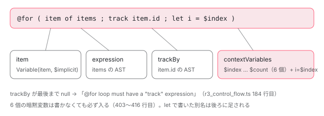

[目次](../README.md) › [テンプレートコンパイラの内側](README.md) › 第 8 回 / 全 18 回

# @if・@for・@switch・@defer・@let がノードになるまで：ブロック構文の解析

> r3\_control\_flow.ts が @if / @else if / @else を IfBlock と IfBlockBranch に、@for の「item of items; track item.id; let i = $index」を ForLoopBlock に分解する行（track が必須である理由、暗黙変数 $index など）、@switch、r3\_deferred\_blocks.ts と r3\_deferred\_triggers.ts が @defer のトリガーと @placeholder / @loading の minimum / after を読む行、@let が LetDeclaration になる行。

angular/angular · 読了 約 15 分 · 中核 · [サイトで読む（デモが動きます）](https://angular-deep-dive-cyan.vercel.app/chapter/compiler-control-flow-blocks)

---

`@if` や `@for` は、HTML パーサの段階では「名前と、セミコロンで区切った文字列の引数を持つブロック」でしかありません。この章では、それを R3 AST（Angular が後段で使うテンプレートの木）の `IfBlock`・`ForLoopBlock`・`SwitchBlock`・`DeferredBlock`・`LetDeclaration` に組み直す関数を 1 つずつ読みます。「`track` が無いとエラー」「`$index` はどこから来る」「`on viewport; prefetch on idle` は何というデータになる」に、行番号で答えられるようになるのが目標です。

読む対象は `packages/compiler/src/render3/` の `r3_template_transform.ts`（振り分け）、`r3_control_flow.ts`（@if / @for / @switch）、`r3_deferred_blocks.ts` と `r3_deferred_triggers.ts`（@defer）、`util.ts`（let の解析）、`r3_ast.ts`（できあがるノード）です。実行時の動き（[@for と track](../template/01-for-track.md)、[@defer](../template/03-defer.md)）は扱いません。

1. [1. 全体図](01-compiler.md)
2. [2. コンパイラの入口](02-compiler-entry.md)
3. [3. HTML の字句解析](03-compiler-html-lexer.md)
4. [4. HTML の構文解析](04-compiler-html-parser.md)
5. [5. 式のパーサ](05-compiler-expression-parser.md)
6. [6. バインディングのパーサ](06-compiler-binding-parser.md)
7. [7. R3 AST](07-compiler-r3-ast.md)
8. **8. ブロック構文の解析**（この章）
9. [9. ディレクティブの照合](09-compiler-binder.md)
10. [10. IR への写像](10-compiler-ingest.md)
11. [11. IR の構造](11-compiler-ir.md)
12. [12. decls・vars・advance](12-compiler-slots-vars.md)
13. [13. 変数とコンテキスト](13-compiler-variables.md)
14. [14. 定数配列と pure function](14-compiler-consts-pure.md)
15. [15. 制御フローのフェーズ](15-compiler-control-flow-phases.md)
16. [16. reify と出力](16-compiler-reify-emit.md)
17. [17. 型検査（TCB）](17-compiler-typecheck.md)
18. [18. スタイルのカプセル化](18-compiler-shadow-css.md)

## 1. 出発点：html.Block は「名前」と「文字列の引数」だけ

[第 3 回](03-compiler-html-lexer.md)の字句解析と[第 4 回](04-compiler-html-parser.md)の構文解析が終わった時点で、`@for (item of items; track item.id) { … }` は次のノードになっています。

📄 `angular/packages/compiler/src/ml_parser/ast.ts` L143–160 （▶ の行: 145–147）

```ts
143 │ export class Block extends NodeWithI18n {
144 │   constructor(
145 ▶     public name: string,
146 ▶     public parameters: BlockParameter[],
147 ▶     public children: Node[],
148 │     sourceSpan: ParseSourceSpan,
149 │     public nameSpan: ParseSourceSpan,
150 │     public startSourceSpan: ParseSourceSpan,
151 │     public endSourceSpan: ParseSourceSpan | null = null,
152 │     i18n?: I18nMeta,
153 │   ) {
154 │     super(sourceSpan, i18n);
155 │   }
156 │ 
157 │   override visit(visitor: Visitor, context: any) {
158 │     return visitor.visitBlock(this, context);
159 │   }
160 │ }
```

📄 `angular/packages/compiler/src/ml_parser/ast.ts` L199–222 （▶ の行: 201, 211–212）

```ts
199 │ export class BlockParameter implements BaseNode {
200 │   constructor(
201 ▶     public expression: string,
202 │     public sourceSpan: ParseSourceSpan,
203 │   ) {}
204 │ 
205 │   visit(visitor: Visitor, context: any): any {
206 │     return visitor.visitBlockParameter(this, context);
207 │   }
208 │ }
209 │ 
210 │ export class LetDeclaration implements BaseNode {
211 ▶   constructor(
212 ▶     public name: string,
213 │     public value: string,
214 │     public sourceSpan: ParseSourceSpan,
215 │     readonly nameSpan: ParseSourceSpan,
216 │     public valueSpan: ParseSourceSpan,
217 │   ) {}
218 │ 
219 │   visit(visitor: Visitor, context: any): any {
220 │     return visitor.visitLetDeclaration(this, context);
221 │   }
222 │ }
```

145 行目の `name` は `'for'`、146 行目の `parameters` は 2 個です。字句解析器が丸括弧の中を `;` で切るので、201 行目の `expression` はそれぞれ `'item of items'` と `'track item.id'` という**ただの文字列**です。`@else if` は字句解析器が空白をそろえて `name = 'else if'` にしてあります（第 3 回）。`@let total = a + b;` も 211〜212 行目のとおり、名前と値の文字列を持つだけの `html.LetDeclaration` です。

つまり「`of` の左が変数名」「`track` の後ろが式」といった**意味づけは、まだ誰もしていません**。それをするのがこの章の関数たちです。

## 2. visitBlock：名前で振り分け、後ろに続くブロックを集める

html の木を R3 AST に変換するのは `HtmlAstToIvyAst` という visitor（木のノードを 1 つずつ訪ねる関数の集まり）です（[第 7 回](07-compiler-r3-ast.md)）。ブロックに来るとこのメソッドが呼ばれます。

📄 `angular/packages/compiler/src/render3/r3_template_transform.ts` L486–527 （▶ の行: 487–488, 493, 497, 511, 514, 520, 523）

```ts
486 │     // Connected blocks may have been processed as a part of the previous block.
487 ▶     if (this.processedNodes.has(block)) {
488 ▶       return null;
489 │     }
490 │ 
491 │     let result: {node: t.Node | null; errors: ParseError[]} | null = null;
492 │ 
493 ▶     switch (block.name) {
494 │       case 'defer':
495 │         result = createDeferredBlock(
496 │           block,
497 ▶           this.findConnectedBlocks(index, context, isConnectedDeferLoopBlock),
498 │           this,
499 │           this.bindingParser,
500 │         );
501 │         break;
502 │ 
503 │       case 'switch':
504 │         result = createSwitchBlock(block, this, this.bindingParser);
505 │         break;
506 │ 
507 │       case 'content':
508 │         result = createContentBlock(block, this);
509 │         break;
510 │ 
511 ▶       case 'for':
512 │         result = createForLoop(
513 │           block,
514 ▶           this.findConnectedBlocks(index, context, isConnectedForLoopBlock),
515 │           this,
516 │           this.bindingParser,
517 │         );
518 │         break;
519 │ 
520 ▶       case 'if':
521 │         result = createIfBlock(
522 │           block,
523 ▶           this.findConnectedBlocks(index, context, isConnectedIfLoopBlock),
524 │           this,
525 │           this.bindingParser,
526 │         );
527 │         break;
```

📄 `angular/packages/compiler/src/render3/r3_template_transform.ts` L568–601 （▶ の行: 575, 579, 584, 587, 592–593, 596–597）

```ts
568 │   private findConnectedBlocks(
569 │     primaryBlockIndex: number,
570 │     siblings: html.Node[],
571 │     predicate: (blockName: string) => boolean,
572 │   ): html.Block[] {
573 │     const relatedBlocks: html.Block[] = [];
574 │ 
575 ▶     for (let i = primaryBlockIndex + 1; i < siblings.length; i++) {
576 │       const node = siblings[i];
577 │ 
578 │       // Skip over comments.
579 ▶       if (node instanceof html.Comment) {
580 │         continue;
581 │       }
582 │ 
583 │       // Ignore empty text nodes between blocks.
584 ▶       if (node instanceof html.Text && node.value.trim().length === 0) {
585 │         // Add the text node to the processed nodes since we don't want
586 │         // it to be generated between the connected nodes.
587 ▶         this.processedNodes.add(node);
588 │         continue;
589 │       }
590 │ 
591 │       // Stop searching as soon as we hit a non-block node or a block that is unrelated.
592 ▶       if (!(node instanceof html.Block) || !predicate(node.name)) {
593 ▶         break;
594 │       }
595 │ 
596 ▶       relatedBlocks.push(node);
597 ▶       this.processedNodes.add(node);
598 │     }
599 │ 
600 │     return relatedBlocks;
601 │   }
```

1. **493 行目：ブロック名で switch**

   `'defer'`・`'switch'`・`'for'`・`'if'` などで、担当の関数（`createDeferredBlock` など）を選びます。
2. **514・523 行目：兄弟の中から「つながるブロック」を集める**

   `@else` や `@empty` は、html の木では `@if` の*子*ではなく*次の兄弟*です。`findConnectedBlocks` は 575 行目で自分の次の兄弟から順に見ていき、コメント（579 行目）と空白だけのテキスト（584 行目）は飛ばし、それ以外のノードか関係ないブロックが来たら 592〜593 行目で止まります。
3. **597 行目：集めたブロックに「処理済み」の印を付ける**

   visitor はこのあと兄弟を順に訪ねるので、`@else` にも `visitBlock` が来ます。487〜488 行目で印を見て `null` を返し、二重に変換しないようにしています。587 行目、ブロックの間の空白テキストにも印を付けるので、`} @else {` の間の改行は出力に残りません。

📄 `angular/packages/compiler/src/render3/r3_template_transform.ts` L538–561 （▶ の行: 541, 544, 547, 550–552, 554, 558）

```ts
538 │       default:
539 │         let errorMessage: string;
540 │ 
541 ▶         if (isConnectedBoundaryErrorBlock(block.name)) {
542 │           errorMessage = `@${block.name} block can only be used after an @defer or @boundary block.`;
543 │           this.processedNodes.add(block);
544 ▶         } else if (isConnectedDeferLoopBlock(block.name)) {
545 │           errorMessage = `@${block.name} block can only be used after an @defer block.`;
546 │           this.processedNodes.add(block);
547 ▶         } else if (isConnectedForLoopBlock(block.name)) {
548 │           errorMessage = `@${block.name} block can only be used after an @for block.`;
549 │           this.processedNodes.add(block);
550 ▶         } else if (isConnectedIfLoopBlock(block.name)) {
551 ▶           errorMessage = `@${block.name} block can only be used after an @if or @else if block.`;
552 ▶           this.processedNodes.add(block);
553 │         } else {
554 ▶           errorMessage = `Unrecognized block @${block.name}.`;
555 │         }
556 │ 
557 │         result = {
558 ▶           node: new t.UnknownBlock(block.name, block.sourceSpan, block.nameSpan),
559 │           errors: [new ParseError(block.sourceSpan, errorMessage)],
560 │         };
561 │         break;
```
*visitBlock の続き。どの担当にも当たらなかったブロック*

どの `case` にも当たらないブロックは 538 行目の `default` に来ます。名前が「つながる側」のもの（`else` など）なら 550〜552 行目で「@if の後ろにしか書けない」という専用のメッセージ、それ以外は 554 行目の「Unrecognized block」です。どちらも 558 行目で `UnknownBlock` を返し、木の形は保ちます。

> [!WARNING]
> **ハマりどころ**
>
> 592 行目のとおり、`@if` と `@else` の間に空白以外のテキスト（例：`} hello @else {`）があると、そこで探索が止まります。取り残された `@else` は上の 550〜551 行目に来て、「`@else block can only be used after an @if or @else if block.`」になります（下のデモの「エラー例」で確かめられます）。

## 3. @if：分岐を IfBlockBranch の配列にする

📄 `angular/packages/compiler/src/render3/r3_control_flow.ts` L17–50 （▶ の行: 18, 21, 24, 27–28, 33, 41, 49）

```ts
17 │ /** Pattern for the expression in a for loop block. */
18 ▶ const FOR_LOOP_EXPRESSION_PATTERN = /^\s*([0-9A-Za-z_$]*)\s+of\s+([\S\s]*)/;
19 │ 
20 │ /** Pattern for the tracking expression in a for loop block. */
21 ▶ const FOR_LOOP_TRACK_PATTERN = /^track\s+([\S\s]*)/;
22 │ 
23 │ /** Pattern for the `as` expression in a conditional block. */
24 ▶ const CONDITIONAL_ALIAS_PATTERN = /^(as\s+)(.*)/;
25 │ 
26 │ /** Names of variables that are allowed to be used in the `let` expression of a `for` loop. */
27 ▶ const ALLOWED_FOR_LOOP_LET_VARIABLES = new Set([
28 ▶   '$index',
29 │   '$first',
30 │   '$last',
31 │   '$even',
32 │   '$odd',
33 ▶   '$count',
34 │ ]);
35 │ 
36 │ /**
37 │  * Predicate function that determines if a block with
38 │  * a specific name cam be connected to a `for` block.
39 │  */
40 │ export function isConnectedForLoopBlock(name: string): boolean {
41 ▶   return name === 'empty';
42 │ }
43 │ 
44 │ /**
45 │  * Predicate function that determines if a block with
46 │  * a specific name cam be connected to an `if` block.
47 │  */
48 │ export function isConnectedIfLoopBlock(name: string): boolean {
49 ▶   return name === 'else' || name === 'else if';
50 │ }
```

この章で使う正規表現と名前の表がファイルの先頭にまとまっています。49 行目、`@if` につながるのは `'else'` と `'else if'` だけ。41 行目、`@for` につながるのは `'empty'` だけです。

📄 `angular/packages/compiler/src/render3/r3_control_flow.ts` L53–76 （▶ の行: 59, 61, 64, 66–68）

```ts
53 │ export function createIfBlock(
54 │   ast: html.Block,
55 │   connectedBlocks: html.Block[],
56 │   visitor: html.Visitor,
57 │   bindingParser: BindingParser,
58 │ ): {node: t.IfBlock | null; errors: ParseError[]} {
59 ▶   const errors: ParseError[] = validateIfConnectedBlocks(connectedBlocks);
60 │   const branches: t.IfBlockBranch[] = [];
61 ▶   const mainBlockParams = parseConditionalBlockParameters(ast, errors, bindingParser);
62 │ 
63 │   if (mainBlockParams !== null) {
64 ▶     branches.push(
65 │       new t.IfBlockBranch(
66 ▶         mainBlockParams.expression,
67 ▶         html.visitAll(visitor, ast.children, ast.children),
68 ▶         mainBlockParams.expressionAlias,
69 │         ast.sourceSpan,
70 │         ast.startSourceSpan,
71 │         ast.endSourceSpan,
72 │         ast.nameSpan,
73 │         ast.i18n,
74 │       ),
75 │     );
76 │   }
```

📄 `angular/packages/compiler/src/render3/r3_control_flow.ts` L78–112 （▶ の行: 79–80, 85, 97, 101, 103）

```ts
 78 │   for (const block of connectedBlocks) {
 79 ▶     if (block.name === 'else if') {
 80 ▶       const params = parseConditionalBlockParameters(block, errors, bindingParser);
 81 │ 
 82 │       if (params !== null) {
 83 │         const children = html.visitAll(visitor, block.children, block.children);
 84 │         branches.push(
 85 ▶           new t.IfBlockBranch(
 86 │             params.expression,
 87 │             children,
 88 │             params.expressionAlias,
 89 │             block.sourceSpan,
 90 │             block.startSourceSpan,
 91 │             block.endSourceSpan,
 92 │             block.nameSpan,
 93 │             block.i18n,
 94 │           ),
 95 │         );
 96 │       }
 97 ▶     } else if (block.name === 'else') {
 98 │       const children = html.visitAll(visitor, block.children, block.children);
 99 │       branches.push(
100 │         new t.IfBlockBranch(
101 ▶           null,
102 │           children,
103 ▶           null,
104 │           block.sourceSpan,
105 │           block.startSourceSpan,
106 │           block.endSourceSpan,
107 │           block.nameSpan,
108 │           block.i18n,
109 │         ),
110 │       );
111 │     }
112 │   }
```

1. **59 行目：つながるブロックの形を先に検査**

   中身は次の引用です。
2. **61〜75 行目：@if 本体を 1 本目の分岐にする**

   66 行目に条件式、67 行目に子ノード（`html.visitAll` で子も R3 AST に変換）、68 行目に `as` の別名を入れて `IfBlockBranch` を作ります。
3. **79〜96 行目：@else if も同じ関数で解析して分岐を足す**

   80 行目、@else if の条件も `parseConditionalBlockParameters` で読みます。だから `@else if (x; as y)` も書けます。
4. **97〜110 行目：@else は条件 `null` の分岐**

   101 行目の `null` が「条件なし＝最後の受け皿」を表します。103 行目、別名も `null`。

📄 `angular/packages/compiler/src/render3/r3_control_flow.ts` L508–536 （▶ の行: 516, 518, 520, 522, 524, 530）

```ts
508 │ function validateIfConnectedBlocks(connectedBlocks: html.Block[]): ParseError[] {
509 │   const errors: ParseError[] = [];
510 │   let hasElse = false;
511 │ 
512 │   for (let i = 0; i < connectedBlocks.length; i++) {
513 │     const block = connectedBlocks[i];
514 │ 
515 │     if (block.name === 'else') {
516 ▶       if (hasElse) {
517 │         errors.push(
518 ▶           new ParseError(block.startSourceSpan, 'Conditional can only have one @else block'),
519 │         );
520 ▶       } else if (connectedBlocks.length > 1 && i < connectedBlocks.length - 1) {
521 │         errors.push(
522 ▶           new ParseError(block.startSourceSpan, '@else block must be last inside the conditional'),
523 │         );
524 ▶       } else if (block.parameters.length > 0) {
525 │         errors.push(new ParseError(block.startSourceSpan, '@else block cannot have parameters'));
526 │       }
527 │       hasElse = true;
528 │     } else if (block.name !== 'else if') {
529 │       errors.push(
530 ▶         new ParseError(block.startSourceSpan, `Unrecognized conditional block @${block.name}`),
531 │       );
532 │     }
533 │   }
534 │ 
535 │   return errors;
536 │ }
```

`@else` は 1 つだけ（516〜518 行目）、最後に置く（520〜522 行目）、引数を持たない（524 行目）。530 行目は、つながるブロックとして集められたのに `else` でも `else if` でもないものへの保険です。

### as の解析

📄 `angular/packages/compiler/src/render3/r3_control_flow.ts` L644–683 （▶ の行: 644, 648, 650, 654, 661, 668, 673, 675, 678）

```ts
644 ▶   const expression = parseBlockParameterToBinding(block.parameters[0], bindingParser);
645 │   let expressionAlias: t.Variable | null = null;
646 │ 
647 │   // Start from 1 since we processed the first parameter already.
648 ▶   for (let i = 1; i < block.parameters.length; i++) {
649 │     const param = block.parameters[i];
650 ▶     const aliasMatch = param.expression.match(CONDITIONAL_ALIAS_PATTERN);
651 │ 
652 │     // For now conditionals can only have an `as` parameter.
653 │     // We may want to rework this later if we add more.
654 ▶     if (aliasMatch === null) {
655 │       errors.push(
656 │         new ParseError(
657 │           param.sourceSpan,
658 │           `Unrecognized conditional parameter "${param.expression}"`,
659 │         ),
660 │       );
661 ▶     } else if (block.name !== 'if' && block.name !== 'else if') {
662 │       errors.push(
663 │         new ParseError(
664 │           param.sourceSpan,
665 │           '"as" expression is only allowed on `@if` and `@else if` blocks',
666 │         ),
667 │       );
668 ▶     } else if (expressionAlias !== null) {
669 │       errors.push(
670 │         new ParseError(param.sourceSpan, 'Conditional can only have one "as" expression'),
671 │       );
672 │     } else {
673 ▶       const name = aliasMatch[2].trim();
674 │ 
675 ▶       if (IDENTIFIER_PATTERN.test(name)) {
676 │         const variableStart = param.sourceSpan.start.moveBy(aliasMatch[1].length);
677 │         const variableSpan = new ParseSourceSpan(variableStart, variableStart.moveBy(name.length));
678 ▶         expressionAlias = new t.Variable(name, name, variableSpan, variableSpan);
679 │       } else {
680 │         errors.push(
681 │           new ParseError(param.sourceSpan, '"as" expression must be a valid JavaScript identifier'),
682 │         );
683 │       }
```

644 行目、1 番目の引数（`user()`）は `BindingParser` で式として解析します（[第 6 回](06-compiler-binding-parser.md)）。648 行目から 2 番目以降を見て、650 行目の正規表現 `/^(as\s+)(.*)/` に合わなければ「Unrecognized conditional parameter」です。673〜678 行目、`as` の後ろの名前が識別子なら `new t.Variable(name, name, …)`。**`as u` は「`u` という名前のテンプレート変数」**として分岐に付きます。この変数が条件式の値を指すようになるのは IR の段階です（[第 10 回](10-compiler-ingest.md)）。

## 4. @for：1 本の文字列を item・式・track・変数の一覧に分ける

📄 `angular/packages/compiler/src/render3/r3_control_flow.ts` L359–398 （▶ の行: 359, 364–366, 369, 373, 379–380, 394）

```ts
359 ▶   if (block.parameters.length === 0) {
360 │     errors.push(new ParseError(block.startSourceSpan, '@for loop does not have an expression'));
361 │     return null;
362 │   }
363 │ 
364 ▶   const [expressionParam, ...secondaryParams] = block.parameters;
365 ▶   const match = stripOptionalParentheses(expressionParam, errors)?.match(
366 ▶     FOR_LOOP_EXPRESSION_PATTERN,
367 │   );
368 │ 
369 ▶   if (!match || match[2].trim().length === 0) {
370 │     errors.push(
371 │       new ParseError(
372 │         expressionParam.sourceSpan,
373 ▶         'Cannot parse expression. @for loop expression must match the pattern "<identifier> of <expression>"',
374 │       ),
375 │     );
376 │     return null;
377 │   }
378 │ 
379 ▶   const [, itemName, rawExpression] = match;
380 ▶   if (ALLOWED_FOR_LOOP_LET_VARIABLES.has(itemName)) {
381 │     errors.push(
382 │       new ParseError(
383 │         expressionParam.sourceSpan,
384 │         `@for loop item name cannot be one of ${Array.from(ALLOWED_FOR_LOOP_LET_VARIABLES).join(
385 │           ', ',
386 │         )}.`,
387 │       ),
388 │     );
389 │   }
390 │ 
391 │   // `expressionParam.expression` contains the variable declaration and the expression of the
392 │   // for...of statement, i.e. 'user of users' The variable of a ForOfStatement is _only_ the "const
393 │   // user" part and does not include "of x".
394 ▶   const variableName = expressionParam.expression.split(' ')[0];
395 │   const variableSpan = new ParseSourceSpan(
396 │     expressionParam.sourceSpan.start,
397 │     expressionParam.sourceSpan.start.moveBy(variableName.length),
398 │   );
```

1. **364 行目：1 番目の引数とそれ以外に分ける**

   1 番目が `'item of items'`、残り（`secondaryParams`）が `'track item.id'` や `'let i = $index'` です。
2. **365〜377 行目：`<識別子> of <式>` の形を確かめる**

   `stripOptionalParentheses` で `((item of items))` のような余分な括弧を外し、18 行目の `FOR_LOOP_EXPRESSION_PATTERN` に当てます。合わなければ 373 行目のメッセージです。
3. **380〜389 行目：item の名前に `$index` などは使えない**

   27〜34 行目の 6 つの名前と同じ名前を item に付けるとエラーです。

📄 `angular/packages/compiler/src/render3/r3_control_flow.ts` L399–417 （▶ の行: 400–403, 410–412）

```ts
399 │   const result = {
400 ▶     itemName: new t.Variable(itemName, '$implicit', variableSpan, variableSpan),
401 ▶     trackBy: null as {expression: ASTWithSource; keywordSpan: ParseSourceSpan} | null,
402 ▶     expression: parseBlockParameterToBinding(expressionParam, bindingParser, rawExpression),
403 ▶     context: Array.from(ALLOWED_FOR_LOOP_LET_VARIABLES, (variableName) => {
404 │       // Give ambiently-available context variables empty spans at the end of
405 │       // the start of the `for` block, since they are not explicitly defined.
406 │       const emptySpanAfterForBlockStart = new ParseSourceSpan(
407 │         block.startSourceSpan.end,
408 │         block.startSourceSpan.end,
409 │       );
410 ▶       return new t.Variable(
411 ▶         variableName,
412 ▶         variableName,
413 │         emptySpanAfterForBlockStart,
414 │         emptySpanAfterForBlockStart,
415 │       );
416 │     }),
417 │   };
```

結果の入れ物です。400 行目、**item は `$implicit` を指す変数**として作ります（`ng-template` の `let-item` と同じ規約）。401 行目、`trackBy` はまず `null`。402 行目、`items` の部分だけを式として解析します。403〜416 行目が**暗黙変数**です。27〜34 行目の 6 つの名前すべてについて、名前も値も同じ `Variable`（`$index = $index` など）を*書いていなくても*必ず作ります。テンプレートで `$index` をそのまま読めるのはこのためです。

📄 `angular/packages/compiler/src/render3/r3_control_flow.ts` L419–458 （▶ の行: 420, 427, 431, 434, 438, 443, 450）

```ts
419 │   for (const param of secondaryParams) {
420 ▶     const letMatch = param.expression.match(LET_PATTERN);
421 │ 
422 │     if (letMatch !== null) {
423 │       const variablesSpan = new ParseSourceSpan(
424 │         param.sourceSpan.start.moveBy(letMatch[0].length - letMatch[1].length),
425 │         param.sourceSpan.end,
426 │       );
427 ▶       parseLetParameters(
428 │         param.sourceSpan,
429 │         letMatch[1],
430 │         variablesSpan,
431 ▶         result.context,
432 │         errors,
433 │         (name, variableName, sourceSpan) => {
434 ▶           if (!ALLOWED_FOR_LOOP_LET_VARIABLES.has(variableName)) {
435 │             errors.push(
436 │               new ParseError(
437 │                 sourceSpan,
438 ▶                 `Unknown "let" parameter variable "${variableName}". The allowed variables are: ${Array.from(
439 │                   ALLOWED_FOR_LOOP_LET_VARIABLES,
440 │                 ).join(', ')}`,
441 │               ),
442 │             );
443 ▶           } else if (name === itemName) {
444 │             errors.push(
445 │               new ParseError(
446 │                 sourceSpan,
447 │                 `Invalid @for loop "let" parameter. Variable cannot be called "${itemName}"`,
448 │               ),
449 │             );
450 ▶           } else if (result.context.some((v) => v.name === name)) {
451 │             errors.push(
452 │               new ParseError(sourceSpan, `Duplicate "let" parameter variable "${variableName}"`),
453 │             );
454 │           }
455 │         },
456 │         '@for loop',
457 │       );
458 │       continue;
```

📄 `angular/packages/compiler/src/render3/util.ts` L53–75 （▶ の行: 53, 56–59, 75）

```ts
53 ▶   const parts = expression.split(',');
54 │   let startSpan = span.start;
55 │   for (const part of parts) {
56 ▶     const expressionParts = part.split('=');
57 ▶     const name = expressionParts[0].trim();
58 ▶     let variableName =
59 ▶       expressionParts.length === 2
60 │         ? expressionParts[1].trim()
61 │         : (defaultImplicitVariableName ?? '');
62 │ 
63 │     if (name.length === 0 || variableName.length === 0) {
64 │       errors.push(
65 │         new ParseError(
66 │           sourceSpan,
67 │           `Invalid ${messagePrefix} "let" parameter. Parameter should match the pattern "<name> = <variable name>"`,
68 │         ),
69 │       );
70 │     } else if (!IDENTIFIER_PATTERN.test(name)) {
71 │       errors.push(
72 │         new ParseError(sourceSpan, `"let" parameter must be a valid JavaScript identifier`),
73 │       );
74 │     } else {
75 ▶       validateLet(name, variableName, sourceSpan);
```

📄 `angular/packages/compiler/src/render3/util.ts` L100–108 （▶ の行: 104）

```ts
100 │               )
101 │             : undefined;
102 │       }
103 │       const variableSpan = new ParseSourceSpan(keySpan.start, valueSpan?.end ?? keySpan.end);
104 ▶       context.push(new t.Variable(name, variableName, variableSpan, keySpan, valueSpan));
105 │     }
106 │     startSpan = startSpan.moveBy(part.length + 1 /* add 1 to move past the comma */);
107 │   }
108 │ }
```

`let i = $index, e = $even` は 420 行目の `LET_PATTERN` に合い、`parseLetParameters` に渡されます。53 行目で `,`、56 行目で `=` に分け、57〜61 行目で左を名前、右を元の変数名にします。75 行目で 434〜454 行目の検査（右辺が 6 つの名前のどれかか、item と同名でないか、同じ名前の変数がもう無いか）を呼び、104 行目で `Variable('i', '$index')` を `context`、つまり 403 行目の配列の**後ろに足します**。結果の `contextVariables` は暗黙の 6 個と、書いた別名の合計になります。

📄 `angular/packages/compiler/src/render3/r3_control_flow.ts` L461–489 （▶ の行: 461, 464, 466, 469–470, 472, 479, 484–485）

```ts
461 ▶     const trackMatch = param.expression.match(FOR_LOOP_TRACK_PATTERN);
462 │ 
463 │     if (trackMatch !== null) {
464 ▶       if (result.trackBy !== null) {
465 │         errors.push(
466 ▶           new ParseError(param.sourceSpan, '@for loop can only have one "track" expression'),
467 │         );
468 │       } else {
469 ▶         const expression = parseBlockParameterToBinding(param, bindingParser, trackMatch[1]);
470 ▶         if (expression.ast instanceof EmptyExpr) {
471 │           errors.push(
472 ▶             new ParseError(block.startSourceSpan, '@for loop must have a "track" expression'),
473 │           );
474 │         }
475 │         const keywordSpan = new ParseSourceSpan(
476 │           param.sourceSpan.start,
477 │           param.sourceSpan.start.moveBy('track'.length),
478 │         );
479 ▶         result.trackBy = {expression, keywordSpan};
480 │       }
481 │       continue;
482 │     }
483 │ 
484 ▶     errors.push(
485 ▶       new ParseError(param.sourceSpan, `Unrecognized @for loop parameter "${param.expression}"`),
486 │     );
487 │   }
488 │ 
489 │   return result;
```

📄 `angular/packages/compiler/src/render3/r3_control_flow.ts` L492–502 （▶ の行: 497–500）

```ts
492 │ function validateTrackByExpression(
493 │   expression: ASTWithSource<AST>,
494 │   parseSourceSpan: ParseSourceSpan,
495 │   errors: ParseError[],
496 │ ): void {
497 ▶   const visitor = new PipeVisitor();
498 ▶   expression.ast.visit(visitor);
499 ▶   if (visitor.hasPipe) {
500 ▶     errors.push(new ParseError(parseSourceSpan, 'Cannot use pipes in track expressions'));
501 │   }
502 │ }
```

461 行目、`track` で始まる引数なら、469 行目でその後ろを式として解析し、479 行目で `trackBy` に入れます。2 回書くと 464〜466 行目でエラー、`track` の後ろが空だと 470〜472 行目でエラーです。`let` でも `track` でもない引数は 484〜485 行目の「Unrecognized @for loop parameter」になります。track の式の中にパイプがあるかは、`PipeVisitor` で式の木を歩いて調べます（497〜500 行目）。

### track が必須なのはここ

📄 `angular/packages/compiler/src/render3/r3_control_flow.ts` L171–209 （▶ の行: 171, 182–184, 186, 188, 191–192, 194, 196–198）

```ts
171 ▶   if (params !== null) {
172 │     // The `for` block has a main span that includes the `empty` branch. For only the span of the
173 │     // main `for` body, use `mainSourceSpan`.
174 │     const endSpan = empty?.endSourceSpan ?? ast.endSourceSpan;
175 │     const sourceSpan = new ParseSourceSpan(
176 │       ast.sourceSpan.start,
177 │       endSpan?.end ?? ast.sourceSpan.end,
178 │     );
179 │     let trackExpression: ASTWithSource | null;
180 │     let trackKeywordSpan: ParseSourceSpan | null;
181 │ 
182 ▶     if (params.trackBy === null) {
183 ▶       trackExpression = trackKeywordSpan = null;
184 ▶       errors.push(new ParseError(ast.startSourceSpan, '@for loop must have a "track" expression'));
185 │     } else {
186 ▶       trackExpression = params.trackBy.expression;
187 │       trackKeywordSpan = params.trackBy.keywordSpan;
188 ▶       validateTrackByExpression(params.trackBy.expression, params.trackBy.keywordSpan, errors);
189 │     }
190 │ 
191 ▶     node = new t.ForLoopBlock(
192 ▶       params.itemName,
193 │       params.expression,
194 ▶       trackExpression,
195 │       trackKeywordSpan,
196 ▶       params.context,
197 ▶       html.visitAll(visitor, ast.children, ast.children),
198 ▶       empty,
199 │       sourceSpan,
200 │       ast.sourceSpan,
201 │       ast.startSourceSpan,
202 │       endSpan,
203 │       ast.nameSpan,
204 │       ast.i18n,
205 │     );
206 │   }
207 │ 
208 │   return {node, errors};
209 │ }
```

**182〜184 行目**。引数をすべて読み終えても `trackBy` が `null` のままなら、「`@for loop must have a "track" expression`」を `errors` に積みます。ここは型検査でも実行時でもなく、**テンプレートを木にする段階の文法チェック**です。それでもノード自体は 191 行目で作られ、194 行目の `trackExpression` が `null` のまま入ります。エラーがあってもノードを作るのは、言語サービス（エディタの補完）が壊れたテンプレートでも木を使えるようにするためです。

後段（[第 10 回](10-compiler-ingest.md)の ingest）は、エラー付きの木が来ても落ちないよう、`trackBy` が `null` なら `$index` を仮の track にしています（`ingestForBlock`。[第 15 回](15-compiler-control-flow-phases.md)で引用）。パースエラーが出ているので、その仮の値が実際の出力に使われることはありません。

📄 `angular/packages/compiler/src/render3/r3_control_flow.ts` L145–169 （▶ の行: 151–155, 157, 167）

```ts
145 │   const errors: ParseError[] = [];
146 │   const params = parseForLoopParameters(ast, errors, bindingParser);
147 │   let node: t.ForLoopBlock | null = null;
148 │   let empty: t.ForLoopBlockEmpty | null = null;
149 │ 
150 │   for (const block of connectedBlocks) {
151 ▶     if (block.name === 'empty') {
152 ▶       if (empty !== null) {
153 ▶         errors.push(new ParseError(block.sourceSpan, '@for loop can only have one @empty block'));
154 ▶       } else if (block.parameters.length > 0) {
155 ▶         errors.push(new ParseError(block.sourceSpan, '@empty block cannot have parameters'));
156 │       } else {
157 ▶         empty = new t.ForLoopBlockEmpty(
158 │           html.visitAll(visitor, block.children, block.children),
159 │           block.sourceSpan,
160 │           block.startSourceSpan,
161 │           block.endSourceSpan,
162 │           block.nameSpan,
163 │           block.i18n,
164 │         );
165 │       }
166 │     } else {
167 ▶       errors.push(new ParseError(block.sourceSpan, `Unrecognized @for loop block "${block.name}"`));
168 │     }
169 │   }
```

`@empty` は 1 つまで（152〜153 行目）、引数なし（154〜155 行目）。157 行目で `ForLoopBlockEmpty` になり、191 行目の `ForLoopBlock` の `empty`（198 行目）に入ります。

📄 `angular/packages/compiler/src/render3/r3_ast.ts` L546–568 （▶ の行: 548–550, 552–554）

```ts
546 │ export class ForLoopBlock extends BlockNode implements Node {
547 │   constructor(
548 ▶     public item: Variable,
549 ▶     public expression: ASTWithSource,
550 ▶     public trackBy: ASTWithSource | null,
551 │     public trackKeywordSpan: ParseSourceSpan | null,
552 ▶     public contextVariables: Variable[],
553 ▶     public children: Node[],
554 ▶     public empty: ForLoopBlockEmpty | null,
555 │     sourceSpan: ParseSourceSpan,
556 │     public mainBlockSpan: ParseSourceSpan,
557 │     startSourceSpan: ParseSourceSpan,
558 │     endSourceSpan: ParseSourceSpan | null,
559 │     nameSpan: ParseSourceSpan,
560 │     public i18n?: I18nMeta,
561 │   ) {
562 │     super(nameSpan, sourceSpan, startSourceSpan, endSourceSpan);
563 │   }
564 │ 
565 │   visit<Result>(visitor: Visitor<Result>): Result {
566 │     return visitor.visitForLoopBlock(this);
567 │   }
568 │ }
```
*できあがるノード。item・expression・trackBy・contextVariables・children・empty*



*@for の 1 行が ForLoopBlock のどのフィールドになるか*

## 5. @switch：@case を本体ごとのグループにまとめる

📄 `angular/packages/compiler/src/render3/r3_control_flow.ts` L212–241 （▶ の行: 217–218, 220, 229–230, 234–237, 239）

```ts
212 │ export function createSwitchBlock(
213 │   ast: html.Block,
214 │   visitor: html.Visitor,
215 │   bindingParser: BindingParser,
216 │ ): {node: t.SwitchBlock | null; errors: ParseError[]} {
217 ▶   const errors = validateSwitchBlock(ast);
218 ▶   const primaryExpression =
219 │     ast.parameters.length > 0
220 ▶       ? parseBlockParameterToBinding(ast.parameters[0], bindingParser)
221 │       : bindingParser.parseBinding('', false, ast.sourceSpan, 0);
222 │   const groups: t.SwitchBlockCaseGroup[] = [];
223 │   const unknownBlocks: t.UnknownBlock[] = [];
224 │   let collectedCases: t.SwitchBlockCase[] = [];
225 │   let firstCaseStart: ParseSourceSpan | null = null;
226 │   let exhaustiveCheck: t.SwitchExhaustiveCheck | null = null;
227 │ 
228 │   // Here we assume that all the blocks are valid given that we validated them above.
229 ▶   for (const node of ast.children) {
230 ▶     if (!(node instanceof html.Block)) {
231 │       continue;
232 │     }
233 │ 
234 ▶     if (
235 ▶       (node.name !== 'case' || node.parameters.length === 0) &&
236 ▶       node.name !== 'default' &&
237 ▶       node.name !== 'default never'
238 │     ) {
239 ▶       unknownBlocks.push(new t.UnknownBlock(node.name, node.sourceSpan, node.nameSpan));
240 │       continue;
241 │     }
```

`@switch` だけは、`@case` が*子*として html の木に入っています（`@else` と違い兄弟ではない）。そのため `findConnectedBlocks` を使わず、229 行目で `ast.children` を順に見ます。217 行目の `validateSwitchBlock` は、引数がちょうど 1 個か、子が `@case` / `@default` だけか（コメントと空白テキストは許す）を確かめます。234〜239 行目、名前の知らないブロックは `UnknownBlock` として脇に置きます（エディタの補完用）。

📄 `angular/packages/compiler/src/render3/r3_control_flow.ts` L303–337 （▶ の行: 304–307, 309, 314, 319, 321, 326–328, 336）

```ts
303 │     // We need to take into account that some cases might have an empty body. ({})
304 ▶     const caseWithoutBody =
305 ▶       node.children.length === 0 &&
306 ▶       node.endSourceSpan !== null &&
307 ▶       node.endSourceSpan.start.offset === node.endSourceSpan.end.offset;
308 │ 
309 ▶     if (caseWithoutBody) {
310 │       if (firstCaseStart === null) {
311 │         firstCaseStart = node.sourceSpan;
312 │       }
313 │       // we'll collect the cases until we find a body.
314 ▶       continue;
315 │     }
316 │ 
317 │     let sourceSpan = node.sourceSpan;
318 │     let startSourceSpan = node.startSourceSpan;
319 ▶     if (firstCaseStart !== null) {
320 │       // We need to create a new sourceSpan that represents all the cases that fallthrough to a single block body
321 ▶       sourceSpan = new ParseSourceSpan(firstCaseStart.start, node.sourceSpan.end);
322 │       startSourceSpan = new ParseSourceSpan(firstCaseStart.start, node.startSourceSpan.end);
323 │       firstCaseStart = null;
324 │     }
325 │ 
326 ▶     const group = new t.SwitchBlockCaseGroup(
327 ▶       collectedCases,
328 ▶       html.visitAll(visitor, node.children, node.children),
329 │       sourceSpan,
330 │       startSourceSpan,
331 │       node.endSourceSpan,
332 │       node.nameSpan,
333 │       node.i18n,
334 │     );
335 │     groups.push(group);
336 ▶     collectedCases = [];
337 │   }
```

`@case ('b') @case ('c') { … }` のように本体の無い `@case` を並べると、304〜307 行目で「本体なし」と判定され、314 行目の `continue` で次へ進みます（`collectedCases` に溜まったまま）。本体のある `@case` に着いたら 326〜328 行目で、溜まった全部の case と 1 つの本体で `SwitchBlockCaseGroup` を作ります。**R3 AST の段階で「フォールスルー」が 1 グループにまとまる**ので、後段は本体ごとに 1 つのビューを作ればよくなります。

## 6. @defer：引数の先頭の語で 3 種類のトリガー表に振り分ける

📄 `angular/packages/compiler/src/render3/r3_deferred_blocks.ts` L22–58 （▶ の行: 23, 26, 29, 32, 35, 38, 41, 44, 47, 50, 57）

```ts
22 │ /** Pattern to identify a `prefetch when` trigger. */
23 ▶ const PREFETCH_WHEN_PATTERN = /^prefetch\s+when\s/;
24 │ 
25 │ /** Pattern to identify a `prefetch on` trigger. */
26 ▶ const PREFETCH_ON_PATTERN = /^prefetch\s+on\s/;
27 │ 
28 │ /** Pattern to identify a `hydrate when` trigger. */
29 ▶ const HYDRATE_WHEN_PATTERN = /^hydrate\s+when\s/;
30 │ 
31 │ /** Pattern to identify a `hydrate on` trigger. */
32 ▶ const HYDRATE_ON_PATTERN = /^hydrate\s+on\s/;
33 │ 
34 │ /** Pattern to identify a `hydrate never` trigger. */
35 ▶ const HYDRATE_NEVER_PATTERN = /^hydrate\s+never(\s*)$/;
36 │ 
37 │ /** Pattern to identify a `minimum` parameter in a block. */
38 ▶ const MINIMUM_PARAMETER_PATTERN = /^minimum\s/;
39 │ 
40 │ /** Pattern to identify a `after` parameter in a block. */
41 ▶ const AFTER_PARAMETER_PATTERN = /^after\s/;
42 │ 
43 │ /** Pattern to identify a `when` parameter in a block. */
44 ▶ const WHEN_PARAMETER_PATTERN = /^when\s/;
45 │ 
46 │ /** Pattern to identify a `on` parameter in a block. */
47 ▶ const ON_PARAMETER_PATTERN = /^on\s/;
48 │ 
49 │ /** Pattern to identify a `name` parameter in a block. */
50 ▶ const NAME_PARAMETER_PATTERN = /^name\s+/;
51 │ 
52 │ /**
53 │  * Predicate function that determines if a block with
54 │  * a specific name cam be connected to a `defer` block.
55 │  */
56 │ export function isConnectedDeferLoopBlock(name: string): boolean {
57 ▶   return name === 'placeholder' || name === 'loading' || name === 'error';
58 │ }
```

引数の文字列を、先頭の語で見分けるための正規表現が並んでいます。57 行目、`@defer` につながるのは `@placeholder`・`@loading`・`@error` です。50 行目の `name` は、読んでいる 22.2.0-next.7 のソースにはありますが、このサイトが入れている 22.1.6 にはまだありません（下のデモでは「Unrecognized trigger」になります）。

📄 `angular/packages/compiler/src/render3/r3_deferred_blocks.ts` L66–105 （▶ の行: 68–69, 73, 91–97）

```ts
 66 │ ): {node: t.DeferredBlock; errors: ParseError[]} {
 67 │   const errors: ParseError[] = [];
 68 ▶   const {placeholder, loading, error} = parseConnectedBlocks(connectedBlocks, errors, visitor);
 69 ▶   const {triggers, prefetchTriggers, hydrateTriggers, definedName} = parsePrimaryTriggers(
 70 │     ast,
 71 │     bindingParser,
 72 │     errors,
 73 ▶     placeholder,
 74 │   );
 75 │ 
 76 │   // The `defer` block has a main span encompassing all of the connected branches as well.
 77 │   let lastEndSourceSpan = ast.endSourceSpan;
 78 │   let endOfLastSourceSpan = ast.sourceSpan.end;
 79 │   if (connectedBlocks.length > 0) {
 80 │     const lastConnectedBlock = connectedBlocks[connectedBlocks.length - 1];
 81 │     lastEndSourceSpan = lastConnectedBlock.endSourceSpan;
 82 │     endOfLastSourceSpan = lastConnectedBlock.sourceSpan.end;
 83 │   }
 84 │ 
 85 │   const sourceSpanWithConnectedBlocks = new ParseSourceSpan(
 86 │     ast.sourceSpan.start,
 87 │     endOfLastSourceSpan,
 88 │   );
 89 │ 
 90 │   const node = new t.DeferredBlock(
 91 ▶     html.visitAll(visitor, ast.children, ast.children),
 92 ▶     triggers,
 93 ▶     prefetchTriggers,
 94 ▶     hydrateTriggers,
 95 ▶     placeholder,
 96 ▶     loading,
 97 ▶     error,
 98 │     ast.nameSpan,
 99 │     sourceSpanWithConnectedBlocks,
100 │     ast.sourceSpan,
101 │     ast.startSourceSpan,
102 │     lastEndSourceSpan,
103 │     definedName,
104 │     ast.i18n,
105 │   );
```

68 行目で**先に**つながるブロック（`@placeholder` など）を解析し、69〜74 行目で本体の引数をトリガーとして解析します。73 行目で `placeholder` もトリガー解析に渡していますが、読んでいるバージョンの `parseOnTrigger` はこの引数を受け取るだけで使っていません（後で引用する r3\_deferred\_triggers.ts 135〜166 行目に `placeholder` は一度も出てこない）。`on viewport` のように対象の要素を書かないトリガーが「placeholder の中のどの要素」を指すかを決めるのは、次回のバインダです（[第 9 回](09-compiler-binder.md)）。90〜105 行目で、子ノード・3 種類のトリガー表・3 つの付属ブロックを持つ `DeferredBlock` を作ります。

📄 `angular/packages/compiler/src/render3/r3_deferred_blocks.ts` L171–203 （▶ の行: 175–176, 180–181, 184, 188, 190, 196）

```ts
171 │ function parsePlaceholderBlock(ast: html.Block, visitor: html.Visitor): t.DeferredBlockPlaceholder {
172 │   let minimumTime: number | null = null;
173 │ 
174 │   for (const param of ast.parameters) {
175 ▶     if (MINIMUM_PARAMETER_PATTERN.test(param.expression)) {
176 ▶       if (minimumTime != null) {
177 │         throw new Error(`@placeholder block can only have one "minimum" parameter`);
178 │       }
179 │ 
180 ▶       const parsedTime = parseDeferredTime(
181 ▶         param.expression.slice(getTriggerParametersStart(param.expression)),
182 │       );
183 │ 
184 ▶       if (parsedTime === null) {
185 │         throw new Error(`Could not parse time value of parameter "minimum"`);
186 │       }
187 │ 
188 ▶       minimumTime = parsedTime;
189 │     } else {
190 ▶       throw new Error(`Unrecognized parameter in @placeholder block: "${param.expression}"`);
191 │     }
192 │   }
193 │ 
194 │   return new t.DeferredBlockPlaceholder(
195 │     html.visitAll(visitor, ast.children, ast.children),
196 ▶     minimumTime,
197 │     ast.nameSpan,
198 │     ast.sourceSpan,
199 │     ast.startSourceSpan,
200 │     ast.endSourceSpan,
201 │     ast.i18n,
202 │   );
203 │ }
```

📄 `angular/packages/compiler/src/render3/r3_deferred_blocks.ts` L209–241 （▶ の行: 210, 215–216, 223–224, 237, 239）

```ts
209 │   for (const param of ast.parameters) {
210 ▶     if (AFTER_PARAMETER_PATTERN.test(param.expression)) {
211 │       if (afterTime != null) {
212 │         throw new Error(`@loading block can only have one "after" parameter`);
213 │       }
214 │ 
215 ▶       const parsedTime = parseDeferredTime(
216 ▶         param.expression.slice(getTriggerParametersStart(param.expression)),
217 │       );
218 │ 
219 │       if (parsedTime === null) {
220 │         throw new Error(`Could not parse time value of parameter "after"`);
221 │       }
222 │ 
223 ▶       afterTime = parsedTime;
224 ▶     } else if (MINIMUM_PARAMETER_PATTERN.test(param.expression)) {
225 │       if (minimumTime != null) {
226 │         throw new Error(`@loading block can only have one "minimum" parameter`);
227 │       }
228 │ 
229 │       const parsedTime = parseDeferredTime(
230 │         param.expression.slice(getTriggerParametersStart(param.expression)),
231 │       );
232 │ 
233 │       if (parsedTime === null) {
234 │         throw new Error(`Could not parse time value of parameter "minimum"`);
235 │       }
236 │ 
237 ▶       minimumTime = parsedTime;
238 │     } else {
239 ▶       throw new Error(`Unrecognized parameter in @loading block: "${param.expression}"`);
240 │     }
241 │   }
```

`@placeholder (minimum 500ms)` は 175 行目の `MINIMUM_PARAMETER_PATTERN` に合い、181 行目で `minimum` の後ろ（`'500ms'`）を切り出して `parseDeferredTime` に渡し、ミリ秒の数値にします。`@loading` は `after`（210 行目）と `minimum`（224 行目）の 2 つを受け付けます。それ以外は 190 / 239 行目で例外を投げ、呼び出し側（`parseConnectedBlocks` の try / catch）がそれを `ParseError` に変えます。

📄 `angular/packages/compiler/src/render3/r3_deferred_triggers.ts` L723–751 （▶ の行: 724, 728, 731, 742–743, 749–750）

```ts
723 │ /** Gets the index within an expression at which the trigger parameters start. */
724 ▶ export function getTriggerParametersStart(value: string, startPosition = 0): number {
725 │   let hasFoundSeparator = false;
726 │ 
727 │   for (let i = startPosition; i < value.length; i++) {
728 ▶     if (SEPARATOR_PATTERN.test(value[i])) {
729 │       hasFoundSeparator = true;
730 │     } else if (hasFoundSeparator) {
731 ▶       return i;
732 │     }
733 │   }
734 │ 
735 │   return -1;
736 │ }
737 │ 
738 │ /**
739 │  * Parses a time expression from a deferred trigger to
740 │  * milliseconds. Returns null if it cannot be parsed.
741 │  */
742 ▶ export function parseDeferredTime(value: string): number | null {
743 ▶   const match = value.match(TIME_PATTERN);
744 │ 
745 │   if (!match) {
746 │     return null;
747 │   }
748 │ 
749 ▶   const [time, units] = match;
750 ▶   return parseFloat(time) * (units === 's' ? 1000 : 1);
751 │ }
```

724〜736 行目の `getTriggerParametersStart` は「最初の空白の後ろの、最初の空白でない文字」の位置を返すだけです。`parseDeferredTime` はファイル先頭の `TIME_PATTERN`（`/^\d+\.?\d*(ms|s)?$/`）に当て（743 行目）、750 行目で `s` なら 1000 倍します。**単位を省略するとミリ秒**です。

### トリガーの振り分け

📄 `angular/packages/compiler/src/render3/r3_deferred_blocks.ts` L276–297 （▶ の行: 276–278, 284–291, 294–295）

```ts
276 ▶   const triggers: t.DeferredBlockTriggers = {};
277 ▶   const prefetchTriggers: t.DeferredBlockTriggers = {};
278 ▶   const hydrateTriggers: t.DeferredBlockTriggers = {};
279 │   let definedName: string | null = null;
280 │ 
281 │   for (const param of ast.parameters) {
282 │     // The lexer ignores the leading spaces so we can assume
283 │     // that the expression starts with a keyword.
284 ▶     if (WHEN_PARAMETER_PATTERN.test(param.expression)) {
285 ▶       parseWhenTrigger(param, bindingParser, triggers, errors);
286 ▶     } else if (ON_PARAMETER_PATTERN.test(param.expression)) {
287 ▶       parseOnTrigger(param, bindingParser, triggers, errors, placeholder);
288 ▶     } else if (PREFETCH_WHEN_PATTERN.test(param.expression)) {
289 ▶       parseWhenTrigger(param, bindingParser, prefetchTriggers, errors);
290 ▶     } else if (PREFETCH_ON_PATTERN.test(param.expression)) {
291 ▶       parseOnTrigger(param, bindingParser, prefetchTriggers, errors, placeholder);
292 │     } else if (HYDRATE_WHEN_PATTERN.test(param.expression)) {
293 │       parseWhenTrigger(param, bindingParser, hydrateTriggers, errors);
294 ▶     } else if (HYDRATE_ON_PATTERN.test(param.expression)) {
295 ▶       parseOnTrigger(param, bindingParser, hydrateTriggers, errors, placeholder);
296 │     } else if (HYDRATE_NEVER_PATTERN.test(param.expression)) {
297 │       parseNeverTrigger(param, hydrateTriggers, errors);
```

1. **276〜278 行目：表を 3 つ用意する**

   `triggers`（表示する条件）、`prefetchTriggers`（先読みする条件）、`hydrateTriggers`（SSR 後に起こす条件）。
2. **284〜297 行目：先頭の語で、どの関数に・どの表を渡すかを決める**

   `when …` と `prefetch when …` は同じ `parseWhenTrigger`、`on …` と `prefetch on …` は同じ `parseOnTrigger` です。違うのは**渡す表だけ**（285 行目は `triggers`、289 行目は `prefetchTriggers`）。`prefetch on idle` は「idle トリガーを prefetch 用の表に入れる」という意味になります。

📄 `angular/packages/compiler/src/render3/r3_deferred_blocks.ts` L318–333 （▶ の行: 319, 323, 327）

```ts
318 │     } else {
319 ▶       errors.push(new ParseError(param.sourceSpan, 'Unrecognized trigger'));
320 │     }
321 │   }
322 │ 
323 ▶   if (hydrateTriggers.never && Object.keys(hydrateTriggers).length > 1) {
324 │     errors.push(
325 │       new ParseError(
326 │         ast.startSourceSpan,
327 ▶         'Cannot specify additional `hydrate` triggers if `hydrate never` is present',
328 │       ),
329 │     );
330 │   }
331 │ 
332 │   return {triggers, prefetchTriggers, hydrateTriggers, definedName};
333 │ }
```

どのパターンにも合わない引数は 319 行目の「Unrecognized trigger」。323〜327 行目、`hydrate never` と他の `hydrate` トリガーは同時に書けません。

📄 `angular/packages/compiler/src/render3/r3_deferred_triggers.ts` L92–125 （▶ の行: 98, 111–113, 118–119, 122）

```ts
 92 │ export function parseWhenTrigger(
 93 │   {expression, sourceSpan}: html.BlockParameter,
 94 │   bindingParser: BindingParser,
 95 │   triggers: t.DeferredBlockTriggers,
 96 │   errors: ParseError[],
 97 │ ): void {
 98 ▶   const whenIndex = expression.indexOf('when');
 99 │   const whenSourceSpan = new ParseSourceSpan(
100 │     sourceSpan.start.moveBy(whenIndex),
101 │     sourceSpan.start.moveBy(whenIndex + 'when'.length),
102 │   );
103 │   const prefetchSpan = getPrefetchSpan(expression, sourceSpan);
104 │   const hydrateSpan = getHydrateSpan(expression, sourceSpan);
105 │ 
106 │   // This is here just to be safe, we shouldn't enter this function
107 │   // in the first place if a block doesn't have the "when" keyword.
108 │   if (whenIndex === -1) {
109 │     errors.push(new ParseError(sourceSpan, `Could not find "when" keyword in expression`));
110 │   } else {
111 ▶     const start = getTriggerParametersStart(expression, whenIndex + 1);
112 ▶     const parsed = bindingParser.parseBinding(
113 ▶       expression.slice(start),
114 │       false,
115 │       sourceSpan,
116 │       sourceSpan.start.offset + start,
117 │     );
118 ▶     trackTrigger(
119 ▶       'when',
120 │       triggers,
121 │       errors,
122 ▶       new t.BoundDeferredTrigger(parsed, sourceSpan, prefetchSpan, whenSourceSpan, hydrateSpan),
123 │     );
124 │   }
125 │ }
```

`when ready` は 98 行目で `when` の位置を探し、111 行目でその後ろの開始位置を求め、112 行目で `ready` を**普通のバインディング式として解析**します。118〜122 行目、表の `when` の欄に `BoundDeferredTrigger` として入れます。

📄 `angular/packages/compiler/src/render3/r3_deferred_triggers.ts` L135–166 （▶ の行: 148–150, 157–159, 165）

```ts
135 │   const onIndex = expression.indexOf('on');
136 │   const onSourceSpan = new ParseSourceSpan(
137 │     sourceSpan.start.moveBy(onIndex),
138 │     sourceSpan.start.moveBy(onIndex + 'on'.length),
139 │   );
140 │   const prefetchSpan = getPrefetchSpan(expression, sourceSpan);
141 │   const hydrateSpan = getHydrateSpan(expression, sourceSpan);
142 │ 
143 │   // This is here just to be safe, we shouldn't enter this function
144 │   // in the first place if a block doesn't have the "on" keyword.
145 │   if (onIndex === -1) {
146 │     errors.push(new ParseError(sourceSpan, `Could not find "on" keyword in expression`));
147 │   } else {
148 ▶     const start = getTriggerParametersStart(expression, onIndex + 1);
149 ▶     const isHydrationTrigger = expression.startsWith('hydrate');
150 ▶     const parser = new OnTriggerParser(
151 │       expression,
152 │       bindingParser,
153 │       start,
154 │       sourceSpan,
155 │       triggers,
156 │       errors,
157 ▶       isHydrationTrigger
158 ▶         ? validateHydrateReferenceBasedTrigger
159 ▶         : validatePlainReferenceBasedTrigger,
160 │       isHydrationTrigger,
161 │       prefetchSpan,
162 │       onSourceSpan,
163 │       hydrateSpan,
164 │     );
165 ▶     parser.parse();
166 │   }
```

📄 `angular/packages/compiler/src/render3/r3_deferred_triggers.ts` L203–232 （▶ の行: 204, 207, 214–215, 217, 220, 224）

```ts
203 │   parse(): void {
204 ▶     while (this.tokens.length > 0 && this.index < this.tokens.length) {
205 │       const token = this.token();
206 │ 
207 ▶       if (!token.isIdentifier()) {
208 │         this.unexpectedToken(token);
209 │         break;
210 │       }
211 │ 
212 │       // An identifier immediately followed by a comma or the end of
213 │       // the expression cannot have parameters so we can exit early.
214 ▶       if (this.isFollowedByOrLast(chars.$COMMA)) {
215 ▶         this.consumeTrigger(token, []);
216 │         this.advance();
217 ▶       } else if (this.isFollowedByOrLast(chars.$LPAREN)) {
218 │         this.advance(); // Advance to the opening paren.
219 │         const prevErrors = this.errors.length;
220 ▶         const parameters = this.consumeParameters();
221 │         if (this.errors.length !== prevErrors) {
222 │           break;
223 │         }
224 ▶         this.consumeTrigger(token, parameters);
225 │         this.advance(); // Advance past the closing paren.
226 │       } else if (this.index < this.tokens.length - 1) {
227 │         this.unexpectedToken(this.tokens[this.index + 1]);
228 │       }
229 │ 
230 │       this.advance();
231 │     }
232 │   }
```

`on` の後ろは複数のトリガーをカンマで並べられる小さな文法（`on idle, timer(500ms)`）なので、専用の `OnTriggerParser` を使います。150 行目でパーサを作り、165 行目で `parse()`。中では式のレキサー（[第 5 回](05-compiler-expression-parser.md)）でトークンに切ってから、207 行目「識別子であること」、214 行目「次がカンマか終わりなら引数なし」、217 行目「次が `(` なら引数を読む」と進み、224 行目の `consumeTrigger` で識別子の名前（`idle`・`timer`・`viewport` など）ごとに専用の関数を呼びます。149 行目、`hydrate` で始まるときは 157〜159 行目で検査関数を差し替えます（hydrate のトリガーは要素の参照を取れない、など）。

📄 `angular/packages/compiler/src/render3/r3_deferred_triggers.ts` L516–542 （▶ の行: 524–525, 528, 530, 534–535）

```ts
516 │ function createTimerTrigger(
517 │   parameters: ParsedParameter[],
518 │   nameSpan: ParseSourceSpan,
519 │   sourceSpan: ParseSourceSpan,
520 │   prefetchSpan: ParseSourceSpan | null,
521 │   onSourceSpan: ParseSourceSpan | null,
522 │   hydrateSpan: ParseSourceSpan | null,
523 │ ) {
524 ▶   if (parameters.length !== 1) {
525 ▶     throw new Error(`"${OnTriggerType.TIMER}" trigger must have exactly one parameter`);
526 │   }
527 │ 
528 ▶   const delay = parseDeferredTime(parameters[0].expression);
529 │ 
530 ▶   if (delay === null) {
531 │     throw new Error(`Could not parse time value of trigger "${OnTriggerType.TIMER}"`);
532 │   }
533 │ 
534 ▶   return new t.TimerDeferredTrigger(
535 ▶     delay,
536 │     nameSpan,
537 │     sourceSpan,
538 │     prefetchSpan,
539 │     onSourceSpan,
540 │     hydrateSpan,
541 │   );
542 │ }
```

📄 `angular/packages/compiler/src/render3/r3_deferred_triggers.ts` L472–484 （▶ の行: 479–480, 482）

```ts
472 │ /** Adds a trigger to a map of triggers. */
473 │ function trackTrigger<Name extends keyof t.DeferredBlockTriggers>(
474 │   name: Name,
475 │   allTriggers: t.DeferredBlockTriggers,
476 │   errors: ParseError[],
477 │   trigger: NonNullable<t.DeferredBlockTriggers[Name]>,
478 │ ) {
479 ▶   if (allTriggers[name]) {
480 ▶     errors.push(new ParseError(trigger.sourceSpan, `Duplicate "${name}" trigger is not allowed`));
481 │   } else {
482 ▶     allTriggers[name] = trigger;
483 │   }
484 │ }
```

例として `timer`。524〜525 行目で引数がちょうど 1 個でなければ例外、528 行目で時間を数値にし、534 行目で `TimerDeferredTrigger(delay, …)` を作ります。作ったトリガーは `trackTrigger` で表に入れます。479〜480 行目、**同じ種類のトリガーを同じ表に 2 回入れるとエラー**です。つまりトリガーの表は「種類ごとに最大 1 個」で、`on timer(1s); on timer(2s)` は書けません。

📄 `angular/packages/compiler/src/render3/r3_ast.ts` L399–425 （▶ の行: 399–401, 406, 411–413, 423–425）

```ts
399 ▶ export interface DeferredBlockTriggers {
400 ▶   when?: BoundDeferredTrigger;
401 ▶   idle?: IdleDeferredTrigger;
402 │   immediate?: ImmediateDeferredTrigger;
403 │   hover?: HoverDeferredTrigger;
404 │   timer?: TimerDeferredTrigger;
405 │   interaction?: InteractionDeferredTrigger;
406 ▶   viewport?: ViewportDeferredTrigger;
407 │   never?: NeverDeferredTrigger;
408 │ }
409 │ 
410 │ export class DeferredBlock extends BlockNode implements Node {
411 ▶   readonly triggers: Readonly<DeferredBlockTriggers>;
412 ▶   readonly prefetchTriggers: Readonly<DeferredBlockTriggers>;
413 ▶   readonly hydrateTriggers: Readonly<DeferredBlockTriggers>;
414 │   private readonly definedTriggers: (keyof DeferredBlockTriggers)[];
415 │   private readonly definedPrefetchTriggers: (keyof DeferredBlockTriggers)[];
416 │   private readonly definedHydrateTriggers: (keyof DeferredBlockTriggers)[];
417 │ 
418 │   constructor(
419 │     public children: Node[],
420 │     triggers: DeferredBlockTriggers,
421 │     prefetchTriggers: DeferredBlockTriggers,
422 │     hydrateTriggers: DeferredBlockTriggers,
423 ▶     public placeholder: DeferredBlockPlaceholder | null,
424 ▶     public loading: DeferredBlockLoading | null,
425 ▶     public error: DeferredBlockError | null,
```
*できあがるデータ。トリガーは「種類名 → トリガー」の表が 3 つ*

`@defer (on viewport; prefetch on idle; when ready)` は、`triggers = { viewport: ViewportDeferredTrigger, when: BoundDeferredTrigger }`、`prefetchTriggers = { idle: IdleDeferredTrigger }`、`hydrateTriggers = {}` になります。399〜408 行目のとおり、表のキーは 8 種類に決まっています。

## 7. @let：値を式として解析するだけ

📄 `angular/packages/compiler/src/render3/r3_template_transform.ts` L364–377 （▶ の行: 365, 372–373, 376）

```ts
364 │   visitLetDeclaration(decl: html.LetDeclaration, context: any) {
365 ▶     const value = this.bindingParser.parseBinding(
366 │       decl.value,
367 │       false,
368 │       decl.valueSpan,
369 │       decl.valueSpan.start.offset,
370 │     );
371 │ 
372 ▶     if (value.errors.length === 0 && value.ast instanceof EmptyExpr) {
373 ▶       this.reportError('@let declaration value cannot be empty', decl.valueSpan);
374 │     }
375 │ 
376 ▶     return new t.LetDeclaration(decl.name, value, decl.sourceSpan, decl.nameSpan, decl.valueSpan);
377 │   }
```

📄 `angular/packages/compiler/src/render3/r3_ast.ts` L634–646 （▶ の行: 636–637）

```ts
634 │ export class LetDeclaration implements Node {
635 │   constructor(
636 ▶     public name: string,
637 ▶     public value: AST,
638 │     public sourceSpan: ParseSourceSpan,
639 │     public nameSpan: ParseSourceSpan,
640 │     public valueSpan: ParseSourceSpan,
641 │   ) {}
642 │ 
643 │   visit<Result>(visitor: Visitor<Result>): Result {
644 │     return visitor.visitLetDeclaration(this);
645 │   }
646 │ }
```

`@let` はブロックではないので `visitBlock` を通りません。365 行目で値の文字列を `BindingParser.parseBinding` に渡し、376 行目で `t.LetDeclaration` にします。372〜373 行目、値が空（`@let x = ;`）ならエラー。637 行目、R3 AST の `value` は文字列ではなく式の AST になっています。これで変換は終わりで、「どこから読めるか」は次回の `Scope`（[第 9 回](09-compiler-binder.md)）が決めます。

> **🧪 DEMO — parseTemplate でブロックがどのノードになるかを見る**
>
> ボタンを押すと `@angular/compiler`（このサイトに入っている 22.1.6）を読み込み、入力を `parseTemplate` に通します。表示は返ってきた `nodes` を歩いて主なフィールドだけを書き出したもの、下はパースエラーの一覧です。
>
> ▶ [このデモはサイトで動かせます](https://angular-deep-dive-cyan.vercel.app/chapter/compiler-control-flow-blocks)

「@for（track なし）」を解析すると、木には `ForLoopBlock` があり `trackBy: null`、エラーに「@for loop must have a "track" expression」が出ます（4 節の 182〜184 行目）。「エラー例」では、track のパイプ（500 行目）、取り残された @else（2 節の警告）、引数の無い `timer`（525 行目）の 3 つが同時に報告されます。

## ここまでの呼び出し

- 👤 `parseTemplate(template, url, options)` — compiler/src/render3/view/template.ts — *第 2 回*
  - `htmlAstToRender3Ast(rootNodes, bindingParser, options)` — r3\_template\_transform.ts — *第 7 回*
    - `HtmlAstToIvyAst.visitBlock(block, siblings)` — r3\_template\_transform.ts L477
      - `findConnectedBlocks(index, siblings, predicate)` — r3\_template\_transform.ts L568 — *@else / @empty / @placeholder を兄弟から集める*
      - `createIfBlock()` → `parseConditionalBlockParameters()` — r3\_control\_flow.ts L53 / L632 — *IfBlock(branches)*
      - `createForLoop()` → `parseForLoopParameters()` → `parseLetParameters()` — r3\_control\_flow.ts L139 / L354、util.ts L43 — *trackBy が null ならエラー*
      - `createSwitchBlock()` — r3\_control\_flow.ts L212 — *SwitchBlockCaseGroup にまとめる*
      - `createDeferredBlock()` — r3\_deferred\_blocks.ts L61
        - `parseConnectedBlocks()` → `parsePlaceholderBlock()` / `parseLoadingBlock()` — r3\_deferred\_blocks.ts L110 — *minimum / after → parseDeferredTime*
        - `parsePrimaryTriggers()` — r3\_deferred\_blocks.ts L270
          - `parseWhenTrigger()` / `parseOnTrigger()` → `OnTriggerParser.parse()` — r3\_deferred\_triggers.ts L92 / L128 / L203 — *trackTrigger で表に入れる*
    - `HtmlAstToIvyAst.visitLetDeclaration(decl)` — r3\_template\_transform.ts L364 — *LetDeclaration(name, value AST)*

## 聞かれそうな質問

**Q. @for で track が必須なのは、どこで決まっているのですか？**

`createForLoop` の r3\_control\_flow.ts 182〜184 行目です。`parseForLoopParameters` が引数をすべて読んだあと `trackBy` が `null` のままなら、テンプレートを R3 AST にする段階で「@for loop must have a "track" expression」を積みます。型検査や実行時の検査ではなく、構文の規則です。`track` と書いて後ろが空でも 470〜472 行目で同じエラーになり、パイプを使うと 497〜500 行目で別のエラーです。

**Q. @if (user(); as u) の as はどう解析されますか？**

`parseConditionalBlockParameters` が 2 番目の引数 `'as u'` を 650 行目の `/^(as\s+)(.*)/` に当て、名前が識別子なら 678 行目で `Variable('u', 'u')` を作ります。それが `IfBlockBranch.expressionAlias`（ifMain の 68 行目）に入ります。`@else if` も同じ関数を通るので書けます（80 行目）。`@else` には 524 行目で引数自体が禁止です。

**Q. @defer (on viewport; prefetch on idle) はどんな形のデータになりますか？**

`DeferredBlock` の `triggers = { viewport: ViewportDeferredTrigger }` と `prefetchTriggers = { idle: IdleDeferredTrigger }` です。r3\_deferred\_blocks.ts 286 行目と 290〜291 行目で、同じ `parseOnTrigger` に別の表を渡しているだけです。viewport の対象要素を書いていないので `reference` は `null` で、どの要素を監視するかは後段のバインダが placeholder の子から決めます（[第 9 回](09-compiler-binder.md)）。

**Q. $index や $count は、書いていないのにどこから来るのですか？**

`parseForLoopParameters` の 403〜416 行目が、27〜34 行目の 6 つの名前すべてについて `Variable(名前, 名前)` を無条件に作り、`contextVariables` に入れています。`let i = $index` は util.ts 104 行目でその後ろに `Variable('i', '$index')` を足すだけなので、`i` と `$index` の両方が読めます。

**Q. @if と @else の間にテキストを書いたらどうなりますか？**

`findConnectedBlocks` は空白だけのテキストとコメントしか飛ばさない（579・584 行目）ので、592 行目で探索が止まり、@else は @if につながりません。その @else は単独で `visitBlock` に来て、550〜551 行目のメッセージ「@else block can only be used after an @if or @else if block.」になります。

## 読み終えて

- HTML パーサの段階のブロックは「名前と、`;` で切った文字列の引数」だけ。意味づけは r3\_control\_flow.ts / r3\_deferred\_blocks.ts がする
- `@else`・`@empty`・`@placeholder` は木の上では兄弟。`findConnectedBlocks` が集めて「処理済み」の印を付ける
- `@for` は item（`$implicit`）・式・trackBy・暗黙の 6 変数＋別名に分解され、trackBy が無ければ構文エラー
- `@switch` は本体ごとの `SwitchBlockCaseGroup` にまとめ、フォールスルーはこの段階で 1 グループになる
- `@defer` の引数は先頭の語で 3 つの表に振り分けられ、表は「種類ごとに最大 1 個」。時間は `parseDeferredTime` でミリ秒になる

---

← 前: [R3 AST：HTML の木を Angular の木に組み替える htmlAstToRender3Ast](07-compiler-r3-ast.md)  
次: [ディレクティブの照合：R3TargetBinder と SelectorMatcher](09-compiler-binder.md) →
