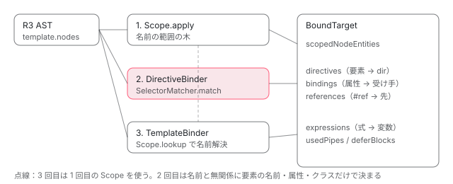

[目次](../README.md) › [テンプレートコンパイラの内側](README.md) › 第 9 回 / 全 18 回

# ディレクティブの照合：R3TargetBinder と SelectorMatcher

> t2\_binder.ts の R3TargetBinder.bind が、テンプレートの各要素について directive\_matching.ts の SelectorMatcher でセレクタを照合し、どのディレクティブ・コンポーネントが付くかを決める手順。CssSelector の分解、:not() の扱い、#ref がどこを指すか、テンプレート変数のスコープ（Scope）、パイプ名の収集（usedPipes）、BoundTarget が後段（依存の絞り込み・型検査）に渡す情報。

angular/angular · 読了 約 14 分 · 発展 · [サイトで読む（デモが動きます）](https://angular-deep-dive-cyan.vercel.app/chapter/compiler-binder)

---

前回までで、テンプレートは R3 AST の木になりました。でもこの木はまだ「`<button mat-button>` に `MatButton` が付く」ことを知りません。この章では、`R3TargetBinder.bind` が木を 3 回歩いて、**どの要素にどのディレクティブが付くか**・**`#ref` が何を指すか**・**式の中の名前がどの変数か**を決める手順を読みます。照合の中身である `SelectorMatcher` も、登録から一致判定まで 1 行ずつ追います。

読む対象は `packages/compiler/src/directive_matching.ts`（`CssSelector` / `SelectorMatcher`）、`packages/compiler/src/render3/view/t2_binder.ts`（`R3TargetBinder` と `Scope` / `DirectiveBinder` / `TemplateBinder`）、`t2_api.ts`（結果の型 `BoundTarget`）、`render3/view/util.ts`（要素を照合用のセレクタにする関数）です。結果を使う側として `compiler-cli` の `handler.ts` と型検査の `typecheck/ops/scope.ts` も少し見ます。

1. [1. 全体図](01-compiler.md)
2. [2. コンパイラの入口](02-compiler-entry.md)
3. [3. HTML の字句解析](03-compiler-html-lexer.md)
4. [4. HTML の構文解析](04-compiler-html-parser.md)
5. [5. 式のパーサ](05-compiler-expression-parser.md)
6. [6. バインディングのパーサ](06-compiler-binding-parser.md)
7. [7. R3 AST](07-compiler-r3-ast.md)
8. [8. ブロック構文の解析](08-compiler-control-flow-blocks.md)
9. **9. ディレクティブの照合**（この章）
10. [10. IR への写像](10-compiler-ingest.md)
11. [11. IR の構造](11-compiler-ir.md)
12. [12. decls・vars・advance](12-compiler-slots-vars.md)
13. [13. 変数とコンテキスト](13-compiler-variables.md)
14. [14. 定数配列と pure function](14-compiler-consts-pure.md)
15. [15. 制御フローのフェーズ](15-compiler-control-flow-phases.md)
16. [16. reify と出力](16-compiler-reify-emit.md)
17. [17. 型検査（TCB）](17-compiler-typecheck.md)
18. [18. スタイルのカプセル化](18-compiler-shadow-css.md)

## 1. 照合の前に：使えるディレクティブを matcher に登録する

バインダは「このテンプレートで使えるディレクティブ」の一覧を自分では探しません。ngtsc（Angular の TypeScript コンパイラ）の `ComponentDecoratorHandler` が、`imports`（または NgModule のスコープ）から集めた一覧を matcher に詰めて渡します。スコープの求め方は [NgModule のコンパイルスコープ](../ngmodule/04-ngmodule-compilation-scope.md)と [使ったものだけを依存にする](../standalone/04-standalone-used-only.md)の章で読みました。

📄 `angular/packages/compiler-cli/src/ngtsc/annotations/component/src/handler.ts` L2809–2823 （▶ の行: 2810, 2816–2818, 2822）

```ts
2809 │ 
2810 ▶   const matcher = new SelectorMatcher();
2811 │   const dependencies =
2812 │     scope.kind === ComponentScopeKind.NgModule
2813 │       ? scope.compilation.dependencies
2814 │       : scope.dependencies;
2815 │ 
2816 ▶   for (const dep of dependencies) {
2817 ▶     if (dep.kind === MetaKind.Directive && dep.selector !== null) {
2818 ▶       matcher.addSelectables(CssSelector.parse(dep.selector), [dep]);
2819 │     }
2820 │   }
2821 │ 
2822 ▶   return matcher;
2823 │ }
```

2817 行目、セレクタを持つディレクティブ（コンポーネントも含む）だけを、2818 行目で `CssSelector.parse(dep.selector)` にして `addSelectables` に渡します。2 番目の引数 `[dep]` は「一致したら返してほしいもの」で、ここではディレクティブのメタデータを 1 個入れた配列です。selectorless（セレクタを使わずクラス名で書く書き方）はこの直前にある別経路で、[selectorless の章](../standalone/13-standalone-selectorless.md)で読みました。

## 2. CssSelector.parse：セレクタ文字列を 4 つの欄に分ける

📄 `angular/packages/compiler/src/directive_matching.ts` L41–56 （▶ の行: 42–43, 52, 55–56）

````ts
41 │ export class CssSelector {
42 ▶   element: string | null = null;
43 ▶   classNames: string[] = [];
44 │   /**
45 │    * The selectors are encoded in pairs where:
46 │    * - even locations are attribute names
47 │    * - odd locations are attribute values.
48 │    *
49 │    * Example:
50 │    * Selector: `[key1=value1][key2]` would parse to:
51 │    * ```
52 ▶    * ['key1', 'value1', 'key2', '']
53 │    * ```
54 │    */
55 ▶   attrs: string[] = [];
56 ▶   notSelectors: CssSelector[] = [];
````

`CssSelector` は要素名（42 行目）、クラス名の配列（43 行目）、属性の「名前・値」を交互に詰めた配列（55 行目。`[key1=value1][key2]` なら 52 行目の `['key1', 'value1', 'key2', '']`）、そして `:not()` の中身（56 行目）の 4 つだけでできています。CSS の子孫セレクタ（空白）や `>` を表す欄はありません。**1 つの要素の上だけで判定できるものしか表せない**形です。

📄 `angular/packages/compiler/src/directive_matching.ts` L9–35 （▶ の行: 10–11, 14, 17–18）

```ts
 9 │ const _SELECTOR_REGEXP = new RegExp(
10 ▶   '(\\:not\\()|' + // 1: ":not("
11 ▶     '(([\\.\\#]?)[-\\w]+)|' + // 2: "tag"; 3: "."/"#";
12 │     // "-" should appear first in the regexp below as FF31 parses "[.-\w]" as a range
13 │     // 4: attribute; 5: attribute_string; 6: attribute_value
14 ▶     '(?:\\[([-.\\w*\\\\$]+)(?:=(["\']?)([^\\]"\']*)\\5)?\\])|' + // "[name]", "[name=value]",
15 │     // "[name="value"]",
16 │     // "[name='value']"
17 ▶     '(\\))|' + // 7: ")"
18 ▶     '(\\s*,\\s*)', // 8: ","
19 │   'g',
20 │ );
21 │ 
22 │ /**
23 │  * These offsets should match the match-groups in `_SELECTOR_REGEXP` offsets.
24 │  */
25 │ const enum SelectorRegexp {
26 │   ALL = 0, // The whole match
27 │   NOT = 1,
28 │   TAG = 2,
29 │   PREFIX = 3,
30 │   ATTRIBUTE = 4,
31 │   ATTRIBUTE_STRING = 5,
32 │   ATTRIBUTE_VALUE = 6,
33 │   NOT_END = 7,
34 │   SEPARATOR = 8,
35 │ }
```

📄 `angular/packages/compiler/src/directive_matching.ts` L58–84 （▶ の行: 61–65, 67, 76–79, 81–83）

```ts
58 │   static parse(selector: string): CssSelector[] {
59 │     const results: CssSelector[] = [];
60 │     const _addResult = (res: CssSelector[], cssSel: CssSelector) => {
61 ▶       if (
62 ▶         cssSel.notSelectors.length > 0 &&
63 ▶         !cssSel.element &&
64 ▶         cssSel.classNames.length == 0 &&
65 ▶         cssSel.attrs.length == 0
66 │       ) {
67 ▶         cssSel.element = '*';
68 │       }
69 │       res.push(cssSel);
70 │     };
71 │     let cssSelector = new CssSelector();
72 │     let match: string[] | null;
73 │     let current = cssSelector;
74 │     let inNot = false;
75 │     _SELECTOR_REGEXP.lastIndex = 0;
76 ▶     while ((match = _SELECTOR_REGEXP.exec(selector))) {
77 ▶       if (match[SelectorRegexp.NOT]) {
78 ▶         if (inNot) {
79 ▶           throw new Error('Nesting :not in a selector is not allowed');
80 │         }
81 ▶         inNot = true;
82 ▶         current = new CssSelector();
83 ▶         cssSelector.notSelectors.push(current);
84 │       }
```

📄 `angular/packages/compiler/src/directive_matching.ts` L85–121 （▶ の行: 85, 88, 90–91, 93, 96, 101–102, 107, 109, 111–113, 115–116）

```ts
 85 ▶       const tag = match[SelectorRegexp.TAG];
 86 │       if (tag) {
 87 │         const prefix = match[SelectorRegexp.PREFIX];
 88 ▶         if (prefix === '#') {
 89 │           // #hash
 90 ▶           current.addAttribute('id', tag.slice(1));
 91 ▶         } else if (prefix === '.') {
 92 │           // Class
 93 ▶           current.addClassName(tag.slice(1));
 94 │         } else {
 95 │           // Element
 96 ▶           current.setElement(tag);
 97 │         }
 98 │       }
 99 │       const attribute = match[SelectorRegexp.ATTRIBUTE];
100 │ 
101 ▶       if (attribute) {
102 ▶         current.addAttribute(
103 │           current.unescapeAttribute(attribute),
104 │           match[SelectorRegexp.ATTRIBUTE_VALUE],
105 │         );
106 │       }
107 ▶       if (match[SelectorRegexp.NOT_END]) {
108 │         inNot = false;
109 ▶         current = cssSelector;
110 │       }
111 ▶       if (match[SelectorRegexp.SEPARATOR]) {
112 ▶         if (inNot) {
113 ▶           throw new Error('Multiple selectors in :not are not supported');
114 │         }
115 ▶         _addResult(results, cssSelector);
116 ▶         cssSelector = current = new CssSelector();
117 │       }
118 │     }
119 │     _addResult(results, cssSelector);
120 │     return results;
121 │   }
```

1. **76 行目：正規表現 1 本で、左から 1 片ずつ取り出す**

   10〜18 行目の正規表現は 5 つの選択肢の「どれか 1 つ」に当たります。`:not(`（10 行目）、名前（11 行目。先頭が `.` ならクラス、`#` なら id、無ければ要素名）、`[属性]` / `[属性=値]`（14 行目）、`)`（17 行目）、`,`（18 行目）です。
2. **77〜84 行目：`:not(` が来たら書き込み先を切り替える**

   82〜83 行目で新しい `CssSelector` を `notSelectors` に足し、以後の片は `current`（＝その not 側）に書きます。107〜110 行目の `)` で元に戻ります。78〜79 行目、`:not` の中にもう一度 `:not` は書けません。
3. **85〜106 行目：片の種類ごとに欄へ入れる**

   90 行目、`#foo` は `id` 属性の `foo` として扱われます。93 行目でクラス、96 行目で要素名、101〜105 行目で属性です。
4. **111〜117 行目：`,` で次のセレクタへ**

   `'x-a, x-b'` は 2 個の `CssSelector` の配列になります。112〜113 行目、`:not(.a, .b)` のように not の中で `,` は使えません。
5. **61〜68 行目：`:not()` だけのセレクタは要素名を `*` にする**

   `':not(.b)'` は要素名もクラスも属性も無いので、67 行目で「どの要素でも」を表す `*` を入れます。

📄 `angular/packages/compiler/src/directive_matching.ts` L181–199 （▶ の行: 182, 194, 198）

```ts
181 │   setElement(element: string | null = null) {
182 ▶     this.element = element;
183 │   }
184 │ 
185 │   getAttrs(): string[] {
186 │     const result: string[] = [];
187 │     if (this.classNames.length > 0) {
188 │       result.push('class', this.classNames.join(' '));
189 │     }
190 │     return result.concat(this.attrs);
191 │   }
192 │ 
193 │   addAttribute(name: string, value: string = '') {
194 ▶     this.attrs.push(name, (value && value.toLowerCase()) || '');
195 │   }
196 │ 
197 │   addClassName(name: string) {
198 ▶     this.classNames.push(name.toLowerCase());
199 │   }
```

194 行目で属性の**値**、198 行目でクラス名を小文字にしています。`[type=Submit]` は `type="submit"` の要素に一致します。182 行目の要素名はそのままです。

> [!WARNING]
> **ハマりどころ**
>
> 正規表現に `:` を拾う選択肢は `:not(` しかありません。`button:hover` の `:` はどの選択肢にも当たらないので読み飛ばされ、続く `hover` が 11 行目の「名前」に当たって、96 行目の `setElement('hover')` で要素名を**上書き**します。結果は `<hover>` という要素に一致するセレクタです。エラーにはなりません（下のデモで確かめられます）。

## 3. SelectorMatcher：セレクタを「要素名 → クラス → 属性」の木に登録する

📄 `angular/packages/compiler/src/directive_matching.ts` L237–246 （▶ の行: 239–241, 244）

```ts
237 │   addSelectables(cssSelectors: CssSelector[], callbackCtxt?: T) {
238 │     let listContext: SelectorListContext = null!;
239 ▶     if (cssSelectors.length > 1) {
240 ▶       listContext = new SelectorListContext(cssSelectors);
241 ▶       this._listContexts.push(listContext);
242 │     }
243 │     for (let i = 0; i < cssSelectors.length; i++) {
244 ▶       this._addSelectable(cssSelectors[i], callbackCtxt as T, listContext);
245 │     }
246 │   }
```

📄 `angular/packages/compiler/src/directive_matching.ts` L253–283 （▶ の行: 262, 264–265, 267, 269, 275, 278, 280）

```ts
253 │   private _addSelectable(
254 │     cssSelector: CssSelector,
255 │     callbackCtxt: T,
256 │     listContext: SelectorListContext,
257 │   ) {
258 │     let matcher: SelectorMatcher<T> = this;
259 │     const element = cssSelector.element;
260 │     const classNames = cssSelector.classNames;
261 │     const attrs = cssSelector.attrs;
262 ▶     const selectable = new SelectorContext(cssSelector, callbackCtxt, listContext);
263 │ 
264 ▶     if (element) {
265 ▶       const isTerminal = attrs.length === 0 && classNames.length === 0;
266 │       if (isTerminal) {
267 ▶         this._addTerminal(matcher._elementMap, element, selectable);
268 │       } else {
269 ▶         matcher = this._addPartial(matcher._elementPartialMap, element);
270 │       }
271 │     }
272 │ 
273 │     if (classNames) {
274 │       for (let i = 0; i < classNames.length; i++) {
275 ▶         const isTerminal = attrs.length === 0 && i === classNames.length - 1;
276 │         const className = classNames[i];
277 │         if (isTerminal) {
278 ▶           this._addTerminal(matcher._classMap, className, selectable);
279 │         } else {
280 ▶           matcher = this._addPartial(matcher._classPartialMap, className);
281 │         }
282 │       }
283 │     }
```

比喩を 1 つだけ使うと、`SelectorMatcher` は「要素名 → クラス → 属性」の順に引く索引です。実物で確かめます。

1. **239〜242 行目：`,` で並んだセレクタは 1 つの「リスト」としてまとめる**

   `SelectorListContext` は、あとで「同じリストの中の 2 つ目が一致しても、もう一度は返さない」ために使います（5 節）。
2. **264〜270 行目：要素名で振り分ける**

   `button` のように要素名しか無いセレクタは「終点」なので、267 行目で `_elementMap` に入れます。`button[mat-button]` のように続きがあれば、269 行目で `_elementPartialMap` に**子の `SelectorMatcher`** を作り、以後の登録先をそちらに移します。
3. **273〜283 行目：クラスで同じことをする**

   最後のクラスで属性も無ければ終点（278 行目）、そうでなければさらに子の matcher へ（280 行目）。この後ろ（引用の外）で、属性についても同じことをします。

`button[mat-button]` は「`_elementPartialMap['button']` の子 matcher の `_attrValueMap['mat-button']['']`」に入ります。`:not()` の中身はこの木には入りません。262 行目の `SelectorContext` が持っているだけです。

## 4. 要素の側も CssSelector にする

照合は「CssSelector 同士」で行うので、テンプレートの要素も同じ形にします。

📄 `angular/packages/compiler/src/render3/view/util.ts` L170–190 （▶ の行: 171–172, 176, 182–183, 185）

```ts
170 │ export function createCssSelectorFromNode(node: t.Element | t.Template): CssSelector {
171 ▶   const elementName = node instanceof t.Element ? node.name : 'ng-template';
172 ▶   const attributes = getAttrsForDirectiveMatching(node);
173 │   const cssSelector = new CssSelector();
174 │   const elementNameNoNs = splitNsName(elementName)[1];
175 │ 
176 ▶   cssSelector.setElement(elementNameNoNs);
177 │ 
178 │   Object.getOwnPropertyNames(attributes).forEach((name) => {
179 │     const nameNoNs = splitNsName(name)[1];
180 │     const value = attributes[name];
181 │ 
182 ▶     cssSelector.addAttribute(nameNoNs, value);
183 ▶     if (name.toLowerCase() === 'class') {
184 │       const classes = value.trim().split(/\s+/);
185 ▶       classes.forEach((className) => cssSelector.addClassName(className));
186 │     }
187 │   });
188 │ 
189 │   return cssSelector;
190 │ }
```

📄 `angular/packages/compiler/src/render3/view/util.ts` L201–224 （▶ の行: 204–205, 207, 209, 213–215, 218–219）

```ts
201 │ function getAttrsForDirectiveMatching(elOrTpl: t.Element | t.Template): {[name: string]: string} {
202 │   const attributesMap: {[name: string]: string} = {};
203 │ 
204 ▶   if (elOrTpl instanceof t.Template && elOrTpl.tagName !== 'ng-template') {
205 ▶     elOrTpl.templateAttrs.forEach((a) => (attributesMap[a.name] = ''));
206 │   } else {
207 ▶     elOrTpl.attributes.forEach((a) => {
208 │       if (!isI18nAttribute(a.name)) {
209 ▶         attributesMap[a.name] = a.value;
210 │       }
211 │     });
212 │ 
213 ▶     elOrTpl.inputs.forEach((i) => {
214 ▶       if (i.type === BindingType.Property || i.type === BindingType.TwoWay) {
215 ▶         attributesMap[i.name] = '';
216 │       }
217 │     });
218 ▶     elOrTpl.outputs.forEach((o) => {
219 ▶       attributesMap[o.name] = '';
220 │     });
221 │   }
222 │ 
223 │   return attributesMap;
224 │ }
```

171 行目、`<ng-template>`（R3 AST の `Template`）は要素名 `ng-template` として照合します。属性の集め方が肝心です。209 行目、**静的な属性は値つき**、213〜215 行目、**`[prop]` と `[(prop)]` は値が空文字**、218〜219 行目、**`(event)` も値が空文字**の属性として足します。つまり `<div [tooltip]="x">` も `<div (tooltip)="f()">` も、セレクタ `[tooltip]` に一致します。204〜205 行目、`*ngIf` のような構造ディレクティブが作るテンプレートでは、`templateAttrs`（`*` の側の属性）だけを使います。183〜185 行目、`class` 属性は空白で割ってクラス名にもします。

## 5. match：索引を引き、:not で落とし、コールバックを呼ぶ

📄 `angular/packages/compiler/src/directive_matching.ts` L340–366 （▶ の行: 349–350, 353, 355, 357, 361, 363）

```ts
340 │   match(
341 │     cssSelector: CssSelector,
342 │     matchedCallback: ((c: CssSelector, a: T) => void) | null,
343 │   ): boolean {
344 │     let result = false;
345 │     const element = cssSelector.element!;
346 │     const classNames = cssSelector.classNames;
347 │     const attrs = cssSelector.attrs;
348 │ 
349 ▶     for (let i = 0; i < this._listContexts.length; i++) {
350 ▶       this._listContexts[i].alreadyMatched = false;
351 │     }
352 │ 
353 ▶     result = this._matchTerminal(this._elementMap, element, cssSelector, matchedCallback) || result;
354 │     result =
355 ▶       this._matchPartial(this._elementPartialMap, element, cssSelector, matchedCallback) || result;
356 │ 
357 ▶     if (classNames) {
358 │       for (let i = 0; i < classNames.length; i++) {
359 │         const className = classNames[i];
360 │         result =
361 ▶           this._matchTerminal(this._classMap, className, cssSelector, matchedCallback) || result;
362 │         result =
363 ▶           this._matchPartial(this._classPartialMap, className, cssSelector, matchedCallback) ||
364 │           result;
365 │       }
366 │     }
```

📄 `angular/packages/compiler/src/directive_matching.ts` L368–390 （▶ の行: 373–374, 376, 379, 381, 383, 386）

```ts
368 │     if (attrs) {
369 │       for (let i = 0; i < attrs.length; i += 2) {
370 │         const name = attrs[i];
371 │         const value = attrs[i + 1];
372 │ 
373 ▶         const terminalValuesMap = this._attrValueMap.get(name)!;
374 ▶         if (value) {
375 │           result =
376 ▶             this._matchTerminal(terminalValuesMap, '', cssSelector, matchedCallback) || result;
377 │         }
378 │         result =
379 ▶           this._matchTerminal(terminalValuesMap, value, cssSelector, matchedCallback) || result;
380 │ 
381 ▶         const partialValuesMap = this._attrValuePartialMap.get(name)!;
382 │         if (value) {
383 ▶           result = this._matchPartial(partialValuesMap, '', cssSelector, matchedCallback) || result;
384 │         }
385 │         result =
386 ▶           this._matchPartial(partialValuesMap, value, cssSelector, matchedCallback) || result;
387 │       }
388 │     }
389 │     return result;
390 │   }
```

1. **349〜351 行目：リストの「一致済み」印を下ろす**

   要素ごとに照合し直すので、前の要素で立った印を消します。
2. **353〜355 行目：要素名で引く**

   終点の表（`_matchTerminal`）と、続きのある子 matcher（`_matchPartial`）の両方を引きます。子 matcher は同じ `match` を*同じ要素の CssSelector で*呼び直すので、木を 1 段ずつ降りていく形になります。
3. **357〜366 行目：要素の持つクラスを 1 つずつ引く**
4. **368〜387 行目：要素の持つ属性を 1 つずつ、2 通りで引く**

   要素の属性に値があるとき、374〜377 行目で「値が空のセレクタ」（`[type]`）を、379 行目で「値まで同じセレクタ」（`[type=submit]`）を引きます。値が空の要素属性（`[prop]` 由来）は 379 行目だけなので、`[type=submit]` には一致しません。

📄 `angular/packages/compiler/src/directive_matching.ts` L449–474 （▶ の行: 462–464, 466, 468, 470）

```ts
449 │ export class SelectorContext<T = any> {
450 │   notSelectors: CssSelector[];
451 │ 
452 │   constructor(
453 │     public selector: CssSelector,
454 │     public cbContext: T,
455 │     public listContext: SelectorListContext,
456 │   ) {
457 │     this.notSelectors = selector.notSelectors;
458 │   }
459 │ 
460 │   finalize(cssSelector: CssSelector, callback: ((c: CssSelector, a: T) => void) | null): boolean {
461 │     let result = true;
462 ▶     if (this.notSelectors.length > 0 && (!this.listContext || !this.listContext.alreadyMatched)) {
463 ▶       const notMatcher = SelectorMatcher.createNotMatcher(this.notSelectors);
464 ▶       result = !notMatcher.match(cssSelector, null);
465 │     }
466 ▶     if (result && callback && (!this.listContext || !this.listContext.alreadyMatched)) {
467 │       if (this.listContext) {
468 ▶         this.listContext.alreadyMatched = true;
469 │       }
470 ▶       callback(this.selector, this.cbContext);
471 │     }
472 │     return result;
473 │   }
474 │ }
```

索引で見つかった候補は、最後に `finalize` を通ります。462〜465 行目、`:not()` があれば**その中身だけで小さな `SelectorMatcher` を作り、同じ要素で照合して、一致したら不合格**にします。466〜471 行目、合格でリストの印がまだ下りていれば、印を立ててコールバックを呼びます。`x-a, x-b` の両方に当たる要素があっても、コールバックは 1 回だけです。

## 6. R3TargetBinder.bind：木を 3 回歩く

📄 `angular/packages/compiler/src/render3/view/t2_binder.ts` L209–248 （▶ の行: 212, 215, 222, 224, 226, 230–231, 237, 240, 243）

```ts
209 │     if (target.template) {
210 │       // First, parse the template into a `Scope` structure. This operation captures the syntactic
211 │       // scopes in the template and makes them available for later use.
212 ▶       const scope = Scope.apply(target.template);
213 │ 
214 │       // Use the `Scope` to extract the entities present at every level of the template.
215 ▶       extractScopedNodeEntities(scope, scopedNodeEntities);
216 │ 
217 │       // Next, perform directive matching on the template using the `DirectiveBinder`. This returns:
218 │       //   - directives: Map of nodes (elements & ng-templates) to the directives on them.
219 │       //   - bindings: Map of inputs, outputs, and attributes to the directive/element that claims
220 │       //     them. TODO(alxhub): handle multiple directives claiming an input/output/etc.
221 │       //   - references: Map of #references to their targets.
222 ▶       DirectiveBinder.apply(
223 │         target.template,
224 ▶         this.directiveMatcher,
225 │         this.foreignComponentMatcher,
226 ▶         directives,
227 │         foreignComponents,
228 │         eagerDirectives,
229 │         missingDirectives,
230 ▶         bindings,
231 ▶         references,
232 │         conflictingHostDirectiveBindings,
233 │       );
234 │ 
235 │       // Finally, run the TemplateBinder to bind references, variables, and other entities within the
236 │       // template. This extracts all the metadata that doesn't depend on directive matching.
237 ▶       TemplateBinder.applyWithScope(
238 │         target.template,
239 │         scope,
240 ▶         expressions,
241 │         symbols,
242 │         nestingLevel,
243 ▶         usedPipes,
244 │         eagerPipes,
245 │         deferBlocks,
246 │         pipes,
247 │       );
248 │     }
```

1. **212 行目：`Scope.apply` — 名前の入れ物を作る**

   どの位置でどの名前（`#ref`・`let` 変数・`@let`）が見えるかの木を作ります（7 節）。
2. **222 行目：`DirectiveBinder.apply` — 要素ごとにディレクティブを照合する**

   結果は 226 行目の `directives`（要素 → ディレクティブ）、230 行目の `bindings`（属性 → 受け取る側）、231 行目の `references`（`#ref` → 指す先）です（8 節）。
3. **237 行目：`TemplateBinder.applyWithScope` — 式の中の名前を解決する**

   240 行目の `expressions`（式の AST → 変数／参照）、243 行目の `usedPipes` などを埋めます（9 節）。

3 回に分けているのは、1 回目の `Scope` が 3 回目の名前解決の前提で、2 回目のディレクティブ照合は名前と無関係に要素だけで決まるからです。235〜236 行目のコメントのとおり、3 回目は「ディレクティブの照合に依存しない情報」を集めます。

## 7. Scope：名前の見える範囲を作る

📄 `angular/packages/compiler/src/render3/view/t2_api.ts` L37–60 （▶ の行: 38–39, 41–42, 44, 57）

```ts
37 │ /** Node that has a `Scope` associated with it. */
38 ▶ export type ScopedNode =
39 ▶   | Template
40 │   | SwitchBlockCaseGroup
41 ▶   | IfBlockBranch
42 ▶   | ForLoopBlock
43 │   | ForLoopBlockEmpty
44 ▶   | DeferredBlock
45 │   | DeferredBlockError
46 │   | DeferredBlockLoading
47 │   | DeferredBlockPlaceholder
48 │   | Content
49 │   | ContentBlock
50 │   | HostElement;
51 │ 
52 │ /** Possible values that a reference can be resolved to. */
53 │ export type ReferenceTarget<DirectiveT> =
54 │   {directive: DirectiveT; node: Exclude<DirectiveOwner, HostElement>} | Element | Template;
55 │ 
56 │ /** Entity that is local to the template and defined within the template. */
57 ▶ export type TemplateEntity = Reference | Variable | LetDeclaration;
58 │ 
59 │ /** Nodes that can have directives applied to them. */
60 │ export type DirectiveOwner = Element | Template | Component | Directive | HostElement;
```

38〜50 行目の `ScopedNode` が「新しい範囲を作るノード」の一覧です。`<ng-template>`、`@if` の各分岐、`@for` 本体、`@defer` とその付属ブロックなど。**普通の要素（`Element`）は入っていません**。`<div>` の中で付けた `#ref` は、div の外の兄弟からも見えます。57 行目、範囲に入る名前は `Reference`・`Variable`・`LetDeclaration` の 3 種類です。

📄 `angular/packages/compiler/src/render3/view/t2_binder.ts` L339–374 （▶ の行: 340, 342, 346–348, 351–353, 372）

```ts
339 │   private ingest(nodeOrNodes: ScopedNode | Node[]): void {
340 ▶     if (nodeOrNodes instanceof Template) {
341 │       // Variables on an <ng-template> are defined in the inner scope.
342 ▶       nodeOrNodes.variables.forEach((node) => this.visitVariable(node));
343 │ 
344 │       // Process the nodes of the template.
345 │       nodeOrNodes.children.forEach((node) => node.visit(this));
346 ▶     } else if (nodeOrNodes instanceof IfBlockBranch) {
347 ▶       if (nodeOrNodes.expressionAlias !== null) {
348 ▶         this.visitVariable(nodeOrNodes.expressionAlias);
349 │       }
350 │       nodeOrNodes.children.forEach((node) => node.visit(this));
351 ▶     } else if (nodeOrNodes instanceof ForLoopBlock) {
352 ▶       this.visitVariable(nodeOrNodes.item);
353 ▶       nodeOrNodes.contextVariables.forEach((v) => this.visitVariable(v));
354 │       nodeOrNodes.children.forEach((node) => node.visit(this));
355 │     } else if (nodeOrNodes instanceof BoundaryErrorBlock) {
356 │       nodeOrNodes.contextVariables.forEach((v) => this.visitVariable(v));
357 │       nodeOrNodes.children.forEach((node) => node.visit(this));
358 │     } else if (
359 │       nodeOrNodes instanceof SwitchBlockCaseGroup ||
360 │       nodeOrNodes instanceof ForLoopBlockEmpty ||
361 │       nodeOrNodes instanceof DeferredBlock ||
362 │       nodeOrNodes instanceof DeferredBlockError ||
363 │       nodeOrNodes instanceof DeferredBlockPlaceholder ||
364 │       nodeOrNodes instanceof DeferredBlockLoading ||
365 │       nodeOrNodes instanceof ContentBlock ||
366 │       nodeOrNodes instanceof BoundaryBlock ||
367 │       nodeOrNodes instanceof Content
368 │     ) {
369 │       nodeOrNodes.children.forEach((node) => node.visit(this));
370 │     } else if (!(nodeOrNodes instanceof HostElement)) {
371 │       // No overarching `Template` instance, so process the nodes directly.
372 ▶       nodeOrNodes.forEach((node) => node.visit(this));
373 │     }
374 │   }
```

📄 `angular/packages/compiler/src/render3/view/t2_binder.ts` L376–400 （▶ の行: 381, 386, 389, 394, 399）

```ts
376 │   visitElement(element: Element) {
377 │     this.visitElementLike(element);
378 │   }
379 │ 
380 │   visitTemplate(template: Template) {
381 ▶     this.elementLikeInScope.add(template);
382 │     template.directives.forEach((node) => node.visit(this));
383 │ 
384 │     // References on a <ng-template> are defined in the outer scope, so capture them before
385 │     // processing the template's child scope.
386 ▶     template.references.forEach((node) => this.visitReference(node));
387 │ 
388 │     // Next, create an inner scope and process the template within it.
389 ▶     this.ingestScopedNode(template);
390 │   }
391 │ 
392 │   visitVariable(variable: Variable) {
393 │     // Declare the variable if it's not already.
394 ▶     this.maybeDeclare(variable);
395 │   }
396 │ 
397 │   visitReference(reference: Reference) {
398 │     // Declare the variable if it's not already.
399 ▶     this.maybeDeclare(reference);
400 │   }
```

📄 `angular/packages/compiler/src/render3/view/t2_binder.ts` L512–535 （▶ の行: 514–515, 525, 527–528, 530, 533）

```ts
512 │   private maybeDeclare(thing: TemplateEntity) {
513 │     // Declare something with a name, as long as that name isn't taken.
514 ▶     if (!this.namedEntities.has(thing.name)) {
515 ▶       this.namedEntities.set(thing.name, thing);
516 │     }
517 │   }
518 │ 
519 │   /**
520 │    * Look up a variable within this `Scope`.
521 │    *
522 │    * This can recurse into a parent `Scope` if it's available.
523 │    */
524 │   lookup(name: string): TemplateEntity | null {
525 ▶     if (this.namedEntities.has(name)) {
526 │       // Found in the local scope.
527 ▶       return this.namedEntities.get(name)!;
528 ▶     } else if (this.parentScope !== null) {
529 │       // Not in the local scope, but there's a parent scope so check there.
530 ▶       return this.parentScope.lookup(name);
531 │     } else {
532 │       // At the top level and it wasn't found.
533 ▶       return null;
534 │     }
535 │   }
```

📄 `angular/packages/compiler/src/render3/view/t2_binder.ts` L542–554 （▶ の行: 551–553）

```ts
542 │   getChildScope(node: ScopedNode): Scope {
543 │     const res = this.childScopes.get(node);
544 │     if (res === undefined) {
545 │       throw new Error(`Assertion error: child scope for ${node} not found`);
546 │     }
547 │     return res;
548 │   }
549 │ 
550 │   private ingestScopedNode(node: ScopedNode) {
551 ▶     const scope = new Scope(this, node);
552 ▶     scope.ingest(node);
553 ▶     this.childScopes.set(node, scope);
554 │   }
```

1. **範囲ごとに、入口で宣言される名前がある**

   `<ng-template let-x>` の変数は内側の範囲に（342 行目）、`@if (…; as u)` の `u` は分岐の範囲に（347〜348 行目）、`@for` の item と `$index` などは本体の範囲に（352〜353 行目）入ります。[前回](08-compiler-control-flow-blocks.md)作った `Variable` がここで使われます。
2. **386 行目：`<ng-template #t>` の参照は*外側*の範囲**

   テンプレートそのものを指す名前なので、389 行目で内側の範囲に入る前に、外側に宣言します。
3. **551〜553 行目：子の範囲は親を覚えて作る**
4. **512〜517 行目：同じ名前は先に宣言したほうが残る**

   514 行目で、すでにある名前は上書きしません。
5. **524〜535 行目：引くときは内側から外側へ**

   530 行目で親の範囲を順にさかのぼり、根でも見つからなければ 533 行目で `null`。`null` は「テンプレートの変数ではない」という意味です。

## 8. DirectiveBinder：要素ごとの照合と #ref の解決

📄 `angular/packages/compiler/src/render3/view/t2_binder.ts` L735–765 （▶ の行: 738–741, 763–764）

```ts
735 │   private visitElementOrTemplate(node: Element | Template): void {
736 │     const matchedDirectives: DirectiveT[] = [];
737 │ 
738 ▶     if (this.directiveMatcher instanceof SelectorMatcher) {
739 ▶       const cssSelector = createCssSelectorFromNode(node);
740 ▶       this.directiveMatcher.match(cssSelector, (_, results) => matchedDirectives.push(...results));
741 ▶       this.trackSelectorBasedBindingsAndDirectives(node, matchedDirectives);
742 │     } else {
743 │       node.references.forEach((ref) => {
744 │         if (ref.value.trim() === '') {
745 │           this.references.set(ref, node);
746 │         }
747 │       });
748 │     }
749 │ 
750 │     if (this.foreignMatcher && node instanceof Element) {
751 │       const foreignMatches = this.foreignMatcher.match(node.name);
752 │       if (foreignMatches.length > 0) {
753 │         if (matchedDirectives.length > 0) {
754 │           throw new Error(
755 │             `Conflict: Element '${node.name}' matches both an Angular directive and a foreign component.`,
756 │           );
757 │         }
758 │         // We assume at most one foreign component matches by name.
759 │         this.foreignComponents.set(node, foreignMatches[0]);
760 │       }
761 │     }
762 │ 
763 ▶     node.directives.forEach((directive) => directive.visit(this));
764 ▶     node.children.forEach((child) => child.visit(this));
765 │   }
```

739 行目で 4 節の関数を使って要素を CssSelector にし、740 行目で 1 節の matcher に照合します。コールバックの 2 番目の引数 `results` は、1 節で登録した `[dep]` です。それを `matchedDirectives` に積みます。**一致した数は数えていません**。コンポーネントが 2 つ一致しても、ここでは 2 つとも積まれます。764 行目で子の要素へ進みます（`@if` や `@for` の中も、それぞれの visit メソッドが子を順に訪ねるので同じように照合されます）。積んだものは 741 行目から `trackMatchedDirectives` で `directives` に記録されます。そこで @defer の外のものを「eager」に分ける話は[使ったものだけを依存にする章](../standalone/04-standalone-used-only.md)で読みました。

📄 `angular/packages/compiler/src/render3/view/t2_binder.ts` L922–959 （▶ の行: 935, 937, 940–942, 945, 948, 954, 957）

```ts
922 │   private trackSelectorBasedBindingsAndDirectives(
923 │     node: Element | Template,
924 │     directives: DirectiveT[],
925 │   ): void {
926 │     this.trackMatchedDirectives(node, directives);
927 │ 
928 │     // Resolve any references that are created on this node.
929 │     node.references.forEach((ref) => {
930 │       let dirTarget: DirectiveT | null = null;
931 │ 
932 │       // If the reference expression is empty, then it matches the "primary" directive on the node
933 │       // (if there is one). Otherwise it matches the host node itself (either an element or
934 │       // <ng-template> node).
935 ▶       if (ref.value.trim() === '') {
936 │         // This could be a reference to a component if there is one.
937 ▶         dirTarget = directives.find((dir) => dir.isComponent) || null;
938 │       } else {
939 │         // This should be a reference to a directive exported via exportAs.
940 ▶         dirTarget =
941 ▶           directives.find(
942 ▶             (dir) => dir.exportAs !== null && dir.exportAs.some((value) => value === ref.value),
943 │           ) || null;
944 │         // Check if a matching directive was found.
945 ▶         if (dirTarget === null) {
946 │           // No matching directive was found - this reference points to an unknown target. Leave it
947 │           // unmapped.
948 ▶           return;
949 │         }
950 │       }
951 │ 
952 │       if (dirTarget !== null) {
953 │         // This reference points to a directive.
954 ▶         this.references.set(ref, {directive: dirTarget, node});
955 │       } else {
956 │         // This reference points to the node itself.
957 ▶         this.references.set(ref, node);
958 │       }
959 │     });
```

1. **935〜937 行目：`#b`（値なし）はコンポーネントを指す**

   一致したディレクティブの中に `isComponent` のものがあれば、それを指します。無ければ `dirTarget` は `null` のままです。
2. **940〜943 行目：`#t="tip"`（値あり）は exportAs で探す**

   値が `exportAs` の一覧に入っているディレクティブを探します。
3. **945〜948 行目：exportAs が見つからなければ、何も記録しない**

   `references` に入らないので、あとで `getReferenceTarget` が `null` を返します。
4. **952〜958 行目：記録する**

   ディレクティブなら `{directive, node}`、そうでなければ（値なしでコンポーネントが無い場合）957 行目で**要素そのもの**です。

📄 `angular/packages/compiler/src/render3/view/t2_binder.ts` L961–980 （▶ の行: 966–968, 973–974, 976, 979）

```ts
961 │     // Associate attributes/bindings on the node with directives or with the node itself.
962 │     const setAttributeBinding = (
963 │       attribute: BoundAttribute | BoundEvent | TextAttribute,
964 │       ioType: keyof Pick<DirectiveMeta, 'inputs' | 'outputs'>,
965 │     ) => {
966 ▶       const dir = directives.find((dir) => dir[ioType].hasBindingPropertyName(attribute.name));
967 ▶       const binding = dir !== undefined ? dir : node;
968 ▶       this.bindings.set(attribute, binding);
969 │     };
970 │ 
971 │     // Node inputs (bound attributes) and text attributes can be bound to an
972 │     // input on a directive.
973 ▶     node.inputs.forEach((input) => setAttributeBinding(input, 'inputs'));
974 ▶     node.attributes.forEach((attr) => setAttributeBinding(attr, 'inputs'));
975 │     if (node instanceof Template) {
976 ▶       node.templateAttrs.forEach((attr) => setAttributeBinding(attr, 'inputs'));
977 │     }
978 │     // Node outputs (bound events) can be bound to an output on a directive.
979 ▶     node.outputs.forEach((output) => setAttributeBinding(output, 'outputs'));
980 │   }
```

属性・バインディングごとに「誰が受け取るか」も決めます。966 行目、一致したディレクティブのうち、その名前の input（イベントなら output）を持つ最初のものです。見つからなければ 967 行目で要素そのもの、つまり DOM のプロパティや属性です。974 行目、静的な属性（`color="primary"`）も input の候補として見ます。

## 9. TemplateBinder：式の中の名前を変数・参照に結びつける

📄 `angular/packages/compiler/src/render3/view/t2_binder.ts` L1231–1242 （▶ の行: 1231–1232, 1235, 1240）

```ts
1231 ▶   // These five types of AST expressions can refer to expression roots, which could be variables
1232 ▶   // or references in the current scope.
1233 │ 
1234 │   override visitPropertyRead(ast: PropertyRead, context: any): any {
1235 ▶     this.maybeMap(ast, ast.name);
1236 │     return super.visitPropertyRead(ast, context);
1237 │   }
1238 │ 
1239 │   override visitSafePropertyRead(ast: SafePropertyRead, context: any): any {
1240 ▶     this.maybeMap(ast, ast.name);
1241 │     return super.visitSafePropertyRead(ast, context);
1242 │   }
```

📄 `angular/packages/compiler/src/render3/view/t2_binder.ts` L1261–1274 （▶ の行: 1264–1265, 1270–1272）

```ts
1261 │   private maybeMap(ast: PropertyRead | SafePropertyRead, name: string): void {
1262 │     // If the receiver of the expression isn't the `ImplicitReceiver`, this isn't the root of an
1263 │     // `AST` expression that maps to a `Variable` or `Reference`.
1264 ▶     if (!(ast.receiver instanceof ImplicitReceiver)) {
1265 ▶       return;
1266 │     }
1267 │ 
1268 │     // Check whether the name exists in the current scope. If so, map it. Otherwise, the name is
1269 │     // probably a property on the top-level component context.
1270 ▶     const target = this.scope.lookup(name);
1271 ▶     if (target !== null) {
1272 ▶       this.bindings.set(ast, target);
1273 │     }
1274 │   }
```

式の中の `user` のような「レシーバの無い読み取り」（`ImplicitReceiver`。[第 5 回](05-compiler-expression-parser.md)）だけが対象です。1264 行目、`a.b` の `b` のように前に何かが付いているものは見ません。1270 行目で 7 節の `lookup` を引き、見つかれば 1272 行目で `expressions` に「この式 → この変数／参照」と記録します。見つからなければ何も記録せず、1268〜1269 行目のコメントのとおり**コンポーネントのプロパティ**とみなされます。

📄 `angular/packages/compiler/src/render3/view/t2_binder.ts` L1191–1204 （▶ の行: 1192–1193, 1202–1203）

```ts
1191 │   override visitForLoopBlock(block: ForLoopBlock) {
1192 ▶     block.expression.visit(this);
1193 ▶     this.ingestScopedNode(block);
1194 │     block.empty?.visit(this);
1195 │   }
1196 │ 
1197 │   override visitForLoopBlockEmpty(block: ForLoopBlockEmpty) {
1198 │     this.ingestScopedNode(block);
1199 │   }
1200 │ 
1201 │   override visitIfBlockBranch(block: IfBlockBranch) {
1202 ▶     block.expression?.visit(this);
1203 ▶     this.ingestScopedNode(block);
1204 │   }
```

訪ねる順番にも意味があります。1192 行目、`@for (item of items)` の `items` は、本体の範囲に入る（1193 行目）*前*に解決されます。1202 行目、`@if` の条件式も分岐の範囲に入る前です。だから `@if (u; as u)` の条件の `u` は、分岐で宣言される別名 `u` ではなく外側の `u` を指します。

パイプは、TemplateBinder の `visitPipe` が名前を `usedPipes` に足すだけです（[使ったものだけを依存にする章](../standalone/04-standalone-used-only.md)で引用済み）。名前からパイプのクラスを引くのはバインダではなく、ngtsc の handler がスコープのパイプ表で行います。

### @defer の対象要素

📄 `angular/packages/compiler/src/render3/view/t2_binder.ts` L1381–1407 （▶ の行: 1381, 1383, 1386–1387, 1396–1397, 1400–1401, 1406）

```ts
1381 ▶     const name = trigger.reference;
1382 │ 
1383 ▶     if (name === null) {
1384 │       let target: Element | null = null;
1385 │ 
1386 ▶       if (block.placeholder !== null) {
1387 ▶         for (const child of block.placeholder.children) {
1388 │           // Skip over comment nodes. Currently by default the template parser doesn't capture
1389 │           // comments, but we have a safeguard here just in case since it can be enabled.
1390 │           if (child instanceof Comment) {
1391 │             continue;
1392 │           }
1393 │ 
1394 │           // We can only infer the trigger if there's one root element node. Any other
1395 │           // nodes at the root make it so that we can't infer the trigger anymore.
1396 ▶           if (target !== null) {
1397 ▶             return null;
1398 │           }
1399 │ 
1400 ▶           if (child instanceof Element) {
1401 ▶             target = child;
1402 │           }
1403 │         }
1404 │       }
1405 │ 
1406 ▶       return target;
1407 │     }
```

[前回](08-compiler-control-flow-blocks.md)の `on viewport` のように対象を書かないトリガーは、`reference` が `null` です（1383 行目）。1386〜1403 行目で placeholder の子を見て、**ルートの要素がちょうど 1 つ**のときだけそれを対象にします。2 つ目が来たら 1396〜1397 行目で `null`（推定できない）です。この関数は 10 節の BoundTarget のメソッドの 1 つで、型検査や出力の段階から呼ばれます。

## 10. BoundTarget：後段に渡すもの

📄 `angular/packages/compiler/src/render3/view/t2_api.ts` L218–256 （▶ の行: 224, 236, 243–245, 256）

```ts
218 │   readonly target: Target<DirectiveT>;
219 │ 
220 │   /**
221 │    * For a given template node (either an `Element` or a `Template`), get the set of directives
222 │    * which matched the node, if any.
223 │    */
224 ▶   getDirectivesOfNode(node: DirectiveOwner): DirectiveT[] | null;
225 │ 
226 │   /**
227 │    * For a given template node (usually an `Element`), get the foreign component that matched
228 │    * the node, if any.
229 │    */
230 │   getForeignComponent(element: Element): ForeignComponentMeta | null;
231 │ 
232 │   /**
233 │    * For a given `Reference`, get the reference's target - either an `Element`, a `Template`, or
234 │    * a directive on a particular node.
235 │    */
236 ▶   getReferenceTarget(ref: Reference): ReferenceTarget<DirectiveT> | null;
237 │ 
238 │   /**
239 │    * For a given binding, get the entity to which the binding is being made.
240 │    *
241 │    * This will either be a directive or the node itself.
242 │    */
243 ▶   getConsumerOfBinding(
244 ▶     binding: BoundAttribute | BoundEvent | TextAttribute,
245 ▶   ): DirectiveT | Element | Template | null;
246 │ 
247 │   /**
248 │    * If the given `AST` expression refers to a `Reference` or `Variable` within the `Target`, then
249 │    * return that.
250 │    *
251 │    * Otherwise, returns `null`.
252 │    *
253 │    * This is only defined for `AST` expressions that read or write to a property of an
254 │    * `ImplicitReceiver`.
255 │    */
256 ▶   getExpressionTarget(expr: AST): TemplateEntity | null;
```

6 節で埋めた表を引くための口です。`getDirectivesOfNode`（224 行目、8 節の `directives`）、`getReferenceTarget`（236 行目、8 節の `references`）、`getConsumerOfBinding`（243 行目、8 節の `bindings`）、`getExpressionTarget`（256 行目、9 節の `expressions`）。使われたディレクティブ・パイプの一覧（`getUsedDirectives` など）は依存の絞り込みに使われます（[使ったものだけを依存にする章](../standalone/04-standalone-used-only.md)）。

もう 1 つの大きな利用者が型検査です。型検査ブロック（TCB：テンプレートを型検査するためにコンパイラが作る TypeScript。[第 17 回](17-compiler-typecheck.md)）を作る `Scope`（型検査側の同名クラス）が、要素ごとに BoundTarget を引きます。なお、[次回](10-compiler-ingest.md)からのテンプレートパイプライン（IR）は BoundTarget を受け取らず、名前の解決も IR の中で自分で行います（[第 13 回](13-compiler-variables.md)）。

📄 `angular/packages/compiler/src/typecheck/ops/scope.ts` L551–570 （▶ の行: 553, 556, 558, 562, 566）

```ts
551 │   private checkAndAppendReferencesOfNode(node: Element | Template | Component | Directive): void {
552 │     for (const ref of node.references) {
553 ▶       const target = this.tcb.boundTarget.getReferenceTarget(ref);
554 │ 
555 │       let ctxIndex: number;
556 ▶       if (target === null) {
557 │         // The reference is invalid if it doesn't have a target, so report it as an error.
558 ▶         this.tcb.oobRecorder.missingReferenceTarget(this.tcb.id, ref);
559 │ 
560 │         // Any usages of the invalid reference will be resolved to a variable of type any.
561 │         ctxIndex = this.opQueue.push(new TcbInvalidReferenceOp(this.tcb, this)) - 1;
562 ▶       } else if (target instanceof Template || target instanceof Element) {
563 │         ctxIndex = this.opQueue.push(new TcbReferenceOp(this.tcb, this, ref, node, target)) - 1;
564 │       } else {
565 │         ctxIndex =
566 ▶           this.opQueue.push(new TcbReferenceOp(this.tcb, this, ref, node, target.directive)) - 1;
567 │       }
568 │       this.referenceOpMap.set(ref, ctxIndex);
569 │     }
570 │   }
```

📄 `angular/packages/compiler/src/typecheck/ops/scope.ts` L638–647 （▶ の行: 639–641）

```ts
638 │     if (node instanceof Element) {
639 ▶       const matchedComponents = directives.filter((dir) => dir.isComponent);
640 ▶       if (matchedComponents.length > 1) {
641 ▶         this.tcb.oobRecorder.multipleMatchingComponents(
642 │           this.tcb.id,
643 │           node,
644 │           matchedComponents.map((dir) => dir.name),
645 │         );
646 │       }
647 │     }
```

📄 `angular/packages/compiler-cli/src/ngtsc/typecheck/src/oob.ts` L688–710 （▶ の行: 706–707）

```ts
688 │   multipleMatchingComponents(
689 │     id: TypeCheckId,
690 │     element: TmplAstElement,
691 │     componentNames: string[],
692 │   ): void {
693 │     const start = element.startSourceSpan.start.moveBy(1);
694 │     const end = element.startSourceSpan.end.moveBy(
695 │       start.offset + element.name.length - element.startSourceSpan.end.offset,
696 │     );
697 │     const span = new ParseSourceSpan(start, end);
698 │     const names = componentNames.map((n: string) => `'${n}'`).join(', ');
699 │ 
700 │     this._diagnostics.push(
701 │       makeTemplateDiagnostic(
702 │         id,
703 │         this.resolver.getTemplateSourceMapping(id),
704 │         span,
705 │         ts.DiagnosticCategory.Error,
706 ▶         ngErrorCode(ErrorCode.MULTIPLE_MATCHING_COMPONENTS),
707 ▶         `Multiple components match node with tagname ${element.name}: ${names}.`,
708 │       ),
709 │     );
710 │   }
```

8 節で「記録しなかった」`#x="nope"` は、型検査側の 553 行目で `null` が返り、558 行目で `missingReferenceTarget`（「No directive found with exportAs 'nope'.」）として報告されます。8 節で「数えなかった」コンポーネントの重複は、639〜641 行目で数えられ、706〜707 行目の「Multiple components match node with tagname …」になります。**バインダは事実を集めるだけで、エラーの判定は使う側がしています。**



*R3TargetBinder.bind の 3 回の走査と、BoundTarget の表*

> **🧪 DEMO 1 — SelectorMatcher に登録して、要素と照合する**
>
> 左に 1 行 1 セレクタ、右に要素を書きます。ボタンを押すと `@angular/compiler`（22.1.6）を読み込み、1 節と同じく `addSelectables(CssSelector.parse(sel), sel)` で登録し、要素は `parseTemplate` → `createCssSelectorFromNode` → `match` の順に通します。
>
> ▶ [このデモはサイトで動かせます](https://angular-deep-dive-cyan.vercel.app/chapter/compiler-binder)

既定の入力では、`.a:not(.b)` は `class="a b"` のボタンに一致せず（5 節の 462〜465 行目）、`class="a"` のボタンにだけ一致します。`button:hover` の解析結果は `element: "hover"` で、`<hover>` に一致します（2 節の警告）。`<ng-template [ngIf]="x">` の CssSelector は `ng-template[ngIf]` で、値が空です（4 節の 213〜215 行目）。

> **🧪 DEMO 2 — R3TargetBinder.bind を呼んで BoundTarget を引く**
>
> 左は「名前 | セレクタ | component か directive | exportAs | input 名（カンマ区切り）」の 1 行 1 ディレクティブ。本物の ngtsc はクラスの解析結果からこのメタデータ（`DirectiveMeta`）を作りますが、ここでは手で作って `new R3TargetBinder(matcher).bind({ template })` を呼びます。
>
> ▶ [このデモはサイトで動かせます](https://angular-deep-dive-cyan.vercel.app/chapter/compiler-binder)

既定の入力では、`<button mat-button>` に `OtherButton`・`MatButton`・`Tooltip` の 3 つが付き、bind はエラーを出しません（8 節）。`#b` は一致した中で最初のコンポーネント（937 行目の `find`）、`#t="tip"` は `Tooltip`、`#x="nope"` は `null` です。`color` は `MatButton` の input なのでそちらへ、`mat-button` 属性はどの input でもないので要素そのものへ行きます（966〜967 行目）。

## ここまでの呼び出し

- 👤 `@Component({ imports: [MatButton, …] })` — あなたのコンポーネント
  - `createMatcherFromScope(scope, …)` — annotations/component/src/handler.ts L2794 — *addSelectables(CssSelector.parse(sel), \[dep\])*
    - `CssSelector.parse(selector)` — compiler/src/directive\_matching.ts L58
    - `SelectorMatcher.addSelectables()` → `_addSelectable()` — directive\_matching.ts L237 / L253
  - `new R3TargetBinder(matcher).bind({ template: nodes })` — handler.ts L1955
    - `Scope.apply(template)` — render3/view/t2\_binder.ts L330 — *ScopedNode ごとに子の Scope*
    - `DirectiveBinder.apply()` → `visitElementOrTemplate(node)` — t2\_binder.ts L593 / L735
      - `createCssSelectorFromNode(node)` — render3/view/util.ts L170
      - `SelectorMatcher.match(css, cb)` → `SelectorContext.finalize()` — directive\_matching.ts L340 / L460 — *:not はここで落とす*
      - `trackSelectorBasedBindingsAndDirectives()` — t2\_binder.ts L922 — *#ref と属性の受け手*
    - `TemplateBinder.applyWithScope()` → `maybeMap(ast, name)` — t2\_binder.ts L1036 / L1261 — *Scope.lookup*
    - `new R3BoundTarget(…)` — t2\_binder.ts L267
  - `getUsedDirectives()` / 型検査の `getReferenceTarget()` など — handler.ts / typecheck/ops/scope.ts

## 聞かれそうな質問

**Q. 同じ要素に 2 つのコンポーネントが一致したら、どこでエラーになりますか？**

バインダではなりません。`visitElementOrTemplate` の 740 行目は一致したものを全部積むだけです。ビルド時は型検査ブロックを作る `Scope` の 639〜641 行目で数えられ、oob.ts 706〜707 行目の「Multiple components match node with tagname …」（`ErrorCode.MULTIPLE_MATCHING_COMPONENTS`）になります。実行時にも、開発モードなら最初の作成パスで同じ検査があります（[ディレクティブの章](../ivy/14-ivy-directives.md)の `findDirectiveDefMatches`）。

**Q. :not() 以外の擬似クラスは使えますか？**

使えません。しかもエラーにならず、意味が変わります。セレクタの正規表現（directive\_matching.ts 10〜18 行目）が `:` を拾うのは `:not(` だけなので、`button:hover` は `:` が読み飛ばされ、`hover` が 96 行目の `setElement` で要素名を上書きします。`:not` も、入れ子（78〜79 行目）と中の `,`（112〜113 行目）は例外になります。

**Q. #ref がディレクティブを指すのはどんなときですか？**

t2\_binder.ts 935〜950 行目の 2 通りです。値なしの `#b` は、その要素に一致したコンポーネントがあればそれ（937 行目）、無ければ要素そのもの（957 行目）。値ありの `#t="tip"` は、一致したディレクティブの `exportAs` に `tip` があるもの（940〜943 行目）。見つからなければ記録されず（945〜948 行目）、型検査の scope.ts 558 行目で「No directive found with exportAs」になります。

**Q. \[tooltip\]="x" と書いても、セレクタ \[tooltip\] のディレクティブは付きますか？**

付きます。`getAttrsForDirectiveMatching`（view/util.ts 213〜215 行目）が `[prop]` を「値が空の属性 tooltip」として照合用のセレクタに入れるからです。`(tooltip)="f()"` も 218〜219 行目で同じく属性になります。ただし値が空なので、`[tooltip=on]` のような値つきセレクタには一致しません（match の 379 行目は値が同じものしか引かない）。

**Q. テンプレートの中の user は、いつ「コンポーネントの user プロパティ」だと決まるのですか？**

TemplateBinder の `maybeMap` が `Scope.lookup('user')` を引き、`null` だったときです（t2\_binder.ts 1270〜1273 行目）。どの範囲にも `#user`・`let user`・`@let user` が無ければ記録されず、1268〜1269 行目のコメントのとおりコンポーネントのプロパティとして扱われます。

## 読み終えて

- 使えるディレクティブは ngtsc が `CssSelector.parse` → `addSelectables` で matcher に入れてから渡す。バインダはスコープを知らない
- `CssSelector` は要素名・クラス・属性・`:not()` の 4 欄だけ。`:hover` などはエラーにならず要素名を上書きする
- 要素側は `createCssSelectorFromNode` で同じ形にする。`[prop]` と `(event)` も「値が空の属性」として照合に参加する
- `bind` は Scope → DirectiveBinder → TemplateBinder の 3 回走査。`#ref` はコンポーネントか exportAs、式の名前は内側から外側へ `lookup`
- バインダは事実を集めるだけ。コンポーネントの重複や未解決の `#ref` をエラーにするのは、BoundTarget を使う型検査側

---

← 前: [@if・@for・@switch・@defer・@let がノードになるまで：ブロック構文の解析](08-compiler-control-flow-blocks.md)  
次: [IR への写像：ingestComponent が R3 AST を create と update の命令リストにする](10-compiler-ingest.md) →
