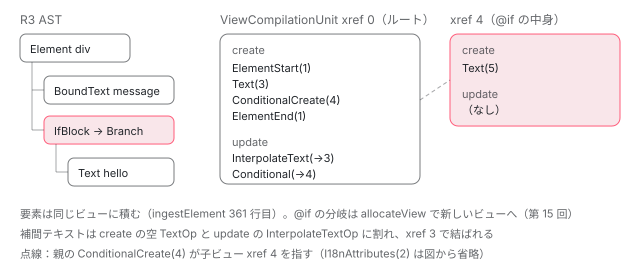

[目次](../README.md) › [テンプレートコンパイラの内側](README.md) › 第 10 回 / 全 18 回

# IR への写像：ingestComponent が R3 AST を create と update の命令リストにする

> template/pipeline/src/ingest.ts の ingestComponent が ComponentCompilationJob を作り、ingestNodes が Element / Template / Text / BoundText / 各ブロックを ir の CreateOp と UpdateOp に写す行。ElementStartOp / ElementEndOp、BindingOp（後の specializeBindings で PropertyOp になる）、InterpolateTextOp、ListenerOp の作り方、子テンプレートが別の ViewCompilationUnit になる理由、xref（参照番号）の振り方。

angular/angular · 読了 約 15 分 · 発展 · [サイトで読む（デモが動きます）](https://angular-deep-dive-cyan.vercel.app/chapter/compiler-ingest)

---

R3 AST は「テンプレートの形」をそのまま写した木でした。出力したいのは `ɵɵelementStart(0, "div")` のような命令の*列*です。この章では、その間に入る中間表現（IR：Intermediate Representation、木と出力の間に置く作業用のデータ）へ最初に写す `ingestComponent` を読みます。木を上から歩きながら、ビューごとに「作成時に 1 回だけやること（create）」と「変更検知のたびにやること（update）」の 2 本のリストへ op（命令 1 つ分のデータ）を積んでいく手順を、1 関数ずつ追います。

読む対象は `packages/compiler/src/template/pipeline/src/ingest.ts` と `compilation.ts`、比較のための compliance fixture（コンパイラの期待出力を固定したテストデータ）`packages/compiler-cli/test/compliance/test_cases/r3_view_compiler_control_flow/basic_if.ts` と `basic_if_template.js` です。op の中身の型（`OpList` や各 op のフィールド）は[次回](11-compiler-ir.md)に回します。

1. [1. 全体図](01-compiler.md)
2. [2. コンパイラの入口](02-compiler-entry.md)
3. [3. HTML の字句解析](03-compiler-html-lexer.md)
4. [4. HTML の構文解析](04-compiler-html-parser.md)
5. [5. 式のパーサ](05-compiler-expression-parser.md)
6. [6. バインディングのパーサ](06-compiler-binding-parser.md)
7. [7. R3 AST](07-compiler-r3-ast.md)
8. [8. ブロック構文の解析](08-compiler-control-flow-blocks.md)
9. [9. ディレクティブの照合](09-compiler-binder.md)
10. **10. IR への写像**（この章）
11. [11. IR の構造](11-compiler-ir.md)
12. [12. decls・vars・advance](12-compiler-slots-vars.md)
13. [13. 変数とコンテキスト](13-compiler-variables.md)
14. [14. 定数配列と pure function](14-compiler-consts-pure.md)
15. [15. 制御フローのフェーズ](15-compiler-control-flow-phases.md)
16. [16. reify と出力](16-compiler-reify-emit.md)
17. [17. 型検査（TCB）](17-compiler-typecheck.md)
18. [18. スタイルのカプセル化](18-compiler-shadow-css.md)

## 1. 先にゴールを見る：入力と最終出力

📄 `angular/packages/compiler-cli/test/compliance/test_cases/r3_view_compiler_control_flow/basic_if.ts` L1–17 （▶ の行: 5–8, 10）

```ts
 1 │ import {Component} from '@angular/core';
 2 │ 
 3 │ @Component({
 4 │     template: `
 5 ▶     <div>
 6 ▶       {{message}}
 7 ▶       @if (value()) {
 8 ▶         hello
 9 │       }
10 ▶     </div>
11 │   `,
12 │     standalone: false
13 │ })
14 │ export class MyApp {
15 │   message = 'hello';
16 │   value = () => 1;
17 │ }
```

📄 `angular/packages/compiler-cli/test/compliance/test_cases/r3_view_compiler_control_flow/basic_if_template.js` L1–20 （▶ の行: 1, 3, 7, 9–12, 15–18）

```js
 1 ▶ function MyApp_Conditional_2_Template(rf, ctx) {
 2 │   if (rf & 1) {
 3 ▶     $r3$.ɵɵtext(0, " hello ");
 4 │   }
 5 │ }
 6 │ …
 7 ▶ function MyApp_Template(rf, ctx) {
 8 │   if (rf & 1) {
 9 ▶     $r3$.ɵɵelementStart(0, "div");
10 ▶     $r3$.ɵɵtext(1);
11 ▶     $r3$.ɵɵconditionalCreate(2, MyApp_Conditional_2_Template, 1, 0);
12 ▶     $r3$.ɵɵelementEnd();
13 │   }
14 │   if (rf & 2) {
15 ▶     $r3$.ɵɵadvance();
16 ▶     $r3$.ɵɵtextInterpolate1(" ", ctx.message, " ");
17 ▶     $r3$.ɵɵadvance();
18 ▶     $r3$.ɵɵconditional(ctx.value() ? 2 : -1);
19 │   }
20 │ }
```
*期待出力（fixture の .js）。テストは部分一致で、6 行目の … は省略を表す*

出力には**関数が 2 つ**あります。7 行目の `MyApp_Template` と、1 行目の `MyApp_Conditional_2_Template`（`@if` の中身）です。それぞれが `if (rf & 1)`（作成）と `if (rf & 2)`（更新）の 2 つの塊を持ちます。実行時にこの 2 つの塊がいつ走るかは[template 関数の章](../ivy/03-ivy-template-function.md)で読みました。

この形の骨組みを作るのが `ingestComponent` です。ただし ingest の直後には、`advance()`（15・17 行目）も、スロット番号（9 行目の `0`）も、`ctx.`（16 行目）もまだありません。それらは ingest のあとに並ぶ 74 個のフェーズ（[第 1 回](01-compiler.md)）が足していきます。

## 2. ingestComponent：ジョブとルートのビューを作る

📄 `angular/packages/compiler/src/template/pipeline/src/ingest.ts` L60–89 （▶ の行: 60, 62, 74, 87–88）

```ts
60 ▶ export function ingestComponent(
61 │   componentName: string,
62 ▶   template: t.Node[],
63 │   constantPool: ConstantPool,
64 │   compilationMode: TemplateCompilationMode,
65 │   relativeContextFilePath: string,
66 │   i18nUseExternalIds: boolean,
67 │   deferMeta: R3ComponentDeferMetadata,
68 │   allDeferrableDepsFn: o.ReadVarExpr | null,
69 │   relativeTemplatePath: string | null,
70 │   enableDebugLocations: boolean,
71 │   legacyOptionalChaining: boolean,
72 │   foreignImports: R3ForeignComponentMetadata[] | null,
73 │ ): ComponentCompilationJob {
74 ▶   const job = new ComponentCompilationJob(
75 │     componentName,
76 │     constantPool,
77 │     compilationMode,
78 │     relativeContextFilePath,
79 │     i18nUseExternalIds,
80 │     deferMeta,
81 │     allDeferrableDepsFn,
82 │     relativeTemplatePath,
83 │     enableDebugLocations,
84 │     legacyOptionalChaining,
85 │     foreignImports,
86 │   );
87 ▶   ingestNodes(job.root, template);
88 ▶   return job;
89 │ }
```

呼び出し元は `compileComponentFromMetadata`（[第 2 回](02-compiler-entry.md)）です。62 行目の `template` が R3 AST のノードの配列、74 行目で `ComponentCompilationJob`（このコンポーネント 1 個分のコンパイル作業）を作り、87 行目で**ルートのビューに**ノードを流し込み、88 行目でジョブを返します。関数の本体はこれだけで、仕事は `ingestNodes` 以下にあります。

📄 `angular/packages/compiler/src/template/pipeline/src/compilation.ts` L82–98 （▶ の行: 96–97）

```ts
82 │   constructor(
83 │     componentName: string,
84 │     pool: ConstantPool,
85 │     mode: TemplateCompilationMode,
86 │     readonly relativeContextFilePath: string,
87 │     readonly i18nUseExternalIds: boolean,
88 │     readonly deferMeta: R3ComponentDeferMetadata,
89 │     readonly allDeferrableDepsFn: o.ReadVarExpr | null,
90 │     readonly relativeTemplatePath: string | null,
91 │     readonly enableDebugLocations: boolean,
92 │     legacyOptionalChaining: boolean,
93 │     readonly foreignImports: R3ForeignComponentMetadata[] | null,
94 │   ) {
95 │     super(componentName, pool, mode, legacyOptionalChaining);
96 ▶     this.root = new ViewCompilationUnit(this, this.allocateXrefId(), null);
97 ▶     this.views.set(this.root.xref, this.root);
98 │ 
```

📄 `angular/packages/compiler/src/template/pipeline/src/compilation.ts` L62–72 （▶ の行: 65–66, 72）

```ts
62 │   /**
63 │    * Generate a new unique `ir.XrefId` in this job.
64 │    */
65 ▶   allocateXrefId(): ir.XrefId {
66 ▶     return this.nextXrefId++ as ir.XrefId;
67 │   }
68 │ 
69 │   /**
70 │    * Tracks the next `ir.XrefId` which can be assigned as template structures are ingested.
71 │    */
72 ▶   private nextXrefId: ir.XrefId = 0 as ir.XrefId;
```

96 行目、ジョブのコンストラクタがルートのビュー（`ViewCompilationUnit`）を作ります。その番号は `allocateXrefId()` の 1 回目、つまり **0** です。65〜66 行目、`allocateXrefId` は 72 行目のカウンタを 1 つ進めて返すだけ。**xref（cross reference、参照番号）はジョブ全体で通しの連番**で、ビューにも要素にもテキストにも、同じカウンタから番号が振られます。op 同士は「どの要素の話か」をこの番号で指し合います。

📄 `angular/packages/compiler/src/template/pipeline/src/compilation.ts` L135–146 （▶ の行: 138–140, 144–145）

```ts
135 │   /**
136 │    * Add a `ViewCompilation` for a new embedded view to this compilation.
137 │    */
138 ▶   allocateView(parent: ir.XrefId): ViewCompilationUnit {
139 ▶     const view = new ViewCompilationUnit(this, this.allocateXrefId(), parent);
140 ▶     this.views.set(view.xref, view);
141 │     return view;
142 │   }
143 │ 
144 ▶   override get units(): Iterable<ViewCompilationUnit> {
145 ▶     return this.views.values();
146 │   }
```

子のビュー（`<ng-template>` や `@if` の中身）も同じ形で作り、139 行目で親の xref を覚え、140 行目で `views` に登録します。144〜145 行目、ジョブの `units` はこの `views` の全部です。**後のフェーズはすべて「units を順に回す」形で書かれています**。

📄 `angular/packages/compiler/src/template/pipeline/src/compilation.ts` L182–195 （▶ の行: 190, 195）

```ts
182 │ export abstract class CompilationUnit {
183 │   constructor(readonly xref: ir.XrefId) {}
184 │ 
185 │   /**
186 │    * List of creation operations for this view.
187 │    *
188 │    * Creation operations may internally contain other operations, including update operations.
189 │    */
190 ▶   readonly create = new ir.OpList<ir.CreateOp>();
191 │ 
192 │   /**
193 │    * List of update operations for this view.
194 │    */
195 ▶   readonly update = new ir.OpList<ir.UpdateOp>();
```

📄 `angular/packages/compiler/src/template/pipeline/src/compilation.ts` L259–285 （▶ の行: 263, 272, 278, 284）

```ts
259 │ export class ViewCompilationUnit extends CompilationUnit {
260 │   constructor(
261 │     readonly job: ComponentCompilationJob,
262 │     xref: ir.XrefId,
263 ▶     readonly parent: ir.XrefId | null,
264 │   ) {
265 │     super(xref);
266 │   }
267 │ 
268 │   /**
269 │    * Map of declared variables available within this view to the property on the context object
270 │    * which they alias.
271 │    */
272 ▶   readonly contextVariables = new Map<string, string | number>();
273 │ 
274 │   /**
275 │    * Set of aliases available within this view. An alias is a variable whose provided expression is
276 │    * inlined at every location it is used. It may also depend on context variables, by name.
277 │    */
278 ▶   readonly aliases = new Set<ir.AliasVariable>();
279 │ 
280 │   /**
281 │    * Number of declaration slots used within this view, or `null` if slots have not yet been
282 │    * allocated.
283 │    */
284 ▶   decls: number | null = null;
285 │ }
```

どのビューも 190 行目の `create` と 195 行目の `update`、2 本の `OpList`（op をつなぐリスト。[次回](11-compiler-ir.md)）を持ちます。ビューにはさらに、272 行目の `contextVariables`（このビューで使える変数名 → コンテキストのどのプロパティか）と、278 行目の `aliases` があります。284 行目の `decls`（スロット数）はまだ `null`。数えるのは[第 12 回](12-compiler-slots-vars.md)のフェーズです。

## 3. ingestNodes：ノードの種類で振り分ける

📄 `angular/packages/compiler/src/template/pipeline/src/ingest.ts` L285–308 （▶ の行: 285–287, 289, 293, 295, 297–298, 305–307）

```ts
285 ▶ function ingestNodes(unit: ViewCompilationUnit, template: t.Node[]): void {
286 ▶   for (const node of template) {
287 ▶     if (node instanceof t.Element) {
288 │       ingestElement(unit, node);
289 ▶     } else if (node instanceof t.Template) {
290 │       ingestTemplate(unit, node);
291 │     } else if (node instanceof t.Content) {
292 │       ingestContent(unit, node);
293 ▶     } else if (node instanceof t.Text) {
294 │       ingestText(unit, node, null);
295 ▶     } else if (node instanceof t.BoundText) {
296 │       ingestBoundText(unit, node, null);
297 ▶     } else if (node instanceof t.IfBlock) {
298 ▶       ingestIfBlock(unit, node);
299 │     } else if (node instanceof t.SwitchBlock) {
300 │       ingestSwitchBlock(unit, node);
301 │     } else if (node instanceof t.DeferredBlock) {
302 │       ingestDeferBlock(unit, node);
303 │     } else if (node instanceof t.Icu) {
304 │       ingestIcu(unit, node);
305 ▶     } else if (node instanceof t.ForLoopBlock) {
306 ▶       ingestForBlock(unit, node);
307 ▶     } else if (node instanceof t.LetDeclaration) {
308 │       ingestLetDeclaration(unit, node);
```

285 行目、引数は「どのビューに積むか（`unit`）」と「ノードの配列」です。286 行目で順に回し、`instanceof` で担当の関数を呼びます。各関数は子ノードがあれば、**自分でまた `ingestNodes` を呼ぶ**ので、木を深さ優先に歩くことになります。子をどのビューに積むか（同じ `unit` か、新しく作ったビューか）は、呼ぶ側の関数が決めます。ここがこの章の要点です。

## 4. ingestElement：開始と終了の 2 つの op で子を挟む

📄 `angular/packages/compiler/src/template/pipeline/src/ingest.ts` L322–350 （▶ の行: 330, 339–341, 347, 349–350）

```ts
322 │ function ingestElement(unit: ViewCompilationUnit, element: t.Element): void {
323 │   if (
324 │     element.i18n !== undefined &&
325 │     !(element.i18n instanceof i18n.Message || element.i18n instanceof i18n.TagPlaceholder)
326 │   ) {
327 │     throw Error(`Unhandled i18n metadata type for element: ${element.i18n.constructor.name}`);
328 │   }
329 │ 
330 ▶   const id = unit.job.allocateXrefId();
331 │ 
332 │   const foreignComp = unit.job.getForeignComponent(element);
333 │   if (foreignComp) {
334 │     ingestForeignComponent(unit, id, element, foreignComp);
335 │     return;
336 │   }
337 │ 
338 │   const [namespaceKey, elementName] = splitNsName(element.name);
339 ▶   const startOp = ir.createElementStartOp(
340 ▶     elementName,
341 ▶     id,
342 │     namespaceForKey(namespaceKey),
343 │     element.i18n instanceof i18n.TagPlaceholder ? element.i18n : undefined,
344 │     element.startSourceSpan,
345 │     element.sourceSpan,
346 │   );
347 ▶   unit.create.push(startOp);
348 │ 
349 ▶   ingestElementBindings(unit, startOp, element);
350 ▶   ingestReferences(startOp, element);
```

📄 `angular/packages/compiler/src/template/pipeline/src/ingest.ts` L361–378 （▶ の行: 361, 368–369）

```ts
361 ▶   ingestNodes(unit, element.children);
362 │ 
363 │   // The source span for the end op is typically the element closing tag. However, if no closing tag
364 │   // exists, such as in `<input>`, we use the start source span instead. Usually the start and end
365 │   // instructions will be collapsed into one `element` instruction, negating the purpose of this
366 │   // fallback, but in cases when it is not collapsed (such as an input with a binding), we still
367 │   // want to map the end instruction to the main element.
368 ▶   const endOp = ir.createElementEndOp(id, element.endSourceSpan ?? element.startSourceSpan);
369 ▶   unit.create.push(endOp);
370 │ 
371 │   // If there is an i18n message associated with this element, insert i18n start and end ops.
372 │   if (i18nBlockId !== null) {
373 │     ir.OpList.insertBefore<ir.CreateOp>(
374 │       ir.createI18nEndOp(i18nBlockId, element.endSourceSpan ?? element.startSourceSpan),
375 │       endOp,
376 │     );
377 │   }
378 │ }
```

1. **330 行目：要素に xref を 1 つ振る**

   開始と終了の両方の op がこの同じ番号を持ちます。
2. **339〜347 行目：`ElementStartOp` を create に積む**

   名前空間（`svg:` など）を分けた要素名と xref を持つ op です。
3. **349 行目：属性・バインディング・イベントを処理する**

   次の小節です。350 行目、`#ref` は op の `localRefs` に名前を写すだけです。
4. **361 行目：子ノードを*同じビュー*に積む**

   要素は新しいビューを作りません。だから `<div>` の中身は同じ create リストの、開始と終了の op の間に並びます。
5. **368〜369 行目：`ElementEndOp` を積む**

   子のない要素も、ここでは開始と終了の 2 つです。`<br>` が出力で `ɵɵelement()` 1 個になるのは、後のフェーズ `collapseEmptyInstructions` が 2 つをまとめるからです。

### バインディングは update、イベントは create

📄 `angular/packages/compiler/src/template/pipeline/src/ingest.ts` L1586–1613 （▶ の行: 1586, 1594–1596, 1598, 1610–1611, 1613）

```ts
1586 ▶   for (const input of element.inputs) {
1587 │     if (i18nAttributeBindingNames.has(input.name)) {
1588 │       console.error(
1589 │         `On component ${unit.job.componentName}, the binding ${input.name} is both an i18n attribute and a property. You may want to remove the property binding. This will become a compilation error in future versions of Angular.`,
1590 │       );
1591 │     }
1592 │     // All dynamic bindings (both attribute and property bindings).
1593 │     bindings.push(
1594 ▶       ir.createBindingOp(
1595 ▶         op.xref,
1596 ▶         BINDING_KINDS.get(input.type)!,
1597 │         input.name,
1598 ▶         convertAstWithInterpolation(unit.job, astOf(input.value), input.i18n),
1599 │         input.unit,
1600 │         input.securityContext,
1601 │         false,
1602 │         false,
1603 │         null,
1604 │         asMessage(input.i18n) ?? null,
1605 │         input.sourceSpan,
1606 │       ),
1607 │     );
1608 │   }
1609 │ 
1610 ▶   unit.create.push(
1611 ▶     bindings.filter((b): b is ir.ExtractedAttributeOp => b?.kind === ir.OpKind.ExtractedAttribute),
1612 │   );
1613 ▶   unit.update.push(bindings.filter((b): b is ir.BindingOp => b?.kind === ir.OpKind.Binding));
```

1586 行目、`[disabled]="busy"` のような入力バインディングを 1 つずつ、1594 行目の `createBindingOp` で op にします。1595 行目の対象は要素の xref、1596 行目の種類は `BINDING_KINDS` の表で R3 AST の `BindingType`（Property / Attribute / Class / Style など）から IR の `BindingKind` に写したもの、1598 行目の値は式を出力用の式に変換したもの（5 節の `convertAst`）です。1613 行目で `update` に積みます。この引用の手前では、`class="primary"` のような**静的な属性も同じ `createBindingOp`**で（種類は Attribute として）作り、同じ配列に入れています。

1610〜1612 行目で create 側に回る `ExtractedAttribute` は、ingest の時点ではまだ 1 つもありません（`createBindingOp` は常に `OpKind.Binding` を返す）。静的な属性を update から抜いて create 側（最終的には `consts` 配列。[第 14 回](14-compiler-consts-pure.md)）へ移すのは、後のフェーズ `extractAttributes` です。ingest は**「とりあえず全部 update に BindingOp として置く」**と決めて、振り分けを後に任せています。

📄 `angular/packages/compiler/src/template/pipeline/src/phases/binding_specialization.ts` L130–147 （▶ の行: 131, 133–135）

```ts
130 │           } else {
131 ▶             ir.OpList.replace<ir.UpdateOp>(
132 │               op,
133 ▶               ir.createPropertyOp(
134 ▶                 op.target,
135 ▶                 op.name,
136 │                 op.expression,
137 │                 op.bindingKind,
138 │                 op.securityContext,
139 │                 op.isStructuralTemplateAttribute,
140 │                 op.templateKind,
141 │                 op.i18nContext,
142 │                 op.i18nMessage,
143 │                 op.sourceSpan,
144 │               ),
145 │             );
146 │           }
147 │           break;
```
*後のフェーズ specializeBindings。BindingOp を PropertyOp に置き換える*

要約に出てくる `PropertyOp` は、ingest では作られません。`specializeBindings` フェーズが BindingOp を種類ごとに見て、プロパティなら 131〜145 行目で `createPropertyOp` に**置き換えます**（`OpList.replace`）。同じフェーズは、`ngNonBindable` 属性なら op を消して要素に印を付ける、`animate.` で始まる名前ならアニメーション用の op にする、といった置き換えもまとめて行います。ingest は種類を表す `bindingKind` を付けておくだけで、具体的な op の型を選ぶのはこのフェーズです。

📄 `angular/packages/compiler/src/template/pipeline/src/ingest.ts` L1645–1660 （▶ の行: 1646–1648, 1650, 1652）

```ts
1645 │     } else {
1646 ▶       unit.create.push(
1647 ▶         ir.createListenerOp(
1648 ▶           op.xref,
1649 │           op.handle,
1650 ▶           output.name,
1651 │           op.tag,
1652 ▶           makeListenerHandlerOps(unit, output.handler, output.handlerSpan),
1653 │           output.phase,
1654 │           output.target,
1655 │           false,
1656 │           output.sourceSpan,
1657 │         ),
1658 │       );
1659 │     }
1660 │   }
```

📄 `angular/packages/compiler/src/template/pipeline/src/ingest.ts` L1960–1980 （▶ の行: 1967, 1971–1972, 1974–1975, 1978）

```ts
1960 │ function makeListenerHandlerOps(
1961 │   unit: CompilationUnit,
1962 │   handler: e.AST,
1963 │   handlerSpan: ParseSourceSpan,
1964 │ ): ir.UpdateOp[] {
1965 │   handler = astOf(handler);
1966 │   const handlerOps = new Array<ir.UpdateOp>();
1967 ▶   let handlerExprs: e.AST[] = handler instanceof e.Chain ? handler.expressions : [handler];
1968 │   if (handlerExprs.length === 0) {
1969 │     throw new Error('Expected listener to have non-empty expression list.');
1970 │   }
1971 ▶   const expressions = handlerExprs.map((expr) => convertAst(expr, unit.job, handlerSpan));
1972 ▶   const returnExpr = expressions.pop()!;
1973 │   handlerOps.push(
1974 ▶     ...expressions.map((e) =>
1975 ▶       ir.createStatementOp<ir.UpdateOp>(new o.ExpressionStatement(e, e.sourceSpan)),
1976 │     ),
1977 │   );
1978 ▶   handlerOps.push(ir.createStatementOp(new o.ReturnStatement(returnExpr, returnExpr.sourceSpan)));
1979 │   return handlerOps;
1980 │ }
```

`(click)="go(); done()"` は、1646 行目で **create** に `ListenerOp` として積みます。リスナーの登録は要素を作るときに 1 回だけで十分だからです（実行時の `ɵɵlistener` は作成パスで呼ばれる）。ハンドラの本体は 1652 行目の `makeListenerHandlerOps` が、op の小さなリストとして ListenerOp の中に持たせます。1967 行目で `;` 区切りの `Chain` を式ごとに分け、1974〜1977 行目で最後以外を文に、1978 行目で最後の式を `return` にします。fixture の `r3_view_compiler_listener/multiple_statements.js` にある `{ $event.preventDefault(); return $event.target; }` が、この「最後だけ return」の形です。

## 5. テキスト：作成は create、値の差し込みは update

📄 `angular/packages/compiler/src/template/pipeline/src/ingest.ts` L565–583 （▶ の行: 566–567, 579, 583）

```ts
565 │ function ingestText(unit: ViewCompilationUnit, text: t.Text, icuPlaceholder: string | null): void {
566 ▶   unit.create.push(
567 ▶     ir.createTextOp(unit.job.allocateXrefId(), text.value, icuPlaceholder, text.sourceSpan),
568 │   );
569 │ }
570 │ 
571 │ /**
572 │  * Ingest an interpolated text node from the AST into the given `ViewCompilation`.
573 │  */
574 │ function ingestBoundText(
575 │   unit: ViewCompilationUnit,
576 │   text: t.BoundText,
577 │   icuPlaceholder: string | null,
578 │ ): void {
579 ▶   let value = text.value;
580 │   if (value instanceof e.ASTWithSource) {
581 │     value = value.ast;
582 │   }
583 ▶   if (!(value instanceof e.Interpolation)) {
```

📄 `angular/packages/compiler/src/template/pipeline/src/ingest.ts` L606–619 （▶ の行: 606–610, 612–613）

```ts
606 ▶   const textXref = unit.job.allocateXrefId();
607 ▶   unit.create.push(ir.createTextOp(textXref, '', icuPlaceholder, text.sourceSpan));
608 ▶   unit.update.push(
609 ▶     ir.createInterpolateTextOp(
610 ▶       textXref,
611 │       new ir.Interpolation(
612 ▶         value.strings,
613 ▶         value.expressions.map((expr) => convertAst(expr, unit.job, null)),
614 │         i18nPlaceholders,
615 │       ),
616 │       text.sourceSpan,
617 │     ),
618 │   );
619 │ }
```

固定のテキスト（`hello`）は 566〜567 行目で `TextOp` を create に積むだけです。補間を含むテキストは 2 つに割れます。606 行目で xref を振り、607 行目で**空の**`TextOp` を create に、608〜618 行目で `InterpolateTextOp` を update に積みます。609〜610 行目、update 側の op は create 側のテキストを xref で指します。612 行目の `strings` は補間の外側の文字列、613 行目の `expressions` は補間の中の式です。fixture の 10 行目 `ɵɵtext(1)` と 16 行目 `ɵɵtextInterpolate1(" ", ctx.message, " ")` がこの 2 つに対応します。

📄 `angular/packages/compiler/src/template/pipeline/src/ingest.ts` L1279–1296 （▶ の行: 1286–1288）

```ts
1279 │ function convertAst(
1280 │   ast: e.AST,
1281 │   job: CompilationJob,
1282 │   baseSourceSpan: ParseSourceSpan | null,
1283 │ ): o.Expression {
1284 │   if (ast instanceof e.ASTWithSource) {
1285 │     return convertAst(ast.ast, job, baseSourceSpan);
1286 ▶   } else if (ast instanceof e.PropertyRead) {
1287 ▶     if (ast.receiver instanceof e.ImplicitReceiver) {
1288 ▶       return new ir.LexicalReadExpr(ast.name);
1289 │     } else {
1290 │       return new o.ReadPropExpr(
1291 │         convertAst(ast.receiver, job, baseSourceSpan),
1292 │         ast.name,
1293 │         null,
1294 │         convertSourceSpan(ast.span, baseSourceSpan),
1295 │       );
1296 │     }
```

式の変換で 1 つ見ておきたいのが 1287〜1288 行目です。`message` のようにレシーバの無い読み取りは、`ctx.message` ではなく `ir.LexicalReadExpr('message')`（「この名前を読む」という印）になります。それがコンポーネントのプロパティ（`ctx.message`）なのか、`@for` の item なのかを決めるのは、[第 13 回](13-compiler-variables.md)のフェーズです。[前回](09-compiler-binder.md)のバインダの結果はここでは使われません。

## 6. ingestTemplate：子のビューを作り、中身をそちらに積む

📄 `angular/packages/compiler/src/template/pipeline/src/ingest.ts` L458–491 （▶ の行: 458, 473–474, 483, 485, 487, 489–490）

```ts
458 ▶   const childView = unit.job.allocateView(unit.xref);
459 │ 
460 │   let tagNameWithoutNamespace = tmpl.tagName;
461 │   let namespacePrefix: string | null = '';
462 │   if (tmpl.tagName) {
463 │     [namespacePrefix, tagNameWithoutNamespace] = splitNsName(tmpl.tagName);
464 │   }
465 │ 
466 │   const i18nPlaceholder = tmpl.i18n instanceof i18n.TagPlaceholder ? tmpl.i18n : undefined;
467 │   const namespace = namespaceForKey(namespacePrefix);
468 │   const functionNameSuffix =
469 │     tagNameWithoutNamespace === null ? '' : prefixWithNamespace(tagNameWithoutNamespace, namespace);
470 │   const templateKind = isPlainTemplate(tmpl)
471 │     ? ir.TemplateKind.NgTemplate
472 │     : ir.TemplateKind.Structural;
473 ▶   const templateOp = ir.createTemplateOp(
474 ▶     childView.xref,
475 │     templateKind,
476 │     tagNameWithoutNamespace,
477 │     functionNameSuffix,
478 │     namespace,
479 │     i18nPlaceholder,
480 │     tmpl.startSourceSpan,
481 │     tmpl.sourceSpan,
482 │   );
483 ▶   unit.create.push(templateOp);
484 │ 
485 ▶   ingestTemplateBindings(unit, templateOp, tmpl, templateKind);
486 │   ingestReferences(templateOp, tmpl);
487 ▶   ingestNodes(childView, tmpl.children);
488 │ 
489 ▶   for (const {name, value} of tmpl.variables) {
490 ▶     childView.contextVariables.set(name, value !== '' ? value : '$implicit');
491 │   }
```

1. **458 行目：子のビューを 1 つ作る**

   2 節の `allocateView` です。xref はジョブ通しの連番から 1 つもらいます。
2. **473〜483 行目：*親*の create に `TemplateOp` を積む**

   474 行目、この op の xref は子ビューの xref と同じです。「ここに、この子ビューを置く場所がある」という印になります。
3. **487 行目：子ノードは*子ビュー*に積む**

   4 節の要素（361 行目、同じ `unit`）と違い、渡すのは `childView` です。中身は親のリストに 1 つも入りません。
4. **489〜491 行目：`let-x` を子ビューの変数として登録**

   `let-x` のように値が無ければ `$implicit`、`let-i="index"` なら `index`。子ビューの `contextVariables` に「x → $implicit」と書きます。

1 つのビューは最終的に 1 つの template 関数になります（[第 16 回](16-compiler-reify-emit.md)）。実行時に埋め込みビュー（`ng-template` から作るビュー）が独自の `TView` と template 関数を必要とすること（[LContainer の章](../ivy/11-ivy-lcontainer.md)）が、ここで「ビューを分ける」理由です。

## 7. @if と @for の入口：分岐ごと・本体ごとに子のビュー

3 節の `ingestNodes` の 297〜298 行目が `ingestIfBlock` へ、305〜306 行目が `ingestForBlock` へ振り分けます。どちらも 6 節の `ingestTemplate` と同じ骨組みで、`@if` は**分岐ごとに**、`@for` は本体（と `@empty`）ごとに `allocateView` で子ビューを作り、中身をそちらに積みます。親のビューには、create に作成用の op（`ConditionalCreateOp` / `RepeaterCreateOp`）、update に値を見る op（`ConditionalOp` / `RepeaterOp`）が 1 つずつ入ります（@if の分は 9 節の表の 4 行目と 7 行目）。関数の中身は[第 15 回](15-compiler-control-flow-phases.md)で 1 行ずつ読みます。

## 8. @let：宣言は create、値の保存は update

📄 `angular/packages/compiler/src/template/pipeline/src/ingest.ts` L1262–1274 （▶ の行: 1263, 1265–1267, 1270）

```ts
1262 │ function ingestLetDeclaration(unit: ViewCompilationUnit, node: t.LetDeclaration) {
1263 ▶   const target = unit.job.allocateXrefId();
1264 │ 
1265 ▶   unit.create.push(ir.createDeclareLetOp(target, node.name, node.sourceSpan));
1266 ▶   unit.update.push(
1267 ▶     ir.createStoreLetOp(
1268 │       target,
1269 │       node.name,
1270 ▶       convertAst(node.value, unit.job, node.valueSpan),
1271 │       node.sourceSpan,
1272 │     ),
1273 │   );
1274 │ }
```

`@let total = a + b;` は、1265 行目で create に `DeclareLetOp`（スロットを 1 つ確保する印）、1266〜1273 行目で update に `StoreLetOp`（毎回値を計算して保存する）です。同じ「作成で場所を取り、更新で値を入れる」パターンが、要素・テキスト・制御フロー・@let のすべてに出てきました。

## 9. ingest 直後の姿

1 節の fixture のテンプレートを ingest に通した直後の op 列です。`ingestComponent` は公開 API ではないので、このサイトに入っている `@angular/compiler` 22.1.6 の内部関数を Node.js から直接呼び、各ビューの `create` / `update` を書き出した結果を写しました。

| ビュー | リスト | op | xref | 元のノード | 積んだ関数 | 最終出力（fixture） |
| --- | --- | --- | --- | --- | --- | --- |
| xref 0（ルート） | create | `ElementStartOp` | 1 | `<div>` | `ingestElement` | `ɵɵelementStart(0, "div")` |
| xref 0（ルート） | create | `I18nAttributesOp` | 2 → 1 | `（div の属性処理）` | `ingestElementBindings` | `（後のフェーズで削除）` |
| xref 0（ルート） | create | `TextOp` | 3 | `{{message}}` | `ingestBoundText` | `ɵɵtext(1)` |
| xref 0（ルート） | create | `ConditionalCreateOp` | 4 | `@if` | `ingestIfBlock` | `ɵɵconditionalCreate(2, …_Conditional_2_Template, 1, 0)` |
| xref 0（ルート） | create | `ElementEndOp` | 1 | `</div>` | `ingestElement` | `ɵɵelementEnd()` |
| xref 0（ルート） | update | `InterpolateTextOp` | → 3 | `{{message}}` | `ingestBoundText` | `ɵɵtextInterpolate1(" ", ctx.message, " ")` |
| xref 0（ルート） | update | `ConditionalOp` | → 4 | `@if (value())` | `ingestIfBlock` | `ɵɵconditional(ctx.value() ? 2 : -1)` |
| xref 4（@if の中） | create | `TextOp` | 5 | `hello` | `ingestText` | `ɵɵtext(0, " hello ")` |

2 行目の `I18nAttributesOp` は、`ingestElementBindings` の最後で要素ごとに積まれる op です（i18n 属性が無い要素でも積まれ、後のフェーズ `removeUnusedI18nAttributesOps` が不要なものを消す）。xref を見ると、`<div>` が 1、テキストが 3、`@if` の子ビューが 4、その中の `hello` が 5 です。一方、最終出力のスロット番号は `<div>` が 0、テキストが 1、`@if` が 2、`hello` が**子ビューの中で 0** です。**xref はジョブ通しの名札、スロットはビューごとの席番号**で、席を割り当てるのは[第 12 回](12-compiler-slots-vars.md)のフェーズです。



*R3 AST の木が、ビューごとの create / update の 2 本のリストになる*

> **🧪 DEMO — このサイトのビルドが書き出した template 関数を覗く**
>
> この章の .ts には、fixture と同じ形のテンプレート `<div>`…`@if (value()) { hello }` を持つ小さなコンポーネント `IngestSample` を置いてあります（画面には出していない）。ボタンを押すと、このサイトのビルド（Angular CLI → ngtsc → テンプレートパイプライン）がそのクラスに付けた `ɵcmp` を学習用に覗きます。本番ビルドの出力は minify 済みなので、関数名や変数名が短縮されています。
>
> ▶ [このデモはサイトで動かせます](https://angular-deep-dive-cyan.vercel.app/chapter/compiler-ingest)

表示される関数は、9 節の表の op が 74 のフェーズと reify を通ったあとの姿です。`decls` が 3（`<div>`・テキスト・`@if` の 3 スロット）、`vars` が 2 になっていれば、fixture の `MyApp_Template` と同じ数です（fixture は `MyApp` の ɵcmp の `decls` / `vars` を省略しているので、数え方は[第 12 回](12-compiler-slots-vars.md)で確かめます）。fixture の `ɵɵelementStart` が、こちらでは `ɵɵdomElementStart` になっています。`IngestSample` は standalone で依存ディレクティブが 1 つも無いので、DOM 専用の命令を使うモードでコンパイルされるからです（[使ったものだけを依存にする章](../standalone/04-standalone-used-only.md)の `TemplateCompilationMode`）。ingest が積む op は同じ `ElementStartOp` で、どちらの命令にするかは reify が決めます。

## ここまでの呼び出し

- 👤 ``@Component({ template: `<div>…` })`` — あなたのコンポーネント
  - `compileComponentFromMetadata(meta, pool, bindingParser)` — compiler/src/render3/view/compiler.ts L178 — *第 2 回*
    - `ingestComponent(name, meta.template.nodes, …)` — template/pipeline/src/ingest.ts L60
      - `new ComponentCompilationJob(…)` — pipeline/src/compilation.ts L82 — *root = ViewCompilationUnit(xref 0)*
      - `ingestNodes(job.root, template)` — ingest.ts L285
        - `ingestElement()` → `ingestElementBindings()` — ingest.ts L322 / L1538 — *ElementStart / BindingOp / ListenerOp / ElementEnd*
        - `ingestText()` / `ingestBoundText()` — ingest.ts L565 / L574 — *TextOp ＋ InterpolateTextOp*
        - `ingestTemplate()` → `job.allocateView(unit.xref)` — ingest.ts L450 / compilation.ts L138 — *子は childView に*
        - `ingestIfBlock()` / `ingestForBlock()` — ingest.ts L624 / L1122 — *分岐・本体ごとに allocateView*
        - `ingestLetDeclaration()` — ingest.ts L1262 — *DeclareLet ＋ StoreLet*
    - `transform(job, CompilationJobKind.Tmpl)` — view/compiler.ts L223 — *74 のフェーズ（第 11〜16 回）*
    - `emitTemplateFn(job, pool)` — view/compiler.ts L226 — *ビューごとに 1 つの関数*

## 聞かれそうな質問

**Q. なぜ create と update の 2 本に分けるのですか？**

実行時の template 関数が `rf & 1`（ビューを作るときに 1 回）と `rf & 2`（変更検知のたび）の 2 つの塊を持つからです（[template 関数の章](../ivy/03-ivy-template-function.md)）。IR はその形に合わせて、どのビューにも `create` と `update` の 2 本の `OpList` を持たせています（compilation.ts 190・195 行目）。ingest は「構造を作るもの」（ElementStart・Text・ListenerOp・ConditionalCreate）を create に、「値に依存するもの」（BindingOp・InterpolateText・Conditional）を update に積みます。

**Q. @if の中身はなぜ別の関数になるのですか？**

`ingestIfBlock` が分岐ごとに `allocateView` で新しい `ViewCompilationUnit` を作り、中身をそちらに積むからです（7 節。中身は[第 15 回](15-compiler-control-flow-phases.md)）。6 節の `ingestTemplate` が 458 行目と 487 行目でしているのと同じ形です。後の段階はビュー 1 つを template 関数 1 つにします。実行時の側では、分岐の中身は条件によって作ったり消したりする埋め込みビューで、独自の template 関数が要ります（[LContainer の章](../ivy/11-ivy-lcontainer.md)）。要素（`ingestElement` の 361 行目）は同じビューに積むので、`<div>` の中身は別の関数になりません。

**Q. xref と slot は何が違うのですか？**

xref は ingest がジョブ全体の通し番号で振る名札（compilation.ts 65〜66 行目）で、op 同士が「どの要素の話か」を指し合うために使います。slot は実行時の `LView` の席番号で、ビューごとに 0 から数えます。9 節の表のとおり、xref 5 の `hello` は子ビューの slot 0 です。slot を割り当てるのは後のフェーズで、[第 11 回](11-compiler-ir.md)の `SlotHandle` と[第 12 回](12-compiler-slots-vars.md)で読みます。

**Q. \[disabled\]="busy" は ingest で PropertyOp になるのですか？**

なりません。ingest は `BindingOp`（種類 Property）を update に積むだけです（ingest.ts 1594〜1613 行目）。`PropertyOp` に置き換えるのは後のフェーズ `specializeBindings` で、binding\_specialization.ts 131〜145 行目の `createPropertyOp` です。静的な属性も同じく BindingOp として update に置かれ、`extractAttributes` フェーズが create 側へ移します。

**Q. (click)="a(); b()" のように 2 つ書くと、どうなりますか？**

`makeListenerHandlerOps` が 1967 行目で `Chain` を 2 つの式に分け、1974〜1977 行目で `a()` を式文に、1978 行目で `b()` を `return` にします。リスナー本体は最後の式を返す関数になり（multiple\_statements fixture の `$event.preventDefault(); return $event.target;` と同じ形）、その op 列は create の `ListenerOp` の中に入ります（1646〜1652 行目）。

## 読み終えて

- `ingestComponent` はジョブとルートのビュー（xref 0）を作り、`ingestNodes` で木を深さ優先に歩く
- どのビューも `create` と `update` の 2 本のリストを持つ。構造は create、値に依存するものは update
- 要素は同じビューに開始・終了の op で子を挟み、`ng-template`・`@if` の各分岐・`@for` 本体は `allocateView` で子のビューになる
- ingest は大づかみに積むだけ。BindingOp → PropertyOp、属性の抽出、名前の解決、スロットの割り当ては後のフェーズ
- xref はジョブ通しの名札、slot はビューごとの席番号。ingest が振るのは xref だけ

---

← 前: [ディレクティブの照合：R3TargetBinder と SelectorMatcher](09-compiler-binder.md)  
次: [テンプレートパイプラインの IR：OpList・Xref・SlotHandle・式の木](11-compiler-ir.md) →
