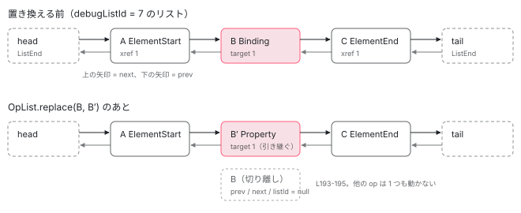

[目次](../README.md) › [テンプレートコンパイラの内側](README.md) › 第 11 回 / 全 18 回

# テンプレートパイプラインの IR：OpList・Xref・SlotHandle・式の木

> template/pipeline/ir の OpList（双方向リスト）と、その上での挿入・置換・削除の操作、CreateOp と UpdateOp の種類（OpKind）、ConsumesSlotOpTrait / ConsumesVarsTrait などの trait、SlotHandle が後のフェーズで番号を受け取る仕組み、ir の式（ReadVariableExpr、LexicalReadExpr、PureFunctionExpr など）と transformExpressionsInOp。フェーズがこの IR をどう書き換えるかの共通の形。

angular/angular · 読了 約 14 分 · 発展 · [サイトで読む（デモが動きます）](https://angular-deep-dive-cyan.vercel.app/chapter/compiler-ir)

---

テンプレートパイプラインは、テンプレートを一度「IR（中間表現。コンパイラの途中段階で使う、出力より抽象的なデータ構造）」に写し、74 個のフェーズがその IR を順に書き換えて、最後に JavaScript の文にします。この章では、その IR の**入れ物**（`OpList` という双方向リスト）と**中身**（op と式）の形を読み、フェーズが IR を書き換えるときの共通の手つき ―― `OpList.replace` で op を差し替える、`transformExpressionsInOp` で式の木を書き換える ―― を 1 つずつ確かめます。

読む対象は `packages/compiler/src/template/pipeline/ir/src/` の `operations.ts`（OpList）・`enums.ts`（OpKind / ExpressionKind）・ `traits.ts`・`handle.ts`・`expression.ts`・`ops/create.ts`・`ops/update.ts`・`ops/shared.ts`、例として `pipeline/src/phases/` の `binding_specialization.ts`・`pipe_variadic.ts` です（IR の持ち主の `compilation.ts` と、IR を消す `reify.ts` は第 10 回・第 16 回で引用）。

1. [1. 全体図](01-compiler.md)
2. [2. コンパイラの入口](02-compiler-entry.md)
3. [3. HTML の字句解析](03-compiler-html-lexer.md)
4. [4. HTML の構文解析](04-compiler-html-parser.md)
5. [5. 式のパーサ](05-compiler-expression-parser.md)
6. [6. バインディングのパーサ](06-compiler-binding-parser.md)
7. [7. R3 AST](07-compiler-r3-ast.md)
8. [8. ブロック構文の解析](08-compiler-control-flow-blocks.md)
9. [9. ディレクティブの照合](09-compiler-binder.md)
10. [10. IR への写像](10-compiler-ingest.md)
11. **11. IR の構造**（この章）
12. [12. decls・vars・advance](12-compiler-slots-vars.md)
13. [13. 変数とコンテキスト](13-compiler-variables.md)
14. [14. 定数配列と pure function](14-compiler-consts-pure.md)
15. [15. 制御フローのフェーズ](15-compiler-control-flow-phases.md)
16. [16. reify と出力](16-compiler-reify-emit.md)
17. [17. 型検査（TCB）](17-compiler-typecheck.md)
18. [18. スタイルのカプセル化](18-compiler-shadow-css.md)

## 1. IR の持ち主：1 つのビューに create と update の 2 本のリスト

R3 AST を IR に写す ingest（[第 10 回](10-compiler-ingest.md)）が作るのは、ビュー（テンプレート 1 枚。`<ng-template>` や `@if` の中身も 1 枚ずつ）ごとの `ViewCompilationUnit` です。このクラスは `create` と `update` という 2 本の `OpList` を持ちます（compilation.ts の `CompilationUnit`。引用は[第 10 回](10-compiler-ingest.md)）。これが IR の本体で、出力のテンプレート関数の `if (rf & 1) { … }`（作成）と `if (rf & 2) { … }`（更新）に、それぞれ 1 本ずつ対応します （実行時に `rf` がどう使われるかは [template 関数の章](../ivy/03-ivy-template-function.md)）。この章は、その `OpList` と、中に入る op・式の形を読みます。

IR の中で「どの要素か」「どのビューか」「どの変数か」を指すときは、オブジェクトの参照ではなく番号を使います。それが `XrefId`（cross-reference ID）で、`CompilationJob.allocateXrefId()` がコンパイル全体で 0 から 1 ずつ増やして配るだけの整数です（第 10 回）。たとえば `[title]="x"` の op は、対象の要素を「`target: 3`」のように XrefId で覚えます。要素の op が後のフェーズで別の op に差し替えられても、XrefId は引き継がれるので参照が切れません。

## 2. op の共通形：prev・next・debugListId

📄 `angular/packages/compiler/src/template/pipeline/ir/src/operations.ts` L11–48 （▶ の行: 15, 23, 27, 34, 41, 47）

```ts
11 │ /**
12 │  * Branded type for a cross-reference ID. During ingest, `XrefId`s are generated to link together
13 │  * different IR operations which need to reference each other.
14 │  */
15 ▶ export type XrefId = number & {__brand: 'XrefId'};
16 │ 
17 │ /**
18 │  * Base interface for semantic operations being performed within a template.
19 │  *
20 │  * @param OpT a specific narrower type of `Op` (for example, creation operations) which this
21 │  *     specific subtype of `Op` can be linked with in a linked list.
22 │  */
23 ▶ export interface Op<OpT extends Op<OpT>> {
24 │   /**
25 │    * All operations have a distinct kind.
26 │    */
27 ▶   kind: OpKind;
28 │ 
29 │   /**
30 │    * The previous operation in the linked list, if any.
31 │    *
32 │    * This is `null` for operation nodes not currently in a list, or for the special head/tail nodes.
33 │    */
34 ▶   prev: OpT | null;
35 │ 
36 │   /**
37 │    * The next operation in the linked list, if any.
38 │    *
39 │    * This is `null` for operation nodes not currently in a list, or for the special head/tail nodes.
40 │    */
41 ▶   next: OpT | null;
42 │ 
43 │   /**
44 │    * Debug id of the list to which this node currently belongs, or `null` if this node is not part
45 │    * of a list.
46 │    */
47 ▶   debugListId: number | null;
48 │ }
```

15 行目、`XrefId` は `number` に印（brand）を付けた型です。ただの数と混ぜると型エラーになります。23 行目の `Op` がすべての op の共通部分で、持つのは 27 行目の `kind`（種類）、34・41 行目の `prev` / `next`（前後の op）、47 行目の `debugListId`（今どのリストに入っているか）の 4 つだけです。op 自身がリストのつなぎ目を持っている、ということです。

📄 `angular/packages/compiler/src/template/pipeline/ir/src/ops/shared.ts` L94–104 （▶ の行: 100–103）

```ts
 94 │ /**
 95 │  * Static structure shared by all operations.
 96 │  *
 97 │  * Used as a convenience via the spread operator (`...NEW_OP`) when creating new operations, and
 98 │  * ensures the fields are always in the same order.
 99 │  */
100 ▶ export const NEW_OP: Pick<Op<any>, 'debugListId' | 'prev' | 'next'> = {
101 ▶   debugListId: null,
102 ▶   prev: null,
103 ▶   next: null,
104 │ };
```

op を作る関数は最後に `...NEW_OP` を混ぜます。100〜104 行目、作りたての op は `debugListId: null`、`prev` / `next` も `null`。「どのリストにも属していない」状態から始まります。

## 3. OpList：番兵つきの双方向リスト

📄 `angular/packages/compiler/src/template/pipeline/ir/src/operations.ts` L50–84 （▶ の行: 56, 61, 63, 66–67, 73–74, 82–83）

```ts
50 │ /**
51 │  * A linked list of `Op` nodes of a given subtype.
52 │  *
53 │  * @param OpT specific subtype of `Op` nodes which this list contains.
54 │  */
55 │ export class OpList<OpT extends Op<OpT>> {
56 ▶   static nextListId = 0;
57 │ 
58 │   /**
59 │    * Debug ID of this `OpList` instance.
60 │    */
61 ▶   readonly debugListId = OpList.nextListId++;
62 │ 
63 ▶   // OpList uses static head/tail nodes of a special `ListEnd` type.
64 │   // This avoids the need for special casing of the first and last list
65 │   // elements in all list operations.
66 ▶   readonly head: OpT = {
67 ▶     kind: OpKind.ListEnd,
68 │     next: null,
69 │     prev: null,
70 │     debugListId: this.debugListId,
71 │   } as OpT;
72 │ 
73 ▶   readonly tail = {
74 ▶     kind: OpKind.ListEnd,
75 │     next: null,
76 │     prev: null,
77 │     debugListId: this.debugListId,
78 │   } as OpT;
79 │ 
80 │   constructor() {
81 │     // Link `head` and `tail` together at the start (list is empty).
82 ▶     this.head.next = this.tail;
83 ▶     this.tail.prev = this.head;
84 │   }
```

1. **56・61 行目：リストごとに番号を振る**

   `OpList.nextListId` は static のカウンタで、リストを作るたびに 1 増えます。この番号が各 op の `debugListId` に書かれ、「この op はどのリストのものか」の判定に使われます。
2. **66〜78 行目：先頭と末尾に「番兵」を置く**

   `head` と `tail` は中身の無い op で、`kind` は `OpKind.ListEnd`。63〜65 行目のコメントのとおり、端にいつも番兵がいるので、「先頭の op を消す」「末尾に足す」で特別扱いが要りません。どの op にも必ず `prev` と `next` があるからです。
3. **82・83 行目：空のリストは head ⇄ tail**

   コンストラクタで `head.next = tail`、`tail.prev = head` とつなぎます。中身が 0 個の状態です。

📄 `angular/packages/compiler/src/template/pipeline/ir/src/operations.ts` L86–112 （▶ の行: 97–98, 100, 103, 106–107, 110–111）

```ts
 86 │   /**
 87 │    * Push a new operation to the tail of the list.
 88 │    */
 89 │   push(op: OpT | Array<OpT>): void {
 90 │     if (Array.isArray(op)) {
 91 │       for (const o of op) {
 92 │         this.push(o);
 93 │       }
 94 │       return;
 95 │     }
 96 │ 
 97 ▶     OpList.assertIsNotEnd(op);
 98 ▶     OpList.assertIsUnowned(op);
 99 │ 
100 ▶     op.debugListId = this.debugListId;
101 │ 
102 │     // The old "previous" node (which might be the head, if the list is empty).
103 ▶     const oldLast = this.tail.prev!;
104 │ 
105 │     // Insert `op` following the old last node.
106 ▶     op.prev = oldLast;
107 ▶     oldLast.next = op;
108 │ 
109 │     // Connect `op` with the list tail.
110 ▶     op.next = this.tail;
111 ▶     this.tail.prev = op;
112 │   }
```

末尾への追加です。97・98 行目で「番兵でないこと」「まだどのリストにも入っていないこと」を確かめ、100 行目で自分のリスト番号を書き込みます。103 行目の `tail.prev`（今の最後の op。空なら `head`）と `tail` の間に、106〜111 行目の 4 本の付け替えで差し込みます。配列の `push` と違い、要素を動かすことはありません。

📄 `angular/packages/compiler/src/template/pipeline/ir/src/operations.ts` L143–172 （▶ の行: 146–147, 150–151, 155, 157–158, 163）

```ts
143 │   /**
144 │    * `OpList` is iterable via the iteration protocol.
145 │    *
146 ▶    * It's safe to mutate the part of the list that has already been returned by the iterator, up to
147 ▶    * and including the last operation returned. Mutations beyond that point _may_ be safe, but may
148 │    * also corrupt the iteration position and should be avoided.
149 │    */
150 ▶   *[Symbol.iterator](): Generator<OpT> {
151 ▶     let current = this.head.next!;
152 │     while (current !== this.tail) {
153 │       // Guards against corruption of the iterator state by mutations to the tail of the list during
154 │       // iteration.
155 ▶       OpList.assertIsOwned(current, this.debugListId);
156 │ 
157 ▶       const next = current.next!;
158 ▶       yield current;
159 │       current = next;
160 │     }
161 │   }
162 │ 
163 ▶   *reversed(): Generator<OpT> {
164 │     let current = this.tail.prev!;
165 │     while (current !== this.head) {
166 │       OpList.assertIsOwned(current, this.debugListId);
167 │ 
168 │       const prev = current.prev!;
169 │       yield current;
170 │       current = prev;
171 │     }
172 │   }
```

`for (const op of unit.create)` と書けるのは、150 行目でリストが iterable（`for...of` で回せる）になっているからです。157 行目で**次の op を先に覚えてから** 158 行目で今の op を返します。そのため、受け取った op をループの中で差し替えたり消したりしても、ループは覚えておいた次へ進めます。146〜148 行目のコメントが「返された所までは書き換えてよい」と言っているのはこのことです。155 行目は、途中で別のリストに移された op に出会ったら例外にする見張りです。163 行目の `reversed()` は後ろから回す版で、使われない変数を消すフェーズ（[第 13 回](13-compiler-variables.md)）が使います。

### 置き換え・削除・前に挿入

📄 `angular/packages/compiler/src/template/pipeline/ir/src/operations.ts` L174–196 （▶ の行: 177, 181–182, 184, 186–187, 190–191, 193–195）

```ts
174 │   /**
175 │    * Replace `oldOp` with `newOp` in the list.
176 │    */
177 ▶   static replace<OpT extends Op<OpT>>(oldOp: OpT, newOp: OpT): void {
178 │     OpList.assertIsNotEnd(oldOp);
179 │     OpList.assertIsNotEnd(newOp);
180 │ 
181 ▶     OpList.assertIsOwned(oldOp);
182 ▶     OpList.assertIsUnowned(newOp);
183 │ 
184 ▶     newOp.debugListId = oldOp.debugListId;
185 │     if (oldOp.prev !== null) {
186 ▶       oldOp.prev.next = newOp;
187 ▶       newOp.prev = oldOp.prev;
188 │     }
189 │     if (oldOp.next !== null) {
190 ▶       oldOp.next.prev = newOp;
191 ▶       newOp.next = oldOp.next;
192 │     }
193 ▶     oldOp.debugListId = null;
194 ▶     oldOp.prev = null;
195 ▶     oldOp.next = null;
196 │   }
```

フェーズが一番よく使う操作です。177 行目、`replace` は**static メソッド**で、リストを引数に取りません。op が自分の `prev` / `next` を持っているので、op だけ渡せば前後が分かるからです。181・182 行目で「古い op はリストの中にある」「新しい op はどこにも無い」を確かめ、184 行目で新しい op にリスト番号を移し、186〜191 行目で前後のつなぎを新しい op に付け替えます。193〜195 行目、古い op は 3 つのフィールドを `null` にしてリストから切り離されます。

📄 `angular/packages/compiler/src/template/pipeline/ir/src/operations.ts` L256–303 （▶ の行: 259, 263–264, 268, 276, 285, 298–299, 301–302）

```ts
256 │   /**
257 │    * Remove the given node from the list which contains it.
258 │    */
259 ▶   static remove<OpT extends Op<OpT>>(op: OpT): void {
260 │     OpList.assertIsNotEnd(op);
261 │     OpList.assertIsOwned(op);
262 │ 
263 ▶     op.prev!.next = op.next;
264 ▶     op.next!.prev = op.prev;
265 │ 
266 │     // Break any link between the node and this list to safeguard against its usage in future
267 │     // operations.
268 ▶     op.debugListId = null;
269 │     op.prev = null;
270 │     op.next = null;
271 │   }
272 │ 
273 │   /**
274 │    * Insert `op` before `target`.
275 │    */
276 ▶   static insertBefore<OpT extends Op<OpT>>(op: OpT | OpT[], target: OpT): void {
277 │     if (Array.isArray(op)) {
278 │       for (const o of op) {
279 │         OpList.insertBefore(o, target);
280 │       }
281 │       return;
282 │     }
283 │ 
284 │     OpList.assertIsOwned(target);
285 ▶     if (target.prev === null) {
286 │       throw new Error(`AssertionError: illegal operation on list start`);
287 │     }
288 │ 
289 │     OpList.assertIsNotEnd(op);
290 │ 
291 │     OpList.assertIsUnowned(op);
292 │ 
293 │     op.debugListId = target.debugListId;
294 │ 
295 │     // Just in case.
296 │     op.prev = null;
297 │ 
298 ▶     target.prev!.next = op;
299 ▶     op.prev = target.prev;
300 │ 
301 ▶     op.next = target;
302 ▶     target.prev = op;
303 │   }
```

`remove`（259 行目）は 263・264 行目で前後を直接つなぎ、268〜270 行目で切り離すだけです。`insertBefore`（276 行目）は 298〜302 行目で `target` の手前に差し込みます。285 行目、`target.prev` が `null` の op（＝番兵の `head`）の前には入れられません。この `insertBefore` は、更新命令の手前に `advance()` を差し込むフェーズ（[第 12 回](12-compiler-slots-vars.md)）が使います。



*OpList は番兵 head / tail の間に op を prev / next でつないだもの。replace(B, B′) は B の前後のつなぎを B′ に付け替え、B を切り離す（operations.ts L177-196）。*

📄 `angular/packages/compiler/src/template/pipeline/ir/src/operations.ts` L327–357 （▶ の行: 331–332, 341, 343, 354）

```ts
327 │   /**
328 │    * Asserts that `op` does not currently belong to a list.
329 │    */
330 │   static assertIsUnowned<OpT extends Op<OpT>>(op: OpT): void {
331 ▶     if (op.debugListId !== null) {
332 ▶       throw new Error(`AssertionError: illegal operation on owned node: ${OpKind[op.kind]}`);
333 │     }
334 │   }
335 │ 
336 │   /**
337 │    * Asserts that `op` currently belongs to a list. If `byList` is passed, `op` is asserted to
338 │    * specifically belong to that list.
339 │    */
340 │   static assertIsOwned<OpT extends Op<OpT>>(op: OpT, byList?: number): void {
341 ▶     if (op.debugListId === null) {
342 │       throw new Error(`AssertionError: illegal operation on unowned node: ${OpKind[op.kind]}`);
343 ▶     } else if (byList !== undefined && op.debugListId !== byList) {
344 │       throw new Error(
345 │         `AssertionError: node belongs to the wrong list (expected ${byList}, actual ${op.debugListId})`,
346 │       );
347 │     }
348 │   }
349 │ 
350 │   /**
351 │    * Asserts that `op` is not a special `ListEnd` node.
352 │    */
353 │   static assertIsNotEnd<OpT extends Op<OpT>>(op: OpT): void {
354 ▶     if (op.kind === OpKind.ListEnd) {
355 │       throw new Error(`AssertionError: illegal operation on list head or tail`);
356 │     }
357 │   }
```

ここまで何度も出てきた見張りの中身です。331 行目、「どこにも属していないはず」の op に `debugListId` が入っていたら例外。341〜343 行目、「属しているはず」の op が `null`、または別のリストの番号を持っていたら例外。354 行目、番兵を操作しようとしたら例外。**同じ op を 2 つのリストに入れる・切り離した op を使い回す**というフェーズの書き間違いを、その場で止めるための仕掛けです。

## 4. op の種類：OpKind と、CreateOp / UpdateOp

📄 `angular/packages/compiler/src/template/pipeline/ir/src/enums.ts` L9–39 （▶ の行: 14, 19, 24, 29, 34, 39）

```ts
 9 │ /**
10 │  * Distinguishes different kinds of IR operations.
11 │  *
12 │  * Includes both creation and update operations.
13 │  */
14 ▶ export enum OpKind {
15 │   /**
16 │    * A special operation type which is used to represent the beginning and end nodes of a linked
17 │    * list of operations.
18 │    */
19 ▶   ListEnd,
20 │ 
21 │   /**
22 │    * An operation which wraps an output AST statement.
23 │    */
24 ▶   Statement,
25 │ 
26 │   /**
27 │    * An operation which declares and initializes a `SemanticVariable`.
28 │    */
29 ▶   Variable,
30 │ 
31 │   /**
32 │    * An operation to begin rendering of an element.
33 │    */
34 ▶   ElementStart,
35 │ 
36 │   /**
37 │    * An operation to render an element with no children.
38 │    */
39 ▶   Element,
```

14 行目の `OpKind` は、作成側と更新側の op をまとめた 1 つの enum です。v22.2.0-next.7 では 19 行目の `ListEnd`（番兵）から `ControlCreate` まで 65 種類あります。24 行目の `Statement` は「もう出力 AST の文になった op」で、最後の reify フェーズが他の op を全部これに置き換えます（9 節）。29 行目の `Variable` は「変数を宣言する op」で、[第 13 回](13-compiler-variables.md)の主役です。

| グループ | OpKind の例 | どちらのリストに入るか |
| --- | --- | --- |
| リストと文 | `ListEnd``Statement``Variable` | 両方 |
| ノードを作る | `ElementStart``Element``ElementEnd``Template``Text``Container*``Projection``Pipe``DeclareLet` | create |
| イベント | `Listener``TwoWayListener``AnimationListener` | create（中に handlerOps を持つ） |
| まだ種類の決まっていない束縛 | `Binding` | update（8 節のフェーズが下のどれかに置き換える） |
| 種類の決まった束縛 | `Property``DomProperty``Attribute``StyleProp``ClassProp``StyleMap``ClassMap``InterpolateText` | update |
| 実行時のカーソル | `Advance` | update |
| 途中だけの op | `ExtractedAttribute``I18nContext` など | create（後のフェーズが情報を取り出して消す。ExtractedAttribute なら consts へ） |

📄 `angular/packages/compiler/src/template/pipeline/ir/src/ops/create.ts` L39–60 （▶ の行: 42–44, 46, 59）

```ts
39 │ /**
40 │  * An operation usable on the creation side of the IR.
41 │  */
42 ▶ export type CreateOp =
43 ▶   | ListEndOp<CreateOp>
44 ▶   | StatementOp<CreateOp>
45 │   | ElementOp
46 ▶   | ElementStartOp
47 │   | ElementEndOp
48 │   | ForeignComponentOp
49 │   | ContainerOp
50 │   | ContainerStartOp
51 │   | ContainerEndOp
52 │   | TemplateOp
53 │   | EnableBindingsOp
54 │   | DisableBindingsOp
55 │   | TextOp
56 │   | ListenerOp
57 │   | TwoWayListenerOp
58 │   | PipeOp
59 ▶   | VariableOp<CreateOp>
60 │   | NamespaceOp
```

「作成側に入れてよい op」は 42 行目の `CreateOp` という union 型（どれか 1 つの型）で決まっています。43・44・59 行目、`ListEndOp<CreateOp>`・`StatementOp<CreateOp>`・`VariableOp<CreateOp>` のように両方のリストに入る op は型引数で区別され、`OpList<CreateOp>` に更新側の op を入れると TypeScript の型エラーになります（2 節の `Op<OpT>` の型引数がこれです）。

### 代表 3 つ：ElementStartOp・PropertyOp・AdvanceOp

📄 `angular/packages/compiler/src/template/pipeline/ir/src/ops/create.ts` L220–246 （▶ の行: 232–233, 235–237, 243–244）

```ts
220 │ /**
221 │  * Create an `ElementStartOp`.
222 │  */
223 │ export function createElementStartOp(
224 │   tag: string,
225 │   xref: XrefId,
226 │   namespace: Namespace,
227 │   i18nPlaceholder: i18n.TagPlaceholder | undefined,
228 │   startSourceSpan: ParseSourceSpan,
229 │   wholeSourceSpan: ParseSourceSpan,
230 │ ): ElementStartOp {
231 │   return {
232 ▶     kind: OpKind.ElementStart,
233 ▶     xref,
234 │     tag,
235 ▶     handle: new SlotHandle(),
236 ▶     attributes: null,
237 ▶     localRefs: [],
238 │     nonBindable: false,
239 │     namespace,
240 │     i18nPlaceholder,
241 │     startSourceSpan,
242 │     wholeSourceSpan,
243 ▶     ...TRAIT_CONSUMES_SLOT,
244 ▶     ...NEW_OP,
245 │   };
246 │ }
```

要素の開始タグの op です。233 行目の `xref` がこの要素の番号。235 行目、`handle: new SlotHandle()` は「この要素の slot 番号を**後で**入れる箱」です（5 節）。236・237 行目、属性は最初 `null`、`#ref` は配列で、どちらも後のフェーズが consts 配列の番号に書き換えます（[第 14 回](14-compiler-consts-pure.md)）。243 行目の `...TRAIT_CONSUMES_SLOT` が「slot を使う op である」という印を付けます。

📄 `angular/packages/compiler/src/template/pipeline/ir/src/ops/update.ts` L258–290 （▶ の行: 274–275, 277, 280, 286–288）

```ts
258 │ /**
259 │  * Create a `PropertyOp`.
260 │  */
261 │ export function createPropertyOp(
262 │   target: XrefId,
263 │   name: string,
264 │   expression: o.Expression | Interpolation,
265 │   bindingKind: BindingKind,
266 │   securityContext: SecurityContext | SecurityContext[],
267 │   isStructuralTemplateAttribute: boolean,
268 │   templateKind: TemplateKind | null,
269 │   i18nContext: XrefId | null,
270 │   i18nMessage: i18n.Message | null,
271 │   sourceSpan: ParseSourceSpan,
272 │ ): PropertyOp {
273 │   return {
274 ▶     kind: OpKind.Property,
275 ▶     target,
276 │     name,
277 ▶     expression,
278 │     bindingKind,
279 │     securityContext,
280 ▶     sanitizer: null,
281 │     isStructuralTemplateAttribute,
282 │     templateKind,
283 │     i18nContext,
284 │     i18nMessage,
285 │     sourceSpan,
286 ▶     ...TRAIT_DEPENDS_ON_SLOT_CONTEXT,
287 ▶     ...TRAIT_CONSUMES_VARS,
288 ▶     ...NEW_OP,
289 │   };
290 │ }
```

`[title]="x"` の op です。275 行目の `target` は対象要素の XrefId で、要素の op そのものは持ちません。277 行目の `expression` が束縛の式（6 節の式の木）。280 行目、サニタイザ（危険な値を無害化する関数）は最初 `null` で、後のフェーズが入れます。286・287 行目の 2 つの印が「実行時のカーソルがこの要素を指している必要がある」「binding 用の変数 slot を使う」を表します。

📄 `angular/packages/compiler/src/template/pipeline/ir/src/ops/update.ts` L633–658 （▶ の行: 636, 642, 651）

```ts
633 │ /**
634 │  * Logical operation to advance the runtime's internal slot pointer in the update IR.
635 │  */
636 ▶ export interface AdvanceOp extends Op<UpdateOp> {
637 │   kind: OpKind.Advance;
638 │ 
639 │   /**
640 │    * Delta by which to advance the pointer.
641 │    */
642 ▶   delta: number;
643 │ 
644 │   // Source span of the binding that caused the advance
645 │   sourceSpan: ParseSourceSpan;
646 │ }
647 │ 
648 │ /**
649 │  * Create an `AdvanceOp`.
650 │  */
651 ▶ export function createAdvanceOp(delta: number, sourceSpan: ParseSourceSpan): AdvanceOp {
652 │   return {
653 │     kind: OpKind.Advance,
654 │     delta,
655 │     sourceSpan,
656 │     ...NEW_OP,
657 │   };
658 │ }
```

`ɵɵadvance(n)` になる op です。642 行目の `delta` だけを持ちます。ingest はこの op を作りません。全部のフェーズの後半で、slot 番号が決まってから差し込まれます（[第 12 回](12-compiler-slots-vars.md)）。

## 5. trait と SlotHandle：「後で決まる値」を IR に持たせる

📄 `angular/packages/compiler/src/template/pipeline/ir/src/traits.ts` L15–45 （▶ の行: 18, 23, 28, 38–39, 45）

```ts
15 │ /**
16 │  * Marker symbol for `ConsumesSlotOpTrait`.
17 │  */
18 ▶ export const ConsumesSlot: unique symbol = Symbol('ConsumesSlot');
19 │ 
20 │ /**
21 │  * Marker symbol for `DependsOnSlotContextOpTrait`.
22 │  */
23 ▶ export const DependsOnSlotContext: unique symbol = Symbol('DependsOnSlotContext');
24 │ 
25 │ /**
26 │  * Marker symbol for `ConsumesVars` trait.
27 │  */
28 ▶ export const ConsumesVarsTrait: unique symbol = Symbol('ConsumesVars');
29 │ 
30 │ /**
31 │  * Marker symbol for `UsesVarOffset` trait.
32 │  */
33 │ export const UsesVarOffset: unique symbol = Symbol('UsesVarOffset');
34 │ 
35 │ /**
36 │  * Marks an operation as requiring allocation of one or more data slots for storage.
37 │  */
38 ▶ export interface ConsumesSlotOpTrait {
39 ▶   readonly [ConsumesSlot]: true;
40 │ 
41 │   /**
42 │    * Assigned data slot (the starting index, if more than one slot is needed) for this operation, or
43 │    * `null` if slots have not yet been assigned.
44 │    */
45 ▶   handle: SlotHandle;
```

📄 `angular/packages/compiler/src/template/pipeline/ir/src/traits.ts` L62–97 （▶ の行: 70, 77, 85–86, 93, 96）

```ts
62 │ /**
63 │  * Marks an operation as depending on the runtime's implicit slot context being set to a particular
64 │  * slot.
65 │  *
66 │  * The runtime has an implicit slot context which is adjusted using the `advance()` instruction
67 │  * during the execution of template update functions. This trait marks an operation as requiring
68 │  * this implicit context to be `advance()`'d to point at a particular slot prior to execution.
69 │  */
70 ▶ export interface DependsOnSlotContextOpTrait {
71 │   readonly [DependsOnSlotContext]: true;
72 │ 
73 │   /**
74 │    * `XrefId` of the `ConsumesSlotOpTrait` which the implicit slot context must reference before
75 │    * this operation can be executed.
76 │    */
77 ▶   target: XrefId;
78 │ 
79 │   sourceSpan: ParseSourceSpan;
80 │ }
81 │ 
82 │ /**
83 │  * Marker trait indicating that an operation or expression consumes variable storage space.
84 │  */
85 ▶ export interface ConsumesVarsTrait {
86 ▶   [ConsumesVarsTrait]: true;
87 │ }
88 │ 
89 │ /**
90 │  * Marker trait indicating that an expression requires knowledge of the number of variable storage
91 │  * slots used prior to it.
92 │  */
93 ▶ export interface UsesVarOffsetTrait {
94 │   [UsesVarOffset]: true;
95 │ 
96 ▶   varOffset: number | null;
97 │ }
```

trait（性質の印）は、op の種類をまたいで「この op はこういう性質を持つ」を表すものです。中身は 18・23・28 行目で作った `Symbol` をキーにした `true` です。種類ごとに `switch` を書く代わりに、フェーズは「印があるか」だけを見ます。

| trait | 持つフィールド | 意味 | 使うフェーズ |
| --- | --- | --- | --- |
| `ConsumesSlotOpTrait`（38 行目） | `handle`, `numSlotsUsed`, `xref` | LView の slot を使う（要素・テキスト・テンプレート・pipe など） | slot\_allocation |
| `DependsOnSlotContextOpTrait`（70 行目） | `target` | 実行前に `advance()` でカーソルを `target` の slot に合わせる必要がある | generate\_advance |
| `ConsumesVarsTrait`（85 行目） | なし | binding 用の変数 slot を使う | var\_counting |
| `UsesVarOffsetTrait`（93 行目） | `varOffset` | 自分より前に使われた変数 slot の数を知る必要がある（pure function・pipe） | var\_counting |

📄 `angular/packages/compiler/src/template/pipeline/ir/src/traits.ts` L99–134 （▶ の行: 103, 105, 130, 133）

```ts
 99 │ /**
100 │  * Default values for most `ConsumesSlotOpTrait` fields (used with the spread operator to initialize
101 │  * implementors of the trait).
102 │  */
103 ▶ export const TRAIT_CONSUMES_SLOT: Omit<ConsumesSlotOpTrait, 'xref' | 'handle'> = {
104 │   [ConsumesSlot]: true,
105 ▶   numSlotsUsed: 1,
106 │ } as const;
107 │ 
108 │ /**
109 │  * Default values for most `DependsOnSlotContextOpTrait` fields (used with the spread operator to
110 │  * initialize implementors of the trait).
111 │  */
112 │ export const TRAIT_DEPENDS_ON_SLOT_CONTEXT: Omit<
113 │   DependsOnSlotContextOpTrait,
114 │   'target' | 'sourceSpan'
115 │ > = {
116 │   [DependsOnSlotContext]: true,
117 │ } as const;
118 │ 
119 │ /**
120 │  * Default values for `UsesVars` fields (used with the spread operator to initialize
121 │  * implementors of the trait).
122 │  */
123 │ export const TRAIT_CONSUMES_VARS: ConsumesVarsTrait = {
124 │   [ConsumesVarsTrait]: true,
125 │ } as const;
126 │ 
127 │ /**
128 │  * Test whether an operation implements `ConsumesSlotOpTrait`.
129 │  */
130 ▶ export function hasConsumesSlotTrait<OpT extends Op<OpT>>(
131 │   op: OpT,
132 │ ): op is OpT & ConsumesSlotOpTrait {
133 ▶   return (op as Partial<ConsumesSlotOpTrait>)[ConsumesSlot] === true;
134 │ }
```

103〜106 行目、`TRAIT_CONSUMES_SLOT` は `numSlotsUsed: 1` を既定にします。`#ref` を持つ要素は後でこの数が増えます（第 12 回）。130〜134 行目の `hasConsumesSlotTrait` は、Symbol のキーが `true` かを見るだけの型ガードです。

📄 `angular/packages/compiler/src/template/pipeline/ir/src/handle.ts` L1–11 （▶ の行: 9–10）

```ts
 1 │ /**
 2 │  * @license
 3 │  * Copyright Google LLC All Rights Reserved.
 4 │  *
 5 │  * Use of this source code is governed by an MIT-style license that can be
 6 │  * found in the LICENSE file at https://angular.dev/license
 7 │  */
 8 │ 
 9 ▶ export class SlotHandle {
10 ▶   slot: number | null = null;
11 │ }
```

`SlotHandle` は 10 行目、`slot: number | null = null` を 1 つ持つだけのクラスです。ingest の時点では slot 番号はまだ分かりません。slot を使う op は後のフェーズで増えたり（pipe の op が足される）、1 つの op が使う slot の数が増えたり（`#ref` の分）するので、番号を振れるのは op が出そろった後だからです（[第 12 回](12-compiler-slots-vars.md)）。そこで、**同じ `SlotHandle` オブジェクトを、slot を使う op と、その slot を参照する式の両方に持たせて**おきます。

📄 `angular/packages/compiler/src/template/pipeline/ir/src/expression.ts` L124–153 （▶ の行: 131–133, 151）

```ts
124 │ /**
125 │  * Runtime operation to retrieve the value of a local reference.
126 │  */
127 │ export class ReferenceExpr extends ExpressionBase {
128 │   override readonly kind = ExpressionKind.Reference;
129 │ 
130 │   constructor(
131 ▶     readonly target: XrefId,
132 ▶     readonly targetSlot: SlotHandle,
133 ▶     readonly offset: number,
134 │   ) {
135 │     super();
136 │   }
137 │ 
138 │   override visitExpression(): void {}
139 │ 
140 │   override isEquivalent(e: o.Expression): boolean {
141 │     return e instanceof ReferenceExpr && e.target === this.target;
142 │   }
143 │ 
144 │   override isConstant(): boolean {
145 │     return false;
146 │   }
147 │ 
148 │   override transformInternalExpressions(): void {}
149 │ 
150 │   override clone(): ReferenceExpr {
151 ▶     return new ReferenceExpr(this.target, this.targetSlot, this.offset);
152 │   }
153 │ }
```

`#user` を読む式 `ReferenceExpr` です。131 行目で要素の XrefId を、132 行目で**要素の op と同じ**`SlotHandle` を持ちます。151 行目、複製（`clone`）しても handle は新しく作らず同じものを渡します。slot を振るフェーズが要素の op の `handle.slot` に番号を書けば、この式からも同じ番号が見えます。実際にその番号を読むのは最後の reify です（9 節）。

## 6. 式の木：出力 AST に IR だけの式を混ぜる

op の中の式（`PropertyOp.expression` など）は、最終的な JavaScript を表す出力 AST（`output/output_ast.ts` の `o.Expression`）で書かれています。ただし途中では、出力 AST にはまだできない「意味だけの式」が要ります。それが IR の式です。

📄 `angular/packages/compiler/src/template/pipeline/ir/src/expression.ts` L60–92 （▶ の行: 65, 70–71, 77–78, 88）

```ts
60 │ 
61 │ /**
62 │  * Transformer type which converts expressions into general `o.Expression`s (which may be an
63 │  * identity transformation).
64 │  */
65 ▶ export type ExpressionTransform = (expr: o.Expression, flags: VisitorContextFlag) => o.Expression;
66 │ 
67 │ /**
68 │  * Check whether a given `o.Expression` is a logical IR expression type.
69 │  */
70 ▶ export function isIrExpression(expr: o.Expression): expr is Expression {
71 ▶   return expr instanceof ExpressionBase;
72 │ }
73 │ 
74 │ /**
75 │  * Base type used for all logical IR expressions.
76 │  */
77 ▶ abstract class ExpressionBase extends o.Expression {
78 ▶   abstract readonly kind: ExpressionKind;
79 │ 
80 │   constructor(sourceSpan: ParseSourceSpan | null = null) {
81 │     super(null, sourceSpan);
82 │   }
83 │ 
84 │   /**
85 │    * Run the transformer against any nested expressions which may be present in this IR expression
86 │    * subtype.
87 │    */
88 ▶   abstract transformInternalExpressions(
89 │     transform: ExpressionTransform,
90 │     flags: VisitorContextFlag,
91 │   ): void;
92 │ }
```

77 行目、IR の式の基底クラス `ExpressionBase` は `o.Expression` を継承しています。だから出力 AST の木の中に、そのまま部品として入れられます。70・71 行目、IR の式かどうかは `instanceof ExpressionBase` で見分けます。88 行目の `transformInternalExpressions` は「自分の子の式に変換を適用せよ」という抽象メソッドで、7 節で使われます。

📄 `angular/packages/compiler/src/template/pipeline/ir/src/enums.ts` L349–381 （▶ の行: 352, 356, 361, 371, 376, 381）

```ts
349 │ /**
350 │  * Distinguishes different kinds of IR expressions.
351 │  */
352 ▶ export enum ExpressionKind {
353 │   /**
354 │    * Read of a variable in a lexical scope.
355 │    */
356 ▶   LexicalRead,
357 │ 
358 │   /**
359 │    * A reference to the current view context.
360 │    */
361 ▶   Context,
362 │ 
363 │   /**
364 │    * A reference to the view context, for use inside a track function.
365 │    */
366 │   TrackContext,
367 │ 
368 │   /**
369 │    * Read of a variable declared in a `VariableOp`.
370 │    */
371 ▶   ReadVariable,
372 │ 
373 │   /**
374 │    * Runtime operation to navigate to the next view context in the view hierarchy.
375 │    */
376 ▶   NextContext,
377 │ 
378 │   /**
379 │    * Runtime operation to retrieve the value of a local reference.
380 │    */
381 ▶   Reference,
```

種類は 352 行目の `ExpressionKind` で、v22.2.0-next.7 では 29 種類です。この章では、変数の解決に関わる 3 つと、pure function を見ます。

📄 `angular/packages/compiler/src/template/pipeline/ir/src/expression.ts` L94–122 （▶ の行: 97, 100, 113–114）

```ts
 94 │ /**
 95 │  * Logical expression representing a lexical read of a variable name.
 96 │  */
 97 ▶ export class LexicalReadExpr extends ExpressionBase {
 98 │   override readonly kind = ExpressionKind.LexicalRead;
 99 │ 
100 ▶   constructor(readonly name: string) {
101 │     super();
102 │   }
103 │ 
104 │   override visitExpression(visitor: o.ExpressionVisitor, context: any): void {}
105 │ 
106 │   override isEquivalent(other: LexicalReadExpr): boolean {
107 │     // We assume that the lexical reads are in the same context, which must be true for parent
108 │     // expressions to be equivalent.
109 │     // TODO: is this generally safe?
110 │     return this.name === other.name;
111 │   }
112 │ 
113 ▶   override isConstant(): boolean {
114 ▶     return false;
115 │   }
116 │ 
117 │   override transformInternalExpressions(): void {}
118 │ 
119 │   override clone(): LexicalReadExpr {
120 │     return new LexicalReadExpr(this.name);
121 │   }
122 │ }
```

テンプレートに `name` と書くと、式のパーサは「暗黙のレシーバ（`ImplicitReceiver`）の `name` を読む」という AST を作ります（[第 5 回](05-compiler-expression-parser.md)）。ingest の `convertAst` は、レシーバが `ImplicitReceiver` の `PropertyRead` を `LexicalReadExpr(name)` に変えます（[第 10 回](10-compiler-ingest.md)で引用）。「`name` という名前を読む」とだけ書いた式で、それがコンポーネントのプロパティなのか、`let-name` のテンプレート変数なのか、`#name` なのかは**まだ決めません**。決めるのはフェーズ `resolveNames` で、[第 13 回](13-compiler-variables.md)で読みます。

📄 `angular/packages/compiler/src/template/pipeline/ir/src/expression.ts` L516–543 （▶ の行: 519, 521–522, 529）

```ts
516 │ /**
517 │  * Read of a variable declared as an `ir.VariableOp` and referenced through its `ir.XrefId`.
518 │  */
519 ▶ export class ReadVariableExpr extends ExpressionBase {
520 │   override readonly kind = ExpressionKind.ReadVariable;
521 ▶   name: string | null = null;
522 ▶   constructor(readonly xref: XrefId) {
523 │     super();
524 │   }
525 │ 
526 │   override visitExpression(): void {}
527 │ 
528 │   override isEquivalent(other: o.Expression): boolean {
529 ▶     return other instanceof ReadVariableExpr && other.xref === this.xref;
530 │   }
531 │ 
532 │   override isConstant(): boolean {
533 │     return false;
534 │   }
535 │ 
536 │   override transformInternalExpressions(): void {}
537 │ 
538 │   override clone(): ReadVariableExpr {
539 │     const expr = new ReadVariableExpr(this.xref);
540 │     expr.name = this.name;
541 │     return expr;
542 │   }
543 │ }
```

名前が決まった後の形が `ReadVariableExpr` です。522 行目、読む対象を `VariableOp` の XrefId で持ちます。521 行目の `name` は最初 `null` で、`ctx_r1` のような名前は全フェーズの終わり近くで付きます。529 行目、2 つの読みが同じかどうかは XrefId の一致で判定します。名前が決まる前でも比べられるわけです。

📄 `angular/packages/compiler/src/template/pipeline/ir/src/expression.ts` L545–579 （▶ の行: 550–551, 553, 561, 567, 573）

```ts
545 │ export class PureFunctionExpr
546 │   extends ExpressionBase
547 │   implements ConsumesVarsTrait, UsesVarOffsetTrait
548 │ {
549 │   override readonly kind = ExpressionKind.PureFunctionExpr;
550 ▶   readonly [ConsumesVarsTrait] = true;
551 ▶   readonly [UsesVarOffset] = true;
552 │ 
553 ▶   varOffset: number | null = null;
554 │ 
555 │   /**
556 │    * The expression which should be memoized as a pure computation.
557 │    *
558 │    * This expression contains internal `PureFunctionParameterExpr`s, which are placeholders for the
559 │    * positional argument expressions in `args.
560 │    */
561 ▶   body: o.Expression | null;
562 │ 
563 │   /**
564 │    * Positional arguments to the pure function which will memoize the `body` expression, which act
565 │    * as memoization keys.
566 │    */
567 ▶   args: o.Expression[];
568 │ 
569 │   /**
570 │    * Once extracted to the `ConstantPool`, a reference to the function which defines the computation
571 │    * of `body`.
572 │    */
573 ▶   fn: o.Expression | null = null;
574 │ 
575 │   constructor(expression: o.Expression | null, args: o.Expression[]) {
576 │     super();
577 │     this.body = expression;
578 │     this.args = args;
579 │   }
```

`[x]="[a, b]"` のような配列リテラルを「引数が変わらなければ前回の配列を返す関数」に変えたものです（[第 14 回](14-compiler-consts-pure.md)）。550・551 行目、式なのに trait を持てます。trait は op だけのものではありません。561 行目の `body`（関数本体。`[a0, a1]` の形）、567 行目の `args`（`a` と `b`）、573 行目の `fn`（body を定数プールに出したあとの関数への参照）、553 行目の `varOffset`（第 12 回で決まる番号）が、フェーズの進行に合わせて順に埋まります。

## 7. フェーズはどうやって式の中を書き換えるか

📄 `angular/packages/compiler/src/template/pipeline/ir/src/expression.ts` L1212–1247 （▶ の行: 1218, 1220, 1223, 1231–1232, 1234, 1243, 1245–1246）

```ts
1212 │ /**
1213 │  * Transform all `Expression`s in the AST of `op` with the `transform` function.
1214 │  *
1215 │  * All such operations will be replaced with the result of applying `transform`, which may be an
1216 │  * identity transformation.
1217 │  */
1218 ▶ export function transformExpressionsInOp(
1219 │   op: CreateOp | UpdateOp,
1220 ▶   transform: ExpressionTransform,
1221 │   flags: VisitorContextFlag,
1222 │ ): void {
1223 ▶   switch (op.kind) {
1224 │     case OpKind.StyleProp:
1225 │     case OpKind.StyleMap:
1226 │     case OpKind.ClassProp:
1227 │     case OpKind.ClassMap:
1228 │     case OpKind.AnimationString:
1229 │     case OpKind.AnimationBinding:
1230 │     case OpKind.Binding:
1231 ▶       if (op.expression instanceof Interpolation) {
1232 ▶         transformExpressionsInInterpolation(op.expression, transform, flags);
1233 │       } else {
1234 ▶         op.expression = transformExpressionsInExpression(op.expression, transform, flags);
1235 │       }
1236 │       break;
1237 │     case OpKind.Property:
1238 │     case OpKind.DomProperty:
1239 │     case OpKind.Attribute:
1240 │       if (op.expression instanceof Interpolation) {
1241 │         transformExpressionsInInterpolation(op.expression, transform, flags);
1242 │       } else {
1243 ▶         op.expression = transformExpressionsInExpression(op.expression, transform, flags);
1244 │       }
1245 ▶       op.sanitizer =
1246 ▶         op.sanitizer && transformExpressionsInExpression(op.sanitizer, transform, flags);
1247 │       break;
```

1. **1218 行目：op 1 つと、変換関数 1 つを受け取る**

   `transform` は「式を 1 つ受け取って、置き換えたい式を返す」関数です（型は 65 行目の `ExpressionTransform`）。置き換えないなら受け取った式をそのまま返します。
2. **1223 行目：op の種類ごとに「式が入っているフィールド」を知っている**

   IR の op はただのオブジェクトなので、どのフィールドに式があるかは op ごとに違います。この関数が 1 か所にその知識を集めています。1231〜1235 行目、補間（`Interpolation`）なら中の式を 1 つずつ、そうでなければ 1234 行目で `op.expression` を変換した結果で**上書き**します。1245・1246 行目、Property ならサニタイザの式も対象です。

📄 `angular/packages/compiler/src/template/pipeline/ir/src/expression.ts` L1292–1299 （▶ の行: 1294, 1296–1297）

```ts
1292 │     case OpKind.Animation:
1293 │     case OpKind.AnimationListener:
1294 ▶     case OpKind.Listener:
1295 │     case OpKind.TwoWayListener:
1296 ▶       for (const innerOp of op.handlerOps) {
1297 ▶         transformExpressionsInOp(innerOp, transform, flags | VisitorContextFlag.InChildOperation);
1298 │       }
1299 │       break;
```

リスナーの op は、中にもう 1 本の op のリスト `handlerOps`（イベントハンドラの本体）を持ちます。1296・1297 行目、その中の op にも再帰し、そのとき `flags` に `InChildOperation` を立てます。フェーズは「ハンドラの中の式か」をこの印で見分け、たとえば `nextContext` をまとめるフェーズは子の op には手を出しません（第 13 回）。

📄 `angular/packages/compiler/src/template/pipeline/ir/src/expression.ts` L1386–1398 （▶ の行: 1393, 1395–1396）

```ts
1386 │     case OpKind.SourceLocation:
1387 │     case OpKind.ConditionalCreate:
1388 │     case OpKind.ConditionalBranchCreate:
1389 │     case OpKind.Control:
1390 │     case OpKind.ControlCreate:
1391 │     case OpKind.BoundaryCreate:
1392 │     case OpKind.BoundaryErrorCreate:
1393 ▶       // These operations contain no expressions.
1394 │       break;
1395 ▶     default:
1396 ▶       throw new Error(`AssertionError: transformExpressionsInOp doesn't handle ${OpKind[op.kind]}`);
1397 │   }
1398 │ }
```

式を持たない op は 1393 行目で何もしません。1395・1396 行目、どこにも書かれていない `OpKind` が来たら例外です。新しい op を足したのにここを書き忘れると、最初のコンパイルで落ちて気づけます。

📄 `angular/packages/compiler/src/template/pipeline/ir/src/expression.ts` L1406–1427 （▶ の行: 1411–1415, 1418–1419）

```ts
1406 │ export function transformExpressionsInExpression(
1407 │   expr: o.Expression,
1408 │   transform: ExpressionTransform,
1409 │   flags: VisitorContextFlag,
1410 │ ): o.Expression {
1411 ▶   if (expr instanceof ExpressionBase) {
1412 ▶     expr.transformInternalExpressions(transform, flags);
1413 ▶   } else if (expr instanceof o.BinaryOperatorExpr) {
1414 ▶     expr.lhs = transformExpressionsInExpression(expr.lhs, transform, flags);
1415 ▶     expr.rhs = transformExpressionsInExpression(expr.rhs, transform, flags);
1416 │   } else if (expr instanceof o.UnaryOperatorExpr) {
1417 │     expr.expr = transformExpressionsInExpression(expr.expr, transform, flags);
1418 ▶   } else if (expr instanceof o.ReadPropExpr) {
1419 ▶     expr.receiver = transformExpressionsInExpression(expr.receiver, transform, flags);
1420 │   } else if (expr instanceof o.ReadKeyExpr) {
1421 │     expr.receiver = transformExpressionsInExpression(expr.receiver, transform, flags);
1422 │     expr.index = transformExpressionsInExpression(expr.index, transform, flags);
1423 │   } else if (expr instanceof o.InvokeFunctionExpr) {
1424 │     expr.fn = transformExpressionsInExpression(expr.fn, transform, flags);
1425 │     for (let i = 0; i < expr.args.length; i++) {
1426 │       expr.args[i] = transformExpressionsInExpression(expr.args[i], transform, flags);
1427 │     }
```

📄 `angular/packages/compiler/src/template/pipeline/ir/src/expression.ts` L1491–1502 （▶ の行: 1492, 1497, 1499, 1501）

```ts
1491 │   } else if (
1492 ▶     expr instanceof o.ReadVarExpr ||
1493 │     expr instanceof o.ExternalExpr ||
1494 │     expr instanceof o.LiteralExpr ||
1495 │     expr instanceof o.RegularExpressionLiteralExpr
1496 │   ) {
1497 ▶     // No action for these types.
1498 │   } else {
1499 ▶     throw new Error(`Unhandled expression kind: ${expr.constructor.name}`);
1500 │   }
1501 ▶   return transform(expr, flags);
1502 │ }
```

式 1 つの中を歩く本体です。1411・1412 行目、IR の式なら 6 節の `transformInternalExpressions` に子の処理を任せ、1413〜1415 行目、`a + b` のような出力 AST の式なら左右の子を変換して付け替えます。そして**子を全部処理したあと**、1501 行目で自分自身に `transform` を適用して返します。木を下から上へ（後順に）書き換えるので、`transform` が受け取る式の子は、すでに変換済みです。1499 行目、知らない種類の式は例外です。

📄 `angular/packages/compiler/src/template/pipeline/ir/src/expression.ts` L605–623 （▶ の行: 609, 611, 614, 620–621）

```ts
605 │   override transformInternalExpressions(
606 │     transform: ExpressionTransform,
607 │     flags: VisitorContextFlag,
608 │   ): void {
609 ▶     if (this.body !== null) {
610 │       // TODO: figure out if this is the right flag to pass here.
611 ▶       this.body = transformExpressionsInExpression(
612 │         this.body,
613 │         transform,
614 ▶         flags | VisitorContextFlag.InChildOperation,
615 │       );
616 │     } else if (this.fn !== null) {
617 │       this.fn = transformExpressionsInExpression(this.fn, transform, flags);
618 │     }
619 │ 
620 ▶     for (let i = 0; i < this.args.length; i++) {
621 ▶       this.args[i] = transformExpressionsInExpression(this.args[i], transform, flags);
622 │     }
623 │   }
```

IR の式側の実装の例です。`PureFunctionExpr` は 609〜615 行目で `body` を、620・621 行目で `args` を 1 つずつ変換します。614 行目、`body` の中は `InChildOperation` 扱いです。

📄 `angular/packages/compiler/src/template/pipeline/ir/src/expression.ts` L1174–1196 （▶ の行: 1177, 1181, 1184–1185, 1193）

```ts
1174 │ /**
1175 │  * Visits all `Expression`s in the AST of `op` with the `visitor` function.
1176 │  */
1177 ▶ export function visitExpressionsInOp(
1178 │   op: CreateOp | UpdateOp,
1179 │   visitor: (expr: o.Expression, flags: VisitorContextFlag) => void,
1180 │ ): void {
1181 ▶   transformExpressionsInOp(
1182 │     op,
1183 │     (expr, flags) => {
1184 ▶       visitor(expr, flags);
1185 ▶       return expr;
1186 │     },
1187 │     VisitorContextFlag.None,
1188 │   );
1189 │ }
1190 │ 
1191 │ export enum VisitorContextFlag {
1192 │   None = 0b0000,
1193 ▶   InChildOperation = 0b0001,
1194 │   InArrowFunctionOperation = 0b0010,
1195 │   InSafeNavigationMigration = 0b0100,
1196 │ }
```

読むだけの版 `visitExpressionsInOp` は、1181〜1188 行目のとおり `transformExpressionsInOp` を「受け取った式をそのまま返す変換」で呼ぶだけです。歩き方が 1 つしかないので、「数える」と「書き換える」で見落としの違いが出ません。

## 8. フェーズの 2 つの型：op を差し替える／式を差し替える

ほとんどのフェーズは、次の 2 つのどちらか（または両方）の形をしています。

### 型 1：op を見つけて OpList.replace / remove

📄 `angular/packages/compiler/src/template/pipeline/src/phases/binding_specialization.ts` L29–48 （▶ の行: 29, 31–32, 36, 41–42, 45, 47–48）

```ts
29 ▶ export function specializeBindings(job: CompilationJob): void {
30 │   const elements = new Map<ir.XrefId, ir.ElementOrContainerOps>();
31 ▶   for (const unit of job.units) {
32 ▶     for (const op of unit.create) {
33 │       if (!ir.isElementOrContainerOp(op)) {
34 │         continue;
35 │       }
36 ▶       elements.set(op.xref, op);
37 │     }
38 │   }
39 │ 
40 │   for (const unit of job.units) {
41 ▶     for (const op of unit.ops()) {
42 ▶       if (op.kind !== ir.OpKind.Binding) {
43 │         continue;
44 │       }
45 ▶       switch (op.bindingKind) {
46 │         case ir.BindingKind.Attribute:
47 ▶           if (op.name === 'ngNonBindable') {
48 ▶             ir.OpList.remove<ir.UpdateOp>(op);
```

phases 配列の 10 番目、`specializeBindings` です。ingest は束縛をいったん「種類未定」の `BindingOp` にしておき、このフェーズが種類を決めます。31〜37 行目、まず要素の op を XrefId で引ける Map を作ります（op が XrefId で要素を指すので、逆引き表が要ります）。41・42 行目、全 op を回して `Binding` だけを拾い、45 行目で束縛の種類を見て、47・48 行目の `ngNonBindable` なら `remove`、普通のプロパティなら（同じファイルの後半。[第 10 回](10-compiler-ingest.md)で引用）`createPropertyOp(op.target, op.name, op.expression, …)` で作った新しい op に `OpList.replace` します。新しい op は古い op の `target`（XrefId）と式を引き継ぎます。ループの途中で今の op を差し替えても、3 節の 157 行目のおかげでループは続きます。

### 型 2：transformExpressionsInOp で式を置き換える

📄 `angular/packages/compiler/src/template/pipeline/src/phases/pipe_variadic.ts` L14–45 （▶ の行: 18, 21, 24–25, 29–30, 33, 37–38）

```ts
14 │ /**
15 │  * Pipes that accept more than 4 arguments are variadic, and are handled with a different runtime
16 │  * instruction.
17 │  */
18 ▶ export function createVariadicPipes(job: CompilationJob): void {
19 │   for (const unit of job.units) {
20 │     for (const op of unit.update) {
21 ▶       ir.transformExpressionsInOp(
22 │         op,
23 │         (expr) => {
24 ▶           if (!(expr instanceof ir.PipeBindingExpr)) {
25 ▶             return expr;
26 │           }
27 │ 
28 │           // Pipes are variadic if they have more than 4 arguments.
29 ▶           if (expr.args.length <= 4) {
30 ▶             return expr;
31 │           }
32 │ 
33 ▶           return new ir.PipeBindingVariadicExpr(
34 │             expr.target,
35 │             expr.targetSlot,
36 │             expr.name,
37 ▶             o.literalArr(expr.args),
38 ▶             expr.args.length,
39 │           );
40 │         },
41 │         ir.VisitorContextFlag.None,
42 │       );
43 │     }
44 │   }
45 │ }
```

引数が 5 個以上の pipe を可変長版に変えるフェーズ `createVariadicPipes` です。形がよく分かる短い例です。21 行目で更新側の op ごとに `transformExpressionsInOp` を呼び、渡す変換関数は、24・25 行目「`PipeBindingExpr` でなければそのまま」、29・30 行目「引数 4 個以下ならそのまま」、33〜39 行目「そうでなければ `PipeBindingVariadicExpr` を作って返す」です。返した式が、元の式のあった場所に入ります。op をたどる・式の木をたどる・結果を書き戻す、の 3 つは 7 節の関数がやるので、フェーズに残るのは「何を何に変えるか」だけです。

## 9. 最後に IR の式は 1 つも残らない

phases 配列の最後から 2 番目の `reify` は、IR の op を `Statement` op に、IR の式を出力 AST の式に変えます。式の側を担当する `reifyIrExpression`（reify.ts）は、IR の式の種類ごとに命令の呼び出しを返します。たとえば `NextContextExpr` は `ɵɵnextContext(steps)`、`ReferenceExpr` は 5 節の `SlotHandle` から**ここで初めて** slot 番号を読んで `ɵɵreference(slot + 1 + offset)`、そして `LexicalReadExpr` がここまで残っていたら例外です（名前の解決が済んでいるはずだから）。関数の全体は [第 16 回](16-compiler-reify-emit.md)で読みます。IR の式は「途中のフェーズどうしが意味を受け渡すための仮の部品」で、出力には 1 つも出てきません。

## ここまでの流れ

- 👤 `<p [title]="name">` — あなたのテンプレート
  - `ingest`：`ElementStartOp`（handle = 空の SlotHandle）＋ `BindingOp`（式 = `LexicalReadExpr('name')`） — ops/create.ts L235 — *第 10 回*
    - `specializeBindings`：`OpList.replace(BindingOp, PropertyOp)` — binding\_specialization.ts — *型 1*
    - `resolveNames`：`LexicalReadExpr` → `ctx.name` などへ — transformExpressionsInOp — *型 2・第 13 回*
    - `allocateSlots`：`handle.slot = 0` — SlotHandle を共有する式からも見える — *第 12 回*
    - `generateAdvance`：`OpList.insertBefore(AdvanceOp, …)` — operations.ts L276 — *第 12 回*
    - `reify`：op → `Statement`、IR の式 → 出力 AST — reify.ts reifyIrExpression — *第 16 回*
  - `emitTemplateFn` — create / update の Statement を if (rf & 1/2) に並べる

## 聞かれそうな質問

**Q. なぜ配列ではなく双方向リストなのですか？**

フェーズの仕事が「途中に差し込む・差し替える・消す」ばかりだからです。双方向リストなら、op 自身が前後を持っているので、`replace`（operations.ts 186〜191 行目）も `insertBefore`（298〜302 行目）も、つなぎを 4 本ほど付け替えるだけで終わり、他の op は動きません。しかも 177 行目のように static メソッドで、リストを探し回らずに op だけで操作できます。さらにイテレータが次の op を先に覚える（157 行目）ので、ループ中に今の op を差し替えても安全です。配列だと、途中に入れるたびに後ろの要素を全部ずらし、ループのインデックスもずれます。

**Q. SlotHandle は何を待っているのですか？**

slot 番号です。作られた時点では handle.ts 10 行目のとおり `null` で、phases 配列の後半にある `allocateSlots`（[第 12 回](12-compiler-slots-vars.md)）が番号を書き込みます。それまでに pipe の op が足されたり、`#ref` の分だけ要素の使う slot の数が増えたりするので、早く番号を振ると数え直しになります。要素の op と、それを参照する `ReferenceExpr`（expression.ts 132 行目）が**同じ handle オブジェクト**を持つので、書き込みは 1 回で両方に伝わり、最後に reify が読みます（9 節）。

**Q. フェーズはどうやって式の中を書き換えるのですか？**

`ir.transformExpressionsInOp(op, 変換関数, flags)` を呼びます（expression.ts 1218 行目）。この関数が op の種類ごとに式の入ったフィールドを知っていて（1223 行目からの switch）、式の木を子から順に歩き（1411〜1499 行目）、各ノードで変換関数を呼んで（1501 行目）、返り値を元の場所に代入します（1234 行目など）。フェーズは「この式ならこれに変える、それ以外はそのまま返す」だけを書けばよく、pipe\_variadic.ts 21〜42 行目がその典型です。

**Q. debugListId は何のためにあるのですか？**

フェーズのバグをその場で見つけるためです。op は自分がどのリストにいるかを番号で持ち（operations.ts 100 行目で書き込み、193・268 行目で消す）、操作のたびに `assertIsOwned` / `assertIsUnowned`（331・341 行目）で確かめます。切り離した op をもう一度 `replace` に渡す、別のリストの op を混ぜる、といった誤りが、壊れた出力ではなく AssertionError として現れます。

**Q. XrefId と slot 番号は何が違うのですか？**

XrefId はコンパイラの中だけで使う通し番号で、コンパイル全体で一意です（operations.ts 15 行目の型。配るのは `allocateXrefId`）。ビューの番号にも変数の番号にも使われ、出力には出てきません。slot 番号は実行時の LView の位置で、ビューごとに 0 から振り直され、`ɵɵelementStart(0, …)` のように出力に出ます。IR の op は XrefId で互いを指し、slot 番号は SlotHandle に後から入る、という分担です。

## 読み終えて

- IR はビューごとに `create` と `update` の 2 本の `OpList`。出力の `rf & 1` / `rf & 2` に対応する
- `OpList` は番兵 head / tail つきの双方向リストで、op 自身が `prev` / `next` / `debugListId` を持つ。`replace` / `remove` / `insertBefore` は op だけで動く static メソッド
- op は XrefId で互いを指し、trait（Symbol の印）で「slot を使う」「カーソル合わせが要る」「変数 slot を使う」を表す。slot 番号は共有された `SlotHandle` に後から入る
- 式は出力 AST に IR の式（`LexicalReadExpr`・`ReadVariableExpr`・`PureFunctionExpr` など）を混ぜた木。フェーズは `transformExpressionsInOp` で後順に書き換える
- reify の後には IR の op も式も残らない。`LexicalReadExpr` が残っていたら reify が例外を投げる

---

← 前: [IR への写像：ingestComponent が R3 AST を create と update の命令リストにする](10-compiler-ingest.md)  
次: [decls・vars・advance()：slot の割り当てとバインディングの数え方](12-compiler-slots-vars.md) →
