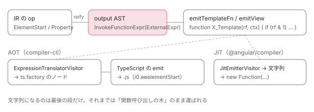

[目次](../README.md) › [テンプレートコンパイラの内側](README.md) › 第 16 回 / 全 18 回

# reify と出力：IR を ɵɵ 命令の呼び出しにして JS を書き出す

> reify.ts が各 IR 命令を r3\_identifiers の ɵɵelementStart / ɵɵproperty / ɵɵtextInterpolate などの呼び出し式（output\_ast）に置き換える行、emitTemplateFn が create ブロック（rf & 1）と update ブロック（rf & 2）を組み立てる行、子テンプレートの関数名の付け方（naming.ts）、compiler-cli の translator が output\_ast を TypeScript の AST に変えて .js に書き出す流れ。

angular/angular · 読了 約 14 分 · 中核 · [サイトで読む（デモが動きます）](https://angular-deep-dive-cyan.vercel.app/chapter/compiler-reify-emit)

---

74 個のフェーズの最後から 2 番目、`reify`（「具体化する」の意味）が、IR の op を 1 つずつ `ɵɵelementStart(0, "div")` のような**関数呼び出しの式**に置き換えます。この章では、その式が output AST（コンパイラ内部の「JavaScript の構文木」）として作られる行、`emitTemplateFn` がそれを `if (rf & 1)` / `if (rf & 2)` の 2 つのブロックを持つ関数に組み立てる行、子テンプレートやリスナーの関数名が決まる行、そして compiler-cli の translator がそれを TypeScript の構文木に変えて `.js` として書き出されるまでを追います。

読む対象は `compiler/src/template/pipeline/src/` の `phases/reify.ts`・`instruction.ts`・`phases/naming.ts`・`emit.ts`・`compilation.ts`、`compiler/src/output/output_ast.ts`・`output_jit.ts`、`compiler/src/render3/r3_identifiers.ts`・`view/compiler.ts`・`jit_compiler_facade.ts`、compiler-cli の `ngtsc/transform/src/transform.ts`・`ngtsc/translator/src/`・`ngtsc/core/src/compiler.ts`、そして compliance fixture です。

1. [1. 全体図](01-compiler.md)
2. [2. コンパイラの入口](02-compiler-entry.md)
3. [3. HTML の字句解析](03-compiler-html-lexer.md)
4. [4. HTML の構文解析](04-compiler-html-parser.md)
5. [5. 式のパーサ](05-compiler-expression-parser.md)
6. [6. バインディングのパーサ](06-compiler-binding-parser.md)
7. [7. R3 AST](07-compiler-r3-ast.md)
8. [8. ブロック構文の解析](08-compiler-control-flow-blocks.md)
9. [9. ディレクティブの照合](09-compiler-binder.md)
10. [10. IR への写像](10-compiler-ingest.md)
11. [11. IR の構造](11-compiler-ir.md)
12. [12. decls・vars・advance](12-compiler-slots-vars.md)
13. [13. 変数とコンテキスト](13-compiler-variables.md)
14. [14. 定数配列と pure function](14-compiler-consts-pure.md)
15. [15. 制御フローのフェーズ](15-compiler-control-flow-phases.md)
16. **16. reify と出力**（この章）
17. [17. 型検査（TCB）](17-compiler-typecheck.md)
18. [18. スタイルのカプセル化](18-compiler-shadow-css.md)

## 0. 目標の出力

この章で「どの行がこれを出したか」を当てていく、2 つの小さな出力です。

📄 `angular/packages/compiler-cli/test/compliance/test_cases/r3_view_compiler_bindings/text_bindings/interpolation.ts` L3–11 （▶ の行: 6）

```ts
 3 │ @Component({
 4 │     selector: 'my-component',
 5 │     template: `
 6 ▶     <div>Hello {{ name }}</div>`,
 7 │     standalone: false
 8 │ })
 9 │ export class MyComponent {
10 │   name = 'World';
11 │ }
```

📄 `angular/packages/compiler-cli/test/compliance/test_cases/r3_view_compiler_bindings/text_bindings/interpolation.js` L2–12 （▶ の行: 2–6, 8–10）

```js
 2 ▶ template:function MyComponent_Template(rf, $ctx$){
 3 ▶   if (rf & 1) {
 4 ▶     $i0$.ɵɵelementStart(0, "div");
 5 ▶     $i0$.ɵɵtext(1);
 6 ▶     $i0$.ɵɵelementEnd();
 7 │   }
 8 ▶   if (rf & 2) {
 9 ▶     $r3$.ɵɵadvance();
10 ▶     $i0$.ɵɵtextInterpolate1("Hello ", $ctx$.name);
11 │   }
12 │ }
```
*期待出力は部分一致で比較される。$名前$ は任意の識別子に一致する書き方（$i0$ は実際には i0）*

📄 `angular/packages/compiler-cli/test/compliance/test_cases/r3_view_compiler_listener/no_event_arg_listener.ts` L3–9 （▶ の行: 4）

```ts
3 │ @Component({
4 ▶     template: `<div (click)="onClick();"></div>`,
5 │     standalone: false
6 │ })
7 │ export class MyComponent {
8 │   onClick() {}
9 │ }
```

📄 `angular/packages/compiler-cli/test/compliance/test_cases/r3_view_compiler_listener/no_event_arg_listener_template.js` L1–11 （▶ の行: 3, 5–7）

```js
 1 │ …
 2 │ consts: [[__AttributeMarker.Bindings__, "click"]],
 3 ▶ template: function MyComponent_Template(rf, ctx) {
 4 │   if (rf & 1) {
 5 ▶     $r3$.ɵɵelementStart(0, "div", 0);
 6 ▶     $r3$.ɵɵlistener("click", function MyComponent_Template_div_click_0_listener() {
 7 ▶       return ctx.onClick();
 8 │     });
 9 │     $r3$.ɵɵelementEnd();
10 │   }
11 │ }
```

## 1. reify：op を「Statement を包んだ op」に置き換える

📄 `angular/packages/compiler/src/template/pipeline/src/phases/reify.ts` L45–58 （▶ の行: 49–51, 53, 55–56）

```ts
45 │ /**
46 │  * Compiles semantic operations across all views and generates output `o.Statement`s with actual
47 │  * runtime calls in their place.
48 │  *
49 ▶  * Reification replaces semantic operations with selected Ivy instructions and other generated code
50 ▶  * structures. After reification, the create/update operation lists of all views should only contain
51 ▶  * `ir.StatementOp`s (which wrap generated `o.Statement`s).
52 │  */
53 ▶ export function reify(job: CompilationJob): void {
54 │   for (const unit of job.units) {
55 ▶     reifyCreateOperations(unit, unit.create);
56 ▶     reifyUpdateOperations(unit, unit.update);
57 │   }
58 │ }
```

49〜51 行目のコメントが仕事のすべてです。reify のあと、各ビューの create / update の op の列には `ir.StatementOp`（output AST の文 1 つを包んだ op）**しか残りません**。55〜56 行目、ビュー（`unit`）ごとに create 側と update 側をそれぞれ処理します。

📄 `angular/packages/compiler/src/template/pipeline/src/phases/reify.ts` L94–105 （▶ の行: 95–96, 98, 102–104）

```ts
 94 │ function reifyCreateOperations(unit: CompilationUnit, ops: ir.OpList<ir.CreateOp>): void {
 95 ▶   for (const op of ops) {
 96 ▶     ir.transformExpressionsInOp(
 97 │       op,
 98 ▶       (expr) => reifyIrExpression(unit, expr),
 99 │       ir.VisitorContextFlag.None,
100 │     );
101 │ 
102 ▶     switch (op.kind) {
103 ▶       case ir.OpKind.Text:
104 ▶         ir.OpList.replace(op, ng.text(op.handle.slot!, op.initialValue, op.sourceSpan));
105 │         break;
```

1. **96〜100 行目：まず op の中の「IR の式」を output AST の式にする**

   `reifyIrExpression`（4 節）を op の中のすべての式に当てます。`ReadVariableExpr` のような IR 専用の式は、ここで普通の変数読みなどに変わります。
2. **102 行目：op の種類で分岐**

   `reifyCreateOperations` には 37 個、`reifyUpdateOperations` には 20 個の `case` があります。
3. **103〜104 行目：例 `Text` → `ng.text(スロット, 初期値)`**

   `ir.OpList.replace` で op を、`instruction.ts` の関数（`ng.*`）が返す `StatementOp` と入れ替えます。目標の出力 5 行目の `ɵɵtext(1)` はここから来ます。

📄 `angular/packages/compiler/src/template/pipeline/src/phases/reify.ts` L126–145 （▶ の行: 129–130, 137）

```ts
126 │       case ir.OpKind.Element:
127 │         ir.OpList.replace(
128 │           op,
129 ▶           unit.job.mode === TemplateCompilationMode.DomOnly
130 ▶             ? ng.domElement(
131 │                 op.handle.slot!,
132 │                 op.tag!,
133 │                 op.attributes as number | null,
134 │                 op.localRefs as number | null,
135 │                 op.wholeSourceSpan,
136 │               )
137 ▶             : ng.element(
138 │                 op.handle.slot!,
139 │                 op.tag!,
140 │                 op.attributes as number | null,
141 │                 op.localRefs as number | null,
142 │                 op.wholeSourceSpan,
143 │               ),
144 │         );
145 │         break;
```

要素も同じ形です。129 行目、テンプレートがディレクティブを 1 つも使わない `DomOnly` モードなら `ɵɵdomElement`、そうでなければ `ɵɵelement`。この 2 択の理由は [standalone シリーズの章](../standalone/04-standalone-used-only.md)で読みました（`ElementStart` の case もその章で引用済み）。

## 2. instruction.ts：呼び出し式を組み立てる

📄 `angular/packages/compiler/src/template/pipeline/src/instruction.ts` L75–97 （▶ の行: 83–85, 87–90, 92–93, 96）

```ts
75 │ function elementOrContainerBase(
76 │   instruction: o.ExternalReference,
77 │   slot: number,
78 │   tag: string | null,
79 │   constIndex: number | null,
80 │   localRefIndex: number | null,
81 │   sourceSpan: ParseSourceSpan,
82 │ ): ir.CreateOp {
83 ▶   const args: o.Expression[] = [o.literal(slot)];
84 ▶   if (tag !== null) {
85 ▶     args.push(o.literal(tag));
86 │   }
87 ▶   if (localRefIndex !== null) {
88 ▶     args.push(
89 ▶       o.literal(constIndex), // might be null, but that's okay.
90 ▶       o.literal(localRefIndex),
91 │     );
92 ▶   } else if (constIndex !== null) {
93 ▶     args.push(o.literal(constIndex));
94 │   }
95 │ 
96 ▶   return call(instruction, args, sourceSpan);
97 │ }
```

`ɵɵelementStart` などの引数の並べ方です。83 行目でスロット番号、85 行目でタグ名、87〜94 行目は「consts の添字」と「ローカル参照の添字」を**必要なときだけ**足します（ローカル参照があるときは consts の添字が `null` でも置く）。目標の出力 4 行目が `ɵɵelementStart(0, "div")` で終わっているのは、属性もローカル参照も無いからです。

📄 `angular/packages/compiler/src/template/pipeline/src/instruction.ts` L1019–1026 （▶ の行: 1024–1025）

```ts
1019 │ function call<OpT extends ir.CreateOp | ir.UpdateOp>(
1020 │   instruction: o.ExternalReference,
1021 │   args: o.Expression[],
1022 │   sourceSpan: ParseSourceSpan | null,
1023 │ ): OpT {
1024 ▶   const expr = o.importExpr(instruction).callFn(args, sourceSpan);
1025 ▶   return ir.createStatementOp(new o.ExpressionStatement(expr, sourceSpan)) as OpT;
1026 │ }
```

すべての命令はこの `call` を通ります。1024 行目、`o.importExpr(命令)`（「外部モジュールの名前」を表す式）に `.callFn(引数)` を付けて呼び出し式にし、1025 行目で `ExpressionStatement`（式 1 つの文）にして `StatementOp` に包みます。

📄 `angular/packages/compiler/src/render3/r3_identifiers.ts` L11–26 （▶ の行: 11, 22, 24）

```ts
11 ▶ const CORE = '@angular/core';
12 │ 
13 │ export class Identifiers {
14 │   static core: o.ExternalReference = {name: null, moduleName: CORE};
15 │ 
16 │   static namespaceHTML: o.ExternalReference = {name: 'ɵɵnamespaceHTML', moduleName: CORE};
17 │ 
18 │   static namespaceMathML: o.ExternalReference = {name: 'ɵɵnamespaceMathML', moduleName: CORE};
19 │ 
20 │   static namespaceSVG: o.ExternalReference = {name: 'ɵɵnamespaceSVG', moduleName: CORE};
21 │ 
22 ▶   static element: o.ExternalReference = {name: 'ɵɵelement', moduleName: CORE};
23 │ 
24 ▶   static elementStart: o.ExternalReference = {name: 'ɵɵelementStart', moduleName: CORE};
25 │ 
26 │   static elementEnd: o.ExternalReference = {name: 'ɵɵelementEnd', moduleName: CORE};
```

「命令」の正体は、`Identifiers` の static フィールドに並んだ `{name, moduleName}` の組です（24 行目 `ɵɵelementStart` と 11 行目の `@angular/core`）。この時点ではまだ文字列でも import 文でもなく、**「@angular/core の ɵɵelementStart」という参照のデータ**にすぎません。

📄 `angular/packages/compiler/src/output/output_ast.ts` L870–879 （▶ の行: 870, 872）

```ts
870 ▶ export class ExternalExpr extends Expression {
871 │   constructor(
872 ▶     public value: ExternalReference,
873 │     type?: Type | null,
874 │     public typeParams: Type[] | null = null,
875 │     sourceSpan?: ParseSourceSpan | null,
876 │     leadingComments?: LeadingComment[],
877 │   ) {
878 │     super(type, sourceSpan, leadingComments);
879 │   }
```

📄 `angular/packages/compiler/src/output/output_ast.ts` L230–237 （▶ の行: 236）

```ts
230 │   callFn(
231 │     params: Expression[],
232 │     sourceSpan?: ParseSourceSpan | null,
233 │     pure?: boolean,
234 │     leadingComments?: LeadingComment[],
235 │   ): InvokeFunctionExpr {
236 ▶     return new InvokeFunctionExpr(this, params, null, sourceSpan, pure, leadingComments);
237 │   }
```

📄 `angular/packages/compiler/src/output/output_ast.ts` L437–448 （▶ の行: 439–440, 443）

```ts
437 │ export class InvokeFunctionExpr extends Expression {
438 │   constructor(
439 ▶     public fn: Expression,
440 ▶     public args: Expression[],
441 │     type?: Type | null,
442 │     sourceSpan?: ParseSourceSpan | null,
443 ▶     public pure = false,
444 │     leadingComments?: LeadingComment[],
445 │     public isOptional = false,
446 │   ) {
447 │     super(type, sourceSpan, leadingComments);
448 │   }
```

output AST の主なクラスです。`importExpr` が作る `ExternalExpr`（872 行目に上の参照データを持つ）、`callFn`（236 行目）が作る `InvokeFunctionExpr`（呼ぶ式 `fn`、引数 `args`、443 行目の `pure` 印）。他に `ReadVarExpr`（変数読み）、`ReadPropExpr`（`a.b`）、`LiteralExpr`、`FunctionExpr` / `ArrowFunctionExpr`、文の側に `ExpressionStatement` / `IfStmt` / `ReturnStatement` / `DeclareVarStmt` などがあります。

## 3. update 側：advance・property・テキスト補間

📄 `angular/packages/compiler/src/template/pipeline/src/phases/reify.ts` L673–694 （▶ の行: 675, 682–683, 685, 688, 691–692）

```ts
673 │ function reifyUpdateOperations(unit: CompilationUnit, ops: ir.OpList<ir.UpdateOp>): void {
674 │   for (const op of ops) {
675 ▶     ir.transformExpressionsInOp(
676 │       op,
677 │       (expr) => reifyIrExpression(unit, expr),
678 │       ir.VisitorContextFlag.None,
679 │     );
680 │ 
681 │     switch (op.kind) {
682 ▶       case ir.OpKind.Advance:
683 ▶         ir.OpList.replace(op, ng.advance(op.delta, op.sourceSpan));
684 │         break;
685 ▶       case ir.OpKind.Property:
686 │         ir.OpList.replace(
687 │           op,
688 ▶           unit.job.mode === TemplateCompilationMode.DomOnly &&
689 │             op.bindingKind !== ir.BindingKind.LegacyAnimation &&
690 │             op.bindingKind !== ir.BindingKind.Animation
691 ▶             ? reifyDomProperty(op)
692 ▶             : reifyProperty(op),
693 │         );
694 │         break;
```

update 側も同じ構造です（675 行目で IR の式を先に変換）。682〜683 行目、`Advance` op は `ɵɵadvance(n)` に（`n` が 1 なら引数を省く。どこに advance を挟むかは [第 12 回](12-compiler-slots-vars.md)の `generateAdvance` が決めた）。685〜693 行目、`[title]="x"` の `Property` は DomOnly なら `ɵɵdomProperty`、そうでなければ `ɵɵproperty` です。

📄 `angular/packages/compiler/src/template/pipeline/src/phases/reify.ts` L722–727 （▶ の行: 725）

```ts
722 │       case ir.OpKind.InterpolateText:
723 │         ir.OpList.replace(
724 │           op,
725 ▶           ng.textInterpolate(op.interpolation.strings, op.interpolation.expressions, op.sourceSpan),
726 │         );
727 │         break;
```

📄 `angular/packages/compiler/src/template/pipeline/src/instruction.ts` L985–1006 （▶ の行: 993–994, 997–998, 1002）

```ts
 985 │ function collateInterpolationArgs(strings: string[], expressions: o.Expression[]): o.Expression[] {
 986 │   if (strings.length < 1 || expressions.length !== strings.length - 1) {
 987 │     throw new Error(
 988 │       `AssertionError: expected specific shape of args for strings/expressions in interpolation`,
 989 │     );
 990 │   }
 991 │   const interpolationArgs: o.Expression[] = [];
 992 │ 
 993 ▶   if (expressions.length === 1 && strings[0] === '' && strings[1] === '') {
 994 ▶     interpolationArgs.push(expressions[0]);
 995 │   } else {
 996 │     let idx: number;
 997 ▶     for (idx = 0; idx < expressions.length; idx++) {
 998 ▶       interpolationArgs.push(o.literal(strings[idx]), expressions[idx]);
 999 │     }
1000 │ 
1001 │     // idx points at the last string.
1002 ▶     interpolationArgs.push(o.literal(strings[idx]));
1003 │   }
1004 │ 
1005 │   return interpolationArgs;
1006 │ }
```

📄 `angular/packages/compiler/src/template/pipeline/src/instruction.ts` L1111–1142 （▶ の行: 1118, 1122–1123, 1126, 1128, 1131, 1133–1134, 1138）

```ts
1111 │ function callVariadicInstructionExpr(
1112 │   config: VariadicInstructionConfig,
1113 │   baseArgs: o.Expression[],
1114 │   interpolationArgs: o.Expression[],
1115 │   sourceSpan: ParseSourceSpan | null,
1116 │ ): o.Expression {
1117 │   // mapping need to be done before potentially dropping the last interpolation argument
1118 ▶   const n = config.mapping(interpolationArgs.length);
1119 │ 
1120 │   // In the case the interpolation instruction ends with a empty string we drop it
1121 │   // And the runtime will take care of it.
1122 ▶   const lastInterpolationArg = interpolationArgs.at(-1);
1123 ▶   if (
1124 │     interpolationArgs.length > 1 &&
1125 │     lastInterpolationArg instanceof o.LiteralExpr &&
1126 ▶     lastInterpolationArg.value === ''
1127 │   ) {
1128 ▶     interpolationArgs.pop();
1129 │   }
1130 │ 
1131 ▶   if (n < config.constant.length) {
1132 │     // Constant calling pattern.
1133 ▶     return o.importExpr(config.constant[n]).callFn([...baseArgs, ...interpolationArgs], sourceSpan);
1134 ▶   } else if (config.variable !== null) {
1135 │     // Variable calling pattern.
1136 │     return o
1137 │       .importExpr(config.variable)
1138 ▶       .callFn([...baseArgs, o.literalArr(interpolationArgs)], sourceSpan);
1139 │   } else {
1140 │     throw new Error(`AssertionError: unable to call variadic function`);
1141 │   }
1142 │ }
```

1. **725 行目：`Hello {{ name }}` は strings `["Hello ", ""]` と expressions `[name]`**

   補間の文字列部分は式より 1 つ多い形で持っています。
2. **997〜1002 行目：文字列と式を交互に並べる**

   `"Hello ", ctx.name, ""` の 3 つ。993〜994 行目、`{{ name }}` だけ（前後が空文字）なら式 1 つにします。
3. **1118 行目：引数の数から命令の番号を決める**

   テキスト用の表 `TEXT_INTERPOLATE_CONFIG` の `mapping` は `(n - 1) / 2`。3 個なら 1 で、`ɵɵtextInterpolate1`（1131〜1133 行目）。9 個以上の式は 1134〜1138 行目の配列版 `ɵɵtextInterpolateV` です。
4. **1122〜1129 行目：最後の空文字は捨てる**

   番号を決めた**後で**捨てるので、命令は `…1` のまま引数が 2 つになります。目標の出力 10 行目の `ɵɵtextInterpolate1("Hello ", ctx.name)` です。

## 4. 式の中の IR を消す：reifyIrExpression

📄 `angular/packages/compiler/src/template/pipeline/src/phases/reify.ts` L848–880 （▶ の行: 849–850, 854–857, 868–869, 876）

```ts
848 │ function reifyIrExpression(unit: CompilationUnit, expr: o.Expression): o.Expression {
849 ▶   if (!ir.isIrExpression(expr)) {
850 ▶     return expr;
851 │   }
852 │ 
853 │   switch (expr.kind) {
854 ▶     case ir.ExpressionKind.NextContext:
855 ▶       return ng.nextContext(expr.steps);
856 ▶     case ir.ExpressionKind.Reference:
857 ▶       return ng.reference(expr.targetSlot.slot! + 1 + expr.offset);
858 │     case ir.ExpressionKind.ForeignContent:
859 │       if (!(unit instanceof ViewCompilationUnit)) {
860 │         throw new Error(`AssertionError: must be compiling a component`);
861 │       }
862 │       const parameterized = unit.job.views.get(expr.childrenViewXref)!.contextVariables.size > 0;
863 │       return ng.foreignContent(
864 │         expr.childrenViewHandle.slot!,
865 │         expr.foreignComponentConstIndex,
866 │         parameterized,
867 │       );
868 ▶     case ir.ExpressionKind.LexicalRead:
869 ▶       throw new Error(`AssertionError: unresolved LexicalRead of ${expr.name}`);
870 │     case ir.ExpressionKind.TwoWayBindingSet:
871 │       throw new Error(`AssertionError: unresolved TwoWayBindingSet`);
872 │     case ir.ExpressionKind.RestoreView:
873 │       if (typeof expr.view === 'number') {
874 │         throw new Error(`AssertionError: unresolved RestoreView`);
875 │       }
876 ▶       return ng.restoreView(expr.view);
877 │     case ir.ExpressionKind.ResetView:
878 │       return ng.resetView(expr.expr);
879 │     case ir.ExpressionKind.GetCurrentView:
880 │       return ng.getCurrentView();
```

📄 `angular/packages/compiler/src/template/pipeline/src/phases/reify.ts` L881–914 （▶ の行: 881, 885, 891, 895–896, 900, 903–904, 907–908, 913–914）

```ts
881 ▶     case ir.ExpressionKind.ReadVariable:
882 │       if (expr.name === null) {
883 │         throw new Error(`Read of unnamed variable ${expr.xref}`);
884 │       }
885 ▶       return o.variable(expr.name);
886 │     case ir.ExpressionKind.ReadTemporaryExpr:
887 │       if (expr.name === null) {
888 │         throw new Error(`Read of unnamed temporary ${expr.xref}`);
889 │       }
890 │       return o.variable(expr.name);
891 ▶     case ir.ExpressionKind.AssignTemporaryExpr:
892 │       if (expr.name === null) {
893 │         throw new Error(`Assign of unnamed temporary ${expr.xref}`);
894 │       }
895 ▶       return o.variable(expr.name).set(expr.expr);
896 ▶     case ir.ExpressionKind.PureFunctionExpr:
897 │       if (expr.fn === null) {
898 │         throw new Error(`AssertionError: expected PureFunctions to have been extracted`);
899 │       }
900 ▶       return ng.pureFunction(expr.varOffset!, expr.fn, expr.args);
901 │     case ir.ExpressionKind.PureFunctionParameterExpr:
902 │       throw new Error(`AssertionError: expected PureFunctionParameterExpr to have been extracted`);
903 ▶     case ir.ExpressionKind.PipeBinding:
904 ▶       return ng.pipeBind(expr.targetSlot.slot!, expr.varOffset!, expr.args);
905 │     case ir.ExpressionKind.PipeBindingVariadic:
906 │       return ng.pipeBindV(expr.targetSlot.slot!, expr.varOffset!, expr.args);
907 ▶     case ir.ExpressionKind.SlotLiteralExpr:
908 ▶       return o.literal(expr.slot.slot!);
909 │     case ir.ExpressionKind.ContextLetReference:
910 │       return ng.readContextLet(expr.targetSlot.slot!);
911 │     case ir.ExpressionKind.StoreLet:
912 │       return ng.storeLet(expr.value, expr.sourceSpan);
913 ▶     case ir.ExpressionKind.TrackContext:
914 ▶       return o.variable('this');
```

1 節 96〜100 行目が op ごとに呼ぶ関数です。主な変換を表にします。

| IR の式 | 出力 | 行 |
| --- | --- | --- |
| IR でない式（`ctx.name` など） | そのまま | 849〜851 |
| `NextContext(steps)` | `ɵɵnextContext(steps)` | 854〜855 |
| `Reference`（`#ref` の読み） | `ɵɵreference(スロット + 1 + offset)` | 856〜857 |
| `RestoreView` | `ɵɵrestoreView(変数)` | 872〜876 |
| `ReadVariable` | 変数読み（名前は naming.ts が付けた `item_r1` など） | 881〜885 |
| `AssignTemporaryExpr` | `tmp_0_0 = 式` | 891〜895 |
| `PureFunctionExpr` | `ɵɵpureFunctionN(…)` | 896〜900 |
| `PipeBinding` | `ɵɵpipeBindN(スロット, …)` | 903〜904 |
| `SlotLiteralExpr` | スロット番号の数値 | 907〜908 |
| `TrackContext` | `this` | 913〜914 |

868〜869 行目のように、ここまでに消えていなければならない IR（`LexicalRead` は `resolveNames` が解決済み）が残っていたら例外です。各フェーズの「担当範囲」が reify の手前で全部終わっていることを、ここで確かめています。

## 5. リスナー：ハンドラは名前付きの function になる

📄 `angular/packages/compiler/src/template/pipeline/src/phases/reify.ts` L316–345 （▶ の行: 317–319, 323, 333, 336–337）

```ts
316 │       case ir.OpKind.Listener:
317 ▶         const listenerFn = reifyListenerHandler(
318 ▶           unit,
319 ▶           op.handlerFnName!,
320 │           op.handlerOps,
321 │           op.consumesDollarEvent,
322 │         );
323 ▶         const eventTargetResolver = op.eventTarget
324 │           ? GLOBAL_TARGET_RESOLVERS.get(op.eventTarget)
325 │           : null;
326 │         if (eventTargetResolver === undefined) {
327 │           throw new Error(
328 │             `Unexpected global target '${op.eventTarget}' defined for '${op.name}' event. Supported list of global targets: window,document,body.`,
329 │           );
330 │         }
331 │         ir.OpList.replace(
332 │           op,
333 ▶           unit.job.mode === TemplateCompilationMode.DomOnly &&
334 │             !op.hostListener &&
335 │             !op.isLegacyAnimationListener
336 ▶             ? ng.domListener(op.name, listenerFn, eventTargetResolver, op.sourceSpan)
337 ▶             : ng.listener(
338 │                 op.name,
339 │                 listenerFn,
340 │                 eventTargetResolver,
341 │                 op.hostListener && op.isLegacyAnimationListener,
342 │                 op.sourceSpan,
343 │               ),
344 │         );
345 │         break;
```

📄 `angular/packages/compiler/src/template/pipeline/src/phases/reify.ts` L937–966 （▶ の行: 944, 948, 955, 960, 962, 965）

```ts
937 │ function reifyListenerHandler(
938 │   unit: CompilationUnit,
939 │   name: string,
940 │   handlerOps: ir.OpList<ir.UpdateOp>,
941 │   consumesDollarEvent: boolean,
942 │ ): o.FunctionExpr {
943 │   // First, reify all instruction calls within `handlerOps`.
944 ▶   reifyUpdateOperations(unit, handlerOps);
945 │ 
946 │   // Next, extract all the `o.Statement`s from the reified operations. We can expect that at this
947 │   // point, all operations have been converted to statements.
948 ▶   const handlerStmts: o.Statement[] = [];
949 │   for (const op of handlerOps) {
950 │     if (op.kind !== ir.OpKind.Statement) {
951 │       throw new Error(
952 │         `AssertionError: expected reified statements, but found op ${ir.OpKind[op.kind]}`,
953 │       );
954 │     }
955 ▶     handlerStmts.push(op.statement);
956 │   }
957 │ 
958 │   // If `$event` is referenced, we need to generate it as a parameter.
959 │   const params: o.FnParam[] = [];
960 ▶   if (consumesDollarEvent) {
961 │     // We need the `$event` parameter.
962 ▶     params.push(new o.FnParam('$event', o.DYNAMIC_TYPE));
963 │   }
964 │ 
965 ▶   return o.fn(params, handlerStmts, undefined, undefined, name);
966 │ }
```

`(click)="onClick()"` の本体は、`handlerOps` という小さな op の列として持たれています。944 行目でそれを再帰的に reify して文にし、960〜963 行目で `$event` を使うときだけ引数に足し、965 行目で **名前付きの `function`** にします。名前は 319 行目の `op.handlerFnName`、つまり次節の naming.ts が付けたものです。目標の出力 6 行目の `MyComponent_Template_div_click_0_listener` で、`$event` を使わないので引数は空です。

## 6. 関数名の付け方：naming.ts

📄 `angular/packages/compiler/src/template/pipeline/src/phases/naming.ts` L23–36 （▶ の行: 24, 28, 32–33）

```ts
23 │ export function nameFunctionsAndVariables(job: CompilationJob): void {
24 ▶   addNamesToView(job.root, job.componentName, {index: 0});
25 │ }
26 │ 
27 │ function addNamesToView(unit: CompilationUnit, baseName: string, state: {index: number}): void {
28 ▶   if (unit.fnName === null) {
29 │     // Ensure unique names for view units. This is necessary because there might be multiple
30 │     // components with same names in the context of the same pool. Only add the suffix
31 │     // if really needed.
32 ▶     unit.fnName = unit.job.pool.uniqueName(
33 ▶       sanitizeIdentifier(`${baseName}_${unit.job.fnSuffix}`),
34 │       /* alwaysIncludeSuffix */ false,
35 │     );
36 │   }
```

📄 `angular/packages/compiler/src/template/pipeline/src/compilation.ts` L118–125 （▶ の行: 120）

```ts
118 │   override kind = CompilationJobKind.Tmpl;
119 │ 
120 ▶   override readonly fnSuffix: string = 'Template';
121 │ 
122 │   /**
123 │    * The root view, representing the component's template.
124 │    */
125 │   override readonly root: ViewCompilationUnit;
```

📄 `angular/packages/compiler/src/template/pipeline/src/phases/naming.ts` L144–157 （▶ の行: 144, 147, 155–156）

```ts
144 ▶       case ir.OpKind.ConditionalCreate:
145 │       case ir.OpKind.ConditionalBranchCreate:
146 │       case ir.OpKind.BoundaryErrorCreate:
147 ▶       case ir.OpKind.Template:
148 │         if (!(unit instanceof ViewCompilationUnit)) {
149 │           throw new Error(`AssertionError: must be compiling a component`);
150 │         }
151 │         const childView = unit.job.views.get(op.xref)!;
152 │         if (op.handle.slot === null) {
153 │           throw new Error(`Expected slot to be assigned`);
154 │         }
155 ▶         const suffix = op.functionNameSuffix.length === 0 ? '' : `_${op.functionNameSuffix}`;
156 ▶         addNamesToView(childView, `${baseName}${suffix}_${op.handle.slot}`, state);
157 │         break;
```

📄 `angular/packages/compiler/src/template/pipeline/src/phases/naming.ts` L74–94 （▶ の行: 86–87, 89–91）

```ts
74 │       case ir.OpKind.Listener:
75 │         if (op.handlerFnName !== null) {
76 │           break;
77 │         }
78 │         if (!op.hostListener && op.targetSlot.slot === null) {
79 │           throw new Error(`Expected a slot to be assigned`);
80 │         }
81 │         let animation = '';
82 │         if (op.isLegacyAnimationListener) {
83 │           op.name = `@${op.name}.${op.legacyAnimationPhase}`;
84 │           animation = 'animation';
85 │         }
86 ▶         if (op.hostListener) {
87 ▶           op.handlerFnName = `${baseName}_${animation}${op.name}_HostBindingHandler`;
88 │         } else {
89 ▶           op.handlerFnName = `${unit.fnName}_${op.tag!.replace('-', '_')}_${animation}${op.name}_${
90 ▶             op.targetSlot.slot
91 ▶           }_listener`;
92 │         }
93 │         op.handlerFnName = sanitizeIdentifier(op.handlerFnName);
94 │         break;
```

1. **24 行目：ルートビューは「コンポーネント名」から**

   33 行目で `${baseName}_${fnSuffix}`。`fnSuffix` はテンプレートなら 120 行目の `Template`、ホストバインディングなら `HostBindings`。だから `MyComponent_Template`。
2. **32 行目：同じファイルで重なれば番号を足す**

   `uniqueName(…, false)` は初回は番号を付けず、2 回目以降に `1`、`2`… を付けます（同じ名前のコンポーネントが 1 ファイルにある場合）。
3. **155〜156 行目：子テンプレートは「親の baseName + 種類 + スロット」**

   `@if` の分岐なら種類は `Conditional`（[第 15 回](15-compiler-control-flow-phases.md)で見た ingest.ts の `'Conditional'`）、`<ng-template>` や `*ngFor` ならタグ名です。156 行目で再帰するので、入れ子は `MyApp_Conditional_2_Conditional_1_Template` のように伸びます。`@for` だけはスロットの次の番号を使います（スロットの先頭に repeater のメタデータが入るため。naming.ts の `RepeaterCreate` の case）。
4. **89〜91 行目：リスナーは「ビューの関数名 + タグ + イベント + スロット + \_listener」**

   ホストのリスナーは 87 行目の `…_HostBindingHandler`。

`nameFunctionsAndVariables` は emit.ts の phases の 65 番目で、スロット割り当て（`allocateSlots`、54 番目）の後です。名前にスロット番号を使うからです。同じ関数が変数名（`item_r1`、`ctx_r0`）も付けますが、それは [第 13 回](13-compiler-variables.md)で読みます。

## 7. emit：rf & 1 と rf & 2 の関数に組み立てる

呼び出し元の `compileComponentFromMetadata` は、`transform`（reify を含む全フェーズ）のあとに `emitTemplateFn` を呼び、できた関数を `decls` / `vars` / `consts` と一緒に ɵcmp の定義（`definitionMap`）の `template` に入れます。その行は [第 2 回（コンパイラの入口）](02-compiler-entry.md)で引用済みです。

📄 `angular/packages/compiler/src/template/pipeline/src/emit.ts` L203–225 （▶ の行: 208–209, 215, 220, 222–223）

```ts
203 │ /**
204 │  * Compile all views in the given `ComponentCompilation` into the final template function, which may
205 │  * reference constants defined in a `ConstantPool`.
206 │  */
207 │ export function emitTemplateFn(tpl: ComponentCompilationJob, pool: ConstantPool): o.FunctionExpr {
208 ▶   const rootFn = emitView(tpl.root);
209 ▶   emitChildViews(tpl.root, pool);
210 │   return rootFn;
211 │ }
212 │ 
213 │ function emitChildViews(parent: ViewCompilationUnit, pool: ConstantPool): void {
214 │   for (const unit of parent.job.units) {
215 ▶     if (unit.parent !== parent.xref) {
216 │       continue;
217 │     }
218 │ 
219 │     // Child views are emitted depth-first.
220 ▶     emitChildViews(unit, pool);
221 │ 
222 ▶     const viewFn = emitView(unit);
223 ▶     pool.statements.push(viewFn.toDeclStmt(viewFn.name!));
224 │   }
225 │ }
```

📄 `angular/packages/compiler/src/template/pipeline/src/emit.ts` L236–268 （▶ の行: 237–238, 245, 248, 256, 259–263, 266）

```ts
236 │   const createStatements: o.Statement[] = [];
237 ▶   for (const op of view.create) {
238 ▶     if (op.kind !== ir.OpKind.Statement) {
239 │       throw new Error(
240 │         `AssertionError: expected all create ops to have been compiled, but got ${
241 │           ir.OpKind[op.kind]
242 │         }`,
243 │       );
244 │     }
245 ▶     createStatements.push(op.statement);
246 │   }
247 │   const updateStatements: o.Statement[] = [];
248 ▶   for (const op of view.update) {
249 │     if (op.kind !== ir.OpKind.Statement) {
250 │       throw new Error(
251 │         `AssertionError: expected all update ops to have been compiled, but got ${
252 │           ir.OpKind[op.kind]
253 │         }`,
254 │       );
255 │     }
256 ▶     updateStatements.push(op.statement);
257 │   }
258 │ 
259 ▶   const createCond = maybeGenerateRfBlock(1, createStatements);
260 ▶   const updateCond = maybeGenerateRfBlock(2, updateStatements);
261 ▶   return o.fn(
262 ▶     [new o.FnParam(RENDER_FLAGS, o.NUMBER_TYPE), new o.FnParam(CONTEXT_NAME, o.DYNAMIC_TYPE)],
263 ▶     [...createCond, ...updateCond],
264 │     /* type */ undefined,
265 │     /* sourceSpan */ undefined,
266 ▶     view.fnName,
267 │   );
268 │ }
```

📄 `angular/packages/compiler/src/template/pipeline/src/emit.ts` L270–285 （▶ の行: 271–272, 276–280）

```ts
270 │ function maybeGenerateRfBlock(flag: number, statements: o.Statement[]): o.Statement[] {
271 ▶   if (statements.length === 0) {
272 ▶     return [];
273 │   }
274 │ 
275 │   return [
276 ▶     o.ifStmt(
277 ▶       new o.BinaryOperatorExpr(
278 ▶         o.BinaryOperator.BitwiseAnd,
279 ▶         o.variable(RENDER_FLAGS),
280 ▶         o.literal(flag),
281 │       ),
282 │       statements,
283 │     ),
284 │   ];
285 │ }
```

1. **237〜257 行目：StatementOp から文を取り出す**

   238 行目、reify で消えていない op があれば例外。1 節 49〜51 行目の約束をここで確かめます。
2. **259〜260 行目と 270〜285 行目：`if (rf & 1)` と `if (rf & 2)`**

   create の文を `rf & 1`、update の文を `rf & 2` の if で包みます。271〜273 行目、**文が無ければ if ごと出さない**ので、バインディングの無いテンプレートには `if (rf & 2)` がありません（第 15 回の fixture の子テンプレートがそうでした）。`rf` の意味は [Ivy シリーズの template 関数の章](../ivy/03-ivy-template-function.md)で読みました。
3. **261〜267 行目：`function 名前(rf, ctx) { … }`**

   引数名は `RENDER_FLAGS`（`rf`）と `CONTEXT_NAME`（`ctx`）、名前は 6 節の `fnName`。
4. **208〜224 行目：ルートは式、子は定数プールの文**

   ルートビューの関数は 208 行目で式として返り、ɵcmp の `template:` に入ります（[第 2 回](02-compiler-entry.md)で見た `definitionMap.set('template', …)`）。子ビューは 220 行目で深さ優先に先に処理し、223 行目で **関数宣言の文としてファイルの先頭側（定数プール）に置かれます**。fixture でクラスより上に `function MyApp_Conditional_2_Template` が並ぶのはこのためです。

📄 `angular/packages/compiler/src/render3/view/compiler.ts` L323–328 （▶ の行: 324–325）

```ts
323 │   const expression = o
324 ▶     .importExpr(R3.defineComponent)
325 ▶     .callFn([definitionMap.toLiteralMap()], undefined, true);
326 │   const type = createComponentType(meta);
327 │ 
328 │   return {expression, type, statements: []};
```

最後に `ɵɵdefineComponent({…})` の呼び出し式を作ります。325 行目の 3 番目の引数 `true` は 2 節 443 行目の `pure`。これが出力の `/*@__PURE__*/` 注釈になります（9 節）。

## 8. ホストバインディング：同じ道を Host 用のフェーズで

📄 `angular/packages/compiler/src/render3/view/compiler.ts` L488–509 （▶ の行: 488, 500, 502, 506, 509）

```ts
488 ▶   const hostJob = ingestHostBinding(
489 │     {
490 │       componentName: name,
491 │       componentSelector: selector,
492 │       properties: bindings,
493 │       events: eventBindings,
494 │       attributes: hostBindingsMetadata.attributes,
495 │       legacyOptionalChaining: legacyOptionalChaining,
496 │     },
497 │     bindingParser,
498 │     constantPool,
499 │   );
500 ▶   transform(hostJob, CompilationJobKind.Host);
501 │ 
502 ▶   definitionMap.set('hostAttrs', hostJob.root.attributes);
503 │ 
504 │   const varCount = hostJob.root.vars;
505 │   if (varCount !== null && varCount > 0) {
506 ▶     definitionMap.set('hostVars', o.literal(varCount));
507 │   }
508 │ 
509 ▶   return emitHostBindingFunction(hostJob);
```

📄 `angular/packages/compiler/src/template/pipeline/src/emit.ts` L315–328 （▶ の行: 315–316, 319–321, 326）

```ts
315 ▶   if (createStatements.length === 0 && updateStatements.length === 0) {
316 ▶     return null;
317 │   }
318 │ 
319 ▶   const createCond = maybeGenerateRfBlock(1, createStatements);
320 ▶   const updateCond = maybeGenerateRfBlock(2, updateStatements);
321 ▶   return o.fn(
322 │     [new o.FnParam(RENDER_FLAGS, o.NUMBER_TYPE), new o.FnParam(CONTEXT_NAME, o.DYNAMIC_TYPE)],
323 │     [...createCond, ...updateCond],
324 │     /* type */ undefined,
325 │     /* sourceSpan */ undefined,
326 ▶     job.root.fnName,
327 │   );
328 │ }
```

`host: {…}` や `@HostBinding` は、488 行目で専用のジョブ（`HostBindingCompilationJob`）に ingest され、500 行目で `CompilationJobKind.Host` のフェーズだけが走り（emit.ts の phases の `kind`）、509 行目の `emitHostBindingFunction` で関数になります。組み立ては `emitView` と同じで、違いは 315〜317 行目、**文が 1 つも無ければ関数自体を出さない**ことです。

📄 `angular/packages/compiler-cli/test/compliance/test_cases/r3_view_compiler_bindings/host_bindings/host_bindings.ts` L3–9 （▶ の行: 8）

```ts
3 │ @Directive({
4 │     selector: '[hostBindingDir]',
5 │     standalone: false
6 │ })
7 │ export class HostBindingDir {
8 ▶   @HostBinding('id') dirId = 'some id';
9 │ }
```

📄 `angular/packages/compiler-cli/test/compliance/test_cases/r3_view_compiler_bindings/host_bindings/host_bindings.js` L1–14 （▶ の行: 6–9）

```js
 1 │ export class HostBindingDir {
 2 │   // ...
 3 │   static ɵdir = /*@__PURE__*/ $r3$.ɵɵdefineDirective({
 4 │     type: HostBindingDir,
 5 │     selectors: [["", "hostBindingDir", ""]],
 6 ▶       hostVars: 1,
 7 ▶       hostBindings: function HostBindingDir_HostBindings(rf, ctx) {
 8 ▶         if (rf & 2) {
 9 ▶           $r3$.ɵɵdomProperty("id", ctx.dirId);
10 │         }
11 │       },
12 │     standalone: false
13 │   });
14 │ }
```

7 行目の名前は 6 節 33 行目に `fnSuffix = 'HostBindings'` を当てたもの。8 行目、属性やリスナーが無いので `rf & 1` のブロックがありません。6 行目の `hostVars: 1` は 506 行目です。

## 9. AOT：translator が output AST を TypeScript の構文木にする

ここまでの結果はまだ output AST（`o.Expression` / `o.Statement`）です。**文字列にするのはコンパイラ本体ではありません**。AOT（ngc / Angular CLI のビルド）では、compiler-cli が TypeScript のコンパイル（`program.emit`）に変換器を差し込み、TypeScript 自身が `.js` を書き出します。

📄 `angular/packages/compiler-cli/src/ngtsc/core/src/compiler.ts` L836–852 （▶ の行: 836–838）

```ts
836 ▶     const before: ts.TransformerFactory<ts.SourceFile>[] = [
837 ▶       ivyTransformFactory(
838 ▶         compilation.traitCompiler,
839 │         compilation.reflector,
840 │         importRewriter,
841 │         defaultImportTracker,
842 │         compilation.localCompilationExtraImportsTracker,
843 │         this.delegatingPerfRecorder,
844 │         compilation.isCore,
845 │         this.closureCompilerEnabled,
846 │         this.emitDeclarationOnly,
847 │         compilation.refEmitter,
848 │         !!this.options['_experimentalEmitIntermediateTs'],
849 │       ),
850 │       aliasTransformFactory(compilation.traitCompiler.exportStatements),
851 │       defaultImportTracker.importPreservingTransformer(),
852 │     ];
```

836 行目、TypeScript の `before` 変換器（型を消して JS にする前に走る変換）の先頭に `ivyTransformFactory` を置きます。CLI のビルドの中でこれが呼ばれる位置は [boot シリーズのアプリケーションビルドの章](../boot/04-boot-application-build.md)で読みました。

📄 `angular/packages/compiler-cli/src/ngtsc/transform/src/transform.ts` L343–376 （▶ の行: 349–351, 354–355, 364, 376）

```ts
343 │   // The transformation process consists of 2 steps:
344 │   //
345 │   //  1. Visit all classes, perform compilation and collect the results.
346 │   //  2. Perform actual transformation of required TS nodes using compilation results from the first
347 │   //     step.
348 │   //
349 ▶   // This is needed to have all `o.Expression`s generated before any TS transforms happen. This
350 ▶   // allows `ConstantPool` to properly identify expressions that can be shared across multiple
351 ▶   // components declared in the same file.
352 │ 
353 │   // Step 1. Go though all classes in AST, perform compilation and collect the results.
354 ▶   const compilationVisitor = new IvyCompilationVisitor(compilation, constantPool);
355 ▶   visit(file, compilationVisitor, context);
356 │ 
357 │   // If we are emitting declarations only, we can skip the script transforms.
358 │   if (emitDeclarationOnly) {
359 │     return file;
360 │   }
361 │ 
362 │   // Step 2. Scan through the AST again and perform transformations based on Ivy compilation
363 │   // results obtained at Step 1.
364 ▶   const transformationVisitor = new IvyTransformationVisitor(
365 │     compilation,
366 │     compilationVisitor.classCompilationMap,
367 │     reflector,
368 │     importManager,
369 │     recordWrappedNode,
370 │     isClosureCompilerEnabled,
371 │     isCore,
372 │     compilationVisitor.deferrableImports,
373 │     refEmitter,
374 │     enableTypeReification,
375 │   );
376 ▶   let sf = visit(file, transformationVisitor, context);
```

📄 `angular/packages/compiler-cli/src/ngtsc/transform/src/transform.ts` L378–388 （▶ の行: 381–382）

```ts
378 │   // Generate the constant statements first, as they may involve adding additional imports
379 │   // to the ImportManager.
380 │   const downlevelTranslatedCode = getLocalizeCompileTarget(context) < ts.ScriptTarget.ES2015;
381 ▶   const constants = constantPool.statements.map((stmt) =>
382 ▶     translateStatement(file, stmt, importManager, {
383 │       recordWrappedNode,
384 │       downlevelTaggedTemplates: downlevelTranslatedCode,
385 │       downlevelVariableDeclarations: downlevelTranslatedCode,
386 │       annotateForClosureCompiler: isClosureCompilerEnabled,
387 │     }),
388 │   );
```

1. **354〜355 行目：ステップ 1、ファイル中のクラスを全部コンパイル**

   ここで `compileFull` → `compileComponentFromMetadata`（7 節）が走り、結果の output AST を集めます。349〜351 行目のコメントのとおり、全部を先に作るのは**同じファイルのコンポーネント同士で定数プールを共有する**ためです（第 15 回の `_forTrack0` の使い回し）。
2. **364〜376 行目：ステップ 2、クラスを書き換える**

   `IvyTransformationVisitor.visitClassDeclaration` です（下の段落）。
3. **381〜388 行目：定数プールの文（子テンプレート関数、`_forTrack0`、`_c0` など）を TS の文に**

ステップ 2 の `visitClassDeclaration` は、`ɵɵdefineComponent({…})` の output AST を `translateExpression` で TS の式にし、`static ɵcmp = …` のプロパティ宣言としてクラスに足します。その行は [第 2 回](02-compiler-entry.md)で引用済みなので、ここでは `translateExpression` の中身を読みます。

📄 `angular/packages/compiler-cli/src/ngtsc/translator/src/typescript_translator.ts` L17–32 （▶ の行: 23–25）

```ts
17 │ export function translateExpression(
18 │   contextFile: ts.SourceFile,
19 │   expression: o.Expression,
20 │   imports: ImportGenerator<ts.SourceFile, ts.Expression>,
21 │   options: TranslatorOptions<ts.Expression> = {},
22 │ ): ts.Expression {
23 ▶   return expression.visitExpression(
24 ▶     new ExpressionTranslatorVisitor<ts.SourceFile, ts.Statement, ts.Expression, ts.TypeNode>(
25 ▶       new TypeScriptAstFactory(options.annotateForClosureCompiler === true),
26 │       imports,
27 │       contextFile,
28 │       options,
29 │     ),
30 │     new Context(false),
31 │   );
32 │ }
```

📄 `angular/packages/compiler-cli/src/ngtsc/translator/src/translator.ts` L149–182 （▶ の行: 149, 151–153, 165, 170–172, 177）

```ts
149 ▶   visitIfStmt(stmt: o.IfStmt, context: Context): TStatement {
150 │     return this.attachComments(
151 ▶       this.factory.createIfStatement(
152 ▶         stmt.condition.visitExpression(this, context),
153 ▶         this.factory.createBlock(this.visitStatements(stmt.trueCase, context.withStatementMode)),
154 │         stmt.falseCase.length > 0
155 │           ? this.factory.createBlock(
156 │               this.visitStatements(stmt.falseCase, context.withStatementMode),
157 │             )
158 │           : null,
159 │       ),
160 │       stmt.leadingComments,
161 │     );
162 │   }
163 │ 
164 │   visitReadVarExpr(ast: o.ReadVarExpr, _context: Context): TExpression {
165 ▶     const identifier = this.factory.createIdentifier(ast.name!);
166 │     this.setSourceMapRange(identifier, ast.sourceSpan);
167 │     return this.attachComments(identifier, ast.leadingComments);
168 │   }
169 │ 
170 ▶   visitInvokeFunctionExpr(ast: o.InvokeFunctionExpr, context: Context): TExpression {
171 ▶     const fn = ast.fn.visitExpression(this, context);
172 ▶     const args = ast.args.map((arg) => arg.visitExpression(this, context));
173 │     return this.attachComments(
174 │       this.setSourceMapRange(
175 │         isSafeAccess(ast)
176 │           ? this.factory.createCallChain(fn, args, ast.pure, ast.isOptional)
177 ▶           : this.factory.createCallExpression(fn, args, ast.pure),
178 │         ast.sourceSpan,
179 │       ),
180 │       ast.leadingComments,
181 │     );
182 │   }
```

`ExpressionTranslatorVisitor` は output AST の訪問者（visitor：ノードの種類ごとのメソッドを呼び分ける仕組み）です。23〜25 行目で TS 用の工場 `TypeScriptAstFactory` を渡します。149〜162 行目、`IfStmt`（7 節の `if (rf & 1)`）は `createIfStatement` に、170〜182 行目、`InvokeFunctionExpr` は `createCallExpression` に。1 ノードずつ、対応する `ts.factory` の関数に置き換えていくだけです。

📄 `angular/packages/compiler-cli/src/ngtsc/translator/src/translator.ts` L376–401 （▶ の行: 387, 391–393）

```ts
376 │   visitExternalExpr(ast: o.ExternalExpr, _context: Context): TExpression {
377 │     let result: TExpression;
378 │     if (ast.value.name === null) {
379 │       if (ast.value.moduleName === null) {
380 │         throw new Error('Invalid import without name nor moduleName');
381 │       }
382 │       result = this.imports.addImport({
383 │         exportModuleSpecifier: ast.value.moduleName,
384 │         exportSymbolName: null,
385 │         requestedFile: this.contextFile,
386 │       });
387 ▶     } else if (ast.value.moduleName !== null) {
388 │       // If a moduleName is specified, this is a normal import. If there's no module name, it's a
389 │       // reference to a global/ambient symbol.
390 │       // This is a normal import. Find the imported module.
391 ▶       result = this.imports.addImport({
392 ▶         exportModuleSpecifier: ast.value.moduleName,
393 ▶         exportSymbolName: ast.value.name,
394 │         requestedFile: this.contextFile,
395 │       });
396 │     } else {
397 │       // The symbol is ambient, so just reference it.
398 │       result = this.factory.createIdentifier(ast.value.name);
399 │     }
400 │     return this.attachComments(result, ast.leadingComments);
401 │   }
```

📄 `angular/packages/compiler-cli/src/ngtsc/transform/src/transform.ts` L336–341 （▶ の行: 338–339）

```ts
336 │ ): ts.SourceFile {
337 │   const constantPool = new ConstantPool(isClosureCompilerEnabled);
338 ▶   const importManager = new ImportManager({
339 ▶     ...presetImportManagerForceNamespaceImports,
340 │     rewriter: importRewriter,
341 │   });
```

📄 `angular/packages/compiler-cli/src/ngtsc/translator/src/import_manager/import_manager.ts` L226–256 （▶ の行: 228–229, 238, 253）

```ts
226 │     // If a namespace import is requested, or the symbol should be forcibly
227 │     // imported through namespace imports:
228 ▶     if (request.exportSymbolName === null || forceGenerateNamespacesForNewImports) {
229 ▶       let namespaceImportName = `${this.config.namespaceImportPrefix}${this.nextUniqueIndex++}`;
230 │ 
231 │       if (this.config.rewriter) {
232 │         namespaceImportName = this.config.rewriter.rewriteNamespaceImportIdentifier(
233 │           namespaceImportName,
234 │           request.exportModuleSpecifier,
235 │         );
236 │       }
237 │ 
238 ▶       const namespaceImport = ts.factory.createNamespaceImport(
239 │         this.config.generateUniqueIdentifier(sourceFile, namespaceImportName) ??
240 │           ts.factory.createIdentifier(namespaceImportName),
241 │       );
242 │ 
243 │       namespaceImports.set(request.exportModuleSpecifier as ModuleName, namespaceImport);
244 │ 
245 │       // Capture the generated namespace import alone, to allow re-use.
246 │       captureGeneratedImport(
247 │         {...request, exportSymbolName: null},
248 │         this.reuseGeneratedImportsTracker,
249 │         namespaceImport.name,
250 │       );
251 │ 
252 │       if (request.exportSymbolName !== null) {
253 ▶         return [namespaceImport.name, ts.factory.createIdentifier(request.exportSymbolName)];
254 │       }
255 │       return namespaceImport.name;
256 │     }
```

2 節の `ExternalExpr`（「@angular/core の ɵɵelementStart」）は 391〜395 行目で `ImportManager` に渡ります。transform.ts 339 行目の設定で「新しい import は必ず名前空間 import」なので、228〜229 行目で `i` + 通し番号の名前（`i0`）を作り、253 行目で `[i0, ɵɵelementStart]` を返します。これが出力の `import * as i0 from "@angular/core"` と `i0.ɵɵelementStart(…)` です。

📄 `angular/packages/compiler-cli/src/ngtsc/translator/src/typescript_ast_factory.ts` L148–163 （▶ の行: 150–151, 157–158, 160）

```ts
148 │   createCallExpression(callee: ts.Expression, args: ts.Expression[], pure: boolean): ts.Expression {
149 │     const call = ts.factory.createCallExpression(callee, undefined, args);
150 ▶     if (pure) {
151 ▶       this.markAsPure(call);
152 │     }
153 │     return call;
154 │   }
155 │ 
156 │   private markAsPure<T extends ts.Node>(node: T): T {
157 ▶     return ts.addSyntheticLeadingComment(
158 ▶       node,
159 │       ts.SyntaxKind.MultiLineCommentTrivia,
160 ▶       this.annotateForClosureCompiler ? PureAnnotation.CLOSURE : PureAnnotation.TERSER,
161 │       /* trailing newline */ false,
162 │     );
163 │   }
```

7 節 325 行目の `pure` 印は、150〜151 行目でコメントとして付きます。160 行目、通常は Terser 形式の `/*@__PURE__*/`。バンドラはこの注釈を見て「使われていなければ呼び出しごと消してよい」と判断します。

## 10. JIT：同じ output AST を文字列にして new Function

📄 `angular/packages/compiler/src/jit_compiler_facade.ts` L457–478 （▶ の行: 466–468, 471）

```ts
457 │   private jitExpression(
458 │     def: Expression,
459 │     context: {[key: string]: any},
460 │     sourceUrl: string,
461 │     preStatements: Statement[],
462 │   ): any {
463 │     // The ConstantPool may contain Statements which declare variables used in the final expression.
464 │     // Therefore, its statements need to precede the actual JIT operation. The final statement is a
465 │     // declaration of $def which is set to the expression being compiled.
466 ▶     const statements: Statement[] = [
467 ▶       ...preStatements,
468 ▶       new DeclareVarStmt('$def', def, undefined, StmtModifier.Exported),
469 │     ];
470 │ 
471 ▶     const res = this.jitEvaluator.evaluateStatements(
472 │       sourceUrl,
473 │       statements,
474 │       new R3JitReflector(context),
475 │       /* enableSourceMaps */ true,
476 │     );
477 │     return res['$def'];
478 │   }
```

📄 `angular/packages/compiler/src/output/output_jit.ts` L33–48 （▶ の行: 39–40, 45–47）

```ts
33 │   evaluateStatements(
34 │     sourceUrl: string,
35 │     statements: o.Statement[],
36 │     refResolver: ExternalReferenceResolver,
37 │     createSourceMaps: boolean,
38 │   ): {[key: string]: any} {
39 ▶     const converter = new JitEmitterVisitor(refResolver);
40 ▶     const ctx = EmitterVisitorContext.createRoot();
41 │     // Ensure generated code is in strict mode
42 │     if (statements.length > 0 && !isUseStrictStatement(statements[0])) {
43 │       statements = [o.literal('use strict').toStmt(), ...statements];
44 │     }
45 ▶     converter.visitAllStatements(statements, ctx);
46 ▶     converter.createReturnStmt(ctx);
47 ▶     return this.evaluateCode(sourceUrl, ctx, converter.getArgs(), createSourceMaps);
48 │   }
```

📄 `angular/packages/compiler/src/output/output_jit.ts` L60–85 （▶ の行: 66, 83–84）

````ts
60 │   evaluateCode(
61 │     sourceUrl: string,
62 │     ctx: EmitterVisitorContext,
63 │     vars: {[key: string]: any},
64 │     createSourceMap: boolean,
65 │   ): any {
66 ▶     let fnBody = `"use strict";${ctx.toSource()}\n//# sourceURL=${sourceUrl}`;
67 │     const fnArgNames: string[] = [];
68 │     const fnArgValues: any[] = [];
69 │     for (const argName in vars) {
70 │       fnArgValues.push(vars[argName]);
71 │       fnArgNames.push(argName);
72 │     }
73 │     if (createSourceMap) {
74 │       // using `new Function(...)` generates a header, 1 line of no arguments, 2 lines otherwise
75 │       // E.g. ```
76 │       // function anonymous(a,b,c
77 │       // /**/) { ... }```
78 │       // We don't want to hard code this fact, so we auto detect it via an empty function first.
79 │       const emptyFn = newTrustedFunctionForJIT(...fnArgNames.concat('return null;')).toString();
80 │       const headerLines = emptyFn.slice(0, emptyFn.indexOf('return null;')).split('\n').length - 1;
81 │       fnBody += `\n${ctx.toSourceMapGenerator(sourceUrl, headerLines).toJsComment()}`;
82 │     }
83 ▶     const fn = newTrustedFunctionForJIT(...fnArgNames.concat(fnBody));
84 ▶     return this.executeFunction(fn, fnArgValues);
85 │   }
````

JIT（ブラウザ上でコンパイルする場合。テストの TestBed など）では TypeScript がいないので、`@angular/compiler` 自身が文字列にします。`jit_compiler_facade.ts` は同じ `compileComponentFromMetadata` の結果を、466〜469 行目で定数プールの文の後ろに `$def = 式` を足した文の列にし、output\_jit.ts 39〜45 行目の `JitEmitterVisitor`（`AbstractJsEmitterVisitor` を継承した、output AST を JS の文字列に書く訪問者）で書き、66 行目で文字列を作って 83 行目で `new Function`（Trusted Types 対応の包み）にして実行します。`i0.ɵɵelementStart` の代わりに、`ExternalExpr` は関数の引数として渡された実物の参照になります（`visitExternalExpr` → `_emitReferenceToExternal`）。

## 11. DEMO：このサイトのビルドが出した関数名を見る

> **🧪 DEMO — template 関数と hostBindings 関数**
>
> 下の `RemoDemo` は `<p>Hello {{ name() }}</p><button (click)="count.set(count() + 1)">` のテンプレートと `host: { '[attr.data-count]': 'count()' }` を持ちます。ボタンで、このサイトのビルドが生成した `RemoDemo.ɵcmp.template` と `hostBindings` を学習用に覗きます。開発ビルドなら `RemoDemo_Template` や `RemoDemo_Template_button_click_2_listener` の名前が残り、本番ビルド（minify 済み）では短い名前に変わっています。
>
> ▶ [このデモはサイトで動かせます](https://angular-deep-dive-cyan.vercel.app/chapter/compiler-reify-emit)



*同じ output AST が、AOT では TypeScript の構文木を経て、JIT では文字列を経て実行可能になる*

## ここまでの呼び出し

- 👤 `ng build` / `ngc` — AOT
  - `NgCompiler.prepareEmit()` → `before: [ivyTransformFactory(…)]` — ngtsc/core/src/compiler.ts L836
    - `transformIvySourceFile()` — ngtsc/transform/src/transform.ts L323
      - `IvyCompilationVisitor` → `compileFull` → `compileComponentFromMetadata()` — compiler/src/render3/view/compiler.ts L178
        - `transform(tpl, Tmpl)` … `nameFunctionsAndVariables` … `reify` — emit.ts L193 / phases/naming.ts L23 / phases/reify.ts L53
          - `ng.elementStart / ng.textInterpolate / ng.listener` → `call()` — instruction.ts L1019 — *o.importExpr(Identifiers.x).callFn(args)*
        - `emitTemplateFn()` → `emitView()` → `maybeGenerateRfBlock(1|2)` — emit.ts L207 / L231 / L270
        - `o.importExpr(R3.defineComponent).callFn([…], undefined, true)` — view/compiler.ts L324
      - `IvyTransformationVisitor.visitClassDeclaration()` — transform.ts L143
        - `translateExpression()` → `ExpressionTranslatorVisitor` — translator/src/typescript\_translator.ts L17 — *ImportManager が i0 を作る*
      - `constantPool.statements.map(translateStatement)` — transform.ts L381 — *子テンプレート関数・\_forTrack0*
    - `ts.Program.emit` — TypeScript — *.js を書き出す*
- 👤 `TestBed` など JIT — ブラウザ
  - `CompilerFacadeImpl.compileComponentFromMeta()` → `jitExpression()` — jit\_compiler\_facade.ts L386 / L457
    - `JitEvaluator.evaluateStatements()` → `new Function` — output/output\_jit.ts L33 / L83

## 聞かれそうな質問

**Q. 生成コードは、どの段階で文字列になるのですか？**

`@angular/compiler` の中では最後まで文字列になりません。reify（reify.ts 49〜51 行目）も emit（emit.ts 261〜267 行目）も output AST を作るだけです。AOT では compiler-cli が `visitClassDeclaration` の `translateExpression`（[第 2 回](02-compiler-entry.md)）と transform.ts 381〜388 行目で TypeScript の構文木に変え、TypeScript の emit が `.js` の文字列にします。JIT では output\_jit.ts 66 行目の `ctx.toSource()` が文字列にします。

**Q. JIT では何で JavaScript にしているのですか？**

output\_jit.ts の `JitEvaluator` です。39 行目の `JitEmitterVisitor` が output AST を JS のソース文字列に書き、83 行目で `newTrustedFunctionForJIT`（`new Function` の Trusted Types 対応版）にして 84 行目で呼びます。入力の output AST は AOT と同じ `compileComponentFromMetadata` の結果です（jit\_compiler\_facade.ts 466〜477 行目）。

**Q. MyApp\_Conditional\_2\_Template のような関数名はどう決まるのですか？**

naming.ts の `addNamesToView` です。ルートは 33 行目でコンポーネント名 + `_` + `fnSuffix`（`Template` / `HostBindings`）。子テンプレートは 156 行目で「親の baseName + `_種類` + `_スロット番号`」を新しい baseName にして再帰します。リスナーは 89〜91 行目で「ビューの関数名\_タグ\_イベント\_スロット\_listener」です。1 ファイル内で重なれば 32 行目の `uniqueName` が番号を足します。

**Q. i0.ɵɵelementStart の i0 は誰が付けていますか？**

compiler-cli の `ImportManager` です。reify が作るのは「@angular/core の ɵɵelementStart」という `ExternalExpr`（r3\_identifiers.ts 24 行目）だけで、translator.ts 391〜395 行目がそれを `ImportManager` に頼み、import\_manager.ts 229 行目で `i` + 通し番号の名前空間 import を作ります（transform.ts 339 行目で名前空間 import を強制）。

**Q. バインディングが無いと if (rf & 2) が出ないのはなぜですか？**

emit.ts 271〜273 行目の `maybeGenerateRfBlock` が、文が 0 個なら空の配列を返すからです。ホストバインディングは 315〜317 行目で関数ごと出しません。

## 読み終えて

- reify は IR の op を「output AST の文 1 つ」に置き換える段。命令名は r3\_identifiers の `{name, moduleName}` のデータとして入る。
- 引数の並べ方や `textInterpolate1` / `V` の選択は instruction.ts の小さな関数が決める。不要な末尾の引数は落とす。
- emit は create の文を `rf & 1`、update の文を `rf & 2` で包み、ルートは ɵcmp の `template` に、子は定数プールの関数宣言にする。
- 関数名は naming.ts が「コンポーネント名 + 種類 + スロット」で決める。スロット割り当ての後でないと名前が付かない。
- 文字列になるのは最後だけ。AOT は TypeScript の emit、JIT は `JitEmitterVisitor` + `new Function`。

---

← 前: [@if・@for・@defer の命令ができるまで：conditional・repeater・defer のフェーズ](15-compiler-control-flow-phases.md)  
次: [型検査：Type Check Block（TCB）がテンプレートを TypeScript にする](17-compiler-typecheck.md) →
