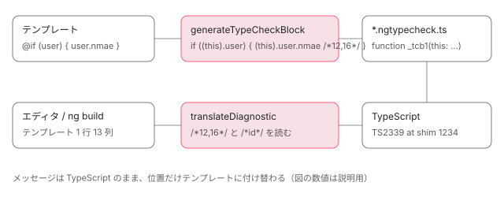

[目次](../README.md) › [テンプレートコンパイラの内側](README.md) › 第 17 回 / 全 18 回

# 型検査：Type Check Block（TCB）がテンプレートを TypeScript にする

> compiler/src/typecheck/type\_check\_block.ts の generateTypeCheckBlock が R3 AST と BoundTarget から、テンプレートの各バインディングを TypeScript の式に書き直した関数を文字列で組み立てる手順。ops の要素・入力・イベント・@if の型の絞り込み・@for、strictTemplates（v22 では書かなければ真）で変わるもの、codegen.ts が書く /\*start,end\*/ の位置コメントを compiler-cli が読んで TS のエラー位置をテンプレートに戻す仕組み。TypeCheckContext と shim ファイル。

angular/angular · 読了 約 15 分 · 発展 · [サイトで読む（デモが動きます）](https://angular-deep-dive-cyan.vercel.app/chapter/compiler-typecheck)

---

テンプレートの `{{ user.nmae }}` が「Property 'nmae' does not exist」という**TypeScript のエラー**として出るのは、コンパイラがテンプレートを TypeScript の関数に書き直し、それを TypeScript 自身に型検査させているからです。この関数を **Type Check Block（TCB）**と呼びます。この章では、`generateTypeCheckBlock` が R3 AST と BoundTarget（[第 9 回](09-compiler-binder.md)）から TCB の文字列を作る手順、要素・式・イベント・`@if`・`@for` の書き直し方、`strictTemplates` で変わる設定、そして TypeScript のエラー位置を `/*開始,終了*/` のコメントからテンプレートの位置に戻す仕組みを読みます。

読む対象は `compiler/src/typecheck/` の `type_check_block.ts`・`expression.ts`・`ops/`（`base.ts`・`scope.ts`・`codegen.ts`・`element.ts`・`expression.ts`・`events.ts`・`if_block.ts`・`for_block.ts`）、`compiler-cli/src/ngtsc/typecheck/src/` の `context.ts`・`type_check_file.ts`・`shim.ts`・`comments.ts`・`tcb_util.ts`・`diagnostics.ts`・`checker.ts`、`ngtsc/core/src/compiler.ts` の `getTypeCheckingConfig`、そしてテスト `type_check_block_spec.ts`・`span_comments_spec.ts` です。

1. [1. 全体図](01-compiler.md)
2. [2. コンパイラの入口](02-compiler-entry.md)
3. [3. HTML の字句解析](03-compiler-html-lexer.md)
4. [4. HTML の構文解析](04-compiler-html-parser.md)
5. [5. 式のパーサ](05-compiler-expression-parser.md)
6. [6. バインディングのパーサ](06-compiler-binding-parser.md)
7. [7. R3 AST](07-compiler-r3-ast.md)
8. [8. ブロック構文の解析](08-compiler-control-flow-blocks.md)
9. [9. ディレクティブの照合](09-compiler-binder.md)
10. [10. IR への写像](10-compiler-ingest.md)
11. [11. IR の構造](11-compiler-ir.md)
12. [12. decls・vars・advance](12-compiler-slots-vars.md)
13. [13. 変数とコンテキスト](13-compiler-variables.md)
14. [14. 定数配列と pure function](14-compiler-consts-pure.md)
15. [15. 制御フローのフェーズ](15-compiler-control-flow-phases.md)
16. [16. reify と出力](16-compiler-reify-emit.md)
17. **17. 型検査（TCB）**（この章）
18. [18. スタイルのカプセル化](18-compiler-shadow-css.md)

## 1. TCB とは：テストの期待値で見る

📄 `angular/packages/compiler-cli/src/ngtsc/typecheck/test/type_check_block_spec.ts` L27–32 （▶ の行: 31）

```ts
27 │ describe('type check blocks', () => {
28 │   beforeEach(() => initMockFileSystem('Native'));
29 │ 
30 │   it('should generate a basic block for a binding', () => {
31 ▶     expect(tcb('{{hello}} {{world}}')).toContain('"" + (((this).hello)) + (((this).world));');
32 │   });
```
*type\_check\_block\_spec.ts（TCB の単体テスト。テスト用の tcb() は位置コメントを消して空白を詰めた文字列を返す）*

31 行目、`{{hello}} {{world}}` が `"" + (((this).hello)) + (((this).world));` になっています。TCB は `this` の型がコンポーネントクラスの関数で（3 節）、テンプレートの式は「`this.` を補った TypeScript の式」として並びます。**実行はされません**。TypeScript に読ませて型エラーを出させるためだけのコードです。

📄 `angular/packages/compiler-cli/src/ngtsc/typecheck/test/span_comments_spec.ts` L106–111 （▶ の行: 107, 109）

```ts
106 │     it('should annotate property access', () => {
107 ▶       const TEMPLATE = `{{ a.b.c }}`;
108 │       expect(tcbWithSpans(TEMPLATE)).toContain(
109 ▶         '((((((this).a /*3,4*/) /*3,4*/).b /*5,6*/) /*3,6*/).c /*7,8*/) /*3,8*/',
110 │       );
111 │     });
```
*span\_comments\_spec.ts（位置コメントを残した版）*

コメントを残すと、`{{ a.b.c }}` は 109 行目のように、部分式ごとに `/*3,4*/` のような**テンプレート内の文字位置**のコメントが付いています。`a` はテンプレートの 3〜4 文字目、`a.b` は 3〜6 文字目。7 節でこのコメントが「エラー位置を戻す」鍵になります。

## 2. compiler-cli：どのファイルに TCB を書くか

📄 `angular/packages/compiler-cli/src/ngtsc/typecheck/src/context.ts` L236–269 （▶ の行: 244, 250–251, 260–262）

```ts
236 │   addDirective(
237 │     ref: Reference<ClassDeclaration<ts.ClassDeclaration>>,
238 │     binder: R3TargetBinder<TypeCheckableDirectiveMeta>,
239 │     schemas: SchemaMetadata[],
240 │     templateContext: TemplateContext | null,
241 │     hostBindingContext: HostBindingsContext | null,
242 │     isStandalone: boolean,
243 │   ): void {
244 ▶     if (!this.host.shouldCheckClass(ref.node)) {
245 │       return;
246 │     }
247 │ 
248 │     const sourceFile = ref.node.getSourceFile();
249 │     const fileData = this.dataForFile(sourceFile);
250 ▶     const shimData = this.pendingShimForClass(ref.node);
251 ▶     const id = fileData.sourceManager.getTypeCheckId(ref.node);
252 │     const templateParsingDiagnostics: TemplateDiagnostic[] = [];
253 │ 
254 │     if (templateContext !== null && templateContext.parseErrors !== null) {
255 │       templateParsingDiagnostics.push(
256 │         ...getTemplateDiagnostics(templateContext.parseErrors, id, templateContext.sourceMapping),
257 │       );
258 │     }
259 │ 
260 ▶     const boundTarget = binder.bind({
261 ▶       template: templateContext?.nodes,
262 ▶       host:
263 │         hostBindingContext === null
264 │           ? undefined
265 │           : {
266 │               node: hostBindingContext.node,
267 │               directives: hostBindingContext.directives,
268 │             },
269 │     });
```

📄 `angular/packages/compiler-cli/src/ngtsc/typecheck/src/context.ts` L621–636 （▶ の行: 623, 630）

```ts
621 │   private pendingShimForClass(node: ts.ClassDeclaration): PendingShimData {
622 │     const fileData = this.dataForFile(node.getSourceFile());
623 ▶     const shimPath = TypeCheckShimGenerator.shimFor(absoluteFromSourceFile(node.getSourceFile()));
624 │     if (!fileData.shimData.has(shimPath)) {
625 │       fileData.shimData.set(shimPath, {
626 │         domSchemaChecker: new RegistryDomSchemaChecker(fileData.sourceManager),
627 │         oobRecorder: new OutOfBandDiagnosticRecorderImpl(fileData.sourceManager, (name) =>
628 │           this.compilerHost.getSourceFile(name, ts.ScriptTarget.Latest),
629 │         ),
630 ▶         file: new TypeCheckFile(shimPath, this.config, this.refEmitter, this.compilerHost),
631 │         data: new Map<TypeCheckId, TypeCheckData>(),
632 │         shimDiagnostics: null,
633 │       });
634 │     }
635 │     return fileData.shimData.get(shimPath)!;
636 │   }
```

📄 `angular/packages/compiler-cli/src/ngtsc/typecheck/src/context.ts` L381–420 （▶ の行: 382–384, 388, 411–412, 418）

```ts
381 │     this.perf.eventCount(PerfEvent.GenerateTcb);
382 ▶     if (
383 ▶       inliningRequirement !== TcbInliningRequirement.None &&
384 ▶       (this.inlining === InliningMode.InlineOps || this.inlining === InliningMode.CopySourceToTcb)
385 │     ) {
386 │       // Queue operations for both inline and copy strategy!
387 │       // The decision on where to apply them will be made in finalize().
388 ▶       this.addInlineTypeCheckBlock(fileData, shimData, ref, meta);
389 │ 
390 │       if (this.inlining === InliningMode.CopySourceToTcb) {
391 │         // Still set the original file path to force local references for symbols from this file.
392 │         shimData.file.copiedSourceOriginPath = absoluteFromSourceFile(sourceFile);
393 │       }
394 │     } else if (
395 │       inliningRequirement === TcbInliningRequirement.ShouldInlineForGenericBounds &&
396 │       this.inlining === InliningMode.Error
397 │     ) {
398 │       // It's suggested that this TCB should be generated inline due to the class' generic
399 │       // bounds, but inlining is not supported by the current environment. Use a non-inline type
400 │       // check block, but fall back to `any` generic parameters since the generic bounds can't be
401 │       // referenced in that context. This will infer a less useful type for the class, but allow
402 │       // for type-checking it in an environment where that would not be possible otherwise.
403 │       shimData.file.addTypeCheckBlock(
404 │         ref,
405 │         meta,
406 │         shimData.domSchemaChecker,
407 │         shimData.oobRecorder,
408 │         TcbGenericContextBehavior.FallbackToAny,
409 │         this.reflector,
410 │       );
411 ▶     } else {
412 ▶       shimData.file.addTypeCheckBlock(
413 │         ref,
414 │         meta,
415 │         shimData.domSchemaChecker,
416 │         shimData.oobRecorder,
417 │         TcbGenericContextBehavior.UseEmitter,
418 ▶         this.reflector,
419 │       );
420 │     }
```

1. **244〜269 行目：コンポーネント 1 つごとに `addDirective`**

   `ComponentDecoratorHandler.typeCheck`（handler.ts）がテンプレートのノードとディレクティブの照合器を渡して呼びます。260〜269 行目で `binder.bind` を呼び、「どの要素にどのディレクティブが付き、どの名前がどの変数を指すか」の `BoundTarget` を作ります。
2. **250 行目と 623・630 行目：元ファイルの隣の「shim ファイル」を用意**

   `app.component.ts` なら `app.component.ngtypecheck.ts`。その中身を組み立てる係が `TypeCheckFile` です。
3. **382〜388 行目と 411〜419 行目：書き先は 2 通り**

   ふつうは 411〜419 行目で shim ファイルに TCB を足します。コンポーネントやそのパイプが export されていない、型引数の制約が shim ファイルから参照できない、のどれかのときだけ（tcb\_util.ts の `requiresInlineTypeCheckBlock`）、元のファイルのクラスの直後に TCB の関数を差し込む「inline」方式になります（388 行目。shim からは export されていないクラスを import できないため）。

📄 `angular/packages/compiler-cli/src/ngtsc/typecheck/src/type_check_file.ts` L76–101 （▶ の行: 84, 92–95, 100）

```ts
 76 │   addTypeCheckBlock(
 77 │     ref: Reference<ClassDeclaration<ts.ClassDeclaration>>,
 78 │     meta: TypeCheckBlockMetadata,
 79 │     domSchemaChecker: DomSchemaChecker<unknown>,
 80 │     oobRecorder: OutOfBandDiagnosticRecorder<unknown>,
 81 │     genericContextBehavior: TcbGenericContextBehavior,
 82 │     reflector: ReflectionHost,
 83 │   ): void {
 84 ▶     const fnId = `${TCB_FUNCTION_PREFIX}${this.nextTcbId++}`;
 85 │     const {tcbMeta, component} = adaptTypeCheckBlockMetadata(
 86 │       ref,
 87 │       meta,
 88 │       this,
 89 │       reflector,
 90 │       genericContextBehavior,
 91 │     );
 92 ▶     const fn = generateTypeCheckBlock(
 93 ▶       this,
 94 ▶       component,
 95 ▶       fnId,
 96 │       tcbMeta,
 97 │       domSchemaChecker,
 98 │       oobRecorder,
 99 │     );
100 ▶     this.tcbStatements.push(fn);
101 │   }
```

84 行目、関数名は `_tcb1`、`_tcb2`…。92〜99 行目で **compiler パッケージの `generateTypeCheckBlock`** を呼び、返ってきた文字列を 100 行目で貯めます。TCB の中身を作るのは compiler 側、ファイルの置き場所と診断の対応付けは compiler-cli 側という分担です。

📄 `angular/packages/compiler-cli/src/ngtsc/typecheck/src/type_check_file.ts` L117–151 （▶ の行: 120, 125, 142–143, 149）

```ts
117 │     const printer = ts.createPrinter();
118 │     let source = this.sourceContent;
119 │ 
120 ▶     const newImports = importChanges.newImports.get(this.contextFile.fileName);
121 │     if (newImports !== undefined) {
122 │       if (source.length > 0 && !source.endsWith('\n')) {
123 │         source += '\n';
124 │       }
125 ▶       source += newImports
126 │         .map((i) => printer.printNode(ts.EmitHint.Unspecified, i, this.contextFile))
127 │         .join('\n');
128 │     }
129 │ 
130 │     source += '\n';
131 │ 
132 │     for (const expr of this.pipeInstStatements) {
133 │       source += `${expr.print()};\n`;
134 │     }
135 │ 
136 │     for (const expr of this.typeCtorStatements) {
137 │       source += `${expr.print()};\n`;
138 │     }
139 │ 
140 │     source += '\n';
141 │ 
142 ▶     for (const stmt of this.tcbStatements) {
143 ▶       source += stmt + '\n';
144 │     }
145 │ 
146 │     // Ensure the template type-checking file is an ES module. Otherwise, it's interpreted as some
147 │     // kind of global namespace in TS, which forces a full re-typecheck of the user's program that
148 │     // is somehow more expensive than the initial parse.
149 ▶     source += '\nexport const IS_A_MODULE = true;\n';
150 │ 
151 │     return source;
```

📄 `angular/packages/compiler-cli/src/ngtsc/typecheck/src/context.ts` L571–590 （▶ の行: 583–585, 588）

```ts
571 │         // Set the source content on the shim file before rendering!
572 │         const originalSf = pendingFileData.sourceFile;
573 │         if (originalSf !== undefined) {
574 │           const transformedText = this.generateCopiedShimContent(
575 │             originalSf,
576 │             pendingShimData.file.fileName,
577 │           );
578 │           if (transformedText !== null) {
579 │             pendingShimData.file.setSourceContent(transformedText);
580 │           }
581 │         }
582 │ 
583 ▶         const sfText = pendingShimData.file.render();
584 ▶         updates.set(pendingShimData.file.fileName, {
585 ▶           newText: sfText,
586 │ 
587 │           // Shim files do not have an associated original file.
588 ▶           originalFile: null,
589 │         });
590 │       }
```

📄 `angular/packages/compiler-cli/src/ngtsc/typecheck/src/shim.ts` L14–49 （▶ の行: 15–19, 22–23, 40, 47–48）

```ts
14 │ /**
15 ▶  * A `ShimGenerator` which adds type-checking files to the `ts.Program`.
16 ▶  *
17 ▶  * This is a requirement for performant template type-checking, as TypeScript will only reuse
18 ▶  * information in the main program when creating the type-checking program if the set of files in
19 ▶  * each are exactly the same. Thus, the main program also needs the synthetic type-checking files.
20 │  */
21 │ export class TypeCheckShimGenerator implements PerFileShimGenerator {
22 ▶   readonly extensionPrefix = 'ngtypecheck';
23 ▶   readonly shouldEmit = false;
24 │ 
25 │   generateShimForFile(
26 │     sf: ts.SourceFile,
27 │     genFilePath: AbsoluteFsPath,
28 │     priorShimSf: ts.SourceFile | null,
29 │   ): ts.SourceFile {
30 │     if (priorShimSf !== null) {
31 │       // If this shim existed in the previous program, reuse it now. It might not be correct, but
32 │       // reusing it in the main program allows the shape of its imports to potentially remain the
33 │       // same and TS can then use the fastest path for incremental program creation. Later during
34 │       // the type-checking phase it's going to either be reused, or replaced anyways. Thus there's
35 │       // no harm in reuse here even if it's out of date.
36 │       return priorShimSf;
37 │     }
38 │     return ts.createSourceFile(
39 │       genFilePath,
40 ▶       'export const USED_FOR_NG_TYPE_CHECKING = true;',
41 │       ts.ScriptTarget.Latest,
42 │       true,
43 │       ts.ScriptKind.TS,
44 │     );
45 │   }
46 │ 
47 ▶   static shimFor(fileName: AbsoluteFsPath): AbsoluteFsPath {
48 ▶     return absoluteFrom(fileName.replace(/\.tsx?$/, '.ngtypecheck.ts'));
49 │   }
```

`render` は import 文（120〜128 行目）、パイプや型コンストラクタの宣言、TCB の関数（142〜144 行目）を 1 つの文字列にし、149 行目で ES モジュールにするための 1 行を足します。`finalize` の 583〜589 行目がそれを shim ファイルの新しい中身として返します。shim ファイルは、最初のプログラムでは 40 行目の 1 行だけのダミー（TypeScript がプログラムを再利用できるよう、ファイルの集合を揃えておくため。15〜19 行目のコメント）で、型検査用のプログラムを作るときに TCB 入りの中身に差し替えられます。23 行目の `shouldEmit = false` で、`.js` として出力されることはありません。

## 3. generateTypeCheckBlock：関数の外枠

📄 `angular/packages/compiler/src/typecheck/type_check_block.ts` L29–58 （▶ の行: 37, 42, 48, 58）

```ts
29 │ export function generateTypeCheckBlock(
30 │   env: TcbEnvironment,
31 │   component: TcbComponentMetadata,
32 │   name: string,
33 │   meta: TcbTypeCheckBlockMetadata,
34 │   domSchemaChecker: DomSchemaChecker<unknown>,
35 │   oobRecorder: OutOfBandDiagnosticRecorder<unknown>,
36 │ ): string {
37 ▶   const tcb = new Context(
38 │     env,
39 │     domSchemaChecker,
40 │     oobRecorder,
41 │     meta.id,
42 ▶     meta.boundTarget,
43 │     meta.pipes,
44 │     meta.schemas,
45 │     meta.isStandalone,
46 │     meta.preserveWhitespaces,
47 │   );
48 ▶   const ctxRawType = env.referenceTcbValue(component.ref);
49 │   const {typeParameters, typeArguments} = component;
50 │ 
51 │   const typeParamsStr =
52 │     !env.config.useContextGenericType || typeParameters === null || typeParameters.length === 0
53 │       ? ''
54 │       : `<${typeParameters.map((p) => p.representation).join(', ')}>`;
55 │   const typeArgsStr =
56 │     typeArguments === null || typeArguments.length === 0 ? '' : `<${typeArguments.join(', ')}>`;
57 │ 
58 ▶   const thisParamStr = `this: ${ctxRawType.print()}${typeArgsStr}`;
```

📄 `angular/packages/compiler/src/typecheck/type_check_block.ts` L59–84 （▶ の行: 62–63, 67, 71, 75–77, 81, 83）

```ts
59 │   const statements: string[] = [];
60 │ 
61 │   // Add the template type checking code.
62 ▶   if (tcb.boundTarget.target.template !== undefined) {
63 ▶     const templateScope = Scope.forNodes(
64 │       tcb,
65 │       null,
66 │       null,
67 ▶       tcb.boundTarget.target.template,
68 │       /* guard */ null,
69 │     );
70 │ 
71 ▶     statements.push(renderBlockStatements(env, templateScope, 'true'));
72 │   }
73 │ 
74 │   // Add the host bindings type checking code.
75 ▶   if (tcb.boundTarget.target.host !== undefined) {
76 ▶     const hostScope = Scope.forNodes(tcb, null, tcb.boundTarget.target.host.node, null, null);
77 ▶     statements.push(renderBlockStatements(env, hostScope, createHostBindingsBlockGuard()));
78 │   }
79 │ 
80 │   const bodyStr = `{\n${statements.join('\n')}\n}`;
81 ▶   const funcDeclStr = `function ${name}${typeParamsStr}(${thisParamStr}) ${bodyStr}`;
82 │ 
83 ▶   return `/*${meta.id}*/\n${funcDeclStr}`;
84 │ }
```

📄 `angular/packages/compiler/src/typecheck/type_check_block.ts` L86–99 （▶ の行: 92–93, 98）

```ts
86 │ function renderBlockStatements(
87 │   env: TcbEnvironment,
88 │   scope: Scope,
89 │   wrapperExpression: string,
90 │ ): string {
91 │   // Note: this needs to be called first so that it can populate the prelude statements.
92 ▶   const scopeStatements = scope.render();
93 ▶   const statements = getStatementsBlock([...env.getPreludeStatements(), ...scopeStatements]);
94 │ 
95 │   // Wrap the body in an if statement. This serves two purposes:
96 │   // 1. It allows us to distinguish between the sections of the block (e.g. host or template).
97 │   // 2. It allows the `ts.Printer` to produce better-looking output.
98 ▶   return `if (${wrapperExpression}) {\n${statements}\n}`;
99 │ }
```

1. **37〜47 行目：`Context` に必要なものを集める**

   42 行目の `boundTarget`（2 節で作った照合結果）、パイプ、スキーマなど。
2. **48・58 行目：`this: コンポーネントの型`**

   TCB の関数は `this` 引数の型だけを宣言します。テンプレートの `name` は `this.name` になるので、**コンポーネントのプロパティの型がそのまま使われます**。
3. **62〜72 行目：テンプレート全体の `Scope` を作って描く**

   `Scope`（4 節）は「1 つのテンプレート（または子テンプレート）分の文の並び」を作る係です。71 行目で `if (true) { … }` に包みます（98 行目）。
4. **75〜78 行目：ホストバインディングも同じ関数に**

   `host: {…}` も別の if ブロックとして型検査されます。
5. **81〜83 行目：文字列で返す**

   `/*id*/ function _tcb1(this: i0.AppComponent) { … }`。TCB は TypeScript の構文木ではなく**文字列**で作られます。先頭の `/*id*/` は、エラーが出たときに「どのコンポーネントの TCB か」を引くための印です（7 節）。

## 4. Scope と TcbOp：テンプレートを op の列にしてから実行する

📄 `angular/packages/compiler/src/typecheck/ops/scope.ts` L489–500 （▶ の行: 490–491, 496–497, 499）

```ts
489 │   private appendNode(node: Node): void {
490 ▶     if (node instanceof Element) {
491 ▶       const opIndex = this.opQueue.push(new TcbElementOp(this.tcb, this, node)) - 1;
492 │       this.elementOpMap.set(node, opIndex);
493 │       if (this.tcb.env.config.controlFlowPreventingContentProjection !== 'suppress') {
494 │         this.appendContentProjectionCheckOp(node);
495 │       }
496 ▶       this.appendDirectivesAndInputsOfElementLikeNode(node);
497 ▶       this.appendOutputsOfElementLikeNode(node, node.inputs, node.outputs);
498 │       this.appendSelectorlessDirectives(node);
499 ▶       this.appendChildren(node);
500 │       this.checkAndAppendReferencesOfNode(node);
```

📄 `angular/packages/compiler/src/typecheck/ops/scope.ts` L516–528 （▶ の行: 518–519, 524–525, 527–528）

```ts
516 │     } else if (node instanceof DeferredBlock) {
517 │       this.appendDeferredBlock(node);
518 ▶     } else if (node instanceof IfBlock) {
519 ▶       this.opQueue.push(new TcbIfBlockOp(this.tcb, this, node));
520 │     } else if (node instanceof BoundaryBlock) {
521 │       this.opQueue.push(new TcbBoundaryOp(this.tcb, this, node));
522 │     } else if (node instanceof SwitchBlock) {
523 │       this.opQueue.push(new TcbSwitchOp(this.tcb, this, node));
524 ▶     } else if (node instanceof ForLoopBlock) {
525 ▶       this.opQueue.push(new TcbForOfOp(this.tcb, this, node));
526 │       node.empty && this.tcb.env.config.checkControlFlowBodies && this.appendChildren(node.empty);
527 ▶     } else if (node instanceof BoundText) {
528 ▶       this.opQueue.push(new TcbExpressionOp(this.tcb, this, node.value));
```

`Scope.appendNode` は R3 AST のノードの種類ごとに `TcbOp` を `opQueue` に積みます。要素なら `TcbElementOp` と、付いたディレクティブの入力（496 行目）・出力（497 行目）の op と、子（499 行目）。`@if` は 519 行目、`@for` は 525 行目、`{{式}}`（`BoundText`）は 528 行目です。

📄 `angular/packages/compiler/src/typecheck/ops/base.ts` L28–54 （▶ の行: 34, 36, 46, 53）

```ts
28 │ export abstract class TcbOp {
29 │   /**
30 │    * Set to true if this operation can be considered optional. Optional operations are only executed
31 │    * when depended upon by other operations, otherwise they are disregarded. This allows for less
32 │    * code to generate, parse and type-check, overall positively contributing to performance.
33 │    */
34 ▶   abstract readonly optional: boolean;
35 │ 
36 ▶   abstract execute(): TcbExpr | null;
37 │ 
38 │   /**
39 │    * Replacement value or operation used while this `TcbOp` is executing (i.e. to resolve circular
40 │    * references during its execution).
41 │    *
42 │    * This is usually a `null!` expression (which asks TS to infer an appropriate type), but another
43 │    * `TcbOp` can be returned in cases where additional code generation is necessary to deal with
44 │    * circular references.
45 │    */
46 ▶   circularFallback(): TcbOp | TcbExpr {
47 │     // Value used to break a circular reference between `TcbOp`s.
48 │     //
49 │     // This value is returned whenever `TcbOp`s have a circular dependency. The
50 │     // expression is a non-null assertion of the null value (in TypeScript, the
51 │     // expression `null!`). This construction will infer the least narrow type
52 │     // for whatever it's assigned to.
53 ▶     return new TcbExpr('null!');
54 │   }
```

📄 `angular/packages/compiler/src/typecheck/ops/scope.ts` L336–344 （▶ の行: 337, 340–341）

```ts
336 │   render(): TcbExpr[] {
337 ▶     for (let i = 0; i < this.opQueue.length; i++) {
338 │       // Optional statements cannot be skipped when we are generating the TCB for use
339 │       // by the TemplateTypeChecker.
340 ▶       const skipOptional = !this.tcb.env.config.enableTemplateTypeChecker;
341 ▶       this.executeOp(i, skipOptional);
342 │     }
343 │     return this.statements;
344 │   }
```

📄 `angular/packages/compiler/src/typecheck/ops/scope.ts` L466–487 （▶ の行: 468–469, 472–473, 479–480, 485）

```ts
466 │   private executeOp(opIndex: number, skipOptional: boolean): TcbExpr | null {
467 │     const op = this.opQueue[opIndex];
468 ▶     if (!(op instanceof TcbOp)) {
469 ▶       return op === null ? null : new TcbExpr(op.print(true /* ignoreComments */));
470 │     }
471 │ 
472 ▶     if (skipOptional && op.optional) {
473 ▶       return null;
474 │     }
475 │ 
476 │     // Set the result of the operation in the queue to its circular fallback. If executing this
477 │     // operation results in a circular dependency, this will prevent an infinite loop and allow for
478 │     // the resolution of such cycles.
479 ▶     this.opQueue[opIndex] = op.circularFallback();
480 ▶     let res = op.execute();
481 │     if (res !== null) {
482 │       res = new TcbExpr(res.print(true /* ignoreComments */));
483 │     }
484 │     // Once the operation has finished executing, it's safe to cache the real result.
485 ▶     this.opQueue[opIndex] = res;
486 │     return res;
487 │   }
```

op は**積んだ順に実行されるとは限りません**。ある式が後ろの要素の参照（`#ref`）を使うと、その要素の op が先に要ります。そこで 485 行目、実行した op は結果の式で置き換えて使い回し（2 度目は 468〜469 行目でそれを返す）、479 行目で実行中の op を `circularFallback`（53 行目の `null!`）に差し替えて循環を断ちます。472〜474 行目、`optional`（34 行目）な op は、誰かに参照されたときだけ実行されます。要素の宣言がそれです（次節）。

## 5. 要素と式の書き直し

📄 `angular/packages/compiler/src/typecheck/ops/element.ts` L30–49 （▶ の行: 30, 34, 43, 45）

```ts
30 ▶   override get optional() {
31 │     // The statement generated by this operation is only used for type-inference of the DOM
32 │     // element's type and won't report diagnostics by itself, so the operation is marked as optional
33 │     // to avoid generating statements for DOM elements that are never referenced.
34 ▶     return true;
35 │   }
36 │ 
37 │   override execute(): TcbExpr {
38 │     const id = this.tcb.allocateId();
39 │     const idNode = new TcbExpr(id);
40 │     idNode.addParseSpanInfo(this.element.startSourceSpan || this.element.sourceSpan);
41 │ 
42 │     // Add the declaration of the element using document.createElement.
43 ▶     const initializer = new TcbExpr(`document.createElement("${this.element.name}")`);
44 │     initializer.addParseSpanInfo(this.element.startSourceSpan || this.element.sourceSpan);
45 ▶     const stmt = new TcbExpr(`var ${idNode.print()} = ${initializer.print()}`);
46 │     stmt.addParseSpanInfo(this.element.startSourceSpan || this.element.sourceSpan);
47 │     this.scope.addStatement(stmt);
48 │     return idNode;
49 │   }
```

要素は 43〜45 行目で `var _t1 = document.createElement("input")` になります。TypeScript の `lib.dom.d.ts` の型定義から `HTMLInputElement` 型が付くので、`#ref` の型や DOM イベントの `$event` の型がここから決まります。optional なので、誰も参照しなければ書き出されません（34 行目）。

📄 `angular/packages/compiler/src/typecheck/ops/expression.ts` L54–72 （▶ の行: 67–69）

```ts
54 │ export class TcbExpressionOp extends TcbOp {
55 │   constructor(
56 │     private tcb: Context,
57 │     private scope: Scope,
58 │     private expression: AST,
59 │   ) {
60 │     super();
61 │   }
62 │ 
63 │   override get optional() {
64 │     return false;
65 │   }
66 │ 
67 ▶   override execute(): null {
68 ▶     const expr = tcbExpression(this.expression, this.tcb, this.scope);
69 ▶     this.scope.addStatement(expr);
70 │     return null;
71 │   }
72 │ }
```

📄 `angular/packages/compiler/src/typecheck/expression.ts` L49–76 （▶ の行: 49, 70–72, 75）

```ts
49 ▶ export function astToTcbExpr(
50 │   ast: AST,
51 │   maybeResolve: (ast: AST) => TcbExpr | null,
52 │   config: TypeCheckingConfig,
53 │ ): TcbExpr {
54 │   const translator = new TcbExprTranslator(maybeResolve, config);
55 │   return translator.translate(ast);
56 │ }
57 │ 
58 │ class TcbExprTranslator implements AstVisitor {
59 │   constructor(
60 │     private maybeResolve: (ast: AST) => TcbExpr | null,
61 │     private config: TypeCheckingConfig,
62 │   ) {}
63 │ 
64 │   translate(ast: AST): TcbExpr {
65 │     if (ast instanceof ASTWithSource) {
66 │       ast = ast.ast;
67 │     }
68 │ 
69 │     // First attempt to let any custom resolution logic provide a translation for the given node.
70 ▶     const resolved = this.maybeResolve(ast);
71 ▶     if (resolved !== null) {
72 ▶       return resolved;
73 │     }
74 │ 
75 ▶     return ast.visit(this);
76 │   }
```

📄 `angular/packages/compiler/src/typecheck/ops/expression.ts` L108–139 （▶ の行: 112, 122, 127–128, 139）

```ts
108 │   translate(ast: AST): TcbExpr {
109 │     // `astToTcbExpr` actually does the conversion. A special resolver `tcbResolve` is passed
110 │     // which interprets specific expression nodes that interact with the `ImplicitReceiver`. These
111 │     // nodes actually refer to identifiers within the current scope.
112 ▶     return astToTcbExpr(ast, (ast: AST) => this.resolve(ast), this.tcb.env.config);
113 │   }
114 │ 
115 │   /**
116 │    * Resolve an `AST` expression within the given scope.
117 │    *
118 │    * Some `AST` expressions refer to top-level concepts (references, variables, the component
119 │    * context). This method assists in resolving those.
120 │    */
121 │   protected resolve(ast: AST): TcbExpr | null {
122 ▶     if (ast instanceof PropertyRead && ast.receiver instanceof ImplicitReceiver) {
123 │       // Try to resolve a bound target for this expression. If no such target is available, then
124 │       // the expression is referencing the top-level component context. In that case, `null` is
125 │       // returned here to let it fall through resolution so it will be caught when the
126 │       // `ImplicitReceiver` is resolved in the branch below.
127 ▶       const target = this.tcb.boundTarget.getExpressionTarget(ast);
128 ▶       const targetExpression = target === null ? null : this.getTargetNodeExpression(target, ast);
129 │       if (target instanceof LetDeclaration && !this.isValidLetDeclarationAccess(target, ast)) {
130 │         this.tcb.oobRecorder.letUsedBeforeDefinition(this.tcb.id, ast, target);
131 │         // Cast the expression to `any` so we don't produce additional diagnostics.
132 │         // We don't use `markIgnoreForDiagnostics` here, because it won't prevent duplicate
133 │         // diagnostics for nested accesses in cases like `@let value = value.foo.bar.baz`.
134 │         if (targetExpression !== null) {
135 │           return new TcbExpr(`${targetExpression.print()} as any`);
136 │         }
137 │       }
138 │ 
139 ▶       return targetExpression;
```

📄 `angular/packages/compiler/src/typecheck/ops/expression.ts` L166–179 （▶ の行: 166, 179）

```ts
166 ▶     } else if (ast instanceof ImplicitReceiver || ast instanceof ThisReceiver) {
167 │       // AST instances representing variables and references look very similar to property reads
168 │       // or method calls from the component context: both have the shape
169 │       // PropertyRead(ImplicitReceiver, 'propName') or Call(ImplicitReceiver, 'methodName').
170 │       //
171 │       // `translate` will first try to `resolve` the outer PropertyRead/Call. If this works,
172 │       // it's because the `BoundTarget` found an expression target for the whole expression, and
173 │       // therefore `translate` will never attempt to `resolve` the ImplicitReceiver of that
174 │       // PropertyRead/Call.
175 │       //
176 │       // Therefore if `resolve` is called on an `ImplicitReceiver`, it's because no outer
177 │       // PropertyRead/Call resolved to a variable or reference, and therefore this is a
178 │       // property read or method call on the component context itself.
179 ▶       return new TcbExpr('this');
```

1. **68 行目：式（[第 5 回](05-compiler-expression-parser.md)の AST）を `TcbExpr` に**

   `astToTcbExpr` は AST の訪問者で、70 行目でまず `resolve`（112 行目で渡した関数）に「この節点は特別か」を尋ね、特別でなければ 75 行目で普通に訳します。
2. **122〜139 行目：名前がテンプレート内の変数なら、その変数に**

   `item`（`@for` の変数）や `#ref` は、127 行目で BoundTarget に「この名前は何を指すか」を尋ね、指す先があれば `_t1` のような TCB の変数にします。
3. **166〜179 行目：どれでもなければ `this`**

   暗黙のレシーバ（`name` の前に隠れている「誰の」）が解決できなければコンポーネントのプロパティなので、179 行目で `this` にします。

📄 `angular/packages/compiler/src/typecheck/expression.ts` L239–270 （▶ の行: 246, 252, 254, 262–263, 267）

```ts
239 │   visitPropertyRead(ast: PropertyRead): TcbExpr {
240 │     const receiver = this.translate(ast.receiver);
241 │     const isSafeChain = this.isStrictSafeNavigationChain(ast.receiver);
242 │     if (!isSafeChain) {
243 │       receiver.wrapForTypeChecker();
244 │     }
245 │ 
246 ▶     const node = new TcbExpr(`${receiver.print()}.${ast.name}`).addParseSpanInfo(ast.nameSpan);
247 │ 
248 │     let result: TcbExpr;
249 │     if (isSafeChain) {
250 │       result = new TcbExpr(node.print());
251 │     } else {
252 ▶       result = node.wrapForTypeChecker();
253 │     }
254 ▶     return result.addParseSpanInfo(ast.sourceSpan);
255 │   }
256 │ 
257 │   visitSafePropertyRead(ast: SafePropertyRead): TcbExpr {
258 │     let node: TcbExpr;
259 │     const receiver = this.translate(ast.receiver).wrapForTypeChecker();
260 │     const name = new TcbExpr(ast.name).addParseSpanInfo(ast.nameSpan);
261 │ 
262 ▶     if (this.config.strictSafeNavigationTypes) {
263 ▶       node = new TcbExpr(`${receiver.print()}?.${name.print()}`);
264 │     } else if (VeSafeLhsInferenceBugDetector.veWillInferAnyFor(ast)) {
265 │       node = new TcbExpr(`(${receiver.print()} as any).${name.print()}`);
266 │     } else {
267 ▶       node = new TcbExpr(`(${receiver.print()}!.${name.print()} as any)`);
268 │     }
269 │     return node.addParseSpanInfo(ast.sourceSpan);
270 │   }
```

📄 `angular/packages/compiler/src/typecheck/expression.ts` L136–143 （▶ の行: 142）

```ts
136 │   visitInterpolation(ast: Interpolation): TcbExpr {
137 │     const exprs = ast.expressions.map((e) => {
138 │       const node = this.translate(e);
139 │       node.wrapForTypeChecker();
140 │       return node.print();
141 │     });
142 ▶     return new TcbExpr(`"" + ${exprs.join(' + ')}`);
143 │   }
```

`a.b` は 246 行目で `(レシーバ).b` に、252 行目で括弧で包み（コメントが正しいノードに付くように）、254 行目で範囲のコメントを付けます。補間は 142 行目で `"" + 式 + 式`（1 節 31 行目の形）。`a?.b` は 262〜263 行目で TypeScript の `?.` そのままになるか、267 行目の `(a!.b as any)` になるかが設定で変わります（6 節）。

## 6. @if が型を絞り込む理由と、@for

📄 `angular/packages/compiler/src/typecheck/ops/if_block.ts` L36–74 （▶ の行: 37, 50, 52, 59, 63–66, 69–71, 73）

```ts
36 │   override execute(): null {
37 ▶     const root = this.generateBranch(0);
38 │     root && this.scope.addStatement(root);
39 │     return null;
40 │   }
41 │ 
42 │   private generateBranch(index: number): TcbExpr | undefined {
43 │     const branch = this.block.branches[index];
44 │ 
45 │     if (!branch) {
46 │       return undefined;
47 │     }
48 │ 
49 │     // If the expression is null, it means that it's an `else` statement.
50 ▶     if (branch.expression === null) {
51 │       const branchScope = this.getBranchScope(this.scope, branch, index);
52 ▶       return new TcbExpr(`{\n${getStatementsBlock(branchScope.render())}}`);
53 │     }
54 │ 
55 │     // We process the expression first in the parent scope, but create a scope around the block
56 │     // that the body will inherit from. We do this, because we need to declare a separate variable
57 │     // for the case where the expression has an alias _and_ because we need the processed
58 │     // expression when generating the guard for the body.
59 ▶     const outerScope = this.scope.createChildScope(this.scope, branch, [], null);
60 │     outerScope.render().forEach((stmt) => this.scope.addStatement(stmt));
61 │     this.expressionScopes.set(branch, outerScope);
62 │ 
63 ▶     let expression = tcbExpression(branch.expression, this.tcb, this.scope);
64 ▶     if (branch.expressionAlias !== null) {
65 ▶       expression = new TcbExpr(
66 ▶         `(${expression.print()}) && ${outerScope.resolve(branch.expressionAlias).print()}`,
67 │       );
68 │     }
69 ▶     const bodyScope = this.getBranchScope(outerScope, branch, index);
70 ▶     const ifStatement = `if (${expression.print()}) {\n${getStatementsBlock(bodyScope.render())}}`;
71 ▶     const elseBranch = this.generateBranch(index + 1);
72 │ 
73 ▶     return new TcbExpr(ifStatement + (elseBranch ? ' else ' + elseBranch.print() : ''));
74 │   }
```

📄 `angular/packages/compiler/src/typecheck/ops/if_block.ts` L76–84 （▶ の行: 77, 81–82）

```ts
76 │   private getBranchScope(parentScope: Scope, branch: IfBlockBranch, index: number): Scope {
77 ▶     const checkBody = this.tcb.env.config.checkControlFlowBodies;
78 │     return this.scope.createChildScope(
79 │       parentScope,
80 │       null,
81 ▶       checkBody ? branch.children : [],
82 ▶       checkBody ? this.generateBranchGuard(index) : null,
83 │     );
84 │   }
```

📄 `angular/packages/compiler-cli/src/ngtsc/typecheck/test/type_check_block_spec.ts` L1975–1994 （▶ の行: 1977, 1988–1990, 1992）

```ts
1975 │     it('should generate an if block', () => {
1976 │       const TEMPLATE = `
1977 ▶         @if (expr === 0) {
1978 │           {{main()}}
1979 │         } @else if (expr1 === 1) {
1980 │           {{one()}}
1981 │         } @else if (expr2 === 2) {
1982 │           {{two()}}
1983 │         } @else {
1984 │           {{other()}}
1985 │         }
1986 │       `;
1987 │ 
1988 ▶       expect(tcb(TEMPLATE)).toContain(
1989 ▶         'if ((((this).expr)) === (0)) { "" + ((this).main()); } ' +
1990 ▶           'else if ((((this).expr1)) === (1)) { "" + ((this).one()); } ' +
1991 │           'else if ((((this).expr2)) === (2)) { "" + ((this).two()); } ' +
1992 ▶           'else { "" + ((this).other()); }',
1993 │       );
1994 │     });
```

`TcbIfBlockOp` は、`@if` を**本物の TypeScript の `if` 文**にします（70 行目）。`@else if` は 71〜73 行目の再帰で `else if` に、`@else` は 50〜52 行目でただのブロックに。1988〜1992 行目の期待値がその形です。

だから `@if (user) { {{ user.name }} }` は `if (((this).user)) { "" + (((this).user).name); }` のような TCB になり、**`if` の中では TypeScript 自身の制御フロー解析（narrowing）が `this.user` の型から `null` / `undefined` を外します**。コンパイラは絞り込みの仕組みを持っていません。TypeScript が絞り込める形のコードを書いているだけです。ただし本体を検査するのは 77 行目の `checkControlFlowBodies` が真のときだけで、偽なら 81 行目で子ノードを空にします（7 節）。

📄 `angular/packages/compiler-cli/src/ngtsc/typecheck/test/type_check_block_spec.ts` L2023–2031 （▶ の行: 2024, 2029）

```ts
2023 │     it('should generate an if block with an `as` expression', () => {
2024 ▶       const TEMPLATE = `@if (expr === 1; as alias) {
2025 │         {{alias}}
2026 │       }`;
2027 │ 
2028 │       expect(tcb(TEMPLATE)).toContain(
2029 ▶         'var _t1 = ((((this).expr)) === (1)); if (((((this).expr)) === (1)) && _t1) { "" + (_t1); }; } }',
2030 │       );
2031 │     });
```

`as alias` は 64〜68 行目、条件を `(式) && _t1` にし、`_t1` を条件の値で宣言します（2029 行目）。本体の `alias` は `_t1` を読むので、`_t1` が truthy に絞り込まれた型になります。

📄 `angular/packages/compiler/src/typecheck/ops/if_block.ts` L94–133 （▶ の行: 94, 114, 120, 125–126, 129）

```ts
 94 ▶     for (let i = 0; i <= index; i++) {
 95 │       const branch = this.block.branches[i];
 96 │ 
 97 │       // Skip over branches without an expression.
 98 │       if (branch.expression === null) {
 99 │         continue;
100 │       }
101 │ 
102 │       // This shouldn't happen since all the state is handled
103 │       // internally, but we have the check just in case.
104 │       if (!this.expressionScopes.has(branch)) {
105 │         throw new Error(`Could not determine expression scope of branch at index ${i}`);
106 │       }
107 │ 
108 │       const expressionScope = this.expressionScopes.get(branch)!;
109 │       let expression: TcbExpr;
110 │ 
111 │       // We need to recreate the expression and mark it to be ignored for diagnostics,
112 │       // because it was already checked as a part of the block's condition and we don't
113 │       // want it to produce a duplicate diagnostic.
114 ▶       expression = tcbExpression(branch.expression, this.tcb, expressionScope);
115 │       if (branch.expressionAlias !== null) {
116 │         expression = new TcbExpr(
117 │           `(${expression.print()}) && ${expressionScope.resolve(branch.expressionAlias).print()}`,
118 │         );
119 │       }
120 ▶       expression.markIgnoreDiagnostics();
121 │ 
122 │       // The expressions of the preceding branches have to be negated
123 │       // (e.g. `expr` becomes `!(expr)`) when comparing in the guard, except
124 │       // for the branch's own expression which is preserved as is.
125 ▶       const comparisonExpression =
126 ▶         i === index ? expression : new TcbExpr(`!(${expression.print()})`);
127 │ 
128 │       // Finally add the expression to the guard with an && operator.
129 ▶       guard =
130 │         guard === null
131 │           ? comparisonExpression
132 │           : new TcbExpr(`(${guard.print()}) && (${comparisonExpression.print()})`);
133 │     }
```

📄 `angular/packages/compiler-cli/src/ngtsc/typecheck/test/type_check_block_spec.ts` L1996–2021 （▶ の行: 1999, 2001, 2011, 2013）

```ts
1996 │     it('should generate a guard expression for listener inside conditional', () => {
1997 │       const TEMPLATE = `
1998 │         @if (expr === 0) {
1999 ▶           <button (click)="zero()"></button>
2000 │         } @else if (expr === 1) {
2001 ▶           <button (click)="one()"></button>
2002 │         } @else if (expr === 2) {
2003 │           <button (click)="two()"></button>
2004 │         } @else {
2005 │           <button (click)="otherwise()"></button>
2006 │         }
2007 │       `;
2008 │ 
2009 │       const result = tcb(TEMPLATE);
2010 │ 
2011 ▶       expect(result).toContain(`if ((((this).expr)) === (0)) { (this).zero(); }`);
2012 │       expect(result).toContain(
2013 ▶         `if ((!((((this).expr)) === (0))) && ((((this).expr)) === (1))) { (this).one(); }`,
2014 │       );
2015 │       expect(result).toContain(
2016 │         `if (((!((((this).expr)) === (0))) && (!((((this).expr)) === (1)))) && ((((this).expr)) === (2))) { (this).two(); }`,
2017 │       );
2018 │       expect(result).toContain(
2019 │         `if (((!((((this).expr)) === (0))) && (!((((this).expr)) === (1)))) && (!((((this).expr)) === (2)))) { (this).otherwise(); }`,
2020 │       );
2021 │     });
```

リスナーは 7 節で見るとおりアロー関数になるので、外側の `if` の絞り込みが関数の中まで届きません（89〜93 行目のコメント）。そこで `generateBranchGuard` が「前の分岐の条件の否定 && この分岐の条件」（125〜132 行目）を作り、ハンドラの中で `if` をもう一度書きます。2013 行目、`@else if (expr === 1)` の中のボタンは `!(expr === 0) && expr === 1` の中で `one()` を呼ぶ形です。120 行目で、この再掲の式からはエラーを出さない印（`D:ignore`）を付けます（同じエラーが 2 回出ないように）。

📄 `angular/packages/compiler/src/typecheck/ops/for_block.ts` L35–68 （▶ の行: 36, 39, 43, 48–49, 57–58, 64）

```ts
35 │   override execute(): null {
36 ▶     const loopScope = this.scope.createChildScope(
37 │       this.scope,
38 │       this.block,
39 ▶       this.tcb.env.config.checkControlFlowBodies ? this.block.children : [],
40 │       null,
41 │     );
42 │     const initializerId = loopScope.resolve(this.block.item);
43 ▶     const initializer = new TcbExpr(`const ${initializerId.print()}`);
44 │     initializer.addParseSpanInfo(this.block.item.keySpan);
45 │ 
46 │     // It's common to have a for loop over a nullable value (e.g. produced by the `async` pipe).
47 │     // Add a non-null expression to allow such values to be assigned.
48 ▶     const expression = new TcbExpr(
49 ▶       `${tcbExpression(this.block.expression, this.tcb, this.scope).print()}!`,
50 │     );
51 │ 
52 │     let statements: TcbExpr[];
53 │ 
54 │     if (this.block.trackBy === null) {
55 │       statements = loopScope.render();
56 │     } else {
57 ▶       const trackTranslator = new TcbForLoopTrackTranslator(this.tcb, loopScope, this.block);
58 ▶       const trackExpression = trackTranslator.translate(this.block.trackBy);
59 │       statements = [...loopScope.render(), trackExpression];
60 │     }
61 │ 
62 │     this.scope.addStatement(
63 │       new TcbExpr(
64 ▶         `for (${initializer.print()} of ${expression.print()}) {\n${getStatementsBlock(statements)} }`,
65 │       ),
66 │     );
67 │     return null;
68 │   }
```

📄 `angular/packages/compiler-cli/src/ngtsc/typecheck/test/type_check_block_spec.ts` L2341–2354 （▶ の行: 2351–2352）

```ts
2341 │     it('should generate a for block', () => {
2342 │       const TEMPLATE = `
2343 │         @for (item of items; track item) {
2344 │           {{main(item)}}
2345 │         } @empty {
2346 │           {{empty()}}
2347 │         }
2348 │       `;
2349 │ 
2350 │       const result = tcb(TEMPLATE);
2351 ▶       expect(result).toContain('for (const _t1 of ((this).items)!) {');
2352 ▶       expect(result).toContain('"" + ((this).main(_t1))');
2353 │       expect(result).toContain('"" + ((this).empty())');
2354 │     });
```

📄 `angular/packages/compiler/src/typecheck/ops/for_block.ts` L81–107 （▶ の行: 83, 85–86, 98–100, 102）

```ts
 81 │     // Tracking expressions are only allowed to read the `$index`,
 82 │     // the item and properties off the component instance.
 83 ▶     this.allowedVariables = new Set([block.item]);
 84 │     for (const variable of block.contextVariables) {
 85 ▶       if (variable.value === '$index') {
 86 ▶         this.allowedVariables.add(variable);
 87 │       }
 88 │     }
 89 │   }
 90 │ 
 91 │   protected override resolve(ast: AST): TcbExpr | null {
 92 │     if (
 93 │       ast instanceof PropertyRead &&
 94 │       (ast.receiver instanceof ImplicitReceiver || ast.receiver instanceof ThisReceiver)
 95 │     ) {
 96 │       const target = this.tcb.boundTarget.getExpressionTarget(ast);
 97 │ 
 98 ▶       if (
 99 ▶         target !== null &&
100 ▶         (!(target instanceof Variable) || !this.allowedVariables.has(target))
101 │       ) {
102 ▶         this.tcb.oobRecorder.illegalForLoopTrackAccess(this.tcb.id, this.block, ast);
103 │       }
104 │     }
105 │ 
106 │     return super.resolve(ast);
107 │   }
```

`@for` は 64 行目で `for (const _t1 of 式!) { … }` になります（2351 行目）。`item` の型は TypeScript が配列の要素型から推論します。48〜50 行目の `!` は `async` パイプのような `null` を返しうる値でもループを書けるようにするためです。track 式も 57〜59 行目でループの中の文として検査され、83〜88 行目、`item` と `$index`（とその別名）以外のテンプレートの変数や参照を読むと 102 行目で Angular 独自の診断を記録します（コンポーネントのプロパティは読んでよい）。

## 7. イベント：$event の型は addEventListener から

📄 `angular/packages/compiler/src/typecheck/ops/events.ts` L213–238 （▶ の行: 214–215, 218, 224, 227, 234–235）

```ts
213 │         if (
214 ▶           this.target instanceof Element &&
215 ▶           this.target.isVoid &&
216 │           this.tcb.env.config.allowDomEventAssertion
217 │         ) {
218 ▶           const assertUtil = this.tcb.env.referenceExternalSymbol('@angular/core', 'ɵassertType');
219 │           domEventAssertion = new TcbExpr(
220 │             `${assertUtil.print()}<typeof ${target.print()}>(${EVENT_PARAMETER}.target)`,
221 │           );
222 │         }
223 │ 
224 ▶         const propertyAccess = new TcbExpr(`${target.print()}.addEventListener`).addParseSpanInfo(
225 │           output.keySpan,
226 │         );
227 ▶         const handler = tcbCreateEventHandler(
228 │           output,
229 │           this.tcb,
230 │           this.scope,
231 │           EventParamType.Infer,
232 │           domEventAssertion,
233 │         );
234 ▶         const call = new TcbExpr(
235 ▶           `${propertyAccess.print()}(${TcbExpr.quoteAndEscape(output.name)}, ${handler.print()})`,
236 │         );
237 │         call.addParseSpanInfo(output.sourceSpan);
238 │         this.scope.addStatement(call);
```

📄 `angular/packages/compiler/src/typecheck/ops/events.ts` L293–327 （▶ の行: 303–306, 313, 316, 318, 327）

```ts
293 │   const handler = tcbEventHandlerExpression(event.handler, tcb, scope);
294 │   const statements: TcbExpr[] = [];
295 │ 
296 │   if (assertionExpression !== undefined) {
297 │     statements.push(assertionExpression);
298 │   }
299 │ 
300 │   statements.push(handler);
301 │ 
302 │   let eventParamType: string | undefined;
303 ▶   if (eventType === EventParamType.Infer) {
304 ▶     eventParamType = undefined;
305 ▶   } else if (eventType === EventParamType.Any) {
306 ▶     eventParamType = 'any';
307 │   } else {
308 │     eventParamType = eventType;
309 │   }
310 │ 
311 │   // Obtain all guards that have been applied to the scope and its parents, as they have to be
312 │   // repeated within the handler function for their narrowing to be in effect within the handler.
313 ▶   const guards = scope.guards();
314 │   let body = `{\n${getStatementsBlock(statements)} }`;
315 │ 
316 ▶   if (guards !== null) {
317 │     // Wrap the body in an `if` statement containing all guards that have to be applied.
318 ▶     body = `{ if (${guards.print()}) ${body} }`;
319 │   }
320 │ 
321 │   const eventParam = new TcbExpr(
322 │     `${EVENT_PARAMETER}${eventParamType === undefined ? '' : ': ' + eventParamType}`,
323 │   );
324 │   eventParam.addExpressionIdentifier(ExpressionIdentifier.EVENT_PARAMETER);
325 │ 
326 │   // Return an arrow function instead of a function expression to preserve the `this` context.
327 ▶   return new TcbExpr(`(${eventParam.print()}): any => ${body}`);
```

📄 `angular/packages/compiler-cli/src/ngtsc/typecheck/test/type_check_block_spec.ts` L67–71 （▶ の行: 68–70）

```ts
67 │   it('should assert the type for DOM events bound on void elements', () => {
68 ▶     const result = tcb(`<input (input)="handleInput($event.target.value)">`);
69 ▶     expect(result).toContain('i1.ɵassertType<typeof _t1>($event.target);');
70 ▶     expect(result).toContain('(this).handleInput((((($event).target)).value));');
71 │   });
```

DOM イベントは 224〜235 行目で `_t1.addEventListener("input", ($event): any => { … })` になります。303〜304 行目、`$event` の型を書かない（`Infer`）ので、TypeScript が `HTMLElementEventMap["input"]` から推論します。214〜221 行目、`input` のような子を持たない要素では `ɵassertType<typeof _t1>($event.target)` を足し、`$event.target` を `HTMLInputElement` として扱えるようにします（69 行目）。313〜319 行目は 6 節のガードをハンドラの中に繰り返す行です。

## 8. strictTemplates で変わるもの

📄 `angular/packages/compiler-cli/src/ngtsc/core/src/compiler.ts` L1063–1072 （▶ の行: 1063–1064）

```ts
1063 ▶   private get strictTemplates(): boolean {
1064 ▶     return this.options.strictTemplates !== false;
1065 │   }
1066 │ 
1067 │   private getTypeCheckingConfig(): TypeCheckingConfig {
1068 │     // Determine the strictness level of type checking based on compiler options. As
1069 │     // `strictTemplates` is a superset of `fullTemplateTypeCheck`, the former implies the latter.
1070 │     // Also see `verifyCompatibleTypeCheckOptions` where it is verified that `fullTemplateTypeCheck`
1071 │     // is not disabled when `strictTemplates` is enabled.
1072 │     const strictTemplates = this.strictTemplates;
```

📄 `angular/packages/compiler-cli/src/ngtsc/core/src/compiler.ts` L1089–1117 （▶ の行: 1090, 1092, 1094, 1096, 1098, 1109, 1115）

```ts
1089 │     let typeCheckingConfig: TypeCheckingConfig;
1090 ▶     if (strictTemplates) {
1091 │       typeCheckingConfig = {
1092 ▶         applyTemplateContextGuards: strictTemplates,
1093 │         checkQueries: false,
1094 ▶         checkTemplateBodies: true,
1095 │         alwaysCheckSchemaInTemplateBodies: true,
1096 ▶         checkTypeOfInputBindings: strictTemplates,
1097 │         honorAccessModifiersForInputBindings: false,
1098 ▶         checkControlFlowBodies: true,
1099 │         strictNullInputBindings: strictTemplates,
1100 │         checkTypeOfAttributes: strictTemplates,
1101 │         // Even in full template type-checking mode, DOM binding checks are not quite ready yet.
1102 │         checkTypeOfDomBindings: false,
1103 │         checkTypeOfOutputEvents: strictTemplates,
1104 │         checkTypeOfAnimationEvents: strictTemplates,
1105 │         // Checking of DOM events currently has an adverse effect on developer experience,
1106 │         // e.g. for `<input (blur)="update($event.target.value)">` enabling this check results in:
1107 │         // - error TS2531: Object is possibly 'null'.
1108 │         // - error TS2339: Property 'value' does not exist on type 'EventTarget'.
1109 ▶         checkTypeOfDomEvents: strictTemplates,
1110 │         checkTypeOfDomReferences: strictTemplates,
1111 │         // Non-DOM references have the correct type in View Engine so there is no strictness flag.
1112 │         checkTypeOfNonDomReferences: true,
1113 │         // Pipes are checked in View Engine so there is no strictness flag.
1114 │         checkTypeOfPipes: true,
1115 ▶         strictSafeNavigationTypes: strictTemplates,
1116 │         useContextGenericType: strictTemplates,
1117 │         strictLiteralTypes: true,
```

📄 `angular/packages/compiler-cli/src/ngtsc/core/src/compiler.ts` L1127–1149 （▶ の行: 1129, 1131–1132, 1136, 1143, 1147）

```ts
1127 │     } else {
1128 │       typeCheckingConfig = {
1129 ▶         applyTemplateContextGuards: false,
1130 │         checkQueries: false,
1131 ▶         checkTemplateBodies: false,
1132 ▶         checkControlFlowBodies: false,
1133 │         // Enable deep schema checking in "basic" template type-checking mode only if Closure
1134 │         // compilation is requested, which is a good proxy for "only in google3".
1135 │         alwaysCheckSchemaInTemplateBodies: this.closureCompilerEnabled,
1136 ▶         checkTypeOfInputBindings: false,
1137 │         strictNullInputBindings: false,
1138 │         honorAccessModifiersForInputBindings: false,
1139 │         checkTypeOfAttributes: false,
1140 │         checkTypeOfDomBindings: false,
1141 │         checkTypeOfOutputEvents: false,
1142 │         checkTypeOfAnimationEvents: false,
1143 ▶         checkTypeOfDomEvents: false,
1144 │         checkTypeOfDomReferences: false,
1145 │         checkTypeOfNonDomReferences: false,
1146 │         checkTypeOfPipes: false,
1147 ▶         strictSafeNavigationTypes: false,
1148 │         useContextGenericType: false,
1149 │         strictLiteralTypes: false,
```

📄 `angular/packages/compiler/src/typecheck/ops/bindings.ts` L169–189 （▶ の行: 170, 173–174, 183）

```ts
169 │ export function widenBinding(expr: TcbExpr, tcb: Context, originalValue: string | AST): TcbExpr {
170 ▶   if (!tcb.env.config.checkTypeOfInputBindings) {
171 │     // If checking the type of bindings is disabled, cast the resulting expression to 'any'
172 │     // before the assignment.
173 ▶     return new TcbExpr(`((${expr.print()}) as any)`);
174 ▶   } else if (!tcb.env.config.strictNullInputBindings) {
175 │     if (originalValue instanceof LiteralMap || originalValue instanceof LiteralArray) {
176 │       // Object literals and array literals should not be wrapped in non-null assertions as that
177 │       // would cause literals to be prematurely widened, resulting in type errors when assigning
178 │       // into a literal type.
179 │       return expr;
180 │     } else {
181 │       // If strict null checks are disabled, erase `null` and `undefined` from the type by
182 │       // wrapping the expression in a non-null assertion.
183 ▶       return new TcbExpr(`(${expr.print()})!`);
184 │     }
185 │   } else {
186 │     // No widening is requested, use the expression as is.
187 │     return expr;
188 │   }
189 │ }
```

1064 行目、**v22 では `strictTemplates` を書かなければ真**（`!== false`）です。設定が TCB の形をどう変えるかの例が `widenBinding` で、170〜173 行目、`checkTypeOfInputBindings` が偽なら入力に代入する式を `(式) as any` にして、型が合わなくてもエラーにならない形にします （入力への代入そのものを作る行は [signals シリーズの章](../signals/12-signals-input-compile.md)で引用済み）。174〜183 行目、`strictNullInputBindings` が偽なら `!` を付けて `null` を消します。`"strictTemplates": false` にしたときの違いを、ここまでの節に対応させると次の表になります。

| 設定（true / false） | 使う場所 | false にすると |
| --- | --- | --- |
| `checkTemplateBodies` 1094 / 1131 | scope.ts（`<ng-template>` の中） | `*ngIf` などの中身を検査しない |
| `checkControlFlowBodies` 1098 / 1132 | if\_block.ts 77 行目、for\_block.ts 39 行目 | `@if` / `@for` の中身を検査しない |
| `checkTypeOfInputBindings` 1096 / 1136 | ops/bindings.ts 170〜173 行目（下の引用） | 入力に代入する式を `as any` にする |
| `checkTypeOfDomEvents` 1109 / 1143 | events.ts（7 節） | `addEventListener` を使わず `$event: any` |
| `strictSafeNavigationTypes` 1115 / 1147 | expression.ts 262 行目 | `a?.b` が `(a!.b as any)` になり型が any に |

📄 `angular/packages/compiler-cli/src/ngtsc/typecheck/test/type_check_block_spec.ts` L1478–1510 （▶ の行: 1484, 1503, 1507）

```ts
1478 │     describe('config.strictSafeNavigationTypes', () => {
1479 │       const TEMPLATE = `{{a?.b}} {{a?.method()}} {{a?.[0]}} {{a.optionalMethod?.()}}`;
1480 │ 
1481 │       it('should use undefined for safe navigation operations when enabled', () => {
1482 │         const block = tcb(TEMPLATE, DIRECTIVES);
1483 │         expect(block).toContain('(((this).a))?.method?.())');
1484 ▶         expect(block).toContain('((((this).a))?.b)');
1485 │         expect(block).toContain('((((this).a))?.[0])');
1486 │         expect(block).toContain('(((((this).a)).optionalMethod))?.())');
1487 │       });
1488 │ 
1489 │       it('should use undefined for safe navigation operations when using the $safeNavigationMigration magic function', () => {
1490 │         // This behavior is _wrong_ but this is where we are today.
1491 │         // See https://github.com/angular/angular/issues/37622
1492 │         const TEMPLATE = `{{$safeNavigationMigration(a?.b)}} {{$safeNavigationMigration(a?.method())}} {{$safeNavigationMigration(a?.[0])}} {{$safeNavigationMigration(a.optionalMethod?.())}}`;
1493 │         const block = tcb(TEMPLATE, DIRECTIVES);
1494 │         expect(block).toContain('((((this).a))?.method?.())');
1495 │         expect(block).toContain('((((this).a))?.b)');
1496 │         expect(block).toContain('((((this).a))?.[0])');
1497 │         expect(block).toContain('((((((this).a)).optionalMethod))?.())');
1498 │       });
1499 │ 
1500 │       it("should use an 'any' type for safe navigation operations when disabled", () => {
1501 │         const DISABLED_CONFIG: TypeCheckingConfig = {
1502 │           ...BASE_CONFIG,
1503 ▶           strictSafeNavigationTypes: false,
1504 │         };
1505 │         const block = tcb(TEMPLATE, DIRECTIVES, DISABLED_CONFIG);
1506 │         expect(block).toContain('((((((this).a))!.method as any) as any)())');
1507 ▶         expect(block).toContain('((((this).a))!.b as any)');
1508 │         expect(block).toContain('(((((this).a))![0] as any)');
1509 │         expect(block).toContain('((((((this).a)).optionalMethod))!() as any)');
1510 │       });
```

📄 `angular/packages/compiler-cli/src/ngtsc/core/src/compiler.ts` L1161–1189 （▶ の行: 1163–1164, 1181–1182）

```ts
1161 │     // Apply explicitly configured strictness flags on top of the default configuration
1162 │     // based on "strictTemplates".
1163 ▶     if (this.options.strictInputTypes !== undefined) {
1164 ▶       typeCheckingConfig.checkTypeOfInputBindings = this.options.strictInputTypes;
1165 │       typeCheckingConfig.applyTemplateContextGuards = this.options.strictInputTypes;
1166 │     }
1167 │     if (this.options.strictInputAccessModifiers !== undefined) {
1168 │       typeCheckingConfig.honorAccessModifiersForInputBindings =
1169 │         this.options.strictInputAccessModifiers;
1170 │     }
1171 │     if (this.options.strictNullInputTypes !== undefined) {
1172 │       typeCheckingConfig.strictNullInputBindings = this.options.strictNullInputTypes;
1173 │     }
1174 │     if (this.options.strictOutputEventTypes !== undefined) {
1175 │       typeCheckingConfig.checkTypeOfOutputEvents = this.options.strictOutputEventTypes;
1176 │       typeCheckingConfig.checkTypeOfAnimationEvents = this.options.strictOutputEventTypes;
1177 │     }
1178 │     if (this.options.strictDomEventTypes !== undefined) {
1179 │       typeCheckingConfig.checkTypeOfDomEvents = this.options.strictDomEventTypes;
1180 │     }
1181 ▶     if (this.options.strictSafeNavigationTypes !== undefined) {
1182 ▶       typeCheckingConfig.strictSafeNavigationTypes = this.options.strictSafeNavigationTypes;
1183 │     }
1184 │     if (this.options.strictDomLocalRefTypes !== undefined) {
1185 │       typeCheckingConfig.checkTypeOfDomReferences = this.options.strictDomLocalRefTypes;
1186 │     }
1187 │     if (this.options.strictAttributeTypes !== undefined) {
1188 │       typeCheckingConfig.checkTypeOfAttributes = this.options.strictAttributeTypes;
1189 │     }
```

1484 行目と 1507 行目が同じ `{{a?.b}}` の true / false の違いです。1161〜1189 行目、`strictInputTypes` や `strictSafeNavigationTypes` などの個別のオプションは、`strictTemplates` で決めた既定値の**上から**上書きします。

## 9. エラーの位置をテンプレートへ戻す

📄 `angular/packages/compiler/src/typecheck/ops/codegen.ts` L40–72 （▶ の行: 45–46, 49, 58, 70）

```ts
40 │   print(ignoreComments = false): string {
41 │     if (ignoreComments) {
42 │       return this.source;
43 │     }
44 │ 
45 ▶     return (
46 ▶       this.source +
47 │       this.formatComment(this.identifierComment) +
48 │       this.formatComment(this.ignoreComment) +
49 ▶       this.formatComment(this.spanComment)
50 │     );
51 │   }
52 │ 
53 │   /**
54 │    * Adds a synthetic comment to the expression that represents the parse span of the provided node.
55 │    * This comment can later be retrieved as trivia of a node to recover original source locations.
56 │    * @param span Span from the parser containing the location information.
57 │    */
58 ▶   addParseSpanInfo(span: AbsoluteSourceSpan | ParseSourceSpan): this {
59 │     let start: number;
60 │     let end: number;
61 │ 
62 │     if (span instanceof AbsoluteSourceSpan) {
63 │       start = span.start;
64 │       end = span.end;
65 │     } else {
66 │       start = span.start.offset;
67 │       end = span.end.offset;
68 │     }
69 │ 
70 ▶     this.spanComment = `${start},${end}`;
71 │     return this;
72 │   }
```

TCB の式を作るとき、`addParseSpanInfo` がテンプレートの開始・終了の文字位置を覚え（70 行目）、`print` で式の直後に `/*3,8*/` として書き出します（49 行目）。1 節の span\_comments\_spec の形がこれです。

📄 `angular/packages/compiler-cli/src/ngtsc/typecheck/src/checker.ts` L683–697 （▶ の行: 684–685, 690）

```ts
683 │       for (const [shimPath, shimRecord] of fileRecord.shimData) {
684 ▶         const shimSf = getSourceFileOrError(typeCheckProgram, shimPath);
685 ▶         const semanticDiagnostics = typeCheckProgram.getSemanticDiagnostics(shimSf);
686 │ 
687 │         const filteredDiagnostics = this.filterShimDiagnostics(shimSf, semanticDiagnostics);
688 │ 
689 │         diagnostics.push(
690 ▶           ...filteredDiagnostics.map((diag) => convertDiagnostic(diag, fileRecord.sourceManager)),
691 │         );
692 │         diagnostics.push(...shimRecord.genesisDiagnostics);
693 │ 
694 │         for (const templateData of shimRecord.data.values()) {
695 │           diagnostics.push(...templateData.templateParsingDiagnostics);
696 │         }
697 │       }
```

📄 `angular/packages/compiler-cli/src/ngtsc/typecheck/src/checker.ts` L1784–1792 （▶ の行: 1791）

```ts
1784 │ function convertDiagnostic(
1785 │   diag: ts.Diagnostic,
1786 │   sourceResolver: TypeCheckSourceResolver,
1787 │ ): TemplateDiagnostic | null {
1788 │   if (!shouldReportDiagnostic(diag)) {
1789 │     return null;
1790 │   }
1791 ▶   return translateDiagnostic(diag, sourceResolver);
1792 │ }
```

📄 `angular/packages/compiler-cli/src/ngtsc/typecheck/src/diagnostics.ts` L59–92 （▶ の行: 66–68, 77–80, 83）

```ts
59 │ export function translateDiagnostic(
60 │   diagnostic: ts.Diagnostic,
61 │   resolver: TypeCheckSourceResolver,
62 │ ): TemplateDiagnostic | null {
63 │   if (diagnostic.file === undefined || diagnostic.start === undefined) {
64 │     return null;
65 │   }
66 ▶   const fullMapping = getSourceMapping(
67 ▶     diagnostic.file,
68 ▶     diagnostic.start,
69 │     resolver,
70 │     /*isDiagnosticsRequest*/ true,
71 │   );
72 │   if (fullMapping === null) {
73 │     return null;
74 │   }
75 │ 
76 │   const {sourceLocation, sourceMapping: templateSourceMapping, span} = fullMapping;
77 ▶   return makeTemplateDiagnostic(
78 ▶     sourceLocation.id,
79 ▶     templateSourceMapping,
80 ▶     span,
81 │     diagnostic.category,
82 │     diagnostic.code,
83 ▶     diagnostic.messageText,
84 │     undefined,
85 │     diagnostic.reportsDeprecated !== undefined
86 │       ? {
87 │           reportsDeprecated: diagnostic.reportsDeprecated,
88 │           relatedMessages: diagnostic.relatedInformation,
89 │         }
90 │       : undefined,
91 │   );
92 │ }
```

📄 `angular/packages/compiler-cli/src/ngtsc/typecheck/src/tcb_util.ts` L130–162 （▶ の行: 136–137, 151, 159）

```ts
130 │ export function getSourceMapping(
131 │   shimSf: ts.SourceFile,
132 │   position: number,
133 │   resolver: TypeCheckSourceResolver,
134 │   isDiagnosticRequest: boolean,
135 │ ): FullSourceMapping | null {
136 ▶   const node = getTokenAtPosition(shimSf, position);
137 ▶   const sourceLocation = findSourceLocation(node, shimSf, isDiagnosticRequest);
138 │   if (sourceLocation === null) {
139 │     return null;
140 │   }
141 │ 
142 │   if (isInHostBindingTcb(node)) {
143 │     const hostSourceMapping = resolver.getHostBindingsMapping(sourceLocation.id);
144 │     const span = resolver.toHostParseSourceSpan(sourceLocation.id, sourceLocation.span);
145 │     if (span === null) {
146 │       return null;
147 │     }
148 │     return {sourceLocation, sourceMapping: hostSourceMapping, span};
149 │   }
150 │ 
151 ▶   const span = resolver.toTemplateParseSourceSpan(sourceLocation.id, sourceLocation.span);
152 │   if (span === null) {
153 │     return null;
154 │   }
155 │   // TODO(atscott): Consider adding a context span by walking up from `node` until we get a
156 │   // different span.
157 │   return {
158 │     sourceLocation,
159 ▶     sourceMapping: resolver.getTemplateSourceMapping(sourceLocation.id),
160 │     span,
161 │   };
162 │ }
```

📄 `angular/packages/compiler-cli/src/ngtsc/typecheck/src/tcb_util.ts` L203–230 （▶ の行: 209–210, 215, 219, 223）

```ts
203 │ export function findSourceLocation(
204 │   node: ts.Node,
205 │   sourceFile: ts.SourceFile,
206 │   isDiagnosticsRequest: boolean,
207 │ ): SourceLocation | null {
208 │   // Search for comments until the TCB's function declaration is encountered.
209 ▶   while (node !== undefined && !ts.isFunctionDeclaration(node)) {
210 ▶     if (hasIgnoreForDiagnosticsMarker(node, sourceFile) && isDiagnosticsRequest) {
211 │       // There's an ignore marker on this node, so the diagnostic should not be reported.
212 │       return null;
213 │     }
214 │ 
215 ▶     const span = readSpanComment(node, sourceFile);
216 │     if (span !== null) {
217 │       // Once the positional information has been extracted, search further up the TCB to extract
218 │       // the unique id that is attached with the TCB's function declaration.
219 ▶       const id = getTypeCheckId(node, sourceFile, isDiagnosticsRequest);
220 │       if (id === null) {
221 │         return null;
222 │       }
223 ▶       return {id, span};
224 │     }
225 │ 
226 │     node = node.parent;
227 │   }
228 │ 
229 │   return null;
230 │ }
```

📄 `angular/packages/compiler-cli/src/ngtsc/typecheck/src/comments.ts` L18–44 （▶ の行: 18, 31, 35–36, 41）

```ts
18 ▶ const parseSpanComment = /^(\d+),(\d+)$/;
19 │ 
20 │ /**
21 │  * Reads the trailing comments and finds the first match which is a span comment (i.e. 4,10) on a
22 │  * node and returns it as an `AbsoluteSourceSpan`.
23 │  *
24 │  * Will return `null` if no trailing comments on the node match the expected form of a source span.
25 │  */
26 │ export function readSpanComment(
27 │   node: ts.Node,
28 │   sourceFile: ts.SourceFile = node.getSourceFile(),
29 │ ): AbsoluteSourceSpan | null {
30 │   return (
31 ▶     ts.forEachTrailingCommentRange(sourceFile.text, node.getEnd(), (pos, end, kind) => {
32 │       if (kind !== ts.SyntaxKind.MultiLineCommentTrivia) {
33 │         return null;
34 │       }
35 ▶       const commentText = sourceFile.text.substring(pos + 2, end - 2);
36 ▶       const match = commentText.match(parseSpanComment);
37 │       if (match === null) {
38 │         return null;
39 │       }
40 │ 
41 ▶       return new AbsoluteSourceSpan(+match[1], +match[2]);
42 │     }) || null
43 │   );
44 │ }
```

1. **685 行目：TypeScript に shim ファイルの型エラーを出させる**

   型検査用のプログラムで `getSemanticDiagnostics(shimSf)`。エラーの位置は「`app.component.ngtypecheck.ts` の何文字目」です。
2. **1791 行目 → 66〜71 行目：位置の変換を頼む**
3. **136〜137 行目：その位置の TS ノードから上へ**

   209〜227 行目、関数宣言（TCB の外枠）に着くまで親へたどり、215 行目で各ノードの直後のコメントを読みます。`readSpanComment` は 31 行目で直後のコメントを走査し、36 行目の正規表現（18 行目の `^(\d+),(\d+)$`）に合えば 41 行目で範囲にします。210 行目、`D:ignore` の印があれば報告しません（6 節 120 行目の印）。
4. **219 行目：TCB の ID を引く**

   関数宣言の先頭の `/*id*/`（3 節 83 行目）で「どのコンポーネントのテンプレートか」が分かります。
5. **151・159 行目、77〜91 行目：テンプレートの位置に直して診断を作り直す**

   ID と文字範囲から、テンプレート（インラインなら .ts の中、`templateUrl` なら .html）の行と列に変換し、TypeScript のメッセージ（83 行目の `messageText`）はそのままに、場所だけ差し替えた診断を作ります。



*テンプレートの型エラーが出るまで：TCB を書いて TypeScript に検査させ、位置コメントで戻す*

## ここまでの呼び出し

- 👤 `ng build` / エディタの Language Service — テンプレートの診断を求める
  - `TemplateTypeCheckerImpl.getDiagnosticsForFile()` — ngtsc/typecheck/src/checker.ts L657
    - `TraitCompiler.typeCheck()` → `ComponentDecoratorHandler.typeCheck()` — transform/src/compilation.ts L552 / handler.ts L1232
      - `TypeCheckContextImpl.addDirective()` — typecheck/src/context.ts L236 — *binder.bind → BoundTarget*
        - `TypeCheckFile.addTypeCheckBlock()` — type\_check\_file.ts L76
          - `generateTypeCheckBlock()` — compiler/src/typecheck/type\_check\_block.ts L29
            - `Scope.forNodes()` → `appendNode()` → `render()` — ops/scope.ts L187 / L489 / L336
              - `TcbElementOp / TcbExpressionOp / TcbIfBlockOp / TcbForOfOp / TcbUnclaimedOutputsOp` — ops/\*.ts — *astToTcbExpr + addParseSpanInfo*
      - `finalize()` → `TypeCheckFile.render()` — context.ts L538 / type\_check\_file.ts L103 — *\*.ngtypecheck.ts の中身*
    - `typeCheckProgram.getSemanticDiagnostics(shimSf)` — checker.ts L685 — *TypeScript が型検査*
    - `convertDiagnostic()` → `translateDiagnostic()` — checker.ts L1784 / diagnostics.ts L59
      - `getSourceMapping()` → `findSourceLocation()` → `readSpanComment()` — tcb\_util.ts L130 / L203 / comments.ts L26
- 👤 `NG… / TS2339` がテンプレートの行・列で表示される

## 聞かれそうな質問

**Q. テンプレートの型エラーは、誰が出しているのですか？**

TypeScript です。compiler が作った TCB（type\_check\_block.ts 81〜83 行目の関数文字列）を compiler-cli が `*.ngtypecheck.ts` に書き（type\_check\_file.ts 142〜144 行目、context.ts 583〜589 行目）、checker.ts 685 行目で TypeScript の `getSemanticDiagnostics` にかけます。Angular がしているのは、その位置を tcb\_util.ts 215 行目で読んだ `/*開始,終了*/` のコメントからテンプレートの位置に戻すこと（diagnostics.ts 77〜91 行目）です。ただし不明なパイプや `@let` の誤用のように TypeScript では表せないものは、`oobRecorder`（out-of-band、型以外の経路）が Angular 自身の診断として記録します。

**Q. @if の中で型が絞り込まれるのはなぜですか？**

TCB の中で `@if` が本物の `if` 文になるからです（if\_block.ts 70 行目、テストの期待値 1988〜1992 行目）。絞り込みは TypeScript の制御フロー解析そのもので、Angular は TypeScript が絞り込める形のコードを書いているだけです。リスナーの中は関数の境界で絞り込みが切れるので、if\_block.ts 125〜132 行目のガードを events.ts 313〜319 行目でハンドラの中にもう一度書きます。

**Q. strictTemplates を false にすると何が変わりますか？**

compiler.ts 1128〜1149 行目の設定に切り替わります。`@if` / `@for` / `<ng-template>` の中身を検査しない（1131〜1132 行目。if\_block.ts 77〜82 行目で子ノードが空になる）、入力の型を見ない（1136 行目）、`$event` が any（1143 行目）、`a?.b` が any（1147 行目、expression.ts 267 行目）など。v22 では書かなければ true です（1064 行目）。個別の `strictXxx` オプションはその上から上書きします（1161〜1189 行目）。

**Q. TCB は実行されるのですか？**

されません。shim.ts 23 行目の `shouldEmit = false` で出力対象から外れ、型検査用のプログラムの中にだけ存在します。中身も `null! as T` や `document.createElement` のように、型を得るための式でできています（codegen.ts の `declareVariable`、element.ts 43 行目）。

**Q. エラーがテンプレートの正しい場所を指せるのはなぜですか？**

TCB の部分式ごとに codegen.ts 70 行目でテンプレート上の文字範囲を記録し、49 行目で `/*3,8*/` のコメントとして書いているからです。TypeScript のエラー位置のノードから tcb\_util.ts 209〜227 行目で親へたどり、最初に見つかった範囲のコメントを使います。式を括弧で包む（expression.ts 252 行目の `wrapForTypeChecker`）のは、コメントが意図したノードに付くようにするためです。

## 読み終えて

- TCB はテンプレートを「`this` がコンポーネントの型の関数」に書き直した TypeScript の文字列で、実行はされない。
- 中身を作るのは compiler の `generateTypeCheckBlock`、置き場所（`*.ngtypecheck.ts`）と診断の対応付けは compiler-cli。
- テンプレートは `Scope` が `TcbOp` の列にし、必要な順で実行する。要素の宣言は参照されたときだけ出る。
- @if は `if` 文、@for は `for…of`、イベントは `addEventListener` の呼び出し。型の絞り込みや `$event` の推論は TypeScript に任せている。
- エラー位置は `/*開始,終了*/` と `/*id*/` のコメントで戻す。`strictTemplates` はどこまで検査するかの設定の束。

---

← 前: [reify と出力：IR を ɵɵ 命令の呼び出しにして JS を書き出す](16-compiler-reify-emit.md)  
次: [スタイルのカプセル化：shadow\_css.ts が CSS セレクタを書き換える](18-compiler-shadow-css.md) →
