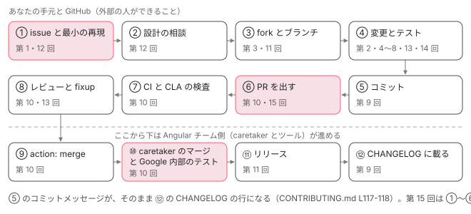

[目次](../README.md) › [コントリビュートの道](README.md) › 第 1 回 / 全 15 回

# 貢献の全体像：issue から CHANGELOG まで

> バグを見つけてから修正がリリースノートに載るまでの道のり（issue と最小の再現 → 設計の相談 → fork とブランチ → 変更とテスト → コミット → PR → CI と CLA → レビュー → merge ラベル → caretaker のマージと Google 内部のテスト → リリース）。CONTRIBUTING.md の「受け入れられる PR の条件」を 1 つずつ読み、どの回がどこを扱うかの地図。

angular/angular · 読了 約 12 分 · 基礎 · [サイトで読む（デモが動きます）](https://angular-deep-dive-cyan.vercel.app/chapter/contrib-overview)

---

この章で分かること: バグを見つけてから、その修正がリリースノート（CHANGELOG）に載るまでに通る段を、Angular 本家の文書の行を指しながら 1 段ずつ並べます。そして「受け入れられる PR の最低条件」として書かれた 8 項目を読み、どの項目をこのシリーズのどの回で扱うかの地図を作ります。

読む対象は `../angular` の `CONTRIBUTING.md`、`.github/ISSUE_TEMPLATE/1-bug-report.yaml`、`contributing-docs/caretaking.md`、`.pullapprove.yml` です。

1. 1. 全体像
2. [2. リポジトリの地図](02-contrib-repo-map.md)
3. [3. 手元の準備](03-contrib-setup.md)
4. [4. Bazel の読み方](04-contrib-bazel.md)
5. [5. テストを走らせる](05-contrib-run-tests.md)
6. [6. spec の読み方](06-contrib-reading-specs.md)
7. [7. テストを書く](07-contrib-writing-a-test.md)
8. [8. 公開 API と golden](08-contrib-public-api.md)
9. [9. コミットメッセージ](09-contrib-commit-messages.md)
10. [10. PR が通るまで](10-contrib-pr-flow.md)
11. [11. ブランチとリリース](11-contrib-branches.md)
12. [12. issue の仕分け](12-contrib-triage.md)
13. [13. コードの書き方](13-contrib-coding-standards.md)
14. [14. 手元で確かめる](14-contrib-debugging.md)
15. [15. 最初の PR](15-contrib-first-pr.md)

> [!TIP]
> **新卒エンジニアへ**
>
> 用語を 3 つだけ先に。**issue** は GitHub 上の「不具合や要望の報告」1 件、**PR**（pull request）は「この変更を取り込んでください」という依頼 1 件、**fork** は本家のリポジトリを自分の GitHub アカウントに丸ごと複製したものです。外部の人は本家に直接 push できないので、fork に push してから PR を出します。

## 1. issue から CHANGELOG までの 12 段

先に全体の図を置きます。箱の下の番号が、その段を詳しく扱う回です。この章では各段の「入口になる文書の行」だけを見て、中身はそれぞれの回に任せます。



*外部のコントリビューターの変更が本家に入り、リリースノートに載るまで。上の段から左→右、右→左、左→右の順に進む。丸数字の下の「第 n 回」がその段を扱う回。*

赤い箱の 3 つ（①・⑥・⑩）は、この章で文書の行を引いて確かめます。残りの段は、図の番号の回で根拠の設定ファイルまで読みます。

## 2. ① issue: 最小の再現がないと調べてもらえない

バグを見つけたら、最初の行動は「直す」ではなく「探す」と「報告する」です。`CONTRIBUTING.md` の Submitting an Issue の段を読みます。

📄 `angular/CONTRIBUTING.md` L54–70 （▶ の行: 56, 58–59, 64, 68, 70）

```md
54 │ ### <a name="submit-issue"></a> Submitting an Issue
55 │ 
56 ▶ Before you submit an issue, please search the issue tracker. An issue for your problem might already exist and the discussion might inform you of workarounds readily available.
57 │ 
58 ▶ We want to fix all the issues as soon as possible, but before fixing a bug, we need to reproduce and confirm it.
59 ▶ In order to reproduce bugs, we require that you provide a minimal reproduction.
60 │ Having a minimal reproducible scenario gives us a wealth of important information without going back and forth to you with additional questions.
61 │ 
62 │ A minimal reproduction allows us to quickly confirm a bug (or point out a coding problem) as well as confirm that we are fixing the right problem.
63 │ 
64 ▶ We require a minimal reproduction to save maintainers' time and ultimately be able to fix more bugs.
65 │ Often, developers find coding problems themselves while preparing a minimal reproduction.
66 │ We understand that sometimes it might be hard to extract essential bits of code from a larger codebase, but we really need to isolate the problem before we can fix it.
67 │ 
68 ▶ Unfortunately, we are not able to investigate / fix bugs without a minimal reproduction, so if we don't hear back from you, we are going to close an issue that doesn't have enough info to be reproduced.
69 │ 
70 ▶ You can file new issues by selecting from our [new issue templates](https://github.com/angular/angular/issues/new/choose) and filling out the issue template.
```

1. **56 行目: 出す前に issue tracker を検索する**

   同じ問題の issue が既にあれば、そこに回避策が書かれていることがあります。検索の組み立て方は [第 12 回](12-contrib-triage.md)で扱います。
2. **58〜59 行目: 直す前に、チームが再現して確認する**

   **最小の再現**（minimal reproduction）とは、問題が起きるのに必要なコードだけを残した小さなアプリのことです。59 行目は「再現のために、最小の再現を出すことを求める（require）」と書いています。
3. **64 行目: 理由はメンテナーの時間**

   「メンテナーの時間を節約し、結果としてより多くのバグを直すため」と理由まで書いてあります。
4. **68 行目: 再現がなく、返事もなければ閉じる**

   再現がないと調査も修正もできない、と言い切っています。
5. **70 行目: 新しい issue はテンプレートから選ぶ**

   そのテンプレートが次のファイルです。

📄 `angular/.github/ISSUE_TEMPLATE/1-bug-report.yaml` L42–64 （▶ の行: 46–47, 49, 52, 54, 57, 63）

```yaml
42 │   - type: textarea
43 │     id: description
44 │     attributes:
45 │       label: Description
46 ▶     validations:
47 ▶       required: true
48 │ 
49 ▶   - type: input
50 │     id: reproduction
51 │     attributes:
52 ▶       label: Please provide a link to a minimal reproduction of the bug
53 │ 
54 ▶   - type: textarea
55 │     id: exception-or-error
56 │     attributes:
57 ▶       label: Please provide the exception or error you saw
58 │       render: true
59 │ 
60 │   - type: textarea
61 │     id: environment
62 │     attributes:
63 ▶       label: Please provide the environment you discovered this bug in (run `ng version`)
64 │       render: true
```

バグ報告のフォームは GitHub の issue forms（YAML で入力欄を定義する仕組み）で書かれています。49〜52 行目が再現のリンクの欄で、ラベルは「バグの最小の再現へのリンクを書いてください」です。54〜57 行目は見えた例外やエラー、63 行目は `ng version` の出力を求める欄です。

> [!WARNING]
> **ハマりどころ**
>
> 46〜47 行目を見ると、説明（description）の欄には `validations: required: true` が付いています。一方、49〜52 行目の再現の欄には `validations` がありません。つまり**フォームは再現のリンクが空でも送信できます**。でも上の `CONTRIBUTING.md` 68 行目のとおり、再現がない issue は閉じられます。フォームが通ることと、調べてもらえることは別です。

### 小さい変更でも issue は要るか

📄 `angular/CONTRIBUTING.md` L40–50 （▶ の行: 45–46, 48, 50）

```md
40 │ ## <a name="feature"></a> Missing a Feature?
41 │ 
42 │ You can _request_ a new feature by [submitting an issue](#submit-issue) to our GitHub Repository.
43 │ If you would like to _implement_ a new feature, please consider the size of the change in order to determine the right steps to proceed:
44 │ 
45 ▶ - For a **Major Feature**, first open an issue and outline your proposal so that it can be discussed.
46 ▶   This process allows us to better coordinate our efforts, prevent duplication of work, and help you to craft the change so that it is successfully accepted into the project.
47 │ 
48 ▶   **Note**: Adding a new topic to the documentation, or significantly re-writing a topic, counts as a major feature.
49 │ 
50 ▶ - **Small Features** can be crafted and directly [submitted as a Pull Request](#submit-pr).
```

機能を*実装*したい場合は、45〜46 行目で大きな機能はまず issue を開いて提案を相談する、50 行目で小さな機能は直接 PR を出してよい、と分けています。48 行目は見落としやすい注意で、**ドキュメントに新しいトピックを足す・大きく書き直すのも「大きな機能」扱い**です。

## 3. Contribution Quality: PR の最低条件 8 項目

次が、外部の人の PR に対する「最低限の期待」です。この 8 項目がシリーズの地図になります。

📄 `angular/CONTRIBUTING.md` L72–93 （▶ の行: 74, 76, 78, 80, 83, 85, 87, 89, 91, 93）

```md
72 │ ### <a name="pr-quality"></a> Contribution Quality
73 │ 
74 ▶ We strongly value open source contribution and pull requests from community contributors. Please note that every pull request is reviewed and merged by an actual person on the team, which does take time and effort. That is time and effort that does take away from other valuable work. With that in mind we have a minimum set of expectations that are required of any community contribution pull request that is opened.
75 │ 
76 ▶ 1. Search [GitHub](https://github.com/angular/angular/pulls) for an open or closed PR that relates to your submission.
77 │    - You don't want to duplicate existing efforts.
78 ▶ 2. Be sure that an issue or pull request clearly describes the problem you're fixing, or documents the design for the feature you'd like to add. Issues require a _minimal_ reproduction.
79 │ 
80 ▶ 3. Discussing the design in an issue upfront helps to ensure that we're ready to accept your work. Pull requests are not the right place to do design work.
81 │    - When in doubt, open an issue first before doing any sort of speculative implementation work
82 │ 
83 ▶ 4. Ideally the PR should be tied to an issue, but this is not required
84 │ 
85 ▶ 5. The change should improve code quality (i.e. addressing a TODO) or should impact / improve a feature
86 │ 
87 ▶ 6. Micro optimizations will only be accepted if they are validated by an actual benchmark
88 │ 
89 ▶ 7. Do not open pull requests that are addressing feature requests that are not labeled as "help wanted" as they usually need additional design work before we could accept pull requests
90 │ 
91 ▶ 8. The change should be well tested
92 │ 
93 ▶ If your pull request does not meet these minimum expectations, we may close your PR. Also, if your PR introduces a breaking change, it's possible the level of churn this breaking change causes may block our ability to move forward with it. We may close your PR in that situation, as well. Otherwise, we're excited to see your contributions and enthusiasm for Angular!
```

74 行目がこの段の前提です。**すべての PR はチームの実際の人がレビューしてマージする**。その時間は他の仕事から削られる。だから最低限の期待を置く、という順で書かれています。93 行目は、満たさない PR は閉じることがある、と結んでいます。

| 行 | 項目（要約） | 扱う回 |
| --- | --- | --- |
| 76 | 関係する PR を open / closed とも検索する（重複を避ける） | [第 12 回](12-contrib-triage.md)・[第 15 回](15-contrib-first-pr.md) |
| 78 | 直す問題か設計を issue か PR に明記。issue には最小の再現 | この章 2 節・[第 12 回](12-contrib-triage.md) |
| 80〜81 | 設計は issue で先に相談。PR は設計の場ではない。迷ったら先に issue | [第 12 回](12-contrib-triage.md) |
| 83 | PR は issue と結び付くのが望ましいが、必須ではない | [第 10 回](10-contrib-pr-flow.md) |
| 85 | コードの質を上げる（TODO の解消など）か、機能に効く変更 | [第 13 回](13-contrib-coding-standards.md) |
| 87 | マイクロ最適化は実際のベンチマークで裏付けたものだけ | （扱わない。`contributing-docs/running-benchmarks.md`） |
| 89 | "help wanted" の付いていない機能要望に PR を出さない | [第 12 回](12-contrib-triage.md) |
| 91 | 十分にテストされている | [第 5 回](05-contrib-run-tests.md)〜[第 7 回](07-contrib-writing-a-test.md) |

8 項目のうち 5 つ（76・78・80・83・89 行目）は、**コードを書く前**の話です。PR を出してから指摘されても戻れないものが多いので、シリーズでは issue の回（第 12 回）を「コードを書く前に読む回」として置いています。

## 4. ③〜⑥ Submitting a PR: fork から angular:main まで

📄 `angular/CONTRIBUTING.md` L95–132 （▶ の行: 99–101, 103, 108, 111, 115, 117–118, 129, 132）

````md
 95 │ ### <a name="submit-pr"></a> Submitting a Pull Request (PR)
 96 │ 
 97 │ Before you submit your Pull Request (PR) consider the following guidelines:
 98 │ 
 99 ▶ 1. Please sign our [Contributor License Agreement (CLA)](#cla) before sending PRs.
100 ▶    We cannot accept code without a signed CLA.
101 ▶    Make sure you author all contributed Git commits with email address associated with your CLA signature.
102 │ 
103 ▶ 2. [Fork](https://docs.github.com/en/github/getting-started-with-github/fork-a-repo) the [angular/angular](https://github.com/angular/angular/fork) repo.
104 │ 
105 │ 3. In your forked repository, make your changes in a new git branch:
106 │ 
107 │    ```shell
108 ▶    git checkout -b my-fix-branch main
109 │    ```
110 │ 
111 ▶ 4. Create your patch, **including appropriate test cases**.
112 │ 
113 │ 5. Follow our [Coding Rules](#rules).
114 │ 
115 ▶ 6. Run the full Angular test suite, as described in the [developer documentation][dev-doc], and ensure that all tests pass.
116 │ 
117 ▶ 7. Commit your changes using a descriptive commit message that follows our [commit message conventions][commit-message-guidelines].
118 ▶    Adherence to these conventions is necessary because release notes are automatically generated from these messages.
119 │ 
120 │    ```shell
121 │    git commit --all
122 │    ```
123 │ 
124 │    Note: the optional commit `--all` command line option will automatically "add" and "rm" edited files.
125 │ 
126 │ 8. Push your branch to GitHub:
127 │ 
128 │    ```shell
129 ▶    git push origin my-fix-branch
130 │    ```
131 │ 
132 ▶ 9. In GitHub, send a pull request to `angular:main`.
````

1. **99〜101 行目: 先に CLA に署名する**

   署名のないコードは受け入れられない（100 行目）。101 行目は、コミットの author のメールアドレスを署名と同じにすること。詳しくは 6 節。
2. **103 行目: angular/angular を fork する**

   GitHub の画面の Fork ボタンで、自分のアカウントに複製します。
3. **108 行目: main から新しいブランチを切る**

   `git checkout -b my-fix-branch main`。ブランチ名は自由ですが、元は必ず `main` です。パッチのブランチに入れたい修正でも PR は main に向けて出し、ラベルで振り分けます（[第 11 回](11-contrib-branches.md)）。
4. **111 行目: パッチには適切なテストを含める**

   3 節の 91 行目と同じ要求が、手順の側にもう一度書かれています。
5. **115 行目: テストを走らせて全部通す**

   「developer documentation」の中身は `contributing-docs/building-and-testing-angular.md` です。走らせ方は [第 5 回](05-contrib-run-tests.md)。
6. **117〜118 行目: コミットメッセージの規約に従う**

   118 行目が理由です。**リリースノートはコミットメッセージから自動で作られる**。図の ⑤ と ⑫ が直結しているのはこの 1 文のためです。生成側の設定は [第 9 回](09-contrib-commit-messages.md)で読みます。
7. **129 行目: fork にブランチを push する**

   `origin` は自分の fork です（本家ではありません）。
8. **132 行目: GitHub で `angular:main` に向けて PR を送る**

   ここから先、⑦ CI と CLA の検査が自動で走ります（[第 10 回](10-contrib-pr-flow.md)）。

> [!NOTE]
> **ポイント**
>
> このシリーズでは、本家に issue や PR を出すこと・コメントすることは**読者自身が決めて行う行動**として扱います。各回の手順は「出し方」と「下書き」までです。出すと決めたら、その回の手順のとおりに実行してください。

## 5. ⑧ レビューと fixup コミット

📄 `angular/CONTRIBUTING.md` L134–155 （▶ の行: 136, 142, 144, 146, 149–150）

````md
134 │ ### Reviewing a Pull Request
135 │ 
136 ▶ The Angular team reserves the right not to accept pull requests from community members who haven't been good citizens of the community. Such behavior includes not following the [Angular code of conduct](https://github.com/angular/code-of-conduct) and applies within or outside of Angular managed channels.
137 │ 
138 │ #### Addressing review feedback
139 │ 
140 │ If we ask for changes via code reviews then:
141 │ 
142 ▶ 1. Make the required updates to the code.
143 │ 
144 ▶ 2. Re-run the Angular test suites to ensure tests are still passing.
145 │ 
146 ▶ 3. Create a fixup commit and push to your GitHub repository (this will update your Pull Request):
147 │ 
148 │    ```shell
149 ▶    git commit --all --fixup HEAD
150 ▶    git push
151 │    ```
152 │ 
153 │    For more info on working with fixup commits see [here](./contributing-docs/using-fixup-commits.md).
154 │ 
155 │ That's it! Thank you for your contribution!
````

136 行目は、コミュニティでの振る舞い（code of conduct を守らないなど）を理由に PR を受け入れない権利がある、という宣言です。変更を頼まれたら 142 行目で直し、144 行目でテストを走らせ直し、146 行目で **fixup コミット** を作って push します。fixup コミットは「直前のコミットへの追加の直し」と印を付けたコミットで、149 行目の `git commit --all --fixup HEAD` で作ります。150 行目の `git push` で同じブランチに足すと、PR が更新されます。マージのときにまとめる仕組みは [第 9 回](09-contrib-commit-messages.md)と [第 10 回](10-contrib-pr-flow.md)で見ます。

## 6. ⑦ CLA: コードを受け入れるための署名

📄 `angular/CONTRIBUTING.md` L232–256 （▶ の行: 234–235, 237–239, 241, 251, 256）

```md
232 │ ## <a name="cla"></a> Signing the CLA
233 │ 
234 ▶ Please sign our Contributor License Agreement (CLA) before sending pull requests. For any code
235 ▶ changes to be accepted, the CLA must be signed. It's a quick process, we promise!
236 │ 
237 ▶ - For individuals, we have a [simple click-through form][individual-cla].
238 ▶ - For corporations, we'll need you to
239 ▶   [print, sign and one of scan+email, fax or mail the form][corporate-cla].
240 │ 
241 ▶ If you have more than one GitHub account, or multiple email addresses associated with a single GitHub account, you must sign the CLA using the primary email address of the GitHub account used to author Git commits and send pull requests.
242 │ 
243 │ The following documents can help you sort out issues with GitHub accounts and multiple email addresses:
244 │ 
245 │ - https://help.github.com/articles/setting-your-commit-email-address-in-git/
246 │ - https://stackoverflow.com/questions/37245303/what-does-usera-committed-with-userb-13-days-ago-on-github-mean
247 │ - https://help.github.com/articles/about-commit-email-addresses/
248 │ - https://help.github.com/articles/blocking-command-line-pushes-that-expose-your-personal-email-address/
249 │ 
250 │ [coc]: https://github.com/angular/code-of-conduct/blob/main/CODE_OF_CONDUCT.md
251 ▶ [corporate-cla]: https://cla.developers.google.com/about/google-corporate
252 │ [dev-doc]: ./contributing-docs/building-and-testing-angular.md
253 │ [commit-message-guidelines]: ./contributing-docs/commit-message-guidelines.md
254 │ [github]: https://github.com/angular/angular
255 │ [discord]: https://discord.gg/angular
256 ▶ [individual-cla]: https://cla.developers.google.com/about/google-individual
```

**CLA**（Contributor License Agreement）は、提供したコードの権利の扱いについて、コントリビューターとプロジェクトの間で結ぶ同意書です。234〜235 行目で、コードの変更を受け入れるには CLA の署名が必須と書いています。237 行目は個人向け（クリックで済むフォーム）、238〜239 行目は会社として出す場合の書面の手続きです。237・238 行目のリンクの実体は 256 行目と 251 行目のリンク定義で、どちらも `cla.developers.google.com`、Google の CLA の窓口です。

241 行目がよく引っかかる点です。GitHub アカウントにメールアドレスが複数あるときは、**コミットの author に使うアカウントの主メールアドレスで署名する**。手元の `git config user.email` が会社のアドレスのまま、個人のアドレスで署名している、という食い違いで PR の検査が落ちます。

## 7. ⑩ caretaker: マージを押す当番

図の境界線から下は、Angular チームの側で進みます。その中心が **caretaker** です。

📄 `angular/contributing-docs/caretaking.md` L1–22 （▶ の行: 3–4, 8–9, 13, 15–16, 21）

````md
 1 │ # Caretaker
 2 │ 
 3 ▶ The _caretaker_ is a role responsible for merging PRs and syncing into Google's
 4 ▶ internal code repository. The caretaker role rotates weekly.
 5 │ 
 6 │ ## Responsibilities
 7 │ 
 8 ▶ - Merging PR (PRs with [`action: merge`](https://github.com/angular/angular/pulls?q=is%3Aopen+is%3Apr+label%3A%22action%3A+merge%22) label)
 9 ▶ - Light issue triage [new issues](https://github.com/angular/angular/issues?q=is%3Aopen+is%3Aissue+no%3Alabel).
10 │ 
11 │ ## Merging the PR
12 │ 
13 ▶ A PR requires the `action: merge` and a `target: *` label to be merged.
14 │ 
15 ▶ The tooling automatically verifies the given PR is ready for merge. If the PR passes the tests, the
16 ▶ tool will automatically merge it based on the applied target label.
17 │ 
18 │ To merge a PR run:
19 │ 
20 │ ```sh
21 ▶ pnpm ng-dev pr merge <pr number>
22 │ ```
````

1. **3〜4 行目: caretaker の仕事は 2 つ**

   PR をマージすること、そして **Google の内部のコードリポジトリへ同期する**こと。この役は週ごとに交代します。
2. **8〜9 行目: マージするのは `action: merge` の付いた PR。ついでに新しい issue の軽い仕分け**

   9 行目の「ラベルの無い issue」の仕分けは [第 12 回](12-contrib-triage.md)で読みます。
3. **13 行目: マージには `action: merge` と `target: *` の 2 つのラベルが要る**

   `target:` はどのブランチに入れるかの印です（[第 11 回](11-contrib-branches.md)）。
4. **15〜16 行目: ツールが準備できているかを検査し、通れば target ラベルに従って自動でマージする**

   人がボタンを押すのではなく、21 行目の `pnpm ng-dev pr merge <pr number>` を caretaker が実行します。

外部のコントリビューターは、この段で何かをする必要はありません。ただ「レビューで approve されたのに、まだマージされない」ときに、どこで止まっているかを読めるようになるのが [第 10 回](10-contrib-pr-flow.md)の目標です。

## 8. 自己点検: PR を出す前に 8 項目を当てはめる

> **🧪 DEMO — PR を出す前の自己点検**
>
> CONTRIBUTING.md の Contribution Quality（L76〜L91）と Submitting a PR（L99〜L118）を、この章の .ts に写した小さな再現です。変更の種類を選ぶと、当てはまらない項目（6 番はマイクロ最適化だけ、7 番は機能追加だけ）が薄く表示されて数から外れます。満たしている項目にチェックを付けると、足りない項目と、それを扱う回へのリンクが出ます。
>
> ▶ [このデモはサイトで動かせます](https://angular-deep-dive-cyan.vercel.app/chapter/contrib-overview)

## 全体の流れ（1 本にすると）

- 👤 `issue を検索 → なければテンプレートから報告` — CONTRIBUTING.md L56, L70 — *最小の再現を付ける*
- 👤 `設計を issue で相談` — CONTRIBUTING.md L80 — *機能は help wanted を確かめる（L89）*
- 👤 `CLA に署名` — CONTRIBUTING.md L99, L241
- 👤 `git checkout -b my-fix-branch main` — CONTRIBUTING.md L108 — *fork の中で*
  - 👤 `変更 + テスト → テストを走らせる` — CONTRIBUTING.md L111, L115
  - 👤 `git commit（type(scope): summary）` — CONTRIBUTING.md L117-118 — *これが CHANGELOG になる*
  - 👤 `git push origin my-fix-branch → PR to angular:main` — CONTRIBUTING.md L129, L132
    - `CI・CLA・pullapprove の検査` — .pullapprove.yml — *第 10 回*
    - 👤 `レビュー → git commit --all --fixup HEAD → git push` — CONTRIBUTING.md L146-150
    - `action: merge + target: *` — caretaking.md L13
      - `pnpm ng-dev pr merge <pr>` — caretaking.md L21 — *caretaker が実行。Google 内部へも同期（L3-4）*
      - `リリース → CHANGELOG.md` — 第 9・11 回

## 聞かれそうな質問

**Q. コミッターとコントリビューターは何が違うの？**

このリポジトリの設定で言えるのは「書き込み権限（write access）を持つかどうか」と「誰が approve できるか」です。次の引用の 22〜23 行目のとおり、main への変更は必ず PR を通し、少なくとも 1 つの approve が要ります。approve できるのは該当するコードオーナー、または PR の作者がコードオーナーのときは **書き込み権限を持つリポジトリの collaborator** です。

📄 `angular/.pullapprove.yml` L12–29 （▶ の行: 16, 18, 22–23, 27–28）

```yaml
12 │ #  General rules / philosophy
13 │ # =========================================================
14 │ #
15 │ #  - We trust that people do the right thing and won't approve changes they don't feel confident reviewing
16 ▶ #  - We enforce that only approved PRs are merged ensuring that unreviewed code isn't accidentally merged
17 │ #  - We distribute approval rights as much as possible to help us scale better
18 ▶ #  - A small number of file groups have very limited number of reviewers because incorrect changes to the files they guard would have serious consequences (e.g. security, public api)
19 │ #
20 │ #  Configuration nuances:
21 │ #
22 ▶ #  - This configuration works in conjunction with the protected branch settings that require all changes to be made via pull requests with at least one approval.
23 ▶ #  - This approval can come from an appropriate codeowner, or any repo collaborator (person with write access) if the PR is authored by a codeowner.
24 │ #  - All groups whose pullapprove rules are matched will be required for overall approval.
25 │ #
26 │ #  NOTE:
27 ▶ #    In the case of emergency, the repo administrators which include the current angular caretaker
28 ▶ #    can bypass this reviewer approval requirement, this is expected as a last resort and to be
29 │ #    done exceedingly sparingly.
```

外部のコントリビューターは書き込み権限を持たないので、fork から PR を出します（`CONTRIBUTING.md` 103・132 行目）。18 行目のとおり、セキュリティや公開 API のような重いファイルはレビューできる人がごく少数に絞られています。マージを実行するのは週替わりの caretaker で（`caretaking.md` 3〜4 行目）、その役には Google の内部リポジトリへの同期が含まれます。27〜28 行目では、caretaker を含むリポジトリ管理者だけが緊急時に approve の要件を飛ばせる、と書いています。誰がチームの一員か（コードオーナーの名前）は同じファイルの `groups:` 以下と `required-minimum-review` の `team` にあります（[第 10 回](10-contrib-pr-flow.md)）。

**Q. 誤字 1 文字の修正でも issue を先に立てるの？**

必須ではありません。`CONTRIBUTING.md` 83 行目に「PR は issue に結び付くのが理想だが、必須ではない」とあり、50 行目で小さな変更は直接 PR にしてよいと書いています。ただし 78 行目の「問題か設計を issue か PR に明記する」は必須なので、issue が無いなら PR の説明に「何が問題か」を書きます。48 行目のとおり、ドキュメントでも新しいトピックの追加や大きな書き直しは「大きな機能」なので、先に issue で相談します。

**Q. CLA は何のため？署名しないとどうなる？**

`CONTRIBUTING.md` 234〜235 行目のとおり、コードの変更を受け入れる条件です。100 行目は「署名のないコードは受け入れられない」。CLA は、提供したコードの権利の扱いを、コントリビューターと受け取る側（リンク先は Google の CLA の窓口）の間で取り決める同意書です。署名の状態は PR に付く `cla: yes` / `cla: no` のラベルで見えます（[第 12 回](12-contrib-triage.md)で読む `triage-and-labelling.md` の Special Labels）。241 行目のとおり、署名したメールアドレスとコミットの author のアドレスが違うと、署名していても未署名と同じ扱いになります。

**Q. 再現のリンクの欄は必須じゃないのに、なぜ閉じられるの？**

フォームの必須はフォームの都合です。`1-bug-report.yaml` 49〜52 行目の再現の欄には `validations` が無いので送信はできます。でも方針は `CONTRIBUTING.md` 58〜59 行目と 68 行目で、再現がない issue は調べられないので、返事が無ければ閉じます。閉じるときの決まった返信は [第 12 回](12-contrib-triage.md)で読みます。

**Q. レビューで直しを頼まれたら、コミットを amend して force push すればいい？**

手引きの既定は fixup コミットです。`CONTRIBUTING.md` 146 行目のとおり、`git commit --all --fixup HEAD` を作って普通に `git push` します（149〜150 行目）。fixup にすると、レビュアーは「前回から何が変わったか」だけを見られます。amend と force push を使うのは、コミットメッセージ自体を直すとき（`CONTRIBUTING.md` の Updating the commit message の段。[第 9 回](09-contrib-commit-messages.md)）です。

## 読み終えて

- 外部の人の変更は、issue → 相談 → fork のブランチ → テスト付きの変更 → 規約どおりのコミット → angular:main への PR、の順で本家に向かう。
- 最小の再現は「あると親切」ではなく調査の条件（`CONTRIBUTING.md` L59, L68）。フォームが通っても再現がなければ閉じられる。
- Contribution Quality の 8 項目のうち 5 つはコードを書く前の話。機能なら help wanted、設計は issue で先に。
- コミットメッセージが厳密なのは、リリースノートがそこから自動で作られるから（L118）。
- マージは週替わりの caretaker が `action: merge` と `target: *` を見て `ng-dev pr merge` で行い、Google の内部へも同期する。

---

← 前: [Material のテーマ：値の代わりに CSS 変数の名前を返す](../cdk/21-theming.md)  
次: [リポジトリの地図：packages・goldens・tools・adev はどこに何があるか](02-contrib-repo-map.md) →
