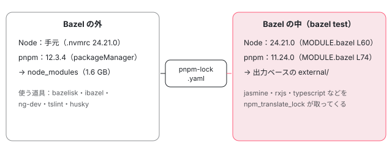

[目次](../README.md) › [コントリビュートの道](README.md) › 第 3 回 / 全 15 回

# 手元の準備：Node・pnpm・Bazel をそろえる

> .nvmrc と package.json の engines・packageManager で決まる Node と pnpm の版、pnpm install が pnpm-workspace.yaml と .pnpmfile.cjs で何をするか（husky で置く git のフックを含む）、bazelisk が .bazelversion の Bazel を取ってくる仕組み、Bazel が MODULE.bazel で自分専用の Node と npm パッケージを持ってくること、.bazelrc の設定。実際にこのマシンで pnpm install と最初の bazel test を走らせたときの時間・ディスク・出力。

angular/angular · 読了 約 13 分 · 中核 · [サイトで読む（デモが動きます）](https://angular-deep-dive-cyan.vercel.app/chapter/contrib-setup)

---

Angular 本体を手元でテストできるようにするまでの手順を、設定ファイルの行で確かめながら進めます。Node と pnpm の版はどのファイルで決まっているか、`pnpm install` が何を読んで何を入れるか、Bazel をなぜ直接入れずに `bazelisk` 経由で使うのか、`.bazelrc` の何行かが何をしているか。最後に、このマシン（macOS・Apple Silicon）で実際に `pnpm install` と最初の `bazel test` を走らせたときの時間・ディスク・出力を見ます。

読む対象は ../angular の `contributing-docs/building-and-testing-angular.md`・`contributing-docs/building-with-bazel.md`・ `.nvmrc`・`package.json`・`MODULE.bazel`・`pnpm-workspace.yaml`・`.pnpmfile.cjs`・ `.bazelversion`・`.bazelrc`・`.husky/pre-commit`・`.devcontainer/` です。

1. [1. 全体像](01-contrib-overview.md)
2. [2. リポジトリの地図](02-contrib-repo-map.md)
3. 3. 手元の準備
4. [4. Bazel の読み方](04-contrib-bazel.md)
5. [5. テストを走らせる](05-contrib-run-tests.md)
6. [6. spec の読み方](06-contrib-reading-specs.md)
7. [7. テストを書く](07-contrib-writing-a-test.md)
8. [8. 公開 API と golden](08-contrib-public-api.md)
9. [9. コミットメッセージ](09-contrib-commit-messages.md)
10. [10. PR が通るまで](10-contrib-pr-flow.md)
11. [11. ブランチとリリース](11-contrib-branches.md)
12. [12. issue の仕分け](12-contrib-triage.md)
13. [13. コードの書き方](13-contrib-coding-standards.md)
14. [14. 手元で確かめる](14-contrib-debugging.md)
15. [15. 最初の PR](15-contrib-first-pr.md)

## 0. 全体の流れ

1. **前提のソフトを入れる**

   Git、`.nvmrc` の版の Node、`package.json` の版の pnpm（1 節）。
2. **fork して clone する**

   自分の fork を clone し、本家を `upstream` として足す（2 節）。
3. **pnpm install**

   `pnpm-workspace.yaml` と `.pnpmfile.cjs` を読んで `node_modules` を作り、`husky` で git のフックを置く（3・4 節）。
4. **bazel を呼ぶ**

   `node_modules/.bin/bazel` の正体は bazelisk。`.bazelversion` の Bazel を取ってきて起動する（5 節）。
5. **.bazelrc が効く**

   出力は `dist/` に、lockfile は固定、ネットワークは sandbox で切る（6 節）。
6. **最初の bazel test**

   Bazel が自分の Node と npm パッケージを取り直し、依存を全部ビルドしてからテストを走らせる。このマシンで 2 分 31 秒（7 節）。

## 1. 前提のソフト：文書が求めるもの

📄 `angular/contributing-docs/building-and-testing-angular.md` L32–59 （▶ の行: 41–43, 45, 48–49, 51–52, 54, 59）

```md
32 │ ## Prerequisite Software
33 │ 
34 │ Before you can build and test Angular, you must install and configure the
35 │ following on your development machine:
36 │ 
37 │ - [Git](https://git-scm.com/) and/or the [**GitHub app**](https://desktop.github.com/) (for Mac and
38 │   Windows);
39 │   [GitHub's Guide to Installing Git](https://docs.github.com/en/get-started/git-basics/set-up-git) is a good source
40 │   of information.\
41 ▶   **Windows Users**: Git Bash or an equivalent shell is required\
42 ▶   _Windows Powershell and cmd shells are not
43 ▶   supported [#46780](https://github.com/angular/angular/issues/46780) so some commands might fail_
44 │ 
45 ▶ - [Node.js](https://nodejs.org), (version specified in [`.nvmrc`](../.nvmrc)) which is used to run a
46 │   development web server,
47 │   run tests, and generate distributable files.
48 ▶   `.nvmrc` is read by [nvm](https://github.com/nvm-sh/nvm) commands like `nvm install`
49 ▶   and `nvm use`.
50 │ 
51 ▶ - [pnpm](https://pnpm.io/) (version specified in the engines field
52 ▶   of [`package.json`](../package.json)) which is used to install dependencies.
53 │ 
54 ▶ - On Windows: [MSYS2](https://www.msys2.org/) which is used by Bazel. Follow
55 │   the [instructions](https://bazel.build/install/windows#installing-compilers-and-language-runtimes)
56 │ 
57 │ ## Development in a Container
58 │ 
59 ▶ You can also use the provided [Dev Container](https://containers.dev/) configuration to set up a development environment. This approach uses Docker to create a container with all the necessary tools (Node.js, pnpm, etc.) pre-installed.
```

45 行目、Node の版は `.nvmrc` に書いてある版です。48〜49 行目のとおり、このファイルは nvm（Node の版を切り替える道具）の `nvm install` / `nvm use` がそのまま読みます。中身は 1 行だけです。51〜52 行目、pnpm の版は `package.json` の `engines` に書いてあります（3 節で読みます）。41〜43 行目と 54 行目は Windows の人向けで、PowerShell と cmd は非対応、Git Bash と MSYS2 が要ります。59 行目、Docker が使えるなら Dev Container（必要な道具が入ったコンテナ）でも始められます（8 節）。

```
$ cat .nvmrc .bazelversion
24.21.0
8.8.0
$ node -v
v24.22.1
$ npx -y pnpm@12.3.4 -v
12.3.4
$ ls -l node_modules/.bin/bazel
-rwxr-xr-x  1 you  staff  1538 Oct 31 19:56 node_modules/.bin/bazel
$ grep -A3 '"bin"' node_modules/@bazel/bazelisk/package.json
  "bin": {
    "bazelisk": "bazelisk.js",
    "bazel": "bazelisk.js"
  },
```
*このマシンでの版の確認。.nvmrc は 24.21.0、手元の Node は 24.22.1（Volta の既定）。*

このマシンの Node は 24.22.1 で、`.nvmrc` の 24.21.0 とは最後の数字がずれています。それでも次の 2 節のあとで `pnpm install` も `bazel test` も通りました。理由は 3 節の後半で分かります （Bazel のテストは手元の Node を使いません）。

## 2. fork・clone・install・build

📄 `angular/contributing-docs/building-and-testing-angular.md` L87–106 （▶ の行: 89, 92, 95, 104）

````md
 87 │ ```shell
 88 │ # Clone your GitHub repository:
 89 ▶ git clone git@github.com:<github username>/angular.git
 90 │ 
 91 │ # Go to the Angular directory:
 92 ▶ cd angular
 93 │ 
 94 │ # Add the main Angular repository as an upstream remote to your repository:
 95 ▶ git remote add upstream https://github.com/angular/angular.git
 96 │ ```
 97 │ 
 98 │ ## Installing npm Modules
 99 │ 
100 │ Next, install the JavaScript modules needed to build and test Angular:
101 │ 
102 │ ```shell
103 │ # Install Angular project dependencies (package.json)
104 ▶ pnpm install
105 │ ```
106 │ 
````

1. **89 行目：自分の fork を clone**

   本家 `angular/angular` ではなく、GitHub で fork した自分のリポジトリを clone します。PR は自分の fork のブランチから出すためです（[第 15 回](15-contrib-first-pr.md)）。
2. **95 行目：本家を upstream に**

   本家の `main` を取り込むための remote です。`git fetch upstream` → `git rebase upstream/main` で追いつきます。
3. **104 行目：pnpm install**

   このマシンでは `npx -y pnpm@12.3.4 install --frozen-lockfile` で 3 分 29 秒、`node_modules` は 1.6 GB でした。`--frozen-lockfile` は `pnpm-lock.yaml` を書き換えずに、書いてあるとおりに入れる指定です。
4. **その次の段：pnpm build（今は不要）**

   npm に出すのと同じ形のパッケージを `dist/packages-dist` に作ります。手元の別のアプリで試すとき（[第 14 回](14-contrib-debugging.md)）に使うもので、テストを走らせるだけなら要りません。

## 3. pnpm の版と、Bazel が持ってくる Node・pnpm

📄 `angular/package.json` L9–20 （▶ の行: 9, 11–13, 20）

```json
 9 ▶   "packageManager": "pnpm@12.3.4",
10 │   "engines": {
11 ▶     "npm": "Please use pnpm instead of NPM to install dependencies",
12 ▶     "yarn": "Please use pnpm instead of Yarn to install dependencies",
13 ▶     "pnpm": "12.3.4"
14 │   },
15 │   "repository": {
16 │     "type": "git",
17 │     "url": "https://github.com/angular/angular.git"
18 │   },
19 │   "scripts": {
20 ▶     "prepare": "husky",
```

9 行目の `packageManager` は「このリポジトリは pnpm 12.3.4 で扱う」という宣言です。13 行目の `engines.pnpm` も同じ 12.3.4。11〜12 行目は、版の範囲の代わりに「npm / Yarn ではなく pnpm を使って」という文を値に書いています。20 行目の `prepare` は install の最後に走るスクリプトで、`husky` が git のフックを置きます（4 節の最後）。

> [!WARNING]
> **ハマりどころ**
>
> このマシンには Volta（Node や pnpm の版を固定する道具）が入っていますが、Volta の pnpm は入っていません。`pnpm -v` は `Volta error: Could not find executable "pnpm"` で失敗します。そこでこのシリーズのコマンドは全部 `npx -y pnpm@12.3.4 …` で書きます。npx が 12.3.4 を取ってきて、その版で実行します。手元に入っている pnpm の版に左右されません。

ここで大事な事実があります。`package.json` の devDependencies の直前に、こう書いてあります。

📄 `angular/package.json` L134–143 （▶ の行: 135, 140, 142）

```json
134 │   },
135 ▶   "// 2": "devDependencies are not used under Bazel. Many can be removed after test.sh is deleted.",
136 │   "devDependencies": {
137 │     "@actions/core": "^3.0.0",
138 │     "@actions/github": "^9.0.0",
139 │     "@angular/ng-dev": "https://github.com/angular/dev-infra-private-ng-dev-builds.git#c3d7ed184d71d390d3eacff85f4b2b3f16b82660",
140 ▶     "@bazel/bazelisk": "^1.7.5",
141 │     "@bazel/buildifier": "^8.0.0",
142 ▶     "@bazel/ibazel": "0.28.0",
143 │     "@inquirer/prompts": "^8.0.0",
```

135 行目「devDependencies are not used under Bazel」。`pnpm install` で入れた `node_modules` は、Bazel のテストの中では使われません。`node_modules` が要るのは、140 行目の `@bazel/bazelisk`（5 節）、142 行目の `@bazel/ibazel`（[第 5 回](05-contrib-run-tests.md)）、`ng-dev`（整形・コミットメッセージの検査）、`tslint` のような、Bazel の外で動く道具のためです。では Bazel は何を使うのか。`MODULE.bazel`（Bazel が読む依存の宣言）を見ます。

📄 `angular/MODULE.bazel` L49–61 （▶ の行: 49–50, 52, 60）

```python
49 ▶ node = use_extension("@rules_nodejs//nodejs:extensions.bzl", "node")
50 ▶ node.toolchain(
51 │     node_repositories = {
52 ▶         "24.21.0-darwin_arm64": ("node-v24.21.0-darwin-arm64.tar.gz", "node-v24.21.0-darwin-arm64", "bed7eea5325e1108f32ce5228ddd6a5f0f08a499ee42aa7442aea583702f6057"),
53 │         "24.21.0-darwin_amd64": ("node-v24.21.0-darwin-x64.tar.gz", "node-v24.21.0-darwin-x64", "1462cb3b3046b815cf8ea436d3da450ec1a9f11dac7e5a46b0ada5305d7e8097"),
54 │         "24.21.0-linux_arm64": ("node-v24.21.0-linux-arm64.tar.xz", "node-v24.21.0-linux-arm64", "6ad1325edbdb5649c379b75a237147a666c95d4f9ae8d340fef2d1575d289ad2"),
55 │         "24.21.0-linux_ppc64le": ("node-v24.21.0-linux-ppc64le.tar.xz", "node-v24.21.0-linux-ppc64le", "1936fd64623a2f98d1fb31b456686d10c30e92639899cfefdefa8835d22adccd"),
56 │         "24.21.0-linux_s390x": ("node-v24.21.0-linux-s390x.tar.xz", "node-v24.21.0-linux-s390x", "2ef7e2ecbf7a6c2f3d08d106f6b2f279419c6dac89fe91b8cad193af7890082c"),
57 │         "24.21.0-linux_amd64": ("node-v24.21.0-linux-x64.tar.xz", "node-v24.21.0-linux-x64", "fd8e59d5a511510f6a298afb548f18c7d2b1be404d8b4a27d94fbe49f56cb2d6"),
58 │         "24.21.0-windows_amd64": ("node-v24.21.0-win-x64.zip", "node-v24.21.0-win-x64", "158f7685b44de51f6c0df1d153526cbcd3e1bc739a8dfc607721cef75de9e541"),
59 │     },
60 ▶     node_version = "24.21.0",
61 │ )
```

49〜50 行目、`rules_nodejs` の `node.toolchain` で、Bazel 専用の Node を宣言しています。60 行目が 24.21.0（`.nvmrc` と同じ版）で、52 行目が Apple Silicon の Mac 用の tar.gz と、その sha256 です。Bazel はこれを自分で取ってきて、テストもビルドもこの Node で走らせます。手元の Node が 24.22.1 でもテストが通ったのはこのためです。

📄 `angular/MODULE.bazel` L71–85 （▶ の行: 72, 74, 80, 83, 85）

```python
71 │ pnpm = use_extension("@aspect_rules_js//npm:extensions.bzl", "pnpm")
72 ▶ pnpm.pnpm(
73 │     name = "pnpm",
74 ▶     pnpm_version = "11.24.0",
75 │     pnpm_version_integrity = "sha512-vSfjRel23LC+C3oSKCF7BJqBfiGx81XJDb59xGZxiVqLwebQbCRVRQXqk+oLRfSJon7Bv7yN5qlln8oPFvoAAA==",
76 │ )
77 │ use_repo(pnpm, "pnpm")
78 │ 
79 │ npm = use_extension("@aspect_rules_js//npm:extensions.bzl", "npm")
80 ▶ npm.npm_translate_lock(
81 │     name = "npm",
82 │     data = [
83 ▶         "//:.pnpmfile.cjs",
84 │         "//:package.json",
85 ▶         "//:pnpm-workspace.yaml",
```

📄 `angular/MODULE.bazel` L110–120 （▶ の行: 113, 116, 118）

```python
110 │         "//tools/bazel/rules_angular_store:package.json",
111 │         "//vscode-ng-language-service/integration/project:package.json",
112 │     ],
113 ▶     lifecycle_hooks = {
114 │         # sleep requires node-gyp rebuild but the native module is not needed in Bazel;
115 │         # disable the install hook to avoid failing builds when node-gyp is unavailable.
116 ▶         "sleep": [],
117 │     },
118 ▶     pnpm_lock = "//:pnpm-lock.yaml",
119 │ )
120 │ use_repo(npm, "npm")
```

npm のパッケージも同じです。80 行目の `npm_translate_lock`（`aspect_rules_js` の規則）が、118 行目の `pnpm-lock.yaml` を読んで、書いてあるパッケージを Bazel の側で 1 つずつ取ってきます。そのとき 83 行目の `.pnpmfile.cjs` と 85 行目の `pnpm-workspace.yaml` も入力にします。74 行目で、Bazel の中で使う pnpm は 11.24.0 と別に固定されています。113〜116 行目は、`sleep` というパッケージの install スクリプト（node-gyp でのビルド）を Bazel の中では走らせない指定です。



*Node・pnpm・npm パッケージは 2 組ある。左は pnpm install と Bazel の外の道具が使う組、右は bazel test の中で使う組。同じ pnpm-lock.yaml から作られる。*

## 4. pnpm install が読むもの：pnpm-workspace.yaml と .pnpmfile.cjs

📄 `angular/pnpm-workspace.yaml` L26–61 （▶ の行: 33, 35, 42–43, 59, 61）

```yaml
26 │   - packages/service-worker/
27 │   - packages/upgrade/
28 │   - packages/zone.js/
29 │   - packages/zone.js/test/typings/
30 │   - tools/bazel/rules_angular_store/
31 │   - vscode-ng-language-service
32 │   - vscode-ng-language-service/server
33 ▶   - vscode-ng-language-service/integration/project
34 │ 
35 ▶ allowBuilds:
36 │   '@bazel/concatjs': false
37 │   '@firebase/util': false
38 │   '@google/genai': false
39 │   '@parcel/watcher': false
40 │   '@vscode/vsce-sign': false
41 │   bufferutil: false
42 ▶   cypress: true
43 ▶   esbuild: false
44 │   keytar: false
45 │   lmdb: false
46 │   msgpackr-extract: false
47 │   protobufjs: false
48 │   re2: false
49 │   sleep: false
50 │   unrs-resolver: false
51 │   utf-8-validate: false
52 │ 
53 │ allowedDeprecatedVersions:
54 │   angular: '*'
55 │   tslint: '*'
56 │   gulp-conventional-changelog: '5'
57 │   protractor: '7'
58 │ 
59 ▶ # The minimum age of a release to be considered for dependency installation.
60 │ # The value is in minutes (1440 minutes = 1 day).
61 ▶ minimumReleaseAge: 1440
```

33 行目までは、ファイルの先頭から続く `packages:` の一覧の終わりの部分です。この一覧に並んだ 32 か所の `package.json`（リポジトリの直下、`packages/forms/` など）を 1 つのワークスペースとして扱い、まとめて 1 回で install します。35 行目の `allowBuilds` は、install のときに自分のスクリプト（ネイティブのビルドなど）を走らせてよいパッケージの許可表です。42 行目の `cypress` だけが `true`、43 行目の `esbuild` などは `false` です。59〜61 行目の `minimumReleaseAge: 1440` は、公開されてから 1440 分（1 日）たっていない版を入れない設定です（pnpm の文書は、公開直後に見つかる悪意のある版を避ける用途を挙げています）。

📄 `angular/.pnpmfile.cjs` L36–70 （▶ の行: 36, 39–42, 45, 53–54, 56, 59, 66–68）

```js
36 ▶   for (const [key, version] of Object.entries(pkg.peerDependencies)) {
37 │     // Any package that has a peerDependency on rxjs or zone.js, should instead treat the peerDependency as a
38 │     // regular dependency.
39 ▶     if (peerDepsToChange.has(key)) {
40 ▶       pkg.dependencies = {
41 ▶         ...pkg.dependencies,
42 ▶         [key]: pkg.devDependencies[key] ?? version,
43 │       };
44 │ 
45 ▶       delete pkg.devDependencies[key];
46 │ 
47 │       continue;
48 │     }
49 │ 
50 │     // Change all locally generated packages to directly depend on the other local packages, instead
51 │     // of expecting them as peerDependencies automatically as we do not auto install peer deps. The
52 │     // package is also removed from peerDependencies as it was moved over and will just cause errors.
53 ▶     if (pkg.version === '0.0.0-PLACEHOLDER' && localAngularPackages.has(key)) {
54 ▶       pkg.dependencies = {
55 │         ...pkg.dependencies,
56 ▶         [key]: 'workspace:*',
57 │       };
58 │ 
59 ▶       delete pkg.peerDependencies[key];
60 │     }
61 │   }
62 │ 
63 │   return pkg;
64 │ }
65 │ 
66 ▶ module.exports = {
67 ▶   hooks: {
68 ▶     readPackage,
69 │   },
70 │ };
```

1. **66〜68 行目：readPackage フック**

   pnpm は依存を解決する前に、各 `package.json` をこの関数に通します。返した中身が、pnpm から見たその package.json になります。
2. **36〜45 行目：rxjs と zone.js を普通の依存へ**

   peerDependencies（「利用者が入れてね」という依存）に rxjs か zone.js があれば、39 行目で拾い、40〜43 行目で dependencies に移し、45 行目で devDependencies から消します。
3. **53〜59 行目：リポジトリの中の Angular パッケージどうしをつなぐ**

   版が `0.0.0-PLACEHOLDER`（リポジトリの中のパッケージ）で、相手が `@angular/core` などのときは、56 行目で `workspace:*`（このワークスペースの中のものを使う）にし、59 行目で peerDependencies から外します。

なぜこんなことをするのか。53 行目の上のコメント（50〜52 行目）のとおり、このリポジトリは peerDependencies を自動で入れないので、peer のままだと `@angular/forms` から `@angular/core` が見えません。中で作っているものどうしを、ふつうの依存として直接つなぎます。

最後に、`prepare` の husky が置いた git のフックを 1 つ見ます。

📄 `angular/.husky/pre-commit` L1–8 （▶ の行: 1, 3–5, 8）

```
1 ▶ set +e
2 │ 
3 ▶ pnpm --silent ng-dev format staged 2>/dev/null
4 ▶ if [ $? -ne 0 ]; then
5 ▶   echo "WARNING: failed to run file formatting (ng-dev format staged)"
6 │ fi
7 │ 
8 ▶ exit 0;
```

コミットのたびに、3 行目で変更したファイルを整形します。ただし 1 行目の `set +e` と 8 行目の `exit 0` のとおり、失敗してもコミットは止めず、5 行目の WARNING を出すだけです。3 行目は `pnpm` をそのまま呼ぶので、`pnpm` が PATH に無いこのマシンでは毎回 WARNING になり、整形されないままコミットされます。コミットメッセージを検査する `.husky/commit-msg` も同じ形です（[第 9 回](09-contrib-commit-messages.md)）。

> [!TIP]
> **新卒エンジニアへ**
>
> フックを効かせるには、PATH に pnpm 12.3.4 を置きます。Volta なら `VOLTA_FEATURE_PNPM=1` を設定してから `volta install pnpm@12.3.4`、Volta を使わないなら `npm install -g pnpm@12.3.4` です。置かない場合は、コミットの前に自分で `npx -y pnpm@12.3.4 ng-dev format changed` を走らせます（CI は整形のずれで落ちます。[第 10 回](10-contrib-pr-flow.md)）。

## 5. bazelisk：.bazelversion の Bazel を取ってくる

📄 `angular/contributing-docs/building-with-bazel.md` L9–18 （▶ の行: 11–12, 15, 18）

```md
 9 │ ## Installation and running
10 │ 
11 ▶ Angular installs Bazel from npm rather than having contributors install Bazel
12 ▶ directly. This ensures that everyone uses the same version of Bazel.
13 │ 
14 │ The binaries for Bazel are provided by
15 ▶ the [`@bazel/bazelisk`](https://github.com/bazelbuild/bazelisk)
16 │ npm package and its platform-specific dependencies.
17 │ 
18 ▶ You can run Bazel with the `pnpm bazel` command.
```

11〜12 行目、Angular は Bazel を各自に入れさせず npm から入れます。全員が同じ版を使うためです。15 行目の `@bazel/bazelisk` は、Bazel そのものではなく「決められた版の Bazel を取ってきて起動する」小さな起動役です。1 節の確認のとおり、`node_modules/.bin/bazel` も `bazelisk` も同じ `bazelisk.js` を指しています。18 行目の `pnpm bazel` は、スクリプトに `bazel` が無いので、pnpm が `node_modules/.bin/bazel` を探して実行します。

- 👤 `npx -y pnpm@12.3.4 bazel test //packages/forms/test:test` — あなたのコマンド
  - `node_modules/.bin/bazel` — @bazel/bazelisk の bazelisk.js — *.bazelversion を読む → 8.8.0*
    - `~/Library/Caches/bazelisk/downloads/…/bin/bazel` — 初回だけ releases.bazel.build から取る（57 MB）
      - `Bazel サーバー（8.8.0）` — /private/var/tmp/\_bazel\_&lt;you&gt;/ — *.bazelrc を読み、MODULE.bazel の Node と npm を取り、テストを走らせる*

## 6. .bazelrc：全員にかかる Bazel の設定

`.bazelrc` は、Bazel を呼ぶたびに自動で足されるオプションの一覧です。手元の準備に関わる行を 2 か所見ます（テストの行は[第 5 回](05-contrib-run-tests.md)、query の行は[第 4 回](04-contrib-bazel.md)で読みます）。

📄 `angular/.bazelrc` L11–36 （▶ の行: 12–13, 19, 25–28, 36）

```
11 │ # Required by `rules_ts`.
12 ▶ common --@aspect_rules_ts//ts:skipLibCheck=always
13 ▶ common --@aspect_rules_ts//ts:default_to_tsc_transpiler
14 │ 
15 │ # Needed as otherwise `env` of TS actions would be ignored.
16 │ common --incompatible_merge_fixed_and_default_shell_env
17 │ 
18 │ # Frozen lockfile
19 ▶ common --lockfile_mode=error
20 │ 
21 │ ###############################
22 │ # Filesystem interactions     #
23 │ ###############################
24 │ 
25 ▶ # Create symlinks in the project:
26 ▶ # - dist/bin for outputs
27 ▶ # - dist/testlogs, dist/genfiles
28 ▶ # - bazel-out
29 │ # NB: bazel-out should be excluded from the editor configuration.
30 │ # The checked-in /.vscode/settings.json does this for VSCode.
31 │ # Other editors may require manual config to ignore this directory.
32 │ # In the past, we say a problem where VSCode traversed a massive tree, opening file handles and
33 │ # eventually a surprising failure with auto-discovery of the C++ toolchain in
34 │ # MacOS High Sierra.
35 │ # See https://github.com/bazelbuild/bazel/issues/4603
36 ▶ build --symlink_prefix=dist/
```

1. **19 行目：--lockfile\_mode=error**

   `MODULE.bazel.lock`（Bazel の依存を解決した結果の固定ファイル）が `MODULE.bazel` と合っていなければ、書き換えずにエラーにします。`--frozen-lockfile` の Bazel 版です。
2. **36 行目：--symlink\_prefix=dist/**

   Bazel の出力への近道（シンボリックリンク）を `dist/bin`・`dist/testlogs` などの名前で作ります（26〜28 行目）。テストのログは `dist/testlogs/…/test.log` で読めます。`dist/` は .gitignore されています。
3. **12〜13 行目：common の行**

   `common` は build・test・query などすべてのコマンドに付く印です。ここでは TypeScript の規則（rules\_ts）の既定を決めています。

📄 `angular/.bazelrc` L151–176 （▶ の行: 160, 167, 174–176）

```
151 │ # Disable network access in the sandbox by default. To enable network access
152 │ # for a particular target, use:
153 │ #
154 │ # load("@devinfra//bazel/remote-execution:index.bzl", "ENABLE_NETWORK")
155 │ # my_target(
156 │ #   ...,
157 │ #   exec_properties = ENABLE_NETWORK,   # Enables network in remote exec
158 │ #   tags = ["requires-network"]         # Enables network in sandbox
159 │ # )
160 ▶ build --nosandbox_default_allow_network
161 │ 
162 │ ################
163 │ # Flag Aliases #
164 │ ################
165 │ 
166 │ # --ng_perf will ask the Ivy compiler to produce performance results for each build.
167 ▶ build --flag_alias=ng_perf=//packages/compiler-cli:ng_perf
168 │ 
169 │ ####################################################
170 │ # User bazel configuration
171 │ # NOTE: This needs to be the *last* entry in the config.
172 │ ####################################################
173 │ 
174 ▶ # Load any settings which are specific to the current user. Needs to be *last* statement
175 ▶ # in this config, as the user configuration should be able to overwrite flags from this file.
176 ▶ try-import %workspace%/.bazelrc.user
```

160 行目、sandbox（アクションを、宣言した入力だけが見える場所に閉じ込めて走らせる仕組み）の中では、既定でネットワークを使えなくしています。テストが外のサーバーに頼ると、結果が日によって変わるからです。176 行目が自分だけの設定の入口です。リポジトリの直下に `.bazelrc.user` を作れば読み込まれ、174〜175 行目のとおり最後に読むので、上の設定を上書きできます。`.bazelrc.user` は .gitignore で無視されるので、PR に混ざりません。

## 7. 実際に走らせた記録：最初の bazel test

`pnpm install` の直後に、初めて `bazel test` を走らせた出力の抜粋です（同じ形の行は省き、パスの一部を … にしています）。

```
$ cd ~/angular-research/angular
$ time npx -y pnpm@12.3.4 bazel test //packages/forms/test:test
2026/10/31 19:57:54 Downloading https://releases.bazel.build/8.8.0/release/bazel-8.8.0-darwin-arm64...
Extracting Bazel installation...
Starting local Bazel server (8.8.0) and connecting to it...
Computing main repo mapping:
Loading: 1 packages loaded
    currently loading: packages/forms/test
DEBUG: …/external/aspect_tools_telemetry+/extension.bzl:164:14: Aspect Telemetry will begin collecting …
Analyzing: target //packages/forms/test:test (76 packages loaded, 11 targets configured)
DEBUG: …/external/aspect_rules_ts+/ts/extensions.bzl:103:14: WARNING: rules_ts: the 'ext' module extension symbol is deprecated …
INFO: Analyzed target //packages/forms/test:test (462 packages loaded, 9860 targets configured).
[440 / 943] Extracting npm package @angular/compiler-cli@22.2.0-next.5(…) [for tool]; 0s darwin-sandbox ... (9 actions, 8 running)
[738 / 1,491] Extracting npm package rxjs@7.8.2; 0s darwin-sandbox ... (10 actions, 9 running)
[1,536 / 2,626] Copying file packages/common/src/directives/ng_if.ts; 0s darwin-sandbox ... (10 actions, 9 running)
[2,436 / 3,133] Bundling domino; 0s darwin-sandbox ... (10 actions, 9 running)
INFO: From Executing genrule //packages/core/third_party/@mcp-b/webmcp-types:sources:
sed: 2: "bazel-out/darwin_arm64- ...": undefined label 'azel-out/darwin_arm64-fastbuild/bin/…/common.d.ts'
[3,050 / 3,133] Compiling TS: @@//packages/compiler:compiler; 3s worker ... (3 actions, 2 running)
[3,115 / 3,133] Compiling Angular TS: @@//packages/core:core; 0s worker
[3,131 / 3,133] Compiling TS: @@//packages/forms/test:test_lib; 0s worker ... (2 actions running)
[3,133 / 3,134] 1 / 1 tests; Testing //packages/forms/test:test; 2s darwin-sandbox
INFO: Found 1 test target...
Target //packages/forms/test:test up-to-date:
  dist/bin/packages/forms/test/test_/test
INFO: Elapsed time: 126.757s, Critical Path: 21.90s
INFO: 3100 processes: 712 internal, 2290 darwin-sandbox, 98 worker.
INFO: Build completed successfully, 3100 total actions
//packages/forms/test:test                                               PASSED in 2.1s

Executed 1 out of 1 test: 1 test passes.
npx -y pnpm@12.3.4 bazel test //packages/forms/test:test  2.13s user 1.77s system 2% cpu 2:31.59 total
```
*pnpm install 直後の 1 回目。合計 2 分 31 秒、テスト本体は 2.1 秒。*

1. **Downloading … bazel-8.8.0：bazelisk が Bazel を取る**

   5 節の流れの 2 段目です。2 回目からは取りません。
2. **Analyzing … 462 packages loaded, 9860 targets configured**

   BUILD.bazel を読み、`//packages/forms/test:test` を作るのに要るものを全部洗い出します。Node や npm パッケージの取得（3 節）もここで起きます。
3. **\[440 / 943\] Extracting npm package … / Copying file …**

   npm パッケージを展開し、ソースを出力の木へ写します。`darwin-sandbox` は macOS の sandbox の中で走ったという印です。
4. **Compiling TS / Compiling Angular TS**

   forms のテストは `@angular/core` などに依存しているので、`packages/compiler`・`packages/core` から順にソースからビルドします。`worker` は TypeScript のコンパイラを常駐させて使い回すやり方です。
5. **PASSED in 2.1s**

   3100 のアクションのうち、テストそのものは最後の 1 つで 2.1 秒。残りの 2 分以上は準備とビルドです。

> [!NOTE]
> **ポイント**
>
> 途中の `DEBUG:` の行（Aspect のテレメトリーの案内、rules\_ts の非推奨の警告）と、`sed: … undefined label` の 2 行は、このとき出ていても 最後は `Build completed successfully` と `PASSED` でした。成否は最後の数行で判断します。

同じコマンドの 2 回目（別の作業でテストを 1 本足したあと）は、ほぼ全部がキャッシュから出て 5 秒でした。

```
$ time npx -y pnpm@12.3.4 bazel test //packages/forms/test:test --test_output=errors
INFO: Analyzed target //packages/forms/test:test (0 packages loaded, 0 targets configured).
[29 / 30] Testing //packages/forms/test:test; 1s darwin-sandbox
INFO: Elapsed time: 3.308s, Critical Path: 2.65s
INFO: 4 processes: 6 action cache hit, 1 internal, 2 darwin-sandbox, 1 worker.
INFO: Build completed successfully, 4 total actions
//packages/forms/test:test                                               PASSED in 1.5s
… 4.986 total
```
*2 回目。6 action cache hit、4 actions。*

ディスクは次のとおりでした（このシリーズを書く間に query や test を何本か走らせたあとの値）。

```
$ du -sh node_modules ~/Library/pnpm ~/Library/Caches/bazelisk /private/var/tmp/_bazel_$USER
1.6G    node_modules
3.7G    ~/Library/pnpm                     # pnpm のストア（store/v11）。pnpm を使う全プロジェクトで共有
 57M    ~/Library/Caches/bazelisk          # bazelisk が落とした Bazel 8.8.0 本体
3.9G    /private/var/tmp/_bazel_<you>      # Bazel の出力（最初の test 直後は 2.1G）
```
*読み取りだけの du。*

| もの | 大きさ | 何か |
| --- | --- | --- |
| `node_modules` | 1.6 GB | `pnpm install` の結果（3 分 29 秒）。Bazel の外の道具用 |
| `~/Library/pnpm` | 3.7 GB | pnpm のストア。`node_modules` の中身はここへのリンク。他のプロジェクトとも共有 |
| `~/Library/Caches/bazelisk` | 57 MB | Bazel 8.8.0 の本体 |
| `/private/var/tmp/_bazel_<you>` | 2.1 GB → 3.9 GB | Bazel の出力ベース。最初の test の直後に 2.1 GB、その後の作業で増えた |

## 8. Dev Container という選択肢

📄 `angular/.devcontainer/recommended-devcontainer.json` L1–12 （▶ の行: 4–6, 9）

```json
 1 │ // Reference: https://code.visualstudio.com/docs/remote/containers#_devcontainerjson-reference
 2 │ {
 3 │   "name": "Angular dev container",
 4 ▶   "dockerFile": "Dockerfile",
 5 ▶   "forwardPorts": [4200, 4201, 4205, 4206, 9876],
 6 ▶   "postCreateCommand": "pnpm install",
 7 │   "customizations": {
 8 │     "vscode": {
 9 ▶       "extensions": ["BazelBuild.vscode-bazel", "ms-vscode.vscode-typescript-tslint-plugin"]
10 │     }
11 │   }
12 │ }
```

📄 `angular/.devcontainer/recommended-Dockerfile` L1–10 （▶ の行: 2–3）

```
 1 │ # Image metadata and config.
 2 ▶ # Ideally, the Node.js version should match what we use on CI.
 3 ▶ FROM cimg/node:22.21.1-browsers@sha256:eee8ed828d5a54196456a86ac6872c43325acad54e59632261e23b486c458992
 4 │ 
 5 │ LABEL name="Angular dev environment" \
 6 │   description="This image can be used to create a dev environment for building Angular." \
 7 │   vendor="angular" \
 8 │   version="1.0"
 9 │ 
10 │ EXPOSE 4200 4201 4205 4206 9876
```

名前が `recommended-` で始まるのは、自分用に `devcontainer.json` / `Dockerfile` へ写して使う雛形だからです。devcontainer.json の 6 行目でコンテナを作ったあとに `pnpm install` を走らせ、5 行目でポートを転送します（9876 は手元でブラウザのテストを見るときの番号。[第 5 回](05-contrib-run-tests.md)）。ただし Dockerfile の 2 行目のコメントは「CI と同じ版にそろえるのが理想」と言いながら、3 行目の Node は `22.21.1` で、`.nvmrc` の 24.21.0 とはメジャー版から違います（8576f161ae4 時点）。3 節のとおり Bazel のテストは MODULE.bazel の Node を使いますが、コンテナの中で `pnpm install` や ng-dev を動かす Node はこの 22 系です。

> [!NOTE]
> **さらに深く**
>
> 雛形の版が古いという食い違いは、「直して PR を出せる」種類の小さな問題です。出すかどうかは[第 15 回](15-contrib-first-pr.md)の考え方で決めます。出すと決めたら、先に [devcontainer に触れた PR](https://github.com/angular/angular/pulls?q=is%3Apr+devcontainer) を検索し、同じ提案が無いか確かめます。

## 9. 手元の版を照合する

> **🧪 DEMO — 手元の版を .nvmrc / package.json と比べる**
>
> 端末で `node -v` と `npx -y pnpm@12.3.4 -v`（または入っている `pnpm -v`）を打ち、出力を貼ってください。比べる先は .nvmrc の `24.21.0` と package.json 9・13 行目の `12.3.4` です（この判定は本文の規則を小さな関数で再現したもので、外部とは通信しません）。
>
> ▶ [このデモはサイトで動かせます](https://angular-deep-dive-cyan.vercel.app/chapter/contrib-setup)

## 聞かれそうな質問

**Q. nvm と Volta、どちらで Node をそろえればいいですか？**

リポジトリが用意しているのは nvm 向けの `.nvmrc` だけです（building-and-testing-angular.md 48〜49 行目）。`package.json` には Volta が読む `volta` の欄がありません（3 節で引いた 9〜20 行目にも、ファイル全体にも無い）。そのため Volta では自動で切り替わらず、このマシンでは Volta の既定の 24.22.1 で動いていました。ただし Bazel のテストは MODULE.bazel 60 行目の 24.21.0 を Bazel が自分で取って使うので、手元の Node のずれが効くのは pnpm・ng-dev・tslint など Bazel の外の道具だけです。

**Q. Bazel を Homebrew などで直接入れずに bazelisk を使うのはなぜですか？**

building-with-bazel.md 11〜12 行目のとおり、全員が同じ版を使うためです。bazelisk は `.bazelversion`（今は 8.8.0）を読んでその版を取ってくるので、ブランチを切り替えて `.bazelversion` が変われば、使う Bazel も自動で変わります。直接入れた Bazel では、版がリポジトリとずれたときに気付けません。bazelisk 自体は package.json 140 行目の devDependency として `pnpm install` で入ります。

**Q. ディスクはどれくらい要りますか？**

このマシンでは `node_modules` が 1.6 GB、Bazel の出力ベースが最初の test の直後に 2.1 GB、いくつか query と test を走らせたあとで 3.9 GB でした（7 節）。pnpm のストアは他のプロジェクトと共有ですが、ここが空なら数 GB 増えます。forms のテスト 1 本でこの量なので、`//packages/...` を全部ビルドすればさらに増えます。余裕を見て 10 GB 以上空けておくと安心です。消し方は[第 4 回](04-contrib-bazel.md)の `bazel clean` の節を見てください。

**Q. Windows でも開発できますか？**

📄 `angular/contributing-docs/building-with-bazel.md` L279–304 （▶ の行: 281, 283, 302, 304）

````md
279 │ ## Known issues
280 │ 
281 ▶ ### Windows
282 │ 
283 ▶ #### bazel run
284 │ 
285 │ If you see the following error:
286 │ 
287 │ ```
288 │ Error: Cannot find module 'C:\users\xxxx\_bazel_xxxx\7lxopdvs\execroot\angular\bazel-out\x64_windows-fastbuild\bin\packages\core\test\bundling\hello_world\symbol_test.bat.runfiles\angular\c;C:\msys64\users\xxxx\_bazel_xxxx\7lxopdvs\execroot\angular\bazel-out\x64_windows-fastbuild\bin\packages\core\test\bundling\hello_world\symbol_test.bat.runfiles\angular\packages\core\test\bundling\hello_world\symbol_test_require_patch.js'
289 │ Require stack:
290 │ - internal/preload
291 │     at Function.Module._resolveFilename (internal/modules/cjs/loader.js:793:17)
292 │     at Function.Module._load (internal/modules/cjs/loader.js:686:27)
293 │     at Module.require (internal/modules/cjs/loader.js:848:19)
294 │     at Module._preloadModules (internal/modules/cjs/loader.js:1133:12)
295 │     at loadPreloadModules (internal/bootstrap/pre_execution.js:443:5)
296 │     at prepareMainThreadExecution (internal/bootstrap/pre_execution.js:62:3)
297 │     at internal/main/run_main_module.js:7:1 {
298 │   code: 'MODULE_NOT_FOUND',
299 │   requireStack: [ 'internal/preload' ]
300 │ ```
301 │ 
302 ▶ `bazel run` only works in Bazel Windows with non-test targets. Ensure that you are using `bazel test` instead.
303 │ 
304 ▶ e.g: `pnpm bazel test packages/core/test/bundling/forms:symbol_test`
````

できますが、条件があります。1 節で引いた 41〜43 行目のとおり PowerShell と cmd は非対応で Git Bash などが要り、54 行目のとおり MSYS2 が要ります。さらに上の 302 行目のとおり、Windows の Bazel ではテストでない対象の `bazel run` しか動かないので、テストは 304 行目のように `bazel test` で走らせます。手順の多くが bash 前提なので、WSL2 の Linux か 8 節の Dev Container を使うほうが、文書どおりに進めやすくなります。

**Q. pnpm install したのに、Bazel がまた npm パッケージを取ってくるのはなぜですか？**

Bazel は `node_modules` を使わないからです（package.json 135 行目）。MODULE.bazel 80 行目の `npm_translate_lock` が 118 行目の `pnpm-lock.yaml` を読み、Bazel の出力ベースの `external/` にパッケージを取り直します。同じ lockfile から作るので版は一致し、しかも Bazel のキャッシュの仕組み（入力のハッシュで結果を使い回す）に乗ります。7 節の出力の `Extracting npm package rxjs@7.8.2` がそれです。

## 読み終えて

- Node は `.nvmrc`（24.21.0）、pnpm は package.json の `packageManager` と `engines`（12.3.4）、Bazel は `.bazelversion`（8.8.0）で決まる。
- Node・pnpm・npm パッケージは「Bazel の外」と「Bazel の中」の 2 組。テストは MODULE.bazel が持ってくる Node 24.21.0 で走る。
- `pnpm install` は `pnpm-workspace.yaml` の一覧を 1 つのワークスペースにし、`.pnpmfile.cjs` で peer を普通の依存に直し、husky で git のフックを置く。フックは PATH の `pnpm` を呼ぶ。
- `.bazelrc` で出力は `dist/` に、lockfile は固定、sandbox のネットワークは既定で切。自分の設定は `.bazelrc.user`。
- 最初の `bazel test` は 2 分 31 秒（うちテスト 2.1 秒）。2 回目からはキャッシュで数秒。

---

← 前: [リポジトリの地図：packages・goldens・tools・adev はどこに何があるか](02-contrib-repo-map.md)  
次: [Bazel の読み方：BUILD.bazel・ターゲット・ラベル](04-contrib-bazel.md) →
