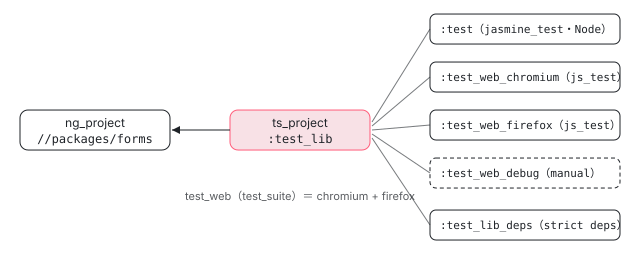

[目次](../README.md) › [コントリビュートの道](README.md) › 第 4 回 / 全 15 回

# Bazel の読み方：BUILD.bazel・ターゲット・ラベル

> BUILD.bazel に並ぶ ts\_project・ng\_project・zoneless\_jasmine\_test・zoneless\_web\_test\_suite などの規則と、//packages/forms/test:test のようなラベルの読み方。tools/defaults.bzl が規則を包んで tsconfig の選択と strict deps の検査を足している理由、依存（deps）を書かないと import できない理由（sandbox と strict deps）、bazel query / cquery で「このファイルを含むターゲット」「この変更で走るテスト」を探す方法、キャッシュの場所と消し方。

angular/angular · 読了 約 14 分 · 中核 · [サイトで読む（デモが動きます）](https://angular-deep-dive-cyan.vercel.app/chapter/contrib-bazel)

---

`packages/forms/test/BUILD.bazel` の 34 行を、1 行ずつ「Bazel から見て何なのか」に直して読みます。`//packages/forms/test:test` のようなラベル（ターゲットの住所）の読み方、`ts_project` や `zoneless_jasmine_test` が `tools/defaults.bzl` で包まれている理由、`deps` に書かないと import できない理由、`bazel query` で「このファイルを含むターゲット」や 「この変更で走るテスト」を探す方法、キャッシュの場所と消し方までを、このマシンで実際に走らせた query の出力で確かめます。

読む対象は ../angular の `packages/forms/test/BUILD.bazel`・`packages/forms/BUILD.bazel`・`packages/BUILD.bazel`・ `tools/defaults.bzl`・`tools/bazel/jasmine_test.bzl`・`tools/bazel/web_test.bzl`・`.bazelrc`・`contributing-docs/building-with-bazel.md` です。

1. [1. 全体像](01-contrib-overview.md)
2. [2. リポジトリの地図](02-contrib-repo-map.md)
3. [3. 手元の準備](03-contrib-setup.md)
4. 4. Bazel の読み方
5. [5. テストを走らせる](05-contrib-run-tests.md)
6. [6. spec の読み方](06-contrib-reading-specs.md)
7. [7. テストを書く](07-contrib-writing-a-test.md)
8. [8. 公開 API と golden](08-contrib-public-api.md)
9. [9. コミットメッセージ](09-contrib-commit-messages.md)
10. [10. PR が通るまで](10-contrib-pr-flow.md)
11. [11. ブランチとリリース](11-contrib-branches.md)
12. [12. issue の仕分け](12-contrib-triage.md)
13. [13. コードの書き方](13-contrib-coding-standards.md)
14. [14. 手元で確かめる](14-contrib-debugging.md)
15. [15. 最初の PR](15-contrib-first-pr.md)

## 0. 言葉を 4 つだけ

| 言葉 | 意味 | この章の例 |
| --- | --- | --- |
| パッケージ | `BUILD.bazel` があるディレクトリ。その下（次の BUILD.bazel の手前まで）のファイルが属する | `packages/forms/test` |
| ターゲット | BUILD.bazel に書いた 1 つの規則の呼び出し（`name = "…"`）。ビルドやテストの単位 | `test_lib`、`test` |
| ラベル | ターゲットの住所。`//パッケージ:名前` | `//packages/forms/test:test` |
| マクロ | 規則の呼び出しをまとめた Starlark（Bazel の Python に似た言語）の関数。`.bzl` に書く | `zoneless_jasmine_test` |

## 1. 文書の説明と、その古い部分

📄 `angular/contributing-docs/building-with-bazel.md` L20–45 （▶ の行: 22–24, 28–29, 39–40, 42）

```md
20 │ ## Configuration
21 │ 
22 ▶ The `WORKSPACE` file indicates that our root directory is a
23 ▶ Bazel project. It contains the version of the Bazel rules we
24 ▶ use to execute build steps, from `npm_bazel_typescript`.
25 │ The sources on [GitHub] are published from Google's internal
26 │ repository (google3).
27 │ 
28 ▶ Bazel accepts a lot of options. We check in some options in the
29 ▶ `.bazelrc` file. See the [bazelrc doc]. For example, if you don't
30 │ want Bazel to create several symlinks in your project directory
31 │ (`bazel-*`) you can add the line `build --symlink_prefix=/` to your
32 │ `.bazelrc` file.
33 │ 
34 │ [GitHub]: https://github.com/bazelbuild/rules_typescript
35 │ [bazelrc doc]: https://bazel.build/run/bazelrc
36 │ 
37 │ ## Building Angular
38 │ 
39 ▶ - Build a package: `pnpm bazel build packages/core`
40 ▶ - Build all packages: `pnpm bazel build packages/...`
41 │ 
42 ▶ You can use [ibazel] to run in a "watch mode" that continuously
43 │ keeps the outputs up-to-date as you save sources.
44 │ 
45 │ [ibazel]: https://github.com/bazelbuild/bazel-watcher
```

39〜40 行目がビルドの例です。`packages/core` や `packages/...` と `//` を付けずに書いていますが、コマンドラインのラベルは今いるディレクトリからの相対なので、リポジトリの直下で打てば `//packages/core` と同じです。28〜29 行目、よく使うオプションは `.bazelrc` に入っています（[第 3 回](03-contrib-setup.md)の 6 節）。

> [!WARNING]
> **ハマりどころ**
>
> 22〜24 行目は今のリポジトリと合っていません。ルートに `WORKSPACE` は無く、代わりに `MODULE.bazel`（と `REPO.bazel`）があります。依存の宣言は Bzlmod（MODULE.bazel で依存を書く今の Bazel の方式）に移っていて、`npm_bazel_typescript` も使っていません（TypeScript は `aspect_rules_ts`、Angular は `rules_angular`）。文書は読みますが、最後は実物の BUILD.bazel と .bzl を読む、が基本です。

## 2. packages/forms/test/BUILD.bazel を読む

📄 `angular/packages/forms/test/BUILD.bazel` L1–34 （▶ の行: 1, 3–8, 14, 22–23, 25, 29–30, 32）

```python
 1 ▶ load("//tools:defaults.bzl", "ts_project", "zoneless_jasmine_test", "zoneless_web_test_suite")
 2 │ 
 3 ▶ ts_project(
 4 ▶     name = "test_lib",
 5 ▶     testonly = True,
 6 ▶     srcs = glob(["**/*.ts"]),
 7 ▶     visibility = ["//:__pkg__"],
 8 ▶     deps = [
 9 │         "//:node_modules/rxjs",
10 │         "//packages/animations/browser",
11 │         "//packages/common",
12 │         "//packages/core",
13 │         "//packages/core/testing",
14 ▶         "//packages/forms",
15 │         "//packages/platform-browser",
16 │         "//packages/platform-browser/animations",
17 │         "//packages/platform-browser/testing",
18 │         "//packages/private/testing",
19 │     ],
20 │ )
21 │ 
22 ▶ zoneless_jasmine_test(
23 ▶     name = "test",
24 │     data = [
25 ▶         ":test_lib",
26 │     ],
27 │ )
28 │ 
29 ▶ zoneless_web_test_suite(
30 ▶     name = "test_web",
31 │     deps = [
32 ▶         ":test_lib",
33 │     ],
34 │ )
```

1. **1 行目：load**

   使う 3 つの名前を `//tools:defaults.bzl`（`tools` パッケージの `defaults.bzl` というファイル）から読みます。Bazel の組み込みでも、外部の規則でもなく、Angular のリポジトリが用意した包みです（4 節）。
2. **3〜20 行目：ts\_project(name = "test\_lib")**

   6 行目、このディレクトリの下の `.ts` を全部（`form_control_spec.ts` も）TypeScript としてコンパイルします。5 行目の `testonly` は「テスト用。本番のターゲットからは依存できない」という印。7 行目の `visibility` は、このターゲットに依存してよい相手（ここではルートのパッケージだけ）。8〜19 行目の `deps` が、spec が import してよい相手の一覧です。14 行目の `//packages/forms` は `//packages/forms:forms` の略で、3 節の `ng_project` を指します。
3. **22〜27 行目：zoneless\_jasmine\_test(name = "test")**

   25 行目、`:test_lib`（同じパッケージの `test_lib`）のコンパイル結果を材料に、Node の上で Jasmine を走らせるテストです。`bazel test //packages/forms/test:test` の `test` はこの `name` です。
4. **29〜34 行目：zoneless\_web\_test\_suite(name = "test\_web")**

   同じ `test_lib` をブラウザで走らせるテストです。32 行目は `data` ではなく `deps` と書く違いがあります（5 節で中身を見ます）。

14 行目の相手、`packages/forms/BUILD.bazel` の先頭です。

📄 `angular/packages/forms/BUILD.bazel` L1–21 （▶ の行: 1, 4, 6, 8–10, 13, 16, 19）

```python
 1 ▶ load("@npm//:defs.bzl", "npm_link_all_packages")
 2 │ load("//tools:defaults.bzl", "api_golden_test", "api_golden_test_npm_package", "generate_api_docs", "ng_examples_db", "ng_package", "ng_project")
 3 │ 
 4 ▶ package(default_visibility = ["//visibility:public"])
 5 │ 
 6 ▶ npm_link_all_packages()
 7 │ 
 8 ▶ ng_project(
 9 ▶     name = "forms",
10 ▶     srcs = glob(
11 │         [
12 │             "*.ts",
13 ▶             "src/**/*.ts",
14 │         ],
15 │     ),
16 ▶     deps = [
17 │         "//:node_modules/rxjs",
18 │         "//packages/common",
19 ▶         "//packages/core",
20 │     ],
21 │ )
```

8〜21 行目の `ng_project(name = "forms")` が `@angular/forms` の本体で、13 行目の `src/**/*.ts` を Angular のコンパイラでコンパイルします。`ts_project` ではなく `ng_project` なのは、`@Directive` などのデコレーターを Angular のコンパイラ（ngtsc）が処理する必要があるからです。4 行目の `default_visibility = public` で、どこからでも依存できます。16〜20 行目、forms 自身の依存は rxjs・common・core だけです。だから forms のテストを走らせると、core と common のビルドが先に走ります（[第 3 回](03-contrib-setup.md)の最初の test の出力の `Compiling Angular TS: @@//packages/core:core`）。6 行目の `npm_link_all_packages()` は、1 行目で読んだ関数で、このパッケージの `package.json` に書いた npm パッケージを Bazel のターゲットにします。

## 3. ラベルを分解する

> **🧪 DEMO — ラベルの分解器**
>
> ラベルの読み方の規則を小さな関数で再現したものです（Bazel を呼んでいるわけではありません）。`:x` や素の名前は「今いるパッケージ」で解釈します。
>
> ▶ [このデモはサイトで動かせます](https://angular-deep-dive-cyan.vercel.app/chapter/contrib-bazel)

## 4. tools/defaults.bzl：規則を包んでいる理由

📄 `angular/tools/defaults.bzl` L8–19 （▶ の行: 9–10, 14, 18）

```python
 8 │ load("@rules_angular//src/ng_examples_db:index.bzl", _ng_examples_db = "ng_examples_db")
 9 ▶ load("@rules_angular//src/ng_project:index.bzl", _ng_project = "ng_project")
10 ▶ load("@rules_angular//src/ts_project:index.bzl", _ts_project = "ts_project")
11 │ load("@rules_sass//src:index.bzl", _npm_sass_library = "npm_sass_library", _sass_binary = "sass_binary", _sass_library = "sass_library")
12 │ load("//adev/shared-docs/pipeline/api-gen:generate_api_docs.bzl", _generate_api_docs = "generate_api_docs")
13 │ load("//tools/bazel:esbuild.bzl", _esbuild = "esbuild", _esbuild_checked_in = "esbuild_checked_in")
14 ▶ load("//tools/bazel:jasmine_test.bzl", _angular_jasmine_test = "angular_jasmine_test", _jasmine_test = "jasmine_test", _zone_compatible_jasmine_test = "zone_compatible_jasmine_test", _zoneless_jasmine_test = "zoneless_jasmine_test")
15 │ load("//tools/bazel:js_defs.bzl", _js_binary = "js_binary", _js_run_binary = "js_run_binary", _js_test = "js_test")
16 │ load("//tools/bazel:npm_packages.bzl", _ng_package = "ng_package", _npm_package = "npm_package")
17 │ load("//tools/bazel:tsec.bzl", _tsec_test = "tsec_test")
18 ▶ load("//tools/bazel:web_test.bzl", _ng_web_test_suite = "ng_web_test_suite", _web_test = "web_test", _zoneless_web_test_suite = "zoneless_web_test_suite")
19 │ load("//tools/bazel:webdriver_test.bzl", _webdriver_test = "webdriver_test")
```

9〜10 行目、`ng_project` と `ts_project` の本物は `@rules_angular`（Angular チームの Bazel 規則の外部リポジトリ）にあり、`_ng_project` / `_ts_project` という名前で読み込みます。14 行目のテストの包みと 18 行目のブラウザのテストの包みは、同じリポジトリの `tools/bazel/` にあります（5 節）。では、なぜ本物をそのまま使わせず、もう 1 枚包むのか。`ts_project` の定義を読みます。

📄 `angular/tools/defaults.bzl` L88–115 （▶ の行: 96–97, 103–104, 110–114）

```python
 88 │ def ts_project(
 89 │         name,
 90 │         deps = [],
 91 │         srcs = [],
 92 │         source_map = True,
 93 │         testonly = False,
 94 │         tsconfig = None,
 95 │         **kwargs):
 96 ▶     if tsconfig == None:
 97 ▶         tsconfig = _determine_tsconfig(testonly)
 98 │ 
 99 │     _ts_project(
100 │         name,
101 │         srcs = srcs,
102 │         deps = deps,
103 ▶         declaration = True,
104 ▶         source_map = source_map,
105 │         testonly = testonly,
106 │         tsconfig = tsconfig,
107 │         **kwargs
108 │     )
109 │ 
110 ▶     strict_deps_test(
111 ▶         name = "%s_deps" % name,
112 ▶         srcs = srcs,
113 ▶         tsconfig = tsconfig,
114 ▶         deps = deps,
115 │     )
```

1. **96〜97 行目：tsconfig を場所で決める**

   BUILD.bazel に tsconfig を書かなくても、パッケージの場所と `testonly` から自動で選びます（すぐ下の `_determine_tsconfig`）。全員が同じ設定でコンパイルされます。
2. **103〜104 行目：既定を固定する**

   `declaration = True`（型定義 .d.ts を出す）と source map を、全ターゲットで同じにします。
3. **110〜115 行目：strict\_deps\_test を必ず足す**

   111 行目、`test_lib` なら `test_lib_deps` という名前のテストが 1 つ増えます。import している相手が `deps` に書いてあるかを検査するテストです（7 節）。`bazel query 'kind(".*_test", …)'` の出力に `_strict_deps_test rule //packages/forms/test:test_lib_deps` が並ぶのはこのためです。

📄 `angular/tools/defaults.bzl` L74–86 （▶ の行: 77–78, 86）

```python
74 │     if native.package_name().startswith("packages/examples"):
75 │         return "//packages/examples:tsconfig_test" if testonly else "//packages/examples:tsconfig_build"
76 │ 
77 ▶     if native.package_name().startswith("packages"):
78 ▶         return "//packages:tsconfig_test" if testonly else "//packages:tsconfig_build"
79 │ 
80 │     if native.package_name().startswith("tools"):
81 │         return "//tools:tsconfig_test" if testonly else "//tools:tsconfig_build"
82 │ 
83 │     if native.package_name().startswith("vscode-ng-language-service"):
84 │         return "//vscode-ng-language-service:tsconfig_test" if testonly else "//vscode-ng-language-service:tsconfig_build"
85 │ 
86 ▶     fail("Failing... a tsconfig value must be provided.")
```

📄 `angular/packages/BUILD.bazel` L39–55 （▶ の行: 40–41, 48–49, 52–53）

```python
39 │ ts_config(
40 ▶     name = "tsconfig_build",
41 ▶     src = "tsconfig-build.json",
42 │     deps = [
43 │         "//:node_modules/tslib",
44 │     ],
45 │ )
46 │ 
47 │ ts_config(
48 ▶     name = "tsconfig_test",
49 ▶     src = "tsconfig-test.json",
50 │     deps = [
51 │         ":tsconfig_build",
52 ▶         "//:node_modules/@types/jasmine",
53 ▶         "//:node_modules/@types/node",
54 │     ],
55 │ )
```

`packages/forms/test` は 77 行目の `startswith("packages")` に当たり、`testonly = True` なので 78 行目で `//packages:tsconfig_test`、つまり `packages/tsconfig-test.json`（49 行目）になります。テスト用の tsconfig だけが 52〜53 行目で `@types/jasmine` と `@types/node` を持つので、spec では `describe` や `it` の型が使え、本番のコードでは使えません。どこにも当たらなければ 86 行目で `fail` し、BUILD.bazel を読む段階で止まります。同じファイルの `ng_project` の包みも、呼ぶ先が `_ng_project` なだけで、同じ 3 つをしています。

## 5. テストの包み：Node とブラウザ

📄 `angular/tools/bazel/jasmine_test.bzl` L1–18 （▶ の行: 1, 12–13, 15–16）

```python
 1 ▶ load("@devinfra//bazel/jasmine:jasmine.bzl", _jasmine_test = "jasmine_test")
 2 │ load("@devinfra//bazel/spec-bundling:index.bzl", "spec_bundle")
 3 │ 
 4 │ def angular_jasmine_test(name, data = [], fixed_args = [], **kwargs):
 5 │     jasmine_test(
 6 │         name = name,
 7 │         data = data + ["//tools/testing:node", "//tools/testing:node_tests.init.mjs"],
 8 │         fixed_args = fixed_args + ["--require=$$JS_BINARY__RUNFILES/$(rlocationpath //tools/testing:node_tests.init.mjs)"],
 9 │         **kwargs
10 │     )
11 │ 
12 ▶ def zoneless_jasmine_test(name, data = [], fixed_args = [], **kwargs):
13 ▶     jasmine_test(
14 │         name = name,
15 ▶         data = data + ["//tools/testing:node_zoneless", "//tools/testing:node_zoneless_tests.init.mjs"],
16 ▶         fixed_args = fixed_args + ["--require=$$JS_BINARY__RUNFILES/$(rlocationpath //tools/testing:node_zoneless_tests.init.mjs)"],
17 │         **kwargs
18 │     )
```

📄 `angular/tools/bazel/jasmine_test.bzl` L45–69 （▶ の行: 45, 52–54, 59, 61, 63–65）

```python
45 ▶ def jasmine_test(name, tsconfig = "//packages:tsconfig_build", fixed_args = [], **kwargs):
46 │     # Create relative path to root, from current package dir. Necessary as
47 │     # we change the `chdir` below to the package directory.
48 │     relative_to_root = "/".join([".."] * len(native.package_name().split("/")))
49 │ 
50 │     all_fixed_args = [
51 │         # Escape so that the `js_binary` launcher triggers Bash expansion.
52 ▶         "'**/*+(.|_)spec.js'",
53 ▶         "'**/*+(.|_)spec.mjs'",
54 ▶         "'**/*+(.|_)spec.cjs'",
55 │     ] + fixed_args
56 │ 
57 │     all_fixed_args = [arg.format(root = relative_to_root) for arg in all_fixed_args]
58 │ 
59 ▶     size = kwargs.pop("size", "medium")
60 │ 
61 ▶     _jasmine_test(
62 │         name = name,
63 ▶         node_modules = "//:node_modules",
64 ▶         chdir = native.package_name(),
65 ▶         fixed_args = all_fixed_args,
66 │         tsconfig = tsconfig,
67 │         size = size,
68 │         **kwargs
69 │     )
```

1. **12〜18 行目：zoneless\_jasmine\_test**

   15 行目で `//tools/testing:node_zoneless` を材料に足し、16 行目の `--require=` で、spec より先に `node_zoneless_tests.init.mjs` を読ませます。これが TestBed を zoneless で初期化するファイルです（[第 5 回](05-contrib-run-tests.md)）。`angular_jasmine_test`（4〜10 行目）は zone.js 版の同じものです。
2. **52〜54 行目：どのファイルを spec とみなすか**

   `*.spec.js` と `*_spec.js`（と .mjs / .cjs）。`form_control_spec.ts` がコンパイルされた `form_control_spec.js` がこれに当たります。
3. **59〜65 行目：jasmine\_test の本物へ**

   61 行目で 1 行目の `@devinfra` の `jasmine_test` を呼びます。64 行目でテストのときの作業ディレクトリをパッケージ（`packages/forms/test`）にし、59 行目で大きさの既定を `medium` にします。

実物の BUILD.bazel の 6 行が、展開されると何になるかは `bazel query --output=build` で見られます。

```
$ npx -y pnpm@12.3.4 bazel query --output=build //packages/forms/test:test
# ~/angular-research/angular/packages/forms/test/BUILD.bazel:22:22
jasmine_test(
  name = "test",
  generator_name = "test",
  generator_function = "zoneless_jasmine_test",
  generator_location = "packages/forms/test/BUILD.bazel:22:22",
  size = "medium",
  chdir = "packages/forms/test",
  data = ["//packages/forms/test:test_lib", "//tools/testing:node_zoneless", "//tools/testing:node_zoneless_tests.init.mjs",
          "@devinfra//bazel/jasmine:stack-traces", "@devinfra//bazel/private/node_loader:node_loader",
          "//packages:tsconfig_build", "//:node_modules/jasmine", "//:node_modules/jasmine-reporters"],
  entry_point = "//packages/forms/test:_test_jasmine_runner.cjs",
  env = {"NODE_OPTIONS_TSCONFIG_PATH": "$(rlocationpath //packages:tsconfig_build)"},
  fixed_args = ["'**/*+(.|_)spec.js'", "'**/*+(.|_)spec.mjs'", "'**/*+(.|_)spec.cjs'",
                "--require=$$JS_BINARY__RUNFILES/$(rlocationpath //tools/testing:node_zoneless_tests.init.mjs)"],
  …
)
# Rule test instantiated at (most recent call last):
#   ~/angular-research/angular/packages/forms/test/BUILD.bazel:22:22   in <toplevel>
#   ~/angular-research/angular/tools/bazel/jasmine_test.bzl:13:17      in zoneless_jasmine_test
#   ~/angular-research/angular/tools/bazel/jasmine_test.bzl:61:18      in jasmine_test
#   …/external/devinfra+/bazel/jasmine/jasmine.bzl:15:18               in jasmine_test
#   …/external/aspect_rules_jasmine+/jasmine/defs.bzl:68:22            in jasmine_test
```
*マクロを展開した結果。generator\_function と、下の「instantiated at」の並びが、BUILD.bazel → jasmine\_test.bzl → devinfra → aspect\_rules\_jasmine の順に包まれていることを示す。*

ブラウザ側の包みです。

📄 `angular/tools/bazel/web_test.bzl` L1–27 （▶ の行: 2, 5–6, 18, 22–24）

```python
 1 │ load("@devinfra//bazel/spec-bundling:index.bzl", "spec_bundle")
 2 ▶ load("@rules_browsers//wtr:index.bzl", "wtr_test")
 3 │ 
 4 │ def web_test(name, tags = [], deps = [], bootstrap = [], tsconfig = "//packages:tsconfig_build", **kwargs):
 5 ▶     spec_bundle(
 6 ▶         name = "%s_bundle" % name,
 7 │         testonly = True,
 8 │         srcs = [tsconfig],
 9 │         tsconfig = tsconfig,
10 │         bootstrap = bootstrap,
11 │         deps = deps,
12 │         tags = [
13 │             "manual",
14 │         ],
15 │         config = {
16 │             "resolveExtensions": [".js", ".mjs"],
17 │         },
18 ▶         platform = "browser",
19 │         external = kwargs.pop("external", []),
20 │     )
21 │ 
22 ▶     wtr_test(
23 ▶         name = name,
24 ▶         deps = [":%s_bundle" % name] + kwargs.pop("data", []),
25 │         tags = tags,
26 │         **kwargs
27 │     )
```

📄 `angular/tools/bazel/web_test.bzl` L29–45 （▶ の行: 38–39, 42）

```python
29 │ def ng_web_test_suite(deps = [], bootstrap = [], **kwargs):
30 │     web_test(
31 │         deps = deps,
32 │         bootstrap = [
33 │             "//tools/testing:browser",
34 │         ] + bootstrap,
35 │         **kwargs
36 │     )
37 │ 
38 ▶ def zoneless_web_test_suite(deps = [], bootstrap = [], **kwargs):
39 ▶     web_test(
40 │         deps = deps,
41 │         bootstrap = [
42 ▶             "//tools/testing:browser_zoneless",
43 │         ] + bootstrap,
44 │         **kwargs
45 │     )
```

5〜20 行目で spec を esbuild で 1 つのブラウザ向けの束にし（18 行目 `platform = "browser"`）、22 行目の `wtr_test`（2 行目、`@rules_browsers` の Web Test Runner の規則）で走らせます。42 行目、zoneless 版は `//tools/testing:browser_zoneless` を先に読ませます。`wtr_test` は 1 つの名前から 3 つのテストと 1 つの `test_suite`（テストをまとめる入れ物）を作ります。

```
$ npx -y pnpm@12.3.4 bazel query --output=build //packages/forms/test:test_web
test_suite(
  name = "test_web",
  generator_function = "zoneless_web_test_suite",
  tests = ["//packages/forms/test:test_web_chromium", "//packages/forms/test:test_web_firefox"],
)
```
*test\_web はテストそのものではなく、chromium と firefox の 2 本をまとめた test\_suite。*



*BUILD.bazel の 3 つの呼び出しから、実際にできるターゲット（一部）。矢印は「材料にする」。*

## 6. bazel query で探す

`bazel query` は、ビルドせずに BUILD.bazel の中身（ターゲットとその依存のつながり）を調べるコマンドです。出力の形は `.bazelrc` で決まっています。

📄 `angular/.bazelrc` L86–95 （▶ の行: 90–92）

```
86 │ ###############################
87 │ # Output                      #
88 │ ###############################
89 │ 
90 ▶ # A more useful default output mode for bazel query
91 ▶ # Prints eg. "ng_module rule //foo:bar" rather than just "//foo:bar"
92 ▶ query --output=label_kind
93 │ 
94 │ # By default, failing tests don't print any output, it goes to the log file
95 │ test --test_output=errors
```

92 行目の `--output=label_kind` で、ラベルの前に規則の種類（`jasmine_test rule` など）が付きます。次の 4 つは、このマシンで実際に走らせた出力です。

### forms の下のテストを全部並べる

```
$ npx -y pnpm@12.3.4 bazel query 'kind(".*_test", //packages/forms/...)'
js_test rule //packages/forms:forms_api
_strict_deps_test rule //packages/forms:forms_deps
js_test rule //packages/forms:forms_errors
_strict_deps_test rule //packages/forms/signals:signals_deps
_strict_deps_test rule //packages/forms/signals/compat:compat_deps
jasmine_test rule //packages/forms/signals/test/node:test
_strict_deps_test rule //packages/forms/signals/test/node:test_lib_deps
js_test rule //packages/forms/signals/test/web:test_chromium
js_test rule //packages/forms/signals/test/web:test_debug
js_test rule //packages/forms/signals/test/web:test_firefox
_strict_deps_test rule //packages/forms/signals/test/web:test_lib_deps
jasmine_test rule //packages/forms/test:test
_strict_deps_test rule //packages/forms/test:test_lib_deps
js_test rule //packages/forms/test:test_web_chromium
js_test rule //packages/forms/test:test_web_debug
js_test rule //packages/forms/test:test_web_firefox
… 1.511 total
```
*kind(規則の種類の正規表現, 範囲)。1.5 秒で返る。*

`jasmine_test` が Node のテスト、`js_test … test_web_chromium` などがブラウザのテスト、`_strict_deps_test` が 4 節で足された検査、`js_test … forms_api` は公開 API の golden の検査です（[第 8 回](08-contrib-public-api.md)）。

### 1 つのパッケージのターゲットを全部並べる

```
$ npx -y pnpm@12.3.4 bazel query //packages/forms/test:all
_write_file rule //packages/forms/test:__test_web_bundle_bundle_write_config
_copy_file rule //packages/forms/test:_test_copy_jasmine_junit_reporter
_copy_file rule //packages/forms/test:_test_copy_jasmine_runner
esbuild_bundle rule //packages/forms/test:_test_web_bundle_bundle
jasmine_test rule //packages/forms/test:test
ts_project rule //packages/forms/test:test_lib
_strict_deps_test rule //packages/forms/test:test_lib_deps
filegroup rule //packages/forms/test:test_lib_types
test_suite rule //packages/forms/test:test_web
_filter_runfiles rule //packages/forms/test:test_web_bundle
spec_entrypoint rule //packages/forms/test:test_web_bundle_entrypoint
js_test rule //packages/forms/test:test_web_chromium
directory_path rule //packages/forms/test:test_web_chromium__entry_point
js_test rule //packages/forms/test:test_web_debug
directory_path rule //packages/forms/test:test_web_debug__entry_point
js_test rule //packages/forms/test:test_web_firefox
directory_path rule //packages/forms/test:test_web_firefox__entry_point
```
*:all はパッケージの中のすべてのターゲット。BUILD.bazel に書いた 3 つが 17 になっている。*

### このファイルを含むターゲットを探す

```
$ npx -y pnpm@12.3.4 bazel query 'attr(srcs, form_control_spec.ts, //packages/forms/...)'
ts_project rule //packages/forms/test:test_lib
_strict_deps_test rule //packages/forms/test:test_lib_deps
```
*attr(属性名, 正規表現, 範囲)。srcs に form\_control\_spec.ts を持つターゲット。*

spec を直したとき、どのターゲットを走らせればよいかはこれで分かります。`test_lib` が出たら、それを材料にしているテスト（`:test` と `:test_web`）を走らせます。

### この変更で走るテストを探す（rdeps）

`rdeps(範囲, X)` は「X に依存しているもの」です。`packages/forms/src` を直したとき、影響を受けるテストを知りたい。ところが `query` ではこのマシンで失敗しました。

```
$ npx -y pnpm@12.3.4 bazel query 'rdeps(//packages/forms/..., //packages/forms:forms, 1)'
ERROR: …/external/rules_browsers+/browsers/private/browser_repo.bzl:27:33: An error occurred during the fetch
  of repository 'rules_browsers++browsers+rules_browsers_firefox_win64':
Error in download_and_extract: Expected a file with a .zip, .jar, … suffix
  (got …/Firefox_20Setup_20155.0.exe)
ERROR: Evaluation of query "rdeps(//packages/forms/..., //packages/forms:forms, 1)" failed:
  preloading transitive closure failed: no such package '@@rules_browsers++browsers+rules_browsers_firefox_win64//': …
```
*query の rdeps は、範囲の依存を select のすべての枝まで読み込む。Windows 用 Firefox のリポジトリ（.exe）まで取ろうとして失敗した。*

`query` は、OS ごとに分かれる依存（`select`）の枝を全部たどるので、macOS では使わない Windows 用の Firefox まで取りに行き、その取得に失敗しました。今の設定（このマシンの OS）で枝を 1 つに決めてからたどる `cquery` なら通ります。

```
$ npx -y pnpm@12.3.4 bazel cquery 'kind(".*_test", rdeps(//packages/forms/..., //packages/forms:forms))'
INFO: Analyzed 109 targets (699 packages loaded, 51790 targets configured).
WARNING: Targets were missing from graph: […]
//packages/forms/signals/test/web:test_lib_deps (e9c460f)
//packages/forms/test:test_lib_deps (e9c460f)
//packages/forms/signals:signals_deps (e9c460f)
//packages/forms/signals/test/node:test_lib_deps (e9c460f)
//packages/forms:forms_errors (e9c460f)
//packages/forms/signals/compat:compat_deps (e9c460f)
//packages/forms/signals/test/node:test (e9c460f)
//packages/forms/test:test (e9c460f)
//packages/forms:forms_deps (e9c460f)
//packages/forms/test:test_web_firefox (e9c460f)
//packages/forms/test:test_web_debug (e9c460f)
//packages/forms/test:test_web_chromium (e9c460f)
//packages/forms/signals/test/web:test_firefox (e9c460f)
//packages/forms/signals/test/web:test_debug (e9c460f)
//packages/forms/signals/test/web:test_chromium (e9c460f)
//packages/forms:forms_api (e9c460f)
INFO: Elapsed time: 140.543s, Critical Path: 0.00s
```
*cquery は解析（analysis）をするので重い。このマシンで 140 秒。(e9c460f) は設定のハッシュ。*

`//packages/forms:forms` を直すと、forms の Node のテスト・ブラウザのテスト・signals のテスト・strict deps の検査・公開 API の検査が影響を受ける、と分かります。範囲を `//packages/...` に広げれば、forms に依存する他のパッケージのテストも対象になります（そのぶん解析は重くなります）。

## 7. deps に書かないと import できない理由

理由は 2 段あります。

1. **sandbox：宣言した入力しか見えない**

   Bazel は 1 つ 1 つのアクション（コンパイル 1 回、テスト 1 回）を、宣言した入力だけを並べた一時ディレクトリで走らせます。[第 3 回](03-contrib-setup.md)の最初の test の出力の `3100 processes: 712 internal, 2290 darwin-sandbox, 98 worker` の `darwin-sandbox` がそれです。`test_lib` の入力は `srcs` と `deps` から決まるので、sandbox で走るアクションでは、`deps` に無いパッケージの型定義はその場所に並ばず、tsc から見えません。ただし同じ出力の `Compiling TS: … worker` のように、コンパイルは worker（常駐するコンパイラのプロセス）で走ることもあり、こちらは 1 回ごとの一時ディレクトリを作りません。
2. **strict\_deps\_test：見えてしまっても落とす**

   1 段目をすり抜けて見えてしまう場合（worker で走った、間接の依存を通して見えた、など）のために、4 節の 110〜115 行目で足した `test_lib_deps` が、spec の import を 1 つずつ `deps` と照らし合わせます。書いていなければ `No explicit Bazel dependency for this module.` という診断で落ちます（このメッセージは `@devinfra` の `bazel/ts_project/strict_deps/index.mts` にあります）。

> [!NOTE]
> **さらに深く**
>
> strict deps の検査は、tsconfig の `paths` に一致する指定子は通します（同じ index.mts の `checkPathsForMatch`）。`packages/tsconfig-build.json` は `@angular/*` を paths に持つので、`@angular/…` の import の漏れはこの 2 段目では検出されません。npm のパッケージ（`rxjs` など）は検出されます。新しい spec で `rxjs/operators` を使うなら、9 行目の `//:node_modules/rxjs` が要る、ということです。

## 8. キャッシュはどこにあり、どう消すか

📄 `angular/contributing-docs/building-with-bazel.md` L135–148 （▶ の行: 137–138, 141, 147）

````md
135 │ ### Debugging Bazel rules
136 │ 
137 ▶ Open `external` directory which contains everything that bazel downloaded while executing the
138 ▶ workspace file:
139 │ 
140 │ ```sh
141 ▶ open $(pnpm run -s bazel info output_base)/external
142 │ ```
143 │ 
144 │ See subcommands that bazel executes (helpful for debugging):
145 │ 
146 │ ```sh
147 ▶ pnpm bazel build //packages/core:package -s
148 │ ```
````

```
$ ls -l dist/
angular  -> /private/var/tmp/_bazel_<you>/d22ee183b6123dcb92041af2bd69c061/execroot/_main
bin      -> /private/var/tmp/_bazel_<you>/d22ee183…/execroot/_main/bazel-out/darwin_arm64-fastbuild/bin
out      -> /private/var/tmp/_bazel_<you>/d22ee183…/execroot/_main/bazel-out
testlogs -> /private/var/tmp/_bazel_<you>/d22ee183…/execroot/_main/bazel-out/darwin_arm64-fastbuild/testlogs
$ du -sh /private/var/tmp/_bazel_<you>/*  /private/var/tmp/_bazel_<you>/d22ee183…/{external,execroot}
759M  /private/var/tmp/_bazel_<you>/cache                 # ダウンロードのキャッシュ（リポジトリキャッシュ）
3.0G  /private/var/tmp/_bazel_<you>/d22ee183…             # このワークスペースの出力ベース
183M  /private/var/tmp/_bazel_<you>/install               # Bazel 自身の展開先
2.6G  /private/var/tmp/_bazel_<you>/d22ee183…/external    # 取ってきた外部リポジトリ（npm・Node・ブラウザ…）
413M  /private/var/tmp/_bazel_<you>/d22ee183…/execroot    # ビルドの出力（dist/bin などの実体）
```
*dist/ の 4 つの近道と、その先の大きさ（このマシン、読み取りのみ）。*

141 行目の `bazel info output_base` が出力ベース（このワークスペース用の Bazel の作業場所）を教えます。このマシンでは `/private/var/tmp/_bazel_<you>/d22ee183…`（名前はワークスペースのパスから決まる）で、137〜138 行目の `external`（取ってきた外部のもの）が 2.6 GB、ビルドの出力の `execroot` が 413 MB でした。`dist/bin` や `dist/testlogs` は、その中への近道です。147 行目の `-s` は、Bazel が実際に実行したコマンドを表示します。

📄 `angular/contributing-docs/building-with-bazel.md` L344–353 （▶ の行: 349, 352）

````md
344 │ If VSCode is not the root cause, you might try:
345 │ 
346 │ - Quit VSCode (make sure no VSCode is running).
347 │ 
348 │ ```sh
349 ▶ bazel clean --expunge
350 │ sudo xcode-select -s /Applications/Xcode.app/Contents/Developer
351 │ sudo xcodebuild -license
352 ▶ pnpm bazel build //packages/core    # Run a build outside VSCode to pre-build the xcode; then safe to run VSCode
353 │ ```
````

| コマンド | 消えるもの | 次の 1 回 |
| --- | --- | --- |
| `npx -y pnpm@12.3.4 bazel clean` | ビルドの出力（execroot の bazel-out） | ビルドはやり直し。取ってきた外部のものは残る |
| `npx -y pnpm@12.3.4 bazel clean --expunge` | 出力ベースまるごと（external も） | Node・npm パッケージの展開からやり直し。ダウンロード自体は `_bazel_<you>/cache` のキャッシュから出るものがある |

349 行目の文書の例は、Xcode が絡むおかしな失敗のときに `--expunge` で全部消して作り直す手順です。ふつうはどちらも要りません。Bazel は入力のハッシュでキャッシュを使い分けるので、「キャッシュが古くて結果がおかしい」は起きない作りです。building-with-bazel.md の「Remote cache」の節も、規則が入力だけに頼るように書いてあると説明しています（`(cached)` の読み方は[第 5 回](05-contrib-run-tests.md)）。

## ここまでを 1 本に

- 👤 `bazel test //packages/forms/test:test` — あなたのコマンド
  - `packages/forms/test/BUILD.bazel` — L22 zoneless\_jasmine\_test(name = "test")
    - `tools/bazel/jasmine_test.bzl` — L12 zoneless\_jasmine\_test → L45 jasmine\_test — *init ファイルと spec のパターンを足す*
      - `@devinfra//bazel/jasmine:jasmine.bzl` — jasmine\_test — *Node のローダーとスタックトレースの設定を足す*
        - `@aspect_rules_jasmine` — jasmine\_test 規則 — *Jasmine を走らせる実行ファイルを作る*
    - `:test_lib` — L3 ts\_project → tools/defaults.bzl L88 — *tsconfig を選び、strict\_deps\_test を足し、@rules\_angular の ts\_project へ*
      - `//packages/forms:forms` — packages/forms/BUILD.bazel L8 ng\_project — *さらに //packages/core・//packages/common へ*

## 聞かれそうな質問

**Q. deps に書かないと import できないのはなぜですか？tsc なら node\_modules から見つけてくれるのに。**

Bazel はアクションを sandbox（宣言した入力だけが並ぶ一時ディレクトリ）で走らせるので、`deps` に無いものはコンパイルの場に置かれません（7 節）。さらに Angular のリポジトリは `tools/defaults.bzl` 110〜115 行目で全ての `ts_project` / `ng_project` に strict deps の検査を足していて、間接的に見えてしまった import も `No explicit Bazel dependency for this module.` で落とします。こうしておくと、入力が完全に分かるので、キャッシュが正しく効き、変更の影響範囲（6 節の rdeps）も BUILD.bazel から正確に出せます。

**Q. キャッシュはどこにあって、消すにはどうしますか？**

出力ベース `$(bazel info output_base)`（このマシンでは `/private/var/tmp/_bazel_<you>/d22ee183…`）にあり、`dist/bin`・`dist/testlogs` はその中への近道です（8 節）。`bazel clean` はビルドの出力だけ、`bazel clean --expunge` は出力ベースまるごとを消します（building-with-bazel.md 349 行目の例）。ふつうは消す必要はありません。ディスクを空けたいときや、Xcode のような外の環境が変わっておかしくなったときに使います。

**Q. Bazel を使わずに tsc だけで型チェックできますか？**

Bazel と同じ条件にはなりません。理由は 3 つです。tsconfig は `_determine_tsconfig`（defaults.bzl 77〜78 行目）がターゲットごとに選ぶので、1 つの tsconfig では再現できない。`packages/forms` は `ng_project`（Angular のコンパイラ）でコンパイルされるので、tsc ではデコレーターの検査が抜ける。そして `deps` の境界（7 節）は tsc では検査されない。エディタの赤線は目安として使い、確かめるのは `npx -y pnpm@12.3.4 bazel build //packages/forms/test:test_lib`（そのターゲットのコンパイルだけ）が確実です。

**Q. ラベルの `//packages/forms` と `//packages/forms/...` はどう違いますか？**

`//packages/forms` は `//packages/forms:forms` の略で、`packages/forms/BUILD.bazel` 8 行目の `ng_project` 1 つです。`//packages/forms/...` は「packages/forms とその下のすべてのパッケージの、すべてのターゲット」というパターンで、`bazel test` に渡すと 6 節の kind の出力に並んだテストが全部走ります。3 節のデモで両方を入れて比べてください。

**Q. bazel query と cquery はどう使い分けますか？**

ふだんは速い `query`（BUILD.bazel を読むだけ）を使います。6 節の kind・attr・:all は 1〜2 秒でした。`select` で OS ごとに分かれる依存を含む「依存の閉包」をたどる `rdeps` で、このマシンのように別の OS 向けのリポジトリで失敗したら、今の設定で枝を決める `cquery` に替えます。cquery は解析までするので、このマシンでは 140 秒かかりました。

## 読み終えて

- ラベルは `//パッケージ:名前`。`//a/b` は `//a/b:b`、`:x` は今のパッケージ、`//a/...` は配下すべて。
- BUILD.bazel の `ts_project` などは `tools/defaults.bzl` の包み。tsconfig を場所で決め、既定をそろえ、strict deps の検査を必ず足す。
- `zoneless_jasmine_test` は Node、`zoneless_web_test_suite` は chromium・firefox・debug の 3 本と test\_suite になる。`query --output=build` で展開後が見える。
- import できる相手は `deps` だけ。sandbox と strict deps の 2 段で守られている。
- 「このファイルのターゲット」は `attr(srcs, …)`、「この変更で走るテスト」は `rdeps`（このマシンでは cquery）。

---

← 前: [手元の準備：Node・pnpm・Bazel をそろえる](03-contrib-setup.md)  
次: [テストを 1 本走らせる：bazel test と fit・--test\_filter](05-contrib-run-tests.md) →
