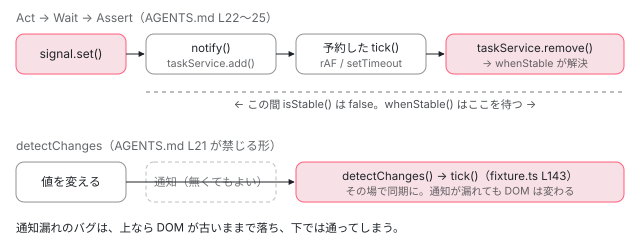

[目次](../README.md) › [コントリビュートの道](README.md) › 第 6 回 / 全 15 回

# spec の読み方：Angular のテストはどう書かれているか

> packages/core/test や packages/forms/test の spec の書き方。spec の探し方と、describe と it の文を並べて仕様として読む方法、TestBed でコンポーネントを宣言するテスト、AGENTS.md の zoneless の「Act → Wait → Assert」（detectChanges でなく await fixture.whenStable）がなぜそうなのかを ComponentFixture の実装で確かめる。packages/private/testing の useAutoTick と timeout、zone.js の無い target で fakeAsync が使えない理由、コンパイラの compliance テスト（TEST\_CASES.json が結ぶ入力と期待する出力のファイル）。

angular/angular · 読了 約 14 分 · 中核 · [サイトで読む（デモが動きます）](https://angular-deep-dive-cyan.vercel.app/chapter/contrib-reading-specs)

---

直したい場所が決まったら、次に開くのはその場所の **spec**（`*_spec.ts`。Jasmine で書かれたテスト）です。spec は「この関数はこう振る舞うべき」という文の集まりなので、実装より先に読むと仕様が分かります。この章では、spec の探し方、`describe` と `it` の文を並べて仕様として読む方法、AGENTS.md が求める zoneless の「Act → Wait → Assert」がなぜその形なのか（`ComponentFixture` の中身）、`useAutoTick` と `timeout`、そしてコンパイラの compliance テスト（入力と期待する出力のファイルの対）を読みます。

読む対象は `AGENTS.md`、`packages/core/testing/src/fixture.ts`・`test_bed_compiler.ts`・`fake_async.ts`、`packages/private/testing/src/utils.ts`、`tools/testing/node_tests.init.mts`、`packages/forms/test/form_control_spec.ts`、`packages/core/test/acceptance/` の 2 つの spec、`packages/compiler-cli/test/compliance/` です（angular リポジトリ）。

1. [1. 全体像](01-contrib-overview.md)
2. [2. リポジトリの地図](02-contrib-repo-map.md)
3. [3. 手元の準備](03-contrib-setup.md)
4. [4. Bazel の読み方](04-contrib-bazel.md)
5. [5. テストを走らせる](05-contrib-run-tests.md)
6. **6. spec の読み方**（この章）
7. [7. テストを書く](07-contrib-writing-a-test.md)
8. [8. 公開 API と golden](08-contrib-public-api.md)
9. [9. コミットメッセージ](09-contrib-commit-messages.md)
10. [10. PR が通るまで](10-contrib-pr-flow.md)
11. [11. ブランチとリリース](11-contrib-branches.md)
12. [12. issue の仕分け](12-contrib-triage.md)
13. [13. コードの書き方](13-contrib-coding-standards.md)
14. [14. 手元で確かめる](14-contrib-debugging.md)
15. [15. 最初の PR](15-contrib-first-pr.md)

## 0. 読む順番

1. **spec のファイルを探す**

   src のファイル名から test のファイル名を当て、grep で呼び出しを探す（1 節）。
2. **名前だけを並べて読む**

   `describe` と `it` の文を抜き出すと、それだけで仕様の箇条書きになる（2 節）。
3. **1 本の it を読む**

   準備（`beforeEach`）→ 操作 → `expect` の順に読む（3 節）。
4. **コンポーネントのテストは Act → Wait → Assert**

   なぜ `detectChanges` を呼ばないのかを、`ComponentFixture` の実装で確かめる（4〜6 節）。
5. **時間を待つテスト**

   `useAutoTick` と `timeout`、そして zone.js がある target と無い target（7〜8 節）。
6. **コンパイラのテストはファイルの対**

   入力の .ts と期待する出力の .js を、`TEST_CASES.json` が結ぶ（9 節）。

## 1. 「この関数のテストはどこ」を探す

パッケージの中は `src/` と `test/` が対になっていて、多くの spec は実装のファイル名に `_spec` を付けた名前です。`packages/forms/src/model/form_control.ts` のテストは `packages/forms/test/form_control_spec.ts` です （地図は[第 2 回](02-contrib-repo-map.md)）。ただし同じ関数は別の spec からも呼ばれます。`FormControl.reset` を呼んでいる spec を grep すると、実際には 8 ファイルありました。

📄 `ターミナル（../angular で実行）`

```
$ grep -rlE "\.reset\(" packages/forms/test | sort
packages/forms/test/form_array_spec.ts
packages/forms/test/form_builder_spec.ts
packages/forms/test/form_control_spec.ts
packages/forms/test/form_group_spec.ts
packages/forms/test/ng_control_status_spec.ts
packages/forms/test/reactive_integration_spec.ts
packages/forms/test/typed_integration_spec.ts
packages/forms/test/value_accessor_integration_spec.ts
```

`form_control_spec.ts` のような**単体テスト**（1 つのクラスだけを new して確かめる）と、`reactive_integration_spec.ts` のような**統合テスト**（テンプレートとディレクティブまで組み合わせて確かめる）が混ざっています。「自分が直したい挙動はもうテストされているか」は、単体の spec だけでなく統合の spec まで grep して確かめます。これを怠るとどうなるかは、[第 7 回](07-contrib-writing-a-test.md)で実際に起きます。

## 2. describe と it の文を並べると仕様書になる

📄 `angular/packages/forms/test/form_control_spec.ts` L21–41 （▶ の行: 21–22, 34–35, 37）

```ts
21 ▶ import {TestBed} from '@angular/core/testing';
22 ▶ import {timeout, useAutoTick} from '@angular/private/testing';
23 │ import {asyncValidator, asyncValidatorReturningObservable} from './util';
24 │ 
25 │ (function () {
26 │   function otherAsyncValidator() {
27 │     return Promise.resolve({'other': true});
28 │   }
29 │ 
30 │   function syncValidator() {
31 │     return null;
32 │   }
33 │ 
34 ▶   describe('FormControl', () => {
35 ▶     useAutoTick();
36 │ 
37 ▶     it('should default the value to null', () => {
38 │       const c = new FormControl();
39 │       expect(c.value).toBe(null);
40 │     });
41 │ 
```

34 行目の `describe('FormControl', …)` がこのファイルの外枠で、42 行目のように中にメソッドごとの `describe` が入れ子になります。1 本のテストは 37 行目・43 行目の `it('should …', …)` です。Jasmine は失敗したとき、外側の `describe` から順に文をつないで「FormControl markAllAsDirty should mark only the control itself as dirty」のように表示します。だから文は **should で始まる英文**で、つなげて読める形に書かれています。

21 行目の `TestBed` は `@angular/core/testing`、22 行目の `timeout` と `useAutoTick` は リポジトリの中だけで使う `@angular/private/testing`（実体は `packages/private/testing/src/utils.ts`、7 節）から来ます。35 行目で `useAutoTick()` を外枠の `describe` に置いているので、このファイルの全部のテストがモックの時計で走ります。

この文だけを grep で抜き出すと、`reset()` がどう振る舞うべきかの一覧になります。

📄 `ターミナル（../angular で実行）`

```
$ grep -nE "^\s*(describe|it)\(" packages/forms/test/form_control_spec.ts \
    | awk -F: '$1>=860 && $1<=1098' | sed -E "s/, (async )?\(\) => \{//"
860:    describe('reset()'
867:      it('should reset to a specific value if passed'
875:      it('should not set the parent when explicitly specified'
881:      it('should reset to a specific value if passed with boxed value'
889:      it('should clear the control value if no value is passed'
897:      it('should reset to the initial value if specified in FormControlOptions'
931:      it('should look inside FormState objects for a default value'
945:      it('should not alter the disabled state when resetting, even if a default value is provided'
960:      it('should update the value of any parent controls with passed value'
969:      it('should update the value of any parent controls with null value'
978:      it('should mark the control as pristine'
986:      it('should set the parent pristine state if all pristine'
995:      it('should not set the parent pristine state if it has other dirty controls'
1005:      it('should mark the control as untouched'
1013:      it('should set the parent untouched state if all untouched'
1022:      it('should not set the parent untouched state if other touched controls'
1032:      it('should retain the disabled state of the control'
1039:      it('should set disabled state based on boxed value if passed'
1046:      describe('reset() events'
1055:        it('should emit one valueChange event per reset control'
1064:        it('should not fire an event when explicitly specified'
1080:        it('should emit one statusChange event per reset control'
1089:        it('should emit one statusChange event per disabled control'
```

実装を読まなくても「値を渡せばその値に、渡さなければ null に、`nonNullable` なら初期値に戻る」「pristine と untouched に戻す」「disabled は保つ」「イベントは 1 回ずつ、`emitEvent: false` なら出さない」と分かります。バグかどうかを判断するときの基準はまずここです。spec に書かれた挙動と違えばバグ、spec に何も書かれていなければ「決まっていない」ので、issue で相談します （[第 12 回](12-contrib-triage.md)）。

## 3. 1 本の it を読む：reset() events

📄 `angular/packages/forms/test/form_control_spec.ts` L1046–1078 （▶ の行: 1046, 1049, 1051, 1053, 1055, 1060–1061, 1064, 1066, 1075, 1077）

```ts
1046 ▶       describe('reset() events', () => {
1047 │         let g: FormGroup, c2: FormControl, logger: any[];
1048 │ 
1049 ▶         beforeEach(() => {
1050 │           c2 = new FormControl('two');
1051 ▶           g = new FormGroup({'one': c, 'two': c2});
1052 │           logger = [];
1053 ▶         });
1054 │ 
1055 ▶         it('should emit one valueChange event per reset control', () => {
1056 │           g.valueChanges.subscribe(() => logger.push('group'));
1057 │           c.valueChanges.subscribe(() => logger.push('control1'));
1058 │           c2.valueChanges.subscribe(() => logger.push('control2'));
1059 │ 
1060 ▶           c.reset();
1061 ▶           expect(logger).toEqual(['control1', 'group']);
1062 │         });
1063 │ 
1064 ▶         it('should not fire an event when explicitly specified', async () => {
1065 │           g.valueChanges.subscribe((value) => {
1066 ▶             throw 'Should not happen';
1067 │           });
1068 │           c.valueChanges.subscribe((value) => {
1069 │             throw 'Should not happen';
1070 │           });
1071 │           c2.valueChanges.subscribe((value) => {
1072 │             throw 'Should not happen';
1073 │           });
1074 │ 
1075 ▶           c.reset(null, {emitEvent: false});
1076 │ 
1077 ▶           await timeout();
1078 │         });
```

1. **1049〜1053 行目：準備**

   `beforeEach` は、この `describe` の中の各 `it` の前に毎回走ります。`c` は外側の `describe('reset()')` の `beforeEach` で作られた `FormControl` で、ここでは `c2` と一緒に `FormGroup` に入れます（1051 行目）。毎回作り直すので、テスト同士が影響し合いません。
2. **1055〜1062 行目：記録して比べる形**

   3 つの `valueChanges` を購読して、来た順に `logger` へ名前を積みます。1060 行目で `c.reset()` し、1061 行目で「control1 → group の順に 1 回ずつ」を `toEqual` で比べます。**順番まで含めて仕様**だと読めます。
3. **1064〜1078 行目：「起きない」ことを確かめる形**

   購読の中で `throw` しておき（1066 行目）、1075 行目で `emitEvent: false` を付けて `reset` します。1077 行目の `await timeout()` は、もし非同期で emit される実装だったとしても取りこぼさないように、1 回だけタイマーを待つためです。何も起きなければ `expect` が 1 つも無いまま通ります。

> [!TIP]
> **新卒エンジニアへ**
>
> 「起きないこと」のテストには、この 1064 行目のように購読の中で失敗させる形と、配列に積んで最後に長さ 0 を確かめる形があります。後者のほうが、失敗したときに「Expected 1 to be 0.」のように何が起きたかが出力に残ります。[第 7 回](07-contrib-writing-a-test.md)で書くのは後者の形です。

## 4. AGENTS.md の「Act → Wait → Assert」

📄 `angular/AGENTS.md` L18–30 （▶ の行: 20–25, 27, 29）

```md
18 │ ## Testing
19 │ 
20 ▶ - **Zoneless & Async-First:** Assume a zoneless environment where state changes schedule updates asynchronously.
21 ▶   - **Do NOT** use `fixture.detectChanges()` to manually trigger updates.
22 ▶   - **ALWAYS** use the "Act, Wait, Assert" pattern:
23 ▶     1. **Act:** Update state or perform an action.
24 ▶     2. **Wait:** `await fixture.whenStable()` to allow the framework to process the scheduled update.
25 ▶     3. **Assert:** Verify the output.
26 │ - To keep tests fast, minimize the need for waiting:
27 ▶   - Use `useAutoTick()` (from `packages/private/testing/src/utils.ts`) to fast-forward time via the mock clock.
28 │ - When waiting is necessary, use real async tests (`it('...', async () => { ... })`) along with:
29 ▶   - `await timeout(ms)` (from `packages/private/testing/src/utils.ts`) to wait a specific number of milliseconds.
30 │   - `await fixture.whenStable()` to wait for framework stability.
```

AGENTS.md はリポジトリの直下にある、AI のコーディング支援向けの手引きです。けれども 18〜30 行目の Testing の段は、人がテストを書くときの決まりとしてそのまま読めます。20 行目「zoneless で、状態の変更は更新を**非同期に予約する**と考える」。21 行目「`fixture.detectChanges()` で手動で更新しない」。22〜25 行目「操作する（Act）→ `await fixture.whenStable()` で待つ（Wait）→ 確かめる（Assert）」。なぜそうなのかは、規則の文からは分かりません。`TestBed` と `ComponentFixture` の実装を読みます。

## 5. TestBed は zoneless、fixture は自動で検知する

📄 `angular/packages/core/testing/src/test_bed_compiler.ts` L985–1000 （▶ の行: 988, 990）

```ts
 985 │   private compileTestModule(): void {
 986 │     class RootScopeModule {}
 987 │     compileNgModuleDefs(RootScopeModule as NgModuleType<any>, {
 988 ▶       providers: [
 989 │         ...this.rootProviderOverrides,
 990 ▶         provideZonelessChangeDetectionInternal(),
 991 │         TestBedApplicationErrorHandler,
 992 │         {
 993 │           provide: ENVIRONMENT_INITIALIZER,
 994 │           multi: true,
 995 │           useValue: () => {
 996 │             inject(ErrorHandler);
 997 │           },
 998 │         },
 999 │       ],
1000 │     });
```

990 行目、`TestBed` がテストごとに作るルートのモジュールは、providers に `provideZonelessChangeDetectionInternal()` を入れています。これは `bootstrapApplication` が先頭に入れるのと同じ zoneless の 3 プロバイダです（[zoneless の第 1 回](../zoneless/01-zoneless-default.md)）。つまりテストの中のアプリは、本物のアプリと同じ `ChangeDetectionSchedulerImpl` で動きます。

📄 `angular/packages/core/testing/src/fixture.ts` L75–100 （▶ の行: 75–76, 78–80, 96–99）

```ts
 75 ▶   private readonly zonelessEnabled = inject(ZONELESS_ENABLED);
 76 ▶   private readonly scheduler = inject(ɵChangeDetectionScheduler);
 77 │   private readonly rootEffectScheduler = inject(EffectScheduler);
 78 ▶   private readonly autoDetectDefault = this.zonelessEnabled ? true : false;
 79 ▶   private autoDetect =
 80 ▶     inject(ComponentFixtureAutoDetect, {optional: true}) ?? this.autoDetectDefault;
 81 │ 
 82 │   private subscriptions = new Subscription();
 83 │   private readonly hostView: ViewRef;
 84 │ 
 85 │   readonly changeDetectorRef: ChangeDetectorRef;
 86 │ 
 87 │   /** @docs-private */
 88 │   constructor(protected readonly hostRef: ComponentRef<unknown>) {
 89 │     this.changeDetectorRef = hostRef.changeDetectorRef;
 90 │     this.debugElement = getDebugNode(hostRef.location.nativeElement) as DebugElement;
 91 │     this.nativeElement = hostRef.location.nativeElement;
 92 │     this.elementRef = hostRef.location;
 93 │     this.hostView = hostRef.hostView;
 94 │     this._testAppRef.allTestViews.add(this.hostView);
 95 │ 
 96 ▶     if (this.autoDetect) {
 97 ▶       this._testAppRef.autoDetectTestViews.add(this.hostView);
 98 ▶       this.scheduler?.notify(ɵNotificationSource.ViewAttached);
 99 ▶       this.scheduler?.notify(ɵNotificationSource.MarkAncestorsForTraversal);
100 │     }
```

78 行目、zoneless のときの `autoDetect` の既定は `true` です。すると 96〜99 行目で、作ったコンポーネントのビューを `autoDetectTestViews` に入れ、スケジューラに `ViewAttached` を通知します。本物のアプリでルートのコンポーネントが `ApplicationRef` に attach されたのと同じ状態です。この先は、signal の変更やイベントが通知を出し、スケジューラが `tick` を予約する、本物と同じ流れになります。

## 6. detectChanges を呼ぶと何が隠れるか

📄 `angular/packages/core/testing/src/fixture.ts` L129–160 （▶ の行: 140, 142–143, 145–146）

```ts
129 │   /**
130 │    * Trigger a change detection cycle for the component.
131 │    */
132 │   detectChanges(checkNoChanges = true): void {
133 │     const originalCheckNoChanges = (this.changeDetectorRef as InternalViewRef<unknown>)
134 │       .checkNoChanges;
135 │     try {
136 │       if (!checkNoChanges) {
137 │         (this.changeDetectorRef as InternalViewRef<unknown>).checkNoChanges = () => {};
138 │       }
139 │ 
140 ▶       if (this.zonelessEnabled) {
141 │         try {
142 ▶           this._testAppRef.includeAllTestViews = true;
143 ▶           this._appRef.tick();
144 │         } finally {
145 ▶           this._testAppRef.includeAllTestViews = false;
146 ▶         }
147 │       } else {
148 │         // Run the change detection inside the NgZone so that any async tasks as part of the change
149 │         // detection are captured by the zone and can be waited for in isStable.
150 │         this._ngZone.run(() => {
151 │           // Flush root effects before `detectChanges()`, to emulate the sequencing of `tick()`.
152 │           this.rootEffectScheduler.flush();
153 │           this.changeDetectorRef.detectChanges();
154 │           this.checkNoChanges();
155 │         });
156 │       }
157 │     } finally {
158 │       (this.changeDetectorRef as InternalViewRef<unknown>).checkNoChanges = originalCheckNoChanges;
159 │     }
160 │   }
```

140〜146 行目、zoneless での `fixture.detectChanges()` は、`includeAllTestViews` を立ててから `ApplicationRef.tick()` を**その場で同期に**呼びます。誰かが通知を出したかどうかに関係なく走ります。たとえば「この操作のあと、フレームワークが通知を出し忘れて画面が更新されない」というバグがあっても、テストの中で `detectChanges()` を呼ぶと画面は更新され、テストは通ってしまいます。バグがテストから見えなくなります。

📄 `angular/packages/core/testing/src/fixture.ts` L204–230 （▶ の行: 208–209, 218–220, 225, 227）

```ts
204 │   /**
205 │    * Return whether the fixture is currently stable or has async tasks that have not been completed
206 │    * yet.
207 │    */
208 ▶   isStable(): boolean {
209 ▶     return !this.pendingTasks.hasPendingTasks;
210 │   }
211 │ 
212 │   /**
213 │    * Get a promise that resolves when the fixture is stable.
214 │    *
215 │    * This can be used to resume testing after events have triggered asynchronous activity or
216 │    * asynchronous change detection.
217 │    */
218 ▶   whenStable(): Promise<any> {
219 ▶     if (this.isStable()) {
220 ▶       return Promise.resolve(false);
221 │     }
222 │ 
223 │     return new Promise((resolve, reject) => {
224 │       this.appErrorHandler.whenStableRejectFunctions.add(reject);
225 ▶       this._appRef.whenStable().then(() => {
226 │         this.appErrorHandler.whenStableRejectFunctions.delete(reject);
227 ▶         resolve(true);
228 │       });
229 │     });
230 │   }
```

一方 `whenStable()` は自分では何も走らせません。209 行目、安定とは「`PendingTasksInternal` に保留のタスクが無い」ことです。スケジューラは `tick` を予約するときに保留のタスクを 1 つ足し、`tick` が終わると外します （`zoneless_scheduling_impl.ts` の `pendingRenderTaskId`。[PendingTasks の章](../zoneless/09-zoneless-pending-tasks.md)）。225 行目で `ApplicationRef.whenStable()` を待つので、「通知 → 予約 → `tick`」が本当に起きたときだけ画面が更新されています。219〜220 行目、もともと保留が無ければすぐに解決します。**通知が出なかったなら、待っても画面は古いまま**で、テストは落ちます。



*上：await fixture.whenStable() は、スケジューラが予約した tick が終わって保留のタスクが 0 になるのを待つだけ。通知が無ければ予約も無く、すぐ解決して DOM は古いまま。下：fixture.detectChanges() は通知の有無に関係なく、その場で tick を呼ぶ。*

### 実際のテスト：TestBed でコンポーネントを宣言する

📄 `angular/packages/core/test/acceptance/expressions_spec.ts` L9–31 （▶ の行: 13–15, 17–18, 20, 28–30）

```ts
 9 │ import {Component} from '../../src/core';
10 │ import {TestBed} from '../../testing';
11 │ 
12 │ describe('expressions', () => {
13 ▶   it('should support nullish coalescing operator', async () => {
14 ▶     // Nullish should not pass a null value (as hinted by the TCB)
15 ▶     // https://github.com/angular/angular/issues/37622
16 │ 
17 ▶     @Component({
18 ▶       template: `{{ method(prop?.field) === undefined }}`,
19 │     })
20 ▶     class App {
21 │       prop: {field: string} | undefined = undefined;
22 │       method(param: string | undefined) {
23 │         // unexpected null should never happen
24 │         return param === null ? 'unexpected null' : param;
25 │       }
26 │     }
27 │ 
28 ▶     const fixture = TestBed.createComponent(App);
29 ▶     await fixture.whenStable();
30 ▶     expect(fixture.nativeElement.innerHTML).toEqual('true');
31 │   });
```

acceptance の spec（`packages/core/test/acceptance/`。コンポーネントを実際に作って振る舞いを確かめるテスト）は、この形が基本です。17〜26 行目、`it` の中でテスト専用のコンポーネントを `@Component` で宣言します（JIT でその場でコンパイルされます）。28 行目で作り、29 行目で待ち、30 行目で DOM を比べます。13 行目の `async` は 29 行目の `await` のためです。14〜15 行目のコメントのように、元になった issue の URL を書いておくのもよくある形です。

📄 `angular/packages/core/test/acceptance/change_detection_spec.ts` L278–297 （▶ の行: 279, 283, 293–296）

```ts
278 │       TestBed.configureTestingModule({
279 ▶         providers: [{provide: ComponentFixtureAutoDetect, useValue: true}],
280 │       });
281 │ 
282 │       const fixture = TestBed.createComponent(ParentComponent);
283 ▶       await fixture.whenStable();
284 │       expect(fixture.nativeElement.innerText).toBe('');
285 │ 
286 │       fixture.debugElement
287 │         .queryAllNodes(By.directive(ViewManipulation))[0]
288 │         .injector.get(ViewManipulation)
289 │         .insertIntoVcRef();
290 │       await fixture.whenStable();
291 │       expect(fixture.nativeElement.innerText).toBe(data());
292 │ 
293 ▶       data.set('new');
294 ▶       expect(fixture.isStable()).toBe(false);
295 ▶       await fixture.whenStable();
296 ▶       expect(fixture.nativeElement.innerText).toBe(data());
297 │     });
```

293〜296 行目が Act → Wait → Assert の見本です。293 行目で signal を変える（Act）。294 行目、その直後は `isStable()` が `false`（スケジューラが `tick` を予約して保留のタスクがある）ことまで確かめています。295 行目で待ち（Wait）、296 行目で DOM を確かめます（Assert）。279 行目の `ComponentFixtureAutoDetect: true` は 79〜80 行目で読まれる設定で、zoneless では既定と同じ値です。

> **🧪 DEMO — このページで本物の Act → Wait → Assert**
>
> このサイトも zoneless です。下の枠は別の OnPush コンポーネントで、テンプレートで signal と普通のプロパティを表示しています。ボタンを押すと、まずクリック自体の描画を待ってから値を変え（Act）、直後の DOM の文字を読み、本物の `ApplicationRef.whenStable()` を待って（Wait）、もう一度読みます（Assert）。
>
> signal のときは「Act の直後は古い → 待つと新しい」。更新が非同期に予約されることが見えます（AGENTS.md 20 行目）。普通のプロパティは誰にも通知しないので、待っても古いままです。テストならここで落ちて、通知が無いことに気づけます。3 つ目のボタンは、同じ変更のあとに `ChangeDetectorRef.detectChanges()` で変更検知を同期に走らせます。`fixture.detectChanges()`（140〜146 行目）と同じく「通知が無くても今すぐ走らせる」ので、DOM は更新され、通知が無いことが隠れます。このあと signal のボタンを押すと、枠の描き直しのついでに普通のプロパティも新しい値になります。
>
> ▶ [このデモはサイトで動かせます](https://angular-deep-dive-cyan.vercel.app/chapter/contrib-reading-specs)

## 7. 待たずに済ませる useAutoTick、本当に待つ timeout

📄 `angular/packages/private/testing/src/utils.ts` L173–212 （▶ の行: 183–185, 204–207, 209–210）

````ts
173 │ /**
174 │  * Returns a promise that resolves after the specified time.
175 │  *
176 │  * @param ms - Time to wait in milliseconds. Defaults to 0.
177 │  *
178 │  * @example
179 │  * ```ts
180 │  * await timeout(100); // Wait 100ms
181 │  * ```
182 │  */
183 ▶ export async function timeout(ms?: number): Promise<void> {
184 ▶   return new Promise((resolve) => {
185 ▶     setTimeout(resolve, ms);
186 │   });
187 │ }
188 │ 
189 │ /**
190 │  * Installs Jasmine's fake clock with auto-tick enabled for all tests in the describe block.
191 │  * Call at the top level of a describe block to automatically advance time for async operations.
192 │  *
193 │  * @example
194 │  * ```ts
195 │  * describe('MyComponent', () => {
196 │  *   useAutoTick();
197 │  *
198 │  *   it('should handle timers', () => {
199 │  *     // setTimeout, setInterval, etc. will execute synchronously
200 │  *   });
201 │  * });
202 │  * ```
203 │  */
204 ▶ export function useAutoTick() {
205 ▶   beforeEach(() => {
206 ▶     jasmine.clock().install();
207 ▶     jasmine.clock().autoTick();
208 │   });
209 ▶   afterEach(() => {
210 ▶     jasmine.clock().uninstall();
211 │   });
212 │ }
````

1. **183〜187 行目：timeout**

   `setTimeout` を `Promise` で包んだだけです。`await timeout(100)` で 100 ミリ秒待ちます。AGENTS.md 29 行目の「本当に時間を待つ必要があるとき」用です。
2. **204〜212 行目：useAutoTick**

   `describe` の直下で呼ぶと、各テストの前に Jasmine のモックの時計を入れ（206 行目）、自動で進める設定にし（207 行目）、テストのあとで外します（210 行目）。モックの時計が入っている間は `setTimeout` などが実時間を待たずに進むので、テストが速くなります（AGENTS.md 27 行目）。2 節の `form_control_spec.ts` 35 行目がこれで、3 節の 1077 行目の `timeout()` もこの時計の上で進みます。

## 8. zone.js がある target と無い target

テストの target によって、zone.js が読み込まれているかどうかが違います。`angular_jasmine_test` の target が最初に読むファイルです。

📄 `angular/tools/testing/node_tests.init.mts` L9–29 （▶ の行: 10–11, 25, 29）

```ts
 9 │ import 'reflect-metadata';
10 ▶ import 'zone.js';
11 ▶ import './zone_base_setup.mjs';
12 │ 
13 │ (global as any).isNode = true;
14 │ (global as any).isBrowser = false;
15 │ 
16 │ import '@angular/compiler'; // For JIT mode. Must be in front of any other @angular/* imports.
17 │ // Init TestBed
18 │ import {NgModule, provideZonelessChangeDetection} from '@angular/core';
19 │ import {TestBed} from '@angular/core/testing';
20 │ import {ServerTestingModule, platformServerTesting} from '@angular/platform-server/testing';
21 │ import {ɵDominoAdapter as DominoAdapter} from '@angular/platform-server';
22 │ import domino from '../../packages/platform-server/third_party/domino/bundled-domino';
23 │ 
24 │ @NgModule({
25 ▶   providers: [provideZonelessChangeDetection()],
26 │ })
27 │ export class TestModule {}
28 │ 
29 ▶ TestBed.initTestEnvironment([ServerTestingModule, TestModule], platformServerTesting());
```

10〜11 行目で zone.js とテスト用のプラグイン（`zone_base_setup.mts` が fake-async-test などを読む）を読みます。それでも 25 行目で `provideZonelessChangeDetection()` を入れているので、変更検知は zoneless です。`packages/forms/test` が使う `zoneless_jasmine_test` の初期化ファイル `node_zoneless_tests.init.mts` は、これと同じ形で zone.js の import だけがありません（target の規則は[第 4 回](04-contrib-bazel.md)）。この違いが効くのが `fakeAsync` です。

📄 `angular/packages/core/testing/src/fake_async.ts` L12–24 （▶ の行: 12, 14, 19–20）

```ts
12 ▶ const _Zone: any = typeof Zone !== 'undefined' ? Zone : null;
13 │ function getFakeAsyncTestModule() {
14 ▶   return _Zone && _Zone[_Zone.__symbol__('fakeAsyncTest')];
15 │ }
16 │ 
17 │ function withFakeAsyncTestModule(fn: (fakeAsyncTestModule: any) => any): any {
18 │   const fakeAsyncTestModule = getFakeAsyncTestModule();
19 ▶   if (!fakeAsyncTestModule) {
20 ▶     throw new Error(`zone-testing.js is needed for the fakeAsync() test helper but could not be found.
21 │         Please make sure that your environment includes zone.js/testing`);
22 │   }
23 │   return fn(fakeAsyncTestModule);
24 │ }
```

12 行目、グローバルに `Zone` が無ければ `_Zone` は null で、19〜20 行目で「zone-testing.js が必要」と投げます。`fakeAsync(fn)` も中でこの `withFakeAsyncTestModule` を通るので、zone.js の無い target で `it('…', fakeAsync(() => …))` と書くと、`fakeAsync` が呼ばれた時点（spec のファイルを読んで it を登録するとき）で投げます。

## 9. コンパイラの compliance テスト：入力と期待する出力

コンパイラは「このテンプレートからこのコードを出す」が仕様なので、テストは `it` の中の `expect` ではなく、**ファイルの対**で書かれています。`packages/compiler-cli/test/compliance/test_cases/` の下のディレクトリごとに `TEST_CASES.json` があり、1 件ずつ入力と期待する出力を結びます。

📄 `angular/packages/compiler-cli/test/compliance/test_cases/r3_view_compiler_control_flow/TEST_CASES.json` L79–93 （▶ の行: 80–81, 86–87, 90）

```json
79 │     {
80 ▶       "description": "should generate a basic if block",
81 ▶       "inputFiles": ["basic_if.ts"],
82 │       "expectations": [
83 │         {
84 │           "files": [
85 │             {
86 ▶               "expected": "basic_if_template.js",
87 ▶               "generated": "basic_if.js"
88 │             }
89 │           ],
90 ▶           "failureMessage": "Incorrect template"
91 │         }
92 │       ]
93 │     },
```

80 行目の `description` が `it` の文にあたります。81 行目の `basic_if.ts` をコンパイルし、できた `basic_if.js`（87 行目）が `basic_if_template.js`（86 行目）に「合う」かを確かめます。合わなければ 90 行目の文で落ちます。

📄 `angular/packages/compiler-cli/test/compliance/test_cases/r3_view_compiler_control_flow/basic_if.ts` L1–17 （▶ の行: 6–9）

```ts
 1 │ import {Component} from '@angular/core';
 2 │ 
 3 │ @Component({
 4 │     template: `
 5 │     <div>
 6 ▶       {{message}}
 7 ▶       @if (value()) {
 8 ▶         hello
 9 ▶       }
10 │     </div>
11 │   `,
12 │     standalone: false
13 │ })
14 │ export class MyApp {
15 │   message = 'hello';
16 │   value = () => 1;
17 │ }
```

📄 `angular/packages/compiler-cli/test/compliance/test_cases/r3_view_compiler_control_flow/basic_if_template.js` L1–20 （▶ の行: 1, 6, 11, 16, 18）

```js
 1 ▶ function MyApp_Conditional_2_Template(rf, ctx) {
 2 │   if (rf & 1) {
 3 │     $r3$.ɵɵtext(0, " hello ");
 4 │   }
 5 │ }
 6 ▶ …
 7 │ function MyApp_Template(rf, ctx) {
 8 │   if (rf & 1) {
 9 │     $r3$.ɵɵelementStart(0, "div");
10 │     $r3$.ɵɵtext(1);
11 ▶     $r3$.ɵɵconditionalCreate(2, MyApp_Conditional_2_Template, 1, 0);
12 │     $r3$.ɵɵelementEnd();
13 │   }
14 │   if (rf & 2) {
15 │     $r3$.ɵɵadvance();
16 ▶     $r3$.ɵɵtextInterpolate1(" ", ctx.message, " ");
17 │     $r3$.ɵɵadvance();
18 ▶     $r3$.ɵɵconditional(ctx.value() ? 2 : -1);
19 │   }
20 │ }
```

入力の 7〜9 行目の `@if` が、期待する出力では 1〜5 行目の `MyApp_Conditional_2_Template` という別の関数と、11 行目の `ɵɵconditionalCreate`（作成時）・18 行目の `ɵɵconditional`（更新時）になります。入力 6 行目の `message` の補間は 16 行目の `ɵɵtextInterpolate1` です。命令の意味は [テンプレート関数の章](../ivy/03-ivy-template-function.md)と[制御フローの phase の章](../compiler/15-compiler-control-flow-phases.md)で読みました。このファイルは、コンパイラを変えたときに出力がどう変わるべきかを書く場所でもあります。

6 行目の `…` と、`$r3$` のような `$` で囲んだ名前は普通の JavaScript ではありません。

📄 `angular/packages/compiler-cli/test/compliance/README.md` L112–123 （▶ の行: 118–123）

```md
112 │ ### Expected file format
113 │ 
114 │ The expected files look like JavaScript but are actually specially formatted to allow matching
115 │ with the generated output. The generated and expected files are tokenized and then the tokens
116 │ are intelligently matched to check whether they are equivalent.
117 │ 
118 ▶ - Whitespace tolerant - the tokens can be separated by any amount of whitespace
119 ▶ - Code skipping - you can skip sections of code in the generated output by adding an ellipsis
120 ▶   (…) to the expectation file.
121 ▶ - Identifier tolerant - identifiers in the expectation file that start and end with a dollar
122 ▶   (e.g. `$r3$`) will be matched against any identifier. But the matching will ensure that the
123 ▶   same identifier name appears consistently elsewhere in the file.
```

📄 `angular/packages/compiler-cli/test/compliance/test_helpers/expect_emit.ts` L21–48 （▶ の行: 21, 29, 44–47）

```ts
21 ▶ const ELLIPSIS = '…';
22 │ const TOKEN = new RegExp(
23 │   `\\s*((${COMMENT_START.source})|(${COMMENT_END.source})|(${IDENTIFIER.source})|(${INLINE_BACKTICK_STRING.source})|(${OPERATOR.source})|(${STRING.source})|${NUMBER.source}|${ELLIPSIS})\\s*`,
24 │   'y',
25 │ );
26 │ 
27 │ type Piece = string | RegExp;
28 │ 
29 ▶ const SKIP = /(?:.|\n|\r)*?/;
30 │ 
31 │ const ERROR_CONTEXT_WIDTH = 30;
32 │ // Transform the expected output to set of tokens
33 │ function tokenize(text: string): Piece[] {
34 │   // TOKEN.lastIndex is stateful so we cache the `lastIndex` and restore it at the end of the call.
35 │   const lastIndex = TOKEN.lastIndex;
36 │   TOKEN.lastIndex = 0;
37 │ 
38 │   let match: RegExpMatchArray | null;
39 │   let tokenizedTextEnd = 0;
40 │   let inComment = false;
41 │   const pieces: Piece[] = [];
42 │   while ((match = TOKEN.exec(text)) !== null) {
43 │     const [, token] = match;
44 ▶     if (token === 'IDENT') {
45 ▶       pieces.push(IDENTIFIER);
46 ▶     } else if (token === ELLIPSIS) {
47 ▶       pieces.push(SKIP);
48 │     } else if ((match = SINGLE_BACKTICK_STRING.exec(token))) {
```

README の 118〜123 行目のとおり、期待する出力は字句（トークン）に分けて比べられ、空白の違いは無視されます。`expect_emit.ts` の 21 行目が `…` の文字で、46〜47 行目でこれを 29 行目の `SKIP`（どんな文字列にも最短で合う正規表現）に置き換えます。つまり `…` は「ここに何があってもよい」です。`basic_if_template.js` の 6 行目は、2 つの関数の間にある定数の宣言などを読み飛ばしています。`$r3$` は README 121〜123 行目の「どの識別子にも合うが、同じ名前は同じものに合う」で、生成物では `i0` のような import の別名になる部分です。

## 全体の流れ：await fixture.whenStable() の裏で起きること

- 👤 `data.set('new')` — あなたの spec（Act） — *signal を変える*
  - `consumerMarkedDirty → markAncestorsForTraversal → notify()` — render3/reactive\_lview\_consumer.ts → render3/util/view\_utils.ts — *[signal の通知の章](../zoneless/07-zoneless-signal-path.md)*
    - `ChangeDetectionSchedulerImpl.notify()` — change\_detection/scheduling/zoneless\_scheduling\_impl.ts — *pendingRenderTaskId = taskService.add()（L217）*
- 👤 `expect(fixture.isStable()).toBe(false)` — change\_detection\_spec.ts L294 — *保留のタスクがある*
- 👤 `await fixture.whenStable()` — testing/src/fixture.ts L218 — *Wait*
  - `ApplicationRef.whenStable()` — application/application\_ref.ts — *isStable が true になるまで待つ*
    - `ApplicationRef.tick()` — 予約された rAF / setTimeout の競争の勝者から — *[rAF の競争の章](../zoneless/04-zoneless-raf-race.md)*
    - `taskService.remove(pendingRenderTaskId)` — zoneless\_scheduling\_impl.ts — *保留が 0 → 安定*
- 👤 `expect(innerText).toBe(data())` — change\_detection\_spec.ts L296 — *Assert*

## 聞かれそうな質問

**Q. fakeAsync はもう使わないのですか？**

zone.js が読み込まれている target では今も動きます（`node_tests.init.mts` 10〜11 行目）。ただし `packages/forms/test` のような `zoneless_jasmine_test` の target には zone.js が無く、`fake_async.ts` 12 行目で `_Zone` が null になり、19〜20 行目で投げます。新しく書くテストは AGENTS.md 26〜30 行目のとおり、時間を進めたいなら `useAutoTick()`、本当に待つなら `async` の `it` と `await timeout(ms)`・`await fixture.whenStable()` にします。

**Q. テストが多すぎて、どれを読めばいいか分かりません。**

直したい関数のファイル名から `_spec.ts` を当てて開き、まず 2 節のように `describe` と `it` の文だけを grep で並べます。それから 1 節のように関数の呼び出しを `test/` 全体で grep して、統合テストにも同じ挙動のテストがないかを見ます。読む `it` は、自分の直したい挙動に一番近い文の 1〜2 本だけで十分です。

**Q. compliance テストの期待する出力にある … は何ですか？**

「ここは何があってもよい」という印です。`expect_emit.ts` 46〜47 行目で、29 行目の `SKIP`（どんな文字列にも最短で合う）に置き換えられます。README 119〜120 行目に、生成された出力の一部を読み飛ばすためのものと書かれています。`basic_if_template.js` 6 行目は、2 つのテンプレート関数の間を読み飛ばしています。

**Q. テストの中で detectChanges を呼ぶと何がいけないのですか？**

zoneless では `fixture.ts` 140〜146 行目で `ApplicationRef.tick()` を同期に呼ぶので、通知が出ていなくても画面が更新されます。「通知が出ない」というバグがあってもテストが通ってしまいます。`whenStable()`（218〜229 行目）は自分では何も走らせず、スケジューラが本当に予約した `tick` が終わるのを待つだけなので、本物のアプリと同じ条件で確かめられます。

**Q. whenStable は、何も変えていないときはどうなりますか？**

`fixture.ts` 219〜220 行目で、保留のタスクが無ければ `Promise.resolve(false)` をすぐ返します。「待ったのに古い DOM のまま」は、変更が通知を出していない（予約されていない）ことを意味します。デモの 2 つ目のボタンがこれです。

## 読み終えて

- spec は `src/x.ts` ↔ `test/x_spec.ts` が基本。ただし同じ挙動が統合テストにもあるので、`test/` 全体を grep する
- `describe` と `it('should …')` の文を並べると、それだけで仕様の一覧になる
- TestBed は zoneless（`test_bed_compiler.ts` 990 行目）。`detectChanges` は同期に `tick` して通知漏れを隠すので、`await fixture.whenStable()` で待つ
- 時間は `useAutoTick()` で進め、本当に待つときだけ `timeout(ms)`。`fakeAsync` は zone.js のある target でしか動かない
- コンパイラのテストは `TEST_CASES.json` が結ぶ入力と期待する出力の対。`…` は読み飛ばし、`$r3$` は任意の識別子

---

← 前: [テストを 1 本走らせる：bazel test と fit・--test\_filter](05-contrib-run-tests.md)  
次: [テストを書いてみる：壊して、失敗を見て、直す](07-contrib-writing-a-test.md) →
