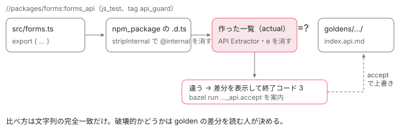

[目次](../README.md) › [コントリビュートの道](README.md) › 第 8 回 / 全 15 回

# 公開 API と golden：API を変えると何が起きるか

> goldens/public-api に、ビルドした .d.ts を API Extractor に通して作った各パッケージの公開 API の一覧が置かれ、Bazel のテスト（&lt;pkg&gt;\_api）が作り直した一覧と文字列で比べて違えば落ちる仕組み。ɵ・private・@internal が一覧に出ない理由と、コンストラクタの引数名や protected は出ること。@publicApi・@developerPreview・@experimental を読むのは golden ではなく angular.dev であること、golden を更新するコマンド（bazel run //packages/&lt;pkg&gt;:&lt;pkg&gt;\_api.accept）、golden が変わった PR に public-api グループの承認が要る理由（public-api-surface.md・.pullapprove.yml）。

angular/angular · 読了 約 13 分 · 中核 · [サイトで読む（デモが動きます）](https://angular-deep-dive-cyan.vercel.app/chapter/contrib-public-api)

---

Angular の公開 API は、ソースのどこかに「これが公開です」と一覧で書いてあるわけではありません。ビルドした npm パッケージの型定義（`.d.ts`）から API の一覧を機械で作り、リポジトリに置いた一覧（**golden** ファイル）と 1 文字でも違えばテストが落ちる、という仕組みで守っています。この章では、その一覧がどこから作られ、何が載って何が載らないか（`ɵ`・`private`・`@internal`）、落ちたときに更新するコマンド、そして golden が変わった PR に専用のレビュー担当が付く理由までを、ファイルの行で追います。

読む対象は `contributing-docs/public-api-surface.md`・`dev_preview_and_experimental.md`、`goldens/`（`README.md`・`BUILD.bazel`・`public-api/manage.js`・`public-api/forms/index.api.md`）、`packages/forms/BUILD.bazel`・`packages/forms/src/forms.ts`・`packages/core/src/core_private_export.ts`、`.pullapprove.yml` です。

1. [1. 全体像](01-contrib-overview.md)
2. [2. リポジトリの地図](02-contrib-repo-map.md)
3. [3. 手元の準備](03-contrib-setup.md)
4. [4. Bazel の読み方](04-contrib-bazel.md)
5. [5. テストを走らせる](05-contrib-run-tests.md)
6. [6. spec の読み方](06-contrib-reading-specs.md)
7. [7. テストを書く](07-contrib-writing-a-test.md)
8. **8. 公開 API と golden**（この章）
9. [9. コミットメッセージ](09-contrib-commit-messages.md)
10. [10. PR が通るまで](10-contrib-pr-flow.md)
11. [11. ブランチとリリース](11-contrib-branches.md)
12. [12. issue の仕分け](12-contrib-triage.md)
13. [13. コードの書き方](13-contrib-coding-standards.md)
14. [14. 手元で確かめる](14-contrib-debugging.md)
15. [15. 最初の PR](15-contrib-first-pr.md)

## 0. 全体の流れ

1. **公開 API の範囲が文書で決まっている**

   どのパッケージの、どの入口から export された名前が semver で守られるか（1 節）。
2. **入口のファイルが export を並べる**

   `packages/forms/src/forms.ts` のような 1 ファイルに、公開する名前と `ɵ` の付いた内部用の名前が混ざって並ぶ（2 節）。
3. **ビルドした .d.ts から一覧を作る**

   Bazel のテスト `forms_api` が npm パッケージの型定義を API Extractor に通し、Markdown の一覧を作る。`ɵ` で始まる export はここで捨てる（3・4 節）。
4. **golden と 1 文字ずつ比べる**

   違えば差分を出してテストが落ち、更新用のコマンドを表示する（6 節）。
5. **更新した golden を PR に含める**

   `goldens/public-api/**` が変わった PR には、公開 API 専用のレビュー担当が付く（8 節）。



*golden テストの流れ。ソースから .d.ts を作り（@internal はここで消える）、API Extractor で一覧にし（ɵ の export はここで消える）、goldens/ のファイルと文字列で比べる。違えば落ち、.accept で作業ツリーの golden を上書きする。*

## 1. 何が「公開 API」か

📄 `angular/contributing-docs/public-api-surface.md` L25–44 （▶ の行: 27, 30, 34, 36, 38–39, 43）

```md
25 │ Within the supported packages, Angular keeps stable:
26 │ 
27 ▶ - Symbols exported via the main entry point (e.g. `@angular/core`) and testing entry point (
28 │   e.g. `@angular/core/testing`). This applies to both runtime/JavaScript values and TypeScript
29 │   types.
30 ▶ - Symbols exported via global namespace `ng` (e.g. `ng.core`)
31 │ 
32 │ We explicitly consider the following to be _excluded_ from the public API:
33 │ 
34 ▶ - Any file/import paths within our package except for the `/`, `/testing` and `/bundles/*` and other
35 │   documented package entry-points.
36 ▶ - Constructors of injectable classes (services and directives). Use dependency injection to obtain
37 │   instances of these classes
38 ▶ - Any class members or symbols marked as `private`, or prefixed with
39 ▶   underscore (`_`), [barred latin o](https://en.wikipedia.org/wiki/%C6%9F) (`ɵ`), and double barred latin o (`ɵɵ`).
40 │ - Extending any of our classes unless the support for this is specifically documented in the API
41 │   reference.
42 │ - The contents and API surface of the code generated by Angular's compiler.
43 ▶ - The `@angular/core/primitives` package, including its descendant entry-points.
44 │ 
```

27 行目、守られるのは各パッケージの**入口**（`@angular/core` や `@angular/core/testing`）から export された名前です。値（実行時の JavaScript）も型も両方が対象です。30 行目の `ng` 名前空間は、ブラウザのコンソールで使う `ng.getComponent` などのデバッグ用の関数です。

32 行目からが「公開 API ではないもの」の一覧で、コントリビュートするときに一番効いてくる行です。34 行目、パッケージの中のファイルを直接 import するパスは対象外。36 行目、サービスやディレクティブのように DI で作られるクラスの**コンストラクタ**は対象外（自分で `new` しない前提だから）。38〜39 行目、`private`、`_` で始まる名前、`ɵ`（ラテン文字の「横棒付きの o」）や `ɵɵ` で始まる名前は対象外。43 行目、`@angular/core/primitives` も対象外です。

> [!TIP]
> **新卒エンジニアへ**
>
> semver（セマンティック バージョニング）は、版番号 `メジャー.マイナー.パッチ` の上げ方で互換性を伝える約束です。公開 API を壊す変更（破壊的変更）はメジャーでだけ入れる。足すだけならマイナー、直すだけならパッチ。どのブランチにどの版が入るかは[第 11 回](11-contrib-branches.md)で読みます。

## 2. 入口のファイル：公開と ɵ が並ぶ

📄 `angular/packages/forms/src/forms.ts` L43–56 （▶ の行: 49, 52–55）

```ts
43 │ export {
44 │   NgSelectOption,
45 │   SelectControlValueAccessor,
46 │ } from './directives/select_control_value_accessor';
47 │ export {
48 │   SelectMultipleControlValueAccessor,
49 ▶   ɵNgSelectMultipleOption,
50 │ } from './directives/select_multiple_control_value_accessor';
51 │ export {
52 ▶   selectValueAccessor as ɵselectValueAccessor,
53 ▶   SetDisabledStateOption,
54 ▶   ɵFORM_CONTROL_INTEGRATION,
55 ▶   ɵFormControlIntegration,
56 │ } from './directives/shared';
```

`@angular/forms` の入口 `index.ts` は `public_api.ts` を、`public_api.ts` はこの `src/forms.ts` を re-export するだけです。ここでは公開の名前（`SelectMultipleControlValueAccessor`、`SetDisabledStateOption`）と内部用の名前が同じ `export` 文に並んでいます。49 行目の `ɵNgSelectMultipleOption` は元の名前に `ɵ` が付いたもの。52 行目は `selectValueAccessor as ɵselectValueAccessor` と、**export するときだけ**`ɵ` を付けて名前を変えています。ファイルの中では普通の関数のまま、外からは `ɵ` 付きにしか見えません。

📄 `angular/packages/forms/src/forms.ts` L124–135 （▶ の行: 124–125, 128, 132, 135）

```ts
124 ▶ export {NG_ASYNC_VALIDATORS, NG_VALIDATORS, Validators} from './validators';
125 ▶ export {VERSION} from './version';
126 │ 
127 │ export {
128 ▶   isNativeFormElement as ɵisNativeFormElement,
129 │   elementAcceptsMinMax as ɵelementAcceptsMinMax,
130 │   isTextualFormElement as ɵisTextualFormElement,
131 │   setNativeDomProperty as ɵsetNativeDomProperty,
132 ▶   type NativeFormControl as ɵNativeFormControl,
133 │ } from './directives/native';
134 │ 
135 ▶ export * from './form_providers';
```

124〜125 行目は公開の `Validators` と `VERSION`。128〜132 行目は再び `as ɵ…` で名前を変えた内部用の export です。135 行目の `export *` は `form_providers.ts` の export をすべて出します。`export *` の先に名前を 1 つ足すだけで公開 API が増える、ということでもあります。

なぜ内部用の名前をわざわざ export するのか。パッケージをまたいで使うためです。`core_private_export.ts` を見ると分かります。

📄 `angular/packages/core/src/core_private_export.ts` L23–38 （▶ の行: 33）

```ts
23 │ export {maybeUnwrapDefaultExport as ɵmaybeUnwrapDefaultExport} from './util/default_export';
24 │ 
25 │ export {setAlternateWeakRefImpl as ɵsetAlternateWeakRefImpl} from '../primitives/signals';
26 │ export {ANIMATIONS_DISABLED as ɵANIMATIONS_DISABLED} from './animation/interfaces';
27 │ export {allLeavingAnimations as ɵallLeavingAnimations} from './animation/longest_animation';
28 │ export {
29 │   IMAGE_CONFIG as ɵIMAGE_CONFIG,
30 │   IMAGE_CONFIG_DEFAULTS as ɵIMAGE_CONFIG_DEFAULTS,
31 │   ImageConfig as ɵImageConfig,
32 │ } from './application/application_tokens';
33 ▶ export {internalCreateApplication as ɵinternalCreateApplication} from './application/create_application';
34 │ export {
35 │   TracingAction as ɵTracingAction,
36 │   TracingService as ɵTracingService,
37 │   TracingSnapshot as ɵTracingSnapshot,
38 │ } from './application/tracing';
```

33 行目、`internalCreateApplication` は `ɵinternalCreateApplication` として `@angular/core` から出ています。これを使うのは `packages/platform-browser/src/browser.ts` で、`ɵinternalCreateApplication as internalCreateApplication` と名前を戻して import しています。`bootstrapApplication` の中身です（[起動の回](../boot/07-boot-bootstrap-application.md)）。パッケージが別でも、同じ日に同じ版で一緒に出るので、`ɵ` の名前は版ごとに自由に変えてよい、という扱いです。このファイルは `packages/core/src/core.ts` の `export * from './core_private_export';` で入口につながっています。

## 3. golden ファイルの中身

📄 `angular/goldens/public-api/forms/index.api.md` L1–24 （▶ の行: 1, 3, 11, 22, 24）

````md
 1 ▶ ## API Report File for "@angular/forms"
 2 │ 
 3 ▶ > Do not edit this file. It is a report generated by [API Extractor](https://api-extractor.com/).
 4 │ 
 5 │ ```ts
 6 │ 
 7 │ import { AfterViewInit } from '@angular/core';
 8 │ import { ChangeDetectorRef } from '@angular/core';
 9 │ import { ElementRef } from '@angular/core';
10 │ import { EventEmitter } from '@angular/core';
11 ▶ import * as i0 from '@angular/core';
12 │ import { InjectionToken } from '@angular/core';
13 │ import { Injector } from '@angular/core';
14 │ import { ModuleWithProviders } from '@angular/core';
15 │ import { Observable } from 'rxjs';
16 │ import { OnChanges } from '@angular/core';
17 │ import { OnDestroy } from '@angular/core';
18 │ import { OnInit } from '@angular/core';
19 │ import { Renderer2 } from '@angular/core';
20 │ import { SimpleChanges } from '@angular/core';
21 │ import { Version } from '@angular/core';
22 ▶ import { ɵControlDirectiveHost } from '@angular/core';
23 │ 
24 ▶ // @public
````

1 行目、`@angular/forms` の入口の API レポート。3 行目、これは API Extractor（Microsoft の、型定義から API の一覧を作る道具）が作ったもので、**手で編集しない**。7〜22 行目は、forms の公開 API の型に出てくる他パッケージの名前です。22 行目に `ɵControlDirectiveHost` があります。`ɵ` の付いた名前でも、公開 API の型の**中で使われている**と、こうして一覧に顔を出します。24 行目の `// @public` は API Extractor の注記です（7 節で、Angular の `@developerPreview` と関係ないことを確かめます）。

📄 `angular/goldens/public-api/forms/index.api.md` L1008–1023 （▶ の行: 1009, 1011–1012, 1015）

```md
1008 │ // @public
1009 ▶ export class Validators {
1010 │     static compose(validators: null): null;
1011 ▶     // (undocumented)
1012 ▶     static compose(validators: (ValidatorFn | null | undefined)[]): ValidatorFn | null;
1013 │     static composeAsync(validators: (AsyncValidatorFn | null)[]): AsyncValidatorFn | null;
1014 │     static email(control: AbstractControl): ValidationErrors | null;
1015 ▶     static max(max: number): ValidatorFn;
1016 │     static maxLength(maxLength: number): ValidatorFn;
1017 │     static min(min: number): ValidatorFn;
1018 │     static minLength(minLength: number): ValidatorFn;
1019 │     static nullValidator(control: AbstractControl): ValidationErrors | null;
1020 │     static pattern(pattern: string | RegExp): ValidatorFn;
1021 │     static required(control: AbstractControl): ValidationErrors | null;
1022 │     static requiredTrue(control: AbstractControl): ValidationErrors | null;
1023 │ }
```

クラスはメンバーまで 1 行ずつ並びます。1015 行目の `static max(max: number): ValidatorFn;` の引数の名前 `max` も一覧の一部です。1011 行目の `// (undocumented)` は、その宣言に JSDoc のコメントが無いという印。1012 行目の `compose` の 2 つ目のオーバーロードに説明が付いていないことが分かります。1 つのファイルに forms の公開 API がすべて入り、全部で 1039 行です。

## 4. golden を作るテスト

📄 `angular/packages/forms/BUILD.bazel` L63–81 （▶ の行: 63–64, 66–67, 69–70, 73, 76, 79–80）

```python
63 ▶ api_golden_test_npm_package(
64 ▶     name = "forms_api",
65 │     data = [
66 ▶         ":npm_package",
67 ▶         "//goldens:public-api",
68 │     ],
69 ▶     golden_dir = "goldens/public-api/forms",
70 ▶     npm_package = "packages/forms/npm_package",
71 │ )
72 │ 
73 ▶ api_golden_test(
74 │     name = "forms_errors",
75 │     data = [
76 ▶         "//goldens:public-api",
77 │         "//packages/forms",
78 │     ],
79 ▶     entry_point = "src/errors.d.ts",
80 ▶     golden = "goldens/public-api/forms/errors.api.md",
81 │ )
```

1. **63〜71 行目：npm パッケージ全体の golden**

   `api_golden_test_npm_package` の名前は `forms_api`。66 行目、比べる材料はビルドした npm パッケージ（`:npm_package`）。70 行目のパッケージの `package.json` の `exports` から入口（`.`・`./signals`・`./signals/compat`）を見つけ、69 行目の `goldens/public-api/forms` の下に入口ごとに `index.api.md` を置きます。`goldens/public-api/forms/signals/index.api.md` があるのはこのためです。
2. **73〜81 行目：エラーコードの golden**

   `forms_errors` は 79 行目の `src/errors.d.ts` 1 ファイルだけを一覧にし、80 行目の `errors.api.md` と比べます。中身は `RuntimeErrorCode` の enum です。エラーコードを 1 つ足しても golden が変わります（エラーコードの付け方は[第 13 回](13-contrib-coding-standards.md)）。

📄 `angular/goldens/BUILD.bazel` L1–10 （▶ の行: 5–6, 8）

```python
 1 │ load("//tools:defaults.bzl", "copy_to_bin")
 2 │ 
 3 │ package(default_visibility = ["//visibility:public"])
 4 │ 
 5 ▶ copy_to_bin(
 6 ▶     name = "public-api",
 7 │     srcs = glob([
 8 ▶         "public-api/**/*.md",
 9 │     ]),
10 │ )
```

比べる相手の golden は、`//goldens:public-api`（6 行目）として 8 行目の `public-api/**/*.md` をまとめた 1 つの target です。上の forms/BUILD.bazel の 67 行目・76 行目の `data` にこれが入っているので、テストの実行時に golden が読めます。

`api_golden_test_npm_package` の中身は、このリポジトリではなく dev-infra（`angular/dev-infra`）の `bazel/api-golden/` にあります（`tools/defaults.bzl` が `@devinfra//bazel/api-golden:index.bzl` から load して名前を付け直している）。cuts で引用できる範囲の外なので、読んだ事実だけを書きます。既定の `strip_export_pattern` は `^ɵ(?!ɵdefineInjectable|ɵinject|ɵInjectableDef)` で、API Extractor が export を集める関数を差し替え、**export 名**がこの正規表現に当たるものを一覧から消します。比べ方は「作った文字列と golden の文字列が等しいか」だけで、違えば差分を表示して終了コード 3 で落ちます。

📄 `angular/packages/core/BUILD.bazel` L113–122 （▶ の行: 114, 121）

```python
113 │ api_golden_test_npm_package(
114 ▶     name = "core_api",
115 │     data = [
116 │         ":npm_package",
117 │         "//goldens:public-api",
118 │     ],
119 │     golden_dir = "goldens/public-api/core",
120 │     npm_package = "packages/core/npm_package",
121 ▶     strip_export_pattern = "^ɵ(?!.*ApiGuard)",
122 │ )
```

`@angular/core` だけは 121 行目で正規表現を上書きし、`ɵ` で始まるものを（名前に `ApiGuard` を含むものを除いて）すべて消します。既定の正規表現は `ɵdefineInjectable` などを残しますが、core では残しません。

## 5. golden に出るもの・出ないもの

「private な関数の名前を変えたら golden は変わるか」は、どの種類の「private」かで答えが変わります。1 つのクラスで確かめます。

📄 `angular/packages/forms/src/directives/select_control_value_accessor.ts` L239–266 （▶ の行: 247, 261–263）

```ts
239 │ /**
240 │  * @description
241 │  * Marks `<option>` as dynamic, so Angular can be notified when options change.
242 │  *
243 │  * @see {@link SelectControlValueAccessor}
244 │  *
245 │  * @ngModule ReactiveFormsModule
246 │  * @ngModule FormsModule
247 ▶  * @publicApi
248 │  */
249 │ @Directive({
250 │   selector: 'option',
251 │   standalone: false,
252 │ })
253 │ export class NgSelectOption implements OnDestroy {
254 │   /**
255 │    * @description
256 │    * ID of the option element
257 │    */
258 │   id!: string;
259 │ 
260 │   constructor(
261 ▶     private _element: ElementRef,
262 ▶     private _renderer: Renderer2,
263 ▶     @Optional() @Host() private _select: SelectControlValueAccessor,
264 │   ) {
265 │     if (this._select) this.id = this._select._registerOption();
266 │   }
```

📄 `angular/packages/forms/src/directives/select_control_value_accessor.ts` L286–300 （▶ の行: 292–293, 297–298）

```ts
286 │   @Input('value')
287 │   set value(value: any) {
288 │     this._setElementValue(value);
289 │     this._select?._writeValueAfterRender();
290 │   }
291 │ 
292 ▶   /** @internal */
293 ▶   _setElementValue(value: string): void {
294 │     this._renderer.setProperty(this._element.nativeElement, 'value', value);
295 │   }
296 │ 
297 ▶   /** @docs-private */
298 ▶   ngOnDestroy(): void {
299 │     this._select?._optionMap.delete(this.id);
300 │     this._select?._writeValueAfterRender();
```

📄 `angular/goldens/public-api/forms/index.api.md` L801–812 （▶ の行: 803–805, 811）

```md
801 │ // @public
802 │ export class NgSelectOption implements OnDestroy {
803 ▶     constructor(_element: ElementRef, _renderer: Renderer2, _select: SelectControlValueAccessor);
804 ▶     id: string;
805 ▶     ngOnDestroy(): void;
806 │     set ngValue(value: any);
807 │     set value(value: any);
808 │     // (undocumented)
809 │     static ɵdir: i0.ɵɵDirectiveDeclaration<NgSelectOption, "option", never, { "ngValue": { "alias": "ngValue"; "required": false; }; "value": { "alias": "value"; "required": false; }; }, {}, never, never, false, never>;
810 │     // (undocumented)
811 ▶     static ɵfac: i0.ɵɵFactoryDeclaration<NgSelectOption, [null, null, { optional: true; host: true; }]>;
812 │ }
```

1. **private なプロパティ → 出ない**

   ソースの 247 行目の `@publicApi` で、このクラスは公開 API です。261〜263 行目の `private _element` などは、golden のメンバーの並び（804〜808 行目）にありません。
2. **コンストラクタの引数名 → 出る**

   ところが golden の 803 行目には `constructor(_element: ElementRef, _renderer: Renderer2, _select: SelectControlValueAccessor);` と、引数の名前がそのまま載っています。`_element` を `_el` に変えるだけで `forms_api` は落ちます。ただし 1 節の 36 行目のとおり、DI で作るクラスのコンストラクタは公開 API の対象外なので、golden を更新すれば済み、破壊的変更にはなりません。
3. **@internal の付いた `_` メンバー → 出ない**

   292〜293 行目の `_setElementValue` は public なメソッドですが golden にありません。292 行目の `/** @internal */` のおかげです。パッケージをビルドする tsconfig が型定義から `@internal` を消します（下の引用）。`_` で始まるのに `@internal` が無いメンバーは lint が落とします（[第 13 回](13-contrib-coding-standards.md)の `require-internal-with-underscore`）。
4. **@docs-private → 出る**

   297〜298 行目の `ngOnDestroy` は `@docs-private` ですが、golden の 805 行目にあります。`@docs-private` は angular.dev の API ページから隠すだけです（7 節）。
5. **デコレータの情報 → 出る**

   811 行目の `ɵfac` の `{ optional: true; host: true; }` は、263 行目の `@Optional() @Host()` から来ています。メンバー名の `ɵfac` は export 名ではないので、4 節の正規表現では消えません。

📄 `angular/packages/tsconfig-build.json` L1–12 （▶ の行: 8–9）

```json
 1 │ /**
 2 │  * Root tsconfig file for use building all Angular packages. Note there is no rootDir
 3 │  * and therefore any tsconfig in the package directory will need to define its own
 4 │  * rootDir.
 5 │  */
 6 │ {
 7 │   "compilerOptions": {
 8 ▶     "declaration": true,
 9 ▶     "stripInternal": true,
10 │     "noImplicitAny": true,
11 │     "noImplicitOverride": true,
12 │     "stableTypeOrdering": true,
```

9 行目の `stripInternal: true` で、TypeScript は `@internal` の JSDoc が付いた宣言を `.d.ts` に書きません。golden は `.d.ts` から作るので、そこで見えなくなります。`tools/defaults.bzl` は `packages/` の下のビルドに、既定でこの tsconfig（`//packages:tsconfig_build`）を使います（`packages/core` などは自分の `tsconfig_build` を持ちます）。

| 変えたもの | golden | 根拠 |
| --- | --- | --- |
| 入口から export していない関数・クラス | 変わらない | 一覧は入口の `.d.ts` から作る |
| `private` メンバー | 変わらない | select\_control\_value\_accessor.ts 261 行目 / golden 804〜808 行目 |
| `@internal` の付いたメンバー | 変わらない | tsconfig-build.json 9 行目 |
| `ɵ` で始まる export | 変わらない（その型が公開 API の型に出てくれば import 行は変わる） | strip\_export\_pattern / golden 22 行目 |
| コンストラクタの引数名 | 変わる | golden 803 行目 |
| `protected` メンバー | 変わる | forms の golden には `protected onChanges(changes: SimpleChanges): void;` などの行がある |
| JSDoc の有無 | 変わる（`// (undocumented)` が付く・外れる） | golden 1011 行目 |
| エラーコードの追加 | 変わる（`forms_errors` など） | forms/BUILD.bazel 73〜81 行目 |

## 6. 落ちたとき：golden を更新するコマンド

📄 `angular/contributing-docs/public-api-surface.md` L61–76 （▶ の行: 67–68, 70, 75）

````md
61 │ <a name="golden-files"></a>
62 │ 
63 │ ## Golden files
64 │ 
65 │ Angular tracks the status of the public API in a _golden file_, maintained with a tool called the
66 │ _public API guard_.
67 ▶ If you modify any part of a public API in one of the supported public packages, the PR will fail a
68 ▶ test in CI with an error message that instructs you to accept the golden file.
69 │ 
70 ▶ The public API guard provides a Bazel target that updates the current status of a given package. If
71 │ you add to or modify the public API in any way, you must use [pnpm](https://pnpm.io/) to execute
72 │ the Bazel target in your terminal shell of choice (a recent version of `bash` is recommended).
73 │ 
74 │ ```shell
75 ▶ pnpm bazel run //packages/<modified_package>:<modified_package>_api.accept
76 │ ```
````

67〜68 行目、公開 API を変えると CI のテストが落ち、エラーメッセージが golden を accept（受け入れて上書き）するよう指示します。75 行目が 1 パッケージ分のコマンドです。`<modified_package>_api` は 4 節の `name = "forms_api"` のことで、末尾の `.accept` はそれと対になって作られる、golden を**書き込む側**の実行ファイルです。このマシンでは pnpm を `npx` 経由で呼ぶので、forms ならこうなります。

1. **確かめる**

   `npx -y pnpm@12.3.4 bazel test //packages/forms:forms_api`。差分があれば `--- Diff for index.api.md ---` と `bazel run //packages/forms:forms_api.accept` の案内が出て落ちます。
2. **書き込む**

   `npx -y pnpm@12.3.4 bazel run //packages/forms:forms_api.accept`。`bazel run` のときだけ設定される `BUILD_WORKSPACE_DIRECTORY`（手元のリポジトリの場所）の下の `goldens/public-api/forms/` に書きます。bazel-out の中ではなく、あなたの作業ツリーのファイルが変わります。
3. **差分を読む**

   `git diff goldens/`。**ここが本番です**。意図した名前だけが増えたか、型が意図せず変わっていないかを自分の目で確かめます（9 節のデモ）。
4. **同じコミットに入れる**

   ソースの変更と golden の変更を同じコミットにします。golden だけ遅れたコミットがあると、そのコミットでテストが落ちます。

文書に載っている、実際に CI が落ちたときの出力の例です（古い版のもので、golden がまだ `.d.ts` の形だったころのファイル名です）。

📄 `angular/contributing-docs/public-api-surface.md` L91–113 （▶ の行: 93–94, 100–101, 108, 112）

```md
 91 │ ==================== Test output for //packages/core:core_api:
 92 │ /b/f/w/bazel-out/k8-fastbuild/bin/packages/core/core_api.sh.runfiles/angular/packages/core/npm_package/core.d.ts(7,1): error: No export declaration found for symbol "ComponentFactory"
 93 ▶ --- goldens/public-api/core/core.d.ts	Golden file
 94 ▶ +++ goldens/public-api/core/core.d.ts	Generated API
 95 │ @@ -563,9 +563,9 @@
 96 │      ngModule: Type<T>;
 97 │      providers?: Provider[];
 98 │  }
 99 │ 
100 ▶ -export declare type NgIterable<T> = Array<T> | Iterable<T>;
101 ▶ +export declare type NgIterable<T> = Iterable<T>;
102 │ 
103 │  export declare interface NgModule {
104 │      bootstrap?: Array<Type<any> | any[]>;
105 │      declarations?: Array<Type<any> | any[]>;
106 │ 
107 │ 
108 ▶ If you modify a public API, you must accept the new golden file.
109 │ 
110 │ 
111 │ To do so, execute the following Bazel target:
112 ▶   pnpm bazel run //packages/core:core_api.accept
113 │ 
```

93〜94 行目が「golden（期待）」と「作り直した一覧（実際）」の見出しで、100 行目の `-` が golden にあった行、101 行目の `+` が新しい行です。`NgIterable<T>` が `Array<T> | Iterable<T>` から `Iterable<T>` に狭まっています。108 行目と 112 行目が accept の案内です。この差分を読んで「受け付ける型が狭まった = 破壊的」と気づけるかどうかが、レビューで問われるところです（9 節のデモの最初の例）。

全パッケージをまとめて扱うコマンドは README にあります。

📄 `angular/goldens/README.md` L1–11 （▶ の行: 4, 9–10）

````md
 1 │ ### _`public-api/`_
 2 │ 
 3 │ This directory contains all of the public api goldens for our npm packages we publish
 4 ▶ to NPM. These are tested on all PRs and commits as part of our bazel tests.
 5 │ 
 6 │ To check or update the public api goldens, run one of the following commands:
 7 │ 
 8 │ ```bash
 9 ▶ pnpm public-api:check
10 ▶ pnpm public-api:update
11 │ ```
````

4 行目、golden は PR とコミットごとに Bazel のテストとして検査されます。9〜10 行目の `pnpm public-api:check` / `pnpm public-api:update` は、package.json の scripts で `node goldens/public-api/manage.js test` / `accept` になっています。

📄 `angular/goldens/public-api/manage.js` L9–27 （▶ の行: 13, 17, 27）

```js
 9 │ const BAZEL_PUBLIC_API_TARGET_QUERY_CMD = [
10 │   'bazel',
11 │   'query',
12 │   '--output=label',
13 ▶   'kind(js_test, //packages/...) intersect attr("tags", "api_guard", //packages/...)',
14 │ ];
15 │ // Bazel targets for testing Public API goldens
16 │ process.stdout.write('Gathering all Public API targets...');
17 ▶ const ALL_PUBLIC_API_TESTS = spawnSync('pnpm', ['--silent', ...BAZEL_PUBLIC_API_TARGET_QUERY_CMD], {
18 │   encoding: 'utf-8',
19 │ })
20 │   .stdout.trim()
21 │   .split('\n')
22 │   .map((test) => test.trim());
23 │ process.stdout.clearLine();
24 │ process.stdout.cursorTo(0);
25 │ 
26 │ // Bazel targets for generating Public API goldens
27 ▶ const ALL_PUBLIC_API_ACCEPTS = ALL_PUBLIC_API_TESTS.map((test) => `${test}.accept`);
```

📄 `angular/goldens/public-api/manage.js` L67–81 （▶ の行: 68–70, 72–74）

```js
67 │ switch (USER_COMMAND) {
68 ▶   case 'accept':
69 ▶     buildTargets(ALL_PUBLIC_API_ACCEPTS);
70 ▶     runBazelCommandOnTargets('run', ALL_PUBLIC_API_ACCEPTS, 'Running');
71 │     break;
72 ▶   case 'test':
73 ▶     buildTargets(ALL_PUBLIC_API_TESTS);
74 ▶     runBazelCommandOnTargets('test', ALL_PUBLIC_API_TESTS, 'Testing');
75 │     break;
76 │   default:
77 │     console.warn('Invalid command provided.');
78 │     console.warn();
79 │     console.warn(`Run this script with either "accept" and "test"`);
80 │     break;
81 │ }
```

13 行目、`//packages/...` の下で、種類が `js_test` かつタグに `api_guard` を持つ target を `bazel query` で集めます。`api_golden_test_npm_package` と `api_golden_test` は自分でこのタグを足すので、BUILD に書かなくても集まります。27 行目、それぞれの名前に `.accept` を付けたものが書き込み用。68〜70 行目の `accept` は、まず全部を並列に build し、それから 1 つずつ `bazel run` します。

13 行目と同じ query を、このマシンで実際に走らせた結果です（query は読むだけなので速く、2 秒でした）。24 個あります。

📄 `bazel query の出力（2026-10-31、このマシン）`

```
$ npx -y pnpm@12.3.4 --silent bazel query --output=label \
    'kind(js_test, //packages/...) intersect attr("tags", "api_guard", //packages/...)'
//packages/animations:animations_api
//packages/animations:animations_errors
//packages/common:common_api
//packages/common:common_errors
//packages/common/http:http_errors
//packages/compiler-cli:compiler_options_api
//packages/compiler-cli:error_code_api
//packages/compiler-cli:extended_template_diagnostic_name_api
//packages/core:core_api
//packages/core:core_errors
//packages/core:ng_global_utils_api
//packages/elements:elements_api
//packages/forms:forms_api
//packages/forms:forms_errors
//packages/localize:localize_api
//packages/platform-browser:platform-browser_api
//packages/platform-browser:platform-browser_errors
//packages/platform-browser-dynamic:platform-browser-dynamic_api
//packages/platform-server:platform-server_api
//packages/router:router_api
//packages/router:router_errors
//packages/service-worker:service-worker_api
//packages/service-worker:service-worker_errors
//packages/upgrade:upgrade_api
```

> [!WARNING]
> **ハマりどころ**
>
> `pnpm public-api:update` は 24 個すべてを build します。forms しか触っていないなら、6 節の 1 パッケージのコマンドの方がずっと速く、関係ない golden を書き換える心配もありません。なお、golden の `.api.md` は prettier の対象から外してあります（`.prettierignore`。[第 13 回](13-contrib-coding-standards.md)）。整形で 1 文字でも変わると、作り直した一覧と一致しなくなるからです。

## 7. @publicApi・@developerPreview・@experimental

📄 `angular/contributing-docs/dev_preview_and_experimental.md` L1–26 （▶ の行: 5–6, 13, 16–17, 23, 25）

```md
 1 │ ## Releasing APIs before they're fully stable
 2 │ 
 3 │ The Angular team may occasionally seek to release a feature or API without immediately
 4 │ including this API in Angular's normal support and deprecation category. You can use
 5 ▶ one of two labels on such APIs: Developer Preview and Experimental. APIs tagged this way
 6 ▶ are not subject to Angular's breaking change and deprecation policy.
 7 │ 
 8 │ Use the sections below to decide whether a pre-stable tag makes sense.
 9 │ 
10 │ ### Developer Preview
11 │ 
12 │ Use "Developer Preview" when:
13 ▶ 
14 │ - The team has relatively high confidence the API will ship as stable.
15 │ - The team needs additional community feedback before fully committing to an exact API shape.
16 ▶ - The API may undergo only minor, superficial changes. This can include changes like renaming
17 ▶   or reordering parameters, but should not include significant conceptual or structural changes.
18 │ 
19 │ ### Experimental
20 │ 
21 │ Use "Experimental" when:
22 │ 
23 ▶ - The team has low-to-medium confidence that the API should exist at all.
24 │ - The team needs additional community feedback before deciding to move forward with the API at all.
25 ▶ - The API may undergo significant conceptual or structural changes.
26 │ - The API relies on a not-yet-standardized platform feature.
```

5〜6 行目、Developer Preview と Experimental の付いた API は、Angular の破壊的変更と非推奨の方針（**メジャーでしか壊さない**、壊す前に非推奨の期間を置く）の外にあります。違いは確かさです。Developer Preview は「ほぼこの形で安定版になる」（13 行目）もので、変えるのは名前や引数の順番のような表面的なものまで（16〜17 行目）。Experimental は「そもそも残すか分からない」（23 行目）もので、考え方ごと変わりうる（25 行目）。

では、この注記は golden にどう出るか。実物で確かめます。

📄 `angular/packages/core/src/change_detection/provide_check_no_changes_config.ts` L13–40 （▶ の行: 22, 24, 35, 37）

```ts
13 │ /**
14 │  * Used to disable exhaustive checks when verifying no expressions changed after they were checked.
15 │  *
16 │  * This means that `OnPush` components that are not marked for check will not be checked.
17 │  * This behavior is the current default behavior in Angular. When running change detection
18 │  * on a view tree, views marked for check are refreshed and the flag to check it is removed.
19 │  * When Angular checks views a second time to ensure nothing has changed, `OnPush` components
20 │  * will no longer be marked and not be checked.
21 │  *
22 ▶  * @developerPreview 20.0
23 │  */
24 ▶ export function provideCheckNoChangesConfig(options: {exhaustive: false}): EnvironmentProviders;
25 │ /**
26 │  * - `interval` will periodically run `checkNoChanges` on application views. This can be useful
27 │  *   in zoneless applications to periodically ensure no changes have been made without notifying
28 │  *   Angular that templates need to be refreshed.
29 │  * - The exhaustive option will treat all application views as if they were `ChangeDetectionStrategy.Eager`/`Default` when verifying
30 │  *   no expressions have changed. All views attached to `ApplicationRef` and all the descendants of
31 │  *   those views will be checked for changes (excluding those subtrees which are detached via `ChangeDetectorRef.detach()`).
32 │  *   This is useful because the check that runs after regular change detection does not work for components using `ChangeDetectionStrategy.OnPush`.
33 │  *   This check is will surface any existing errors hidden by `OnPush` components.
34 │  *
35 ▶  * @developerPreview 20.0
36 │  */
37 ▶ export function provideCheckNoChangesConfig(options: {
38 │   interval?: number;
39 │   exhaustive: true;
40 │ }): EnvironmentProviders;
```

📄 `angular/goldens/public-api/core/index.api.md` L1503–1512 （▶ の行: 1503–1504, 1508）

```md
1503 ▶ // @public
1504 ▶ export function provideCheckNoChangesConfig(options: {
1505 │     exhaustive: false;
1506 │ }): EnvironmentProviders;
1507 │ 
1508 ▶ // @public
1509 │ export function provideCheckNoChangesConfig(options: {
1510 │     interval?: number;
1511 │     exhaustive: true;
1512 │ }): EnvironmentProviders;
```

ソースの 22 行目と 35 行目は `@developerPreview 20.0`（v20.0 から Developer Preview）。ところが golden の 1503 行目と 1508 行目は `// @public` です。golden の `@public` は API Extractor の区分で、Angular の注記を区別しません。つまり golden は「Developer Preview かどうか」を見ていません。Developer Preview の API の形を変えても、普通の API と同じように golden が落ち、同じように accept します。

Angular の注記を読んでいるのは、angular.dev の API リファレンスを作る側です。

📄 `angular/adev/shared-docs/pipeline/api-gen/manifest/generate_manifest.mts` L54–92 （▶ の行: 55, 83, 87–90）

```ts
54 │ export function isHiddenEntry<T extends DocEntry | FunctionEntry>(entry: T): boolean {
55 ▶   return getTag(entry, 'docs-private', /* every */ true) ? true : false;
56 │ }
57 │ 
58 │ function getTagSinceVersion(
59 │   entry: DocEntry,
60 │   tagName: string,
61 │   every = false,
62 │ ): {version: string | undefined} | undefined {
63 │   const tag = getTag(entry, tagName, every);
64 │   if (!tag) {
65 │     return undefined;
66 │   }
67 │ 
68 │   // In case of deprecated tag we need to separate the version from the deprecation message.
69 │   const version = tag.comment.match(/^\s*(?:(?:since|from|as of)\s+)?v?(\d+(?:\.\d+)?)/i)?.[1];
70 │ 
71 │   return {version};
72 │ }
73 │ 
74 │ /**
75 │  * Generates an API manifest for a set of API collections extracted by
76 │  * extract_api_to_json.
77 │  */
78 │ export function generateManifest(apiCollections: EntryCollection[]): Manifest {
79 │   const manifest: Manifest = [];
80 │   for (const collection of apiCollections) {
81 │     const entries = collection.entries
82 │       .filter((entry) => !isHiddenEntry(entry))
83 ▶       .map((entry: DocEntry) => ({
84 │         name: entry.name,
85 │         ...(entry.aliases && {aliases: entry.aliases}),
86 │         type: entry.entryType,
87 ▶         deprecated: getTagSinceVersion(entry, 'deprecated', true),
88 ▶         developerPreview: getTagSinceVersion(entry, 'developerPreview'),
89 ▶         experimental: getTagSinceVersion(entry, 'experimental'),
90 ▶         stable: getTagSinceVersion(entry, 'publicApi'),
91 │         category: getTag(entry, 'category')?.comment.trim(),
92 │       }));
```

83 行目、`@docs-private` の付いた宣言はリファレンスから外します。`isHiddenEntry` は 54〜56 行目のとおり `docs-private` の tag を探すだけです。87〜90 行目で、`@deprecated`・`@developerPreview`・`@experimental`・`@publicApi` の tag から「いつの版から」を読み、リファレンスの印にします。`@publicApi` は 90 行目で `stable`（安定版）として扱われます。

| 注記 | 読む側 | 意味 |
| --- | --- | --- |
| `@publicApi` | angular.dev（90 行目） | 安定版。semver と非推奨の方針で守る |
| `@developerPreview` | angular.dev（88 行目） | 方針の外。表面的な変更はありうる |
| `@experimental` | angular.dev（89 行目） | 方針の外。大きく変わる・消えることもある |
| `@deprecated` | angular.dev（87 行目）と golden（`// @deprecated`） | 非推奨。消すのは後のメジャー |
| `@internal` | TypeScript（tsconfig-build.json 9 行目） | 型定義から消える。golden にも出ない |
| `@docs-private` | angular.dev（83 行目） | リファレンスから隠す。golden には出る |

## 8. API を変える PR が厳しく見られる理由

📄 `angular/.pullapprove.yml` L363–396 （▶ の行: 366, 369–370, 372–373, 394–395）

```yaml
363 │   # =========================================================
364 │   #  Public API
365 │   # =========================================================
366 ▶   public-api:
367 │     <<: *defaults
368 │     conditions:
369 ▶       - *no-groups-above-this-pending
370 ▶       - *no-groups-above-this-rejected
371 │       - >
372 ▶         contains_any_globs(files.exclude("goldens/public-api/manage.js"), [
373 ▶           'goldens/public-api/**/{*,.*}',
374 │         ])
375 │     reviewers:
376 │       users:
377 │         - ~AndrewKushnir
378 │         - ~alxhub
379 │         - atscott
380 │         - ~thePunderWoman
381 │         - ~pkozlowski-opensource
382 │         - kirjs
383 │         - crisbeto
384 │         - devversion
385 │         - JeanMeche
386 │         - ~hybrist
387 │         - ~iteriani
388 │         - ~tbondwilkinson
389 │         - ~rahatarmanahmed
390 │         - ~amishne
391 │         - ~leonsenft
392 │         - ~mattrbeck
393 │     reviews:
394 ▶       request: 2
395 ▶       required: 1
396 │       reviewed_for: required
```

PullApprove（PR の変更ファイルからレビュー担当を決める仕組み。[第 10 回](10-contrib-pr-flow.md)）の `public-api` グループです。372〜373 行目、`goldens/public-api/**` のファイルが 1 つでも変わると、このグループの承認が要ります（`manage.js` だけは除く）。369〜370 行目の 2 つの条件は、名前のとおり「このグループより上に書かれたグループ（forms・core などの担当）に、保留中・却下のものが残っていない」ことです。パッケージの担当が中身を見終えてから、公開 API の担当が見る順番になります。394〜395 行目、2 人に依頼し、1 人の承認が必須です。

厳しいのは、公開 API は一度出すと戻せないからです。足した名前はメジャーまで消せず、消すには非推奨の期間が要ります。golden は「API が変わった」ことを人の目の前に必ず出すための装置で、golden のファイルが PR の差分にあるかどうかで、担当者が機械的に呼ばれます。ソースの差分の中に埋もれた 1 文字の型の変更も、golden の差分では 1 行の `-` と `+` になって見えます。

## 9. デモ：API の差分から変更の種類を判定する

> **🧪 DEMO — golden の差分を読む（自作の再現）**
>
> 変更前・変更後の API を 1 行 1 宣言で書くと、行の差分（golden の差分と同じ `-` / `+`）を出し、名前ごとに「足した（minor）」「消した・型を狭めた（破壊的）」を判定します。本物の golden テストは文字列が等しいかしか見ません（4 節）。semver の判定は人の仕事で、これはその考え方を小さく再現したものです。型の中身までは読まないので、外れることがあります。
>
> public-api-surface.md 100〜101 行目に載っている、CI が落ちた実例の差分です。
>
> ▶ [このデモはサイトで動かせます](https://angular-deep-dive-cyan.vercel.app/chapter/contrib-public-api)

## 全体の流れ

- 👤 `export { Foo } from './foo'` — packages/forms/src/forms.ts — *入口に名前を足す（ɵ なら一覧から消える）*
  - `ng_package → npm_package` — packages/forms/BUILD.bazel L35 — *tsconfig-build.json の stripInternal で @internal が消えた .d.ts*
  - `forms_api`（js\_test, tag api\_guard） — packages/forms/BUILD.bazel L63
    - `API Extractor` で入口ごとに一覧を作る — dev-infra bazel/api-golden — *export 名が strip\_export\_pattern に当たれば消す*
    - `actual !== expected` なら差分を出して終了コード 3 — dev-infra bazel/api-golden — *「bazel run …forms\_api.accept」を案内*
- 👤 `bazel run //packages/forms:forms_api.accept` — public-api-surface.md L75 — *作業ツリーの goldens/public-api/forms/\*.api.md を上書き*
  - `public-api` グループの承認 — .pullapprove.yml L366 — *golden が変わった PR だけ*

## 聞かれそうな質問

**Q. private な関数の名前を変えるのも golden に出ますか？**

入口から export していない関数や、`private` のメンバー、`@internal` の付いたメンバーなら出ません。golden は入口の `.d.ts` から作り、`private` のメンバーは載らず（golden 804〜808 行目）、`@internal` は tsconfig-build.json の 9 行目で `.d.ts` から消えるからです。ただしコンストラクタの引数名は、`private` の引数でも golden の 803 行目のように載るので、名前を変えると `forms_api` が落ちます。その場合は accept すれば済み、public-api-surface.md の 36 行目によりコンストラクタは公開 API の対象外なので破壊的変更ではありません（それでも golden が変わるので public-api の承認は要ります）。

**Q. @developerPreview の API なら、破壊的変更をしてよいのですか？**

方針の上では、dev\_preview\_and\_experimental.md の 5〜6 行目のとおり、破壊的変更と非推奨の方針の対象外なので、マイナー版でも変えられます。ただし Developer Preview で許されるのは名前の変更や引数の並べ替えのような表面的な変更までで、考え方や構造を大きく変えるものは想定されていません（16〜17 行目）。それを超える変更なら Experimental の領分です（25 行目）。仕組みの上では、golden は Developer Preview を区別しない（core の golden 1503 行目は `// @public`）ので、普通の API と同じく golden が落ち、accept し、public-api の承認を通ります。

**Q. ɵ の API を使っている外部のライブラリが、Angular の更新で壊れたらどうなりますか？**

Angular 側の不具合にはなりません。public-api-surface.md の 38〜39 行目で `ɵ` と `ɵɵ` の名前は公開 API の外と明記され、golden も `ɵ` の export を消して作る（core は BUILD.bazel 121 行目）ので、`ɵ` の名前を変えても消しても CI は何も言いません。`ɵ` の名前が export されているのは、`platform-browser` が `ɵinternalCreateApplication`（core\_private\_export.ts 33 行目）を使うように、同じ版で一緒に出る Angular のパッケージどうしで使うためです。外部のライブラリが使うなら、そのライブラリが Angular の版を細かく固定して自分で追いかける前提になります。どうしても必要な API があるなら、公開 API にしてほしいという feature request を出すのが筋です（[第 12 回](12-contrib-triage.md)）。

**Q. golden を手で直してもいいですか？**

いけません。index.api.md の 3 行目に「Do not edit this file」とあり、テストは作り直した文字列との完全一致しか見ないので、手で直すと空白 1 つで落ちます。必ず `…_api.accept` を `bazel run` して書かせます（public-api-surface.md 75 行目）。

**Q. golden の差分の 1 行が「足した」なのか「壊した」なのか、どう見分けますか？**

`+` だけなら足した（マイナーで入れられる）。`-` だけなら消した（破壊的）。`-` と `+` の組なら変わった行で、public-api-surface.md の 100〜101 行目の `Array<T> | Iterable<T>` → `Iterable<T>` のように受け付ける型が狭まれば破壊的、必須の引数が増えても破壊的です。破壊的なら、コミットメッセージの footer に `BREAKING CHANGE:` を書きます（[第 9 回](09-contrib-commit-messages.md)）。

## 読み終えて

- 公開 API は「入口から export された名前」。`ɵ`・`_`・`private`・DI で作るクラスのコンストラクタは外（public-api-surface.md 32〜43 行目）。
- golden は、ビルドした `.d.ts` を API Extractor に通した一覧。`ɵ` の export 名は消し、`@internal` は tsconfig の `stripInternal` で先に消える。比べ方は文字列の完全一致。
- コンストラクタの引数名・`protected`・JSDoc の有無・エラーコードも golden に出る。落ちたら `bazel run //packages/<pkg>:<pkg>_api.accept`。
- `@developerPreview` などの注記は angular.dev が読み、golden は区別しない（どれも `// @public`）。
- golden が変わった PR には `public-api` グループの承認が要る。golden の差分は「API が変わった」ことを人に必ず見せるための仕組み。

---

← 前: [テストを書いてみる：壊して、失敗を見て、直す](07-contrib-writing-a-test.md)  
次: [コミットメッセージ：type(scope): summary と CHANGELOG](09-contrib-commit-messages.md) →
