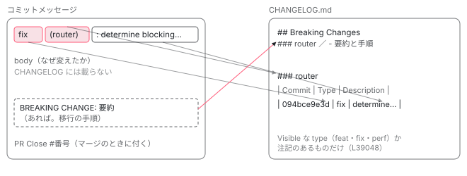

[目次](../README.md) › [コントリビュートの道](README.md) › 第 9 回 / 全 15 回

# コミットメッセージ：type(scope): summary と CHANGELOG

> commit-message-guidelines.md の header・body・footer の規則と、それを検査する .ng-dev/commit-message.mjs と ng-dev の validateCommitMessage（scopes は 24 個、feat・fix・perf は scope 必須、body は 20 文字以上で docs は不要。summary の大文字・ピリオドは機械は見ない）。BREAKING CHANGE と DEPRECATED の footer、コミットから CHANGELOG が作られる仕組み（feat・fix・perf と注記のあるものだけ、scope ごと）、fixup コミットとレビュー後の整理、.gitmessage と husky のフック（手元は警告だけで、強制は PR の CI の validate-range）。

angular/angular · 読了 約 13 分 · 中核 · [サイトで読む（デモが動きます）](https://angular-deep-dive-cyan.vercel.app/chapter/contrib-commit-messages)

---

angular/angular のコミットメッセージは `type(scope): summary` の 1 行で始まり、形が違うと PR の CI が落ちます。厳しいのは、リリースのときに **CHANGELOG（リリースノート）をコミットメッセージから機械で作る**からです。この章では、規則の文書（`commit-message-guidelines.md`）と、それを実際に検査するコード（`.ng-dev/commit-message.mjs` と、それを読む ng-dev の検査関数）を並べて読み、文書には書いてあるのに機械は見ていない規則、逆に機械だけが見ている規則を区別します。最後に、コミットが CHANGELOG の 1 行になるまでを追います。

読む対象は `contributing-docs/commit-message-guidelines.md`・`using-fixup-commits.md`、`.ng-dev/commit-message.mjs`・`release.mjs`・`gitconfig`、`.gitmessage`、`.husky/commit-msg`・`prepare-commit-msg`、`CHANGELOG.md`、そしてインストール済みの ng-dev（`node_modules/@angular/ng-dev/bundles/` の `cli.mjs` と `chunk-U7PAJR6D.mjs`）です。

> [!NOTE]
> **ポイント**
>
> ng-dev は Angular チームの開発用 CLI（`angular/dev-infra` で作られ、npm から入る）で、ソースはこのリポジトリにありません。ここでは `pnpm install` で入ったビルド済みの 1 ファイル（`cli.mjs`、版は `0.0.0-f5c817076b8e…`）をそのまま引用します。まとめて 1 ファイルにしたものなので行番号は大きいですが、関数の中身は元のソースのままです。

1. [1. 全体像](01-contrib-overview.md)
2. [2. リポジトリの地図](02-contrib-repo-map.md)
3. [3. 手元の準備](03-contrib-setup.md)
4. [4. Bazel の読み方](04-contrib-bazel.md)
5. [5. テストを走らせる](05-contrib-run-tests.md)
6. [6. spec の読み方](06-contrib-reading-specs.md)
7. [7. テストを書く](07-contrib-writing-a-test.md)
8. [8. 公開 API と golden](08-contrib-public-api.md)
9. **9. コミットメッセージ**（この章）
10. [10. PR が通るまで](10-contrib-pr-flow.md)
11. [11. ブランチとリリース](11-contrib-branches.md)
12. [12. issue の仕分け](12-contrib-triage.md)
13. [13. コードの書き方](13-contrib-coding-standards.md)
14. [14. 手元で確かめる](14-contrib-debugging.md)
15. [15. 最初の PR](15-contrib-first-pr.md)

## 0. 全体の流れ

1. **書く**

   エディタで書く。`.gitmessage` を雛形にもできる（6 節）。
2. **手元のフック**

   `git commit` のたびに husky の `commit-msg` フックが ng-dev で検査する。ただし**警告だけでコミットは止めない**（6 節）。
3. **PR の CI**

   PR の全コミットを同じ検査関数で調べ、1 つでも不正なら CI の lint が落ちる（7 節）。ここで初めて強制される。
4. **マージ**

   マージの道具が本文の末尾に `PR Close #番号` を足して main に入れる（[第 10 回](10-contrib-pr-flow.md)）。
5. **リリース**

   前の版からのコミットを集め、type・scope・footer で振り分けて CHANGELOG.md に書く（8 節）。

## 1. 形：header・body・footer

📄 `angular/contributing-docs/commit-message-guidelines.md` L1–21 （▶ の行: 4, 6, 16, 18–19, 21）

````md
 1 │ # Commit Message Format
 2 │ 
 3 │ We have very precise rules over how our Git commit messages must be formatted.
 4 ▶ This format leads to **easier to read commit history** and makes it analyzable for changelog generation.
 5 │ 
 6 ▶ Each commit message consists of a **header**, a **body**, and a **footer**.
 7 │ 
 8 │ ```
 9 │ <header>
10 │ <BLANK LINE>
11 │ <body>
12 │ <BLANK LINE>
13 │ <footer>
14 │ ```
15 │ 
16 ▶ The `header` is mandatory and must conform to the [Commit Message Header](#commit-header) format.
17 │ 
18 ▶ The `body` is mandatory for all commits except for those of type "docs".
19 ▶ When the body is present it must be at least 20 characters long and must conform to the [Commit Message Body](#commit-body) format.
20 │ 
21 ▶ The `footer` is optional. The [Commit Message Footer](#commit-footer) format describes what the footer is used for and the structure it must have.
````

4 行目が理由です。履歴を読みやすくするためと、**CHANGELOG を作るために解析できるようにするため**。6〜14 行目、メッセージは header・空行・body・空行・footer。16 行目、header は必須。18〜19 行目、body も docs 以外は必須で、あるなら 20 文字以上。21 行目、footer は任意です。この「20 文字」と「docs だけ例外」は、2 節で設定ファイルの数字として出てきます。

## 2. type と scope：文書と設定

📄 `angular/contributing-docs/commit-message-guidelines.md` L39–54 （▶ の行: 39, 47–54）

```md
39 ▶ The `<type>` and `<summary>` fields are mandatory, the `(<scope>)` field is optional.
40 │ 
41 │ ### Type
42 │ 
43 │ Must be one of the following:
44 │ 
45 │ | Type         | Description                                                                                         |
46 │ | ------------ | --------------------------------------------------------------------------------------------------- |
47 ▶ | **build**    | Changes that affect the build system or external dependencies (example scopes: gulp, broccoli, npm) |
48 ▶ | **ci**       | Changes to our CI configuration files and scripts (examples: GitHub Actions)                        |
49 ▶ | **docs**     | Documentation only changes                                                                          |
50 ▶ | **feat**     | A new feature                                                                                       |
51 ▶ | **fix**      | A bug fix                                                                                           |
52 ▶ | **perf**     | A code change that improves performance                                                             |
53 ▶ | **refactor** | A code change that neither fixes a bug nor adds a feature                                           |
54 ▶ | **test**     | Adding missing tests or correcting existing tests                                                   |
```

文書の type は 47〜54 行目の 8 つです。39 行目には「`(<scope>)` は省いてよい」とあります。では、検査する側は何を許しているか。type の一覧は ng-dev の中にあります。

📄 `angular/node_modules/@angular/ng-dev/bundles/chunk-U7PAJR6D.mjs` L24464–24493 （▶ の行: 24466–24468, 24471–24472, 24479–24480, 24485）

```js
24464 │ var ScopeRequirement;
24465 │ (function(ScopeRequirement2) {
24466 ▶   ScopeRequirement2[ScopeRequirement2["Required"] = 0] = "Required";
24467 ▶   ScopeRequirement2[ScopeRequirement2["Optional"] = 1] = "Optional";
24468 ▶   ScopeRequirement2[ScopeRequirement2["Forbidden"] = 2] = "Forbidden";
24469 │ })(ScopeRequirement || (ScopeRequirement = {}));
24470 │ var ReleaseNotesLevel;
24471 ▶ (function(ReleaseNotesLevel2) {
24472 ▶   ReleaseNotesLevel2[ReleaseNotesLevel2["Hidden"] = 0] = "Hidden";
24473 │   ReleaseNotesLevel2[ReleaseNotesLevel2["Visible"] = 1] = "Visible";
24474 │ })(ReleaseNotesLevel || (ReleaseNotesLevel = {}));
24475 │ var COMMIT_TYPES = {
24476 │   build: {
24477 │     name: "build",
24478 │     description: "Changes to local repository build system and tooling",
24479 ▶     scope: ScopeRequirement.Optional,
24480 ▶     releaseNotesLevel: ReleaseNotesLevel.Hidden
24481 │   },
24482 │   ci: {
24483 │     name: "ci",
24484 │     description: "Changes to CI configuration and CI specific tooling",
24485 ▶     scope: ScopeRequirement.Forbidden,
24486 │     releaseNotesLevel: ReleaseNotesLevel.Hidden
24487 │   },
24488 │   docs: {
24489 │     name: "docs",
24490 │     description: "Changes which exclusively affects documentation.",
24491 │     scope: ScopeRequirement.Optional,
24492 │     releaseNotesLevel: ReleaseNotesLevel.Hidden
24493 │   },
```

📄 `angular/node_modules/@angular/ng-dev/bundles/chunk-U7PAJR6D.mjs` L24494–24530 （▶ の行: 24497–24498, 24503–24504, 24509–24510, 24519, 24521）

```js
24494 │   feat: {
24495 │     name: "feat",
24496 │     description: "Creates a new feature",
24497 ▶     scope: ScopeRequirement.Required,
24498 ▶     releaseNotesLevel: ReleaseNotesLevel.Visible
24499 │   },
24500 │   fix: {
24501 │     name: "fix",
24502 │     description: "Fixes a previously discovered failure/bug",
24503 ▶     scope: ScopeRequirement.Required,
24504 ▶     releaseNotesLevel: ReleaseNotesLevel.Visible
24505 │   },
24506 │   perf: {
24507 │     name: "perf",
24508 │     description: "Improves performance without any change in functionality or API",
24509 ▶     scope: ScopeRequirement.Required,
24510 ▶     releaseNotesLevel: ReleaseNotesLevel.Visible
24511 │   },
24512 │   refactor: {
24513 │     name: "refactor",
24514 │     description: "Refactor without any change in functionality or API (includes style changes)",
24515 │     scope: ScopeRequirement.Optional,
24516 │     releaseNotesLevel: ReleaseNotesLevel.Hidden
24517 │   },
24518 │   release: {
24519 ▶     name: "release",
24520 │     description: "A release point in the repository",
24521 ▶     scope: ScopeRequirement.Forbidden,
24522 │     releaseNotesLevel: ReleaseNotesLevel.Hidden
24523 │   },
24524 │   test: {
24525 │     name: "test",
24526 │     description: "Improvements or corrections made to the project's test suite",
24527 │     scope: ScopeRequirement.Optional,
24528 │     releaseNotesLevel: ReleaseNotesLevel.Hidden
24529 │   }
24530 │ };
```

type ごとに 2 つの属性があります。`scope`（24466〜24468 行目の Required・Optional・Forbidden）と、`releaseNotesLevel`（24471〜24472 行目の Hidden・Visible）。

1. **scope が必須の type がある**

   24497・24503・24509 行目、`feat`・`fix`・`perf` は `ScopeRequirement.Required`。**文書の 39 行目の「scope は任意」はこの 3 つには当てはまりません**。`fix: …` と書くと 4 節の検査で落ちます。逆に 24485 行目の `ci` は Forbidden で、`ci(core): …` は落ちます。
2. **文書に無い type がある**

   24519 行目の `release`（Forbidden）。リリースの道具が作る `release: cut the v22.2.0-next.7 release` のようなコミット用で、コントリビューターが使うものではありません。
3. **CHANGELOG に載るのは 3 つだけ**

   24498・24504・24510 行目、`releaseNotesLevel: Visible` は `feat`・`fix`・`perf` だけ。`refactor` や `test` は 24480 行目と同じ Hidden です（8 節）。

📄 `angular/contributing-docs/commit-message-guidelines.md` L56–86 （▶ の行: 58, 60）

```md
56 │ ### <a name="scope"></a> Scope
57 │ 
58 ▶ The scope should be the name of the npm package affected (as perceived by the person reading the changelog generated from commit messages).
59 │ 
60 ▶ The following is the list of supported scopes:
61 │ 
62 │ - `animations`
63 │ - `benchpress`
64 │ - `common`
65 │ - `compiler`
66 │ - `compiler-cli`
67 │ - `core`
68 │ - `dev-infra`
69 │ - `devtools`
70 │ - `docs-infra`
71 │ - `elements`
72 │ - `forms`
73 │ - `http`
74 │ - `language-service`
75 │ - `language-server`
76 │ - `localize`
77 │ - `migrations`
78 │ - `platform-browser`
79 │ - `platform-browser-dynamic`
80 │ - `platform-server`
81 │ - `router`
82 │ - `service-worker`
83 │ - `upgrade`
84 │ - `vscode-extension`
85 │ - `zone.js`
86 │ 
```

📄 `angular/.ng-dev/commit-message.mjs` L1–38 （▶ の行: 7–12）

```js
 1 │ /**
 2 │  * The configuration for `ng-dev commit-message` commands.
 3 │  *
 4 │  * @type { import("@angular/ng-dev").CommitMessageConfig }
 5 │  */
 6 │ export const commitMessage = {
 7 ▶   maxLineLength: Infinity,
 8 ▶   minBodyLength: 20,
 9 ▶   minBodyLengthTypeExcludes: ['docs'],
10 ▶   // If you update this, also update the docs.
11 ▶   // https://github.com/angular/angular/blob/main/contributing-docs/commit-message-guidelines.md#scope
12 ▶   scopes: [
13 │     'animations',
14 │     'benchpress',
15 │     'common',
16 │     'compiler',
17 │     'compiler-cli',
18 │     'core',
19 │     'dev-infra',
20 │     'devtools',
21 │     'docs-infra',
22 │     'elements',
23 │     'forms',
24 │     'http',
25 │     'language-service',
26 │     'language-server',
27 │     'localize',
28 │     'migrations',
29 │     'platform-browser',
30 │     'platform-browser-dynamic',
31 │     'platform-server',
32 │     'router',
33 │     'service-worker',
34 │     'upgrade',
35 │     'vscode-extension',
36 │     'zone.js',
37 │   ],
38 │ };
```

58 行目、scope は「影響する npm パッケージの名前（CHANGELOG を読む人から見て）」。60〜85 行目の箇条書きの 24 個と、`commit-message.mjs` の 13〜36 行目の 24 個は同じです。10〜11 行目のコメントが「ここを変えたら文書も変えること」と、2 つが手で同期されていることを示しています。同じ文書の冒頭の header の図にも scope の一覧がありますが、そちらは設定と食い違っています（[第 15 回](15-contrib-first-pr.md)の題材）。

7〜9 行目が検査の数字です。`maxLineLength: Infinity`（行の長さは見ない）、`minBodyLength: 20`、`minBodyLengthTypeExcludes: ['docs']`。1 節の 18〜19 行目と対応します。

📄 `angular/contributing-docs/commit-message-guidelines.md` L87–97 （▶ の行: 89, 91, 97）

```md
87 │ There are currently a few exceptions to the "use package name" rule:
88 │ 
89 ▶ - `dev-infra`: used for dev-infra related changes within the directories /scripts and /tools
90 │ 
91 ▶ - `docs-infra`: used for infrastructure changes to the docs-app (angular.dev) within the `/adev` directory, such as application code, tooling, or configuration. **For modifications to documentation content (e.g., editing a `.md` file), use `docs:` without a scope instead.**
92 │ 
93 │ - `migrations`: used for changes to the `ng update` migrations.
94 │ 
95 │ - `devtools`: used for changes in the [browser extension](../devtools/README.md).
96 │ 
97 ▶ - none/empty string: useful for `test` and `refactor` changes that are done across all packages (e.g. `test: add missing unit tests`) and for docs changes that are not related to a specific package (e.g. `docs: fix typo in tutorial`).
```

「パッケージ名を使う」の例外です。89 行目、`/scripts` と `/tools` の変更は `dev-infra`。91 行目、angular.dev（`/adev`）の**仕組み**の変更は `docs-infra`、ドキュメントの**中身**（`.md`）の変更は scope なしの `docs:`。97 行目、全パッケージにまたがる `test` と `refactor`、特定のパッケージに関係しない `docs` は scope を付けない。どれも scope が Optional の type なので、2 節の検査と矛盾しません。

## 3. summary と body

📄 `angular/contributing-docs/commit-message-guidelines.md` L99–112 （▶ の行: 103–105, 111）

```md
 99 │ ### Summary
100 │ 
101 │ Use the summary field to provide a succinct description of the change:
102 │ 
103 ▶ - use the imperative, present tense: "change" not "changed" nor "changes"
104 ▶ - don't capitalize the first letter
105 ▶ - no dot (.) at the end
106 │ 
107 │ ## <a name="commit-body"></a>Commit Message Body
108 │ 
109 │ Just as in the summary, use the imperative, present tense: "fix" not "fixed" nor "fixes".
110 │ 
111 ▶ Explain the motivation for the change in the commit message body. This commit message should explain _why_ you are making the change.
112 │ You can include a comparison of the previous behavior with the new behavior in order to illustrate the impact of the change.
```

summary は 103 行目の命令形・現在形（"change"。"changed" や "changes" ではない）、104 行目の先頭を大文字にしない、105 行目の末尾にピリオドを付けない。111 行目、body には**なぜ**変えるのかを書く。どう変えたかは差分を見れば分かるので、差分に書けない理由を書きます。

## 4. 検査する関数を 1 行ずつ

文字列を type・scope・summary に分けるのは、ng-dev の中の正規表現です。

📄 `angular/node_modules/@angular/ng-dev/bundles/cli.mjs` L15378–15396 （▶ の行: 15379–15380, 15383–15387, 15389, 15392）

```js
15378 │ var NoteSections;
15379 ▶ (function(NoteSections2) {
15380 ▶   NoteSections2["BREAKING_CHANGE"] = "BREAKING CHANGE";
15381 │   NoteSections2["DEPRECATED"] = "DEPRECATED";
15382 │ })(NoteSections || (NoteSections = {}));
15383 ▶ var FIXUP_PREFIX_RE = /^fixup! /i;
15384 ▶ var SQUASH_PREFIX_RE = /^squash! /i;
15385 ▶ var REVERT_PREFIX_RE = /^revert:? /i;
15386 ▶ var headerPattern = /^(\w+)(?:\(([^)]+)\))?: (.*)$/;
15387 ▶ var headerCorrespondence = ["type", "scope", "subject"];
15388 │ var parseOptions = {
15389 ▶   commentChar: "#",
15390 │   headerPattern,
15391 │   headerCorrespondence,
15392 ▶   noteKeywords: [NoteSections.BREAKING_CHANGE, NoteSections.DEPRECATED],
15393 │   notesPattern: (keywords) => new RegExp(`^\\s*(${keywords}): ?(.*)`)
15394 │ };
15395 │ var commitParser = new CommitParser(parseOptions);
15396 │ var parseCommitMessage = parseInternal;
```

15386 行目の `headerPattern` が header の形のすべてです。`(\w+)` が type、`(?:\(([^)]+)\))?` が括弧の中の scope（無くてもよい）、`: (.*)` がコロンと**半角スペース 1 つ**のあとの summary。15387 行目でこの 3 つに名前を付けます。15389 行目の `commentChar: "#"` により、`#` で始まる行は読む前に捨てられます。15392 行目、footer の注記として認める語は `BREAKING CHANGE` と `DEPRECATED`（15379〜15380 行目）の 2 つ。15383〜15385 行目は `fixup! `・`squash! `・`revert: ` の印です。

📄 `angular/node_modules/@angular/ng-dev/bundles/cli.mjs` L15437–15468 （▶ の行: 15444, 15447–15448, 15450–15451, 15457, 15462）

```js
15437 │ var COMMIT_BODY_URL_LINE_RE = /^https?:\/\/.*$/;
15438 │ var INCORRECT_BREAKING_CHANGE_BODY_RE = /^(BREAKING CHANGE[^:]|BREAKING-CHANGE|BREAKING[ -]CHANGES)/m;
15439 │ var INCORRECT_DEPRECATION_BODY_RE = /^(DEPRECATED[^:]|DEPRECATIONS?|DEPRECATE:|DEPRECATES)/m;
15440 │ async function validateCommitMessage(commitMsg, options = {}) {
15441 │   const _config = await getConfig();
15442 │   assertValidCommitMessageConfig(_config);
15443 │   const config2 = _config.commitMessage;
15444 ▶   const commit = typeof commitMsg === "string" ? parseCommitMessage(commitMsg) : commitMsg;
15445 │   const errors = [];
15446 │   function validateCommitAndCollectErrors() {
15447 ▶     if (commit.isRevert) {
15448 ▶       return true;
15449 │     }
15450 ▶     if (commit.isSquash) {
15451 ▶       if (options.disallowSquash) {
15452 │         errors.push("The commit must be manually squashed into the target commit");
15453 │         return false;
15454 │       }
15455 │       return true;
15456 │     }
15457 ▶     if (commit.isFixup) {
15458 │       if (config2.disallowFixup) {
15459 │         errors.push("The commit must be manually fixed-up into the target commit as fixup commits are disallowed");
15460 │         return false;
15461 │       }
15462 ▶       if (options.nonFixupCommitHeaders && !options.nonFixupCommitHeaders.includes(commit.header)) {
15463 │         errors.push("Unable to find match for fixup commit among prior commits: " + (options.nonFixupCommitHeaders.map((x) => `
15464 │       ${x}`).join("") || "-"));
15465 │         return false;
15466 │       }
15467 │       return true;
15468 │     }
```

📄 `angular/node_modules/@angular/ng-dev/bundles/cli.mjs` L15469–15498 （▶ の行: 15469, 15473, 15477, 15483, 15487, 15491, 15496）

```js
15469 ▶     if (commit.header.length > config2.maxLineLength) {
15470 │       errors.push(`The commit message header is longer than ${config2.maxLineLength} characters`);
15471 │       return false;
15472 │     }
15473 ▶     if (!commit.type) {
15474 │       errors.push(`The commit message header does not match the expected format.`);
15475 │       return false;
15476 │     }
15477 ▶     if (COMMIT_TYPES[commit.type] === void 0) {
15478 │       errors.push(`'${commit.type}' is not an allowed type.
15479 │  => TYPES: ${Object.keys(COMMIT_TYPES).join(", ")}`);
15480 │       return false;
15481 │     }
15482 │     const scopeRequirementForType = COMMIT_TYPES[commit.type].scope;
15483 ▶     if (scopeRequirementForType === ScopeRequirement.Forbidden && commit.scope) {
15484 │       errors.push(`Scopes are forbidden for commits with type '${commit.type}', but a scope of '${commit.scope}' was provided.`);
15485 │       return false;
15486 │     }
15487 ▶     if (scopeRequirementForType === ScopeRequirement.Required && !commit.scope) {
15488 │       errors.push(`Scopes are required for commits with type '${commit.type}', but no scope was provided.`);
15489 │       return false;
15490 │     }
15491 ▶     if (commit.scope && !config2.scopes.includes(commit.scope)) {
15492 │       errors.push(`'${commit.scope}' is not an allowed scope.
15493 │  => SCOPES: ${config2.scopes.join(", ")}`);
15494 │       return false;
15495 │     }
15496 ▶     if (commit.type === "release") {
15497 │       return true;
15498 │     }
```

📄 `angular/node_modules/@angular/ng-dev/bundles/cli.mjs` L15499–15523 （▶ の行: 15499–15501, 15505, 15513, 15517）

```js
15499 ▶     const allNonHeaderContent = `${commit.body.trim()}
15500 ▶ ${commit.footer.trim()}`;
15501 ▶     if (!config2.minBodyLengthTypeExcludes?.includes(commit.type) && allNonHeaderContent.length < config2.minBodyLength) {
15502 │       errors.push(`The commit message body does not meet the minimum length of ${config2.minBodyLength} characters`);
15503 │       return false;
15504 │     }
15505 ▶     const bodyByLine = commit.body.split("\n");
15506 │     const lineExceedsMaxLength = bodyByLine.some((line) => {
15507 │       return line.length > config2.maxLineLength && !COMMIT_BODY_URL_LINE_RE.test(line);
15508 │     });
15509 │     if (lineExceedsMaxLength) {
15510 │       errors.push(`The commit message body contains lines greater than ${config2.maxLineLength} characters.`);
15511 │       return false;
15512 │     }
15513 ▶     if (INCORRECT_BREAKING_CHANGE_BODY_RE.test(commit.fullText)) {
15514 │       errors.push(`The commit message body contains an invalid breaking change note.`);
15515 │       return false;
15516 │     }
15517 ▶     if (INCORRECT_DEPRECATION_BODY_RE.test(commit.fullText)) {
15518 │       errors.push(`The commit message body contains an invalid deprecation note.`);
15519 │       return false;
15520 │     }
15521 │     return true;
15522 │   }
15523 │   return { valid: validateCommitAndCollectErrors(), errors, commit };
```

1. **15444 行目：分ける**

   上の正規表現でメッセージを分解する。
2. **15447〜15468 行目：特別なコミット**

   revert は無条件に有効（15447）。squash! は呼び出し側が禁止していれば不可（15451）。fixup! は、呼び出し側が渡した「前のコミットの header の一覧」にあれば有効（15462）。
3. **15469 行目：header の長さ**

   `maxLineLength` は Infinity なので、ここでは落ちません。
4. **15473 行目：形**

   正規表現に当たらず type が取れなければ「header does not match the expected format」。
5. **15477 行目：type**

   2 節の 9 つに無ければ落ちる。
6. **15483・15487 行目：scope の要・不要**

   Forbidden なのに付いている、Required なのに無い、で落ちる。
7. **15491 行目：scope の名前**

   commit-message.mjs の 24 個に無ければ落ちる。
8. **15496 行目：release なら終わり**
9. **15499〜15503 行目：body の長さ**

   body と footer をそれぞれ trim し、**改行 1 つでつないだ**文字列が 20 文字未満なら落ちる（docs を除く）。改行も 1 文字に数えるので、footer が無ければ 19 文字の body で通ります。
10. **15513・15517 行目：注記の書き損じ**

    15438〜15439 行目の正規表現で、`BREAKING CHANGES`・`BREAKING-CHANGE`・コロンの無い `BREAKING CHANGE`、`DEPRECATIONS` などを拾って落とす。正しい形は 5 節。

> [!WARNING]
> **ハマりどころ**
>
> この関数は、summary が小文字で始まるか、末尾にピリオドが無いか、命令形かを**見ていません**（3 節の 103〜105 行目は機械の検査にない）。現に `679c50dcbe8 refactor(router): Remove ActivatedRouteSnapshot from resourceContext` は大文字で始まったまま main に入っています。このマシンの `git log` で直近 2000 件の summary を数えると、120 件が大文字で始まっていました（頭字語で始まるものも含む）。機械が見ない規則はレビューで指摘されます。指摘されないように最初から守る、が正解です。

## 5. footer：BREAKING CHANGE・DEPRECATED・revert

📄 `angular/contributing-docs/commit-message-guidelines.md` L114–141 （▶ の行: 116, 120, 122, 125, 131, 133, 139, 141）

````md
114 │ ## <a name="commit-footer"></a>Commit Message Footer
115 │ 
116 ▶ The footer can contain information about breaking changes and deprecations and is also the place to reference GitHub issues and other PRs that this commit closes or is related to.
117 │ For example:
118 │ 
119 │ ```
120 ▶ BREAKING CHANGE: <breaking change summary>
121 │ <BLANK LINE>
122 ▶ <breaking change description + migration instructions>
123 │ <BLANK LINE>
124 │ <BLANK LINE>
125 ▶ Fixes #<issue number>
126 │ ```
127 │ 
128 │ or
129 │ 
130 │ ```
131 ▶ DEPRECATED: <what is deprecated>
132 │ <BLANK LINE>
133 ▶ <deprecation description + recommended update path>
134 │ <BLANK LINE>
135 │ <BLANK LINE>
136 │ Closes #<pr number>
137 │ ```
138 │ 
139 ▶ Breaking Change section should start with the phrase `BREAKING CHANGE: ` followed by a _brief_ summary of the breaking change, a blank line, and a detailed description of the breaking change that also includes migration instructions.
140 │ 
141 ▶ Similarly, a Deprecation section should start with `DEPRECATED: ` followed by a short description of what is deprecated, a blank line, and a detailed description of the deprecation that also mentions the recommended update path.
````

120 行目、破壊的変更は `BREAKING CHANGE: `（単数・大文字・コロン・半角スペース）で始め、短い要約を書く。122 行目、空行を挟んで、詳しい説明と**移行の手順**。125 行目のように、閉じる issue は `Fixes #番号` で。131・133 行目、非推奨は `DEPRECATED: ` で始め、何が非推奨か、代わりに何を使うか。これらの文がそのまま CHANGELOG の「Breaking Changes」「Deprecations」の節の本文になります（8 節）。利用者が読む文章だと思って書きます。

📄 `angular/contributing-docs/commit-message-guidelines.md` L143–150 （▶ の行: 145, 149–150）

```md
143 │ ## Revert commits
144 │ 
145 ▶ If the commit reverts a previous commit, it should begin with `revert: `, followed by the header of the reverted commit.
146 │ 
147 │ The content of the commit message body should contain:
148 │ 
149 ▶ - information about the SHA of the commit being reverted in the following format: `This reverts commit <SHA>`,
150 ▶ - a clear description of the reason for reverting the commit message.
```

145 行目、revert のコミットは `revert: ` に続けて元のコミットの header をそのまま書く。149〜150 行目、body に `This reverts commit <SHA>` と、戻す理由。なお `git revert` が作る既定のメッセージ `Revert "…"` も、4 節の 15385 行目の `/^revert:? /i`（大文字小文字を区別しない、コロンは任意）に当たるので、15447 行目で検査は素通りします。機械が通すからといって形が正しいわけではないので、145 行目の形に書き直します。

## 6. 手元：.gitmessage と husky のフック

📄 `angular/.gitmessage` L1–19 （▶ の行: 1, 3–4, 6, 8, 16, 18）

```
 1 ▶ <type>(<scope>): <summary>
 2 │ 
 3 ▶ <Describe the motivation behind this change - explain WHY you are making this change. Wrap all lines
 4 ▶ at 100 characters.>
 5 │ 
 6 ▶ Fixes #<issue number>
 7 │ 
 8 ▶ # ────────────────────────────────────────── 100 chars ────────────────────────────────────────────┤
 9 │ 
10 │ 
11 │ # Example Commit Messages
12 │ # =======================
13 │ 
14 │ 
15 │ # ─── Example: Simple refactor ────────────────────────────────────────────────────────────────────┤
16 ▶ # refactor(core): rename refreshDynamicEmbeddedViews to refreshEmbeddedViews
17 │ #
18 ▶ # Improve code readability. The original name no longer matches how the function is used.
19 │ # ─────────────────────────────────────────────────────────────────────────────────────────────────┤
```

`.gitmessage` はコミットメッセージの雛形です。1・3・6 行目が書き込む場所で、8 行目の罫線が 100 文字の目印。16〜18 行目のような例が続きます。`#` で始まる行は git が捨てる（4 節の `commentChar` も同じ）ので、残しておいても構いません。ただし雛形は既定では使われません。

📄 `angular/.ng-dev/gitconfig` L1–15 （▶ の行: 1, 4, 14–15）

````
 1 ▶ # The file is inert unless it's explicitly included into the local git config via:
 2 │ #
 3 │ # ```
 4 ▶ # git config --add include.path '../.ng-dev/gitconfig'
 5 │ # ```
 6 │ #
 7 │ # Calling that command will append the following into `.git/config` of the current git workspace
 8 │ # (i.e. $GIT_DIR, typically `angular/.git/config`):
 9 │ #
10 │ # ```
11 │ # [include]
12 │ #     path = ../.ng-dev/gitconfig
13 │ # ```
14 ▶ [commit]
15 ▶   template = .gitmessage
````

1 行目、このファイルは自分で include しない限り何もしません。4 行目のコマンドを 1 度だけ走らせると、14〜15 行目の `commit.template = .gitmessage` が効きます。

📄 `雛形を使うとき（このマシンでは未設定）`

```
cd ~/angular-research/angular
git config --add include.path '../.ng-dev/gitconfig'
git config --get commit.template   # → .gitmessage
```

📄 `angular/.gitmessage` L96–114 （▶ の行: 96, 106, 109, 113）

```
 96 ▶ # Any line of the commit message cannot be longer than 100 characters.
 97 │ #
 98 │ #
 99 │ # Commit Message Header
100 │ # ---------------------
101 │ #
102 │ # <type>(<scope>): <short summary>
103 │ #   │       │             │
104 │ #   │       │             └─⫸ Summary in present tense. Not capitalized. No period at the end.
105 │ #   │       │
106 ▶ #   │       └─⫸ Commit Scope: animations|bazel|benchpress|common|compiler|compiler-cli|core|
107 │ #   │                          elements|forms|http|language-service|localize|platform-browser|
108 │ #   │                          platform-browser-dynamic|platform-server|router|service-worker|
109 ▶ #   │                          upgrade|zone.js|packaging|changelog|docs-infra|migrations|ngcc|ve|
110 │ #   │                          devtools
111 │ #   │                          https://github.com/angular/angular/blob/main/CONTRIBUTING.md#scope
112 │ #   │
113 ▶ #   └─⫸ Commit Type: build|ci|docs|feat|fix|perf|refactor|style|test
114 │ #                     https://github.com/angular/angular/blob/main/CONTRIBUTING.md#type
```

> [!WARNING]
> **ハマりどころ**
>
> 雛形の中の説明は古いままです。96 行目「どの行も 100 文字以内」は、2 節の `maxLineLength: Infinity` のとおり検査されません（100 文字で折り返すのは良い習慣として守る）。106〜110 行目の scope には今は無い `bazel`・`packaging`・`changelog`・`ngcc`・`ve` があり、113 行目の type には今は無い `style` があります。正しい一覧は commit-message.mjs と 2 節の `COMMIT_TYPES` です。

次に、コミットのたびに走るフックです。`pnpm install` のときに package.json の `"prepare": "husky"` が git の `core.hooksPath` を `.husky/_` にします（このマシンで確認済み）。

📄 `angular/.husky/commit-msg` L1–8 （▶ の行: 1, 3–5, 8）

```
1 ▶ set +e
2 │ 
3 ▶ pnpm --silent ng-dev commit-message pre-commit-validate --file $1 2>/dev/null
4 ▶ if [ $? -ne 0 ]; then
5 ▶   echo "WARNING: failed to run commit message validation (ng-dev commit-mesage pre-commit-validate)"
6 │ fi
7 │ 
8 ▶ exit 0;
```

3 行目、`ng-dev commit-message pre-commit-validate` に、git が渡すメッセージのファイル（`$1`）を渡します。`2>/dev/null` で標準エラーは捨てます。4〜5 行目、ng-dev が 0 以外で終われば WARNING を出すだけ。そして 8 行目、**いつでも `exit 0`**。1 行目の `set +e` と合わせ、このフックはコミットを止めません。

📄 `angular/node_modules/@angular/ng-dev/bundles/cli.mjs` L15546–15568 （▶ の行: 15549, 15552, 15556, 15563, 15566–15567）

```js
15546 │ async function validateFile(filePath, isErrorMode) {
15547 │   const git = await GitClient.get();
15548 │   const commitMessage = readFileSync2(resolve(git.baseDir, filePath), "utf8");
15549 ▶   const { valid, errors } = await validateCommitMessage(commitMessage);
15550 │   if (valid) {
15551 │     Log.info(`${green("\u2714")}  Valid commit message`);
15552 ▶     deleteCommitMessageDraft(filePath);
15553 │     process.exitCode = 0;
15554 │     return;
15555 │   }
15556 ▶   let printFn = isErrorMode ? Log.error : Log.log;
15557 │   printFn(isErrorMode ? "\u2718 Invalid commit message." : yellow("! Invalid commit message."));
15558 │   printValidationErrors(errors, printFn);
15559 │   if (isErrorMode) {
15560 │     printFn("Aborting commit attempt due to invalid commit message.");
15561 │     printFn("Commit message aborted as failure rather than warning due to local configuration.");
15562 │   } else {
15563 ▶     printFn(yellow("Before this commit can be merged into the upstream repository, it must be"));
15564 │     printFn(yellow("amended to follow commit message guidelines."));
15565 │   }
15566 ▶   saveCommitMessageDraft(filePath, commitMessage);
15567 ▶   process.exitCode = isErrorMode ? 1 : 0;
15568 │ }
```

📄 `angular/node_modules/@angular/ng-dev/bundles/cli.mjs` L15597–15610 （▶ の行: 15598–15599, 15603）

```js
15597 │ async function handler4({ error: error61, file: file2, fileEnvVariable }) {
15598 ▶   const isErrorMode = error61 === null ? await getIsErrorModeDefault() : error61;
15599 ▶   const filePath = file2 || fileEnvVariable || ".git/COMMIT_EDITMSG";
15600 │   await validateFile(filePath, isErrorMode);
15601 │ }
15602 │ async function getIsErrorModeDefault() {
15603 ▶   return !!process.env["CI"] || !!(await getUserConfig())["commitMessage"]?.errorOnInvalidMessage;
15604 │ }
15605 │ var ValidateFileModule = {
15606 │   handler: handler4,
15607 │   builder: builder4,
15608 │   command: "pre-commit-validate",
15609 │   describe: "Validate the most recent commit message"
15610 │ };
```

1. **15549 行目：4 節と同じ関数で検査**

   手元でも CI でも、検査の中身は同じ `validateCommitMessage` です。
2. **15598・15603 行目：既定は「警告」**

   環境変数 `CI` があるか、ng-dev のユーザー設定（`.ng-dev.user` で始まるファイル。`.gitignore` 済み）で `commitMessage.errorOnInvalidMessage` を立てたときだけ「エラー」。
3. **15556・15563 行目：警告のときの表示**

   標準出力に「`! Invalid commit message.`」と、「upstream にマージする前に直す必要がある」と出す。
4. **15566 行目：下書きを保存**

   不正だったメッセージを `.git/COMMIT_EDITMSG.ngDevSave` に残す。15567 行目、警告なら終了コード 0。

📄 `angular/.husky/prepare-commit-msg` L1–8 （▶ の行: 3）

```
1 │ set +e
2 │ 
3 ▶ pnpm --silent ng-dev commit-message restore-commit-message-draft $1 $2 2>/dev/null
4 │ if [ $? -ne 0 ]; then
5 │   echo "WARNING: failed to attempt to restore commit message draft (ng-dev commit-message restore-commit-message-draft)"
6 │ fi
7 │ 
8 │ exit 0;
```

3 行目、次に `git commit` したとき、エディタが開く前にこのフックが保存した下書きを戻します。エラーの設定でコミットが止まっても、書いた文章は失われません。`-m` で渡したとき、`--amend` のとき、`commit.template` を設定しているときは、git が `$2`（メッセージの出どころ：message・commit・template など）を付けるので、ng-dev は何もせずに終わります。

> [!TIP]
> **新卒エンジニアへ**
>
> フックの 3 行目は `pnpm` を PATH から探します。`pnpm` が動かない環境では、ng-dev が走らないまま WARNING（failed to run commit message validation）が出て、やはりコミットは通ります。手元で確実に確かめたいなら、コミットのあとに自分で走らせます：`npx -y pnpm@12.3.4 ng-dev commit-message validate-range main HEAD`（7 節の CI と同じ検査）。

## 7. PR の CI：範囲の全コミットを検査

📄 `angular/node_modules/@angular/ng-dev/bundles/cli.mjs` L15961–15987 （▶ の行: 15963, 15966, 15969–15970, 15972, 15986）

```js
15961 │ async function validateCommitRange(from, to) {
15962 │   const errors = [];
15963 ▶   const commits = await getCommitsInRange(from, to);
15964 │   Log.info(`Examining ${commits.length} commit(s) in the provided range: ${from}..${to}`);
15965 │   let allCommitsInRangeValid = true;
15966 ▶   for (let i = 0; i < commits.length; i++) {
15967 │     const commit = commits[i];
15968 │     const options = {
15969 ▶       disallowSquash: true,
15970 ▶       nonFixupCommitHeaders: isNonFixup(commit) ? void 0 : commits.slice(i + 1).filter(isNonFixup).map(extractCommitHeader)
15971 │     };
15972 ▶     const { valid, errors: localErrors } = await validateCommitMessage(commit, options);
15973 │     if (localErrors.length) {
15974 │       errors.push([commit.header, localErrors]);
15975 │     }
15976 │     allCommitsInRangeValid = allCommitsInRangeValid && valid;
15977 │   }
15978 │   if (allCommitsInRangeValid) {
15979 │     Log.info(green("\u2714  All commit messages in range valid."));
15980 │   } else {
15981 │     Log.error("\u2718  Invalid commit message");
15982 │     errors.forEach(([header, validationErrors]) => {
15983 │       Log.error(header);
15984 │       printValidationErrors(validationErrors);
15985 │     });
15986 ▶     process.exit(1);
15987 │   }
```

PR の CI の lint ジョブ（`.github/workflows/pr.yml`、[第 10 回](10-contrib-pr-flow.md)）は、`ng-dev commit-message validate-range <base の SHA> <head の SHA>` を走らせます。15963 行目でその範囲のコミットを集め、15966 行目から 1 つずつ同じ `validateCommitMessage` に通します。15969 行目、ここでは `squash!` は禁止。15970 行目、`fixup!` のコミットには、それより前（一覧で後ろ）の普通のコミットの header の一覧を渡し、4 節の 15462 行目で照合させます。15986 行目、1 つでも不正なら終了コード 1 で、CI が赤になります。手元のフックと違い、ここは止まります。

📄 `angular/contributing-docs/using-fixup-commits.md` L43–61 （▶ の行: 47, 50–51, 54–55, 60–61）

```md
43 │ ## <a name="why-fixup-commits"></a> Why use fixup commits
44 │ 
45 │ So, when are fixup commits useful?
46 │ 
47 ▶ During the life of a Pull Request, a reviewer might request changes.
48 │ The Pull Request author can make the requested changes and submit them for another review.
49 │ Normally, these changes should be part of one of the original commits of the Pull Request.
50 ▶ However, amending an existing commit with the changes makes it difficult for the reviewer to know
51 ▶ exactly what has changed since the last time they reviewed the Pull Request.
52 │ 
53 │ Here is where fixup commits come in handy.
54 ▶ By addressing review feedback in fixup commits, you make it very straightforward for the reviewer
55 ▶ to see what are the new changes that need to be reviewed and verify that their earlier feedback has
56 │ been addressed.
57 │ This can save a lot of effort, especially on larger Pull Requests (where having to re-review _all_
58 │ the changes is pretty wasteful).
59 │ 
60 ▶ When the time comes to merge the Pull Request into the repository, the merge script knows how to
61 ▶ automatically squash fixup commits with the corresponding regular commits.
```

レビューで直しを頼まれたとき、元のコミットを `--amend` で書き換えると、レビューする人は前回から何が変わったか分かりにくい（50〜51 行目）。そこで `git commit --fixup <SHA>` で `fixup! <元の header>` というコミットを足します（54〜55 行目）。60〜61 行目、マージの道具が fixup を元のコミットへ自動で畳むので、main には元のコミット 1 つだけが入ります。手で畳むなら `git rebase -i --autosquash main` です（同じ文書の後半）。

## 8. コミットが CHANGELOG になるまで

📄 `angular/.ng-dev/release.mjs` L47–57 （▶ の行: 47–54）

```js
47 ▶   releaseNotes: {
48 ▶     hiddenScopes: [
49 ▶       'dev-infra',
50 ▶       'docs-infra',
51 ▶       'zone.js',
52 ▶       'devtools',
53 ▶       'vscode-extension',
54 ▶       'benchpress',
55 │     ],
56 │   },
57 │   releasePrLabels: ['area: build & ci', 'action: merge', 'PullApprove: disable'],
```

リリースノートの設定はこれだけです。48〜55 行目、`dev-infra`・`docs-infra`・`zone.js`・`devtools`・`vscode-extension`・`benchpress` の scope は CHANGELOG に出さない。angular/angular の npm パッケージを使う人には関係が無いか、別に CHANGELOG を持つものです。

📄 `angular/node_modules/@angular/ng-dev/bundles/cli.mjs` L38997–39007 （▶ の行: 39001, 39006）

```js
38997 │ // ng-dev/release/notes/context.js
38998 │ function escapeHtml(str) {
38999 │   return str.replace(/&/g, "&amp;").replace(/</g, "&lt;").replace(/>/g, "&gt;").replace(/"/g, "&quot;").replace(/'/g, "&apos;");
39000 │ }
39001 ▶ var typesToIncludeInReleaseNotes = Object.values(COMMIT_TYPES).filter((type) => type.releaseNotesLevel === ReleaseNotesLevel.Visible).map((type) => type.name);
39002 │ var RenderContext = class {
39003 │   constructor(data) {
39004 │     this.data = data;
39005 │     this.groupOrder = this.data.groupOrder || [];
39006 ▶     this.hiddenScopes = this.data.hiddenScopes || [];
39007 │     this.title = this.data.title;
```

📄 `angular/node_modules/@angular/ng-dev/bundles/cli.mjs` L39042–39058 （▶ の行: 39050, 39053–39054, 39056）

```js
39042 │     this.hasBreakingChanges = (commit) => {
39043 │       return commit.breakingChanges.length !== 0;
39044 │     };
39045 │     this.hasDeprecations = (commit) => {
39046 │       return commit.deprecations.length !== 0;
39047 │     };
39048 │     this.includeInReleaseNotes = () => {
39049 │       return (commit) => {
39050 ▶         if (this.hiddenScopes.includes(commit.scope)) {
39051 │           return false;
39052 │         }
39053 ▶         if (this.hasBreakingChanges(commit) || this.hasDeprecations(commit)) {
39054 ▶           return true;
39055 │         }
39056 ▶         return typesToIncludeInReleaseNotes.includes(commit.type);
39057 │       };
39058 │     };
```

1. **39001 行目：載せる type を決める**

   2 節の `COMMIT_TYPES` から `releaseNotesLevel` が Visible のもの、つまり `feat`・`fix`・`perf`。
2. **39050 行目：隠す scope なら載せない**

   39006 行目で受け取った release.mjs の `hiddenScopes`。
3. **39053 行目：破壊的変更か非推奨があれば必ず載せる**

   `refactor` でも、footer に `BREAKING CHANGE:` があれば載ります。
4. **39056 行目：それ以外は type で決める**

📄 `angular/node_modules/@angular/ng-dev/bundles/cli.mjs` L39128–39150 （▶ の行: 39134, 39138, 39141, 39144, 39149）

```js
39128 │ // ng-dev/release/notes/templates/changelog.js
39129 │ var changelog_default = `
39130 │ <a name="<%- urlFragmentForRelease %>"></a>
39131 │ # <%- version %><% if (title) { %> "<%- title %>"<% } %> (<%- dateStamp %>)
39132 │ 
39133 │ <%_
39134 ▶ const commitsInChangelog = commits.filter(includeInReleaseNotes());
39135 │ if (commitsInChangelog.length === 0) {
39136 │ _%>
39137 │ 
39138 ▶ No user facing changes in this release
39139 │ <%_
39140 │ }
39141 ▶ const breakingChanges = commits.filter(hasBreakingChanges);
39142 │ if (breakingChanges.length) {
39143 │ _%>
39144 ▶ ## Breaking Changes
39145 │ 
39146 │ <%_
39147 │   for (const group of asCommitGroups(breakingChanges)) {
39148 │ _%>
39149 ▶ ### <%- group.title %>
39150 │ <%_
```

CHANGELOG の雛形です。39134 行目で上の `includeInReleaseNotes` を使って絞り、1 つも無ければ 39138 行目の「No user facing changes in this release」。39141〜39149 行目、破壊的変更のあるコミットを先に「## Breaking Changes」の節に、scope ごとの見出しで並べます。このあと「## Deprecations」、最後に scope ごとの表が続きます。実物と見比べます。

📄 `angular/CHANGELOG.md` L1–36 （▶ の行: 2–3, 9–10, 20, 26, 35）

```md
 1 │ <a name="22.2.0-next.7"></a>
 2 ▶ # 22.2.0-next.7 (2026-09-09)
 3 ▶ No user facing changes in this release
 4 │ 
 5 │ <!-- CHANGELOG SPLIT MARKER -->
 6 │ 
 7 │ <a name="22.2.0-next.6"></a>
 8 │ # 22.2.0-next.6 (2026-09-09)
 9 ▶ ### compiler
10 ▶ | Commit | Type | Description |
11 │ | -- | -- | -- |
12 │ | [9b80d4ce9e](https://github.com/angular/angular/commit/9b80d4ce9e00d50d471c1a1a98ab67ec53fbce5f) | fix | namespace `@property` declarations |
13 │ ### compiler-cli
14 │ | Commit | Type | Description |
15 │ | -- | -- | -- |
16 │ | [f0a271c7bd](https://github.com/angular/angular/commit/f0a271c7bd4be000c52592034573cda9866f26bb) | fix | do not flag callable objects with zero parameters in uninvoked track function check |
17 │ ### core
18 │ | Commit | Type | Description |
19 │ | -- | -- | -- |
20 ▶ | [f6afb807c1](https://github.com/angular/angular/commit/f6afb807c1e62d26b8b665f2b4a9a52c2433a673) | feat | add ErrorBoundary programmatic APIs ([#70463](https://github.com/angular/angular/pull/70463)) |
21 │ | [bd9b45b5cc](https://github.com/angular/angular/commit/bd9b45b5cc1dd904cc4a5de45f6de8e1564b70b6) | feat | allow reading `Injector` from a view or content query |
22 │ | [70756b506c](https://github.com/angular/angular/commit/70756b506c508faa908fe8917e1f6937bcd6df77) | fix | apply SkipSelf to only the starting node in embedded views |
23 │ ### language-service
24 │ | Commit | Type | Description |
25 │ | -- | -- | -- |
26 ▶ | [f4a5650ed9](https://github.com/angular/angular/commit/f4a5650ed9c71a8ee1dbd3003e13900464827757) | feat | add support for `@boundary` blocks ([#70463](https://github.com/angular/angular/pull/70463)) |
27 │ ### platform-server
28 │ | Commit | Type | Description |
29 │ | -- | -- | -- |
30 │ | [bc3a6cda5d](https://github.com/angular/angular/commit/bc3a6cda5d7c4ef9207ee6c6adbcd55b7bd7dcab) | fix | avoid sourcemap corruption during domino path substitution |
31 │ ### router
32 │ | Commit | Type | Description |
33 │ | -- | -- | -- |
34 │ | [3064f3f1dc](https://github.com/angular/angular/commit/3064f3f1dccd78177bf3b86f8ea231102884f0d7) | feat | expose router resources in public API |
35 ▶ | [094bce9e3d](https://github.com/angular/angular/commit/094bce9e3defe7e9fd56f951641f3bb74248d06a) | fix | determine blocking state solely by resource loading status |
36 │ | [8227e5cf6d](https://github.com/angular/angular/commit/8227e5cf6d157d6e472f963da68a804813ad26ed) | fix | keep detached route subtree contexts isolated and intact |
```

3 行目、22.2.0-next.7 は「No user facing changes」。下の `git log` で next.6 と next.7 の release コミットが隣り合っている、つまり間にコミットが無いからです。9〜10 行目、scope（`compiler`）が見出しで、表の列は Commit・Type・Description。Description は summary そのものです。35 行目の `determine blocking state solely by resource loading status` は、下の一覧の最後の行 `094bce9e3de fix(router): …` の summary です。同じ範囲にあった `679c50dcbe8 refactor(router): …` や `25228d0cc3c test: …` は、type が Hidden なので載っていません。

📄 `git log --oneline -20（2026-10-31、../angular の main）`

```
$ git log --oneline -20
8576f161ae4 fix(docs-infra): highlight home page code for the resolved theme
947f3ffaefa test(core): reduce fakeAsync usage in tests Use async/await where needed. Remove unused dependencies.
cea6896a0fe fix(core): return null when getDirectiveMetadata is called with null or undefined
ef09d108f23 fix(devtools): safely handle foreign root elements in feature detection
a410e1370c0 release: cut the v22.2.0-next.7 release
0625c1d81df release: cut the v22.2.0-next.6 release
2f3afc9909a docs: release notes for the v22.1.6 release
018bec1eccf docs: release notes for the v20.3.31 release
c62641fdb00 docs: release notes for the v21.2.23 release
b6517a66727 build: resolve pnpm 12 breakages
679c50dcbe8 refactor(router): Remove ActivatedRouteSnapshot from resourceContext
25228d0cc3c test: fix failing boundary test
2c71e8823af docs: update cross-repo adev docs
25317c38370 build: update dependency cypress to v16
bc0fd20d55e build: update dependency vitest to v5
8414f90a6f8 build: update cross-repo angular dependencies
bc3a6cda5d7 fix(platform-server): avoid sourcemap corruption during domino path substitution
199da47d582 build: update dependency node to v24.21.0
d0a748cc1bf docs(animations): stop the query() usage notes truncating at a code sample
094bce9e3de fix(router): determine blocking state solely by resource loading status
```



*1 つのコミットの各部分が CHANGELOG のどこになるか。scope は見出し、type は表の列、summary は Description、BREAKING CHANGE: の段落は Breaking Changes の節の本文になる。*

summary が CHANGELOG の 1 行に、scope が見出しに、`BREAKING CHANGE:` の段落が利用者向けの移行の説明になる。だから summary は「利用者が読んで分かる、何が変わったか」を短く書きます。`cea6896a0fe fix(core): return null when getDirectiveMetadata is called with null or undefined` は、そのまま次の版の CHANGELOG の core の表に入る行です。

## 9. デモ：コミットメッセージの検査器

> **🧪 DEMO — validateCommitMessage の再現（自作）**
>
> 4 節の関数の順番どおりに検査します（type は 2 節の 9 つ、scope は commit-message.mjs の 24 個、body は 20 文字以上で docs は不要、注記の書き損じ）。本物にない「注意」は、ガイドラインにだけある規則（大文字で始まる・末尾のピリオド）です。footer の切り分けは簡略化しています。下に、CHANGELOG にどう載るかも出します。
>
> 出典：実際のコミット cea6896a0fe（git log -20 にある）
>
> CHANGELOG での扱い
>
> ▶ [このデモはサイトで動かせます](https://angular-deep-dive-cyan.vercel.app/chapter/contrib-commit-messages)

## 全体の流れ

- 👤 `git commit` — 手元
  - `.husky/prepare-commit-msg` — restore-commit-message-draft — *前回の不正な下書きがあれば戻す*
  - `.husky/commit-msg` — ng-dev commit-message pre-commit-validate — *既定は警告。いつでも exit 0*
    - `validateCommitMessage()` — cli.mjs L15440 — *headerPattern（L15386）→ type → scope → body の長さ → 注記*
- 👤 `PR を開く・push する` — GitHub
  - `validate-range base head` — cli.mjs L15961 — *全コミットを同じ関数で。1 つでも不正なら exit 1*
  - `マージ` — ng-dev の merge — *fixup! を畳み、PR Close #番号 を足す*
  - `ng-dev release` — CHANGELOG.md — *includeInReleaseNotes（L39048）で絞り、scope ごとの表に*

## 聞かれそうな質問

**Q. 1 つの PR に複数のコミットがあってはだめですか？**

だめではありません。7 節の 15966 行目のとおり、PR の全コミットが 1 つずつ検査されるので、それぞれが規則を満たしていれば通ります。fixup 以外のコミットはそれぞれ main に入り、コミットごとに CHANGELOG の 1 行になります。8 節の CHANGELOG.md の 20 行目と 26 行目は、同じ PR（#70463）の別々のコミットです。だから「1 コミット = 利用者に説明できる 1 つの変更」に分けます。レビュー対応は `fixup!` で足し、マージのときに畳まれます（using-fixup-commits.md 60〜61 行目）。`squash!` は 15969 行目で禁止なので使いません。PR を 1 つのコミットにまとめてマージしてほしいときは、`merge: squash commits` のラベルで指定する仕組みがあります（[第 10 回](10-contrib-pr-flow.md)）。

**Q. scope を省いてよいのはどんなときですか？**

type が `build`・`docs`・`refactor`・`test`（Optional）のとき、かつ特定のパッケージに限らない変更のときです（ガイドライン 97 行目）。`ci` と `release` は逆に scope を付けてはいけません（24485・24521 行目）。`feat`・`fix`・`perf` は scope が必須で（24497・24503・24509 行目）、ガイドライン 39 行目の「scope は任意」はこの 3 つには当てはまりません。`fix: …` は 15487 行目で落ちます。

**Q. 破壊的変更なのに BREAKING CHANGE を書き忘れたら、どうなりますか？**

機械は気づきません。4 節の検査は「書いたなら正しい形か」（15513 行目）しか見ず、変更の中身が破壊的かは分からないからです。そのまま入ると、CHANGELOG の「Breaking Changes」の節（39141〜39144 行目）に載らず、利用者は移行の手順を知らないまま更新して壊れます。API の変更なら golden の差分でレビューする人が気づく（[第 8 回](08-contrib-public-api.md)）ので、そこで指摘されて `git commit --amend` か rebase でメッセージを直します。CONTRIBUTING.md にもメッセージの直し方（`git commit --amend`）が書いてあります。CHANGELOG はコミットから作られるので、マージの前に直すことが大事です。

**Q. body が無い docs のコミットは本当に通りますか？**

通ります。commit-message.mjs の 9 行目で `docs` は body の長さの検査から外され（15501 行目の `minBodyLengthTypeExcludes`）、header だけで有効です。`docs` は 24492 行目で Hidden なので CHANGELOG にも載りません。

**Q. 手元のフックが何も言わなかったのに、CI で落ちました。なぜですか？**

手元のフックは止めない作りだからです。`.husky/commit-msg` は 8 行目でいつでも `exit 0`、ng-dev も既定は警告（15603 行目）で、しかも 3 行目で標準エラーを捨てています。`pnpm` が動かなければ ng-dev 自体が走りません。CI では 15603 行目の `process.env["CI"]` が立つうえ、7 節の validate-range が 15986 行目で exit 1 にします。push する前に `npx -y pnpm@12.3.4 ng-dev commit-message validate-range main HEAD` で確かめます。

## 読み終えて

- 形は `type(scope): summary`・空行・body・空行・footer。header の正規表現は cli.mjs 15386 行目の 1 本。
- type は 9 つ（文書の 8 つ + release）。`feat`・`fix`・`perf` は scope 必須、`ci` は scope 禁止。scope は commit-message.mjs の 24 個。
- body は body と footer を改行でつないで 20 文字以上（docs は不要）。summary の大文字・ピリオドは機械は見ず、レビューで見る。
- 手元のフックは警告だけ。強制されるのは PR の CI の `validate-range`。
- CHANGELOG は feat・fix・perf と、BREAKING CHANGE・DEPRECATED を持つコミットだけを scope ごとに並べる。summary は利用者が読む 1 行。

---

← 前: [公開 API と golden：API を変えると何が起きるか](08-contrib-public-api.md)  
次: [PR が通るまで：CI・ラベル・レビュー・マージ](10-contrib-pr-flow.md) →
