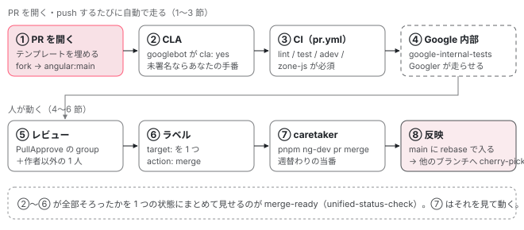

[目次](../README.md) › [コントリビュートの道](README.md) › 第 10 回 / 全 15 回

# PR が通るまで：CI・ラベル・レビュー・マージ

> PULL\_REQUEST\_TEMPLATE.md の項目、.github/workflows/pr.yml が走らせる検査と、.ng-dev/pull-request.mjs の requiredStatuses で決まるマージに必須の 5 つ、.pullapprove.yml で決まるレビューの担当（触ったファイルに当たる group 全部と作者以外の 1 人）、CLA、target: と action: のラベルと angular-robot.yml の merge の条件、merge-ready の状態、週替わりの caretaker が ng-dev pr merge で main へ rebase マージし対象ブランチへ cherry-pick する流れ、Google 内部のテスト（google-internal-tests.yml・google-sync-config.json・google-markers.md）。レビューで指摘されたときの直し方。

angular/angular · 読了 約 14 分 · 発展 · [サイトで読む（デモが動きます）](https://angular-deep-dive-cyan.vercel.app/chapter/contrib-pr-flow)

---

PR を開いてから main に入るまでに、あなたの PR には何本もの「門」が立ちます。CLA、GitHub Actions の CI、Google 内部のテスト、PullApprove のレビュー、`target:` と `action:` のラベル、そして caretaker が手で走らせる `ng-dev pr merge`。この章では、それぞれの門がどのファイルのどの行で決まっていて、いま誰の手番なのかを 1 つずつ確かめます。最後に、自分の PR の状態を入れると「次に何を待っているか」を出す表を動かします。

読む対象は `.github/PULL_REQUEST_TEMPLATE.md`、`.github/workflows/` の `pr.yml`・`merge-ready-status.yml`・`google-internal-tests.yml`、`.github/angular-robot.yml`、`.pullapprove.yml`、`.ng-dev/` の `pull-request.mjs`・`github.mjs`・`caretaker.mjs`・`google-sync-config.json`、`contributing-docs/` の `caretaking.md`・`google-markers.md`・`triage-and-labelling.md`、それに `node_modules/@angular/ng-dev`（マージの道具の本体。このマシンに入っている版は `0.0.0-f5c8170…`）です。

1. [1. 全体像](01-contrib-overview.md)
2. [2. リポジトリの地図](02-contrib-repo-map.md)
3. [3. 手元の準備](03-contrib-setup.md)
4. [4. Bazel の読み方](04-contrib-bazel.md)
5. [5. テストを走らせる](05-contrib-run-tests.md)
6. [6. spec の読み方](06-contrib-reading-specs.md)
7. [7. テストを書く](07-contrib-writing-a-test.md)
8. [8. 公開 API と golden](08-contrib-public-api.md)
9. [9. コミットメッセージ](09-contrib-commit-messages.md)
10. **10. PR が通るまで**（この章）
11. [11. ブランチとリリース](11-contrib-branches.md)
12. [12. issue の仕分け](12-contrib-triage.md)
13. [13. コードの書き方](13-contrib-coding-standards.md)
14. [14. 手元で確かめる](14-contrib-debugging.md)
15. [15. 最初の PR](15-contrib-first-pr.md)

## 0. 全体の流れ



*PR が main に入るまで。上の段は PR を開くと自動で始まる検査（矢印の順ではなく同時に進む）、下の段は人が動く手順。赤い枠はあなたが動く門、点線は Googler（Google の社員）しか動かせない門。*

1. **テンプレートを埋めて PR を開く**

   `PULL_REQUEST_TEMPLATE.md` の項目（1 節）。
2. **CLA と CI が自動で走る**

   googlebot が CLA を見て、`pr.yml` のジョブが走る（2 節）。
3. **Google 内部のテスト**

   `google-internal-tests` の状態は Googler が内部のテストを走らせて付ける（3 節）。
4. **レビュー**

   `.pullapprove.yml` が、触ったファイルから担当の group を選んで依頼する（4 節）。
5. **ラベル**

   `target:` と `action: merge`。angular-robot がそろったかを見る（5 節）。
6. **caretaker がマージ**

   `ng-dev pr merge` が GitHub の API で main に入れ、他のブランチへ cherry-pick する（6 節）。

## 1. PR のテンプレート

📄 `angular/.github/PULL_REQUEST_TEMPLATE.md` L1–23 （▶ の行: 5–7, 21）

```md
 1 │ ## PR Checklist
 2 │ 
 3 │ Please check if your PR fulfills the following requirements:
 4 │ 
 5 ▶ - [ ] The commit message follows our guidelines: https://github.com/angular/angular/blob/main/contributing-docs/commit-message-guidelines.md
 6 ▶ - [ ] Tests for the changes have been added (for bug fixes / features)
 7 ▶ - [ ] Docs have been added / updated (for bug fixes / features)
 8 │ 
 9 │ ## PR Type
10 │ 
11 │ What kind of change does this PR introduce?
12 │ 
13 │ <!-- Please check the one that applies to this PR using "x". -->
14 │ 
15 │ - [ ] Bugfix
16 │ - [ ] Feature
17 │ - [ ] Code style update (formatting, local variables)
18 │ - [ ] Refactoring (no functional changes, no api changes)
19 │ - [ ] Build related changes
20 │ - [ ] CI related changes
21 ▶ - [ ] Documentation content changes
22 │ - [ ] angular.dev application / infrastructure changes
23 │ - [ ] Other... Please describe:
```

PR を開くと、本文の欄にこのファイルがそのまま入ります。5〜7 行目のチェックリストは「コミットメッセージが規則どおり」「テストを足した」「ドキュメントを直した」。5 行目の規則は[第 9 回](09-contrib-commit-messages.md)で読んだもので、実際に CI が検査します（2 節の 38 行目）。15〜23 行目の PR の種類は 1 つだけに `x` を付けます。`.md` の中身を直すだけなら 21 行目の「Documentation content changes」です。

📄 `angular/.github/PULL_REQUEST_TEMPLATE.md` L25–40 （▶ の行: 29, 31, 33, 38）

```md
25 │ ## What is the current behavior?
26 │ 
27 │ <!-- Please describe the current behavior that you are modifying, or link to a relevant issue. -->
28 │ 
29 ▶ Issue Number: N/A
30 │ 
31 ▶ ## What is the new behavior?
32 │ 
33 ▶ ## Does this PR introduce a breaking change?
34 │ 
35 │ - [ ] Yes
36 │ - [ ] No
37 │ 
38 ▶ <!-- If this PR contains a breaking change, please describe the impact and migration path for existing applications below. -->
39 │ 
40 │ ## Other information
```

29 行目の `Issue Number: N/A` は、関係する issue があれば番号に書き換えます。31 行目「新しい振る舞い」は、レビュアーが差分を開く前に読む欄です。33〜36 行目の破壊的変更の有無は、[第 11 回](11-contrib-branches.md)の `target:` ラベルの選び方に直結します。38 行目のとおり、「Yes」なら影響と移行の手順をその下に書きます。

## 2. 自動で走るもの：CLA と pr.yml

📄 `angular/contributing-docs/triage-and-labelling.md` L185–195 （▶ の行: 189, 194–195）

```md
185 │ ## Special Labels
186 │ 
187 │ ### `cla: yes`, `cla: no`
188 │ 
189 ▶ - _**Who adds it:** @googlebot, or a Googler manually overriding the status in case the bot got it
190 │   wrong._
191 │ - _**Who removes it:** @googlebot._
192 │ 
193 │ Managed by googlebot.
194 ▶ Indicates whether a PR has a CLA on file for its author(s).
195 ▶ Only issues with `cla:yes` should be merged into main.
```

CLA（Contributor License Agreement、コードの権利を Google に許諾する契約）は、このリポジトリの外にある googlebot が見ます。189 行目、`cla: yes` / `cla: no` のラベルは googlebot が付け、195 行目のとおり `cla: yes` でなければ main に入りません。署名は CONTRIBUTING.md の「Signing the CLA」の個人用フォームから、**コミットに使うメールアドレスで**行います（違うアドレスだと googlebot が結び付けられません）。

📄 `angular/.github/workflows/pr.yml` L17–44 （▶ の行: 18, 26, 28, 30, 32, 37–38, 40）

```yaml
17 │ jobs:
18 ▶   lint:
19 │     runs-on: ubuntu-latest
20 │     steps:
21 │       - name: Initialize environment
22 │         uses: angular/dev-infra/github-actions/npm/checkout-and-setup-node@183403ae13b785698eaf13c819dda55b9fed430b # main
23 │       - name: Install node modules
24 │         run: pnpm install --frozen-lockfile
25 │       - name: Check code lint
26 ▶         run: pnpm tslint
27 │       - name: Check for circular dependencies
28 ▶         run: pnpm ts-circular-deps:check
29 │       - name: Validate pull approve configuration
30 ▶         run: pnpm ng-dev pullapprove verify
31 │       - name: Validate angular robot configuration
32 ▶         run: pnpm ng-dev ngbot verify
33 │       - name: Confirm code builds with typescript as expected
34 │         run: pnpm check-tooling-setup
35 │       - name: Validate agent skills
36 │         run: pnpm ng-dev misc validate-skills
37 ▶       - name: Check commit message
38 ▶         run: pnpm ng-dev commit-message validate-range ${{ github.event.pull_request.base.sha }} ${{ github.event.pull_request.head.sha }}
39 │       - name: Check code format
40 ▶         run: pnpm ng-dev format changed --check ${{ github.event.pull_request.base.sha }}
41 │       - name: Check Package Licenses
42 │         uses: angular/dev-infra/github-actions/linting/licenses@183403ae13b785698eaf13c819dda55b9fed430b # main
43 │         with:
44 │           allow-dependencies-licenses: 'pkg:npm/google-protobuf@'
```

`pr.yml` は PR を開いたとき・push したとき・開き直したときに走ります。最初のジョブ `lint`（18 行目）は 1 台の上で順に：

1. **26 行目 `pnpm tslint`**

   tslint.json の規則（[第 13 回](13-contrib-coding-standards.md)）。
2. **28 行目 循環 import の検査**

   パッケージの中で import が輪になっていないか。
3. **30・32 行目 設定ファイル自体の検査**

   `.pullapprove.yml` と angular-robot の設定が壊れていないか。この 2 つを直す PR でも CI で確かめられます。
4. **38 行目 コミットメッセージ**

   PR の base から head までの全コミットを `validate-range` で検査。1 つでも規則外なら lint が赤になります。
5. **40 行目 フォーマット**

   base から変わったファイルだけ prettier に通して、差が出たら赤。

📄 `angular/.github/workflows/pr.yml` L72–95 （▶ の行: 79–80, 84）

```yaml
72 │   test:
73 │     runs-on: ubuntu-latest
74 │     steps:
75 │       - name: Initialize environment
76 │         uses: angular/dev-infra/github-actions/npm/checkout-and-setup-node@183403ae13b785698eaf13c819dda55b9fed430b # main
77 │       - name: Setup Bazel
78 │         uses: angular/dev-infra/github-actions/bazel/setup@183403ae13b785698eaf13c819dda55b9fed430b # main
79 ▶       - name: Setup Bazel Remote Caching
80 ▶         uses: angular/dev-infra/github-actions/bazel/configure-remote@183403ae13b785698eaf13c819dda55b9fed430b # main
81 │       - name: Install node modules
82 │         run: pnpm install --frozen-lockfile
83 │       - name: Run CI tests for framework
84 ▶         run: pnpm test:ci
85 │         env:
86 │           # Ensures Aspect lock files are up-to-date.
87 │           # TODO(devversion): Remove when removing pnpm.
88 │           ASPECT_RULES_JS_FROZEN_PNPM_LOCK: '1'
89 │       - name: Upload GRPC logs (for debugging of RBE issues)
90 │         if: always()
91 │         uses: actions/upload-artifact@043fb46d1a93c77aae656e7c1c64a875d1fc6a0a # v7
92 │         with:
93 │           path: /tmp/rbe-grpc.log
94 │           retention-days: 1
95 │ 
```

`test` ジョブの本体は 84 行目の `pnpm test:ci` の 1 行です。package.json の `test:ci` は `bazelisk test -- //... -//integration/... -//adev/... -//vscode-ng-language-service/... -//devtools/... -//modules/ssr-benchmarks/...`、つまり「リポジトリ全部のテストから、別のジョブが受け持つ部分を除いたもの」です。79〜80 行目で Bazel のリモートキャッシュを使うので、あなたの変更に関係しないターゲットはキャッシュから結果が返ります（[第 4 回](04-contrib-bazel.md)）。手元で同じターゲットを走らせる方法は[第 5 回](05-contrib-run-tests.md)です。

このファイルには他に `devtools`・`integration-tests`・`adev`・`vscode-ng-language-service`・`zone-js` のジョブがあります。そのうちマージに**必須**なのはどれかは、別のファイルが決めています。

📄 `angular/.ng-dev/pull-request.mjs` L7–34 （▶ の行: 27–32）

```js
 7 │ export const pullRequest = {
 8 │   githubApiMerge: {
 9 │     default: 'auto',
10 │     labels: [{pattern: 'merge: squash commits', method: 'squash'}],
11 │   },
12 │   requiredBaseCommits: {
13 │     // PRs that target either `main` or the patch branch, need to be rebased
14 │     // on top of the latest commit message validation fix.
15 │     // These SHAs are the commits that update the required license text in the header.
16 │     'main': '5aeb9a4124922d8ac08eb73b8f322905a32b0b3a',
17 │     '10.0.x': '27b95ba64a5d99757f4042073fd1860e20e3ed24',
18 │   },
19 │   // `docs-infra` are not affecting the public NPM packages.
20 │   targetLabelExemptScopes: ['docs-infra'],
21 │   // enables specific validations during the pull request merge process
22 │   validators: {
23 │     assertEnforceTested: true,
24 │     assertIsolatedSeparateFiles: true,
25 │   },
26 │ 
27 ▶   requiredStatuses: [
28 ▶     {type: 'check', name: 'test'},
29 ▶     {type: 'check', name: 'lint'},
30 ▶     {type: 'check', name: 'adev'},
31 ▶     {type: 'check', name: 'zone-js'},
32 ▶     {type: 'status', name: 'google-internal-tests'},
33 │   ],
34 │ };
```

27〜33 行目の `requiredStatuses` が、マージの道具（`ng-dev pr merge`）が緑であることを要求する 5 つです。28〜31 行目の `test`・`lint`・`adev`・`zone-js` は `pr.yml` のジョブ名、32 行目の `google-internal-tests` だけは種類が `status`（GitHub Actions のジョブではなく、外から書き込まれる状態）です。`integration-tests` や `devtools` はこの表に無いので、ng-dev のこの検査では見られません。

## 3. Google 内部のテスト

📄 `angular/.github/workflows/google-internal-tests.yml` L1–22 （▶ の行: 4–5, 14, 17–18, 20, 22）

```yaml
 1 │ name: Google Internal Tests Enforcement
 2 │ 
 3 │ on:
 4 ▶   # zizmor: ignore[dangerous-triggers] - {Trigger is safe as workflow does not checkout untrusted code}
 5 ▶   pull_request_target:
 6 │     types: [opened, reopened, synchronize]
 7 │ 
 8 │ permissions: {}
 9 │ 
10 │ jobs:
11 │   trigger:
12 │     permissions:
13 │       pull-requests: read
14 ▶       statuses: write
15 │     runs-on: ubuntu-latest
16 │     steps:
17 ▶       - uses: actions/checkout@3d3c42e5aac5ba805825da76410c181273ba90b1 # v7.0.1
18 ▶       - uses: angular/dev-infra/github-actions/google-internal-tests@183403ae13b785698eaf13c819dda55b9fed430b # main
19 │         with:
20 ▶           run-tests-guide-url: http://go/angular-g3sync-start
21 │           github-token: ${{ secrets.GITHUB_TOKEN }}
22 ▶           sync-config: ./.ng-dev/google-sync-config.json
```

Angular は Google の社内のコード（google3）でも数多くのアプリに使われていて、main に入れる前にそれらのテストを通します。このワークフローがするのは「状態を付ける」ことだけです。14 行目の `statuses: write` の権限で、18 行目の dev-infra のアクションが `google-internal-tests` の状態を PR に書きます。20 行目の案内先 `go/angular-g3sync-start` は社内の URL で、外からは開けません。5 行目が `pull_request_target` なのは、fork からの PR でも状態を書き込む権限（secrets）を使えるようにするためで、4 行目のコメントのとおり PR のコードは checkout しない作りにしてあります（`pull_request_target` の 17 行目の checkout が取ってくるのは base 側）。

📄 `angular/.ng-dev/google-sync-config.json` L1–13 （▶ の行: 2–4）

```json
 1 │ {
 2 ▶   "syncedFilePatterns": ["LICENSE", "modules/benchmarks/**", "packages/**"],
 3 ▶   "separateFilePatterns": ["packages/core/primitives/**"],
 4 ▶   "alwaysExternalFilePatterns": [
 5 │     "packages/*",
 6 │     "packages/bazel/**",
 7 │     "packages/compiler-cli/linker/**",
 8 │     "packages/compiler-cli/src/ngtsc/sourcemaps/**",
 9 │     "packages/compiler-cli/src/ngtsc/testing/**",
10 │     "packages/compiler-cli/private/bazel.ts",
11 │     "packages/compiler-cli/private/localize.ts",
12 │     "packages/compiler-cli/private/tooling.ts",
13 │     "packages/compiler-cli/private/hybrid_analysis.ts",
```

22 行目で渡す設定がこれです。2 行目の `syncedFilePatterns` が「Google の社内へ同期するファイル」で、`LICENSE`・`modules/benchmarks/**`・`packages/**` の 3 つ。`contributing-docs/` や `adev/` はここに入っていません。3 行目の `separateFilePatterns`（`packages/core/primitives/**`）は他の変更と混ぜてはいけない場所で、4 行目以降の `alwaysExternalFilePatterns`（`packages/bazel/**` など）は、`packages/` の下にあっても社内には持ち込まないファイルです。

📄 `angular/contributing-docs/caretaking.md` L32–46 （▶ の行: 34–40）

````md
32 │ ## PRs that require global presubmits
33 │ 
34 ▶ Most PRs are tested against a curated subset of Angular application tests inside Google. However,
35 ▶ if a change is deemed risky or otherwise requires more thorough testing, add the `requires: TGP`
36 ▶ label to the PR. For such PRs, the merge tooling enforces that _all_ affected tests inside Google
37 ▶ have been run (a "global presubmit"). A Googler can alternatively satisfy the merge tooling check by
38 ▶ adding a review comment that starts with `TESTED=` and then put a reason why the PR is sufficiently
39 ▶ tested. The `requires: TGP` label is automatically added to PRs that affect files
40 ▶ matching `separateFilePatterns` in [`.ng-dev/google-sync-config.json`](https://github.com/angular/angular/blob/main/.ng-dev/google-sync-config.json).
41 │ 
42 │ An example of specifying a `TESTED=` comment:
43 │ 
44 │ ```
45 │ TESTED=docs only update and does not need a TGP
46 │ ```
````

34 行目、ふだんの PR は社内のアプリのテストのうち選んだ一部（curated subset）で確かめます。危ない変更には 35〜36 行目の `requires: TGP` ラベルが付き、影響する**全部**のテスト（global presubmit）が要ります。39〜40 行目、`separateFilePatterns` に当たるファイル（上の 3 行目）を触ると、このラベルは自動で付きます。37〜38 行目、Googler が `TESTED=` で始まるコメントで理由を書けば、その検査は満たされます。

📄 `angular/contributing-docs/google-markers.md` L5–20 （▶ の行: 5, 7, 17, 19）

```md
 5 ▶ As an Angular contributor, you will occasionally encounter these markers in the codebase. Most external contributors will never need to **write** these markers themselves. Instead, this guide exists to explain what these markers mean and why they are in the code when you run into them.
 6 │ 
 7 ▶ These tags are necessary because Google's internal codebase builds and integrates Angular in a slightly different configuration than the public NPM packages. For example, Google may require certain APIs to remain public internally for integration purposes, or might need to bypass public-only configurations. These markers allow the automated sync tooling to adjust the code seamlessly during the import process.
 8 │ 
 9 │ ---
10 │ 
11 │ ## Reference Table
12 │ 
13 │ The following markers are processed during the synchronization to Google's internal codebase:
14 │ 
15 │ | Marker                                        | Type        | Action in Google's Codebase                 | Intended Use Case                                                                           |
16 │ | :-------------------------------------------- | :---------- | :------------------------------------------ | :------------------------------------------------------------------------------------------ |
17 ▶ | **`// 3p-only`**                              | Single-line | **Strip**: Deletes the entire line          | Remove imports or calls that only exist in the public version.                              |
18 │ | **`// 3p-only-start`** / **`// 3p-only-end`** | Block       | **Strip**: Deletes the entire block         | Remove larger chunks of public-only code (e.g., benchmarking suites, public-only adapters). |
19 ▶ | **`// g3-only`**                              | Single-line | **Insert**: Uncomments the rest of the line | Export Google-internal symbols or activate Google-specific configurations.                  |
20 │ | **`// g3-only-start`** / **`// g3-only-end`** | Block       | **Insert**: Uncomments every line inside    | Add larger Google-specific functions or class definitions.                                  |
```

ソースの中で `// 3p-only` や `// g3-only` というコメントを見かけたら、それが同期のための印です。17 行目の `// 3p-only` の行は社内では消え、19 行目の `// g3-only` の行は社内ではコメントが外れて有効になります。5 行目のとおり、外の人がこれを**書く**ことはほとんどありません。触る行の近くにあったら消さない、ということだけ覚えておけば足ります。

## 4. レビュー：PullApprove が担当を決める

📄 `angular/.pullapprove.yml` L37–57 （▶ の行: 40–41, 47, 57）

```yaml
37 │ version: 3
38 │ 
39 │ availability:
40 ▶   users_unavailable:
41 ▶     - devversion
42 │ 
43 │ # Meta field that goes unused by PullApprove to allow for defining aliases to be
44 │ # used throughout the config.
45 │ meta:
46 │   # Note: Because all inactive groups start as pending, we are only checking pending and rejected active groups.
47 ▶   no-groups-above-this-pending: &no-groups-above-this-pending len(groups.active.pending.exclude("required-minimum-review")) == 0
48 │   no-groups-above-this-rejected: &no-groups-above-this-rejected len(groups.active.rejected.exclude("required-minimum-review")) == 0
49 │ 
50 │   defaults: &defaults
51 │     reviews:
52 │       # Authors provide their approval implicitly, this approval allows for a reviewer
53 │       # from a group not to need a review specifically for an area of the repository
54 │       # they own.  This is coupled with the `required-minimum-review` group which requires
55 │       # that all PRs are reviewed by at least one team member who is not the author of
56 │       # the PR.
57 ▶       author_value: 1
```

PullApprove は GitHub の外のサービスで、このファイルを読んで「この PR は誰の承認が要るか」を決め、`pullapprove` という状態を PR に付けます。考え方はファイルの冒頭の注記にあり（[第 1 回](01-contrib-overview.md)で引用）、要は**触ったファイルに当てはまる group の全部**の承認が要る、ということです。57 行目 `author_value: 1` は、作者自身もその group の一員なら作者の分で 1 と数える設定で、そのときも別の group（下の required-minimum-review）で作者以外の承認を必ず求めます。47 行目は、その required-minimum-review を除いた「有効で pending の group」が 0 か、という式に名前を付けたものです。40〜41 行目の `users_unavailable` に入っている人には、依頼が出されません。

📄 `angular/.pullapprove.yml` L64–84 （▶ の行: 69–71, 73, 78–79, 82–83）

```yaml
64 │ # https://docs.pullapprove.com/config/overrides/
65 │ # Note that overrides are processed in order.
66 │ overrides:
67 │   # For PRs which are still being worked on, either still in draft mode or indicated through WIP in
68 │   # title or label, PullApprove stays in a pending state until its ready for review.
69 ▶   - if: "draft or 'WIP' in title or 'PR state: WIP' in labels"
70 ▶     status: pending
71 ▶     explanation: 'Waiting to send reviews as PR is WIP'
72 │   # Disable PullApprove on specific PRs by adding the `PullApprove: disable` label
73 ▶   - if: "'PullApprove: disable' in labels"
74 │     status: success
75 │     explanation: "PullApprove skipped because of 'PullApprove: disable' label"
76 │   # If no file matching based groups are active, report this pull request as failing. Most likely,
77 │   # the PR author would need to update the PullApprove config, or create new group.
78 ▶   - if: len(groups.active.exclude("required-minimum-review").exclude("global-*")) == 0 and len(groups.approved.include("global-*")) == 0
79 ▶     status: failure
80 │     explanation: 'At least one group must match this PR. Please update an existing review group, or create a new group.'
81 │   # If any global approval is given the status should be passing.
82 ▶   - if: len(groups.approved.include("global-approvers")) == 1
83 ▶     status: success
84 │     explanation: 'Passing as globally approved by global approvers'
```

`overrides` は上から順に評価され、当てはまれば状態をそこで決めます。69〜71 行目、下書き（draft）の PR や、タイトルに `WIP` を含む PR は `pending` のままで、レビューの依頼を出しません。「レビューが付かない」とき、まずここを疑います。78〜80 行目、どの group にも当てはまらない PR は `failure`（設定に group を足す必要がある、と 80 行目が言う）。82〜84 行目、`global-approvers` の誰か 1 人の承認があれば、他は満たさなくても通ります。

📄 `angular/.pullapprove.yml` L115–147 （▶ の行: 118, 122, 135）

```yaml
115 │   # =========================================================
116 │   #  Framework: General (most code in our packages)
117 │   # =========================================================
118 ▶   fw-general:
119 │     <<: *defaults
120 │     conditions:
121 │       - >
122 ▶         contains_any_globs(files.exclude('packages/core/primitives/*'), [
123 │           '.agent/skills/**/{*,.*}',
124 │           'contributing-docs/public-api-surface.md',
125 │           'dev-app/**/{*,.*}',
126 │           'integration/**/{*,.*}',
127 │           'modules/**/{*,.*}',
128 │           'packages/animations/**/{*,.*}',
129 │           'packages/benchpress/**/{*,.*}',
130 │           'packages/common/**/{*,.*}',
131 │           'packages/core/**/{*,.*}',
132 │           'packages/docs/**/{*,.*}',
133 │           'packages/elements/**/{*,.*}',
134 │           'packages/examples/**/{*,.*}',
135 ▶           'packages/forms/**/{*,.*}',
136 │           'packages/localize/**/{*,.*}',
137 │           'packages/misc/**/{*,.*}',
138 │           'packages/platform-browser/**/{*,.*}',
139 │           'packages/platform-browser-dynamic/**/{*,.*}',
140 │           'packages/platform-server/**/{*,.*}',
141 │           'packages/private/**/{*,.*}',
142 │           'packages/ssr/**/{*,.*}',
143 │           'packages/router/**/{*,.*}',
144 │           'packages/service-worker/**/{*,.*}',
145 │           'packages/upgrade/**/{*,.*}',
146 │           'vscode-ng-language-service/**/{*,.*}',
147 │         ])
```

group の例です。118 行目の `fw-general` は、122 行目の条件で「PR が触ったファイル（`packages/core/primitives/*` を除く）が、どれか 1 つでもこのパターンに当たれば有効」になります。`packages/forms` を直す PR なら 135 行目に当たり、この group が有効になります。この後に `reviewers` の `users` が並び、その中の誰かが承認すれば group は満たされます。`contributing-docs/*.md` は別の `dev-infra` という group が受け持っています（[第 15 回](15-contrib-first-pr.md)で使います）。

📄 `angular/.pullapprove.yml` L518–534 （▶ の行: 527–529, 534）

```yaml
518 │   # =========================================================
519 │   # Require review on all PRs
520 │   #
521 │   # All PRs require at least one review.  This rule will not
522 │   # request any reviewers, however will require that at least
523 │   # one review is provided before the group is satisfied.
524 │   # =========================================================
525 │   required-minimum-review:
526 │     reviews:
527 ▶       request: 0 # Do not request any reviews from the reviewer group
528 ▶       required: 1 # Require that all PRs have approval from at least one of the users in the group
529 ▶       author_value: 0 # The author of the PR cannot provide an approval for themself
530 │       reviewed_for: ignored # All reviews apply to this group whether noted via Reviewed-for or not
531 │     reviewers:
532 │       teams:
533 │         # Any member of the team can provide a review to perform the minimum review required
534 ▶         - team
```

どの PR にも必ず効く group です。527 行目で依頼は出さず（`request: 0`）、528 行目で承認 1 つを要求し、529 行目で作者の分は 0 と数えます。534 行目の `team` の誰でもよい、つまり「チームの誰か 1 人、作者以外」の承認が必ず要ります。

📄 `angular/contributing-docs/triage-and-labelling.md` L168–183 （▶ の行: 176–177, 180, 183）

```md
168 │ ## PR Approvals
169 │ 
170 │ Before a PR can be merged it must be approved by the appropriate reviewer(s).
171 │ 
172 │ To ensure that the right people review each change, we set review requests
173 │ using [PullApprove](https://docs.pullapprove.com/) (via `.pullapprove`) and require that each PR has
174 │ at least one approval from an appropriate code owner.
175 │ 
176 ▶ If the PR author is a code owner themselves, the approval can come from _any_ repo collaborator (
177 ▶ person with write access).
178 │ In any case, the reviewer should actually look through the code and provide feedback if necessary.
179 │ 
180 ▶ Note that approved state does not mean a PR is ready to be merged.
181 │ For example, a reviewer might approve the PR but request a minor tweak that doesn't need further
182 │ review, e.g., a rebase or small uncontroversial change.
183 ▶ Only the `action: merge` label means that the PR is ready for merging.
```

手引きの言葉で言い直すとこうなります。176〜177 行目、作者がコードオーナーなら承認は書き込み権限のある誰でもよい。180〜183 行目が大事です：**承認されても、まだマージしてよいという意味ではない**。その合図は `action: merge` ラベルだけです。

## 5. ラベルと merge-ready

📄 `angular/contributing-docs/triage-and-labelling.md` L93–113 （▶ の行: 95, 100, 105–109, 111）

```md
 93 │ ## Triaging PRs
 94 │ 
 95 ▶ PRs labels signal their state. Every triaged PR must have a `action: *` label assigned to it:
 96 │ 
 97 │ - `action: discuss`: Discussion is needed, to be led by the author.
 98 │   - _**Who adds it:** Typically the PR author._
 99 │   - _**Who removes it:** Whoever added it._
100 ▶ - `action: review` (optional): One or more reviews are pending. The label is optional, since the
101 │   review status can be derived from GitHub's Reviewers interface.
102 │   - _**Who adds it:** Any team member. The caretaker can use it to differentiate PRs pending
103 │     review from merge-ready PRs._
104 │   - _**Who removes it:** Whoever added it or the reviewer adding the last missing review._
105 ▶ - `action: cleanup`: More work is needed from the author.
106 ▶   - _**Who adds it:** The reviewer requesting changes to the PR._
107 ▶   - _**Who removes it:** Either the author (after implementing the requested changes) or the
108 ▶     reviewer (after confirming the requested changes have been implemented)._
109 ▶ - `action: merge`: The PR author is ready for the changes to be merged by the caretaker as soon as
110 │   the PR is green (or merge-assistance label is applied and caretaker has deemed it acceptable
111 ▶   manually). In other words, this label indicates to "auto submit when ready".
112 │   - _**Who adds it:** Typically the PR author._
113 │   - _**Who removes it:** Whoever added it._
```

95 行目、仕分けの済んだ PR には `action: *` のラベルが 1 つ付きます。105〜106 行目の `action: cleanup` は「作者の手直し待ち」で、付けるのは変更を求めたレビュアー。109〜111 行目の `action: merge` は「緑になったら自動でマージしてよい」（auto submit when ready）という合図です。GitHub ではラベルの付け外しに書き込み権限が要るので、外の人の PR ではチームの人が付けます。`target:` ラベルの選び方は[第 11 回](11-contrib-branches.md)です。

📄 `angular/.github/angular-robot.yml` L38–72 （▶ の行: 39, 42, 54, 57, 59–60, 63–67, 70–72）

```yaml
38 │   # comment that will be added to a PR when there is a conflict, leave empty or set to false to disable
39 ▶   mergeConflictComment: "Hi @{{PRAuthor}}! This PR has merge conflicts due to recent upstream merges.\nPlease help to unblock it by resolving these conflicts. Thanks!"
40 │ 
41 │   # label to monitor
42 ▶   mergeLabel: 'action: merge'
43 │ 
44 │   # adding any of these labels will also add the merge label
45 │   mergeLinkedLabels:
46 │     - 'action: merge-assistance'
47 │ 
48 │   # list of checks that will determine if the merge label can be added
49 │   checks:
50 │     # require that the PR has reviews from all requested reviewers
51 │     #
52 │     # This enables us to request reviews from both eng and tech writers, or multiple eng folks, and prevents accidental merges.
53 │     # Rather than merging PRs with pending reviews, if all approvals are obtained and additional reviews are not needed, any pending reviewers should be removed via GitHub UI (this also leaves an audit trail behind these decisions).
54 ▶     requireReviews: true,
55 │ 
56 │     # whether the PR shouldn't have a conflict with the base branch
57 ▶     noConflict: true
58 │     # list of labels that a PR needs to have, checked with a regexp.
59 ▶     requiredLabels:
60 ▶       - 'target: *'
61 │ 
62 │     # list of labels that a PR shouldn't have, checked after the required labels with a regexp
63 ▶     forbiddenLabels:
64 ▶       - 'target: TBD'
65 ▶       - 'action: cleanup'
66 ▶       - 'action: review'
67 ▶       - 'state: blocked'
68 │ 
69 │     # list of PR statuses that need to be successful
70 ▶     requiredStatuses:
71 ▶       - 'google-internal-tests'
72 ▶       - 'pullapprove'
```

angular-robot（チームの bot）が、`action: merge`（42 行目）を付けてよい状態かを見る条件です。上から順に：

1. **54 行目 依頼したレビューが全部返っている**

   依頼されたまま返していないレビュアーがいると止まります。
2. **57 行目 base ブランチと衝突していない**

   衝突すると 39 行目の文面で「衝突を解いてください」とコメントが付きます。
3. **59〜60 行目 `target: *` がある**

   正規表現で、どの target でも 1 つあればよい。
4. **63〜67 行目 付いていてはいけないラベル**

   `target: TBD`・`action: cleanup`・`action: review`・`state: blocked`。
5. **70〜72 行目 状態**

   `google-internal-tests` と `pullapprove` が成功している。

📄 `angular/.github/workflows/merge-ready-status.yml` L1–16 （▶ の行: 5, 14）

```yaml
 1 │ name: Merge Ready
 2 │ 
 3 │ on:
 4 │   # zizmor: ignore[dangerous-triggers] - {Trigger is safe as workflow does not checkout untrusted code}
 5 ▶   pull_request_target:
 6 │ 
 7 │ # Declare default permissions as read only.
 8 │ permissions: {}
 9 │ 
10 │ jobs:
11 │   status:
12 │     runs-on: ubuntu-latest
13 │     steps:
14 ▶       - uses: angular/dev-infra/github-actions/unified-status-check@183403ae13b785698eaf13c819dda55b9fed430b # main
15 │         with:
16 │           angular-robot-key: ${{ secrets.ANGULAR_ROBOT_PRIVATE_KEY }}
```

PR のページの下に並ぶたくさんの状態を 1 つにまとめて見せるのが、このワークフローです。14 行目の `unified-status-check`（dev-infra リポジトリのアクション）が中身で、このリポジトリにはそれを呼ぶ 16 行しかありません。5 行目は 3 節と同じ `pull_request_target` で、fork の PR にも状態を書き込めるようにしています。

## 6. caretaker がマージする

caretaker は PR のマージと Google の社内への同期を受け持つ**週替わり**の役で、マージには `action: merge` と `target: *` の両方が要り、caretaker が打つのは `pnpm ng-dev pr merge <番号>` の 1 行です（`contributing-docs/caretaking.md` の冒頭。[第 1 回](01-contrib-overview.md)で引用）。ここでは、その 1 行の裏で道具が何をしているかを読みます。

📄 `angular/.ng-dev/github.mjs` L1–13 （▶ の行: 10–11）

```js
 1 │ /**
 2 │  * Github configuration for the `ng-dev` command. This repository is used as
 3 │  * remote for the merge script and other utilities like `ng-dev pr rebase`.
 4 │  *
 5 │  * @type { import("@angular/ng-dev").GithubConfig }
 6 │  */
 7 │ export const github = {
 8 │   owner: 'angular',
 9 │   name: 'angular',
10 ▶   mainBranchName: 'main',
11 ▶   mergeMode: 'caretaker-only',
12 │   requireReleaseModeForRelease: false,
13 │ };
```

11 行目 `mergeMode: 'caretaker-only'`。GitHub の画面の「Merge」ボタンで入れるのではなく、caretaker が道具で入れる、という宣言です。あなたが PR を出したあと、最後にマージするのはあなたでもレビュアーでもなく、その週の caretaker です。

📄 `angular/.ng-dev/caretaker.mjs` L1–11 （▶ の行: 8, 11）

```js
 1 │ /**
 2 │  * The configuration for `ng-dev caretaker` commands.
 3 │  *
 4 │  * @type { import("@angular/ng-dev").CaretakerConfig }
 5 │  */
 6 │ export const caretaker = {
 7 │   g3SyncConfigPath: './.ng-dev/google-sync-config.json',
 8 ▶   githubQueries: [
 9 │     {
10 │       name: 'Merge Queue',
11 ▶       query: `is:pr is:open label:"action: merge"`,
```

`ng-dev caretaker check` が caretaker に見せる一覧です。11 行目「Merge Queue」の検索は `label:"action: merge"` そのもの。つまり `action: merge` が付いた瞬間に、あなたの PR は caretaker の待ち行列に入ります（8 行目の `githubQueries` には、このあとに「手助けが要るもの」と「最初の仕分け待ち」の 2 つの列が続きます）。

`pnpm ng-dev pr merge` の中身は、このマシンの `node_modules/@angular/ng-dev` の bundle で読めます。pull-request.mjs の 8〜11 行目（`githubApiMerge`）が設定されているので、GitHub の API でマージする方式が選ばれます。

📄 `angular/node_modules/@angular/ng-dev/bundles/cli.mjs` L37247–37262 （▶ の行: 37249, 37252, 37255, 37260–37262）

```js
37247 │   async merge(pullRequest) {
37248 │     const { githubTargetBranch, prNumber, needsCommitMessageFixup, targetBranches, headSha } = pullRequest;
37249 ▶     const cherryPickTargetBranches = targetBranches.filter((b) => b !== githubTargetBranch);
37250 │     const commits = await this.getPullRequestCommits(pullRequest);
37251 │     const { squashCount, fixupCount, normalCommitsCount } = await this.getCommitsInfo(pullRequest);
37252 ▶     const method = this.getMergeActionFromPullRequest(pullRequest);
37253 │     const mergeOptions = {
37254 │       pull_number: prNumber,
37255 ▶       merge_method: method === "auto" ? "rebase" : method,
37256 │       sha: headSha,
37257 │       ...this.git.remoteParams
37258 │     };
37259 │     if (method === "auto") {
37260 ▶       const hasFixUpOrSquashAndMultipleCommits = normalCommitsCount > 1 && (fixupCount > 0 || squashCount > 0);
37261 ▶       if (needsCommitMessageFixup || hasFixUpOrSquashAndMultipleCommits) {
37262 ▶         return super.merge(pullRequest);
```

1. **37249 行目：cherry-pick 先**

   target ラベルから決まったブランチのうち、PR の base（ふつうは main）以外が cherry-pick 先です。
2. **37252・37255 行目：方式**

   既定（`'auto'`、pull-request.mjs の 9 行目）なら GitHub の **rebase** マージ。コミットは squash されず、あなたのコミットがそのまま main に並びます。だからコミットメッセージ 1 つ 1 つが CHANGELOG の 1 行になります。
3. **37260〜37262 行目：fixup が混ざっていたら**

   普通のコミットが 2 つ以上あって fixup コミットもある PR は、手元で autosquash して入れる方式に切り替わります（[第 9 回](09-contrib-commit-messages.md)の fixup がここで畳まれる）。

📄 `angular/node_modules/@angular/ng-dev/bundles/cli.mjs` L37305–37322 （▶ の行: 37310, 37315–37316, 37321–37322）

```js
37305 │     if (githubTargetBranch !== this.git.mainBranchName) {
37306 │       await this.closeLinkedIssues(pullRequest);
37307 │     }
37308 │     this.git.run(["checkout", TEMP_PR_HEAD_BRANCH]);
37309 │     this.fetchTargetBranches([githubTargetBranch]);
37310 ▶     if (!cherryPickTargetBranches.length) {
37311 │       await this.createMergeComment(pullRequest, targetBranches);
37312 │       return;
37313 │     }
37314 │     const pullRequestCommitCount = mergeOptions.merge_method === "rebase" ? pullRequest.commitCount : 1;
37315 ▶     const failedBranches = await this.cherryPickIntoTargetBranches(`${targetSha}~${pullRequestCommitCount}..${targetSha}`, cherryPickTargetBranches, {
37316 ▶       linkToOriginalCommits: true
37317 │     });
37318 │     if (failedBranches.length) {
37319 │       throw new MergeConflictsFatalError(failedBranches);
37320 │     }
37321 ▶     this.pushTargetBranchesUpstream(cherryPickTargetBranches);
37322 ▶     await this.createMergeComment(pullRequest, targetBranches);
```

main に入ったあと、37310 行目で cherry-pick 先が無ければマージのコメントを付けて終わり。あれば 37315〜37316 行目で、いま main に入ったコミットを各ブランチへ cherry-pick します。`linkToOriginalCommits: true` なので、パッチのブランチのコミットには `(cherry picked from commit …)` が付きます（[第 11 回](11-contrib-branches.md)で実例を見ます）。37321 行目で push、37322 行目で PR にコメントします。

📄 `angular/node_modules/@angular/ng-dev/bundles/pr/merge/strategies/commit-message-filter.mjs` L23–32 （▶ の行: 29–30）

```js
23 │   process.stdin.on("end", () => {
24 │     console.info(rewriteCommitMessage(commitMessage, prNumber));
25 │   });
26 │ }
27 │ function rewriteCommitMessage(message, prNumber) {
28 │   const lines = message.split(/\n/);
29 ▶   lines[0] += ` (#${prNumber})`;
30 ▶   lines.push(`PR Close #${prNumber}`);
31 │   return lines.join("\n");
32 │ }
```

autosquash の方式（37262 行目の分かれ道）を通ったときは、このフィルタがコミットメッセージを書き換えます。29 行目で 1 行目の末尾に `(#PR番号)`、30 行目で最後に `PR Close #PR番号`。git log には `PR Close #63799` のような行が付いたコミットがあります。今の版の ng-dev でこの行が付くのは autosquash の道を通ったときだけで、37255 行目の rebase マージではメッセージは書き換えられません。

## 7. レビューで指摘されたら

手順そのものは CONTRIBUTING.md の「Addressing review feedback」にあります（[第 1 回](01-contrib-overview.md)で引用）：直す → テストを走らせ直す → `git commit --all --fixup HEAD` で **fixup コミット**を作って `git push`。押し直すと `pr.yml` がもう一度走り（PR が更新されるたびに走る）、レビュアーには前回からの差分だけが見えます。fixup は 6 節のとおりマージのときに畳まれるので、自分で squash し直す必要はありません。コミットメッセージ自体を直すときの `--amend` と `--force-with-lease`、fixup の詳しい扱いは[第 9 回](09-contrib-commit-messages.md)です。

> [!TIP]
> **新卒エンジニアへ**
>
> 指摘に返事をするときは、直したコミットを指して「Done in &lt;SHA&gt;」のように書くと、レビュアーが差分を探す手間が減ります。全部直したら、もう一度レビューを依頼（GitHub の Re-request review）します。`action: cleanup` が付いていたら、外すのは付けた人です（5 節の 107〜108 行目）。

## 8. DEMO：いま何を待っているか

> **🧪 DEMO — PR の状態から「次の手番」を出す（再現）**
>
> angular-robot.yml の 49〜72 行目、pull-request.mjs の 27〜33 行目、.pullapprove.yml の 69〜71・525〜530 行目、triage-and-labelling.md の 95〜113 行目を小さく再現した表です。本物の bot や PullApprove の判定を呼ぶわけではありません。上から順に、最初に満たしていないものが「いま待っているもの」です。
>
> ▶ [このデモはサイトで動かせます](https://angular-deep-dive-cyan.vercel.app/chapter/contrib-pr-flow)

## 全体の trace

- 👤 `git push` → PR を開く — .github/PULL\_REQUEST\_TEMPLATE.md — *テンプレートを埋める*
  - `googlebot` — triage-and-labelling.md L187-195 — *cla: yes / no*
  - `pr.yml` の lint / test / adev / zone-js — .github/workflows/pr.yml — *必須は pull-request.mjs L27-33*
  - `google-internal-tests` — .github/workflows/google-internal-tests.yml — *Googler が社内で走らせ、状態が付く*
  - `pullapprove` — .pullapprove.yml — *当てはまる group 全部 + 作者以外の 1 人*
  - `target: *`・`action: merge` — .github/angular-robot.yml L41-72 — *robot がそろったかを見る*
  - `merge-ready` — .github/workflows/merge-ready-status.yml — *状態を 1 つにまとめる*
- `pnpm ng-dev pr merge <番号>` — contributing-docs/caretaking.md — *caretaker が手で*
  - `GithubApiMergeStrategy.merge()` — ng-dev/bundles/cli.mjs L37247 — *main へ rebase マージ*
    - `cherryPickIntoTargetBranches()` — ng-dev/bundles/cli.mjs L37315 — *パッチのブランチなどへ*

## 聞かれそうな質問

**Q. レビューが付かないときは？**

まず `.pullapprove.yml` の 69〜71 行目に当たっていないかを見ます。draft のまま、タイトルに `WIP` がある、`PR state: WIP` ラベルがある、のどれかなら PullApprove は依頼を出しません。当たっていなければ、PR の下の `pullapprove` の状態の「Details」で、どの group が誰に依頼したかが見えます（24 行目のとおり有効な group は全部要ります）。依頼された人が返さない場合は、しばらく待ってから PR に丁寧にひとことコメントを書きます。週替わりの caretaker（6 節）が交通整理をしています。

**Q. CI のどれが落ちたかはどう見る？**

PR の Checks タブで、`Pull Request / lint` のように「ワークフロー名 / ジョブ名」で並びます。赤いジョブを開くと、`pr.yml` の `name:`（例えば 37 行目の「Check commit message」）ごとにログが分かれています。lint なら 26〜44 行目のどの step かで、直すものが決まります（コミットメッセージなら 38 行目、フォーマットなら 40 行目）。test なら Bazel のログに落ちたターゲットのラベルが出るので、[第 5 回](05-contrib-run-tests.md)の手順で同じターゲットを手元で走らせます。手元では `gh pr checks <番号> --repo angular/angular` でも一覧できます。

**Q. google-internal-tests が落ちたら？外の人には中身が見えないのでは？**

そのとおり、見えません。google-internal-tests.yml の 20 行目の案内先は社内の URL です。落ちたときは、Googler が社内のログを見て、PR に「どのテストがどう落ちたか」を言葉で書いてくれるのを待ちます。あなたにできるのは、その説明をもとに直すことと、社内でしか起きない事情なら `action: merge-assistance`（triage-and-labelling.md）で caretaker に助けを頼んでもらうことです。`contributing-docs/` のように google-sync-config.json の 2 行目に入っていない場所だけを触る PR は、そもそも社内に同期されるファイルを変えていません。

**Q. 承認されたのにマージされないのはなぜ？**

承認はマージの合図ではないからです（triage-and-labelling.md の 180〜183 行目）。`action: merge` が付き、angular-robot.yml の 49〜72 行目の条件が全部そろって初めて caretaker の Merge Queue（caretaker.mjs の 11 行目）に入ります。付いているのに止まっているなら、衝突（57 行目）か、google-internal-tests（71 行目）を見ます。

**Q. main に入ったコミットはどんな形になる？**

既定は GitHub の rebase マージ（cli.mjs の 37255 行目）なので、あなたのコミットがメッセージもそのまま main に並びます。fixup が混ざった複数コミットの PR は autosquash の方式（37262 行目）になり、1 行目に `(#番号)`、最後に `PR Close #番号` が付きます（commit-message-filter.mjs の 29〜30 行目）。

## 読み終えて

- マージに必須の状態は pull-request.mjs の 27〜33 行目の 5 つ（test・lint・adev・zone-js・google-internal-tests）と、PullApprove の承認。
- PullApprove は「触ったファイルに当たる group 全部」＋「作者以外の 1 人」。draft と WIP は依頼が出ない。
- 承認はマージの合図ではない。合図は `action: merge` で、付けば caretaker の Merge Queue に入る。
- マージは週替わりの caretaker が `ng-dev pr merge` で行い、main へは rebase、他のブランチへは cherry-pick。
- Google 内部のテストは外から見えない。落ちたら Googler の説明を待ち、それに沿って直す。

---

← 前: [コミットメッセージ：type(scope): summary と CHANGELOG](09-contrib-commit-messages.md)  
次: [ブランチとリリース：main・パッチのブランチ・target ラベル](11-contrib-branches.md) →
