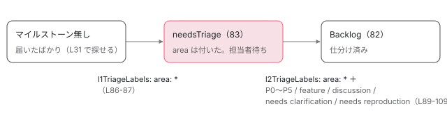

[目次](../README.md) › [コントリビュートの道](README.md) › 第 12 回 / 全 15 回

# issue の仕分け：ラベル・優先度・最初に手を付ける issue

> triage-and-labelling.md の area: ラベル（caretaker の初期仕分け）、P0〜P5 の優先度、needs clarification（設定の angular-robot.yml には needs reproduction も）、help wanted、good first issue の意味と、ロボットのマイルストーンで仕分けの 2 段が判定される仕組み。feature-request-consideration.md で機能要望が 20 票と期限で扱われる流れ。gh や GitHub の検索で自分に合う issue を探す方法と、手を付ける前に issue でひとこと伝える理由（重複・設計・同時に開く PR は 3 つまで）、最小の再現の作り方。

angular/angular · 読了 約 13 分 · 基礎 · [サイトで読む（デモが動きます）](https://angular-deep-dive-cyan.vercel.app/chapter/contrib-triage)

---

この章で分かること: Angular の issue に付くラベル（`area:`、`P0`〜`P5`、`needs clarification`、`help wanted`、`good first issue` など）が、誰によって、どの順で、何を意味して付くのか。機能要望が投票で扱われる流れ。そして自分が手を付ける issue を検索で探し、最小の再現を作り、手を付ける前にひとこと書くまでの手順です。

読む対象は `../angular` の `contributing-docs/triage-and-labelling.md`、`feature-request-consideration.md`、`saved-issue-replies.md`、`auto-issue-locking.md`、`spam.md`、`.github/angular-robot.yml`、`.github/workflows/dev-infra.yml` です。

1. [1. 全体像](01-contrib-overview.md)
2. [2. リポジトリの地図](02-contrib-repo-map.md)
3. [3. 手元の準備](03-contrib-setup.md)
4. [4. Bazel の読み方](04-contrib-bazel.md)
5. [5. テストを走らせる](05-contrib-run-tests.md)
6. [6. spec の読み方](06-contrib-reading-specs.md)
7. [7. テストを書く](07-contrib-writing-a-test.md)
8. [8. 公開 API と golden](08-contrib-public-api.md)
9. [9. コミットメッセージ](09-contrib-commit-messages.md)
10. [10. PR が通るまで](10-contrib-pr-flow.md)
11. [11. ブランチとリリース](11-contrib-branches.md)
12. 12. issue の仕分け
13. [13. コードの書き方](13-contrib-coding-standards.md)
14. [14. 手元で確かめる](14-contrib-debugging.md)
15. [15. 最初の PR](15-contrib-first-pr.md)

> [!TIP]
> **新卒エンジニアへ**
>
> **トリアージ**（triage）は、届いた issue を「どの分野か」「どれくらい急ぐか」「情報は足りているか」で仕分ける作業です。ラベルはその結果を issue に貼った札で、**読む側から見ると「この issue に自分が手を出してよいか」の情報**になります。PR に付くラベル（`action:`・`target:`）は [第 10 回](10-contrib-pr-flow.md)と [第 11 回](11-contrib-branches.md)で扱い、この章は issue の側だけを読みます。

## 1. 仕分けの基本: caretaker は area を付けるだけ

📄 `angular/contributing-docs/triage-and-labelling.md` L1–26 （▶ の行: 4–5, 12, 14, 18, 20–21）

```md
 1 │ # Triage Process and GitHub Labels for Angular
 2 │ 
 3 │ This document describes how the Angular team uses labels and milestones to triage issues on GitHub.
 4 ▶ The basic idea of the process is that caretaker only assigns a component (`area: *`) label.
 5 ▶ The owner of the component is then responsible for the detailed / component-level triage.
 6 │ 
 7 │ ## Label Types
 8 │ 
 9 │ ### Areas
10 │ 
11 │ The caretaker should be able to determine the _area_ for incoming issues.
12 ▶ Most areas generally correspond to a specific directory or set of directories in this repo. Some
13 │ areas are more cross-cutting (e.g. for performance or security). Apply all labels that make sense
14 ▶ for an issue. Each `area: ` label on GitHub should have a description of what it's for.
15 │ 
16 │ ### Community engagement
17 │ 
18 ▶ - `help wanted` - Indicates an issue whose complexity/scope makes it suitable for a community
19 │   contributor to pick up.
20 ▶ - `good first issue` - Indicates an issue that is suitable for first-time contributors.
21 ▶   (This label should be applied _in addition_ to `help wanted` for better discoverability.)
22 │ 
23 │ <sub>`help wanted` and `good first issue` are [default GitHub labels] familiar to many
24 │ developers.</sub>
25 │ 
26 │ [default GitHub labels]: https://docs.github.com/en/github/managing-your-work-on-github/managing-labels#about-default-labels
```

1. **4〜5 行目: 2 段構え**

   caretaker（週替わりの当番。[第 1 回](01-contrib-overview.md) 7 節）は `area: *` のラベルを付けるだけ。その先の細かい仕分けは、その area の担当者が行います。
2. **12 行目: area はほぼディレクトリに対応する**

   多くの area は、リポジトリの特定のディレクトリに対応します（[第 2 回](02-contrib-repo-map.md)の地図）。性能やセキュリティのように横断的な area もあります。14 行目、GitHub の各 `area:` ラベルには説明文が付いているはず、と書かれています。
3. **18〜21 行目: コミュニティ向けの 2 つのラベル**

   `help wanted` は「複雑さと範囲がコミュニティの人に向いている」issue。`good first issue` は「初めてのコントリビューターに向いている」issue で、21 行目のとおり**見つけやすいように `help wanted` と一緒に付ける**決まりです。

### area ラベルの実際の名前

手引きには area ラベルの一覧はありません。名前と説明がコードとして読める場所は、チームのツール `@angular/ng-dev` のラベル定義です。このリポジトリでは、`.github/actions/deploy-docs-site/` の Action が `@angular/ng-dev` を import していて（同じディレクトリの `lib/main.mts` と `BUILD.bazel` の deps）、esbuild で 1 ファイルに束ねた `main.js` の中にその定義がそのまま入っています。

📄 `angular/.github/actions/deploy-docs-site/main.js` L62224–62259 （▶ の行: 62226–62227, 62232–62233, 62238–62239, 62244, 62250, 62256）

```js
62224 │   DETECTED_HTTP_CHANGE: {
62225 │     description: "Issues related to HTTP and HTTP Client",
62226 ▶     name: "area: common/http",
62227 ▶     commitCheck: (c) => c.scope === "common/http" || c.scope === "http",
62228 │     repositories: [ManagedRepositories.ANGULAR]
62229 │   },
62230 │   DETECTED_COMPILER_CHANGE: {
62231 │     description: "Issues related to `ngc`, Angular's template compiler",
62232 ▶     name: "area: compiler",
62233 ▶     commitCheck: (c) => c.scope === "compiler" || c.scope === "compiler-cli",
62234 │     repositories: [ManagedRepositories.ANGULAR]
62235 │   },
62236 │   DETECTED_PLATFORM_BROWSER_CHANGE: {
62237 │     description: "Issues related to the framework runtime",
62238 ▶     name: "area: core",
62239 ▶     commitCheck: (c) => c.scope === "platform-browser" || c.scope === "core" || c.scope === "platform-browser-dynamic",
62240 │     repositories: [ManagedRepositories.ANGULAR]
62241 │   },
62242 │   DETECTED_PLATFORM_SERVER_CHANGE: {
62243 │     description: "Issues related to server-side rendering",
62244 ▶     name: "area: server",
62245 │     commitCheck: (c) => c.scope === "platform-server",
62246 │     repositories: [ManagedRepositories.ANGULAR]
62247 │   },
62248 │   DETECTED_ZONES_CHANGE: {
62249 │     description: "Issues related to zone.js",
62250 ▶     name: "area: zones",
62251 │     commitCheck: (c) => c.scope === "zone.js",
62252 │     repositories: [ManagedRepositories.ANGULAR]
62253 │   },
62254 │   DETECTED_LOCALIZE_CHANGE: {
62255 │     description: "Issues related to localization and internationalization",
62256 ▶     name: "area: i18n",
62257 │     commitCheck: (c) => c.scope === "localize",
62258 │     repositories: [ManagedRepositories.ANGULAR]
62259 │   }
```

名前（`name`）は 62226 行目 `area: common/http`、62232 行目 `area: compiler`、62238 行目 `area: core`、62244 行目 `area: server`、62250 行目 `area: zones`、62256 行目 `area: i18n` です。それぞれの `commitCheck` は**コミットを受け取って、その scope がこの area に当たるかを返す関数**です。例えば 62227 行目は scope が `common/http` か `http`、62239 行目は `platform-browser`・`core`・`platform-browser-dynamic` のどれかなら `area: core`。コミットの scope（[第 9 回](09-contrib-commit-messages.md)）と area ラベルが同じ言葉でつながっていることが分かります。

> [!WARNING]
> **ハマりどころ**
>
> この定義に無い area（例えば forms や router の area）があるかどうか、あればその正確な名前は、このリポジトリのファイルからは確かめられません。検索に使う前に [GitHub のラベル一覧](https://github.com/angular/angular/labels)で正確な名前を見てください。

## 2. 1 段目: caretaker の初期仕分けと、ロボットのマイルストーン

📄 `angular/contributing-docs/triage-and-labelling.md` L28–39 （▶ の行: 30–31, 33–34, 37, 39）

```md
28 │ ## Caretaker Triage Process (Initial Triage)
29 │ 
30 ▶ The caretaker assigns `area:  *` labels to new issues as they come in.
31 ▶ Untriaged issues can be found by selecting the issues with no milestone.
32 │ 
33 ▶ If an issue or PR obviously relates to a release regression, the caretaker must assign an
34 ▶ appropriate priority (`P0` or `P1`) and ensure that someone from the team is actively working to
35 │ resolve it.
36 │ 
37 ▶ Initial triage should occur daily so that issues can move into detailed triage.
38 │ 
39 ▶ Once the initial triage is done, the ng-bot automatically adds the milestone `needsTriage`.
```

30〜31 行目、caretaker は新しい issue に area を付けます。まだ仕分けていない issue は「マイルストーンが無い issue」で探せます。33〜34 行目、リリースでの回帰（regression。前の版では動いていたのに壊れたもの）なら、caretaker が `P0` か `P1` を付け、誰かが実際に取り組むようにします。37 行目、初期仕分けは毎日。39 行目、終わると ng-bot がマイルストーン `needsTriage` を付けます。その「終わった」の判定がロボットの設定にあります。

📄 `angular/.github/angular-robot.yml` L79–110 （▶ の行: 82, 84, 86–87, 89–91, 106, 108）

```yaml
 79 │ # options for the triage plugin
 80 │ triage:
 81 │   # number of the milestone to apply when the issue has not been triaged yet
 82 ▶   needsTriageMilestone: 83,
 83 │   # number of the milestone to apply when the issue is triaged
 84 ▶   defaultMilestone: 82,
 85 │   # arrays of labels that determine if an issue has been triaged by the caretaker
 86 ▶   l1TriageLabels:
 87 ▶     - - 'area: *'
 88 │   # arrays of labels that determine if an issue has been fully triaged
 89 ▶   l2TriageLabels:
 90 ▶     - - 'P0'
 91 ▶       - 'area: *'
 92 │     - - 'P1'
 93 │       - 'area: *'
 94 │     - - 'P2'
 95 │       - 'area: *'
 96 │     - - 'P3'
 97 │       - 'area: *'
 98 │     - - 'P4'
 99 │       - 'area: *'
100 │     - - 'P5'
101 │       - 'area: *'
102 │     - - 'feature'
103 │       - 'area: *'
104 │     - - 'discussion'
105 │       - 'area: *'
106 ▶     - - 'needs clarification'
107 │       - 'area: *'
108 ▶     - - 'needs reproduction'
109 │       - 'area: *'
110 │ 
```

1. **86〜87 行目: `area: *` が 1 つ付いたら「1 段目が済んだ」**

   そのとき 82 行目の番号 83 のマイルストーン（未仕分け = `needsTriage`）が付きます。
2. **89〜109 行目: 「area + もう 1 つ」の組で「2 段目が済んだ」**

   組の 2 つ目は `P0`〜`P5`、`feature`、`discussion`、`needs clarification`（106 行目）、`needs reproduction`（108 行目）のどれか。どれか 1 組がそろうと、84 行目の番号 82 のマイルストーン（`Backlog`）に移ります。



*issue のマイルストーンは、付いたラベルの組で進む（angular-robot.yml L82-109）。番号 83 と 82 はマイルストーンの番号。*

つまり **「`area:` はあるが `P` も `needs` も無い」issue は、まだ担当者が見ていない**ことになります。手を付けるかどうかを決める材料がまだそろっていない issue です。

### issue が開かれた瞬間に動く自動のラベル付け

📄 `angular/.github/workflows/dev-infra.yml` L26–37 （▶ の行: 30–31, 34, 37）

```yaml
26 │     steps:
27 │       - uses: angular/dev-infra/github-actions/post-approval-changes@183403ae13b785698eaf13c819dda55b9fed430b # main
28 │         with:
29 │           angular-robot-key: ${{ secrets.ANGULAR_ROBOT_PRIVATE_KEY }}
30 ▶   issue_labels:
31 ▶     if: github.event_name == 'issues'
32 │     runs-on: ubuntu-latest
33 │     steps:
34 ▶       - uses: angular/dev-infra/github-actions/labeling/issue@183403ae13b785698eaf13c819dda55b9fed430b # main
35 │         with:
36 │           angular-robot-key: ${{ secrets.ANGULAR_ROBOT_PRIVATE_KEY }}
37 ▶           google-generative-ai-key: ${{ secrets.GOOGLE_GENERATIVE_AI_KEY }}
```

31 行目、issue のイベント（同じファイルの `on: issues: types: [opened, reopened]`）のとき、34 行目の `angular/dev-infra` の `labeling/issue` Action が動きます。37 行目でその Action に Google の生成 AI の鍵を渡しています。Action の中身はこのリポジトリには無いので、何を判断しているかはここからは読めません。ただし、ラベルの定義の側に対応するものがあります。

📄 `angular/.github/actions/deploy-docs-site/main.js` L62342–62365 （▶ の行: 62346, 62350–62351, 62354–62355, 62362–62363）

```js
62342 │ var MiscLabel = class extends Label {
62343 │ };
62344 │ var miscLabels = createTypedObject(MiscLabel)({
62345 │   FEATURE: {
62346 ▶     name: "feature",
62347 │     description: "Label used to distinguish feature request from other issues"
62348 │   },
62349 │   GOOD_FIRST_ISSUE: {
62350 ▶     name: "good first issue",
62351 ▶     description: "Label noting a good first issue to be worked on by a community member"
62352 │   },
62353 │   HELP_WANTED: {
62354 ▶     name: "help wanted",
62355 ▶     description: "Label noting an issue which the team is looking for contribution from the community to fix"
62356 │   },
62357 │   RENOVATE_MANAGED: {
62358 │     name: "renovate managed",
62359 │     description: "Label noting that a pull request will automatically be managed and rebased by renovate"
62360 │   },
62361 │   GEMINI_TRIAGED: {
62362 ▶     name: "gemini-triaged",
62363 ▶     description: "Label noting that an issue has been triaged by gemini"
62364 │   }
62365 │ });
```

62362〜62363 行目、`gemini-triaged` は「gemini が仕分けた issue」を示すラベルです。同じ定義の 62350〜62351 行目が `good first issue`（コミュニティの人が取り組むのに良い最初の issue）、62354〜62355 行目が `help wanted`（チームがコミュニティからの修正を求めている issue）です。62346 行目の `feature` は、機能要望を他の issue と区別するラベルです（5 節）。

## 3. 2 段目: 担当者の詳しい仕分け

📄 `angular/contributing-docs/triage-and-labelling.md` L41–63 （▶ の行: 43, 47–49, 54, 56, 60）

```md
41 │ ## Detailed Triage
42 │ 
43 ▶ Detailed triage can be done by anyone familiar with the issue's area.
44 │ 
45 │ ### Step 1: Does the issue have enough information?
46 │ 
47 ▶ Gauge whether the issue has enough information to act upon. This typically includes a test case
48 ▶ via StackBlitz or GitHub and steps to reproduce. If the issue may be legitimate but needs more
49 ▶ information, add the "needs clarification" label. These labels can be revisited if the author can
50 │ provide further clarification. If the issue does have enough information, move on to step 2.
51 │ 
52 │ ### Step 2: Bug, feature, or discussion?
53 │ 
54 ▶ By default, all issues are considered bugs. Bug reports require only a priority label.
55 │ 
56 ▶ If the issue is a feature request, apply the "feature" label. Use your judgement to determine
57 │ whether the feature request is reasonable. If it's clear that the issue requests something
58 │ infeasible, close the issue with a comment explaining why.
59 │ 
60 ▶ If the issue is an RFC or discussion, apply the "discussion" label. Use your judgement to determine
61 │ whether this discussion belongs on GitHub. Discussions here should pertain to the technical
62 │ implementation details of Angular. Redirect requests for debugging help or advice to a more
63 │ appropriate channel unless they're capturing a legitimate bug.
```

1. **43 行目: 詳しい仕分けは、その area に詳しい人なら誰でもできる**

   チームの人に限りません。
2. **47〜49 行目、Step 1: 情報は足りているか**

   足りているとは、ふつう **StackBlitz か GitHub のテストケースと、再現の手順**があること（48 行目）。足りなければ `needs clarification` を付け、作者が補えば見直します（49 行目）。
3. **54 行目、Step 2: 既定ではすべてバグ**

   バグには優先度のラベルだけが要ります。
4. **56 行目: 機能要望なら `feature`、60 行目: RFC や議論なら `discussion`**

   実現できないと明らかな要望は、理由を書いて閉じます（57〜58 行目）。

## 4. 優先度 P0〜P5

📄 `angular/contributing-docs/triage-and-labelling.md` L65–78 （▶ の行: 71–76, 78）

```md
65 │ ### Step 3: Set a Priority
66 │ 
67 │ For bug reports, set a priority label.
68 │ 
69 │ | Label | Description                                                                                                                                                                                                                                          |
70 │ | ----- | ---------------------------------------------------------------------------------------------------------------------------------------------------------------------------------------------------------------------------------------------------- |
71 ▶ | P0    | An issue that causes a full outage, breakage, or major function unavailability for everyone, without any known workaround. The issue must be fixed immediately, taking precedence over all other work. Should receive updates at least once per day. |
72 ▶ | P1    | An issue that significantly impacts a large percentage of users; if there is a workaround it is partial or overly painful. The issue should be resolved before the next release.                                                                     |
73 ▶ | P2    | The issue is important to a large percentage of users, with a workaround. Issues that are significantly ugly or painful (especially first-use or install-time issues). Issues with workarounds that would otherwise be P0 or P1.                     |
74 ▶ | P3    | An issue that is relevant to core functions, but does not impede progress. Important, but not urgent.                                                                                                                                                |
75 ▶ | P4    | A relatively minor issue that is not relevant to core functions, or relates only to the attractiveness or pleasantness of use of the system. Good to have but not necessary changes/fixes.                                                           |
76 ▶ | P5    | The team acknowledges the request but (due to any number of reasons) does not plan to work on or accept contributions for this request. The issue remains open for discussion.                                                                       |
77 │ 
78 ▶ Issues marked with "feature" or "discussion" don't require a priority.
```

| ラベル | 行 | 要約 | 回避策 |
| --- | --- | --- | --- |
| `P0` | 71 | 全員にとって完全な停止・破損。他のすべての仕事より先に、ただちに直す。少なくとも 1 日 1 回は更新 | 無い |
| `P1` | 72 | 多くの利用者に大きく影響。次のリリースまでに解決 | あっても部分的か、ひどく面倒 |
| `P2` | 73 | 多くの利用者に重要。特に最初に使うときやインストール時の、ひどく醜い・痛い問題 | ある（無ければ P0・P1 だったもの） |
| `P3` | 74 | 中心機能に関係するが、作業は止まらない。重要だが急がない | — |
| `P4` | 75 | 中心機能に関係しない小さな問題、使い心地や見た目の問題 | — |
| `P5` | 76 | チームは認識しているが、取り組む予定も**コントリビューションを受け入れる予定も無い**。議論のために開いたまま | — |

78 行目、`feature` と `discussion` には優先度が要りません。コントリビューターにとって大事なのは 76 行目の `P5` です。**P5 の issue に PR を出しても受け入れない**、と明記されています。

📄 `angular/contributing-docs/triage-and-labelling.md` L80–91 （▶ の行: 84, 86–88, 90–91）

```md
80 │ ### Step 4: Apply additional information labels
81 │ 
82 │ Many optional labels provide additional context for issues. Consider adding any of the following if
83 │ they apply to the issue:
84 ▶ 
85 │ - Browser or operating system labels (`windows`, `browser: ie 11`, etc.)
86 ▶ - Labels that inform the severity (`regression`, `has workaround`, `no workaround`)
87 ▶ - Labels that categorize the bug (`performance`, `refactoring`, `memory leak`)
88 ▶ - Community engagement labels (`help wanted`, `good first issue`)
89 │ 
90 ▶ Once this triage is done, the ng-bot automatically changes the milestone from `needs triage` to
91 ▶ `Backlog`.
```

Step 4 では補足のラベルを足します。86 行目の `regression`・`has workaround`・`no workaround` は深刻さ、87 行目の `performance`・`memory leak` などは種類、88 行目が `help wanted`・`good first issue` です。90〜91 行目、ここまで済むとマイルストーンが `Backlog` に変わります（2 節のロボットの 84 行目）。

## 5. 機能要望: 20 票と期限

📄 `angular/contributing-docs/feature-request-consideration.md` L14–32 （▶ の行: 16–17, 19–20, 22, 24, 28–30）

```md
14 │ ## Voting phase
15 │ 
16 ▶ To include the community in the feature request process, we open voting for a fixed length of time.
17 ▶ Anyone can cast a vote for the request with a thumbs-up (👍) reaction on the original issue
18 │ description.
19 ▶ When a feature request reaches 20 or more upvotes, we formally consider the feature request.
20 ▶ Alternatively, the bot closes the request.
21 │ 
22 ▶ **For issues that are 60+ days old**: The voting phase is 20 days
23 │ 
24 ▶ **For new issues**: The voting phase is 60 days
25 │ 
26 │ ## Consideration phase
27 │ 
28 ▶ If the feature request receives 20 or more thumbs-up (👍) votes on the original issue description
29 ▶ (during the voting phase described above), we verify the Angular team can afford to maintain the
30 ▶ feature and whether it aligns with the long-term vision of Angular. If the answers to both of these
31 │ questions are yes, we prioritize the request, alternatively we close it with an explanation of our
32 │ decision.
```

1. **16〜17 行目: 決まった期間だけ投票を受け付ける**

   投票は、issue の最初の説明（description）への 👍 のリアクションです。コメントではありません。
2. **19〜20 行目: 20 票以上で正式に検討、届かなければボットが閉じる**
3. **22・24 行目: 期間は issue の古さで変わる**

   60 日以上前の issue は 20 日、新しい issue は 60 日。
4. **28〜30 行目: 検討の基準は 2 つ**

   チームがその機能を保守し続けられるか、Angular の長期の方向と合うか。両方 yes なら優先度を付け、そうでなければ説明を付けて閉じます。

📄 `angular/contributing-docs/feature-request-consideration.md` L34–47 （▶ の行: 40, 42, 45–47）

```md
34 │ ## Diagram
35 │ 
36 │ <p align="center" width="100%">
37 │   
38 │ </p>
39 │ 
40 ▶ ## What if I want to implement the feature to help the Angular team?
41 │ 
42 ▶ Often implementing the feature as a separate package is a better option. Building an external
43 │ package rather than including the functionality in Angular helps with:
44 │ 
45 ▶ - Keeping the framework's runtime smaller and simpler
46 ▶ - Makes the learning journey of developers getting started with Angular smoother
47 ▶ - Reduces maintainers' burden and the complexity of the source code
```

40 行目は、まさにコントリビューターの問い「その機能を自分で実装して助けたい」への答えです。42 行目、**多くの場合は別のパッケージとして作るほうが良い**。理由は 45〜47 行目、フレームワークを小さく保つ・学ぶ道を滑らかにする・保守の負担を減らす。[第 1 回](01-contrib-overview.md)で読んだ `CONTRIBUTING.md` の「help wanted の付いていない機能要望に PR を出さない」と合わせると、機能を足す PR は `feature` と `help wanted` の両方が付いた issue に限るのが筋です。

## 6. 決まった返信: どう閉じられるかを先に知る

📄 `angular/contributing-docs/saved-issue-replies.md` L27–48 （▶ の行: 27, 30, 32, 35, 38, 41, 44）

````md
27 ▶ ## Angular: Can't reproduce (v2)
28 │ 
29 │ ```
30 ▶ I'm sorry but we can't reproduce the problem you are reporting. We require that reported issues have a minimal reproduction that showcases the problem.
31 │ 
32 ▶ If the problem still exists in your application, please [open a new issue](https://github.com/angular/angular/issues/new/choose) and follow the instructions in the issue template that include info on how to create a reproduction using our template.
33 │ ```
34 │ 
35 ▶ ## Angular: Duplicate (v2)
36 │ 
37 │ ```
38 ▶ Thanks for reporting this issue. However this issue is a duplicate of an existing issue #ISSUE_NUMBER. Please subscribe to that issue for future updates.
39 │ ```
40 │ 
41 ▶ ## Angular: Insufficient Information Provided (v2)
42 │ 
43 │ ```
44 ▶ Thanks for reporting this issue. However, you didn't provide sufficient information for us to understand and reproduce the problem. Please check out [our submission guidelines](https://github.com/angular/angular/blob/main/CONTRIBUTING.md#submit-issue) to understand why we can't act on issues that are lacking important information.
45 │ 
46 │ If the problem still exists in your application, please [open a new issue](https://github.com/angular/angular/issues/new/choose) and follow the instructions in the issue template.
47 │ 
48 │ ```
````

チームが issue を閉じるときに使う定型文です。27〜32 行目の「Can't reproduce」は、最小の再現が無い issue に使います。30 行目で「報告される issue には問題を示す最小の再現を求める」と言い、32 行目で「テンプレートの再現の作り方に従って新しい issue を開いて」と案内します。35〜38 行目の「Duplicate」は重複。41〜44 行目の「Insufficient Information」は情報不足で、`CONTRIBUTING.md` の Submitting an Issue の段に誘導します。逆に言えば、**この 3 つの返信を受けない issue を書く**のが報告する側の目標です。

## 7. 最小の再現の作り方

3 節の 48 行目にある「StackBlitz か GitHub のテストケース」を作る手順です。StackBlitz はブラウザの中で動く開発環境で、リンク 1 つで他の人が同じアプリを動かせます。

1. **まっさらなアプリを作る**

   自分のアプリの中で再現するだけでは「自分のアプリのせい」と区別できません。新しい workspace から始めます。`--minimal` はテストの仕組みを入れない workspace を作る `ng new` のオプション（angular-cli の `packages/schematics/angular/ng-new/schema.json` の `minimal`）、`--defaults` は既定値のある質問を聞かずに進めるオプション（同じく `packages/angular/cli/src/command-builder/schematics-command-module.ts` の `defaults`）です。回帰（前の版では動いた）を報告するなら、`@latest` を動いていた版の番号に変えて、もう 1 つ作って比べます。

   📄 `ターミナル（作業用のディレクトリで）`

   ```
   npx -y @angular/cli@latest new ng-repro --minimal --defaults
   cd ng-repro
   npx ng version   # issue の「environment」欄に貼る
   npx ng serve     # http://localhost:4200 で問題が起きるか確かめる
   ```
2. **問題が起きるのに必要な部分だけを写す**

   コンポーネントは 1〜2 個、外部のライブラリは使わない、サーバへの通信は固定の値に置き換える。写したら一度動かして、**問題がまだ起きるか**を確かめます。起きなくなったら、最後に消したものが原因の候補です。
3. **版を確かめる**

   バグ報告のテンプレートは `ng version` の出力を求めます（[第 1 回](01-contrib-overview.md) 2 節）。最新の版でも起きるかを確かめると、6 節の「Already Fixed」や「Obsolete」で閉じられるのを防げます。
4. **公開する**

   GitHub に公開リポジトリとして push するか、StackBlitz に同じファイルを置きます。issue には、そのリンクと、「何をすると」「何が起き」「何を期待したか」を書きます。

## 8. 手を付ける前に、issue にひとこと

良さそうな issue を見つけたら、コードを書き始める前に issue にコメントします。理由は 3 つあり、どれも文書の行で言えます。

1. **重複を防ぐ**

   `CONTRIBUTING.md` の Contribution Quality の 1 番は「既存の努力を重複させない」ために関係する PR を探すことでした（[第 1 回](01-contrib-overview.md) 3 節）。PR になる前の「いま取り組んでいる」は検索に出ないので、コメントで知らせます。
2. **設計の確認を先に済ませる**

   同じく 3 番は「PR は設計をする場所ではない」。直し方に選択肢があるなら、コメントで方針を書いて反応を待ちます。
3. **出しすぎない**

   次の方針があるので、手を広げる前に相談します。

📄 `angular/contributing-docs/spam.md` L1–11 （▶ の行: 3–5, 7–8, 11）

```md
 1 │ # Spam Policy
 2 │ 
 3 ▶ Users who create excessive amounts of issues or PRs in a short time frame,
 4 ▶ particularly low-quality or low-value contributions, may see those contributions
 5 ▶ automatically closed without consideration.
 6 │ 
 7 ▶ Community contributors should limit themselves to no more than 3 open PRs at a
 8 ▶ single time. If you have more than 3 open PRs, we ask that you wait until some of those
 9 │ PRs are merged or closed before opening more.
10 │ 
11 ▶ Draft pull requests are considered acceptable beyond the limit if 3, but within a reasonable limit (~10 or more within a short time frame). Beyond that reasonable limit, the team may still consider it spam and close them without consideration.
```

7〜8 行目、**コミュニティのコントリビューターが同時に開いてよい PR は 3 つまで**。11 行目、draft の PR はそれより多くてもよいが、短い期間に 10 前後を超えればスパムとみなされることがあります。3〜5 行目、短い期間に大量の issue や PR を出すと、内容を見ずに自動で閉じられることがあります。

> [!NOTE]
> **ポイント**
>
> コメントの下書きの例（出すかどうかは自分で決める）: 「この問題を直したいと考えています。原因は `packages/router/src/apply_redirects.ts` の〜で、〜のように直す方針です。進めてよければ PR を出します。」ファイルの場所の当たりの付け方は [第 2 回](02-contrib-repo-map.md)の DEMO を使ってください。

## 9. 閉じて古くなった issue はロックされる

📄 `angular/contributing-docs/auto-issue-locking.md` L1–19 （▶ の行: 5, 9, 11–12, 16–18）

```md
 1 │ <a name="conversation-locking"></a>
 2 │ 
 3 │ # Automatic conversation locking
 4 │ 
 5 ▶ Closed issues and pull requests are locked automatically after 30 days of inactivity.
 6 │ 
 7 │ ## I want to comment on a locked conversation, what should I do?
 8 │ 
 9 ▶ When an issue has been closed and inactive for over 30 days, the original context is likely
10 │ outdated.
11 ▶ If you encounter a similar or related issue in the current version, please open a new issue and
12 ▶ provide up-to-date reproduction instructions.
13 │ 
14 │ ## Why lock conversations?
15 │ 
16 ▶ Automatically locking closed, inactive issues guides people towards filing new issues with updated
17 ▶ context rather than commenting on a "resolved" issue that contains out-of-date or unrelated
18 ▶ information. As an example, someone may comment "I'm still having this issue", but without
19 │ providing any of the additional information the team needs to investigate.
```

5 行目、閉じた issue と PR は、30 日動きが無いと自動でロックされます（コメントできなくなります）。11〜12 行目、似た問題に出会ったら、新しい issue を開いて**最新の再現の手順**を書く。16〜18 行目が理由で、「まだ起きる」とだけ書かれた古い issue のコメントには、調べるのに要る情報が無いからです。

## 10. 自分に合う issue を探す

> **🧪 DEMO — GitHub の issue 検索 URL と gh コマンドを組み立てる**
>
> チェックした条件から、GitHub の issue 検索の URL と `gh issue list` のコマンドを組み立てます。この画面からは通信しません。URL を開くと GitHub の検索結果が新しいタブで開きます。area のチェックは「どれか 1 つが付いている」（`label:a,b` の OR）、ほかの条件は全部を満たすもの（AND）です。
>
> P5 は選べないようにしてあります（4 節の 76 行目。コントリビューションを受け入れる予定が無い）。結果が少なすぎるときは、まず good first issue を外して help wanted だけにしてみてください。
>
> ▶ [このデモはサイトで動かせます](https://angular-deep-dive-cyan.vercel.app/chapter/contrib-triage)

## 全体の流れ（issue が届いてから、あなたが手を付けるまで）

- `issue opened` — dev-infra.yml L31, L34 — *自動のラベル付け（gemini-triaged）*
  - `caretaker が area: * を付ける` — triage-and-labelling.md L30 — *回帰なら P0 / P1（L33-34）*
    - `milestone: needsTriage` — angular-robot.yml L82, L86-87
  - `area の担当者: 情報は足りるか → needs clarification` — triage-and-labelling.md L47-49
  - `bug なら P0〜P5 / feature / discussion` — L54-60, L71-76
    - `milestone: Backlog` — angular-robot.yml L84, L89-109
  - `help wanted / good first issue` — L88
- 👤 `検索 → 最小の再現で確かめる → issue にひとこと` — この章 7〜10 節
- 👤 `ブランチを切って直す` — 第 3〜9 回

## 聞かれそうな質問

**Q. good first issue がほとんど無いときはどうする？**

手引きの決まりでは `good first issue` は `help wanted` に*追加で*付けるもの（`triage-and-labelling.md` 21 行目）なので、まず `help wanted` だけで探します（18〜19 行目「複雑さと範囲がコミュニティ向き」）。次に、読んだことのある area（このサイトで内部を読んだ分野）に絞り、`needs clarification` の付いた issue で**最小の再現を作って補う**のも貢献です。3 節の 49 行目のとおり、作者が情報を補えば見直されます。

**Q. 何年も前の open の issue を直してもいい？**

open のままで `P5` でなければ、直して構いません。ただし 2 つ確かめます。1 つは、**いまの main でもまだ起きるか**。`saved-issue-replies.md` には「Already Fixed」「Obsolete」の返信があり、古い issue はこれで閉じられることがあります。7 節の手順で最新版の最小の再現を作り、issue にコメントで添えてから取りかかります。もう 1 つは、`P5`（`triage-and-labelling.md` 76 行目「コントリビューションを受け入れる予定が無い」）でないこと。閉じた issue は 30 日でロックされるので（`auto-issue-locking.md` 5 行目）、閉じた古い issue を見つけたら新しい issue を開きます。

**Q. P2 と P3 は何が違う？**

`triage-and-labelling.md` 73〜74 行目です。`P2` は「多くの利用者にとって重要で、回避策がある」。回避策が無ければ P0 か P1 だったもの、と書かれています。`P3` は「中心機能に関係するが、作業を止めない。重要だが急がない」。つまり P2 は**影響の広さ**が基準で、回避策があるから下がっているもの。P3 は影響が小さく急がないもの。回避策の有無は補足のラベル `has workaround` / `no workaround`（86 行目）にも表れます。

**Q. `needs clarification` と `needs reproduction` は何が違う？**

手引きに出てくるのは `needs clarification` だけで、49 行目「正当かもしれないが情報が足りない」ときに付けます。`needs reproduction` は `angular-robot.yml` 108 行目に、2 段目の仕分けが済んだとみなす組（`area: *` と組で）として出てきます。どちらも付けばマイルストーンは Backlog に移りますが、「作者の返事待ち」の状態です。その issue を直したいなら、まず再現を作って補うのが先です。

**Q. 機能要望の issue に 👍 を付けるのは意味がある？**

あります。`feature-request-consideration.md` 17〜19 行目のとおり、最初の説明への 👍 が投票で、20 票以上で正式に検討されます。期間は新しい issue で 60 日、60 日以上前の issue で 20 日（22・24 行目）。届かなければボットが閉じます（20 行目）。票として数えられるのは最初の説明への 👍 で、コメントの「+1」ではありません。

## 読み終えて

- 仕分けは 2 段。caretaker が `area:` を付け（1 段目）、担当者が優先度か `feature` / `discussion` / `needs …` を付ける（2 段目）。その判定は `angular-robot.yml` の l1 / l2 の組。
- area ラベルの名前はコミットの scope と対応している（ng-dev の `commitCheck`）。
- 手を出してよい目印は `help wanted`（と `good first issue`）。`P5` は受け入れない。機能要望は 20 票と期限で決まる。
- 最小の再現は「まっさらなアプリ + 必要な部分だけ + 最新版で確認 + 公開リンク」。
- 書き始める前に issue でひとこと。同時に開く PR は 3 つまで。

---

← 前: [ブランチとリリース：main・パッチのブランチ・target ラベル](11-contrib-branches.md)  
次: [コードの書き方：coding-standards と format・lint](13-contrib-coding-standards.md) →
