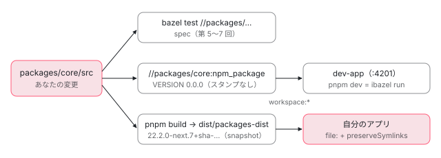

[目次](../README.md) › [コントリビュートの道](README.md) › 第 14 回 / 全 15 回

# 手元で確かめる：dev-app・ローカルのビルドを自分のアプリで使う

> debugging-tips.md のコンソールの ng と、window.ng が開発モードでだけ作られる仕組み、dev-app（workspace:\* と ibazel）で変更をすぐに試す方法、pnpm build で dist/packages-dist に作ったパッケージを自分のアプリ（例えばこのサイト）に file: で入れて確かめる手順と戻し方、VERSION.full のスタンプで入ったことを確かめる方法、ソースマップの vendor 設定とブレークポイント、コンパイラの出力を見る方法。

angular/angular · 読了 約 13 分 · 発展 · [サイトで読む（デモが動きます）](https://angular-deep-dive-cyan.vercel.app/chapter/contrib-debugging)

---

テストが通っても、「本物のアプリで本当に直ったか」は別に確かめたくなります。この章では、ブラウザのコンソールで使える開発用の道具（`window.ng`）がどこで作られるか、リポジトリの中の dev-app で変更をすぐに試す仕組み、`pnpm build` で `dist/packages-dist` に作ったパッケージを 自分のアプリ（このサイト）に入れて確かめる手順と戻し方、ソースマップでフレームワークの TypeScript にブレークポイントを置く設定を読みます。テストの実行そのもののデバッグ（`fit`・`debugger`）は[第 5 回](05-contrib-run-tests.md)です。

読む対象は `contributing-docs/debugging-tips.md`・`building-and-testing-angular.md`、`dev-app/`、`scripts/build/build-packages-dist.mts`・`package-builder.mts`、`.ng-dev/release.mjs`、`tools/bazel/npm_packages.bzl`、`packages/core/src` の `version.ts`・`render3/util/global_utils.ts`、ng-dev の本体（`node_modules/@angular/ng-dev/bundles/cli.mjs`）、angular-cli リポジトリの application ビルダーの 2 ファイルです。

1. [1. 全体像](01-contrib-overview.md)
2. [2. リポジトリの地図](02-contrib-repo-map.md)
3. [3. 手元の準備](03-contrib-setup.md)
4. [4. Bazel の読み方](04-contrib-bazel.md)
5. [5. テストを走らせる](05-contrib-run-tests.md)
6. [6. spec の読み方](06-contrib-reading-specs.md)
7. [7. テストを書く](07-contrib-writing-a-test.md)
8. [8. 公開 API と golden](08-contrib-public-api.md)
9. [9. コミットメッセージ](09-contrib-commit-messages.md)
10. [10. PR が通るまで](10-contrib-pr-flow.md)
11. [11. ブランチとリリース](11-contrib-branches.md)
12. [12. issue の仕分け](12-contrib-triage.md)
13. [13. コードの書き方](13-contrib-coding-standards.md)
14. **14. 手元で確かめる**（この章）
15. [15. 最初の PR](15-contrib-first-pr.md)

## 0. 確かめ方は 3 つ

| やり方 | 使う @angular/\* はどこから | 向いている確かめ |
| --- | --- | --- |
| spec を足す（第 6〜7 回） | ソースそのもの（Bazel がコンパイル） | 関数 1 つの振る舞い。PR に必ず入れる |
| dev-app（3 節） | リポジトリの中で作ったパッケージ。保存のたびに作り直す | 画面で動かして試す。設定の少ない小さな再現 |
| 自分のアプリに入れる（4〜6 節） | `pnpm build` の `dist/packages-dist` | issue の報告者のアプリ、SSR、Angular CLI の設定込みの再現 |



*同じ packages/ のソースから、3 つの道で確かめる。spec は Bazel がソースを直接コンパイル、dev-app は //packages/core:npm\_package（版 0.0.0）を ibazel が作り直し、自分のアプリには pnpm build の dist/packages-dist（版 +sha-…）を file: で入れる。*

## 1. debugging-tips.md：コンソールの ng

📄 `angular/contributing-docs/debugging-tips.md` L17–49 （▶ の行: 25, 29, 31–32, 36, 43, 48）

````md
17 │ ## Angular debug tools in the dev console
18 │ 
19 │ Angular provides a set of debug tools that are accessible from any browser's
20 │ developer console. In Chrome the dev console can be accessed by pressing
21 │ Ctrl + Shift + j.
22 │ 
23 │ ### Enabling debug tools
24 │ 
25 ▶ By default, the debug tools are disabled. You can enable debug tools as follows:
26 │ 
27 │ ```typescript
28 │ import {ApplicationRef} from '@angular/core';
29 ▶ import {platformBrowser, enableDebugTools} from '@angular/platform-browser';
30 │ 
31 ▶ platformBrowser()
32 ▶   .bootstrapModule(AppModule)
33 │   .then((moduleRef) => {
34 │     const applicationRef = moduleRef.injector.get(ApplicationRef);
35 │     const appComponent = applicationRef.components[0];
36 ▶     enableDebugTools(appComponent);
37 │   });
38 │ ```
39 │ 
40 │ ### Using debug tools
41 │ 
42 │ In the browser open the developer console (Ctrl + Shift + j in Chrome). The
43 ▶ top level object is called `ng` and contains more specific tools inside it.
44 │ 
45 │ Example:
46 │ 
47 │ ```javascript
48 ▶ ng.profiler.timeChangeDetection();
49 │ ```
````

25 行目「既定では無効」、29〜37 行目で `enableDebugTools` を呼ぶと、43 行目の `ng` の下に 48 行目の `ng.profiler` が増えます。この例は 31〜32 行目のとおり `platformBrowser().bootstrapModule(AppModule)` で書かれていて、今の `bootstrapApplication` のアプリでは、`then` で受け取る `ApplicationRef` の `components[0]` を渡すことになります。手引きが古いまま残っている箇所は、それ自体が小さな docs の PR の題材です（[第 15 回](15-contrib-first-pr.md)）。

ただし、`ng.getComponent` のような道具は `enableDebugTools` を呼ばなくても、開発モードなら最初から `window.ng` にあります。次の節で、どこで入るのかを見ます。

## 2. window.ng は開発モードでだけ作られる

📄 `angular/packages/core/src/platform/platform.ts` L167–180 （▶ の行: 172, 175, 177）

```ts
167 │ /**
168 │  * The goal of this function is to bootstrap a platform injector,
169 │  * but avoid referencing `PlatformRef` class.
170 │  * This function is needed for bootstrapping a Standalone Component.
171 │  */
172 ▶ export function createOrReusePlatformInjector(providers: StaticProvider[] = []): Injector {
173 │   // If a platform injector already exists, it means that the platform
174 │   // is already bootstrapped and no additional actions are required.
175 ▶   if (_platformInjector) return _platformInjector;
176 │ 
177 ▶   publishDefaultGlobalUtils();
178 │   if (typeof ngDevMode !== 'undefined' && ngDevMode) {
179 │     _unregisterAiTools = registerAiTools();
180 │   }
```

📄 `angular/packages/core/src/application/application_ref.ts` L62–68 （▶ の行: 66–67）

```ts
62 │ export const APP_BOOTSTRAP_LISTENER = new InjectionToken<
63 │   ReadonlyArray<(compRef: ComponentRef<any>) => void>
64 │ >(ngDevMode ? 'appBootstrapListener' : '');
65 │ 
66 ▶ export function publishDefaultGlobalUtils() {
67 ▶   ngDevMode && _publishDefaultGlobalUtils();
68 │ }
```

`bootstrapApplication` はプラットフォームの注入器を `createOrReusePlatformInjector`（172 行目）で作り、その最初の 1 回（175 行目で 2 回目以降は戻る）で 177 行目の `publishDefaultGlobalUtils()` を呼びます。その中身が `application_ref.ts` 67 行目の `ngDevMode && …` です。（`bootstrapApplication` から `createOrReusePlatformInjector` を呼ぶのは `create_application.ts` の `internalCreateApplication`。[起動の回の注入器の章](../boot/08-boot-injectors.md)。）

📄 `angular-cli/packages/angular/build/src/tools/esbuild/application-code-bundle.ts` L658–668 （▶ の行: 659, 661–662, 664）

```ts
658 │     preserveSymlinks,
659 ▶     define: {
660 │       ...options.define,
661 ▶       // Only set to false when script optimizations are enabled. It should not be set to true because
662 ▶       // Angular turns `ngDevMode` into an object for development debugging purposes when not defined
663 │       // which a constant true value would break.
664 ▶       ...(optimizationOptions.scripts ? { 'ngDevMode': 'false' } : undefined),
665 │       'ngJitMode': jit ? 'true' : 'false',
666 │       'ngServerMode': 'false',
667 │       'ngHmrMode': options.templateUpdates ? 'true' : 'false',
668 │     },
```

`ngDevMode` を決めるのは Angular CLI です。664 行目、スクリプトの最適化が有効なとき（production の既定）だけ、esbuild の `define` で `ngDevMode` を `false` という定数に置き換えます。すると 67 行目は `false && …` になり、呼び出しごと消えます。661〜663 行目のコメントのとおり、最適化しないとき（development）は何も置き換えず、Angular が実行時に `ngDevMode` を開発用の object にします。

📄 `angular/packages/core/src/render3/util/global_utils.ts` L173–197 （▶ の行: 180–181, 189–190）

```ts
173 │ let _published = false;
174 │ /**
175 │  * Publishes a collection of default debug tools onto`window.ng`.
176 │  *
177 │  * These functions are available globally when Angular is in development
178 │  * mode and are automatically stripped away from prod mode is on.
179 │  */
180 ▶ export function publishDefaultGlobalUtils() {
181 ▶   if (!_published) {
182 │     _published = true;
183 │ 
184 │     if (typeof window !== 'undefined') {
185 │       // Only configure the injector profiler when running in the browser.
186 │       setupFrameworkInjectorProfiler();
187 │     }
188 │ 
189 ▶     for (const [methodName, method] of Object.entries(externalCoreGlobalUtils)) {
190 ▶       publishGlobalUtil(methodName as keyof ExternalCoreGlobalUtils, method);
191 │     }
192 │ 
193 │     for (const [methodName, method] of Object.entries(internalCoreGlobalUtils)) {
194 │       publishGlobalUtil(methodName as keyof InternalCoreGlobalUtils, method);
195 │     }
196 │   }
197 │ }
```

📄 `angular/packages/core/src/render3/util/global_utils.ts` L230–242 （▶ の行: 236, 239–240）

```ts
230 │ function publishUtil(name: string, fn: Function) {
231 │   if (typeof COMPILED === 'undefined' || !COMPILED) {
232 │     // Note: we can't export `ng` when using closure enhanced optimization as:
233 │     // - closure declares globals itself for minified names, which sometimes clobber our `ng` global
234 │     // - we can't declare a closure extern as the namespace `ng` is already used within Google
235 │     //   for typings for AngularJS (via `goog.provide('ng....')`).
236 ▶     const w = global;
237 │     ngDevMode && assertDefined(fn, 'function not defined');
238 │ 
239 ▶     w[GLOBAL_PUBLISH_EXPANDO_KEY] ??= {} as any;
240 ▶     w[GLOBAL_PUBLISH_EXPANDO_KEY][name] = fn;
241 │   }
242 │ }
```

189〜191 行目で `getComponent`・`getContext`・`getInjector`・`applyChanges` などを 1 つずつ公開し、239〜240 行目で `window.ng`（`GLOBAL_PUBLISH_EXPANDO_KEY` は `'ng'`）に入れます。つまり **`typeof ng` が `'object'` なら開発モードのビルド**です。下のデモで、このページを動かしている Angular で確かめます。

> **🧪 DEMO — このページを動かしている Angular**
>
> `@angular/core` から `VERSION` と `isDevMode` を import し、描画のあとで `globalThis.ng` を読んでいます。公開しているこのサイトは production のビルドなので `ng` は無く、手元で `ng serve` すると `object` になります。4 節の手順でローカルのビルドに替えると、1 行目が `22.2.0-next.7+sha-8576f16…` の形に変わります。
>
> ▶ [このデモはサイトで動かせます](https://angular-deep-dive-cyan.vercel.app/chapter/contrib-debugging)

## 3. dev-app：リポジトリの中の試し場

📄 `angular/dev-app/README.md` L5–22 （▶ の行: 17, 20–21）

````md
 5 │ ## Local Development
 6 │ 
 7 │ For local development, [pnpm](https://pnpm.io/) is the preferred package manager. You can set up a local environment with the following commands:
 8 │ 
 9 │ ```bash
10 │ # Clone Angular repo
11 │ git clone https://github.com/angular/angular.git
12 │ 
13 │ # Navigate to project directory
14 │ cd angular
15 │ 
16 │ # Install dependencies
17 ▶ pnpm install
18 │ 
19 │ # Build and run local dev server
20 ▶ # NOTE: Initial build will take some time
21 ▶ pnpm dev
22 │ ```
````

21 行目の `pnpm dev` は、ルートの package.json で `pnpm --filter=dev-app dev` になり、dev-app の package.json の `dev` を走らせます。

📄 `angular/dev-app/package.json` L1–21 （▶ の行: 5, 10, 12, 18）

```json
 1 │ {
 2 │   "name": "dev-app",
 3 │   "private": true,
 4 │   "scripts": {
 5 ▶     "dev": "ibazel run //dev-app:build.serve",
 6 │     "dev:prod": "ibazel run //dev-app:build.production.serve",
 7 │     "dev:build": "bazel build //dev-app:build"
 8 │   },
 9 │   "dependencies": {
10 ▶     "@angular/common": "workspace:*",
11 │     "@angular/compiler": "workspace:*",
12 ▶     "@angular/core": "workspace:*",
13 │     "@angular/forms": "workspace:*",
14 │     "@angular/platform-browser": "workspace:*",
15 │     "@angular/platform-server": "workspace:*",
16 │     "@angular/localize": "workspace:*",
17 │     "@angular/router": "workspace:*",
18 ▶     "@angular/ssr": "22.2.0-next.6",
19 │     "rxjs": "~7.8.0",
20 │     "tslib": "^2.3.0"
21 │   },
```

1. **5 行目：ibazel run //dev-app:build.serve**

   ibazel はファイルの保存を見張って Bazel を走らせ直す道具です。ソースを保存するたびに、パッケージを作り直して開発サーバーに反映します。
2. **10〜17 行目：@angular/\* は workspace:\***

   npm から取らず、pnpm のワークスペース（同じリポジトリの `packages/core` など）を使う指定です。18 行目の `@angular/ssr` は別のリポジトリ（angular-cli）のものなので、npm の版が書かれています。

Bazel の中で、その `@angular/core` が何から作られるかを query で見ると、こうなりました。

📄 `ターミナル（../angular で実行。2026-10-31）`

```
$ npx -y pnpm@12.3.4 bazel query 'deps(//dev-app:node_modules/@angular/core, 2)' 2>/dev/null | grep -v '^@'
//:.aspect_rules_js/node_modules/@angular+compiler@0.0.0
//:.aspect_rules_js/node_modules/@angular+core@0.0.0
//:.aspect_rules_js/node_modules/rxjs@7.8.2
//:.aspect_rules_js/node_modules/tslib@2.8.1
//:.aspect_rules_js/node_modules/zone.js@0.16.2
//dev-app:node_modules/@angular/core
//packages/core:pkg

$ npx -y pnpm@12.3.4 bazel query 'labels(actual, //packages/core:pkg)' 2>/dev/null
//packages/core:npm_package
```

dev-app の `node_modules/@angular/core` は `//packages/core:pkg` に依存し、その実体は `//packages/core:npm_package`、つまり `packages/core` のソースから作る npm パッケージです。版が `0.0.0` になっている理由は 5 節で分かります。

📄 `angular/dev-app/BUILD.bazel` L31–54 （▶ の行: 33–34, 38, 46–48）

```python
31 │ ng_config(name = "ng_config")
32 │ 
33 ▶ ng_application(
34 ▶     name = "build",
35 │     srcs = APPLICATION_FILES + APPLICATION_DEPS,
36 │     args = [
37 │         "--configuration",
38 ▶         "development",
39 │     ],
40 │     env = {
41 │         "NG_BUILD_PARTIAL_SSR": "1",
42 │     },
43 │     ng_config = ":ng_config",
44 │     node_modules = ":node_modules",
45 │     project_name = "dev-app",
46 ▶     serve_args = [
47 ▶         "--port",
48 ▶         "4201",
49 │     ],
50 │     tags = [
51 │         # Tagged as manual as both build and build.production use the same output directory.
52 │         "manual",
53 │     ],
54 │ )
```

33〜34 行目の `ng_application` は Angular CLI の application ビルダーを Bazel から呼ぶ規則で、38 行目のとおり `development` の設定で作ります。46〜49 行目で開発サーバーは 4201 番ポートです（`pnpm dev` のあと `http://localhost:4201`）。dev-app の `src/` に再現したいコンポーネントを書き、`packages/` のソースを直して保存すると、画面に反映されます。dev-app の変更は試すためのものなので、PR には入れません。

## 4. 自分のアプリで確かめる：pnpm build と dist/packages-dist

📄 `angular/contributing-docs/building-and-testing-angular.md` L107–116 （▶ の行: 112, 115）

````md
107 │ ## Building
108 │ 
109 │ To build Angular run:
110 │ 
111 │ ```shell
112 ▶ pnpm build
113 │ ```
114 │ 
115 ▶ - Results are put in the `dist/packages-dist` folder.
116 │ 
````

📄 `angular/scripts/build/build-packages-dist.mts` L11–24 （▶ の行: 12, 15–16, 20, 24）

```ts
11 │ import {buildAngularInMemoryWebApiPackage} from './angular-in-memory-web-api.mts';
12 ▶ import {performDefaultSnapshotBuild} from './package-builder.mts';
13 │ import {buildZoneJsPackage} from './zone-js-builder.mts';
14 │ 
15 ▶ // Build the legacy (view engine) npm packages into `dist/packages-dist/`.
16 ▶ performDefaultSnapshotBuild();
17 │ 
18 │ // Build the `angular-in-memory-web-api` npm package into `dist/angular-in-memory-web-api-dist/`,
19 │ // because it might be needed by other scripts/targets.
20 ▶ buildAngularInMemoryWebApiPackage('dist/angular-in-memory-web-api-dist');
21 │ 
22 │ // Build the `zone.js` npm package into `dist/zone.js-dist/`, because it might be needed by other
23 │ // scripts/tests.
24 ▶ buildZoneJsPackage('dist/zone.js-dist');
```

112 行目の `pnpm build` は、ルートの package.json の `"build": "node scripts/build/build-packages-dist.mts"` です。16 行目の `performDefaultSnapshotBuild()` が本体で、20・24 行目でついでに in-memory-web-api と zone.js も作ります。

📄 `angular/scripts/build/package-builder.mts` L18–43 （▶ の行: 19, 22, 25–27, 30, 41–42）

```ts
18 │ /** Command that runs Bazel. */
19 ▶ export const bazelCmd = process.env.BAZEL || `pnpm --silent bazel`;
20 │ 
21 │ /** Name of the Bazel tag that will be used to find release package targets. */
22 ▶ const releaseTargetTag = 'release-with-framework';
23 │ 
24 │ /** Command that queries Bazel for all release package targets. */
25 ▶ const queryPackagesCmd =
26 ▶   `${bazelCmd} query --output=label "filter(':npm_package$', ` +
27 ▶   `attr('tags', '\\[.*${releaseTargetTag}.*\\]', //packages/... + //vscode-ng-language-service/...))"`;
28 │ 
29 │ /** Path for the default distribution output directory. */
30 ▶ const defaultDistPath = join(projectDir, 'dist/packages-dist');
31 │ 
32 │ /** Builds the release packages for NPM. */
33 │ export function performNpmReleaseBuild(): BuiltPackage[] {
34 │   return buildReleasePackages(defaultDistPath, /* isSnapshotBuild */ false);
35 │ }
36 │ 
37 │ /**
38 │  * Builds the release packages as snapshot build. This means that the current
39 │  * Git HEAD SHA is included in the version (for easier debugging and back tracing).
40 │  */
41 ▶ export function performDefaultSnapshotBuild(): BuiltPackage[] {
42 ▶   return buildReleasePackages(defaultDistPath, /* isSnapshotBuild */ true);
43 │ }
```

📄 `angular/scripts/build/package-builder.mts` L72–102 （▶ の行: 75, 88, 92–93, 100）

```ts
 72 │   // Build with "--config=release" or `--config=snapshot-build` so that Bazel
 73 │   // runs the workspace stamping script. The stamping script ensures that the
 74 │   // version placeholder is populated in the release output.
 75 ▶   const stampConfigArg = `--config=${isSnapshotBuild ? 'snapshot-build' : 'release'}`;
 76 │ 
 77 │   // Walk through each release package and clear previous "npm_package" outputs. This is
 78 │   // a workaround for: https://github.com/bazelbuild/rules_nodejs/issues/1219. We need to
 79 │   // do this to ensure that the version placeholders are properly populated.
 80 │   packageNames.forEach((pkgName) => {
 81 │     const outputPath = getBazelOutputPath(pkgName);
 82 │     if (existsSync(outputPath) && lstatSync(outputPath).isDirectory()) {
 83 │       exec(`chmod -R u+w ${outputPath}`);
 84 │       exec(`rm -rf ${outputPath}`);
 85 │     }
 86 │   });
 87 │ 
 88 ▶   exec(`${bazelCmd} build ${stampConfigArg} ${targets.join(' ')}`);
 89 │ 
 90 │   // Delete the distribution directory so that the output is guaranteed to be clean. Re-create
 91 │   // the empty directory so that we can copy the release packages into it later.
 92 ▶   exec(`rm -rf ${distPath}`);
 93 ▶   exec(`mkdir -p ${distPath}`);
 94 │ 
 95 │   // Copy the package output into the specified distribution folder.
 96 │   packageNames.forEach((pkgName) => {
 97 │     const outputPath = getBazelOutputPath(pkgName);
 98 │     const targetFolder = getDistPath(pkgName);
 99 │     console.info(`> Copying package output to "${targetFolder}"`);
100 ▶     exec(`cp -R ${outputPath} ${targetFolder}`);
101 │     exec(`chmod -R u+w ${targetFolder}`);
102 │   });
```

1. **25〜27 行目：どのパッケージを作るか**

   `bazel query` で、`packages/` の下の `:npm_package` のうち、22 行目のタグ `release-with-framework` が付いたものを集めます。本家が npm に出すのと同じ一式です。
2. **75・88 行目：スタンプ付きで build**

   41〜42 行目で `isSnapshotBuild` が `true` なので、`--config=snapshot-build` で `bazel build` します。スタンプ（stamp）は、ビルドのときに版や git の情報を成果物に書き込むことです。中身は 5 節。
3. **92〜101 行目：dist/packages-dist にコピー**

   30 行目の `dist/packages-dist` を消して作り直し、パッケージごとのフォルダ（`core`、`forms` …）にコピーします。

> [!WARNING]
> **ハマりどころ**
>
> 19 行目、Bazel を呼ぶコマンドは `pnpm --silent bazel` で、`.bazelrc` の `build:snapshot-build` の `workspace_status_command` も `pnpm --silent ng-dev release build-env-stamp --mode=snapshot` です。どちらも PATH の `pnpm` を名前で呼びます。このマシンでは `pnpm --version` が 「Volta error: Could not find executable "pnpm"」を返すので、`npx -y pnpm@12.3.4` で包むだけでは足りません。先に `volta install pnpm@12.3.4` で PATH の pnpm を動くようにします。

### 手引きの方法：ng-dev misc build-and-link

📄 `angular/contributing-docs/building-and-testing-angular.md` L136–166 （▶ の行: 139–140, 145, 153, 159–161, 165）

````md
136 │ ### Testing changes against a local library/project
137 │ 
138 │ Often for developers the best way to ensure the changes they have made work as expected is to run
139 ▶ use changes in another library or project. To do this developers can build Angular locally, and
140 ▶ using `pnpm link` build a local project with the created artifacts.
141 │ 
142 │ This can be done by running:
143 │ 
144 │ ```sh
145 ▶ pnpm ng-dev misc build-and-link <path-to-local-project-root>
146 │ ```
147 │ 
148 │ ### Building and serving a project
149 │ 
150 │ #### Cache
151 │ 
152 │ When making changes to Angular packages and testing in a local library/project you need to
153 ▶ run `ng cache disable` to disable the Angular CLI disk cache. If you are making changes that are not
154 │ reflected in your locally served library/project, verify if you
155 │ have [CLI Cache](https://angular.dev/reference/configs/workspace-config#cache-options) disabled.
156 │ 
157 │ #### Invoking the Angular CLI
158 │ 
159 ▶ The Angular CLI needs to be invoked using
160 ▶ Node.js [`--preserve-symlinks`](https://nodejs.org/api/cli.html#--preserve-symlinks) flag. Otherwise
161 ▶ the symbolic links will be resolved using their real path which causes node module resolution to
162 │ fail.
163 │ 
164 │ ```sh
165 ▶ node --preserve-symlinks --preserve-symlinks-main node_modules/@angular/cli/lib/init.js serve
166 │ ```
````

📄 `angular/node_modules/@angular/ng-dev/bundles/cli.mjs` L16627–16650 （▶ の行: 16639, 16645–16647）

```js
16627 │ async function handler11({ projectRoot }) {
16628 │   try {
16629 │     if (!lstatSync2(projectRoot).isDirectory()) {
16630 │       Log.error(`  \u2718   The 'projectRoot' must be a directory: ${projectRoot}`);
16631 │       process.exit(1);
16632 │     }
16633 │   } catch {
16634 │     Log.error(`  \u2718   Could not find the 'projectRoot' provided: ${projectRoot}`);
16635 │     process.exit(1);
16636 │   }
16637 │   const config2 = await getConfig();
16638 │   assertValidReleaseConfig(config2);
16639 ▶   const builtPackages = await BuildWorker.invokeBuild();
16640 │   if (builtPackages === null) {
16641 │     Log.error(`  \u2718   Could not build release output. Please check output above.`);
16642 │     process.exit(1);
16643 │   }
16644 │   Log.info(green(` \u2713  Built release output.`));
16645 ▶   for (const { outputPath, name } of builtPackages) {
16646 ▶     await ChildProcess.spawn("pnpm", ["--dir", outputPath, "link", "--global"]);
16647 ▶     await ChildProcess.spawn("pnpm", ["--dir", projectRoot, "link", "--global", name]);
16648 │   }
16649 │   Log.info(green(` \u2713  Linked release packages in provided project.`));
16650 │ }
```

📄 `angular/.ng-dev/release.mjs` L38–47 （▶ の行: 41, 44–45）

```js
38 │     {name: '@angular/service-worker'},
39 │     {name: '@angular/upgrade'},
40 │   ],
41 ▶   buildPackages: async () => {
42 │     // The buildTargetPackages function is loaded at runtime as the loading the script
43 │     // causes an invocation of Bazel.
44 ▶     const {performNpmReleaseBuild} = await import('../scripts/build/package-builder.mts');
45 ▶     return performNpmReleaseBuild();
46 │   },
47 │   releaseNotes: {
```

手引きの 145 行目のコマンドは、16639 行目で `.ng-dev/release.mjs` の `buildPackages`（41〜45 行目、`performNpmReleaseBuild`）を呼び、16645〜16648 行目でパッケージごとに `pnpm link --global` を 2 回（出力のフォルダを登録し、あなたのプロジェクトからそれを link）実行します。相手のプロジェクトも pnpm で管理されている前提です。このサイトは npm（`package-lock.json`、package.json の `packageManager` は `npm@11.19.0`）なので、下の手順では `pnpm build` の出力を npm の `file:` で入れます。

### このサイトに入れる手順（手順だけ。この章を書くときには実行していない）

📄 `ターミナル`

```
# --- ../angular 側：パッケージを作る ---------------------------------
cd ~/angular-research/angular
pnpm --version                 # 中で pnpm を名前で呼ぶので、動くことを先に確かめる
# このマシンでは "Volta error: Could not find executable "pnpm"" と出る。そのときは 1 回だけ:
volta install pnpm@12.3.4
pnpm build                     # = node scripts/build/build-packages-dist.mts
ls dist/packages-dist          # core common compiler compiler-cli forms platform-browser ...

# --- このサイト側：作業用のブランチで差し替える -----------------------------
cd ~/angular-research/angular-deep-dive
git switch -c try-local-angular
D=../angular/dist/packages-dist
npm install $D/core $D/common $D/compiler $D/forms $D/platform-browser \
            $D/platform-server $D/router
npm install -D $D/compiler-cli
#   → package.json に "file:../angular/dist/packages-dist/core" のように書かれ、
#     node_modules/@angular/core は dist への symlink になる
#   peer の範囲（例: @angular/cdk の "^22.0.0 || ^23.0.0"）に合わないと
#   npm が ERESOLVE で止まることがある。そのときは同じコマンドに --legacy-peer-deps

# angular.json の projects.angular-deep-dive.architect.build.options に足す:
#   "preserveSymlinks": true
#   development の "sourceMap": true を
#   { "scripts": true, "styles": true, "vendor": true } に（ブレークポイント用）

npx ng cache disable           # building-and-testing-angular.md の Cache の段
npx ng serve                   # /chapter/contrib-debugging を開いてデモの表を見る

# --- 戻す ---------------------------------------------------------------
git restore package.json package-lock.json angular.json
npm ci
npx ng cache enable
git switch -                   # 元のブランチへ。try-local-angular は git branch -D で消す
```

1. **パッケージを作る**

   `pnpm build` で `dist/packages-dist/<パッケージ名>` ができます（上の 92〜101 行目）。
2. **同じリポジトリのパッケージは全部替える**

   このサイトが使う `@angular/*` のうち、angular/angular で作られるもの（core・common・compiler・forms・platform-browser・platform-server・router・compiler-cli）をまとめて替えます。これらは同じ版どうしで動く前提で、たとえば npm から入れた `@angular/router` 22.1.6 の peerDependencies は `@angular/core` を `22.1.6` ちょうどに指定しています。`@angular/cdk`・`@angular/ssr`・`@angular/build`・`@angular/cli` は別のリポジトリのものなので npm のまま残します。
3. **preserveSymlinks を付ける**

   `npm install <フォルダ>` は node\_modules に symlink を作ります。手引きの 159〜162 行目のとおり、symlink を実際のパス（`../angular/dist/…`）に解決すると、そこから見える node\_modules が違うので import の解決に失敗します。下の 173〜174 行目のとおり、application ビルダーは `preserveSymlinks` を設定すればそれを、無ければ Node が `--preserve-symlinks` 付きで起動されたかを見ます。手引きの 165 行目は後者、手順は angular.json に書く前者です。
4. **キャッシュを切って起動**

   153〜155 行目、Angular CLI のディスクのキャッシュが残っていると、差し替えたパッケージが反映されないことがあります。`ng cache disable` してから `ng serve` します。
5. **戻す**

   `git restore` で package.json・package-lock.json・angular.json を戻し、`npm ci` で lock どおりに入れ直し、キャッシュを元に戻します。作業用のブランチで行えば、戻し忘れても元のブランチは汚れません。

📄 `angular-cli/packages/angular/build/src/builders/application/options.ts` L166–175 （▶ の行: 172–174）

```ts
166 │ export async function normalizeOptions(
167 │   context: BuilderContext,
168 │   projectName: string,
169 │   options: ApplicationBuilderInternalOptions,
170 │   extensions?: ApplicationBuilderExtensions,
171 │ ) {
172 ▶   // If not explicitly set, default to the Node.js process argument
173 ▶   const preserveSymlinks =
174 ▶     options.preserveSymlinks ?? process.execArgv.includes('--preserve-symlinks');
175 │ 
```

## 5. 入ったことを版の文字列で確かめる

📄 `angular/packages/core/src/version.ts` L14–30 （▶ の行: 19, 30）

```ts
14 │ export class Version {
15 │   public readonly major: string;
16 │   public readonly minor: string;
17 │   public readonly patch: string;
18 │ 
19 ▶   constructor(public full: string) {
20 │     const parts = full.split('.');
21 │     this.major = parts[0];
22 │     this.minor = parts[1];
23 │     this.patch = parts.slice(2).join('.');
24 │   }
25 │ }
26 │ 
27 │ /**
28 │  * @publicApi
29 │  */
30 ▶ export const VERSION = /* @__PURE__ */ new Version('0.0.0-PLACEHOLDER');
```

📄 `angular/tools/bazel/npm_packages.bzl` L43–52 （▶ の行: 45–47, 49–50）

```python
43 │     tags = kwargs.pop("tags", [])
44 │ 
45 ▶     common_substitutions = dict(kwargs.pop("substitutions", {}), **PKG_GROUP_REPLACEMENTS)
46 ▶     substitutions = dict(common_substitutions, **{
47 ▶         "0.0.0-PLACEHOLDER": "0.0.0",
48 │     })
49 ▶     stamped_substitutions = dict(common_substitutions, **{
50 ▶         "0.0.0-PLACEHOLDER": "{{STABLE_PROJECT_VERSION}}",
51 │     })
52 │ 
```

📄 `angular/node_modules/@angular/ng-dev/bundles/cli.mjs` L41464–41478 （▶ の行: 41465, 41467, 41473–41474, 41476）

```js
41464 │ function getSCMVersions(git, mode) {
41465 ▶   const version2 = getVersionFromWorkspacePackageJson(git).format();
41466 │   const experimentalVersion = createExperimentalSemver(version2).format();
41467 ▶   if (mode === "release") {
41468 │     return {
41469 │       version: version2,
41470 │       experimentalVersion
41471 │     };
41472 │   }
41473 ▶   const headShaAbbreviated = getCurrentSha(git).slice(0, 7);
41474 ▶   const localChanges = hasLocalChanges(git) ? "-with-local-changes" : "";
41475 │   return {
41476 ▶     version: `${version2}+sha-${headShaAbbreviated}${localChanges}`,
41477 │     experimentalVersion: `${experimentalVersion}+sha-${headShaAbbreviated}${localChanges}`
41478 │   };
```

1. **ソースでは 0.0.0-PLACEHOLDER**

   `version.ts` 30 行目、`VERSION` の中身はソースでは仮の文字列です。デモの 1 行目はこの `full`（19 行目）です。
2. **スタンプしなければ 0.0.0**

   `npm_packages.bzl` 46〜48 行目、スタンプなしのビルドでは `0.0.0-PLACEHOLDER` を `0.0.0` に置き換えます。3 節の query で dev-app の `@angular/core` が `@0.0.0` だったのはこれで、dev-app で `VERSION.full` を出すと `0.0.0` です。
3. **スタンプすれば STABLE\_PROJECT\_VERSION**

   49〜51 行目、`--stamp` 付きなら `{{STABLE_PROJECT_VERSION}}` に置き換えます。その値を作るのが ng-dev の 41464 行目からです。41465 行目、元はルートの package.json の `version`（いまは `22.2.0-next.7`）。41467 行目、release なら（`build-and-link` の経路）そのまま `22.2.0-next.7`。snapshot なら（`pnpm build` の経路）41476 行目で `+sha-` と HEAD の先頭 7 文字が付き、41474 行目、手元に commit していない変更があれば `-with-local-changes` も付きます。

いまの ../angular（HEAD は `8576f161ae4`、元からの削除が 1 つある）で `pnpm build` すれば、版は `22.2.0-next.7+sha-8576f16-with-local-changes` になります。npm から入れた版は `22.1.6` なので、デモの 1 行目を見るだけで「どちらの `@angular/core` で動いているか」が分かります。

## 6. ソースマップでフレームワークにブレークポイント

📄 `angular-cli/packages/angular/build/src/utils/normalize-source-maps.ts` L11–25 （▶ の行: 12, 15）

```ts
11 │ export function normalizeSourceMaps(sourceMap: SourceMapUnion): SourceMapClass {
12 ▶   const scripts = typeof sourceMap === 'object' ? sourceMap.scripts : sourceMap;
13 │   const styles = typeof sourceMap === 'object' ? sourceMap.styles : sourceMap;
14 │   const hidden = (typeof sourceMap === 'object' && sourceMap.hidden) || false;
15 ▶   const vendor = (typeof sourceMap === 'object' && sourceMap.vendor) || false;
16 │   const sourcesContent = typeof sourceMap === 'object' ? sourceMap.sourcesContent : sourceMap;
17 │ 
18 │   return {
19 │     vendor,
20 │     hidden,
21 │     scripts,
22 │     styles,
23 │     sourcesContent,
24 │   };
25 │ }
```

📄 `angular/dev-app/angular.json` L19–38 （▶ の行: 35–37）

```json
19 │         "build": {
20 │           "builder": "@angular/build:application",
21 │           "options": {
22 │             "externalDependencies": ["xhr2"],
23 │             "browser": "src/main.ts",
24 │             "tsConfig": "tsconfig.app.json",
25 │             "polyfills": ["@angular/localize/init"],
26 │             "assets": [
27 │               {
28 │                 "glob": "**/*",
29 │                 "input": "public"
30 │               }
31 │             ],
32 │             "styles": ["src/styles.css"],
33 │             "server": "src/main.server.ts",
34 │             "outputMode": "static",
35 ▶             "sourceMap": {
36 ▶               "vendor": true
37 ▶             }
38 │           },
```

このサイトの angular.json の development は `"sourceMap": true` です。12 行目でスクリプトのソースマップは出ますが、15 行目、`vendor` は object で `true` を書いたときだけ `true` で、真偽値の `true` では `false` です。vendor（node\_modules のパッケージ）のソースマップを読まないので、DevTools でフレームワークの中は束ねられた `.mjs` のままです。dev-app は 35〜37 行目で `vendor: true` にしています。同じようにすると、DevTools の Sources に `packages/core/src/…` の TypeScript が出て、そこにブレークポイントを置けます。npm から入れた `@angular/core` 22.1.6 の `fesm2022/*.mjs.map` にも元の TypeScript の中身（`sourcesContent`）が入っていることを、このサイトの node\_modules で確かめました。

## 7. コンパイラの出力を見る

コンパイラ（`packages/compiler`・`packages/compiler-cli`）を変えたときは、2 つの見方があります。

- **テストで見る：**compliance テストの期待する出力（[第 6 回の 9 節](06-contrib-reading-specs.md)）。変えた出力の形を `…_template.js` に書き、PR に入れます。
- **アプリで見る：**Angular CLI はプロジェクトの `@angular/compiler-cli` でテンプレートをコンパイルするので、4 節の手順で compiler と compiler-cli も替えます。`ng build --configuration development`（このサイトでは `"optimization": false`）の出力の JS には、テンプレート関数がそのまま残ります。この章をビルドした出力を grep した結果が下です。

📄 `ターミナル（このサイトの development ビルドの出力を grep）`

```
$ npx ng build --configuration development --output-path <出力先>
$ grep -l "function ContribDebuggingChapter_Template" <出力先>/browser/*.js
<出力先>/browser/chunk-ZKREMGMF.js          # ファイル名のハッシュはビルドごとに変わる
$ grep -n "repeaterCreate(.*ContribDebuggingChapter" <出力先>/browser/chunk-ZKREMGMF.js
1120:      \u0275\u0275repeaterCreate(352, ContribDebuggingChapter_For_353_Template, 8, 3, "tr", null, _forTrack0);
$ sed -n 560,580p <出力先>/browser/chunk-ZKREMGMF.js
function ContribDebuggingChapter_For_353_Template(rf, ctx) {
  if (rf & 1) {
    \u0275\u0275elementStart(0, "tr")(1, "td")(2, "code");
    \u0275\u0275text(3);
    \u0275\u0275elementEnd()();
    \u0275\u0275elementStart(4, "td");
    \u0275\u0275text(5);
    \u0275\u0275elementEnd();
    \u0275\u0275elementStart(6, "td");
    \u0275\u0275text(7);
    \u0275\u0275elementEnd()();
  }
  if (rf & 2) {
    const r_r1 = ctx.$implicit;
    \u0275\u0275advance(3);
    \u0275\u0275textInterpolate(r_r1.label);
    \u0275\u0275advance(2);
    \u0275\u0275textInterpolate(r_r1.value);
    \u0275\u0275advance(2);
    \u0275\u0275textInterpolate(r_r1.note);
  }
```

2 節のデモの表の `@for (r of rows(); track r.label)` が、`ɵɵrepeaterCreate` と、行ごとの `ContribDebuggingChapter_For_353_Template` という別の関数になっています（出力では `ɵ` が `\u0275` と書かれます）。`rf & 1` が作成、`rf & 2` が更新の段で、[テンプレート関数の章](../ivy/03-ivy-template-function.md)で読んだ形そのものです。コンパイラを変えたら、ここが変わったかを見ます。

## 全体の流れ：ソースの変更がこのページの表に出るまで

- 👤 `packages/core/src/… を直す` — ../angular — *あなたの変更*
- `pnpm build` — scripts/build/build-packages-dist.mts L16
  - `performDefaultSnapshotBuild()` — scripts/build/package-builder.mts L41 — *isSnapshotBuild = true*
    - `bazel query … release-with-framework` — package-builder.mts L25 — *作るパッケージの一覧*
    - `bazel build --config=snapshot-build` — package-builder.mts L88 — *getSCMVersions → 22.2.0-next.7+sha-…*
    - `cp -R … dist/packages-dist/<pkg>` — package-builder.mts L100
- 👤 `npm install ../angular/dist/packages-dist/core …` — angular-deep-dive — *file: と symlink*
- 👤 `ng serve`（preserveSymlinks: true） — angular-cli options.ts L173
  - `createOrReusePlatformInjector → publishDefaultGlobalUtils` — platform.ts L177 — *開発モードなので window.ng ができる*
  - `VERSION.full` — version.ts L30（置き換え済み） — *デモの表の 1 行目*

## 聞かれそうな質問

**Q. dev-app と自分のアプリ、どちらで確かめればいいですか？**

直してすぐ画面で試すなら dev-app です。`pnpm dev`（dev-app の package.json 5 行目の `ibazel run`）が保存のたびに作り直すので、`pnpm build` を毎回やり直すより速く回せます。issue の報告者のアプリや、SSR・Angular CLI の設定が関わる再現は、そのプロジェクトに `dist/packages-dist` を入れて確かめます（4 節）。どちらで確かめても、PR に入れるのは spec です。

**Q. コンパイラの変更を確かめるには？**

テストとしては compliance テストの期待する出力に書きます（第 6 回の 9 節）。アプリで見るなら、Angular CLI が使う `@angular/compiler-cli` と `@angular/compiler` も `dist/packages-dist` のものに替え、development のビルドの出力 JS でテンプレート関数を grep します（7 節）。替えずに core だけ替えると、テンプレートは npm の版のコンパイラでコンパイルされたままです。

**Q. ソースマップでフレームワークの中にブレークポイントを置けますか？**

置けます。ただし `"sourceMap": true` だけでは `normalize-source-maps.ts` 15 行目で `vendor` が `false` になり、node\_modules のソースマップが読まれません。dev-app の angular.json 35〜37 行目のように `"sourceMap": { "vendor": true }` を含む object で書くと、DevTools に `packages/core/src/…` の TypeScript が出ます。

**Q. 本番のサイトで ng.getComponent が undefined なのはなぜですか？**

`application_ref.ts` 67 行目の `ngDevMode && _publishDefaultGlobalUtils()` で止まるからです。production のビルドでは Angular CLI の `application-code-bundle.ts` 664 行目で `ngDevMode` が `false` に置き換わるので、`global_utils.ts` 239〜240 行目の `window.ng` への代入が起きません。デモの表の `typeof ng` がそれを示しています。

**Q. ローカルのビルドが本当に使われているか、どう確かめますか？**

`VERSION.full` を見ます。npm の版は `22.1.6` のような番号、`pnpm build` の出力は ng-dev 41476 行目の `+sha-<HEAD の 7 文字>` が付き、変更が commit されていなければ `-with-local-changes` も付きます。dev-app は `0.0.0` です。

## 読み終えて

- `window.ng` は `createOrReusePlatformInjector` → `publishDefaultGlobalUtils` が `ngDevMode` のときだけ作る
- dev-app は `workspace:*` で `//packages/core:npm_package` を使い、`ibazel` が保存のたびに作り直す。版は `0.0.0`
- `pnpm build` は `release-with-framework` のパッケージをスタンプ付きで作り、`dist/packages-dist` にコピーする。中で PATH の `pnpm` を呼ぶ
- 自分のアプリには同じリポジトリのパッケージをまとめて `file:` で入れ、`preserveSymlinks` と `ng cache disable`。戻すのは `git restore` と `npm ci`
- 入ったかは `VERSION.full` の `+sha-…` で、フレームワークの中を追うには `sourceMap.vendor: true`

---

← 前: [コードの書き方：coding-standards と format・lint](13-contrib-coding-standards.md)  
次: [最初の PR の通し練習：手引きの図の食い違いを直す](15-contrib-first-pr.md) →
