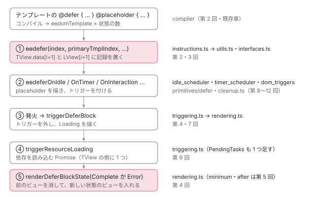

[目次](../README.md) › [@defer とインクリメンタルハイドレーションの内側](README.md) › 第 1 回 / 全 20 回

# @defer の全体像：命令・記録・状態・トリガー

> テンプレートの @defer がコンパイルで ɵɵdefer とトリガーの命令になり、packages/core/src/defer/ の各ファイル（instructions・interfaces・utils・rendering・triggering・timer\_scheduler・idle\_scheduler・dom\_triggers・cleanup・registry・discovery）がどう分担して動かすか。塊が placeholder から本体に変わるまでの道筋の全体図と、各章へのリンク。

angular/angular · 読了 約 12 分 · 基礎 · [サイトで読む（デモが動きます）](https://angular-deep-dive-cyan.vercel.app/chapter/defer-overview)

---

テンプレートに `@defer { … }` と書くと、コンパイラはそれを「テンプレートの関数を並べる命令」と「`ɵɵdefer`」と「トリガーの命令」に変えます。実行時には `packages/core/src/defer/` の 12 個のファイルが、その命令を受けて「記録を作る → トリガーを付ける → 依存を読み込む → 状態を描き替える」を分担します。この章では、その分担の全体図を描き、このシリーズの 20 回がどこを読むかを決めます。

読む対象は、コンパイラのテストの入力と出力（`packages/compiler-cli/test/compliance/test_cases/r3_view_compiler_deferred/basic_deferred*`）、`packages/core/src/defer/instructions.ts` の import の並び、`utils.ts` の先頭、`discovery.ts` です。

1. **1. 全体像**（この章）
2. [2. ɵɵdefer 命令](02-defer-instruction.md)
3. [3. 塊の記録](03-defer-details.md)
4. [4. 状態を描く](04-defer-render-state.md)
5. [5. minimum と after](05-defer-minimum-after.md)
6. [6. 依存を読み込む](06-defer-resource-loading.md)
7. [7. トリガーから描画まで](07-defer-trigger-flow.md)
8. [8. when](08-defer-when.md)
9. [9. idle と immediate](09-defer-idle-immediate.md)
10. [10. timer](10-defer-timer.md)
11. [11. interaction と hover](11-defer-dom-triggers.md)
12. [12. viewport](12-defer-viewport.md)
13. [13. prefetch](13-defer-prefetch.md)
14. [14. 入れ子・注入器・クエリ](14-defer-nested-di.md)
15. [15. サーバーでの @defer](15-defer-server.md)
16. [16. hydrate トリガー](16-defer-hydrate-triggers.md)
17. [17. 親から順にハイドレート](17-defer-hydration-queue.md)
18. [18. hydrate のイベント](18-defer-hydrate-events.md)
19. [19. テストを読む](19-defer-tests.md)
20. [20. issue と PR を読む](20-defer-issues.md)

## 1. コンパイルすると何の命令になるか

コンパイラのテスト（compliance test）は「この入力をコンパイルすると、出力のこの形が含まれる」を確かめるもので、命令の形を見るのにいちばん確かな資料です。いちばん小さい例を見ます。

📄 `angular/packages/compiler-cli/test/compliance/test_cases/r3_view_compiler_deferred/basic_deferred.ts` L1–15 （▶ の行: 7）

```ts
 1 │ import {Component} from '@angular/core';
 2 │ 
 3 │ @Component({
 4 │     template: `
 5 │     <div>
 6 │       {{message}}
 7 ▶       @defer {Deferred content}
 8 │       <p>Content after defer block</p>
 9 │     </div>
10 │   `,
11 │     standalone: false
12 │ })
13 │ export class MyApp {
14 │   message = 'hello';
15 │ }
```

📄 `angular/packages/compiler-cli/test/compliance/test_cases/r3_view_compiler_deferred/basic_deferred_template.js` L1–25 （▶ の行: 1, 3, 11, 14–17）

```js
 1 ▶ function MyApp_Defer_2_Template(rf, ctx) {
 2 │   if (rf & 1) {
 3 ▶     $r3$.ɵɵtext(0, "Deferred content");
 4 │   }
 5 │ }…
 6 │ export class MyApp {
 7 │   …
 8 │   static ɵcmp = /*@__PURE__*/ $r3$.ɵɵdefineComponent({
 9 │   …
10 │   template: function MyApp_Template(rf, ctx) {
11 ▶     if (rf & 1) {
12 │       $r3$.ɵɵelementStart(0, "div");
13 │       $r3$.ɵɵtext(1);
14 ▶       $r3$.ɵɵdomTemplate(2, MyApp_Defer_2_Template, 1, 0);
15 ▶       $r3$.ɵɵdefer(3, 2);
16 ▶       $r3$.ɵɵdeferOnIdle();
17 ▶       $r3$.ɵɵelementStart(5, "p");
18 │       $r3$.ɵɵtext(6, "Content after defer block");
19 │       $r3$.ɵɵelementEnd()();
20 │     }
21 │     if (rf & 2) {
22 │       $r3$.ɵɵadvance();
23 │       $r3$.ɵɵtextInterpolate1(" ", ctx.message, " ");
24 │     }
25 │   },
```

1. **1〜5 行目：塊の中身は別の関数になる**

   入力の 7 行目の `{Deferred content}` は、`MyApp_Defer_2_Template` という独立したテンプレートの関数になります。3 行目の `ɵɵtext` はこの関数の中にあり、`MyApp_Template` の本文には入りません。だから塊の中身は、誰かがこの関数でビューを作るまで DOM になりません。
2. **14 行目：`ɵɵdomTemplate(2, …)` がスロット 2 に「テンプレートの置き場」を作る**

   スロット（slot）は、コンポーネントのビューの配列（LView）の何番目を使うかの番号です。`ɵɵdomTemplate` は `@if` の分岐と同じく「後でビューを作るためのテンプレート」を宣言する命令です（[ivy-lcontainer の章](../ivy/11-ivy-lcontainer.md)）。@placeholder・@loading・@error があれば、その数だけここに並びます（[第 2 回](02-defer-instruction.md)）。
3. **15 行目：`ɵɵdefer(3, 2)` が塊そのもの**

   1 つ目の引数 3 は塊のスロット、2 つ目の引数 2 は「本体のテンプレートはスロット 2」という番号です。依存が無いので 3 つ目の引数（依存を読み込む関数）はありません。中身は [第 2 回](02-defer-instruction.md)で 1 行ずつ読みます。
4. **16 行目：トリガーを書いていないのに `ɵɵdeferOnIdle()` が出る**

   トリガーを 1 つも書かない `@defer` は `on idle` として扱われます。これを足しているのはコンパイラです（[compiler-control-flow-phases の章](../compiler/15-compiler-control-flow-phases.md)）。トリガーの命令は塊ごとに `ɵɵdefer` のすぐ後ろに並びます（第 7〜12 回）。
5. **17 行目：スロット 4 が飛ばされている**

   次の `<p>` はスロット 5 です。4 は塊の「記録」の置き場として空けてあります。この空きが 3 節の主題です。
6. **11 行目：すべて `rf & 1`（作成のとき）の中**

   `ɵɵdefer` もトリガーの `ɵɵdeferOnIdle` も、ビューを作る 1 回目にだけ呼ばれます。値が変わるたびに見る必要がある `when` だけは、更新のとき（`rf & 2`）の命令 `ɵɵdeferWhen` になります（[第 8 回](08-defer-when.md)）。

## 2. 実行時に動くファイル：instructions.ts の import から分かる分担

命令の入口 `instructions.ts` が何を import しているかを見ると、ほかのファイルの役目がそのまま並びます。

📄 `angular/packages/core/src/defer/instructions.ts` L27–46 （▶ の行: 29–33, 46）

```ts
27 │ import {removeLViewOnDestroy, storeLViewOnDestroy} from '../render3/util/view_utils';
28 │ import {performanceMarkFeature} from '../util/performance';
29 ▶ import {invokeAllTriggerCleanupFns, storeTriggerCleanupFn} from './cleanup';
30 ▶ import {onViewportWrapper, registerDomTrigger} from './dom_triggers';
31 ▶ import {onHover, onInteraction} from '../../primitives/defer/src/triggers';
32 ▶ import {onIdleWrapper} from './idle_scheduler';
33 ▶ import {
34 │   DEFER_BLOCK_STATE,
35 │   DeferBlockInternalState,
36 │   DeferBlockState,
37 │   DeferDependenciesLoadingState,
38 │   DependencyResolverFn,
39 │   DeferBlockTrigger,
40 │   LDeferBlockDetails,
41 │   TDeferBlockDetails,
42 │   TriggerType,
43 │   SSR_UNIQUE_ID,
44 │   TDeferDetailsFlags,
45 │ } from './interfaces';
46 ▶ import {onTimer} from './timer_scheduler';
```

📄 `angular/packages/core/src/defer/instructions.ts` L47–73 （▶ の行: 47, 54–55, 60, 62）

```ts
47 ▶ import {
48 │   getLDeferBlockDetails,
49 │   getTDeferBlockDetails,
50 │   setLDeferBlockDetails,
51 │   setTDeferBlockDetails,
52 │   trackTriggerForDebugging,
53 │ } from './utils';
54 ▶ import {DEHYDRATED_BLOCK_REGISTRY, DehydratedBlockRegistry} from './registry';
55 ▶ import {
56 │   warnIncrementalHydrationNotConfigured,
57 │   assertSsrIdDefined,
58 │   isIncrementalHydrationEnabled,
59 │ } from '../hydration/utils';
60 ▶ import {ɵɵdeferEnableTimerScheduling, renderPlaceholder} from './rendering';
61 │ 
62 ▶ import {
63 │   getHydrateTriggers,
64 │   triggerHydrationFromBlockName,
65 │   scheduleDelayedHydrating,
66 │   scheduleDelayedPrefetching,
67 │   scheduleDelayedTrigger,
68 │   triggerDeferBlock,
69 │   triggerPrefetching,
70 │   triggerResourceLoading,
71 │   shouldAttachTrigger,
72 │   hasHydrateTriggers,
73 │ } from './triggering';
```

29 行目の `cleanup`（トリガーの後片付け）、30〜32 行目の DOM・idle のトリガー、46 行目の timer、33〜45 行目の型、47〜53 行目の記録の読み書き（`utils`）、54 行目のハイドレーション用の登録簿、55〜59 行目のハイドレーションの判定、60 行目の描画（`rendering`）、62〜73 行目のトリガーが発火したあとの処理（`triggering`）。`instructions.ts` 自身は「命令を受けて、どれに渡すかを決める」だけの場所です。

| ファイル（行数） | 中にある主なもの | 役目 | 読む回 |
| --- | --- | --- | --- |
| `instructions.ts`（886） | `ɵɵdefer` と `ɵɵdeferWhen`・`ɵɵdeferOnIdle` など、`ɵɵdefer` で始まる命令 23 個 | コンパイラが出した命令の受け口 | 2・7〜13・16 |
| `interfaces.ts`（352） | `TDeferBlockDetails`・`LDeferBlockDetails`・`DeferBlockState`・欄の番号 | 記録の形と状態の番号 | 3 |
| `utils.ts`（196） | `getLDeferBlockDetails`・`getTemplateIndexForState`・`getMinimumDurationForState` | 記録の読み書き | 3・5・6 |
| `rendering.ts`（506） | `renderDeferBlockState`・`applyDeferBlockState`・`renderPlaceholder`・`ɵɵdeferEnableTimerScheduling` | 状態を決めて、ビューを入れ替える | 4・5 |
| `triggering.ts`（742） | `triggerDeferBlock`・`triggerResourceLoading`・`scheduleDelayedTrigger`・ハイドレーションの順番 | 発火したあとの段取りと依存の読み込み | 6・7・13・17 |
| `timer_scheduler.ts`（230） | `onTimer`・`scheduleTimerTrigger`・`TimerScheduler` | 時間のトリガーと minimum・after のタイマー | 5・10 |
| `idle_scheduler.ts`（167）・`idle_service.ts`（94） | `onIdle`・`IdleScheduler`・`IDLE_SERVICE`・`provideIdleServiceWith` | idle のトリガー（requestIdleCallback をまとめる） | 9 |
| `dom_triggers.ts`（210）と `primitives/defer/src/triggers.ts`（220） | `registerDomTrigger`・`getTriggerElement`・`onInteraction`・`onHover`・`onViewport` | DOM のイベントと IntersectionObserver のトリガー | 11・12 |
| `cleanup.ts`（64） | `storeTriggerCleanupFn`・`invokeAllTriggerCleanupFns` | 付けたトリガーを外す関数を記録に貯める | 2・7 |
| `registry.ts`（117） | `DehydratedBlockRegistry`・`DEHYDRATED_BLOCK_REGISTRY` | 脱水されたままの塊の登録簿（インクリメンタルハイドレーション） | 16・17 |
| `discovery.ts`（64） | `getDeferBlocks` | ビューの木から塊を集める（テストと DevTools、この章のデモ） | 1・19 |

## 3. 記録は 2 つ：TView の側と LView の側

1 節で空いていたスロット 4 を使うのが、`utils.ts` の先頭の関数です。

📄 `angular/packages/core/src/defer/utils.ts` L25–41 （▶ の行: 29, 32, 36, 38, 40）

```ts
25 │ /**
26 │  * Calculates a data slot index for defer block info (either static or
27 │  * instance-specific), given an index of a defer instruction.
28 │  */
29 ▶ export function getDeferBlockDataIndex(deferBlockIndex: number) {
30 │   // Instance state is located at the *next* position
31 │   // after the defer block slot in an LView or TView.data.
32 ▶   return deferBlockIndex + 1;
33 │ }
34 │ 
35 │ /** Retrieves a defer block state from an LView, given a TNode that represents a block. */
36 ▶ export function getLDeferBlockDetails(lView: LView, tNode: TNode): LDeferBlockDetails {
37 │   const tView = lView[TVIEW];
38 ▶   const slotIndex = getDeferBlockDataIndex(tNode.index);
39 │   ngDevMode && assertIndexInDeclRange(tView, slotIndex);
40 ▶   return lView[slotIndex];
41 │ }
```

29〜33 行目、記録のスロットは「塊のスロットの次」（`+ 1`）です。36〜41 行目はそのスロットを **LView** から読みます。同じファイルの少し下には、同じスロットを **TView.data** から読む `getTDeferBlockDetails` があります（[第 3 回](03-defer-details.md)）。つまり 1 つのスロット番号に、2 種類の記録が入っています。

- **TView の側（`TDeferBlockDetails`）**…テンプレートに 1 つ。各状態のテンプレートの番号・依存を読み込む関数・読み込みの進み具合（`loadingState`）など、その塊を何個描いても同じものです。TView は「テンプレートの設計図」で、同じコンポーネントのすべてのインスタンスで共有されます（[ivy-tview の章](../ivy/05-ivy-tview.md)）。
- **LView の側（`LDeferBlockDetails`）**…描いた塊 1 つにつき 1 つ。今どの状態を描いているか・トリガーの後片付けの関数など、インスタンスごとに違うものです（[ivy-lview の章](../ivy/06-ivy-lview.md)）。

依存の読み込みが TView の側にあるので、`@for` の中の同じ塊を 10 個描いても読み込みは 1 回です。これは [第 2 回](02-defer-instruction.md)のデモで確かめます。

## 4. 塊が placeholder から本体に変わるまで



*@defer の塊 1 つが動く道筋。左がコンパイルの出力と命令、右がそれを受ける packages/core/src/defer/ のファイル。*

1. **① ビューを作るとき、`ɵɵdefer` が記録を置く**

   最初の 1 回だけ TView の側を作り、毎回 LView の側を作ります。この時点では何も描きません（状態は `Initial`）。[第 2 回](02-defer-instruction.md)・[第 3 回](03-defer-details.md)。
2. **② トリガーの命令が placeholder を描き、トリガーを付ける**

   `ɵɵdeferOnIdle` などは、まず placeholder を描いてから、idle・タイマー・DOM のイベントを待ち始めます。外すための関数は LView の側の記録に貯めます。[第 7 回](07-defer-trigger-flow.md)から各トリガー。
3. **③ 発火すると `triggerDeferBlock`**

   貯めておいた後片付けを全部呼んで、ほかのトリガーも外します。読み込みが始まっていなければ Loading を描いて読み込みを始めます。
4. **④ 依存を読み込む**

   コンパイラが作った「`import()` を並べる関数」を呼び、結果をコンポーネントの登録簿に足します。読み込みの間は PendingTasks に 1 つ足すので、アプリは安定していない扱いになります（[第 6 回](06-defer-resource-loading.md)・[zoneless-pending-tasks の章](../zoneless/09-zoneless-pending-tasks.md)）。
5. **⑤ 終わったら Complete（失敗なら Error）を描く**

   状態は数の大きい方へしか進みません。前の状態のビューを LContainer から外して壊し、新しい状態のテンプレートからビューを作って入れます（[第 4 回](04-defer-render-state.md)）。

## 5. DEMO：3 つの塊の記録を段ごとに見る（記録の再生）

> **🧪 DEMO — 3 つの @defer の塊の記録（記録の再生）**
>
> これは記録です。本物の @angular/core 22.1.6（開発モード・JIT）を Node で、domino の DOM の上で動かした結果です。アプリには塊が 3 つあります。A は `on interaction(btn)` で @placeholder・@loading・@error つき、B は `on timer(60ms)` で @placeholder だけ、C は `when go()` で A と同じく 3 つつき。JIT では依存がすべて先に読み込まれて「依存を読み込む関数」が無くなるので、`ɵDEFER_BLOCK_DEPENDENCY_INTERCEPTOR` でその関数を「30ms 後に解決する（C だけは失敗する）Promise を返す関数」に差し替えています（6 節の spec と同じやり方）。ブラウザでは何も動かしません。
>
> 「次の段へ」か段のボタンを押してください。
>
> ▶ [このデモはサイトで動かせます](https://angular-deep-dive-cyan.vercel.app/chapter/defer-overview)

記録から読み取れることです。

1. **段 1：3 つとも Placeholder、読み込みは NOT\_STARTED**

   ② のとおり、トリガーの命令が placeholder を描いています。`TRIGGER_CLEANUP_FNS` が A と B は 2 つ、C は 1 つです。1 つは 3 つに共通で、`ɵɵdefer` 自身が「発火したら LView の破棄の購読をやめる」関数を入れたもの（[第 2 回](02-defer-instruction.md)）。A と B のもう 1 つは、それぞれイベントの購読とタイマーを外す関数です。`when` は更新のたびに値を見るだけなので、外すものがありません。
2. **段 2：click の直後、待たずに A は Loading**

   click のリスナーから `triggerDeferBlock` → `renderDeferBlockState(Loading)` までが同じ呼び出しの中で進むので、変更検知を待たずに DOM が `A:loading` に変わっています。差し替えた関数が `intercept(null)` と呼ばれているのは、JIT では本来の「依存を読み込む関数」が null だからです。
3. **段 4：B は読み込み中なのに Placeholder のまま**

   B のタイマーが発火して `loadingState` は IN\_PROGRESS になりましたが、B には @loading が無いので、状態は Placeholder のままです。「描くテンプレートが無い状態には移らない」という規則で、[第 4 回](04-defer-render-state.md)で行を読みます。
4. **段 6〜8：`go.set(true)` の直後は何も変わらず、変更検知のあとに Loading、失敗して Error**

   `when` は更新のときの命令なので、signal を変えただけでは何も起きず、変更検知で `ɵɵdeferWhen` が true を見たときに動きます（[第 8 回](08-defer-when.md)）。読み込みが失敗すると `loadingState` は FAILED、状態は Error です。C には @error があるので、エラーは投げられません。

### blocks() が塊を集める方法

記録の部品の `blocks()` は、@angular/core が公開している内部の関数 `ɵgetDeferBlocks`（`discovery.ts`）を呼んでいます。この関数は LView のスロットを順に見て、LContainer なら「その次のスロットに TView の側の記録があるか」で塊かどうかを決め、塊でなければ中のビューへ潜ります。全体は [testing-defer の章](../testing/18-testing-defer.md)で読んでいるので、2025 年に直された部分だけを見ます。

📄 `angular/packages/core/src/defer/discovery.ts` L50–56 （▶ の行: 52–53, 56）

```ts
50 │       // The host can be an `LView` if this is the container
51 │       // for a component that injects `ViewContainerRef`.
52 ▶       if (isLView(lContainer[HOST])) {
53 ▶         getDeferBlocks(lContainer[HOST], deferBlocks);
54 │       }
55 │ 
56 ▶       for (let j = CONTAINER_HEADER_OFFSET; j < lContainer.length; j++) {
```

52〜54 行目は 3eee19d8926（#62156、2025-06-20）で足されました。`ViewContainerRef` を inject したコンポーネントは、ホストの要素の位置に LContainer が挟まり、コンポーネントの LView はその LContainer の `HOST` に入ります。この修正の前は 56 行目のループ（LContainer の中のビュー）しか見ていなかったので、そういうコンポーネントの中の塊が `fixture.getDeferBlocks()` に出てきませんでした（#62047）。テストは `packages/core/test/defer_fixture_spec.ts` に足されています。

### 記録に使った共通の部品（このシリーズの記録のデモはすべてこれを使います）

`harness.ts` の `bootBrowser` は、domino（Node 向けの DOM）の `window` と `document` をグローバルに置き、本物の @angular/core 22.1.6 をブラウザのプラットフォーム（`PLATFORM_ID` が `'browser'`）で起動します。だからトリガーは本当に付いて、本当に発火します。`renderServer` は platform-server でサーバーの描画をします（[第 15 回](15-defer-server.md)）。domino に無い `IntersectionObserver`・`requestIdleCallback`・`requestAnimationFrame` には、記録のスクリプトから操作できる代わりを置いています。**これは環境の代わりで、Angular のロジックではありません。** domino では要素の大きさや位置は意味を持たず、時刻（記録の `t`）は Node のタイマーの目安です。`build.mjs` は、記録のスクリプトと @angular/\* を esbuild で 1 つのファイルに束ねます。パッケージは必ずこのサイトの `node_modules`（22.1.6）から読みます。

> [!WARNING]
> **ハマりどころ**
>
> 記録の 22.1.6 と、このシリーズが読むソース（22.2.0-next.7）は版が違います。`packages/core/src/defer/` の `ɵɵdefer`・`renderDeferBlockState`・`applyDeferBlockState` は配布物（`node_modules/@angular/core/fesm2022/_debug_node-chunk.mjs`）でも同じ処理でしたが、LView の先頭の欄の数 `HEADER_OFFSET` はソースが 28、22.1.6 が 27 です。記録の `index`（塊の TNode の番号）はこの数を含むので、ソースで同じテンプレートを描くと 1 つずつ大きくなります。

📄 `scratchpad の共通の部品（_shared/harness.ts）`

```
// defer シリーズの記録用の共通部品。
// 本物の @angular/core 22.1.6（開発モード・JIT）を Node で動かす。
// - bootBrowser: domino の DOM をグローバルに置き、ブラウザのプラットフォーム（platformBrowser）でアプリを起動する。
//   PLATFORM_ID が 'browser' なので、@defer のトリガーは本当に付けられて発火する。
// - renderServer: platform-server の renderApplication でサーバーの描画をして HTML を返す（サーバーでの @defer を見る用）。
// - blocks: ɵgetDeferBlocks で LView の中の @defer の塊を集め、記録（TDeferBlockDetails と LDeferBlockDetails）を読める形に写す。
// domino に無いブラウザの API（IntersectionObserver・requestIdleCallback など）は、記録のスクリプトから操作できる代わりを置く
// （環境の代わりで、Angular のロジックではない）。
import '@angular/compiler';
import {
  ApplicationRef, ComponentRef, EnvironmentProviders, Provider, Type, provideZonelessChangeDetection,
  ɵgetDeferBlocks as getDeferBlocks, ɵDeferBlockState as DeferBlockState,
} from '@angular/core';
import { bootstrapApplication, type BootstrapContext } from '@angular/platform-browser';
import domino from '~/angular-research/angular-deep-dive/node_modules/@angular/platform-server/third_party/domino/bundled-domino.mjs';

const g = globalThis as any;

/** domino の window と document をグローバルに置く。 */
export function installDom(html = '<html><head></head><body><app-root></app-root></body></html>') {
  const win = domino.createWindow(html, 'http://localhost/');
  const doc = win.document as Document;
  g.window = g;
  g.document = doc;
  for (const k of ['Node', 'Element', 'HTMLElement', 'Text', 'Comment', 'Event', 'CustomEvent', 'KeyboardEvent', 'MouseEvent', 'FocusEvent', 'DocumentFragment', 'getComputedStyle', 'location', 'navigator'])
    if (g[k] === undefined && win[k] !== undefined) g[k] = typeof win[k] === 'function' && /^[a-z]/.test(k) ? win[k].bind(win) : win[k];
  const et = new EventTarget();
  for (const k of ['addEventListener', 'removeEventListener', 'dispatchEvent']) g[k] ??= (et as any)[k].bind(et);
  g.requestAnimationFrame ??= (cb: (t: number) => void) => setTimeout(() => cb(performance.now()), 0);
  g.cancelAnimationFrame ??= (id: any) => clearTimeout(id);
  g.IntersectionObserver = FakeIntersectionObserver;
  return doc;
}

/** IntersectionObserver の代わり。作られたものを observers に残し、intersect(el) で「見えた」を知らせる。 */
export const observers: FakeIntersectionObserver[] = [];
export class FakeIntersectionObserver {
  targets = new Set<Element>();
  constructor(public callback: (entries: any[], o: any) => void, public options?: IntersectionObserverInit) { observers.push(this); }
  observe(el: Element) { this.targets.add(el); }
  unobserve(el: Element) { this.targets.delete(el); }
  disconnect() { this.targets.clear(); }
  takeRecords() { return []; }
}
export function intersect(el: Element) {
  for (const o of observers) if (o.targets.has(el)) o.callback([{ target: el, isIntersecting: true, intersectionRatio: 1 }], o);
}

/** requestIdleCallback の代わり（install したときだけ）。呼ばれた関数を貯め、runIdle() で流す。 */
export const idleQueue: { id: number; cb: Function; options?: unknown }[] = [];
export function installIdle() {
  let n = 0;
  g.requestIdleCallback = (cb: Function, options?: unknown) => { const id = ++n; idleQueue.push({ id, cb, options }); return id; };
  g.cancelIdleCallback = (id: number) => { const i = idleQueue.findIndex((x) => x.id === id); if (i >= 0) idleQueue.splice(i, 1); };
}
export function runIdle() {
  for (const x of idleQueue.splice(0)) x.cb({ didTimeout: false, timeRemaining: () => 50 });
}

/** ブラウザのプラットフォームでアプリを起動する（先に installDom）。 */
export async function bootBrowser(
  root: Type<unknown>,
  opts: { providers?: (Provider | EnvironmentProviders)[] } = {},
): Promise<{ appRef: ApplicationRef; ref: ComponentRef<unknown>; doc: Document }> {
  if (!g.document) installDom();
  const appRef = await bootstrapApplication(root, {
    providers: [provideZonelessChangeDetection(), ...(opts.providers ?? [])],
  });
  await appRef.whenStable();
  return { appRef, ref: appRef.components[0], doc: g.document };
}

/** サーバーで描画して HTML を返す（platform-server の renderApplication）。 */
export async function renderServer(
  root: Type<unknown>,
  opts: { providers?: (Provider | EnvironmentProviders)[]; html?: string } = {},
): Promise<string> {
  const { renderApplication, provideServerRendering } = await import('@angular/platform-server');
  const document = opts.html ?? '<html><head></head><body><app-root></app-root></body></html>';
  return renderApplication(
    (context: BootstrapContext) =>
      bootstrapApplication(root, { providers: [provideServerRendering(), provideZonelessChangeDetection(), ...(opts.providers ?? [])] }, context),
    { document, url: '/' },
  );
}

const STATE = ['Placeholder', 'Loading', 'Complete', 'Error'];
const INTERNAL = { [-1]: 'Initial' } as Record<number, string>;
const LOADING = ['NOT_STARTED', 'IN_PROGRESS', 'COMPLETE', 'FAILED'];
/** ComponentRef（か ApplicationRef）の中の @defer の塊を集めて、記録を読める形に写す。 */
export function blocks(ref: ComponentRef<unknown> | ApplicationRef) {
  const cr = ref instanceof ApplicationRef ? ref.components[0] : ref;
  const lView = (cr.hostView as any)._lView;
  const out: any[] = [];
  getDeferBlocks(lView, out);
  return out.map(({ lView, tNode, tDetails }) => {
    const l = lView[tNode.index + 1];
    const s = (v: number) => INTERNAL[v] ?? STATE[v] ?? v;
    return {
      index: tNode.index,
      tDetails: {
        primaryTmplIndex: tDetails.primaryTmplIndex,
        loadingTmplIndex: tDetails.loadingTmplIndex,
        placeholderTmplIndex: tDetails.placeholderTmplIndex,
        errorTmplIndex: tDetails.errorTmplIndex,
        placeholderBlockConfig: tDetails.placeholderBlockConfig,
        loadingBlockConfig: tDetails.loadingBlockConfig,
        loadingState: LOADING[tDetails.loadingState] ?? tDetails.loadingState,
        hasDependencyResolverFn: typeof tDetails.dependencyResolverFn === 'function',
        hasLoadingPromise: !!tDetails.loadingPromise,
        flags: tDetails.flags,
        hydrateTriggers: tDetails.hydrateTriggers ? [...tDetails.hydrateTriggers.entries()] : null,
        debug: tDetails.debug ?? undefined,
      },
      lDetails: {
        NEXT_DEFER_BLOCK_STATE: l[0] == null ? l[0] : s(l[0]),
        DEFER_BLOCK_STATE: s(l[1]),
        STATE_IS_FROZEN_UNTIL: l[2],
        LOADING_AFTER_CLEANUP_FN: typeof l[3] === 'function' ? 'function' : l[3],
        TRIGGER_CLEANUP_FNS: l[4] ? l[4].length : l[4],
        PREFETCH_TRIGGER_CLEANUP_FNS: l[5] ? l[5].length : l[5],
        SSR_UNIQUE_ID: l[6],
        SSR_BLOCK_STATE: l[7],
        ON_COMPLETE_FNS: l[8] ? l[8].length : l[8],
        HYDRATE_TRIGGER_CLEANUP_FNS: l[9] ? l[9].length : l[9],
      },
    };
  });
}
export { DeferBlockState };

/** 描かれている中身（ホストの要素の textContent を整えたもの）。 */
export const text = (ref: ComponentRef<unknown>) => ((ref.location.nativeElement as Element).textContent ?? '').replace(/\s+/g, ' ').trim();
export const html = (ref: ComponentRef<unknown>) => (ref.location.nativeElement as Element).innerHTML;

export const tick = (ms = 0) => new Promise((r) => setTimeout(r, ms));

/** JSON にできる形に写す（関数・循環は文字列に）。 */
export function clone<T>(v: T): T {
  const seen = new WeakSet();
  return JSON.parse(JSON.stringify(v, (_k, x) => {
    if (typeof x === 'function') return `[function ${x.name || 'anonymous'}]`;
    if (x && typeof x === 'object') { if (seen.has(x)) return '[circular]'; seen.add(x); }
    return x;
  }) ?? null);
}

/** 記録を JSON のファイルに書く（stdout には Angular の「development mode」の行が混ざるので使わない）。 */
export async function writeJson(path: string, data: unknown) {
  const { writeFileSync } = await import('node:fs');
  writeFileSync(path, JSON.stringify(data, null, 2) + '\n');
}

```

📄 `scratchpad の共通の部品（_shared/build.mjs）`

```
// 使い方: node build.mjs <記録のスクリプト.ts> <出力.mjs>  →  node <出力.mjs> > 記録.json
// devtools のソース（../angular/devtools、読むだけ）と記録のスクリプトを 1 つの ESM に束ねる。
// パッケージ（@angular/*・rxjs・semver）は必ず angular-deep-dive/node_modules（22.1.6）から読む。
import { build } from '~/angular-research/angular-deep-dive/node_modules/esbuild/lib/main.js';
const SITE = '~/angular-research/angular-deep-dive';
const [entry, out] = process.argv.slice(2);
const sitePackages = {
  name: 'site-packages',
  setup(b) {
    b.onResolve({ filter: /^[^./]/ }, async (args) => {
      if (args.pluginData === 'site') return undefined;
      const r = await b.resolve(args.path, { kind: args.kind, resolveDir: SITE, pluginData: 'site' });
      return r.errors.length ? undefined : r;
    });
  },
};
await build({ entryPoints: [entry], outfile: out, bundle: true, platform: 'node', format: 'esm', target: 'es2022',
  plugins: [sitePackages], logLevel: 'warning',
  tsconfigRaw: { compilerOptions: { experimentalDecorators: true, useDefineForClassFields: false } },
  banner: { js: "import { createRequire as __cr } from 'module'; const require = __cr(import.meta.url);" } });

```

📄 `scratchpad の記録スクリプト（a/overview.ts。build.mjs で束ねて node で実行）`

```
// defer-overview の記録: 状態の違う 3 つの @defer の塊を置いたアプリを、ブラウザのプラットフォームで起動し、
// 起動 → interaction → 時間が経つ → when → 時間が経つ の段ごとに blocks() と描かれた中身を記録する。
// JIT では依存がすべて eager になる（dependencyResolverFn が null）ので、ɵDEFER_BLOCK_DEPENDENCY_INTERCEPTOR で
// 「依存を読み込む関数」を差し替え、setTimeout で解決・失敗する Promise を返す（defer_spec.ts の dynamicImportOf と同じやり方）。
// 使い方: node ../_shared/build.mjs overview.ts overview.mjs && node overview.mjs overview.json
import { Component, signal, ɵDEFER_BLOCK_DEPENDENCY_INTERCEPTOR as DEFER_BLOCK_DEPENDENCY_INTERCEPTOR } from '@angular/core';
import { installDom, bootBrowser, blocks, text, tick, writeJson, clone } from '../_shared/harness';

// 次に呼ばれる「依存を読み込む関数」を成功させるか失敗させるか（記録のスクリプトが切り替える）
let nextLoad: 'ok' | 'fail' = 'ok';
const loadLog: string[] = [];
const interceptor = {
  intercept(original: unknown) {
    const outcome = nextLoad;
    loadLog.push(`intercept(${original === null ? 'null' : 'fn'}) → ${outcome}`);
    return () => [
      new Promise((resolve, reject) => setTimeout(() => (outcome === 'ok' ? resolve(Chart) : reject(new Error('load failed'))), 30)),
    ];
  },
  setInterceptor() {},
};

@Component({ selector: 'app-chart', template: '<b>chart</b>' })
class Chart {}

@Component({
  selector: 'app-root',
  imports: [Chart],
  template: `
    <button #btn>open</button>
    @defer (on interaction(btn)) { <app-chart /> }
    @placeholder { <i>A:placeholder</i> } @loading { <i>A:loading</i> } @error { <i>A:error</i> }
    @defer (on timer(60ms)) { <span>B:main</span> } @placeholder { <i>B:placeholder</i> }
    @defer (when go()) { <span>C:main</span> }
    @placeholder { <i>C:placeholder</i> } @loading { <i>C:loading</i> } @error { <i>C:error</i> }
  `,
})
class Root {
  go = signal(false);
}

function snap(step: string, ref: any) {
  const bs = blocks(ref).map((b: any) => ({
    ...b,
    tDetails: { ...b.tDetails, debug: b.tDetails.debug?.triggers ? [...b.tDetails.debug.triggers] : null },
  }));
  return clone({ step, t: Date.now() - t0, text: text(ref), blocks: bs, loadLog: [...loadLog] });
}

const rec: any[] = [];
installDom();
const t0 = Date.now();
const { appRef, ref } = await bootBrowser(Root, {
  providers: [{ provide: DEFER_BLOCK_DEPENDENCY_INTERCEPTOR, useValue: interceptor }],
});
rec.push(snap('起動（whenStable のあと）', ref));

// domino の Event で click を起こす（Node の組み込みの Event は domino の要素に渡せない）
const ev = document.createEvent('Event');
ev.initEvent('click', true, true);
(document.querySelector('button') as HTMLElement).dispatchEvent(ev);
rec.push(snap('click の直後（待たない）', ref));

await appRef.whenStable();
rec.push(snap('whenStable（依存の読み込みが終わるまで待つ）', ref));

// B の on timer(60ms) が発火するまで待つ。B には @loading が無い
while (blocks(ref)[1].tDetails.loadingState === 'NOT_STARTED') await tick(1);
rec.push(snap('B の timer が発火した直後', ref));

await appRef.whenStable();
rec.push(snap('whenStable', ref));

nextLoad = 'fail';
(ref.instance as Root).go.set(true);
rec.push(snap('go.set(true) の直後（まだ変更検知の前）', ref));

await tick(20);
rec.push(snap('20ms 後（変更検知で ɵɵdeferWhen が true を見た）', ref));

await appRef.whenStable();
rec.push(snap('whenStable（読み込みが失敗した）', ref));

await writeJson(process.argv[2] ?? '/dev/stdout', rec);
process.exit(0);

```

## 6. 既存の章との関係と、このシリーズの各回

| 既存の章 | そこで読んだこと | このシリーズでの扱い |
| --- | --- | --- |
| [defer](../template/03-defer.md) | 4 つの状態と 8 種類のトリガーの概観、minimum と after | 状態の数の並びを前提にし、関数の中を 1 行ずつ読む |
| [standalone-defer-deps](../standalone/11-standalone-defer-deps.md) | コンパイラが依存を `import()` にするまで | その関数を実行時に呼ぶ側を第 6 回で読む |
| [compiler-control-flow-blocks](../compiler/08-compiler-control-flow-blocks.md)・[phases](../compiler/15-compiler-control-flow-phases.md) | @defer の構文の解析と命令の生成 | 出力の命令の形だけを使う |
| [testing-defer](../testing/18-testing-defer.md) | `DeferBlockBehavior`・`getDeferBlocks`・`DeferBlockFixture` | 第 19 回で spec の読み方として使う |
| [incremental-hydration](../platform/15-incremental-hydration.md) | hydrate トリガーの全体の流れ | 第 15〜18 回で各段を詳しく |
| [event-replay](../platform/14-event-replay.md) | jsaction の EventContract と EventDispatcher | 第 18 回で hydrate のイベントとつなぐ |
| [ivy-lcontainer](../ivy/11-ivy-lcontainer.md)・[ivy-lview](../ivy/06-ivy-lview.md) | LContainer と LView の形、ビューの出し入れ | 第 2・4 回で前提にする |

| 回 | 主なファイル | 読むもの |
| --- | --- | --- |
| [2](02-defer-instruction.md)・[3](03-defer-details.md)・[4](04-defer-render-state.md) | instructions・interfaces・utils・rendering | `ɵɵdefer`、2 つの記録の欄、状態の描き替え |
| [5](05-defer-minimum-after.md)・[6](06-defer-resource-loading.md) | rendering・timer\_scheduler・triggering | minimum と after のタイマー、依存の読み込み |
| [7](07-defer-trigger-flow.md)〜[12](12-defer-viewport.md) | instructions・triggering・各 scheduler・dom\_triggers・primitives | トリガーごとの付け方・外し方 |
| [13](13-defer-prefetch.md)・[14](14-defer-nested-di.md) | instructions・triggering・rendering | prefetch、入れ子・注入器・クエリ |
| [15](15-defer-server.md)〜[18](18-defer-hydrate-events.md) | hydration/・registry・triggering | サーバーでの @defer とインクリメンタルハイドレーション |
| [19](19-defer-tests.md)・[20](20-defer-issues.md) | spec・issue | テストの読み方、issue と PR の読み方 |

## ここまでの呼び出し

- 👤 `@defer (on interaction(btn)) { … }` — あなたのテンプレート
  - `MyApp_Template(rf = 1)` — コンパイラの出力 — *作成のときだけ*
    - `ɵɵdomTemplate(…)` × 状態の数 — render3/instructions/template.ts
    - `ɵɵdefer(index, primaryTmplIndex, …)` — defer/instructions.ts — *記録を index + 1 に置く（第 2 回）*
    - `ɵɵdeferOnInteraction(…)` — defer/instructions.ts — *placeholder を描き、click と keydown を待つ（第 11 回）*
- 👤 `ボタンを押す` — 利用者
  - `triggerDeferBlock(Regular, lView, tNode)` — defer/triggering.ts — *トリガーを外す（第 7 回）*
    - `renderDeferBlockState(Loading, …)` — defer/rendering.ts — *第 4 回*
    - `triggerResourceLoading(tDetails, …)` — defer/triggering.ts — *第 6 回*
      - `renderDeferBlockState(Complete か Error, …)` — defer/rendering.ts — *Promise が終わったあと*

## テストと直し方

### この 4 回（第 1〜4 回）で使う spec

`@defer` の振る舞いの spec は `packages/core/test/acceptance/defer_spec.ts`（5652 行）に集まっています。先頭に、このシリーズのデモと同じ考え方の道具があります。

📄 `angular/packages/core/test/acceptance/defer_spec.ts` L53–79 （▶ の行: 58, 62, 64, 75, 77）

```ts
53 │ /**
54 │  * Clears all associated directive defs from a given component class.
55 │  *
56 │  * This is a *hack* for TestBed, which compiles components in JIT mode
57 │  * and can not remove dependencies and their imports in the same way as AOT.
58 ▶  * From JIT perspective, all dependencies inside a defer block remain eager.
59 │  * We need to clear this association to run tests that verify loading and
60 │  * prefetching behavior.
61 │  */
62 ▶ function clearDirectiveDefs(type: Type<unknown>): void {
63 │   const cmpDef = getComponentDef(type);
64 ▶   cmpDef!.dependencies = [];
65 │   cmpDef!.directiveDefs = null;
66 │ }
67 │ 
68 │ /**
69 │  * Emulates a dynamic import promise.
70 │  *
71 │  * Note: `setTimeout` is used to make `fixture.whenStable()` function
72 │  * wait for promise resolution, since `whenStable()` relies on the state
73 │  * of a macrotask queue.
74 │  */
75 ▶ function dynamicImportOf<T>(type: T, timeout = 0): Promise<T> {
76 │   return new Promise<T>((resolve) => {
77 ▶     setTimeout(() => resolve(type), timeout);
78 │   });
79 │ }
```

58〜60 行目のとおり、TestBed は JIT でコンパイルするので、塊の中の依存も eager のままです。62〜66 行目の `clearDirectiveDefs` で依存を消し、75〜79 行目の `dynamicImportOf` で「setTimeout で解決する `import()` の代わり」を作ります。この章のデモが `ɵDEFER_BLOCK_DEPENDENCY_INTERCEPTOR` で setTimeout の Promise を返しているのは、これと同じ理由です。

📄 `angular/packages/core/test/acceptance/defer_spec.ts` L272–307 （▶ の行: 276, 296, 298, 301, 304, 307）

```ts
272 │     @Component({
273 │       selector: 'simple-app',
274 │       imports: [MyLazyCmp],
275 │       template: `
276 ▶         @defer (when isVisible) {
277 │           <my-lazy-cmp />
278 │         } @loading {
279 │           Loading...
280 │         } @placeholder {
281 │           Placeholder!
282 │         } @error {
283 │           Failed to load dependencies :(
284 │         }
285 │       `,
286 │ 
287 │       changeDetection: ChangeDetectionStrategy.Eager,
288 │     })
289 │     class MyCmp {
290 │       isVisible = false;
291 │     }
292 │ 
293 │     const fixture = TestBed.createComponent(MyCmp);
294 │     fixture.detectChanges();
295 │ 
296 ▶     expect(fixture.nativeElement.outerHTML).toContain('Placeholder');
297 │ 
298 ▶     fixture.componentInstance.isVisible = true;
299 │     fixture.detectChanges();
300 │ 
301 ▶     expect(fixture.nativeElement.outerHTML).toContain('Loading');
302 │ 
303 │     // Wait for dependencies to load.
304 ▶     await allPendingDynamicImports();
305 │     fixture.detectChanges();
306 │ 
307 ▶     expect(fixture.nativeElement.outerHTML).toContain('<my-lazy-cmp>Hi!</my-lazy-cmp>');
```

`describe('@defer')` の最初の it です。296 行目で Placeholder、298〜301 行目で `isVisible` を true にした直後に Loading、304〜307 行目で読み込みを待ってから本体、と、デモの塊 C の成功版を 1 本で確かめています。依存を消していないので「依存を読み込む関数」は null ですが、それでも 301 行目で Loading が見えるのは、読み込みの終わりが Promise の 1 回あと（microtask）になるからです（[第 6 回](06-defer-resource-loading.md)）。

### 手元で走らせた結果

📄 `ターミナル（../angular で）`

```
cd ~/angular-research/angular
pnpm bazel test //packages/core/test/acceptance:acceptance --nocache_test_results --test_output=all \
  '--test_arg=--filter=^@defer (should transition between placeholder|should work when only main block|should be able to use pipes injecting|should preserve execution order|with HMR|directive matching)'

# @defer の describe 全体
pnpm bazel test //packages/core/test/acceptance:acceptance --nocache_test_results --test_output=all \
  '--test_arg=--filter=^@defer '
```

📄 `出力（2026-11-06 に実行。抜粋。ログは scratchpad/defer-logs/a-acceptance.log・a-overview-all.log）`

```
Ran 7 of 2693 specs
7 specs, 0 failures
Finished in 0.166 seconds
INFO: Elapsed time: 2.144s, Critical Path: 1.49s
//packages/core/test/acceptance:acceptance          PASSED in 1.4s

（describe 全体）
Ran 95 of 2693 specs
95 specs, 0 failures
Finished in 2.657 seconds
INFO: Elapsed time: 6.524s, Critical Path: 4.24s
//packages/core/test/acceptance:acceptance          PASSED in 3.9s
```

- 1 つ目の絞り込みは第 1〜4 回の持ち場の it（先頭の 4 本・`with HMR` の 2 本・`directive matching` の 1 本）で、7 件・bazel の Elapsed 2.1 秒でした。
- `--filter` は jasmine の正規表現で、describe と it の名前をつないだ全体（例：`@defer should transition between placeholder, …`）に当たります。**1 件も当たらなくても PASSED になる**ので、必ず「Ran N of 2693 specs」を見ます。
- `^@defer `（describe 全体）は 95 件・6.5 秒でした。ほかの describe（`getControlFlowBlocks > @defer blocks` など）は数に入りません。

### 直すとしたら

- **まず「どの段で止まっているか」を記録で見ます。** 4 節の ①〜⑤ のどこで止まっているかは、`DEFER_BLOCK_STATE`（LView の側）と `loadingState`（TView の側）の 2 つの値でほぼ決まります。たとえば「Loading のまま」は ④ の Promise、「Placeholder のまま・NOT\_STARTED」は ② か ③ のトリガーです。
- **描かれ方（どのビューが入るか）は `rendering.ts`、いつ動くかは `triggering.ts` と各 scheduler です。** spec は `defer_spec.ts` のその describe に足します（describe の一覧は [第 19 回](19-defer-tests.md)）。
- **テストで塊が見つからない不具合は `discovery.ts` です。** 上の 3eee19d8926 がその例で、spec は `defer_fixture_spec.ts` に足されました。テストで塊に名前を付けて探したいという要望（#52556、開いている）もこの辺りの話です（[第 20 回](20-defer-issues.md)）。
- 本家に PR を出すことは勧めません。手元で spec を走らせ、記録のスクリプトで同じ形の塊を描いて「どの段で止まるか」を確かめるところまでにします。

## 聞かれそうな質問

**Q. @defer の中身は、いつ DOM になるのですか？**

中身はコンパイルで別のテンプレートの関数（basic\_deferred\_template.js の 1〜5 行目）になり、親のテンプレートの本文には入りません。状態を Complete にするときに、そのテンプレートからビューが作られて初めて DOM になります（[第 4 回](04-defer-render-state.md)）。

**Q. トリガーを書かなかった @defer はどうなりますか？**

`on idle` になります。basic\_deferred\_template.js の 16 行目のとおり、トリガーを書いていなくてもコンパイラが `ɵɵdeferOnIdle()` を出します。

**Q. なぜ `<p>` のスロットが 4 ではなく 5 なのですか？**

塊は 2 つのスロットを使うからです。3 が塊（LContainer）、4 が記録の置き場です。`getDeferBlockDataIndex`（utils.ts 29〜33 行目）が `+ 1` を返し、同じ番号に TView の側（TView.data）と LView の側（LView）の 2 つの記録が入ります。

**Q. 同じ塊を `@for` で 100 個描いたら、依存も 100 回読み込まれますか？**

読み込まれません。読み込みの進み具合と Promise は TView の側の記録にあり、同じテンプレートのすべてのインスタンスで共有されます。インスタンスごとなのは、今の状態などの LView の側だけです（[第 2 回](02-defer-instruction.md)のデモ）。

**Q. @loading が無い塊は、読み込み中に何を描いていますか？**

placeholder のままです。デモの段 4 で、B の `loadingState` が IN\_PROGRESS なのに状態は Placeholder でした。描くテンプレートが無い状態には移りません（[第 4 回](04-defer-render-state.md)）。

## 読み終えて

- `@defer` はコンパイルで「状態ごとのテンプレート」「`ɵɵdefer`」「トリガーの命令」の 3 種類になり、すべて作成のとき（`rf & 1`）に呼ばれる（`when` だけ更新のとき）。
- 実行時は `instructions.ts` が受け口で、記録は `interfaces.ts`・`utils.ts`、描画は `rendering.ts`、発火のあとは `triggering.ts`、トリガーは各 scheduler と `dom_triggers.ts` が受け持つ。
- 記録は塊のスロットの次に 2 つ入る。TView の側はテンプレートに 1 つ（読み込みもここ）、LView の側は描いた塊ごと（今の状態もここ）。
- 塊は Initial → Placeholder → Loading → Complete / Error と、数の大きい方へしか進まない。

---

← 前: [issue と PR を読む：DevTools の今](../devtools/20-devtools-issues.md)  
次: [ɵɵdefer 命令：最初の creation pass で塊の記録を作る](02-defer-instruction.md) →
