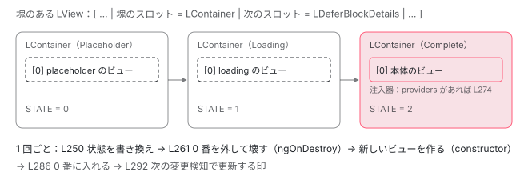

[目次](../README.md) › [@defer とインクリメンタルハイドレーションの内側](README.md) › 第 4 回 / 全 20 回

# 状態を描く：renderDeferBlockState と applyDeferBlockState

> renderDeferBlockState が今の状態と比べて切り替えを決め（isValidStateChange）、applyDeferBlockState が LContainer の中のビューを消して新しい状態のテンプレートのビューを入れる行。本体のビューに渡す注入器（createDeferBlockInjector・getOrCreateEnvironmentInjector）と、ハイドレーションの脱水されたビューを探す行。

angular/angular · 読了 約 13 分 · 中核 · [サイトで読む（デモが動きます）](https://angular-deep-dive-cyan.vercel.app/chapter/defer-render-state)

---

塊の状態が変わるとき、実際に DOM を描き替えているのは `rendering.ts` の 2 つの関数です。`renderDeferBlockState` が「今の状態と比べて、この切り替えをしてよいか」を決め、`applyDeferBlockState` が「LContainer の中のビューを消して、新しい状態のテンプレートからビューを作って入れる」をします。この章ではその 2 つを 1 行ずつ読み、本体のビューに渡す注入器（`createDeferBlockInjector`・`getOrCreateEnvironmentInjector`）と、ハイドレーションのときに脱水されたビューを探す行も読みます。

読む対象は `packages/core/src/defer/rendering.ts` の 78〜317 行目と 400〜422 行目です。

1. [1. 全体像](01-defer-overview.md)
2. [2. ɵɵdefer 命令](02-defer-instruction.md)
3. [3. 塊の記録](03-defer-details.md)
4. **4. 状態を描く**（この章）
5. [5. minimum と after](05-defer-minimum-after.md)
6. [6. 依存を読み込む](06-defer-resource-loading.md)
7. [7. トリガーから描画まで](07-defer-trigger-flow.md)
8. [8. when](08-defer-when.md)
9. [9. idle と immediate](09-defer-idle-immediate.md)
10. [10. timer](10-defer-timer.md)
11. [11. interaction と hover](11-defer-dom-triggers.md)
12. [12. viewport](12-defer-viewport.md)
13. [13. prefetch](13-defer-prefetch.md)
14. [14. 入れ子・注入器・クエリ](14-defer-nested-di.md)
15. [15. サーバーでの @defer](15-defer-server.md)
16. [16. hydrate トリガー](16-defer-hydrate-triggers.md)
17. [17. 親から順にハイドレート](17-defer-hydration-queue.md)
18. [18. hydrate のイベント](18-defer-hydrate-events.md)
19. [19. テストを読む](19-defer-tests.md)
20. [20. issue と PR を読む](20-defer-issues.md)

## 1. 入口は 1 つ：renderPlaceholder も renderDeferBlockState を呼ぶだけ

📄 `angular/packages/core/src/defer/rendering.ts` L400–422 （▶ の行: 405–406, 413, 417–418, 421）

```ts
400 │ /**
401 │  * Checks whether we can transition to the next state.
402 │  *
403 │  * We transition to the next state if the previous state was represented
404 │  * with a number that is less than the next state. For example, if the current
405 ▶  * state is "loading" (represented as `1`), we should not show a placeholder
406 ▶  * (represented as `0`), but we can show a completed state (represented as `2`)
407 │  * or an error state (represented as `3`).
408 │  */
409 │ function isValidStateChange(
410 │   currentState: DeferBlockState | DeferBlockInternalState,
411 │   newState: DeferBlockState,
412 │ ): boolean {
413 ▶   return currentState < newState;
414 │ }
415 │ 
416 │ /** Utility function to render placeholder content (if present) */
417 ▶ export function renderPlaceholder(lView: LView, tNode: TNode) {
418 ▶   const lContainer = lView[tNode.index];
419 │   ngDevMode && assertLContainer(lContainer);
420 │ 
421 ▶   renderDeferBlockState(DeferBlockState.Placeholder, tNode, lContainer);
422 │ }
```

417〜422 行目の `renderPlaceholder` は、トリガーの命令が作成のときに呼ぶ関数です（[第 2 回](02-defer-instruction.md)の最後）。418 行目で塊のスロットの LContainer を取り、421 行目で `renderDeferBlockState(Placeholder, …)` を呼ぶだけです。Loading も Complete も Error も、すべて同じ `renderDeferBlockState` を通ります。

413 行目の `isValidStateChange` は `currentState < newState` の 1 行です。405〜407 行目の説明のとおり、Loading（1）を描いている途中で Placeholder（0）には戻れず、Complete（2）や Error（3）には進めます。**状態は数の大きい方へしか進まない**、がこの章のすべての土台です。

## 2. renderDeferBlockState：切り替えてよいかを決める

📄 `angular/packages/core/src/defer/rendering.ts` L150–183 （▶ の行: 164, 168, 170, 175, 180）

```ts
150 │ /** Rendering Helpers */
151 │ 
152 │ /**
153 │  * Transitions a defer block to the new state. Updates the  necessary
154 │  * data structures and renders corresponding block.
155 │  *
156 │  * @param newState New state that should be applied to the defer block.
157 │  * @param tNode TNode that represents a defer block.
158 │  * @param lContainer Represents an instance of a defer block.
159 │  * @param skipTimerScheduling Indicates that `@loading` and `@placeholder` block
160 │  *   should be rendered immediately, even if they have `after` or `minimum` config
161 │  *   options setup. This flag to needed for testing APIs to transition defer block
162 │  *   between states via `DeferFixture.render` method.
163 │  */
164 ▶ export function renderDeferBlockState(
165 │   newState: DeferBlockState,
166 │   tNode: TNode,
167 │   lContainer: LContainer,
168 ▶   skipTimerScheduling = false,
169 │ ): void {
170 ▶   const hostLView = lContainer[PARENT];
171 │   const hostTView = hostLView[TVIEW];
172 │ 
173 │   // Check if this view is not destroyed. Since the loading process was async,
174 │   // the view might end up being destroyed by the time rendering happens.
175 ▶   if (isDestroyed(hostLView)) return;
176 │ 
177 │   // Make sure this TNode belongs to TView that represents host LView.
178 │   ngDevMode && assertTNodeForLView(tNode, hostLView);
179 │ 
180 ▶   const lDetails = getLDeferBlockDetails(hostLView, tNode);
181 │ 
182 │   ngDevMode && assertDefined(lDetails, 'Expected a defer block state defined');
183 │ 
```

1. **170 行目：LContainer の `PARENT` が、塊のある LView**

   LContainer は親の LView を持っているので、ここから TView（171 行目）と記録が引けます。引数が `lContainer` と `tNode` だけで足りるのはこのためです。
2. **175 行目：もう壊れたビューなら何もしない**

   173〜174 行目の説明のとおり、読み込みは非同期なので、終わったときには塊のあるビューが消えていることがあります（`@if` が false になった、ページを移った、など）。その場合はここで終わります。
3. **180 行目：LView の側の記録を取る**

   `getLDeferBlockDetails` は塊のスロットの次を読む関数です（[第 1 回](01-defer-overview.md)）。
4. **168 行目の `skipTimerScheduling`**

   テストの `DeferBlockFixture.render(state)` が true を渡し、`minimum`・`after` を無視してすぐ描かせるための引数です（[testing-defer の章](../testing/18-testing-defer.md)）。

📄 `angular/packages/core/src/defer/rendering.ts` L187–193 （▶ の行: 187–188, 191–193）

```ts
187 ▶   if (ssrState !== null && newState < ssrState) {
188 ▶     return; // trying to render a previous state, exit
189 │   }
190 │ 
191 ▶   if (
192 ▶     isValidStateChange(currentState, newState) &&
193 ▶     isValidStateChange(lDetails[NEXT_DEFER_BLOCK_STATE] ?? -1, newState)
```

1. **187〜189 行目：サーバーで描いた状態より前には戻らない**

   `SSR_BLOCK_STATE` は、ハイドレーションのときにサーバーの印から読んだ「サーバーで描いた状態」です（[第 2 回](02-defer-instruction.md)の 5 節）。たとえばサーバーで Complete まで描いた塊に、ブラウザのトリガーの命令が Placeholder を描かせようとしても、ここで止まります。ブラウザだけで描くときは null なので、この確かめは素通りです。
2. **191〜193 行目：今の状態と、予約されている次の状態の両方より大きいときだけ進む**

   192 行目は今描いている状態、193 行目は `NEXT_DEFER_BLOCK_STATE`（minimum や after で待っている間に予約された状態。無ければ -1）です（[第 3 回](03-defer-details.md)）。両方より大きいときだけ先へ進みます。

その後ろ（関数の終わりまで）は [testing-defer の章](../testing/18-testing-defer.md)で引用しています。要点は 2 つです。`minimum` か `after` の設定があり、サーバーでなく、`skipTimerScheduling` でもなければ、タイマーつきの `applyDeferBlockStateWithScheduling` を使い（[第 5 回](05-defer-minimum-after.md)）、そうでなければ次の節の `applyDeferBlockState` を直接使います。どちらも try で囲み、投げられたエラーは `handleUncaughtError` でアプリのエラーの扱いに渡します（「テストと直し方」の fd12220a356）。

## 3. applyDeferBlockState：ビューを入れ替える

📄 `angular/packages/core/src/defer/rendering.ts` L235–262 （▶ の行: 245, 247, 249–250, 252, 255, 259, 261）

```ts
235 │ /**
236 │  * Applies changes to the DOM to reflect a given state.
237 │  */
238 │ function applyDeferBlockState(
239 │   newState: DeferBlockState,
240 │   lDetails: LDeferBlockDetails,
241 │   lContainer: LContainer,
242 │   tNode: TNode,
243 │   hostLView: LView<unknown>,
244 │ ) {
245 ▶   profiler(ProfilerEvent.DeferBlockStateStart);
246 │ 
247 ▶   const stateTmplIndex = getTemplateIndexForState(newState, hostLView, tNode);
248 │ 
249 ▶   if (stateTmplIndex !== null) {
250 ▶     lDetails[DEFER_BLOCK_STATE] = newState;
251 │     const hostTView = hostLView[TVIEW];
252 ▶     const adjustedIndex = stateTmplIndex + HEADER_OFFSET;
253 │ 
254 │     // The TNode that represents a template that will activated in the defer block
255 ▶     const activeBlockTNode = getTNode(hostTView, adjustedIndex) as TContainerNode;
256 │ 
257 │     // There is only 1 view that can be present in an LContainer that
258 │     // represents a defer block, so always refer to the first one.
259 ▶     const viewIndex = 0;
260 │ 
261 ▶     removeLViewFromLContainer(lContainer, viewIndex);
262 │ 
```

1. **247・249 行目：描くテンプレートが無ければ、何もしない**

   `getTemplateIndexForState` は、@loading などが無ければ null を返します（[第 3 回](03-defer-details.md)）。そのとき 249 行目の if に入らないので、**250 行目の状態の書き換えも起きません**。@placeholder の無い塊が `Initial` のまま、@loading の無い塊が読み込み中も Placeholder のままなのはこの行のためです（[第 1 回](01-defer-overview.md)のデモの塊 B）。
2. **250 行目：先に状態を書き換える**

   ビューを作る前に `DEFER_BLOCK_STATE` を新しい状態にします。このあとの 277 行目（脱水されたビューを探す）が、この新しい値を使います。
3. **252〜255 行目：新しい状態のテンプレートの TNode**

   テンプレートの番号に `HEADER_OFFSET` を足して、TView から TNode を取ります（[第 2 回](02-defer-instruction.md)で見た `index + HEADER_OFFSET` と同じ計算）。この TNode の `tView` が、ビューを作る設計図です。
4. **259・261 行目：0 番のビューを外して壊す**

   257〜258 行目の説明のとおり、塊の LContainer に入るビューはいつも 1 つなので、番号は 0 で決め打ちです。`removeLViewFromLContainer` は、ビューを LContainer から外して DOM から抜き、壊します（[ivy-lcontainer の章](../ivy/11-ivy-lcontainer.md)）。壊すときに、中のコンポーネントの `ngOnDestroy` が呼ばれます。最初の placeholder のときは中が空なので、何もしません。

📄 `angular/packages/core/src/defer/rendering.ts` L263–277 （▶ の行: 264, 271–274, 277）

```ts
263 │     let injector: Injector | undefined;
264 ▶     if (newState === DeferBlockState.Complete) {
265 │       // When we render a defer block in completed state, there might be
266 │       // newly loaded standalone components used within the block, which may
267 │       // import NgModules with providers. In order to make those providers
268 │       // available for components declared in that NgModule, we create an instance
269 │       // of an environment injector to host those providers and pass this injector
270 │       // to the logic that creates a view.
271 ▶       const tDetails = getTDeferBlockDetails(hostTView, tNode);
272 ▶       const providers = tDetails.providers;
273 ▶       if (providers && providers.length > 0) {
274 ▶         injector = createDeferBlockInjector(hostLView[INJECTOR], tDetails, providers);
275 │       }
276 │     }
277 ▶     const {dehydratedView, dehydratedViewIx} = findMatchingDehydratedViewForDeferBlock(
```

264〜276 行目は Complete のときだけです。読み込んだコンポーネントの NgModule の providers（[第 3 回](03-defer-details.md)の `providers`）があれば、274 行目でそれを持つ注入器を作ります（4 節）。無ければ `injector` は undefined のままで、ビューはふつうに塊のある場所の注入器を親にします。277 行目で脱水されたビューを探し（5 節）、その次の行の `createAndRenderEmbeddedLView` で新しい状態のテンプレートからビューを作って、作成モードで 1 回実行します（ここは [di-node-injector-lookup の章](../di/11-di-node-injector-lookup.md)などで引用しています。中身は [ivy-lcontainer の章](../ivy/11-ivy-lcontainer.md)）。新しいコンポーネントの constructor はここで呼ばれます。

📄 `angular/packages/core/src/defer/rendering.ts` L286–292 （▶ の行: 286, 289–290, 292）

```ts
286 ▶     addLViewToLContainer(
287 │       lContainer,
288 │       embeddedLView,
289 ▶       viewIndex,
290 ▶       shouldAddViewToDom(activeBlockTNode, dehydratedView),
291 │     );
292 ▶     markViewForRefresh(embeddedLView);
```

286〜291 行目で、作ったビューを 0 番に入れます。290 行目の `shouldAddViewToDom` は、脱水されたビューを使ったとき（DOM がもうサーバーの描画で入っているとき）は DOM に挿さない、という判定です。292 行目の `markViewForRefresh` は、新しいビューに「次の変更検知で更新する」印を付けます。これで zoneless でも変更検知が予約され、ビューの中の `{{ … }}` が埋まります（[zoneless-notification-source の章](../zoneless/02-zoneless-notification-source.md)）。

📄 `angular/packages/core/src/defer/rendering.ts` L293–317 （▶ の行: 294, 302, 305–307, 309–310, 312, 316）

```ts
293 │ 
294 ▶     if (dehydratedViewIx > -1) {
295 │       // Erase dehydrated view info in a given LContainer, so that the view is not
296 │       // removed later by post-hydration cleanup process (which iterates over all
297 │       // dehydrated views in component tree). This clears only the dehydrated view
298 │       // that was found for this render, which in most cases will be the only view.
299 │       // In the case that there was control flow that changed, there may be either
300 │       // more than one or the views would not match up due to the server rendered
301 │       // content being a different branch of the control flow.
302 ▶       lContainer[DEHYDRATED_VIEWS]?.splice(dehydratedViewIx, 1);
303 │     }
304 │ 
305 ▶     if (
306 ▶       (newState === DeferBlockState.Complete || newState === DeferBlockState.Error) &&
307 ▶       Array.isArray(lDetails[ON_COMPLETE_FNS])
308 │     ) {
309 ▶       for (const callback of lDetails[ON_COMPLETE_FNS]) {
310 ▶         callback();
311 │       }
312 ▶       lDetails[ON_COMPLETE_FNS] = null;
313 │     }
314 │   }
315 │ 
316 ▶   profiler(ProfilerEvent.DeferBlockStateEnd);
317 │ }
```

1. **294〜303 行目：使った脱水されたビューを一覧から消す**

   消しておかないと、ハイドレーションの後片付け（使われなかった脱水されたビューの DOM を消す処理）が、いま使ったビューの DOM まで消してしまうからです（295〜298 行目の説明）。
2. **305〜313 行目：Complete か Error を描いたら `ON_COMPLETE_FNS` を呼ぶ**

   `ON_COMPLETE_FNS`（[第 3 回](03-defer-details.md)）は、インクリメンタルハイドレーションが「この塊が描き終わったら、次の子の塊へ進む」ために入れる関数です（[第 17 回](17-defer-hydration-queue.md)）。呼んだら 312 行目で null に戻すので、1 回しか呼ばれません。
3. **245・316 行目：profiler の印**

   `DeferBlockStateStart` と `DeferBlockStateEnd` で、DevTools のプロファイラーにこの区間が出ます。



*applyDeferBlockState の 1 回で、LContainer の 0 番のビューが前の状態のものから新しい状態のものに入れ替わる。状態の欄は先に書き換わる。*

## 4. 本体のビューに渡す注入器

3 節の 274 行目で使う関数です。なぜ注入器を作る必要があるのかというと、読み込んだ standalone のコンポーネントが `imports: [SomeNgModule]` を持っていて、その NgModule が providers を持っていることがあるからです。塊の外の注入器はその providers を知らないので、読み込みのあとで「それを持つ環境の注入器（EnvironmentInjector）」を作って、本体のビューの注入器の道のりに差し込みます。

📄 `angular/packages/core/src/defer/rendering.ts` L78–96 （▶ の行: 83, 88–93）

```ts
78 │ /**
79 │  * Checks whether there is a cached injector associated with a given defer block
80 │  * declaration and returns if it exists. If there is no cached injector present -
81 │  * creates a new injector and stores in the cache.
82 │  */
83 ▶ function getOrCreateEnvironmentInjector(
84 │   parentInjector: Injector,
85 │   tDetails: TDeferBlockDetails,
86 │   providers: Provider[],
87 │ ) {
88 ▶   return parentInjector
89 ▶     .get(CachedInjectorService)
90 ▶     .getOrCreateInjector(
91 ▶       tDetails,
92 ▶       parentInjector as EnvironmentInjector,
93 ▶       providers,
94 │       ngDevMode ? 'DeferBlock Injector' : '',
95 │     );
96 │ }
```

88〜95 行目、作るのは `CachedInjectorService`（`packages/core/src/cached_injector_service.ts`）です。91 行目のとおり、**キャッシュのキーは `tDetails`**（TView の側の記録）です。このサービスは環境の注入器ごとに 1 つできるので、同じ環境の注入器の下にある同じ塊のインスタンスは、何個あっても 1 つの注入器を共有します。

📄 `angular/packages/core/src/defer/rendering.ts` L116–122 （▶ の行: 116–117, 119, 121–122）

```ts
116 ▶   if (parentInjector instanceof ChainedInjector) {
117 ▶     const origInjector = parentInjector.injector;
118 │     // Guaranteed to be an environment injector
119 ▶     const parentEnvInjector = parentInjector.parentInjector;
120 │ 
121 ▶     const envInjector = getOrCreateEnvironmentInjector(parentEnvInjector, tDetails, providers);
122 ▶     return new ChainedInjector(origInjector, envInjector);
```

📄 `angular/packages/core/src/defer/rendering.ts` L124–148 （▶ の行: 125, 136–141, 147）

```ts
124 │ 
125 ▶   const parentEnvInjector = parentInjector.get(EnvironmentInjector);
126 │ 
127 │   // If the `parentInjector` is *not* an `EnvironmentInjector` - we need to create
128 │   // a new `ChainedInjector` with the following setup:
129 │   //
130 │   //  - the provided `parentInjector` becomes a primary injector
131 │   //  - an existing (real) `EnvironmentInjector` becomes a parent injector for
132 │   //    a newly-created one, which contains extra providers
133 │   //
134 │   // So the final order in which injectors would be consulted in this case would look like this:
135 │   //
136 ▶   //  1. Provided `parentInjector`
137 ▶   //  2. Newly-created `EnvironmentInjector` with extra providers
138 ▶   //  3. `EnvironmentInjector` from the `parentInjector`
139 ▶   if (parentEnvInjector !== parentInjector) {
140 ▶     const envInjector = getOrCreateEnvironmentInjector(parentEnvInjector, tDetails, providers);
141 ▶     return new ChainedInjector(parentInjector, envInjector);
142 │   }
143 │ 
144 │   // The `parentInjector` is an instance of an `EnvironmentInjector`.
145 │   // No need for special handling, we can use `parentInjector` as a
146 │   // parent injector directly.
147 ▶   return getOrCreateEnvironmentInjector(parentInjector, tDetails, providers);
148 │ }
```

`createDeferBlockInjector` は、親の注入器の形で 3 通りに分かれます。

1. **116〜122 行目：親がすでに `ChainedInjector`**

   `ChainedInjector` は「まず `injector`（ふつうは要素の NodeInjector）を見て、無ければ `parentInjector`（環境の注入器）を見る」という 2 段の注入器です（[ngmodule-standalone-imports の章](../ngmodule/13-ngmodule-standalone-imports.md)）。形を保ったまま、後ろの環境の注入器だけを新しいものに差し替えます（122 行目）。
2. **139〜142 行目：親が環境の注入器ではない**

   125 行目で親から本物の環境の注入器を取り、その子として新しい注入器を作り、親を前に置いた `ChainedInjector` を返します。探す順は 136〜138 行目の説明のとおり、①親 → ②新しい注入器 → ③元の環境の注入器です。
3. **147 行目：親が環境の注入器そのもの**

   そのまま親にして作るだけです。

入れ子の塊や、塊の中のコンポーネントが外の providers を見つける場面は [第 14 回](14-defer-nested-di.md)で spec と一緒に読みます。NgModule の providers ではなく `EnvironmentProviders`（`provideXxx()` の戻り値）を塊ごとに足したいという要望は、開いている issue #53700 です。いまの 274 行目は `tDetails.providers`（NgModule から集めたもの）しか使いません。

## 5. ハイドレーションのとき：脱水されたビューを探す

📄 `angular/packages/core/src/defer/rendering.ts` L222–233 （▶ の行: 226–228, 231–232）

```ts
222 │ function findMatchingDehydratedViewForDeferBlock(
223 │   lContainer: LContainer,
224 │   lDetails: LDeferBlockDetails,
225 │ ): {dehydratedView: DehydratedContainerView | null; dehydratedViewIx: number} {
226 ▶   const dehydratedViewIx =
227 ▶     lContainer[DEHYDRATED_VIEWS]?.findIndex(
228 ▶       (view: any) => view.data[SERIALIZED_DEFER_BLOCK_STATE] === lDetails[DEFER_BLOCK_STATE],
229 │     ) ?? -1;
230 │   const dehydratedView =
231 ▶     dehydratedViewIx > -1 ? lContainer[DEHYDRATED_VIEWS]![dehydratedViewIx] : null;
232 ▶   return {dehydratedView, dehydratedViewIx};
233 │ }
```

ハイドレーションでは、`ɵɵdefer` が LContainer に「サーバーで描いたビューの一覧」（`DEHYDRATED_VIEWS`）を付けています（[第 2 回](02-defer-instruction.md)の 5 節）。228 行目で、その中から「サーバーで描いた状態」が**いま描こうとしている状態**（250 行目で書き換えた値）と同じものを探します。見つかれば、新しいビューを作るときにその DOM を使い（作り直さない）、3 節の 290 行目で DOM に挿すのを省き、294〜303 行目で一覧から消します。見つからなければ -1 と null を返し、ふつうに DOM を作ります。ハイドレーションの順番の全体は [第 17 回](17-defer-hydration-queue.md)、脱水されたビューの使い方は [hydration-containers の章](../platform/11-hydration-containers.md)です。

## 6. DEMO：ページの上の本物の @defer で、ビューの入れ替わりを見る（ライブ）

> **🧪 DEMO — placeholder → loading → 本体（ライブ）**
>
> このページの中に本物の `@defer (when open())` を置いています。本体の `<defer-rs-main>` は別のファイルのコンポーネントで、@defer の中だけで使っているので、本番のビルドでは別の chunk になり、押したときに `import()` で読み込まれます。@placeholder と @loading の中の `<defer-rs-mark>` と、本体のコンポーネントは、constructor と `ngOnDestroy` で下のログに 1 行ずつ書きます。@loading には、Loading の間に読めるように `minimum 1500ms` を付けました（このときは 2 節のタイマーつきの道を通ります。[第 5 回](05-defer-minimum-after.md)）。
>
> 「記録を読む」は、@angular/core の内部の関数 `ɵgetDeferBlocks` に、この章のコンポーネントの LView（`ChangeDetectorRef` の内部のプロパティ `_lView`）を渡して塊を集め、**内部の配列の形を読んでいます**。状態は LView の側の記録（塊のスロットの次。[第 1 回](01-defer-overview.md)の `getDeferBlockDataIndex`）の欄 1（`DEFER_BLOCK_STATE = 1`。[第 3 回](03-defer-details.md)の 4 節の定数）、ビューの数は LContainer の長さから `ɵCONTAINER_HEADER_OFFSET`（10）を引いたもの、TView は 0 番のビューの欄 1、DOM の中身は LContainer の欄 7（`NATIVE`、碇のコメント）の直前の要素の文字です。読むだけで、状態は変えません。
>
> 「1. 描き始める」を押すと、ここに塊が描かれます。
>
> ▶ [このデモはサイトで動かせます](https://angular-deep-dive-cyan.vercel.app/chapter/defer-render-state)

次の順に押すと、3 節の行がそのまま見えます。

1. **「描き始める」→「記録を読む」**

   状態は 0（Placeholder）、ビューの数は 1、TView #1。ログには `DeferRsMark（@placeholder）の constructor` だけが出ます。最初の placeholder では 261 行目で外すものが無いので、`ngOnDestroy` はありません。
2. **「本体を読み込む」→ すぐ「記録を読む」**

   状態は 1（Loading）、ビューの数は 1 のまま、TView は #2 に変わります。ログは `@placeholder の ngOnDestroy` → `@loading の constructor` の順です。261 行目で前のビューを壊してから、新しいビューを作っている順番そのものです。`loadingState` は IN\_PROGRESS か、chunk がもう届いていれば COMPLETE です（読み込みが終わっても、minimum の 1.5 秒が過ぎるまで Loading のまま）。
3. **1.5 秒待って「記録を読む」**

   状態は 2（Complete）、ビューの数は 1、TView #3。ログは `@loading の ngOnDestroy` → `DeferRsMain の constructor` です。
4. **「片付ける」→「描き始める」→「本体を読み込む」**

   片付けると `DeferRsMain の ngOnDestroy` が出ます（塊のあるビューごと壊れる）。もう一度描いて読み込むと、今度は Loading を飛ばして、すぐ本体になります。`loadingState` は TView の側（[第 3 回](03-defer-details.md)）なので、ビューを作り直しても COMPLETE のまま残っており、発火したときに読み込みをせずに Complete を描くからです（[第 7 回](07-defer-trigger-flow.md)）。TView も #1・#3 と同じものが出ます。テンプレートの設計図は使い回されるからです。

> [!NOTE]
> **ポイント**
>
> 本体の `DeferRsMain` が別の chunk になっていることは、本番のビルドの出力（`dist/…/browser/chunk-*.js`）で、`defer-rs-main` という文字列を含む chunk が、章の chunk とは別にあることで確かめました（このページの最後の「テストと直し方」）。このサイトはプリレンダーしますが、このデモは「描き始める」を押すまで `@if` の外なので、プリレンダーの HTML には塊がありません。

## ここまでの呼び出し

- `renderPlaceholder(lView, tNode)` か `triggerDeferBlock` など — defer/rendering.ts L417・defer/triggering.ts
  - `renderDeferBlockState(newState, tNode, lContainer)` — defer/rendering.ts L164
    - `isDestroyed(hostLView)` → `ssrState` → `isValidStateChange` × 2 — L175・L187・L191 — *進めないならここで終わり*
    - `applyDeferBlockState`（minimum・after があれば `…WithScheduling` 経由） — L238
      - `getTemplateIndexForState` → null なら何もしない — L247–249
      - `lDetails[DEFER_BLOCK_STATE] = newState` — L250
      - `removeLViewFromLContainer(lContainer, 0)` — render3/view/container.ts — *前のビューの ngOnDestroy*
      - `createDeferBlockInjector(…)` — defer/rendering.ts — *Complete で providers があるときだけ*
        - `getOrCreateEnvironmentInjector(…)` → `CachedInjectorService.getOrCreateInjector(tDetails, …)` — L83
      - `findMatchingDehydratedViewForDeferBlock(lContainer, lDetails)` — L222
      - `createAndRenderEmbeddedLView(…)` → `addLViewToLContainer(lContainer, view, 0, …)` — render3/view\_manipulation.ts・view/container.ts — *新しいビューの constructor*
      - `markViewForRefresh(embeddedLView)` — L292
      - `ON_COMPLETE_FNS` を呼ぶ — L305–313 — *Complete か Error のとき*

## テストと直し方

### spec：どの状態のテンプレートでも、ビューはふつうに作られる

📄 `angular/packages/core/test/acceptance/defer_spec.ts` L846–885 （▶ の行: 850–851, 853–854, 856–857, 873–874, 877, 880–881）

```ts
846 │       @Component({
847 │         selector: 'simple-app',
848 │         imports: [NestedCmp],
849 │         template: `
850 ▶           @defer (when isVisible) {
851 ▶             <nested-cmp [block]="'primary'" />
852 │           } @loading {
853 ▶             Loading...
854 ▶             <nested-cmp [block]="'loading'" />
855 │           } @placeholder {
856 ▶             Placeholder!
857 ▶             <nested-cmp [block]="'placeholder'" />
858 │           } @error {
859 │             Failed to load dependencies :(
860 │             <nested-cmp [block]="'error'" />
861 │           }
862 │         `,
863 │ 
864 │         changeDetection: ChangeDetectionStrategy.Eager,
865 │       })
866 │       class MyCmp {
867 │         isVisible = false;
868 │       }
869 │ 
870 │       const fixture = TestBed.createComponent(MyCmp);
871 │       fixture.detectChanges();
872 │ 
873 ▶       expect(fixture.nativeElement.outerHTML).toContain(
874 ▶         '<nested-cmp ng-reflect-block="placeholder">Rendering placeholder block.</nested-cmp>',
875 │       );
876 │ 
877 ▶       fixture.componentInstance.isVisible = true;
878 │       fixture.detectChanges();
879 │ 
880 ▶       expect(fixture.nativeElement.outerHTML).toContain(
881 ▶         '<nested-cmp ng-reflect-block="loading">Rendering loading block.</nested-cmp>',
882 │       );
883 │ 
884 │       // Wait for dependencies to load.
885 │       await allPendingDynamicImports();
```

`describe('directive matching')` の it は、4 つの状態のテンプレートのすべてに同じコンポーネント `nested-cmp` を置き、873〜875 行目で placeholder、877〜882 行目で loading、そのあと（885 行目で読み込みを待ってから）本体の `nested-cmp` が、それぞれ input つきで描かれることを確かめます。3 節の `createAndRenderEmbeddedLView` が、どの状態のテンプレートからも同じやり方でビューを作るので、コンポーネントのマッチングも input もふつうに働く、ということです。注入器の道のり（4 節）は、同じファイルの `describe('DI')`（4825 行目）と `describe('NgModules')`（4992 行目）が確かめていて、[第 14 回](14-defer-nested-di.md)で読みます。

### 手元で走らせた結果

📄 `ターミナル（../angular で）`

```
cd ~/angular-research/angular
pnpm bazel test //packages/core/test/acceptance:acceptance --nocache_test_results --test_output=all \
  '--test_arg=--filter=^@defer (directive matching|DI|NgModules) '
```

📄 `出力（2026-11-06 に実行。抜粋。ログは scratchpad/defer-logs/a-render-state.log）`

```
Ran 4 of 2693 specs
4 specs, 0 failures
Finished in 0.139 seconds
INFO: Elapsed time: 2.222s, Critical Path: 1.61s
//packages/core/test/acceptance:acceptance          PASSED in 1.4s
```

4 件の内訳は `directive matching` が 1・`DI` が 2・`NgModules` が 1 です（grep で 835・4826・4897・4993 行目）。本番のビルドで `DeferRsMain` が別の chunk になったかの確かめは、下に残しています。

> [!NOTE]
> **さらに深く**
>
> 2026-11-06 に `ng build`（本番の設定、プリレンダーあり）で確かめました。`DeferRsMain` のテンプレートの文字は 720 バイトの chunk 1 つだけにあり、章の chunk（67 KB、`app-chapter-defer-render-state` を含む）とも `main-*.js` とも別でした。章の chunk に `defer-rs-main` の文字があるのは、テンプレートの要素名として出てくるためです。プリレンダーの HTML（`chapter/defer-render-state/index.html`）には `rs-stage` も `<defer-rs-mark` もありませんでした。その出力をローカルで開き、上の手順のとおりに押したところ、記録は 0（Placeholder・TView #1）→ 1（Loading・TView #2）→ 2（Complete・TView #3）、ログは placeholder の ngOnDestroy → loading の constructor → loading の ngOnDestroy → DeferRsMain の constructor の順で、2 回目は Loading を飛ばして本体になりました。コンソールに Angular の警告やエラーはありませんでした。

### 直すとしたら

- **描画のときのエラーの行き先：fd12220a356（#60149、2025-02-27）。** 2 節の try/catch の中で、以前は `handleError`（利用者が provide した `ErrorHandler` に渡す）を呼んでいたのを、`handleUncaughtError`（アプリのいちばん上のエラーの扱い）に変えました。テストの側は `defer_spec.ts` の読み込みの失敗の it に `rethrowApplicationErrors: false` を足しています。描画中に投げられたエラーの扱いを変えるなら、直す場所は `renderDeferBlockState` の try/catch、spec は `describe('error handling')`（1035 行目）です。
- **「状態が戻らない」「もう一度読み込みたい」は、1 節の `isValidStateChange` と、TView の側の `loadingState` が残ることの組み合わせです。** Error（3）より大きい状態は無いので、一度 Error になった塊は同じビューのままでは Loading に戻れません。@error に「もう一度」を付けたいという要望が開いている issue #52800 です（[第 20 回](20-defer-issues.md)）。
- **描画の順番（壊す → 作る）を変えるような直しは、ハイドレーションの 5 節に響きます。** 250 行目で状態を先に書き換えるのは、277 行目の検索がその値を使うからです。直したら `packages/platform-server/test/incremental_hydration_spec.ts` も走らせます（[第 17 回](17-defer-hydration-queue.md)）。
- 本家に PR を出すことは勧めません。このページのデモのように、本物の塊で「どの順で constructor と ngOnDestroy が呼ばれるか」を確かめ、spec で同じことが確かめられているかを読むところまでにします。

## 聞かれそうな質問

**Q. placeholder から本体に変わるとき、placeholder のコンポーネントは壊されますか？**

壊されます。applyDeferBlockState の 261 行目で `removeLViewFromLContainer(lContainer, 0)` が前のビューを外して壊すので、中のコンポーネントの `ngOnDestroy` が呼ばれます。そのあとで新しいビューを作るので、ログでは「前の ngOnDestroy → 新しい constructor」の順になります（デモ）。

**Q. @loading を書かないと、読み込みの間は何が出ていますか？**

placeholder のままです。247 行目の `getTemplateIndexForState(Loading)` が null を返し、249 行目の if に入らないので、状態も 250 行目で書き換わらず、ビューも入れ替わりません。

**Q. 読み込みが終わる前に塊のあるビューが消えたら、どうなりますか？**

読み込みが終わって `renderDeferBlockState` が呼ばれても、175 行目の `isDestroyed(hostLView)` で何もせずに戻ります。読み込んだ依存は TView の側に残るので、次に同じ塊を描いたときは読み込みなしで本体になります（デモの最後）。

**Q. 読み込んだコンポーネントの NgModule の providers は、どこから見えるようになるのですか？**

Complete を描くときに 274 行目の `createDeferBlockInjector` がそれを持つ環境の注入器を作り、本体のビューの注入器にします。注入器は `tDetails` をキーにキャッシュされるので（91 行目）、同じ塊のインスタンスで共有されます。

**Q. サーバーで本体まで描いた塊に、ブラウザで placeholder が描かれてしまうことはありますか？**

ありません。187〜189 行目で、サーバーで描いた状態（`SSR_BLOCK_STATE`）より小さい状態は描かずに戻ります。

**Q. Error になった塊を、もう一度読み込ませることはできますか？**

同じビューのままではできません。413 行目の判定は「今より大きい状態」だけを通し、Error（3）より大きい状態は無いからです。`@if` などで塊のあるビューを作り直しても、TView の側の `loadingState` が FAILED のまま残るので、発火するとすぐ Error を描きます（[第 7 回](07-defer-trigger-flow.md)）。

## 読み終えて

- 状態を変える入口は `renderDeferBlockState` 1 つで、「壊れていない」「サーバーの状態より前でない」「今と予約の両方より大きい」のときだけ進む。
- `applyDeferBlockState` は、描くテンプレートが無ければ何もせず、あれば状態を書き換え → 0 番のビューを壊す → 新しいビューを作って入れる → 更新の印、の順で動く。
- Complete のときだけ、読み込んだ NgModule の providers を持つ環境の注入器を作る。キャッシュのキーは `tDetails`。
- ハイドレーションでは、いま描く状態と同じ状態の脱水されたビューを探して DOM を使い回し、使ったものを一覧から消す。

---

← 前: [塊の記録：TDeferBlockDetails と LDeferBlockDetails の欄](03-defer-details.md)  
次: [ちらつきを防ぐ：minimum と after のタイマー](05-defer-minimum-after.md) →
