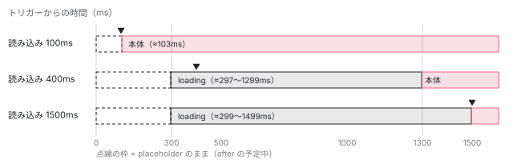

[目次](../README.md) › [@defer とインクリメンタルハイドレーションの内側](README.md) › 第 5 回 / 全 20 回

# ちらつきを防ぐ：minimum と after のタイマー

> applyDeferBlockStateWithScheduling・scheduleDeferBlockUpdate が、loading の after（表示を遅らせる）と minimum（最低限表示する）、placeholder の minimum を TimerScheduler の予定に直す行と、予定のあいだに来た次の状態を NEXT\_DEFER\_BLOCK\_STATE に覚えて予定が明けたら描く扱い。ɵɵdeferEnableTimerScheduling が、minimum や after を書いた塊でだけ渡され、consts の設定を tDetails に置いてタイマー付きの描き方を差し込む理由。

angular/angular · 読了 約 12 分 · 発展 · [サイトで読む（デモが動きます）](https://angular-deep-dive-cyan.vercel.app/chapter/defer-minimum-after)

---

`@loading (after 300ms; minimum 1s)` と書くと、「300 ms より早く読み終われば読み込み中の表示を出さない。出したら最低 1 秒は見せる」になります。この章では、その 2 つの数字がどこに入り、`applyDeferBlockStateWithScheduling` と `scheduleDeferBlockUpdate` がそれをどうやって `TimerScheduler` の予定に直すのかを 1 行ずつ追います。予定のあいだに次の状態（読み込みの完了など）が来たときに、それをどこに覚えておき、いつ描くのかも、ページの上の本物の `@defer` と Node の記録で確かめます。

読む対象は `packages/core/src/defer/rendering.ts`（319〜398 行目・451〜488 行目）、`packages/core/src/defer/utils.ts`（96〜116 行目）と、コンパイラの出力を確かめる compliance のテスト `r3_view_compiler_deferred/deferred_with_placeholder_params` です。

1. [1. 全体像](01-defer-overview.md)
2. [2. ɵɵdefer 命令](02-defer-instruction.md)
3. [3. 塊の記録](03-defer-details.md)
4. [4. 状態を描く](04-defer-render-state.md)
5. **5. minimum と after**（この章）
6. [6. 依存を読み込む](06-defer-resource-loading.md)
7. [7. トリガーから描画まで](07-defer-trigger-flow.md)
8. [8. when](08-defer-when.md)
9. [9. idle と immediate](09-defer-idle-immediate.md)
10. [10. timer](10-defer-timer.md)
11. [11. interaction と hover](11-defer-dom-triggers.md)
12. [12. viewport](12-defer-viewport.md)
13. [13. prefetch](13-defer-prefetch.md)
14. [14. 入れ子・注入器・クエリ](14-defer-nested-di.md)
15. [15. サーバーでの @defer](15-defer-server.md)
16. [16. hydrate トリガー](16-defer-hydrate-triggers.md)
17. [17. 親から順にハイドレート](17-defer-hydration-queue.md)
18. [18. hydrate のイベント](18-defer-hydrate-events.md)
19. [19. テストを読む](19-defer-tests.md)
20. [20. issue と PR を読む](20-defer-issues.md)

## 1. 書いた数字はどこに入るか：consts と第 9 引数

まずコンパイラの出力を見ます。compliance のテストは「この入力からこの出力が出る」を固定したテストです。

📄 `angular/packages/compiler-cli/test/compliance/test_cases/r3_view_compiler_deferred/deferred_with_placeholder_params.ts` L1–14 （▶ の行: 5, 7）

```ts
 1 │ import {Component} from '@angular/core';
 2 │ 
 3 │ @Component({
 4 │     template: `
 5 ▶     @defer {
 6 │       <button></button>
 7 ▶     } @placeholder (minimum 2s) {
 8 │       
 9 │     }
10 │   `,
11 │     standalone: false
12 │ })
13 │ export class MyApp {
14 │ }
```

📄 `angular/packages/compiler-cli/test/compliance/test_cases/r3_view_compiler_deferred/deferred_with_placeholder_params_template.js` L13–24 （▶ の行: 17, 21）

```js
13 │ export class MyApp {
14 │   …
15 │   static ɵcmp = /*@__PURE__*/ $r3$.ɵɵdefineComponent({
16 │   …
17 ▶   consts: [[2000], ["src", "placeholder.gif"]],
18 │   template: function MyApp_Template(rf, ctx) {
19 │     if (rf & 1) {
20 │       $r3$.ɵɵdomTemplate(0, MyApp_Defer_0_Template, 1, 0)(1, MyApp_DeferPlaceholder_1_Template, 1, 0);
21 ▶       $r3$.ɵɵdefer(2, 0, null, null, 1, null, null, 0, $r3$.ɵɵdeferEnableTimerScheduling);
22 │       $r3$.ɵɵdeferOnIdle();
23 │     }
24 │   },
```

1. **17 行目：`minimum 2s` は consts の `[2000]` になる**

   入力の 7 行目の `2s` はミリ秒に直され、コンポーネントの定数の配列（`consts`）の 0 番に `[2000]` として入ります。`@placeholder` の設定は `[minimum]`、`@loading` の設定は `[minimum, after]` の組です（形は [defer](../template/03-defer.md) の章の 6 節）。どの値を consts に入れるかを決めるコンパイラの段（`defer_configs.ts`）は [compiler-control-flow-phases](../compiler/15-compiler-control-flow-phases.md) で読めます。
2. **21 行目：`ɵɵdefer` の 8 番目に consts の番号、9 番目に関数そのもの**

   引数は前から「塊の番号 2・本体のテンプレート 0・依存の関数 null・@loading null・@placeholder 1・@error null・@loading の設定 null・@placeholder の設定 0・`ɵɵdeferEnableTimerScheduling`」です（引数の並びは [第 2 回](02-defer-instruction.md)）。**9 番目は数でも真偽値でもなく、関数への参照**です。コンパイラは `minimum` か `after` が 1 つでも書かれた塊にだけこの参照を出し、書かれていない塊では後ろの `null` ごと引数を省きます（reify の段、[compiler-control-flow-phases](../compiler/15-compiler-control-flow-phases.md)）。

## 2. ɵɵdeferEnableTimerScheduling：設定を読み、タイマー付きの描き方を差し込む

`ɵɵdefer` は最初の create pass で `tDetails`（TView に載る塊の静的な記録。[第 3 回](03-defer-details.md)）を作った直後に、受け取った 9 番目の関数を `enableTimerScheduling?.(tView, tDetails, placeholderConfigIndex, loadingConfigIndex)` の形で呼びます（[第 2 回](02-defer-instruction.md)）。呼ばれる側がこれです。

📄 `angular/packages/core/src/defer/rendering.ts` L451–488 （▶ の行: 458, 471–472, 477–478, 485–486）

```ts
451 │ /**
452 │  * Reference to the timer-based scheduler implementation of defer block state
453 │  * rendering method. It's used to make timer-based scheduling tree-shakable.
454 │  * If `minimum` or `after` parameters are used, compiler generates an extra
455 │  * argument for the `ɵɵdefer` instruction, which references a timer-based
456 │  * implementation.
457 │  */
458 ▶ let applyDeferBlockStateWithSchedulingImpl: typeof applyDeferBlockState | null = null;
459 │ 
460 │ /**
461 │  * Enables timer-related scheduling if `after` or `minimum` parameters are setup
462 │  * on the `@loading` or `@placeholder` blocks.
463 │  */
464 │ export function ɵɵdeferEnableTimerScheduling(
465 │   tView: TView,
466 │   tDetails: TDeferBlockDetails,
467 │   placeholderConfigIndex?: number | null,
468 │   loadingConfigIndex?: number | null,
469 │ ) {
470 │   const tViewConsts = tView.consts;
471 ▶   if (placeholderConfigIndex != null) {
472 ▶     tDetails.placeholderBlockConfig = getConstant<DeferredPlaceholderBlockConfig>(
473 │       tViewConsts,
474 │       placeholderConfigIndex,
475 │     );
476 │   }
477 ▶   if (loadingConfigIndex != null) {
478 ▶     tDetails.loadingBlockConfig = getConstant<DeferredLoadingBlockConfig>(
479 │       tViewConsts,
480 │       loadingConfigIndex,
481 │     );
482 │   }
483 │ 
484 │   // Enable implementation that supports timer-based scheduling.
485 ▶   if (applyDeferBlockStateWithSchedulingImpl === null) {
486 ▶     applyDeferBlockStateWithSchedulingImpl = applyDeferBlockStateWithScheduling;
487 │   }
488 │ }
```

1. **471〜482 行目：consts から設定を取り出して tDetails に置く**

   `getConstant(tViewConsts, placeholderConfigIndex)` で、1 節の `[2000]` を `tDetails.placeholderBlockConfig` に入れます。@loading の `[minimum, after]` も同じく `loadingBlockConfig` へ。**この関数が呼ばれない塊では、2 つの欄は `null` のまま**です（`ɵɵdefer` は両方 `null` で作ります）。
2. **458・485〜487 行目：モジュールの変数にタイマー付きの実装を入れる**

   458 行目の `applyDeferBlockStateWithSchedulingImpl` はファイルの一番外の変数で、最初は `null` です。どれか 1 つの塊でこの関数が呼ばれると、486 行目で 3 節の `applyDeferBlockStateWithScheduling` が入り、以後ずっとそのままです。

どの塊を描くときも、まず `renderDeferBlockState`（[第 4 回](04-defer-render-state.md)）を通ります。そこで「その塊に after か minimum があるか」を下の 2 つの関数で調べ、あれば `applyDeferBlockStateWithSchedulingImpl` を、無ければタイマーの無い `applyDeferBlockState` を呼びます。テストの `DeferBlockFixture.render` がタイマーを飛ばせるのも、この選び分けの所です（[testing-defer](../testing/18-testing-defer.md) の 3 節）。

📄 `angular/packages/core/src/defer/utils.ts` L96–116 （▶ の行: 105–108, 110, 115）

```ts
 96 │ /**
 97 │  * Returns a minimum amount of time that a given state should be rendered for,
 98 │  * taking into account `minimum` parameter value. If the `minimum` value is
 99 │  * not specified - returns `null`.
100 │  */
101 │ export function getMinimumDurationForState(
102 │   tDetails: TDeferBlockDetails,
103 │   currentState: DeferBlockState,
104 │ ): number | null {
105 ▶   if (currentState === DeferBlockState.Placeholder) {
106 ▶     return tDetails.placeholderBlockConfig?.[MINIMUM_SLOT] ?? null;
107 ▶   } else if (currentState === DeferBlockState.Loading) {
108 ▶     return tDetails.loadingBlockConfig?.[MINIMUM_SLOT] ?? null;
109 │   }
110 ▶   return null;
111 │ }
112 │ 
113 │ /** Retrieves the value of the `after` parameter on the @loading block. */
114 │ export function getLoadingBlockAfter(tDetails: TDeferBlockDetails): number | null {
115 ▶   return tDetails.loadingBlockConfig?.[LOADING_AFTER_SLOT] ?? null;
116 │ }
```

106 行目は `placeholderBlockConfig?.[MINIMUM_SLOT]`、108 行目は `loadingBlockConfig?.[MINIMUM_SLOT]`、115 行目は `loadingBlockConfig?.[LOADING_AFTER_SLOT]` です（`MINIMUM_SLOT` は 0、`LOADING_AFTER_SLOT` は 1）。110 行目、**Complete と Error には minimum がありません**。本体とエラーは一度出したら替わらないので、止めておく理由が無いからです。

> [!NOTE]
> **さらに深く**
>
> 452〜456 行目のコメントは、この形の目的を「タイマーを使う実装を tree-shaking できるようにするため」と書いています。`applyDeferBlockStateWithScheduling` を名前で参照しているのは 486 行目だけなので、どのテンプレートも `ɵɵdeferEnableTimerScheduling` を参照しなければ、束ねるツールはそれを落とせる、という設計です。ただし筆者が 22.1.6 の配布物を esbuild で束ねて試した範囲では、`ɵɵtext` だけを使う入口でも `@angular/core` がおよそ 268 KB 残り、`TimerScheduler` も含まれていました。この試し方では差を確かめられていません。

## 3. applyDeferBlockStateWithScheduling：描くか、予定に回すか

📄 `angular/packages/core/src/defer/rendering.ts` L319–353 （▶ の行: 332, 336–337, 339–341, 344–345, 352）

```ts
319 │ /**
320 │  * Extends the `applyDeferBlockState` with timer-based scheduling.
321 │  * This function becomes available on a page if there are defer blocks
322 │  * that use `after` or `minimum` parameters in the `@loading` or
323 │  * `@placeholder` blocks.
324 │  */
325 │ function applyDeferBlockStateWithScheduling(
326 │   newState: DeferBlockState,
327 │   lDetails: LDeferBlockDetails,
328 │   lContainer: LContainer,
329 │   tNode: TNode,
330 │   hostLView: LView<unknown>,
331 │ ) {
332 ▶   const now = Date.now();
333 │   const hostTView = hostLView[TVIEW];
334 │   const tDetails = getTDeferBlockDetails(hostTView, tNode);
335 │ 
336 ▶   if (lDetails[STATE_IS_FROZEN_UNTIL] === null || lDetails[STATE_IS_FROZEN_UNTIL] <= now) {
337 ▶     lDetails[STATE_IS_FROZEN_UNTIL] = null;
338 │ 
339 ▶     const loadingAfter = getLoadingBlockAfter(tDetails);
340 ▶     const inLoadingAfterPhase = lDetails[LOADING_AFTER_CLEANUP_FN] !== null;
341 ▶     if (newState === DeferBlockState.Loading && loadingAfter !== null && !inLoadingAfterPhase) {
342 │       // Trying to render loading, but it has an `after` config,
343 │       // so schedule an update action after a timeout.
344 ▶       lDetails[NEXT_DEFER_BLOCK_STATE] = newState;
345 ▶       const cleanupFn = scheduleDeferBlockUpdate(
346 │         loadingAfter,
347 │         lDetails,
348 │         tNode,
349 │         lContainer,
350 │         hostLView,
351 │       );
352 ▶       lDetails[LOADING_AFTER_CLEANUP_FN] = cleanupFn;
353 │     } else {
```

📄 `angular/packages/core/src/defer/rendering.ts` L354–377 （▶ の行: 357–360, 363, 365–368, 375）

```ts
354 │       // If we transition to a complete or an error state and there is a pending
355 │       // operation to render loading after a timeout - invoke a cleanup operation,
356 │       // which stops the timer.
357 ▶       if (newState > DeferBlockState.Loading && inLoadingAfterPhase) {
358 ▶         lDetails[LOADING_AFTER_CLEANUP_FN]!();
359 ▶         lDetails[LOADING_AFTER_CLEANUP_FN] = null;
360 ▶         lDetails[NEXT_DEFER_BLOCK_STATE] = null;
361 │       }
362 │ 
363 ▶       applyDeferBlockState(newState, lDetails, lContainer, tNode, hostLView);
364 │ 
365 ▶       const duration = getMinimumDurationForState(tDetails, newState);
366 ▶       if (duration !== null) {
367 ▶         lDetails[STATE_IS_FROZEN_UNTIL] = now + duration;
368 ▶         scheduleDeferBlockUpdate(duration, lDetails, tNode, lContainer, hostLView);
369 │       }
370 │     }
371 │   } else {
372 │     // We are still rendering the previous state.
373 │     // Update the `NEXT_DEFER_BLOCK_STATE`, which would be
374 │     // picked up once it's time to transition to the next state.
375 ▶     lDetails[NEXT_DEFER_BLOCK_STATE] = newState;
376 │   }
377 │ }
```

使う欄は `LDeferBlockDetails`（塊の 1 つ 1 つの記録。[第 3 回](03-defer-details.md)）の 3 つです。`STATE_IS_FROZEN_UNTIL`（いまの状態を「この時刻までは替えない」）、`NEXT_DEFER_BLOCK_STATE`（予定が明けたら描く状態）、`LOADING_AFTER_CLEANUP_FN`（after の予定を取り消す関数）。分かれ道は 3 本です。

1. **371〜376 行目：止めている最中なら、覚えるだけ**

   336 行目の条件は「`STATE_IS_FROZEN_UNTIL` が `null` か、もう過ぎた」。そうでなければ 375 行目で `NEXT_DEFER_BLOCK_STATE` に新しい状態を書くだけで、何も描きません。後から来たものが上書きするので、止めている間に Loading → Complete と 2 回来れば、残るのは Complete です。
2. **341〜352 行目：Loading に after があり、まだ after の予定を立てていなければ、予定にする**

   340 行目の `inLoadingAfterPhase` は「after の予定を立てたことがあるか」です。無ければ 344 行目で Loading を `NEXT_DEFER_BLOCK_STATE` に覚え、345〜351 行目で after ミリ秒あとの予定（4 節）を立て、352 行目でその取り消しの関数をしまいます。**この時点では画面は替わりません**（placeholder のまま）。
3. **353〜370 行目：それ以外は描く。必要なら止める**

   357〜361 行目、Complete か Error（`> Loading`）が来たときに after の予定が残っていれば、358 行目で取り消し、360 行目で覚えていた Loading も消します。**after より早く読み終わったときに読み込み中の表示を出さない**のはこの 3 行です。363 行目で本当に描き（`applyDeferBlockState`、[第 4 回](04-defer-render-state.md)）、365〜369 行目でその状態に minimum があれば、367 行目で「いま（332 行目の `now`）+ minimum」まで止め、368 行目でその時刻の予定を立てます。

> [!WARNING]
> **ハマりどころ**
>
> after の予定が明けて Loading を描くときも、この関数を通ります。そのとき 340 行目の `inLoadingAfterPhase` は `true`（取り消しの関数がまだ入っている）なので、341 行目の条件に入らず、もう一度 after を待つことはありません。`LOADING_AFTER_CLEANUP_FN` は、本体かエラーが来て 359 行目で消えるまで残ります（下の記録の「LOADING\_AFTER」の列）。

## 4. scheduleDeferBlockUpdate：予定が明けたら、覚えていた状態を描く

📄 `angular/packages/core/src/defer/rendering.ts` L379–398 （▶ の行: 389–394, 397）

```ts
379 │ /**
380 │  * Schedules an update operation after a specified timeout.
381 │  */
382 │ function scheduleDeferBlockUpdate(
383 │   timeout: number,
384 │   lDetails: LDeferBlockDetails,
385 │   tNode: TNode,
386 │   lContainer: LContainer,
387 │   hostLView: LView<unknown>,
388 │ ): VoidFunction {
389 ▶   const callback = () => {
390 ▶     const nextState = lDetails[NEXT_DEFER_BLOCK_STATE];
391 ▶     lDetails[STATE_IS_FROZEN_UNTIL] = null;
392 ▶     lDetails[NEXT_DEFER_BLOCK_STATE] = null;
393 ▶     if (nextState !== null) {
394 ▶       renderDeferBlockState(nextState, tNode, lContainer);
395 │     }
396 │   };
397 ▶   return scheduleTimerTrigger(timeout, callback, hostLView[INJECTOR]);
398 │ }
```

1. **390〜392 行目：覚えていた状態を取り出し、止めるのをやめる**

   `NEXT_DEFER_BLOCK_STATE` を読み、`STATE_IS_FROZEN_UNTIL` と `NEXT_DEFER_BLOCK_STATE` を `null` に戻します。
2. **393〜395 行目：あれば、もう一度 renderDeferBlockState から**

   覚えていた状態が無ければ（minimum の間に何も来なかった）何もしません。あれば `renderDeferBlockState` を呼ぶので、3 節の分かれ道をもう一度通ります。たとえば placeholder の minimum が明けたときに Loading を覚えていれば、こんどは Loading の after の予定が立ちます（記録の「描いてすぐトリガー・1500ms」）。
3. **397 行目：予定そのものは TimerScheduler に任せる**

   `scheduleTimerTrigger(timeout, callback, injector)` が、アプリに 1 つの `TimerScheduler` に予定を足し、取り消しの関数を返します。`@defer (on timer)` と同じ仕組みです（[第 10 回](10-defer-timer.md)）。368 行目の minimum の予定では、戻り値の取り消しの関数を捨てています。止めている間に塊のある view が壊されても、予定が明けたときの `renderDeferBlockState` が先頭で壊れた view かを見て何もせず帰ります（[第 4 回](04-defer-render-state.md)）。



*記録から：@loading (after 300ms; minimum 1000ms) の塊を、読み込みの時間を変えてトリガーした。横軸はトリガーからのミリ秒（記録の値を丸めた）。▼ は読み込みが終わった時刻。*

## 5. DEMO：ページの上の本物の @defer で時刻を測る

> **🧪 DEMO — @loading の after と minimum（ライブ）**
>
> 下の 2 つは、この章のテンプレートに書いた本物の `@defer` です。本体の `defer-ma-panel` は `@defer` の中でだけ使っているので別の chunk になり、トリガーで初めて `import()` されます。各ブロックの中の部品が作られた時刻を、最初に「描く」を押した時刻からのミリ秒で並べます。「いまの記録を読む」は `ɵgetDeferBlocks` で `LDeferBlockDetails` の欄を**読むだけ**です（内部の形です。0 番が NEXT\_DEFER\_BLOCK\_STATE、1 番が DEFER\_BLOCK\_STATE、2 番が STATE\_IS\_FROZEN\_UNTIL、3 番が LOADING\_AFTER\_CLEANUP\_FN。欄の番号は `interfaces.ts` の定数で、[第 3 回](03-defer-details.md)で読みます）。
>
> 試し方：A を描いてすぐトリガーすると、placeholder の minimum（500 ms）が明けるまで本体は出ません（3 節の 375 行目で覚え、4 節で描く）。このページの chunk は小さいので、読み込みはたいてい 300 ms より早く終わり、A では `@loading` が作られません（357〜361 行目）。B は after が無いので、すぐ `@loading` が出て、読み込みが早くても 1 秒は残ります。読み込みが済んだ塊は `tDetails.loadingState` が COMPLETE のまま残るので、片付けてからもう一度描いてトリガーすると、`@loading` を通らずに本体が出ます（[第 7 回](07-defer-trigger-flow.md)の COMPLETE の枝）。読み込みを遅くする `ɵDEFER_BLOCK_DEPENDENCY_INTERCEPTOR` は開発モードでしか効かない（[第 6 回](06-defer-resource-loading.md)）ので、遅い場合は次の記録で見ます。
>
> ▶ [このデモはサイトで動かせます](https://angular-deep-dive-cyan.vercel.app/chapter/defer-minimum-after)

## 6. DEMO：読み込みの時間を変えた記録

> **🧪 DEMO — 10 ms ごとに読んだ LDeferBlockDetails（記録の再生）**
>
> これは記録です。本物の @angular/core 22.1.6（開発モード・JIT）を Node で、domino の DOM の上で動かした結果です。塊は `@defer (when ready()) { <defer-heavy /> } @loading (after 300ms; minimum 1000ms) @placeholder (minimum 500ms)` で、依存の読み込みを `ɵDEFER_BLOCK_DEPENDENCY_INTERCEPTOR` で「n ms 後に解決する Promise」に差し替えました（defer\_spec.ts の `createFixture` と同じやり方）。ms は起動して描いた時刻からで、欄が変わった行だけを残しています。`STATE_IS_FROZEN_UNTIL` は同じ基準の ms に直しました。時刻は Node の `setTimeout` の揺れで数 ms ずれます。共通の部品は[第 1 回](01-defer-overview.md)に全文があります。
>
> 場面のボタンを押してください。
>
> ▶ [このデモはサイトで動かせます](https://angular-deep-dive-cyan.vercel.app/chapter/defer-minimum-after)

記録から読み取れることです（数字は記録の値）。

1. **読み込み 100ms：Loading を一度も描かない**

   612 ms のトリガーで NEXT が Loading、LOADING\_AFTER が関数になり（344・352 行目）、文字は「待機」のまま。715 ms に読み終わり、Complete が来たので 358 行目で取り消して本体を描きました。
2. **読み込み 400ms：after のあと、minimum いっぱい Loading**

   910 ms（トリガーから約 300 ms）に Loading を描き、FROZEN\_UNTIL が 1909 になります（367 行目）。1010 ms に読み終わっても止めている最中なので NEXT に Complete を覚えるだけ（375 行目）。1912 ms の予定で本体を描きました（394 行目）。
3. **読み込み 1500ms：minimum が先に明け、読み終わりを待つ**

   914 ms に Loading、1916 ms に FROZEN\_UNTIL が null に戻っても NEXT は null なので何もしません（393 行目）。2114 ms に読み終わり、止めていないのですぐ本体です。
4. **描いてすぐ（0ms）トリガー：placeholder の minimum が先**

   placeholder を描いた時点で FROZEN\_UNTIL が 499 です。5〜6 ms のトリガーは 375 行目で NEXT に Loading を覚えるだけ。読み込み 100ms なら 105 ms に NEXT が Complete に上書きされ、502 ms に本体（Loading を通らない）。1500ms なら 511 ms に Loading が描き直しに回り、**after の 300 ms はそこから数える**ので 810 ms に Loading、1805 ms に本体でした。

📄 `scratchpad の記録スクリプト（minimum-after.ts、共通の build.mjs で束ねて node で実行。共通の harness.ts は第 1 回に全文）`

```
// 第 5 回 defer-minimum-after の記録。
// @loading (after 300ms; minimum 1000ms) と @placeholder (minimum 500ms) を持つ塊で、
// 依存の読み込みにかかる時間（ɵDEFER_BLOCK_DEPENDENCY_INTERCEPTOR で包んだ Promise の待ち時間）と
// トリガーの時刻を変え、10ms ごとに LDeferBlockDetails の欄と描かれた文字を読む。変わったときだけ残す。
import { Component, signal, ɵDEFER_BLOCK_DEPENDENCY_INTERCEPTOR as DEFER_BLOCK_DEPENDENCY_INTERCEPTOR } from '@angular/core';
import { installDom, bootBrowser, blocks, text, tick, writeJson } from '../_shared/harness';

@Component({ selector: 'defer-heavy', template: '本体' })
class Heavy {}

/** 場面ごとに新しいクラスを作る（tDetails.loadingState は TView、つまりクラスごとに残るため）。 */
function makeRoot(selector: string) {
  @Component({
    selector,
    imports: [Heavy],
    template: `
      @defer (when ready()) { <defer-heavy /> }
      @loading (after 300ms; minimum 1000ms) { 読み込み中 }
      @placeholder (minimum 500ms) { 待機 }
    `,
  })
  class Root { ready = signal(false); }
  // defer_spec.ts の clearDirectiveDefs と同じ: JIT では依存が eager になるので、
  // 定義から依存を外し、本体の依存は下の interceptor が返す Promise からだけ届くようにする。
  const def = (Root as any).ɵcmp;
  def.dependencies = [];
  def.directiveDefs = null;
  return Root;
}

const scenes = [
  { id: 'fast', title: '読み込み 100ms・placeholder の 500ms の後にトリガー', triggerAt: 600, loadMs: 100 },
  { id: 'mid', title: '読み込み 400ms・placeholder の 500ms の後にトリガー', triggerAt: 600, loadMs: 400 },
  { id: 'slow', title: '読み込み 1500ms・placeholder の 500ms の後にトリガー', triggerAt: 600, loadMs: 1500 },
  { id: 'early-fast', title: '読み込み 100ms・描いてすぐ（0ms）トリガー', triggerAt: 0, loadMs: 100 },
  { id: 'early-slow', title: '読み込み 1500ms・描いてすぐ（0ms）トリガー', triggerAt: 0, loadMs: 1500 },
];

const out: any = { core: '22.1.6', scenes: [] };
const doc = installDom('<html><head></head><body></body></html>');
for (const sc of scenes) {
  // プラットフォームは 1 つなので document も 1 つ。場面ごとにホストの要素を足す（selector も場面ごとに変える）。
  doc.body.appendChild(doc.createElement('app-' + sc.id));
  let calls = 0;
  const interceptor = {
    intercept: (fn: unknown) => () => {
      calls++;
      return [new Promise((r) => setTimeout(() => r(Heavy), sc.loadMs))];
    },
  };
  const Root = makeRoot('app-' + sc.id);
  const { appRef, ref } = await bootBrowser(Root, {
    providers: [{ provide: DEFER_BLOCK_DEPENDENCY_INTERCEPTOR, useValue: interceptor }],
  });
  const t0 = Date.now();
  const rows: any[] = [];
  let last = '';
  const snap = (note: string) => {
    const b = blocks(ref)[0];
    const l = b.lDetails;
    const row = {
      text: text(ref),
      DEFER_BLOCK_STATE: l.DEFER_BLOCK_STATE,
      NEXT_DEFER_BLOCK_STATE: l.NEXT_DEFER_BLOCK_STATE,
      STATE_IS_FROZEN_UNTIL: l.STATE_IS_FROZEN_UNTIL === null ? null : l.STATE_IS_FROZEN_UNTIL - t0,
      LOADING_AFTER_CLEANUP_FN: l.LOADING_AFTER_CLEANUP_FN,
      loadingState: b.tDetails.loadingState,
    };
    const key = JSON.stringify(row);
    if (key !== last || note) {
      rows.push({ ms: Date.now() - t0, note, ...row });
      last = key;
    }
  };
  snap('起動して描いた直後');
  let triggered = false;
  while (Date.now() - t0 < 2600) {
    if (!triggered && Date.now() - t0 >= sc.triggerAt) {
      (ref.instance as any).ready.set(true);
      // whenStable は使わない（読み込み中は PendingTasks が残り、終わるまで待ってしまうため）。
      await tick(5);
      triggered = true;
      snap('ready.set(true) と変更検知のあと');
      continue;
    }
    await tick(10);
    snap('');
  }
  out.scenes.push({ ...sc, dependencyFnCalls: calls, placeholderConfig: blocks(ref)[0].tDetails.placeholderBlockConfig, loadingConfig: blocks(ref)[0].tDetails.loadingBlockConfig, rows });
  appRef.destroy();
}
await writeJson(process.argv[2] ?? '/dev/stdout', out);
process.exit(0);

```

## ここまでの呼び出し

- 👤 `@loading (after 300ms; minimum 1s)` — あなたのテンプレート
  - `ɵɵdefer(…, loadingConfigIndex, placeholderConfigIndex, ɵɵdeferEnableTimerScheduling)` — コンパイラの出力 — *第 2 回*
    - `ɵɵdeferEnableTimerScheduling(tView, tDetails, …)` — rendering.ts 464 — *consts → tDetails、Impl を入れる*
- `renderDeferBlockState(newState, tNode, lContainer)` — rendering.ts — *第 4 回。after・minimum があれば Impl を選ぶ*
  - `applyDeferBlockStateWithScheduling(newState, lDetails, …)` — rendering.ts 325
    - `getLoadingBlockAfter(tDetails)`・`getMinimumDurationForState(tDetails, state)` — utils.ts 114・101
    - `applyDeferBlockState(…)` — rendering.ts 363 — *本当に描く*
    - `scheduleDeferBlockUpdate(timeout, …)` — rendering.ts 382
      - `scheduleTimerTrigger(timeout, callback, injector)` — timer\_scheduler.ts — *第 10 回*
        - `callback()` → `renderDeferBlockState(NEXT_DEFER_BLOCK_STATE, …)` — rendering.ts 389〜395 — *もう一度上から*

## テストと直し方

### spec と describe

`packages/core/test/acceptance/defer_spec.ts` の describe `minimum and after conditions`（894 行目）に it が 7 件あります： `should support minimum and after conditions`（895）・`` should support @placeholder with `minimum` ``（919）・`should keep rendering @placeholder if trigger happened later`（931）・`should transition from @placeholder to primary content if it was prefetched`（949）・`` should support @loading with `minimum` ``（971）・`` should support @loading with `after` and `minimum` ``（991）・`should skip @loading when resources were prefetched`（1013）。

📄 `angular/packages/core/test/acceptance/defer_spec.ts` L894–918 （▶ の行: 899, 901, 911–913, 915）

```ts
894 │   describe('minimum and after conditions', () => {
895 │     it('should support minimum and after conditions', async () => {
896 │       const {trigger, fixture} = createFixture(`
897 │             @defer (when trigger; prefetch when prefetchTrigger) {
898 │               <nested-cmp [block]="'Main'" />
899 ▶             } @loading (after 100ms; minimum 150ms) {
900 │               Loading
901 ▶             } @placeholder (minimum 100ms) {
902 │               Placeholder
903 │             } @error {
904 │               Error
905 │             }
906 │           `);
907 │ 
908 │       await verifyTimeline(
909 │         fixture,
910 │         [50, 'Placeholder'],
911 ▶         [100, trigger(170)],
912 ▶         [150, 'Placeholder'],
913 ▶         [250, 'Loading'],
914 │         [300, 'Loading'],
915 ▶         [450, 'Main'],
916 │       );
917 │     });
918 │ 
```

`verifyTimeline` は spec の先頭にある補助関数で、`[時刻, 期待する文字]` を順に本物の時間で待って確かめます（期待の文字になるまで最大 40 ms ずつ様子を見る）。`trigger(170)` は「読み込みに 170 ms かかる」として when を真にします。911 行目の 100 ms のトリガーから after の 100 ms は placeholder のまま（912 行目）、200 ms から Loading で minimum 150 ms は 350 ms まで止まり、読み込みは 270 ms に終わっても 913〜914 行目は Loading、915 行目で本体です。3 節の 375 行目と 4 節の 394 行目の組み合わせを確かめている it です。

📄 `angular/packages/core/test/acceptance/defer_spec.ts` L971–1012 （▶ の行: 975, 982, 986–987, 995, 1003, 1005, 1009）

```ts
 971 │     it('should support @loading with `minimum`', async () => {
 972 │       const {trigger, fixture} = createFixture(`
 973 │           @defer (when trigger; prefetch when prefetchTrigger) {
 974 │             <nested-cmp [block]="'Main'" />
 975 ▶           } @loading (minimum 100ms) {
 976 │             Loading
 977 │           }
 978 │         `);
 979 │ 
 980 │       await verifyTimeline(
 981 │         fixture,
 982 ▶         [0, trigger(20)],
 983 │         // Even though loading happened in 20ms,
 984 │         // we still render @loading block for longer
 985 │         // period of time, since there was `minimum` defined.
 986 ▶         [95, 'Loading'],
 987 ▶         [100, 'Main'],
 988 │       );
 989 │     });
 990 │ 
 991 │     it('should support @loading with `after` and `minimum`', async () => {
 992 │       const {trigger, fixture} = createFixture(`
 993 │          @defer (when trigger; prefetch when prefetchTrigger) {
 994 │            <nested-cmp [block]="'Main'" />
 995 ▶          } @loading (after 100ms; minimum 150ms) {
 996 │            Loading
 997 │          }
 998 │        `);
 999 │ 
1000 │       await verifyTimeline(
1001 │         fixture,
1002 │         [0, trigger(150)],
1003 ▶         [50, ''],
1004 │         // Start showing loading after `after` ms.
1005 ▶         [100, 'Loading'],
1006 │         [150, 'Loading'],
1007 │         [200, 'Loading'],
1008 │         // Render main content after `after` + `minimum` ms.
1009 ▶         [300, 'Main'],
1010 │       );
1011 │     });
1012 │ 
```

986 行目、読み込みは 20 ms で済んでも minimum 100 ms のあいだ Loading のままです。1003 行目の `''` は「after の間は何も出ない」の確認で、この 2 つ目の it には `@placeholder` がありません。1009 行目、本体は after + minimum の 300 ms です。

### 手元で走らせた結果

📄 `ターミナル（../angular で）`

```
cd ~/angular-research/angular
pnpm bazel test //packages/core/test/acceptance:acceptance \
  --nocache_test_results --test_output=all \
  '--test_arg=--filter=@defer minimum and after conditions'
```

📄 `出力（2026-11-06 に実行。抜粋。ログは scratchpad/defer-logs/b-minimum-after.log）`

```
Ran 7 of 2693 specs
7 specs, 0 failures
INFO: Elapsed time: 5.770s, Critical Path: 3.26s
//packages/core/test/acceptance:acceptance   PASSED in 2.9s
```

- jasmine の `--filter` は describe と it をつないだ名前に対する正規表現です。`@defer minimum and after conditions` で 2693 件のうち上の 7 件だけが走りました（0 件でも PASSED になるので、件数を必ず見ます）。
- この 7 件は本物の時間（`setTimeout`）で待つので、合わせて 1 秒ほどかかります。

### 直すとしたら

- 「minimum が効かない」「after より早いのに読み込み中が光る」は、まず `rendering.ts` の `applyDeferBlockStateWithScheduling` の 336・341・357 行目の条件と、`scheduleDeferBlockUpdate` の 390〜395 行目を疑います。その塊に `ɵɵdeferEnableTimerScheduling` が渡っているか（コンパイラの出力）も 1 節の形で確かめます。
- 直したら、defer\_spec.ts の `minimum and after conditions` に `verifyTimeline` の形で 1 件足すのが近道です。時刻の幅は 40 ms の様子見があるので、境目ぎりぎりの期待は書かないようにします。
- 閉じた issue #65596（`@defer (on viewport)` の塊ごとに `viewChildren` が何度も更新される）では、報告者が `@loading` に minimum を足しても変わらなかったと書いています。minimum は 1 つの塊の中の状態を止めるだけで、複数の塊をまとめて描く仕組みではないこと（3 節）が、読むときの手がかりになります。最近の修正の一覧は [第 20 回](20-defer-issues.md)です。
- 本家に PR を出すことは勧めません。手元で spec を走らせ、この章の記録のように欄を読んで確かめるところまでにします。

## 聞かれそうな質問

**Q. after より早く読み終わったら、読み込み中の表示は一瞬も出ないのですか？**

出ません。after の間は 344 行目で Loading を NEXT\_DEFER\_BLOCK\_STATE に覚えているだけで、画面は placeholder のままです。読み終わって Complete が来ると、357〜361 行目で after の予定を取り消し、覚えていた Loading も消してから 363 行目で本体を描きます（記録の「読み込み 100ms」）。

**Q. minimum の間に読み込みが終わったら、どこで待っているのですか？**

336 行目の条件に入らず、375 行目で `NEXT_DEFER_BLOCK_STATE` に Complete を書いて帰ります。368 行目で立てた予定が明けると、390 行目でそれを取り出し 394 行目で描きます。待っているのは Promise ではなく、塊の記録の 1 つの欄です。

**Q. after の 300 ms は、トリガーから数えるのですか？**

「Loading を描こうとした時刻」から数えます。placeholder の minimum で止まっている最中にトリガーが来ると、Loading は 375 行目で覚えられるだけで、minimum が明けたとき（394 行目）に初めて 341 行目に来て after の予定が立ちます。記録の「描いてすぐトリガー・1500ms」では、511 ms から 300 ms 後の 810 ms に Loading が出ました。

**Q. 本体（Complete）に minimum を付けられないのはなぜですか？**

構文が @placeholder と @loading にしか無く、実行時も `getMinimumDurationForState` の 110 行目が Complete と Error に `null` を返すからです。状態は前にしか進まないので、本体やエラーを止めておく理由がありません。

**Q. minimum も after も書かない塊でも、タイマーの仕組みは動きますか？**

その塊では動きません。`ɵɵdeferEnableTimerScheduling` が渡らないので `placeholderBlockConfig`・`loadingBlockConfig` は `null` のままで、utils.ts の 106・108・115 行目が `null` を返し、`renderDeferBlockState` はタイマーの無い `applyDeferBlockState` を選びます。ページの別の塊が 486 行目で Impl を入れていても、選ばれません。

## 読み終えて

- `minimum` と `after` は consts の `[minimum]`・`[minimum, after]` になり、`ɵɵdeferEnableTimerScheduling` が `tDetails` に置きます。書いた塊にだけこの関数が渡ります。
- `applyDeferBlockStateWithScheduling` の分かれ道は 3 本：止めている最中なら覚えるだけ、Loading に after があれば予定にする、それ以外は描いて minimum があれば止める。
- 予定のあいだに来た状態は `NEXT_DEFER_BLOCK_STATE` に上書きで覚え、`scheduleDeferBlockUpdate` の予定が明けたら `renderDeferBlockState` からもう一度通します。
- after は「Loading を描こうとした時刻」から、minimum は「その状態を描いた時刻」から数えます。

---

← 前: [状態を描く：renderDeferBlockState と applyDeferBlockState](04-defer-render-state.md)  
次: [依存を読み込む：triggerResourceLoading](06-defer-resource-loading.md) →
