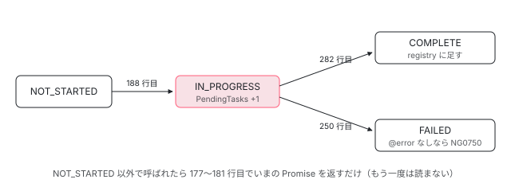

[目次](../README.md) › [@defer とインクリメンタルハイドレーションの内側](README.md) › 第 6 回 / 全 20 回

# 依存を読み込む：triggerResourceLoading

> triggerResourceLoading が dependencyResolverFn を呼んで import() を始め、Promise.allSettled で待ち、読み込んだディレクティブとパイプを TView の registry に足す（addDepsToRegistry）行、失敗したときに Failed になって error のテンプレートを出す行、DEFER\_BLOCK\_DEPENDENCY\_INTERCEPTOR、読み込み中の PendingTasks、2 つのトリガーが同時に来たときに loadingPromise を共有する行。

angular/angular · 読了 約 13 分 · 中核 · [サイトで読む（デモが動きます）](https://angular-deep-dive-cyan.vercel.app/chapter/defer-resource-loading)

---

トリガーが発火すると、`@defer` の中でだけ使うコンポーネントやパイプの `import()` が始まります。その入口が `triggerResourceLoading` です。この章では、この関数が「もう始まっていれば何もしない」と決める行、依存の関数（`dependencyResolverFn`）を呼ぶ前に差し替えの口と `PendingTasks` を通す行、`Promise.allSettled` の結果を 1 つずつ見て成功なら TView の registry に足し（`addDepsToRegistry`）、失敗なら `FAILED` にする行を、順に読みます。ページの上で本当に別の chunk が読まれることと、Node の記録で失敗の場面も確かめます。

読む対象は `packages/core/src/defer/triggering.ts`（176〜313 行目）、`utils.ts`（118〜135 行目）、`rendering.ts`（424〜449 行目）です。

1. [1. 全体像](01-defer-overview.md)
2. [2. ɵɵdefer 命令](02-defer-instruction.md)
3. [3. 塊の記録](03-defer-details.md)
4. [4. 状態を描く](04-defer-render-state.md)
5. [5. minimum と after](05-defer-minimum-after.md)
6. **6. 依存を読み込む**（この章）
7. [7. トリガーから描画まで](07-defer-trigger-flow.md)
8. [8. when](08-defer-when.md)
9. [9. idle と immediate](09-defer-idle-immediate.md)
10. [10. timer](10-defer-timer.md)
11. [11. interaction と hover](11-defer-dom-triggers.md)
12. [12. viewport](12-defer-viewport.md)
13. [13. prefetch](13-defer-prefetch.md)
14. [14. 入れ子・注入器・クエリ](14-defer-nested-di.md)
15. [15. サーバーでの @defer](15-defer-server.md)
16. [16. hydrate トリガー](16-defer-hydrate-triggers.md)
17. [17. 親から順にハイドレート](17-defer-hydration-queue.md)
18. [18. hydrate のイベント](18-defer-hydrate-events.md)
19. [19. テストを読む](19-defer-tests.md)
20. [20. issue と PR を読む](20-defer-issues.md)

前提を 1 つ。読み込みの状態 `loadingState` は `tDetails`（TView に載る、テンプレートの中の塊 1 つにつき 1 つの記録）にあり、塊の 1 回 1 回の記録 `LDeferBlockDetails` にはありません（[第 3 回](03-defer-details.md)）。**同じテンプレートの同じ塊なら、いくつ描かれても読み込みは 1 回**です。この章の行は、ほとんどがこの前提の上にあります。

## 1. もう始まっていれば、同じ Promise を返す

📄 `angular/packages/core/src/defer/triggering.ts` L176–182 （▶ の行: 177, 181）

```ts
176 │ 
177 ▶   if (tDetails.loadingState !== DeferDependenciesLoadingState.NOT_STARTED) {
178 │     // If the loading status is different from initial one, it means that
179 │     // the loading of dependencies is in progress and there is nothing to do
180 │     // in this function. All details can be obtained from the `tDetails` object.
181 ▶     return tDetails.loadingPromise ?? Promise.resolve();
182 │   }
```

177 行目、`NOT_STARTED` でなければ、181 行目でいまの `loadingPromise` を返して終わります（済んでいて `null` なら、解決済みの Promise）。**2 つのトリガーが同時に来たとき**（prefetch と本体のトリガー、`@for` の中の同じ塊の 2 つなど）に、読み込みが 2 回走らないのはこの行のおかげです。後から来た側は、同じ Promise を待つことになります（記録の「@for の 2 つの塊」の場面で、依存の関数は 1 回しか呼ばれていません）。この関数の前半はテストの章でも読んでいます（[testing-defer](../testing/18-testing-defer.md) の 3 節）。

📄 `angular/packages/core/src/defer/triggering.ts` L185–191 （▶ の行: 185, 188, 191）

```ts
185 ▶   const primaryBlockTNode = getPrimaryBlockTNode(tView, tDetails);
186 │ 
187 │   // Switch from NOT_STARTED -> IN_PROGRESS state.
188 ▶   tDetails.loadingState = DeferDependenciesLoadingState.IN_PROGRESS;
189 │ 
190 │   // Prefetching is triggered, cleanup all registered prefetch triggers.
191 ▶   invokeTriggerCleanupFns(TriggerType.Prefetch, lDetails);
```

185 行目で本体のテンプレートの TNode を取り、188 行目で `IN_PROGRESS` にします。この代入は `dependencyResolverFn` を呼ぶより前なので、依存の関数の中で何が起きても、2 回目の呼び出しは 177 行目で止まります。191 行目、読み込みが始まったので、prefetch のトリガーの後片付けをここで呼びます。**本体のトリガーの後片付けは呼びません**。prefetch で読み込んでも、本体を出すのは本体のトリガーだからです（後片付けの仕組みは[第 7 回](07-defer-trigger-flow.md)、prefetch は[第 13 回](13-defer-prefetch.md)）。

## 2. 依存の関数と、差し替えの口

`tDetails.dependencyResolverFn` は、コンパイラが `@defer` の中だけで使う依存を `() => [import('./x').then(m => m.X)]` の形にした関数です（[standalone-defer-deps](../standalone/11-standalone-defer-deps.md)）。呼ぶ前に、開発モードのときだけ差し替えの口を見ます。

📄 `angular/packages/core/src/defer/triggering.ts` L196–202 （▶ の行: 197, 201–202）

```ts
196 │     // Check if dependency function interceptor is configured.
197 ▶     const deferDependencyInterceptor = injector.get(DEFER_BLOCK_DEPENDENCY_INTERCEPTOR, null, {
198 │       optional: true,
199 │     });
200 │ 
201 ▶     if (deferDependencyInterceptor) {
202 ▶       dependenciesFn = deferDependencyInterceptor.intercept(dependenciesFn);
```

197 行目で `DEFER_BLOCK_DEPENDENCY_INTERCEPTOR` を省略可能で探し、あれば 202 行目で元の関数を `intercept()` に渡して、戻り値と取り替えます。この 7 行は `if (ngDevMode)` の中なので、**本番のビルドでは差し替えは効きません**。`ɵDEFER_BLOCK_DEPENDENCY_INTERCEPTOR` という名前で外に出ていて、defer\_spec.ts のテストや、この章の Node の記録が「n ms 後に解決（失敗）する Promise」を返すのに使っています。

## 3. PendingTasks：読み込み中はアプリが「安定していない」

📄 `angular/packages/core/src/defer/triggering.ts` L207–213 （▶ の行: 207, 212–213）

```ts
207 ▶   const removeTask = injector.get(PendingTasks).add();
208 │ 
209 │   // The `dependenciesFn` might be `null` when all dependencies within
210 │   // a given defer block were eagerly referenced elsewhere in a file,
211 │   // thus no dynamic `import()`s were produced.
212 ▶   if (!dependenciesFn) {
213 ▶     tDetails.loadingPromise = Promise.resolve().then(() => {
```

207 行目で `PendingTasks` に 1 つ足し、外す関数 `removeTask` を持っておきます。足している間は `ApplicationRef.isStable` が `false` になり、`whenStable()` は待ちます（仕組みは [zoneless-pending-tasks](../zoneless/09-zoneless-pending-tasks.md)）。サーバーの描画が読み込みの終わりを待てるのも、テストの `await fixture.whenStable()` で本体まで進めるのも、この 1 行のおかげです。外すのは成功でも失敗でも 6 節の 311 行目です。212〜213 行目は、依存がすべてほかでも使われていて `import()` が 1 つも無い塊の道で、次の microtask で `COMPLETE` にして task を外します（[testing-defer](../testing/18-testing-defer.md) の 3 節）。

## 4. Promise.allSettled：結果を 1 つずつ仕分ける

📄 `angular/packages/core/src/defer/triggering.ts` L221–248 （▶ の行: 222, 228, 230, 232, 236, 241–243, 245）

```ts
221 │   // Start downloading of defer block dependencies.
222 ▶   tDetails.loadingPromise = Promise.allSettled(dependenciesFn()).then((results) => {
223 │     let failed = false;
224 │     let failedReason: Error | null = null;
225 │     const directiveDefs: DirectiveDefList = [];
226 │     const pipeDefs: PipeDefList = [];
227 │ 
228 ▶     for (let i = 0; i < results.length; i++) {
229 │       const result = results[i];
230 ▶       if (result.status === 'fulfilled') {
231 │         const dependency = result.value;
232 ▶         const directiveDef = getComponentDef(dependency) || getDirectiveDef(dependency);
233 │         if (directiveDef) {
234 │           directiveDefs.push(directiveDef);
235 │         } else {
236 ▶           const pipeDef = getPipeDef(dependency);
237 │           if (pipeDef) {
238 │             pipeDefs.push(pipeDef);
239 │           }
240 │         }
241 ▶       } else {
242 ▶         failed = true;
243 ▶         failedReason =
244 │           result.reason instanceof Error ? result.reason : new Error(String(result.reason));
245 ▶         break;
246 │       }
247 │     }
248 │ 
```

1. **222 行目：`Promise.all` ではなく `allSettled`**

   どれか 1 つが失敗しても、全部が終わるまで待ちます。結果は `{status, value}` か `{status, reason}` の配列です。
2. **230〜240 行目：成功したものはディレクティブかパイプかで分ける**

   232 行目、`getComponentDef` か `getDirectiveDef` で定義（`ɵcmp`・`ɵdir`）が取れればディレクティブの配列へ、236 行目で `ɵpipe` が取れればパイプの配列へ。どちらでもないもの（定義の無いクラスなど）は黙って捨てられます。
3. **241〜245 行目：1 つでも失敗したら、そこで打ち切る**

   243 行目で理由を `Error` に揃えて（`reject()` に文字列や `undefined` が渡っても `new Error(String(...))`）、245 行目の `break` で残りを見ません。

## 5. 失敗したとき：FAILED と NG0750

📄 `angular/packages/core/src/defer/triggering.ts` L249–280 （▶ の行: 250, 252–253, 256, 262, 265, 271, 274, 278–279）

```ts
249 │     if (failed) {
250 ▶       tDetails.loadingState = DeferDependenciesLoadingState.FAILED;
251 │ 
252 ▶       if (tDetails.errorTmplIndex === null) {
253 ▶         const templateLocation = ngDevMode ? getTemplateLocationDetails(lView) : '';
254 │         let errorMsg = '';
255 │ 
256 ▶         if (ngDevMode) {
257 │           errorMsg =
258 │             'Loading dependencies for `@defer` block failed, ' +
259 │             `but no \`@error\` block was configured${templateLocation}. ` +
260 │             'Consider using the `@error` block to render an error state.';
261 │ 
262 ▶           const depsFn = tDetails.dependencyResolverFn;
263 │           const errorReason = failedReason?.message;
264 │ 
265 ▶           if (depsFn) {
266 │             errorMsg +=
267 │               `\n\nAngular tried to invoke the following dependency function (compiler-generated):\n` +
268 │               `\`\`\`\n${depsFn.toString()}\n\`\`\``;
269 │           }
270 │ 
271 ▶           if (errorReason) {
272 │             errorMsg += depsFn
273 │               ? `\n\nbut it resulted in the following error:\n\n${errorReason}`
274 ▶               : `\n\nThe loading resulted in the following error:\n\n${errorReason}`;
275 │           }
276 │         }
277 │ 
278 ▶         const error = new RuntimeError(RuntimeErrorCode.DEFER_LOADING_FAILED, errorMsg);
279 ▶         handleUncaughtError(lView, error);
280 │       }
```

1. **250 行目：`loadingState` を FAILED に**

   tDetails の欄なので、**この塊は以後ずっと FAILED** です。同じ塊を描き直してトリガーしても、もう一度読み込みには行かず、エラーの状態を描くだけです（[第 7 回](07-defer-trigger-flow.md)の FAILED の枝。記録の「失敗したあと、同じ塊をもう一度描く」）。
2. **252〜280 行目：@error が無ければ、アプリのエラーの窓口へ**

   `errorTmplIndex` が `null`（@error を書いていない）のときだけ、278 行目で `RuntimeError`（NG0750）を作り、279 行目の `handleUncaughtError` でアプリの `ErrorHandler` に渡します。@error があれば、何も投げずにエラーの状態の描画に任せます。
3. **256〜276 行目：開発モードのときだけ、詳しい文**

   253 行目の場所（どのコンポーネントのテンプレートか）に続けて、265 行目で依存の関数があればその中身（`depsFn.toString()`）を、271〜274 行目で失敗の理由を足します。262 行目が読むのは差し替える前の元の関数なので、2 節の差し替えを使ったときや JIT では依存の関数が `null` で、274 行目の「The loading resulted in the following error」の文になります（記録の「@error なし」）。本番のビルドでは `errorMsg` は空のままで、NG0750 の番号だけが届きます。

## 6. 成功したとき：registry に足し、Promise を片付ける

📄 `angular/packages/core/src/defer/triggering.ts` L281–313 （▶ の行: 282, 285, 287–288, 294–296, 299, 307, 310–311）

```ts
281 │     } else {
282 ▶       tDetails.loadingState = DeferDependenciesLoadingState.COMPLETE;
283 │ 
284 │       // Update directive and pipe registries to add newly downloaded dependencies.
285 ▶       const primaryBlockTView = primaryBlockTNode.tView!;
286 │       if (directiveDefs.length > 0) {
287 ▶         primaryBlockTView.directiveRegistry = addDepsToRegistry<DirectiveDefList>(
288 ▶           primaryBlockTView.directiveRegistry,
289 │           directiveDefs,
290 │         );
291 │ 
292 │         // Extract providers from all NgModules imported by standalone components
293 │         // used within this defer block.
294 ▶         const directiveTypes = directiveDefs.map((def) => def.type);
295 ▶         const providers = internalImportProvidersFrom(false, ...directiveTypes);
296 ▶         tDetails.providers = providers;
297 │       }
298 │       if (pipeDefs.length > 0) {
299 ▶         primaryBlockTView.pipeRegistry = addDepsToRegistry<PipeDefList>(
300 │           primaryBlockTView.pipeRegistry,
301 │           pipeDefs,
302 │         );
303 │       }
304 │     }
305 │   });
306 │ 
307 ▶   return tDetails.loadingPromise.finally(() => {
308 │     // Loading is completed, we no longer need the loading Promise
309 │     // and a pending task should also be removed.
310 ▶     tDetails.loadingPromise = null;
311 ▶     removeTask();
312 │   });
313 │ }
```

1. **285〜290 行目：本体のテンプレートの TView の `directiveRegistry` に足す**

   テンプレートの中で `<defer-heavy>` の要素がどのコンポーネントかを決めるのは、その TView の `directiveRegistry` です（要素と定義の突き合わせは [ivy-directives](../ivy/14-ivy-directives.md)）。`@defer` の中だけで使う依存は、コンパイラがコンポーネントの `dependencies` から外しているので、最初の registry には入っていません。ここで足すので、このあと本体を描くときに初めて要素が一致します。
2. **294〜296 行目：NgModule を持ち込んだ部品の providers を取り出しておく**

   読み込んだ standalone のコンポーネントが `imports` した NgModule の providers を集めて `tDetails.providers` に置きます。本体を描くときに、これを持つ注入器を作ります（[第 14 回](14-defer-nested-di.md)）。記録では providers の無い部品なので、空の配列（長さ 0）でした。
3. **298〜303 行目：パイプも同じく `pipeRegistry` に**

   記録の「成功」の場面では、本体で `{{ 'ok' | shout }}` と書いたパイプが、ここで `pipeRegistry` に入りました。
4. **307〜312 行目：`finally` で Promise を消し、task を外す**

   成功でも失敗でも、310 行目で `loadingPromise` を `null` に戻し、311 行目で 3 節の task を外します。ここで `isStable` が `true` に戻ります（記録の isStable の列）。返すのは `finally` の付いた Promise なので、呼んだ側はこの片付けが済んでから先へ進みます。

📄 `angular/packages/core/src/defer/utils.ts` L118–135 （▶ の行: 123–124, 127, 129, 134）

```ts
118 │ /**
119 │  * Adds downloaded dependencies into a directive or a pipe registry,
120 │  * making sure that a dependency doesn't yet exist in the registry.
121 │  */
122 │ export function addDepsToRegistry<T extends DependencyDef[]>(currentDeps: T | null, newDeps: T): T {
123 ▶   if (!currentDeps || currentDeps.length === 0) {
124 ▶     return newDeps;
125 │   }
126 │ 
127 ▶   const currentDepSet = new Set(currentDeps);
128 │   for (const dep of newDeps) {
129 ▶     currentDepSet.add(dep);
130 │   }
131 │ 
132 │   // If `currentDeps` is the same length, there were no new deps and can
133 │   // return the original array.
134 ▶   return currentDeps.length === currentDepSet.size ? currentDeps : (Array.from(currentDepSet) as T);
135 │ }
```

123〜124 行目、いまの registry が無いか空なら、新しい配列をそのまま使います。そうでなければ 127〜130 行目で `Set` に入れて重複を除き、134 行目で「増えていなければ元の配列、増えていれば新しい配列」を返します。本体のテンプレートの TView は、最初は外側のテンプレートの registry と**同じ配列**を持っています（埋め込みのテンプレートの TView は宣言した側の registry を受け取る）。134 行目で新しい配列ができるので、足した依存は本体のテンプレートの中だけで見え、外側のテンプレートの registry は変わりません（下のライブのデモの「外側と」の列）。

## 7. 読み込みのあとに描く：renderDeferStateAfterResourceLoading

📄 `angular/packages/core/src/defer/rendering.ts` L424–449 （▶ の行: 439–440, 444–446）

```ts
424 │ /**
425 │  * Subscribes to the "loading" Promise and renders corresponding defer sub-block,
426 │  * based on the loading results.
427 │  *
428 │  * @param lContainer Represents an instance of a defer block.
429 │  * @param tNode Represents defer block info shared across all instances.
430 │  */
431 │ export function renderDeferStateAfterResourceLoading(
432 │   tDetails: TDeferBlockDetails,
433 │   tNode: TNode,
434 │   lContainer: LContainer,
435 │ ) {
436 │   ngDevMode &&
437 │     assertDefined(tDetails.loadingPromise, 'Expected loading Promise to exist on this defer block');
438 │ 
439 ▶   tDetails.loadingPromise!.then(() => {
440 ▶     if (tDetails.loadingState === DeferDependenciesLoadingState.COMPLETE) {
441 │       ngDevMode && assertDeferredDependenciesLoaded(tDetails);
442 │ 
443 │       // Everything is loaded, show the primary block content
444 ▶       renderDeferBlockState(DeferBlockState.Complete, tNode, lContainer);
445 ▶     } else if (tDetails.loadingState === DeferDependenciesLoadingState.FAILED) {
446 ▶       renderDeferBlockState(DeferBlockState.Error, tNode, lContainer);
447 │     }
448 │   });
449 │ }
```

トリガーの側（[第 7 回](07-defer-trigger-flow.md)の `triggerDeferBlock`）は、`triggerResourceLoading` を呼んだあとこの関数で `loadingPromise` に `then` をつなぎます。439 行目のあと、440 行目で COMPLETE なら 444 行目で本体を、445 行目で FAILED なら 446 行目でエラーの状態を描きます。**@error を書いていない塊では、446 行目で描くテンプレートが無い**ので、画面は替わりません。記録の「@error なし」では、失敗したあとも「読み込み中」が残り、`DEFER_BLOCK_STATE` も Loading のままでした（エラーは 5 節の NG0750 で `ErrorHandler` に届くだけ）。



*triggerResourceLoading の中の分かれ道。loadingState は tDetails（TView）の欄なので、塊を何回描いても 1 本だけ。*

## 8. DEMO：本当に別の chunk を読む（ライブ）

> **🧪 DEMO — @defer の中の defer-rl-widget の chunk（ライブ）**
>
> 下の塊は、この章のテンプレートに書いた本物の `@defer (when go())` です。中の `defer-rl-widget` は `@defer` の中でだけ使っているので、コンパイラが `import()` に置き換え、別の chunk になっています。ボタンを押す直前と、本体が作られた直後に `performance.getEntriesByType('resource')` の JS のファイル名を読み、増えたものを出します（このサイト自身の chunk で、外部への通信ではありません）。registry の列は `ɵgetDeferBlocks` で塊を見つけ、本体のテンプレートの TView の `directiveRegistry` を**読むだけ**です（内部の形です。テンプレートの TNode の番号に 22.1.6 の `HEADER_OFFSET` の 27 を足して探しています）。1 回読み込むと、ページを読み直すまで元には戻りません。
>
> 本番のビルドで、`defer-rl-widget` の文字列が章の chunk とは別の chunk にだけ入っていることを確かめています（「テストと直し方」の節）。`isStable` の列は、押してから 1 秒の間の変化を貯めて最後に出したものです。押した直後に `false`（3 節の 207 行目）になり、読み込みと描画が済むと `true` に戻ります（6 節の 311 行目）。
>
> ▶ [このデモはサイトで動かせます](https://angular-deep-dive-cyan.vercel.app/chapter/defer-resource-loading)

## 9. DEMO：成功・共有・失敗の記録

> **🧪 DEMO — triggerResourceLoading の前後（記録の再生）**
>
> これは記録です。本物の @angular/core 22.1.6（開発モード・JIT）を Node で、domino の DOM の上で動かした結果です。JIT では依存がすべて eager になる（`dependencyResolverFn` が `null`）ので、defer\_spec.ts の `clearDirectiveDefs` と同じくコンポーネントの定義から依存を外し、依存の関数を 2 節の `ɵDEFER_BLOCK_DEPENDENCY_INTERCEPTOR` で「n ms 後に解決（失敗）する Promise」に差し替えました。だから registry は最初 `null` で、123〜124 行目の道を通ります。失敗の文の `chunk-heavy.js` は記録のスクリプトが書いた文字で、本物のファイルではありません。共通の部品は[第 1 回](01-defer-overview.md)に全文があります。
>
> 場面のボタンを押してください。
>
> ▶ [このデモはサイトで動かせます](https://angular-deep-dive-cyan.vercel.app/chapter/defer-resource-loading)

記録から読み取れることです。

1. **成功**

   show を真にした直後に IN\_PROGRESS・Loading・Promise あり、isStable が false。読み終わると registry に `Heavy` と `ShoutPipe` が入り、Promise は null、isStable は true に戻りました（約 105 ms）。
2. **@for の 2 つの塊**

   2 つとも Loading → Complete になりましたが、依存の関数は 1 回だけです（177〜181 行目）。`tDetails` が 1 つなので、registry の欄も 1 つです。
3. **@error あり**

   FAILED になり、文字は「失敗」。ErrorHandler には何も届きません（252 行目の条件）。
4. **失敗したあと、もう一度描く**

   @if で消して出し直すと、新しい塊の記録（LView）ができますが、依存の関数は呼ばれず、すぐ Error でした。tDetails の FAILED が残っているからです。
5. **@error なし**

   NG0750 の文が ErrorHandler に届き、「(used in the 'Root' component template)」と、274 行目の「The loading resulted in the following error」の文が付いています。画面は「読み込み中」のまま、DEFER\_BLOCK\_STATE も Loading のままでした（7 節）。

📄 `scratchpad の記録スクリプト（resource-loading.ts、共通の build.mjs で束ねて node で実行。共通の harness.ts は第 1 回に全文）`

```
// 第 6 回 defer-resource-loading の記録。
// 依存の読み込み（triggerResourceLoading）の前後で、tDetails.loadingState・本体の TView の registry・
// ApplicationRef.isStable（PendingTasks）・描かれた文字を読む。依存の Promise は ɵDEFER_BLOCK_DEPENDENCY_INTERCEPTOR で差し替える
// （ngDevMode のときだけ効く。triggering.ts 195〜204 行目）。
import {
  Component, ErrorHandler, Pipe, PipeTransform, signal,
  ɵDEFER_BLOCK_DEPENDENCY_INTERCEPTOR as DEFER_BLOCK_DEPENDENCY_INTERCEPTOR,
  ɵgetDeferBlocks as getDeferBlocks,
} from '@angular/core';
import { installDom, bootBrowser, blocks, text, tick, writeJson } from '../_shared/harness';

@Component({ selector: 'defer-heavy', template: '<b>heavy</b>' })
class Heavy {}

@Pipe({ name: 'shout' })
class ShoutPipe implements PipeTransform { transform(v: string) { return v.toUpperCase() + '!'; } }

const LOADING = ['NOT_STARTED', 'IN_PROGRESS', 'COMPLETE', 'FAILED'];
const HEADER_OFFSET = 27; // 22.1.6 の配布物の HEADER_OFFSET（fesm2022/_pending_tasks-chunk.mjs）

/** 1 つ目の塊の、本体のテンプレートの TView が持つ registry の名前。 */
function registries(ref: any) {
  const out: any[] = [];
  getDeferBlocks(ref.hostView._lView, out);
  const { lView, tDetails } = out[0];
  const tView = lView[1];
  const primary = tView.data[HEADER_OFFSET + tDetails.primaryTmplIndex].tView;
  const names = (list: any[] | null) => (list === null ? null : list.map((d) => d.type.name));
  return {
    directiveRegistry: names(primary.directiveRegistry),
    pipeRegistry: names(primary.pipeRegistry),
    providers: tDetails.providers === null ? null : tDetails.providers.length,
    loadingState: LOADING[tDetails.loadingState],
    loadingPromise: tDetails.loadingPromise ? 'Promise' : null,
  };
}

function makeRoot(selector: string, template: string) {
  @Component({ selector, imports: [Heavy, ShoutPipe], template })
  class Root { show = signal(false); open = signal(true); items = ['a', 'b']; }
  // defer_spec.ts の clearDirectiveDefs と同じく、JIT で eager になった依存を定義から外す。
  const def = (Root as any).ɵcmp;
  def.dependencies = [];
  def.directiveDefs = null;
  def.pipeDefs = null;
  return Root;
}

const MAIN = `@defer (when show()) { <defer-heavy /> <span>{{ 'ok' | shout }}</span> }`;
const scenes = [
  {
    id: 'success', title: '読み込みが成功する（100ms）',
    template: `${MAIN} @loading { 読み込み中 } @placeholder { 待機 } @error { 失敗 }`,
    deps: () => [new Promise((r) => setTimeout(() => r(Heavy), 100)), new Promise((r) => setTimeout(() => r(ShoutPipe), 60))],
  },
  {
    id: 'shared', title: '@for の 2 つの塊が同じ変更検知で発火する（100ms）',
    template: `@for (i of items; track i) { @defer (when show()) { <defer-heavy /> } @loading { 読み込み中 } @placeholder { 待機 } }`,
    deps: () => [new Promise((r) => setTimeout(() => r(Heavy), 100))],
  },
  {
    id: 'error-block', title: '読み込みが失敗する・@error あり',
    template: `${MAIN} @loading { 読み込み中 } @placeholder { 待機 } @error { 失敗 }`,
    deps: () => [new Promise((_, rej) => setTimeout(() => rej(new Error('Failed to fetch dynamically imported module: chunk-heavy.js')), 50))],
  },
  {
    id: 'after-failure', title: '失敗したあと、同じ塊をもう一度描く（@if で消して出す）',
    template: `@if (open()) { ${MAIN} @loading { 読み込み中 } @placeholder { 待機 } @error { 失敗 } }`,
    deps: () => [new Promise((_, rej) => setTimeout(() => rej(new Error('Failed to fetch dynamically imported module: chunk-heavy.js')), 50))],
    again: true,
  },
  {
    id: 'no-error-block', title: '読み込みが失敗する・@error なし',
    template: `${MAIN} @loading { 読み込み中 } @placeholder { 待機 }`,
    deps: () => [new Promise((_, rej) => setTimeout(() => rej(new Error('Failed to fetch dynamically imported module: chunk-heavy.js')), 50))],
  },
];

const out: any = { core: '22.1.6', scenes: [] };
const doc = installDom('<html><head></head><body></body></html>');
for (const sc of scenes) {
  doc.body.appendChild(doc.createElement('app-' + sc.id));
  let calls = 0;
  const interceptor = {
    intercept: (fn: unknown) => {
      return () => { calls++; return sc.deps(); };
    },
  };
  const errors: string[] = [];
  const Root = makeRoot('app-' + sc.id, sc.template);
  const { appRef, ref } = await bootBrowser(Root, {
    providers: [
      { provide: DEFER_BLOCK_DEPENDENCY_INTERCEPTOR, useValue: interceptor },
      { provide: ErrorHandler, useValue: { handleError: (e: any) => errors.push(String(e?.message ?? e)) } },
    ],
  });
  const t0 = Date.now();
  const stable: any[] = [];
  const sub = appRef.isStable.subscribe((v) => stable.push({ ms: Date.now() - t0, isStable: v }));
  const steps: any[] = [];
  const snap = (note: string) =>
    steps.push({
      ms: Date.now() - t0, note, text: text(ref), calls,
      states: blocks(ref).map((b) => b.lDetails.DEFER_BLOCK_STATE),
      ...registries(ref),
    });
  snap('起動して描いた直後');
  (ref.instance as any).show.set(true);
  await tick(5);
  snap('show.set(true) と変更検知のあと');
  await appRef.whenStable();
  snap('whenStable() が解決したあと');
  await tick(20);
  snap('さらに 20ms のあと');
  if ((sc as any).again) {
    (ref.instance as any).open.set(false);
    await tick(5);
    (ref.instance as any).open.set(true);
    await tick(5);
    snap('@if を false → true にして、同じ塊を描き直したあと（show は true のまま）');
    await tick(100);
    snap('さらに 100ms のあと');
  }
  sub.unsubscribe();
  out.scenes.push({ id: sc.id, title: sc.title, template: sc.template, steps, stable, errors });
  appRef.destroy();
}
await writeJson(process.argv[2] ?? '/dev/stdout', out);
process.exit(0);

```

## ここまでの呼び出し

- `triggerDeferBlock(…)` か `triggerPrefetching(…)` — triggering.ts — *第 7 回・第 13 回*
  - `triggerResourceLoading(tDetails, lView, tNode)` — triggering.ts 169
    - `invokeTriggerCleanupFns(TriggerType.Prefetch, lDetails)` — triggering.ts 191 — *prefetch の後片付けだけ*
    - `DEFER_BLOCK_DEPENDENCY_INTERCEPTOR.intercept(fn)` — triggering.ts 202 — *開発モードのみ*
    - `injector.get(PendingTasks).add()` — triggering.ts 207
    - `Promise.allSettled(dependenciesFn())` — triggering.ts 222 — *import() が走る*
      - `addDepsToRegistry(primaryBlockTView.directiveRegistry, defs)` — utils.ts 122 — *成功*
      - `handleUncaughtError(lView, new RuntimeError(NG0750))` — triggering.ts 279 — *失敗・@error なし*
      - `finally` → `removeTask()` — triggering.ts 311
  - `renderDeferStateAfterResourceLoading(tDetails, tNode, lContainer)` — rendering.ts 431
    - `renderDeferBlockState(Complete | Error, …)` — rendering.ts 444・446 — *第 4 回*

## テストと直し方

### spec と describe

`packages/core/test/acceptance/defer_spec.ts` の describe `error handling`（1035 行目）に、it が 4 件と、describe `with ngDevMode`（1328 行目）の中に開発モードの真と偽で 2 件の、合わせて 6 件があります： `should render an error block when loading fails`（1036）・``should report an error to the ErrorHandler if no `@error` block is defined``（1106）・``should include detailed failure info in the error message when no `@error` block is defined``（1179）・``should not render `@error` block if loaded component has errors``（1246）・`should log an error in the handler when there is no error block with devMode:true / false`（1335）。

📄 `angular/packages/core/test/acceptance/defer_spec.ts` L1070–1104 （▶ の行: 1072, 1078, 1084, 1089, 1092, 1097, 1102）

```ts
1070 │       const deferDepsInterceptor = {
1071 │         intercept() {
1072 ▶           return () => [failedDynamicImport()];
1073 │         },
1074 │       };
1075 │ 
1076 │       TestBed.configureTestingModule({
1077 │         rethrowApplicationErrors: false,
1078 ▶         providers: [{provide: ɵDEFER_BLOCK_DEPENDENCY_INTERCEPTOR, useValue: deferDepsInterceptor}],
1079 │       });
1080 │ 
1081 │       const fixture = TestBed.createComponent(MyCmp);
1082 │       fixture.detectChanges();
1083 │ 
1084 ▶       expect(fixture.nativeElement.outerHTML).toContain('Placeholder');
1085 │ 
1086 │       fixture.componentInstance.isVisible = true;
1087 │       fixture.detectChanges();
1088 │ 
1089 ▶       expect(fixture.nativeElement.outerHTML).toContain('Loading');
1090 │ 
1091 │       // Wait for dependencies to load.
1092 ▶       await allPendingDynamicImports();
1093 │       fixture.detectChanges();
1094 │ 
1095 │       // Verify that the error block is rendered.
1096 │       // Also verify that selector matching works in an error block.
1097 ▶       expect(fixture.nativeElement.outerHTML).toContain(
1098 │         '<nested-cmp ng-reflect-block="error">Rendering error block.</nested-cmp>',
1099 │       );
1100 │ 
1101 │       // Verify that queries work within an error block.
1102 ▶       expect(fixture.componentInstance.cmps.length).toBe(1);
1103 │       expect(fixture.componentInstance.cmps.get(0)?.block).toBe('error');
1104 │     });
```

1072 行目、差し替えの関数が失敗する Promise を返します（`failedDynamicImport` は `setTimeout` のあと `reject()`）。1078 行目で 2 節の口に渡し、1089 行目で Loading、1092 行目で読み込みを待って、1097 行目で @error の中の `nested-cmp` まで描かれていることを確かめます。@error の中ではふつうの依存として要素が一致すること、1102 行目でクエリも効くことも見ています。

📄 `angular/packages/core/test/acceptance/defer_spec.ts` L1159–1177 （▶ の行: 1174–1176）

```ts
1159 │       const fixture = TestBed.createComponent(MyCmp);
1160 │       fixture.detectChanges();
1161 │ 
1162 │       expect(fixture.nativeElement.outerHTML).toContain('Placeholder');
1163 │ 
1164 │       fixture.componentInstance.isVisible = true;
1165 │       fixture.detectChanges();
1166 │ 
1167 │       expect(fixture.nativeElement.outerHTML).toContain('Loading');
1168 │ 
1169 │       // Wait for dependencies to load.
1170 │       await allPendingDynamicImports();
1171 │       fixture.detectChanges();
1172 │ 
1173 │       // Verify that there was an error reported to the `ErrorHandler`.
1174 ▶       expect(reportedErrors.length).toBe(1);
1175 ▶       expect(reportedErrors[0].message).toContain('NG0750');
1176 ▶       expect(reportedErrors[0].message).toContain(`(used in the 'MyCmp' component template)`);
1177 │     });
```

@error の無い塊で、279 行目から `ErrorHandler` に 1 件届き（1174 行目）、NG0750 と 253 行目の場所の文（1176 行目）が入ることを確かめる it です。

📄 `angular/packages/core/test/acceptance/defer_spec.ts` L1305–1326 （▶ の行: 1320–1321, 1325）

```ts
1305 │       const fixture = TestBed.createComponent(MyCmp);
1306 │       fixture.detectChanges();
1307 │ 
1308 │       expect(fixture.nativeElement.outerHTML).toContain('Placeholder');
1309 │ 
1310 │       fixture.componentInstance.isVisible = true;
1311 │       fixture.detectChanges();
1312 │ 
1313 │       expect(fixture.nativeElement.outerHTML).toContain('Loading');
1314 │ 
1315 │       // Wait for dependencies to load.
1316 │       await allPendingDynamicImports();
1317 │       fixture.detectChanges();
1318 │ 
1319 │       // Expect an error to be reported to the `ErrorHandler`.
1320 ▶       expect(reportedErrors.length).toBe(1);
1321 ▶       expect(reportedErrors[0].message).toBe('CmpWithError produced an error');
1322 │ 
1323 │       // Expect that the `@loading` UI is removed, but the `@error` is *not* rendered,
1324 │       // because it was a component initialization error, not resource loading issue.
1325 ▶       expect(fixture.nativeElement.textContent).toBe('');
1326 │     });
```

読み込みは成功したが、本体のコンポーネントのコンストラクタが投げた場合です。`loadingState` は COMPLETE なので @error は描かれず（1325 行目で中身は空）、エラーは描画の側の `handleUncaughtError` から届きます（1321 行目）。@error は「読み込みの失敗」だけの受け皿だ、ということです。

### 手元で走らせた結果

📄 `ターミナル（../angular で）`

```
cd ~/angular-research/angular
pnpm bazel test //packages/core/test/acceptance:acceptance \
  --nocache_test_results --test_output=all \
  '--test_arg=--filter=@defer error handling'
```

📄 `出力（2026-11-06 に実行。抜粋。ログは scratchpad/defer-logs/b-resource-loading.log）`

```
Ran 6 of 2693 specs
6 specs, 0 failures
INFO: Elapsed time: 2.140s, Critical Path: 1.47s
//packages/core/test/acceptance:acceptance   PASSED in 1.4s
```

- `@defer error handling` で 2693 件のうち上の 6 件が走りました。
- 本番のビルド（`ng build`、2026-11-06）で、`defer-rl-widget` の文字列は章の chunk には無く、別の 1 つの chunk にだけ入っていました（8 節のデモの chunk）。

### 直すとしたら

- 読み込みの不具合は `triggering.ts` の `triggerResourceLoading` です。仕分け（228〜247 行目）、失敗の文（252〜280 行目）、registry（285〜303 行目）の 3 か所に分かれます。直したら defer\_spec.ts の `error handling` に、差し替えの口（`ɵDEFER_BLOCK_DEPENDENCY_INTERCEPTOR`）で失敗する Promise を返す形の it を足します。
- 最近の修正：8218d2e34a4（2026-03-31）が NG0750 の文に依存の関数の中身と失敗の理由を足し、`should include detailed failure info…` の it（1179 行目）を足しました。翌日の 30f63fc1c29 で、依存の関数があるときだけ中身を書き、理由が無ければ書かない今の形（265・271 行目）に直り、spec からは「Angular tried to invoke…」を期待する行が消えました。spec は差し替えの口を使うので、262 行目の依存の関数が `null` で、その文が出ないからです（記録の「@error なし」と同じ）。
- 開いている issue #52800「@error に error と retry の設定を」は、5 節の 250 行目を読むと話が見えます。FAILED は tDetails に残り、同じ塊は二度と読み込みに行かない（記録の「もう一度描く」）ので、やり直しを入れるには tDetails の状態を戻す道が要ります。issue のコメントでも、@boundary では読み込みのやり直しにならないと議論されています。issue を読む手がかりとしてここまでにし、本家に PR を出すことは勧めません（[第 20 回](20-defer-issues.md)）。

## 聞かれそうな質問

**Q. 同じコンポーネントを 10 個並べて、それぞれに @defer があると、import() は 10 回走りますか？**

1 回です。`loadingState` は塊ごとの `tDetails`（TView）にあり、188 行目で IN\_PROGRESS にしたあとの呼び出しは 177〜181 行目で同じ Promise を返すだけです。記録の「@for の 2 つの塊」でも、依存の関数は 1 回しか呼ばれていません。

**Q. prefetch で読み込んだあと本体のトリガーが来たら、もう一度読みますか？**

読みません。prefetch の側が 188 行目で IN\_PROGRESS にしているので、本体のトリガーからの呼び出しは 177 行目で止まり、読み込み中なら同じ Promise、済んでいれば解決済みの Promise を受け取ります。

**Q. 読み込みに失敗したら、ユーザーがもう一度ボタンを押せば読み直しますか？**

読み直しません。250 行目で tDetails が FAILED になり、以後のトリガーはエラーの状態を描くだけです（記録の「もう一度描く」で、依存の関数の呼び出しは 1 回のまま）。ページを読み直して TView が作り直されるまで、そのままです。

**Q. @error を書かないと、失敗したときに画面はどうなりますか？**

@loading（無ければ @placeholder）のまま替わりません。7 節の 446 行目でエラーの状態を描こうとしても、描くテンプレートが無いからです。代わりに 279 行目で NG0750 が `ErrorHandler` に届きます。

**Q. 読み込み中に `whenStable()` が待つのはなぜですか？**

207 行目で `PendingTasks` に task を足し、311 行目の `finally` で外すまで、`isStable` が `false` だからです。ライブのデモと記録の isStable の列で、その前後が見られます。

## 読み終えて

- `triggerResourceLoading` は、tDetails の `loadingState` が NOT\_STARTED のときだけ読み込みを始め、それ以外は同じ Promise を返します。塊を何回描いても、2 つのトリガーが同時でも、読み込みは 1 回です。
- 読み込みの間は `PendingTasks` に 1 つ足し、`finally` で外します。
- 結果は `allSettled` で 1 つずつ仕分け、成功なら本体のテンプレートの TView の registry に足し、1 つでも失敗なら FAILED にして以後ずっとそのままです。
- @error が無いときだけ NG0750 を `ErrorHandler` に送り、画面は替わりません。
- 差し替えの口 `DEFER_BLOCK_DEPENDENCY_INTERCEPTOR` は開発モードだけで効き、テストと記録はこれで遅い読み込みや失敗を作ります。

---

← 前: [ちらつきを防ぐ：minimum と after のタイマー](05-defer-minimum-after.md)  
次: [トリガーから描画まで：triggerDeferBlock と shouldTriggerDeferBlock](07-defer-trigger-flow.md) →
