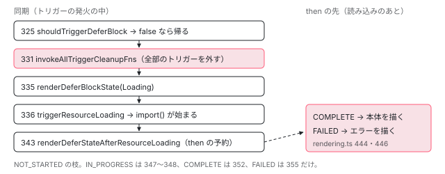

[目次](../README.md) › [@defer とインクリメンタルハイドレーションの内側](README.md) › 第 7 回 / 全 20 回

# トリガーから描画まで：triggerDeferBlock と shouldTriggerDeferBlock

> どのトリガーも最後に呼ぶ triggerDeferBlock が、shouldTriggerDeferBlock でサーバーとテストの Manual を除き、ほかのトリガーをすべて外してから、loadingState に応じて loading を出して読み込みを始める・同じ Promise を待つ・すぐ本体・すぐエラーに分かれ、読み込みの後に本体を出す（renderDeferStateAfterResourceLoading）順番。cleanup.ts がトリガーの後片付けの関数を種類ごとにしまい、本体の発火では全部、prefetch の発火では prefetch の分だけを外す行。

angular/angular · 読了 約 13 分 · 中核 · [サイトで読む（デモが動きます）](https://angular-deep-dive-cyan.vercel.app/chapter/defer-trigger-flow)

---

`on idle`・`on timer`・`on interaction`・`when` と、トリガーの種類は 8 つありますが、本体のトリガーが発火したときに最後に呼ばれる関数は 1 つ、`triggerDeferBlock` です。この章では、この関数が「トリガーを付けてよい場面か」を確かめ、ほかのトリガーをすべて外し、読み込みの状態に応じて loading・本体・エラーのどれを描くかを決める順番を、1 行ずつ追います。トリガーを外す仕組み（`cleanup.ts`）は、2 つのトリガーを持つ塊を Node で動かした記録で、後片付けの関数の数が減るところまで確かめます。

読む対象は `packages/core/src/defer/triggering.ts`（315〜362 行目）、`packages/core/src/defer/cleanup.ts`（全体）、`rendering.ts` の `shouldTriggerDeferBlock` です。

1. [1. 全体像](01-defer-overview.md)
2. [2. ɵɵdefer 命令](02-defer-instruction.md)
3. [3. 塊の記録](03-defer-details.md)
4. [4. 状態を描く](04-defer-render-state.md)
5. [5. minimum と after](05-defer-minimum-after.md)
6. [6. 依存を読み込む](06-defer-resource-loading.md)
7. **7. トリガーから描画まで**（この章）
8. [8. when](08-defer-when.md)
9. [9. idle と immediate](09-defer-idle-immediate.md)
10. [10. timer](10-defer-timer.md)
11. [11. interaction と hover](11-defer-dom-triggers.md)
12. [12. viewport](12-defer-viewport.md)
13. [13. prefetch](13-defer-prefetch.md)
14. [14. 入れ子・注入器・クエリ](14-defer-nested-di.md)
15. [15. サーバーでの @defer](15-defer-server.md)
16. [16. hydrate トリガー](16-defer-hydrate-triggers.md)
17. [17. 親から順にハイドレート](17-defer-hydration-queue.md)
18. [18. hydrate のイベント](18-defer-hydrate-events.md)
19. [19. テストを読む](19-defer-tests.md)
20. [20. issue と PR を読む](20-defer-issues.md)

## 1. どのトリガーも、最後はここ

📄 `angular/packages/core/src/defer/triggering.ts` L315–332 （▶ の行: 320, 322, 325, 327–328, 331）

```ts
315 │ /**
316 │  * Attempts to trigger loading of defer block dependencies.
317 │  * If the block is already in a loading, completed or an error state -
318 │  * no additional actions are taken.
319 │  */
320 ▶ export function triggerDeferBlock(triggerType: TriggerType, lView: LView, tNode: TNode) {
321 │   const tView = lView[TVIEW];
322 ▶   const lContainer = lView[tNode.index];
323 │   ngDevMode && assertLContainer(lContainer);
324 │ 
325 ▶   if (!shouldTriggerDeferBlock(triggerType, lView)) return;
326 │ 
327 ▶   const lDetails = getLDeferBlockDetails(lView, tNode);
328 ▶   const tDetails = getTDeferBlockDetails(tView, tNode);
329 │ 
330 │   // Defer block is triggered, cleanup all registered trigger functions.
331 ▶   invokeAllTriggerCleanupFns(lDetails);
332 │ 
```

1. **320 行目：受け取るのは「種類」と「どの view のどの塊か」だけ**

   `triggerType` は `Regular`（本体のトリガー）・`Prefetch`・`Hydrate` の 3 つです。`lView` と `tNode` で塊を指します。`on timer` の予定も、`on interaction` のリスナーも、`when` の命令も、発火したらこの形で呼びます（各トリガーの命令の中身は [第 9 回](09-defer-idle-immediate.md)〜[第 12 回](12-defer-viewport.md)と[第 8 回](08-defer-when.md)）。
2. **325 行目：発火してよい場面か**

   下の `shouldTriggerDeferBlock` が `false` なら、ここで何もせずに帰ります。
3. **327〜331 行目：塊の記録を 2 つ取り、トリガーをすべて外す**

   `lDetails`（この 1 回の塊の記録）と `tDetails`（テンプレートの中の塊の記録）を取り（[第 3 回](03-defer-details.md)）、331 行目の `invokeAllTriggerCleanupFns` で、この塊に付いているトリガーの後片付けをすべて呼びます（3 節）。**発火したのが timer でも、まだ付いている interaction のリスナーはここで外れます**。

📄 `angular/packages/core/src/defer/rendering.ts` L495–501 （▶ の行: 495–496, 500–501）

```ts
495 ▶   if (triggerType === TriggerType.Regular && typeof ngServerMode !== 'undefined' && ngServerMode) {
496 ▶     return false;
497 │   }
498 │ 
499 │   // prevents triggering in the case of a test run with manual defer block configuration.
500 ▶   const injector = lView[INJECTOR];
501 ▶   const config = injector.get(DEFER_BLOCK_CONFIG, null, {optional: true});
```

495〜496 行目、サーバー（`ngServerMode`）では本体のトリガーで発火しません。サーバーでは placeholder のまま HTML にするからです（[第 15 回](15-defer-server.md)）。500〜501 行目で注入器から `DEFER_BLOCK_CONFIG` を探し、テストの `DeferBlockBehavior.Manual` なら発火しません（その先の 2 行と、Manual の意味は [testing-defer](../testing/18-testing-defer.md) の 1 節）。この関数は `rendering.ts` にあり、`on timer`・`on idle` の予定を立てる前と、DOM のトリガー（interaction・hover・viewport）を登録する前にも呼ばれます。DOM のトリガーの側で呼ぶようになったのは 2026-05 の修正（abc61aaf7c0、「テストの節」）からです。

> [!NOTE]
> **ポイント**
>
> 名前の似た `shouldAttachTrigger`（triggering.ts）は別の問いに答えます。「この塊では、本体のトリガーと hydrate のトリガーのどちらを付けるか」です。インクリメンタルハイドレーションで、サーバーで描いた塊に hydrate のトリガーがあれば、ブラウザでは本体のトリガーを付けません（[incremental-hydration](../platform/15-incremental-hydration.md)、[第 16 回](16-defer-hydrate-triggers.md)）。サーバーや Manual で止めるのは `shouldTriggerDeferBlock` の方です。

## 2. 読み込みの状態で 4 つに分かれる

📄 `angular/packages/core/src/defer/triggering.ts` L333–362 （▶ の行: 333, 335–336, 339–341, 343, 347–348, 352, 355）

```ts
333 ▶   switch (tDetails.loadingState) {
334 │     case DeferDependenciesLoadingState.NOT_STARTED:
335 ▶       renderDeferBlockState(DeferBlockState.Loading, tNode, lContainer);
336 ▶       triggerResourceLoading(tDetails, lView, tNode);
337 │ 
338 │       // The `loadingState` might have changed to "loading".
339 ▶       if (
340 ▶         (tDetails.loadingState as DeferDependenciesLoadingState) ===
341 ▶         DeferDependenciesLoadingState.IN_PROGRESS
342 │       ) {
343 ▶         renderDeferStateAfterResourceLoading(tDetails, tNode, lContainer);
344 │       }
345 │       break;
346 │     case DeferDependenciesLoadingState.IN_PROGRESS:
347 ▶       renderDeferBlockState(DeferBlockState.Loading, tNode, lContainer);
348 ▶       renderDeferStateAfterResourceLoading(tDetails, tNode, lContainer);
349 │       break;
350 │     case DeferDependenciesLoadingState.COMPLETE:
351 │       ngDevMode && assertDeferredDependenciesLoaded(tDetails);
352 ▶       renderDeferBlockState(DeferBlockState.Complete, tNode, lContainer);
353 │       break;
354 │     case DeferDependenciesLoadingState.FAILED:
355 ▶       renderDeferBlockState(DeferBlockState.Error, tNode, lContainer);
356 │       break;
357 │     default:
358 │       if (ngDevMode) {
359 │         throwError('Unknown defer block state');
360 │       }
361 │   }
362 │ }
```

1. **334〜345 行目：NOT\_STARTED — loading を描き、読み込みを始め、終わったら描く予約**

   335 行目で先に Loading を描こうとします（@loading が無ければ描くものが無く、画面は placeholder のまま。after があれば予定に回る、[第 5 回](05-defer-minimum-after.md)）。336 行目で `triggerResourceLoading`（[第 6 回](06-defer-resource-loading.md)）。読み込みが始まれば `loadingState` は IN\_PROGRESS になっているので、339〜344 行目で `renderDeferStateAfterResourceLoading` を呼び、Promise の `then` に「済んだら本体かエラーを描く」をつなぎます。**ここまで全部、トリガーの発火と同じ同期の処理の中**です。`import()` の結果を待つのは `then` の先だけです。
2. **346〜349 行目：IN\_PROGRESS — 読み込み中なら、loading を描いて同じ Promise を待つ**

   prefetch で読み込みが始まっていた場合や、同じテンプレートの別の塊が先に読み込みを始めた場合です。348 行目で、いま走っている `loadingPromise` に予約をつなぎます。
3. **350〜353 行目：COMPLETE — もう読み終わっていれば、loading を通らず本体**

   prefetch が済んでいた場合や、同じ塊を描き直した 2 回目です（[第 5 回](05-defer-minimum-after.md)のライブのデモで、2 回目に @loading が出ない理由）。
4. **354〜356 行目：FAILED — 前に失敗していれば、すぐエラー**

   読み込みのやり直しはしません（[第 6 回](06-defer-resource-loading.md)の 5 節）。

📄 `angular/packages/core/src/defer/rendering.ts` L439–445 （▶ の行: 439–440, 444）

```ts
439 ▶   tDetails.loadingPromise!.then(() => {
440 ▶     if (tDetails.loadingState === DeferDependenciesLoadingState.COMPLETE) {
441 │       ngDevMode && assertDeferredDependenciesLoaded(tDetails);
442 │ 
443 │       // Everything is loaded, show the primary block content
444 ▶       renderDeferBlockState(DeferBlockState.Complete, tNode, lContainer);
445 │     } else if (tDetails.loadingState === DeferDependenciesLoadingState.FAILED) {
```

343・348 行目が呼ぶ側の中身です（全体は[第 6 回](06-defer-resource-loading.md)の 7 節）。439 行目で `then` をつなぎ、440 行目で COMPLETE なら 444 行目で本体を描きます。どちらの状態を描くのも `renderDeferBlockState` で、そこから先（状態が前にしか進まないこと、minimum の予定）は[第 4 回](04-defer-render-state.md)・[第 5 回](05-defer-minimum-after.md)です。



*triggerDeferBlock の順番。同期の処理（左）と、Promise の then の先（右）に分かれる。*

## 3. cleanup.ts：トリガーの後片付けを、種類ごとの引き出しにしまう

「トリガーを付ける」とは、タイマーの予定やイベントのリスナーを登録することです。登録した側は、それを外す関数（後片付けの関数）を `cleanup.ts` にしまいます。

📄 `angular/packages/core/src/defer/cleanup.ts` L9–45 （▶ の行: 21, 26–28, 30, 36, 38–39, 41, 43）

```ts
 9 │ import {
10 │   HYDRATE_TRIGGER_CLEANUP_FNS,
11 │   LDeferBlockDetails,
12 │   PREFETCH_TRIGGER_CLEANUP_FNS,
13 │   TRIGGER_CLEANUP_FNS,
14 │   TriggerType,
15 │ } from './interfaces';
16 │ 
17 │ /**
18 │  * Registers a cleanup function associated with a prefetching trigger
19 │  * or a regular trigger of a defer block.
20 │  */
21 ▶ export function storeTriggerCleanupFn(
22 │   type: TriggerType,
23 │   lDetails: LDeferBlockDetails,
24 │   cleanupFn: VoidFunction,
25 │ ) {
26 ▶   const key = getCleanupFnKeyByType(type);
27 ▶   if (lDetails[key] === null) {
28 ▶     lDetails[key] = [];
29 │   }
30 ▶   (lDetails[key]! as VoidFunction[]).push(cleanupFn);
31 │ }
32 │ 
33 │ /**
34 │  * Invokes registered cleanup functions either for prefetch or for regular triggers.
35 │  */
36 ▶ export function invokeTriggerCleanupFns(type: TriggerType, lDetails: LDeferBlockDetails) {
37 │   const key = getCleanupFnKeyByType(type);
38 ▶   const cleanupFns = lDetails[key] as VoidFunction[];
39 ▶   if (cleanupFns !== null) {
40 │     for (const cleanupFn of cleanupFns) {
41 ▶       cleanupFn();
42 │     }
43 ▶     lDetails[key] = null;
44 │   }
45 │ }
```

📄 `angular/packages/core/src/defer/cleanup.ts` L47–64 （▶ の行: 50–53, 57, 59, 61）

```ts
47 │ /**
48 │  * Invokes registered cleanup functions for prefetch, hydrate, and regular triggers.
49 │  */
50 ▶ export function invokeAllTriggerCleanupFns(lDetails: LDeferBlockDetails) {
51 ▶   invokeTriggerCleanupFns(TriggerType.Prefetch, lDetails);
52 ▶   invokeTriggerCleanupFns(TriggerType.Regular, lDetails);
53 ▶   invokeTriggerCleanupFns(TriggerType.Hydrate, lDetails);
54 │ }
55 │ 
56 │ function getCleanupFnKeyByType(type: TriggerType): number {
57 ▶   let key = TRIGGER_CLEANUP_FNS;
58 │   if (type === TriggerType.Prefetch) {
59 ▶     key = PREFETCH_TRIGGER_CLEANUP_FNS;
60 │   } else if (type === TriggerType.Hydrate) {
61 ▶     key = HYDRATE_TRIGGER_CLEANUP_FNS;
62 │   }
63 │   return key;
64 │ }
```

1. **56〜64 行目：引き出しは 3 つ**

   種類ごとに `LDeferBlockDetails` の欄が決まっています。既定は `TRIGGER_CLEANUP_FNS`（57 行目）、Prefetch は `PREFETCH_TRIGGER_CLEANUP_FNS`（59 行目）、Hydrate は `HYDRATE_TRIGGER_CLEANUP_FNS`（61 行目）です。欄の番号は[第 3 回](03-defer-details.md)。
2. **21〜31 行目：storeTriggerCleanupFn — しまう**

   27〜29 行目、引き出しが `null` ならその場で配列を作り、30 行目で足します。`on timer` なら `scheduleTimerTrigger` が返す「予定を消す関数」、`on interaction` なら「リスナーを外す関数」がここに入ります。
3. **36〜45 行目：invokeTriggerCleanupFns — 1 つの引き出しを空にする**

   39〜42 行目で全部呼び、43 行目で欄を `null` に戻します。2 回目に呼ばれても 39 行目で何もしません。
4. **50〜54 行目：invokeAllTriggerCleanupFns — 3 つとも空にする**

   `triggerDeferBlock` の 331 行目が呼ぶのはこちらです。本体のトリガーが発火したら、prefetch のトリガーも hydrate のトリガーも、もう要りません。一方、prefetch が発火したときは、`triggerResourceLoading` が Prefetch の引き出しだけを空にします（[第 6 回](06-defer-resource-loading.md)の 191 行目）。**prefetch と本体で後片付けを分けている**ので、先に読み込んでも、本体を出すトリガーは残ります（記録の「prefetch」の場面）。

> [!NOTE]
> **さらに深く**
>
> `TRIGGER_CLEANUP_FNS` には、トリガーではないものも 1 つ入っています。`ɵɵdefer` が塊を作るときに「view が壊れたら全部の後片付けを呼ぶ」関数を view に登録し、その登録を外す関数を Regular の引き出しにしまうからです（[第 2 回](02-defer-instruction.md)）。記録の最初の段で、トリガーが 2 つなのに数が 3 なのはこのためです。発火すれば、view が壊れたときの後片付けも要らなくなります。

## 4. DEMO：片方が発火すると、もう片方が外れる

> **🧪 DEMO — 後片付けの欄の数と、包んだ API の呼び出し（記録の再生）**
>
> これは記録です。本物の @angular/core 22.1.6（開発モード・JIT）を Node で、domino の DOM の上で動かした結果です。記録のスクリプトが、環境の側で `setTimeout`・`clearTimeout`（0 ms のものは変更検知の予定なので除く）と、ボタンの `addEventListener`・`removeEventListener` を包み、呼ばれた時刻を残しました。**包んだのは環境で、Angular のロジックではありません**。欄の数は `blocks()`（`ɵgetDeferBlocks`）で読んだ配列の長さです。`click()` は domino の要素の `click()` で、本物のブラウザのクリックではありません。共通の部品は[第 1 回](01-defer-overview.md)に全文があります。
>
> 場面のボタンを押してください。
>
> ▶ [このデモはサイトで動かせます](https://angular-deep-dive-cyan.vercel.app/chapter/defer-trigger-flow)

記録から読み取れることです。

1. **起動の直後：Regular の引き出しに 3 つ**

   timer の予定（`setTimeout(300ms)` 前後）と、ボタンの `click`・`keydown` のリスナーが付き、`TRIGGER_CLEANUP_FNS` は 3 です（3 節の補足の 1 つ ＋ トリガー 2 つ）。
2. **interaction が先：click の同期の処理の中で、timer の予定が消える**

   「click() から戻った直後」の段で、もう `TRIGGER_CLEANUP_FNS` は null、`clearTimeout` と 2 つの `removeEventListener` が呼ばれ、`loadingState` は IN\_PROGRESS です（331・336 行目まで同期）。本体（Complete）は次の段です。依存の読み込みが無い塊なので、次の microtask で COMPLETE になります（[第 6 回](06-defer-resource-loading.md)の 3 節）。
3. **timer が先：リスナーが外れる**

   300 ms で timer が発火し、2 つの `removeEventListener` が呼ばれました。このときの `clearTimeout` は、発火した `TimerScheduler` が自分の予定を片付けたものです（[第 10 回](10-defer-timer.md)）。そのあとクリックしても、何も呼ばれません。
4. **prefetch：Prefetch の引き出しだけが空になる**

   最初は Regular が 2（補足の 1 つ ＋ interaction）、Prefetch が 1（timer）。50 ms の prefetch で Prefetch だけが null になり、`loadingState` は COMPLETE、文字は「待機」のまま、リスナーは残っています。クリックで Regular も null になり、350〜353 行目の COMPLETE の枝で loading を通らず本体が出ました。

📄 `scratchpad の記録スクリプト（trigger-flow.ts、共通の build.mjs で束ねて node で実行。共通の harness.ts は第 1 回に全文）`

```
// 第 7 回 defer-trigger-flow の記録。
// 2 つのトリガーを持つ塊で、片方が発火したときにもう片方の後片付け（cleanup.ts）が呼ばれて外れることを、
// LDeferBlockDetails の TRIGGER_CLEANUP_FNS・PREFETCH_TRIGGER_CLEANUP_FNS の数と、
// 環境の側で包んだ setTimeout / clearTimeout / addEventListener / removeEventListener の呼び出しで見る。
// （包んだのは記録のための環境の側で、Angular のロジックではない。）
import { Component } from '@angular/core';
import { installDom, bootBrowser, blocks, text, writeJson } from '../_shared/harness';

const g = globalThis as any;
const doc = installDom('<html><head></head><body></body></html>');

// ---- 環境の側の記録 ----
let log: string[] = [];
let t0 = Date.now();
const stamp = () => `${String(Date.now() - t0).padStart(4)}ms`;
const realSetTimeout = g.setTimeout;
const realClearTimeout = g.clearTimeout;
// 記録のスクリプト自身の待ちは、包む前の setTimeout で待つ（ログに混ぜない）。
const tick = (ms: number) => new Promise((r) => realSetTimeout(r, ms));
const watched = new Set<unknown>();
g.setTimeout = (fn: Function, ms?: number, ...a: unknown[]) => {
  const id = realSetTimeout(fn, ms, ...a);
  // 0ms の setTimeout は変更検知の予定（zoneless のスケジューラ）なので記録しない。
  if ((ms ?? 0) > 0) { watched.add(id); log.push(`${stamp()} setTimeout(${ms}ms)`); }
  return id;
};
g.clearTimeout = (id: unknown) => {
  if (watched.has(id)) log.push(`${stamp()} clearTimeout`);
  return realClearTimeout(id);
};
const proto = (() => {
  let p: any = doc.createElement('button');
  while (p && !Object.prototype.hasOwnProperty.call(p, 'addEventListener')) p = Object.getPrototypeOf(p);
  return p;
})();
const realAdd = proto.addEventListener;
const realRemove = proto.removeEventListener;
proto.addEventListener = function (type: string, ...rest: unknown[]) {
  if (this.nodeName === 'BUTTON') log.push(`${stamp()} button.addEventListener('${type}')`);
  return realAdd.call(this, type, ...rest);
};
proto.removeEventListener = function (type: string, ...rest: unknown[]) {
  if (this.nodeName === 'BUTTON') log.push(`${stamp()} button.removeEventListener('${type}')`);
  return realRemove.call(this, type, ...rest);
};

function makeRoot(selector: string, template: string) {
  @Component({ selector, template })
  class Root {}
  return Root;
}

const scenes = [
  {
    id: 'click-first', title: 'interaction が先（50ms でクリック）',
    template: `<button #btn>押す</button>
@defer (on timer(300ms); on interaction(btn)) { 本体 } @placeholder { 待機 }`,
    run: async (ref: any, snap: (n: string) => void) => {
      await tick(50);
      ref.location.nativeElement.querySelector('button').click();
      snap('click() から戻った直後（同じ同期の処理の中）');
      await tick(5);
      snap('ボタンを click() したあと');
      await tick(350);
      snap('300ms を過ぎたあと');
    },
  },
  {
    id: 'timer-first', title: 'timer が先（300ms）',
    template: `<button #btn>押す</button>
@defer (on timer(300ms); on interaction(btn)) { 本体 } @placeholder { 待機 }`,
    run: async (ref: any, snap: (n: string) => void) => {
      await tick(350);
      snap('300ms を過ぎたあと');
      ref.location.nativeElement.querySelector('button').click();
      await tick(5);
      snap('そのあとボタンを click() したあと');
    },
  },
  {
    id: 'prefetch', title: 'prefetch on timer(50ms) と on interaction',
    template: `<button #btn>押す</button>
@defer (on interaction(btn); prefetch on timer(50ms)) { 本体 } @placeholder { 待機 }`,
    run: async (ref: any, snap: (n: string) => void) => {
      await tick(100);
      snap('50ms の prefetch が発火したあと');
      ref.location.nativeElement.querySelector('button').click();
      await tick(5);
      snap('ボタンを click() したあと');
    },
  },
];

const out: any = { core: '22.1.6', scenes: [] };
for (const sc of scenes) {
  doc.body.appendChild(doc.createElement('app-' + sc.id));
  log = [];
  t0 = Date.now();
  const steps: any[] = [];
  let ref: any;
  const snap = (note: string) => {
    const b = blocks(ref)[0];
    steps.push({
      ms: Date.now() - t0, note, text: text(ref).replace('押す', '').trim(),
      DEFER_BLOCK_STATE: b.lDetails.DEFER_BLOCK_STATE,
      TRIGGER_CLEANUP_FNS: b.lDetails.TRIGGER_CLEANUP_FNS,
      PREFETCH_TRIGGER_CLEANUP_FNS: b.lDetails.PREFETCH_TRIGGER_CLEANUP_FNS,
      HYDRATE_TRIGGER_CLEANUP_FNS: b.lDetails.HYDRATE_TRIGGER_CLEANUP_FNS,
      loadingState: b.tDetails.loadingState,
      log: log.splice(0),
    });
  };
  const booted = await bootBrowser(makeRoot('app-' + sc.id, sc.template));
  ref = booted.ref;
  snap('起動して描いた直後（whenStable のあと）');
  await sc.run(ref, snap);
  out.scenes.push({ id: sc.id, title: sc.title, template: sc.template, steps });
  booted.appRef.destroy();
}
await writeJson(process.argv[2] ?? '/dev/stdout', out);
process.exit(0);

```

## ここまでの呼び出し

- 👤 `@defer (on timer(300ms); on interaction(btn))` — あなたのテンプレート
  - `ɵɵdeferOnTimer`・`ɵɵdeferOnInteraction` → `storeTriggerCleanupFn(Regular, …)` — cleanup.ts 21 — *第 10・11 回*
- `（発火）` → `triggerDeferBlock(TriggerType.Regular, lView, tNode)` — triggering.ts 320
  - `shouldTriggerDeferBlock(triggerType, lView)` — rendering.ts 493 — *サーバー・Manual なら帰る*
  - `invokeAllTriggerCleanupFns(lDetails)` — cleanup.ts 50 — *Prefetch・Regular・Hydrate*
    - `invokeTriggerCleanupFns(type, lDetails)` — cleanup.ts 36 — *clearTimeout・removeEventListener*
  - `renderDeferBlockState(Loading, …)` — rendering.ts — *第 4・5 回*
  - `triggerResourceLoading(tDetails, lView, tNode)` — triggering.ts 169 — *第 6 回*
  - `renderDeferStateAfterResourceLoading(tDetails, tNode, lContainer)` — rendering.ts 431
    - `then` → `renderDeferBlockState(Complete | Error, …)` — rendering.ts 444・446

## テストと直し方

### spec と describe

`packages/core/test/acceptance/defer_spec.ts` の describe `` `on` conditions ``（675 行目）に it が 2 件あります：``should support `on immediate` condition``（676）と ``should trigger change detection when `on idle` is fired without explicit fixture.detectChanges()``（749）。どちらも、トリガーから `triggerDeferBlock` を通って描かれるまでを見ています。

📄 `angular/packages/core/test/acceptance/defer_spec.ts` L704–747 （▶ の行: 708, 717, 721, 724, 728, 731, 737, 746）

```ts
704 │       let loadingFnInvokedTimes = 0;
705 │       const deferDepsInterceptor = {
706 │         intercept() {
707 │           return () => {
708 ▶             loadingFnInvokedTimes++;
709 │             return [dynamicImportOf(NestedCmp)];
710 │           };
711 │         },
712 │       };
713 │ 
714 │       TestBed.configureTestingModule({
715 │         providers: [
716 │           ...COMMON_PROVIDERS,
717 ▶           {provide: ɵDEFER_BLOCK_DEPENDENCY_INTERCEPTOR, useValue: deferDepsInterceptor},
718 │         ],
719 │       });
720 │ 
721 ▶       clearDirectiveDefs(RootCmp);
722 │ 
723 │       const fixture = TestBed.createComponent(RootCmp);
724 ▶       fixture.detectChanges();
725 │ 
726 │       // Expecting that no placeholder content would be rendered when
727 │       // a loading block is present.
728 ▶       expect(fixture.nativeElement.outerHTML).toContain('Loading');
729 │ 
730 │       // Expecting loading function to be triggered right away.
731 ▶       expect(loadingFnInvokedTimes).toBe(1);
732 │ 
733 │       await allPendingDynamicImports();
734 │       fixture.detectChanges();
735 │ 
736 │       // Expect that the loading resources function was not invoked again.
737 ▶       expect(loadingFnInvokedTimes).toBe(1);
738 │ 
739 │       // Verify primary block content.
740 │       const primaryBlockHTML = fixture.nativeElement.outerHTML;
741 │       expect(primaryBlockHTML).toContain(
742 │         '<nested-cmp ng-reflect-block="primary">Rendering primary block.</nested-cmp>',
743 │       );
744 │ 
745 │       // Expect that the loading resources function was not invoked again (counter remains 1).
746 ▶       expect(loadingFnInvokedTimes).toBe(1);
747 │     });
```

708 行目で依存の関数が呼ばれた回数を数えます。724 行目の最初の `detectChanges()` の中で `on immediate` が発火し、728 行目ではもう Loading、731 行目で回数は 1 です。2 節の 335〜336 行目が同期で進むので、`detectChanges()` から戻った時点で読み込みは始まっています。737・746 行目、読み終わって本体を描いても回数は 1 のまま（[第 6 回](06-defer-resource-loading.md)の 177 行目）。721 行目の `clearDirectiveDefs` は、JIT で eager になった依存を定義から外す補助関数です。

📄 `angular/packages/core/test/acceptance/defer_spec.ts` L809–831 （▶ の行: 814–815, 818–819, 822, 826）

```ts
809 │         clearDirectiveDefs(RootCmp);
810 │ 
811 │         const fixture = TestBed.createComponent(RootCmp);
812 │         fixture.detectChanges();
813 │ 
814 ▶         expect(fixture.nativeElement.outerHTML).toContain('Placeholder');
815 ▶         expect(loadingFnInvokedTimes).toBe(0);
816 │ 
817 │         // Trigger the idle callback
818 ▶         expect(idleCallbacks.length).toBe(1);
819 ▶         idleCallbacks[0]({timeRemaining: () => 50, didTimeout: false} as IdleDeadline);
820 │ 
821 │         // Ensure that loading function was called
822 ▶         expect(loadingFnInvokedTimes).toBe(1);
823 │ 
824 │         // The tick generated from the defer block state change inside the idle scheduler
825 │         // should have updated the view automatically, showing the loading block.
826 ▶         expect(fixture.nativeElement.outerHTML).toContain('Loading');
827 │       } finally {
828 │         globalThis.requestIdleCallback = nativeRequestIdleCallback;
829 │         globalThis.cancelIdleCallback = nativeCancelIdleCallback;
830 │       }
831 │     });
```

`requestIdleCallback` を偽物に替えて、819 行目で idle のコールバックを手で呼びます。822 行目で読み込みが始まり、826 行目で `fixture.detectChanges()` を呼ばずに Loading が見えることを確かめます。この it は e1bc3428569（2026-02-24）で足されました。同じ commit で `IdleScheduler` がコールバックを 1 つ呼ぶたびに `ApplicationRef._tick()` を呼ぶようになっています（[第 9 回](09-defer-idle-immediate.md)）。

### 手元で走らせた結果

📄 `ターミナル（../angular で）`

```
cd ~/angular-research/angular
pnpm bazel test //packages/core/test/acceptance:acceptance \
  --nocache_test_results --test_output=all \
  '--test_arg=--filter=@defer `on` conditions'
```

📄 `出力（2026-11-06 に実行。抜粋。ログは scratchpad/defer-logs/b-trigger-flow.log）`

```
Ran 2 of 2693 specs
2 specs, 0 failures
INFO: Elapsed time: 2.117s, Critical Path: 1.47s
//packages/core/test/acceptance:acceptance   PASSED in 1.4s
```

- 絞り込みの文字列にバッククォートが入るので、シェルでは全体を `'…'` で囲みます。2693 件のうち 2 件だけが走りました。

### 直すとしたら

- 「トリガーが二重に発火する」「片方が発火したのにもう片方のリスナーが残る」は、`triggering.ts` の `triggerDeferBlock` の 331 行目と、`cleanup.ts` の 3 つの関数、そして各トリガーの命令が `storeTriggerCleanupFn` に正しい種類でしまっているかを見ます。この章の記録のように、欄の数と `removeEventListener` を並べると確かめやすいです。
- 最近の修正：abc61aaf7c0（2026-05-22、issue #68800）。`DeferBlockBehavior.Manual` のテストで `on viewport` の IntersectionObserver が作られてしまう、という報告でした。それまで `shouldTriggerDeferBlock` は triggering.ts の中の非公開の関数で、呼ばれるのは `triggerDeferBlock` と timer・idle の予定を立てる前だけでした。DOM のトリガーは付いてしまい、発火しても 325 行目で止まるだけだったのです。修正で rendering.ts に移して公開し、dom\_triggers.ts の `registerDomTrigger` の先頭でも呼ぶようにしました。足した it は defer\_spec.ts の `should not attach observer if rendering manually`（4672 行目）です。
- 直したら、トリガーの組み合わせなら describe `` `on` conditions `` に、Manual の扱いなら viewport などの describe に it を足します。本家に PR を出すことは勧めません。issue を読むときに、どの関数がどの場面で `shouldTriggerDeferBlock` を呼ぶかを確かめる手がかりにします（[第 20 回](20-defer-issues.md)）。

## 聞かれそうな質問

**Q. `on timer(5s); on interaction(btn)` で先にクリックしたら、5 秒後のタイマーはどうなりますか？**

クリックで `triggerDeferBlock` の 331 行目が `invokeAllTriggerCleanupFns` を呼び、Regular の引き出しにある timer の後片付け（予定を消す関数）が呼ばれて消えます。記録の「interaction が先」で、click の同期の処理の中で `clearTimeout` が呼ばれています。

**Q. prefetch のトリガーが先に発火したら、本体のトリガーも外れますか？**

外れません。prefetch では `triggerResourceLoading` が Prefetch の引き出しだけを空にします（第 6 回の 191 行目）。全部を空にする 50〜54 行目は、本体のトリガーの `triggerDeferBlock` からしか呼ばれません。

**Q. トリガーが発火してから本体が出るまでに、どこで待ちますか？**

336 行目の `triggerResourceLoading` が返す Promise の `then` の先だけです（343 行目 → rendering.ts 439 行目）。それまでの、ほかのトリガーを外す・Loading を描く・`import()` を始める、は発火と同じ同期の処理の中で済みます。minimum や after があれば、さらに `TimerScheduler` の予定で待ちます（第 5 回）。

**Q. テストで `DeferBlockBehavior.Manual` にすると、トリガーはどこで止まりますか？**

`shouldTriggerDeferBlock` の 500〜501 行目で `DEFER_BLOCK_CONFIG` を見て `false` を返すので、`triggerDeferBlock` は 325 行目で帰ります。2026-05 の修正からは、DOM のトリガーの登録そのものもこの関数で止めています。

**Q. 読み込みが済んでいる塊をトリガーしたら、@loading は一瞬出ますか？**

出ません。`loadingState` が COMPLETE なので 350〜353 行目の枝に入り、352 行目で直接 Complete を描きます。Loading を描く 335・347 行目は通りません。

## 読み終えて

- 本体のトリガーは種類にかかわらず `triggerDeferBlock` に集まり、まず `shouldTriggerDeferBlock`（サーバー・Manual）で止めるかを決めます。
- 発火したら `invokeAllTriggerCleanupFns` で、prefetch・本体・hydrate のトリガーをすべて外します。prefetch の発火は prefetch の引き出しだけを空にします。
- そのあとは `tDetails.loadingState` の 4 つの値で、loading と読み込みの開始・同じ Promise を待つ・すぐ本体・すぐエラー に分かれます。
- 発火から `import()` の開始までは同期で、待つのは Promise の `then` の先と、minimum・after の予定だけです。

---

← 前: [依存を読み込む：triggerResourceLoading](06-defer-resource-loading.md)  
次: [when のトリガー：式が真になったときだけ](08-defer-when.md) →
