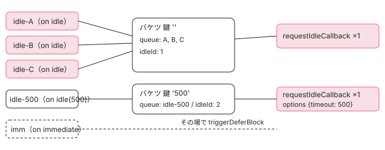

[目次](../README.md) › [@defer とインクリメンタルハイドレーションの内側](README.md) › 第 9 回 / 全 20 回

# on idle と on immediate：requestIdleCallback と次の描画

> ɵɵdeferOnIdle が onIdleWrapper で IdleScheduler に頼み、IdleScheduler が requestIdleCallback（無ければ setTimeout）で塊ごとの関数をまとめて呼ぶ行、idle の timeout の指定、ɵɵdeferOnImmediate が予定を作らずにすぐ発火する行。injectAsync の章と共有する IdleScheduler は差分だけを書く。

angular/angular · 読了 約 12 分 · 中核 · [サイトで読む（デモが動きます）](https://angular-deep-dive-cyan.vercel.app/chapter/defer-idle-immediate)

---

`@defer (on idle)` は「ブラウザが暇になったら」、`@defer (on immediate)` は「すぐに」本体を読み込みます。この章では、idle の塊がいくつあっても `requestIdleCallback` が options ごとに 1 回しか呼ばれないこと、`on idle(500)` の 500 がどこまで運ばれるか、immediate がタイマーも予定も作らずに同じ creation pass の中で発火することを、行で追います。

読む対象は `packages/core/src/defer/` の `instructions.ts`（`ɵɵdeferOnIdle`・`ɵɵdeferOnImmediate`）、`triggering.ts`（`scheduleDelayedTrigger`）、`idle_scheduler.ts`、`idle_service.ts` です。

1. [1. 全体像](01-defer-overview.md)
2. [2. ɵɵdefer 命令](02-defer-instruction.md)
3. [3. 塊の記録](03-defer-details.md)
4. [4. 状態を描く](04-defer-render-state.md)
5. [5. minimum と after](05-defer-minimum-after.md)
6. [6. 依存を読み込む](06-defer-resource-loading.md)
7. [7. トリガーから描画まで](07-defer-trigger-flow.md)
8. [8. when](08-defer-when.md)
9. **9. idle と immediate**（この章）
10. [10. timer](10-defer-timer.md)
11. [11. interaction と hover](11-defer-dom-triggers.md)
12. [12. viewport](12-defer-viewport.md)
13. [13. prefetch](13-defer-prefetch.md)
14. [14. 入れ子・注入器・クエリ](14-defer-nested-di.md)
15. [15. サーバーでの @defer](15-defer-server.md)
16. [16. hydrate トリガー](16-defer-hydrate-triggers.md)
17. [17. 親から順にハイドレート](17-defer-hydration-queue.md)
18. [18. hydrate のイベント](18-defer-hydrate-events.md)
19. [19. テストを読む](19-defer-tests.md)
20. [20. issue と PR を読む](20-defer-issues.md)

> [!TIP]
> **新卒エンジニアへ**
>
> **requestIdleCallback** は「メインスレッドの手が空いたときに呼んでほしい関数」をブラウザに預ける API です。呼ばれるとき、関数は `IdleDeadline`（あと何 ms 暇か＝`timeRemaining()`、時間切れで呼ばれたか＝`didTimeout`）を受け取ります。2 つ目の引数の `{timeout}` を渡すと、暇にならなくてもその時間が過ぎたら呼ばれます。

## 1. ɵɵdeferOnIdle：timeout を包んで scheduleDelayedTrigger へ

`@defer (on idle)` はコンパイルで `ɵɵdeferOnIdle()`、`@defer (on idle(500))` は `ɵɵdeferOnIdle(500)` になります。命令は塊の creation pass の中で 1 回だけ呼ばれます（どこで呼ばれるかは [第 2 回](02-defer-instruction.md)）。

📄 `angular/packages/core/src/defer/instructions.ts` L365–380 （▶ の行: 369, 373, 377, 379）

```ts
365 │ /**
366 │  * Sets up logic to handle the `on idle` deferred trigger.
367 │  * @codeGenApi
368 │  */
369 ▶ export function ɵɵdeferOnIdle(timeout?: number) {
370 │   const lView = getLView();
371 │   const tNode = getCurrentTNode()!;
372 │   if (ngDevMode) {
373 ▶     const expression = timeout ? `on idle(${timeout})` : 'on idle';
374 │     trackTriggerForDebugging(lView[TVIEW], tNode, expression);
375 │   }
376 │ 
377 ▶   if (!shouldAttachTrigger(TriggerType.Regular, lView, tNode)) return;
378 │ 
379 ▶   scheduleDelayedTrigger(onIdleWrapper({timeout}));
380 │ }
```

1. **369 行目：timeout は数か undefined**

   コンパイラーは `on idle(500)`・`on idle(500ms)`・`on idle(1s)` の時間を ms の数（500・500・1000）にして渡します（98eb24cea04 で入った引数）。書かなければ引数そのものがありません。
2. **372〜375 行目：開発モードだけの印**

   `trackTriggerForDebugging` が `on idle(500)` のような文字列を残します。DevTools が塊のトリガーを出すときに使う印で、動きには関係しません。
3. **377 行目：付けてよいかを先に確かめる**

   `shouldAttachTrigger` がサーバーやテストの Manual のときに false を返し、ここで帰ります（[第 7 回](07-defer-trigger-flow.md)）。
4. **379 行目：`{timeout}` を包んだ関数を渡す**

   `onIdleWrapper({timeout})` は「(callback, injector) を受け取って予定を作る関数」を返し、それを `scheduleDelayedTrigger` に渡します。timeout を書かなかった塊でも `{timeout: undefined}` というオブジェクトが作られます（記録の 2 段目で `requestIdleCallback` に届いた options がこの形です）。

## 2. scheduleDelayedTrigger：予定を作り、後片付けをしまう

`scheduleDelayedTrigger` は on idle と on timer の両方が使う入口です。前半（placeholder を描き、`shouldTriggerDeferBlock` で確かめる行）は [testing-defer の章](../testing/18-testing-defer.md)で読んだので、ここでは後半の 7 行だけを見ます。

📄 `angular/packages/core/src/defer/triggering.ts` L92–98 （▶ の行: 94–96, 98）

```ts
92 │   const lDetails = getLDeferBlockDetails(lView, tNode);
93 │ 
94 ▶   const cleanupFn = scheduleFn(
95 ▶     () => triggerDeferBlock(TriggerType.Regular, lView, tNode),
96 ▶     injector,
97 │   );
98 ▶   storeTriggerCleanupFn(TriggerType.Regular, lDetails, cleanupFn);
```

94〜97 行目で、1 節の関数に「発火したら呼ぶ関数」（95 行目の `triggerDeferBlock`）と注入器を渡します。戻り値は予定を取り消す関数で、98 行目で塊の `TRIGGER_CLEANUP_FNS` の欄にしまいます。塊が発火したときや塊のビューが壊されたときに、この関数が呼ばれて予定が消えます（しまう場所と呼ぶ時期は [第 7 回](07-defer-trigger-flow.md)）。

> [!NOTE]
> **ポイント**
>
> 記録では、どの idle の塊も `TRIGGER_CLEANUP_FNS` の数が 2 です。1 つは 98 行目でしまった予定の取り消し、もう 1 つは `ɵɵdefer` 自身が最初にしまう「LView の破棄の購読をやめる」関数です（[第 2 回](02-defer-instruction.md)）。発火すると両方が呼ばれ、欄は `null` に戻ります。

## 3. onIdle：IdleScheduler に add して、remove を返す

📄 `angular/packages/core/src/defer/idle_scheduler.ts` L15–32 （▶ の行: 23–24, 26–27, 30–31）

```ts
15 │ /**
16 │  * Helper function to schedule a callback to be invoked when a browser becomes idle.
17 │  *
18 │  * @param callback A function to be invoked when a browser becomes idle.
19 │  * @param injector injector for the app
20 │  * @param options Optional options passed to `requestIdleCallback`.
21 │  */
22 │ export function onIdle(callback: VoidFunction, injector: Injector, options?: IdleRequestOptions) {
23 ▶   const scheduler = injector.get(IdleScheduler);
24 ▶   const cleanupFn = () => scheduler.remove(callback);
25 │ 
26 ▶   scheduler.add(callback, options);
27 ▶   return cleanupFn;
28 │ }
29 │ 
30 ▶ export function onIdleWrapper(options?: IdleRequestOptions) {
31 ▶   return (callback: VoidFunction, injector: Injector) => onIdle(callback, injector, options);
32 │ }
```

30〜32 行目の `onIdleWrapper` は options を閉じ込めるだけの関数です。2 節の 94 行目から呼ばれると 31 行目で `onIdle(callback, injector, options)` になり、23 行目で注入器から `IdleScheduler`（`providedIn: 'root'` のサービス。アプリに 1 つ）を取り出して、26 行目で `add` します。24 行目の取り消しの関数は `remove(callback)` を呼ぶだけです。callback は塊ごとに作られる関数（2 節の 95 行目のアロー関数）なので、`remove` はその塊の分だけを消せます。

## 4. バケツ：options が同じ塊を 1 つの requestIdleCallback にまとめる

📄 `angular/packages/core/src/defer/idle_scheduler.ts` L34–52 （▶ の行: 38–40, 48–51）

```ts
34 │ /**
35 │  * A bucket groups callbacks sharing the same idle request options into a single
36 │  * `requestIdleCallback` invocation.
37 │  */
38 ▶ interface IdleBucket {
39 ▶   idleId: number | null;
40 ▶   readonly queue: Set<VoidFunction>;
41 │ }
42 │ 
43 │ /**
44 │  * Helper service to schedule `requestIdleCallback`s for batches of defer blocks,
45 │  * to avoid calling `requestIdleCallback` for each defer block (e.g. if
46 │  * defer blocks are defined inside a for loop).
47 │  *
48 ▶  * Callbacks are grouped into buckets by their serialized options key. Each bucket is
49 ▶  * scheduled independently with its own `requestIdleCallback` call, so different
50 ▶  * options never interfere with each other. Callbacks that share the same
51 ▶  * options (including no options) are batched together.
52 │  */
```

38〜41 行目の `IdleBucket` が「1 本の `requestIdleCallback` で呼ぶ塊の組」です。`idleId` はブラウザに預けている予定の番号（無ければ `null`）、`queue` はその予定で呼ぶ関数の `Set` です。48〜51 行目のコメントのとおり、options（timeout）が同じ塊は同じバケツに入り、違えば別のバケツ・別の予定になります。バケツを入れる `buckets` と、関数からバケツの鍵を引く `callbackBucket` の 2 つの `Map` の欄は [di-inject-async の章](../di/15-di-inject-async.md)で引用しました。

📄 `angular/packages/core/src/defer/idle_scheduler.ts` L66–96 （▶ の行: 67–68, 70–73, 75–76, 80–81, 83, 88, 92–94）

```ts
66 │   add(callback: VoidFunction, options?: IdleRequestOptions) {
67 ▶     const key = getIdleRequestKey(options);
68 ▶     this.callbackBucket.set(callback, key);
69 │ 
70 ▶     let bucket = this.buckets.get(key);
71 ▶     if (bucket == null) {
72 ▶       bucket = {idleId: null, queue: new Set()};
73 ▶       this.buckets.set(key, bucket);
74 │     }
75 ▶     bucket.queue.add(callback);
76 ▶     this.scheduleBucket(bucket, options);
77 │   }
78 │ 
79 │   remove(callback: VoidFunction) {
80 ▶     const key = this.callbackBucket.get(callback);
81 ▶     if (key === undefined) return;
82 │ 
83 ▶     this.callbackBucket.delete(callback);
84 │ 
85 │     const bucket = this.buckets.get(key);
86 │     if (!bucket) return;
87 │ 
88 ▶     bucket.queue.delete(callback);
89 │ 
90 │     // If the last callback in this bucket was removed, cancel the
91 │     // idle callback - cancel it.
92 ▶     if (bucket.queue.size === 0) {
93 ▶       this.cancelBucket(bucket);
94 ▶       this.buckets.delete(key);
95 │     }
96 │   }
```

1. **67〜68 行目：鍵を作り、関数と鍵を結ぶ**

   鍵は 6 節の `getIdleRequestKey` が作る文字列です（timeout が無ければ `''`、500 なら `'500'`）。
2. **70〜74 行目：その鍵のバケツが無ければ作る**

   最初の 1 つの塊だけがバケツを作ります。2 つ目以降は同じバケツを使います。
3. **75〜76 行目：queue に足して、バケツの予定を頼む**

   `scheduleBucket` は `idleId` がすでにあれば何もせずに帰ります（[di-inject-async の章](../di/15-di-inject-async.md)で引用した `scheduleBucket` の先頭）。だから idle の塊が 3 つあっても、`requestIdleCallback` を呼ぶのは最初の 1 回だけです。
4. **80〜83 行目：remove は鍵を引いて結び目をほどく**

   知らない関数（もう流れたもの）なら 81 行目で何もしません。
5. **88〜95 行目：最後の 1 つが消えたら予定も取り消す**

   queue が空になったら 93 行目の `cancelBucket` で `cancelIdleCallback` まで呼び、94 行目でバケツを捨てます。

## 5. idle が来たとき：1 つずつ流し、時間切れなら次の idle へ

ブラウザが予定を呼ぶと、`scheduleBucket` の中の関数が queue を先頭から 1 つずつ呼び、1 つごとに `ApplicationRef._tick()` で描画まで済ませます。この関数の全体は [di-inject-async の章](../di/15-di-inject-async.md)で引用したので、ここでは 2026 年に変わったループの終わりの 7 行だけを見ます。

📄 `angular/packages/core/src/defer/idle_scheduler.ts` L115–121 （▶ の行: 115–116, 120）

```ts
115 ▶         if (deadline && deadline.timeRemaining() === 0 && !deadline.didTimeout) {
116 ▶           break;
117 │         }
118 │       }
119 │ 
120 ▶       bucket.idleId = null;
121 │ 
```

115〜116 行目：1 つ流したあと `timeRemaining()` が 0 で、しかも時間切れ（`didTimeout`）で呼ばれたのでなければ、ループを抜けます。120 行目でバケツの `idleId` を `null` に戻し、queue に残りがあれば同じバケツでもう一度 `requestIdleCallback` を頼みます。記録の 4 段目（残り時間 0 の idle）で、idle-A だけが Complete になり、新しい `requestIdleCallback`（id 3）が呼ばれたのがこれです。

> [!NOTE]
> **さらに深く**
>
> 120 行目は c2b14b7ab44（2026-06-26、22.1.3 に入ったのは cherry-pick の 7bcce260f51）で今の場所に移りました。直す前は関数の先頭で `cancelBucket` を呼んで `idleId` を先に `null` にしていたので、流している途中で同じバケツに `add` されると 「予定が無い」と見て 2 本目の `requestIdleCallback` を頼みました。流し終わると queue は空なのでバケツは捨てられ、2 本目の番号を持つ者がいなくなります（コミットの説明の言葉では orphaned）。直したあとは流している間ずっと `idleId` が残るので、途中の `add` は 4 節の 76 行目から `scheduleBucket` に入ってもすぐ帰り、足された関数は `Set` のループがそのまま拾います。

📄 `git -C ../angular show c2b14b7ab44 -- packages/core/src（抜粋）`

```
diff --git a/packages/core/src/defer/idle_scheduler.ts b/packages/core/src/defer/idle_scheduler.ts
@@ -102,8 +102,7 @@ export class IdleScheduler implements OnDestroy {

     const key = getIdleRequestKey(options);
     const callback = (deadline?: IdleDeadline) => {
-      this.cancelBucket(bucket);
-
+      // Keep idleId set during the drain to prevent re-entrant add() from scheduling redundant callbacks.
       for (const cb of bucket.queue) {
         cb();
         // _tick here is an optimized change detection check and is safe to call here.
@@ -118,6 +117,8 @@ export class IdleScheduler implements OnDestroy {
         }
       }

+      bucket.idleId = null;
+
       if (bucket.queue.size > 0) {
         this.scheduleBucket(bucket, options);
       } else {
```

> [!WARNING]
> **ハマりどころ**
>
> 記録の 5 段目では、流したバケツの最後の塊が発火したときに `cancelIdleCallback` がもう呼ばれ終わった番号（2 と 3）で呼ばれています。流している間 `idleId` が残っているので、塊の後片付け（3 節の 24 行目 → 4 節の 92〜93 行目）が `cancelBucket` まで届くからです。ブラウザの `cancelIdleCallback` は終わった番号なら何もしないので、画面の動きは変わりません。自分で `IdleService` を書くときは、`cancelOnIdle` に終わった番号が来ても困らないようにしておきます。

## 6. 取り消し・アプリの破棄・鍵

📄 `angular/packages/core/src/defer/idle_scheduler.ts` L137–167 （▶ の行: 138–140, 144–146, 148, 162–163, 166）

```ts
137 │   private cancelBucket(bucket: IdleBucket) {
138 ▶     if (bucket.idleId !== null) {
139 ▶       this.idleService.cancelOnIdle(bucket.idleId);
140 ▶       bucket.idleId = null;
141 │     }
142 │   }
143 │ 
144 ▶   ngOnDestroy() {
145 ▶     for (const bucket of this.buckets.values()) {
146 ▶       this.cancelBucket(bucket);
147 │     }
148 ▶     this.buckets.clear();
149 │     this.callbackBucket.clear();
150 │   }
151 │ 
152 │   /** @nocollapse */
153 │   static ɵprov = /** @pureOrBreakMyCode */ /* @__PURE__ */ ɵɵdefineInjectable({
154 │     token: IdleScheduler,
155 │     providedIn: 'root',
156 │     factory: () => new IdleScheduler(),
157 │   });
158 │ }
159 │ 
160 │ /** Generates a string that can be used to find identical idle request option objects. */
161 │ function getIdleRequestKey(options?: IdleRequestOptions): string {
162 ▶   if (!options || options.timeout == null) {
163 ▶     return '';
164 │   }
165 │ 
166 ▶   return `${options.timeout}`;
167 │ }
```

137〜142 行目：予定があれば `IdleService.cancelOnIdle` を呼んで番号を消します。144〜150 行目の `ngOnDestroy` は、ルートの注入器が壊されるとき（アプリの破棄）にすべてのバケツの予定を取り消します。161〜167 行目の鍵は timeout だけを見ます。`{timeout: undefined}`（1 節の 379 行目）も options が無いときも 162 行目で `''` になるので、`on idle` と書いた塊はすべて同じバケツに入ります。

## 7. IdleService：requestIdleCallback を差し替える口

📄 `angular/packages/core/src/defer/idle_service.ts` L32–53 （▶ の行: 40, 46, 51）

```ts
32 │ /**
33 │  * Service which configures custom 'on idle' behavior for Angular features like `@defer`.
34 │  *
35 │  * @publicApi
36 │  *
37 │  * @see [Customizing `idle` behavior](guide/templates/defer#customizing-idle-behavior)
38 │  *
39 │  */
40 ▶ export interface IdleService {
41 │   /**
42 │    * Schedule `callback` to be executed when the current application or browser is considered idle.
43 │    *
44 │    * @returns an id which allows the scheduled callback to be cancelled before it executes.
45 │    */
46 ▶   requestOnIdle(callback: (deadline?: IdleDeadline) => void, options?: IdleRequestOptions): number;
47 │ 
48 │   /**
49 │    * Cancel a previously scheduled callback using the id associated with it.
50 │    */
51 ▶   cancelOnIdle(id: number): void;
52 │ }
53 │ 
```

`IdleScheduler` はブラウザの API を直接呼ばず、`IDLE_SERVICE` から注入したこの interface を呼びます（a5981b83a60 で入った口）。46 行目の `requestOnIdle` は 17d3ea44e25 で `options` を受け取るようになり、5 節の予定を頼む行がそこに `{timeout}` を渡します。既定の実装（`requestIdleCallback` が無いときは `setTimeout` で代わる）と、差し替える `provideIdleServiceWith` は [di-inject-async の章](../di/15-di-inject-async.md)で引用しました。Safari で `window` を見失う不具合を直した f9d8da69243 は、その既定の実装に `.bind(globalThis)` を足したものです。

## 8. ɵɵdeferOnImmediate：予定を作らずに、その場で発火する

📄 `angular/packages/core/src/defer/instructions.ts` L426–448 （▶ の行: 438, 443–445, 447）

```ts
426 │ /**
427 │  * Sets up logic to handle the `on immediate` deferred trigger.
428 │  * @codeGenApi
429 │  */
430 │ export function ɵɵdeferOnImmediate() {
431 │   const lView = getLView();
432 │   const tNode = getCurrentTNode()!;
433 │ 
434 │   if (ngDevMode) {
435 │     trackTriggerForDebugging(lView[TVIEW], tNode, 'on immediate');
436 │   }
437 │ 
438 ▶   if (!shouldAttachTrigger(TriggerType.Regular, lView, tNode)) return;
439 │ 
440 │   // Render placeholder block only if loading template is not present and we're on
441 │   // the client to avoid content flickering, since it would be immediately replaced
442 │   // by the loading block.
443 ▶   const tDetails = getTDeferBlockDetails(lView[TVIEW], tNode);
444 ▶   if (tDetails.loadingTmplIndex === null) {
445 ▶     renderPlaceholder(lView, tNode);
446 │   }
447 ▶   triggerDeferBlock(TriggerType.Regular, lView, tNode);
448 │ }
```

1. **438 行目：付けてよいかを確かめる**

   ここまでは idle と同じです。サーバーと Manual ではここで帰ります。
2. **443〜446 行目：@loading が無いときだけ placeholder を描く**

   440〜442 行目のコメントのとおり、@loading があると placeholder は描いたそばから loading に置き換わってちらつくので描きません。記録の 2 段目で、@loading の無い imm-1 は `Placeholder`、@loading のある imm-2 は最初から `Loading` です。
3. **447 行目：すぐ triggerDeferBlock**

   `scheduleDelayedTrigger` も `IdleScheduler` も通りません。予定が無いので後片付けの関数もしまいません（記録で imm の `TRIGGER_CLEANUP_FNS` は最初から `null`）。依存の読み込みはこの時点で始まり、読み込みが済んだ次の描画で本体になります（記録の 3 段目。読み込みの流れは [第 6 回](06-defer-resource-loading.md)）。



*3 つの on idle と 1 つの on idle(500) は、2 つのバケツ・2 回の requestIdleCallback になる。on immediate はバケツを通らない*

## 9. 記録で確かめる

> **🧪 DEMO — requestIdleCallback の呼ばれ方と塊の状態（記録の再生）**
>
> これは記録です。本物の @angular/core 22.1.6（開発モード・JIT）を Node で、domino の DOM の上で動かした結果です。ブラウザのプラットフォームで起動しているので、トリガーは本当に付いて発火します。Node には `requestIdleCallback` が無いので、記録の共通の部品が置いた代わり（呼ばれた関数を貯めておき、スクリプトが好きなときに `IdleDeadline` の代わりを渡して呼ぶもの）を使っています。これは環境の代わりで、Angular のロジックではありません。`id` はその代わりが振った番号です。JIT なので依存の読み込み（`import()`）はありません（どの塊も依存の関数を持ちません）。
>
> 段のボタンを押してください。
>
> ▶ [このデモはサイトで動かせます](https://angular-deep-dive-cyan.vercel.app/chapter/defer-idle-immediate)

記録から読み取れることです。

1. **2 段目：idle の塊 4 つで requestIdleCallback は 2 回**

   鍵 `''` の 3 つは id 1 の 1 回に、`on idle(500)` は id 2 の別の 1 回になりました（4 節の 70〜76 行目）。options は `{timeout: undefined}` と `{timeout: 500}` です。
2. **2〜3 段目：immediate は idle を待たない**

   同じ tick の中で imm-1 は Placeholder のまま読み込み中、imm-2 は Loading です（8 節の 443〜447 行目）。`whenStable` のあとは両方 Complete で、idle の塊はまだ Placeholder です。
3. **4 段目：残り時間 0 なら 1 つで止まる**

   idle-A だけが Complete になり、残りの B・C のために id 3 の `requestIdleCallback` が頼まれました（5 節の 115〜120 行目）。
4. **5 段目：残り時間があれば全部流れる**

   B・C・idle-500 が Complete になりました。各バケツの最後の塊の後片付けが、終わった番号で `cancelIdleCallback` を呼んでいます（5 節の注意）。
5. **7 段目：開き直した塊は loadingState が COMPLETE のまま**

   `loadingState` は塊の TView 側の記録（`TDeferBlockDetails`）にあるので、同じテンプレートから作り直した塊にも引き継がれます（[第 3 回](03-defer-details.md)）。それでも画面の状態は Placeholder から始まり、idle の予定もまた頼まれます（id 4・5）。
6. **8 段目：idle が来る前に閉じると予定は取り消される**

   塊のビューが壊されると、しまっておいた取り消しの関数（2 節の 98 行目）が呼ばれ、`remove` → `cancelBucket` で id 4・5 が `cancelIdleCallback` されました。

📄 `scratchpad の記録スクリプト（idle.ts。共通の build.mjs で束ねて node で実行。共通の harness.ts と build.mjs は第 1 回に全文）`

```
// 第 9 回（defer-idle-immediate）の記録。
// on idle の塊 3 つ・on idle(500) の塊 1 つ・on immediate の塊 2 つを @if で一度に描き、
// requestIdleCallback が何回・どの options で呼ばれたか、塊がいつ Complete になるかを段ごとに残す。
// requestIdleCallback は harness の installIdle() の代わり（環境の代わりで、Angular のロジックではない）。
import { Component, VERSION, signal } from '@angular/core';
import { installDom, installIdle, idleQueue, runIdle, bootBrowser, blocks, text, writeJson } from '../_shared/harness';

const OUT = process.argv[2];
const g = globalThis as any;

installDom();
installIdle();
// installIdle が置いた代わりを、呼ばれた記録を残す関数で包む（IDLE_SERVICE が作られる前に包む）。
const calls: { kind: string; id: number; options: string | null }[] = [];
// options を文字で残す（JSON にすると {timeout: undefined} が {} になって見分けられないため）。
const fmt = (o: any) =>
  o === undefined ? 'undefined' : `{${Object.keys(o).map((k) => `${k}: ${String(o[k])}`).join(', ')}}`;
const ric = g.requestIdleCallback;
const cic = g.cancelIdleCallback;
g.requestIdleCallback = (cb: Function, options?: unknown) => {
  const id = ric(cb, options);
  calls.push({ kind: 'requestIdleCallback', id, options: fmt(options) });
  return id;
};
g.cancelIdleCallback = (id: number) => {
  calls.push({ kind: 'cancelIdleCallback', id, options: null });
  cic(id);
};

const TEMPLATE = `@if (show()) {
  @defer (on idle) { <b>idle-A</b> } @placeholder { <i>a</i> }
  @defer (on idle) { <b>idle-B</b> } @placeholder { <i>b</i> }
  @defer (on idle) { <b>idle-C</b> } @placeholder { <i>c</i> }
  @defer (on idle(500)) { <b>idle-500</b> } @placeholder { <i>t</i> }
  @defer (on immediate) { <b>imm-1</b> } @placeholder { <i>p1</i> }
  @defer (on immediate) { <b>imm-2</b> } @placeholder { <i>p2</i> } @loading { <i>l2</i> }
}`;

@Component({ selector: 'app-root', template: TEMPLATE })
class Root {
  show = signal(false);
}

const NAMES = ['idle-A', 'idle-B', 'idle-C', 'idle-500', 'imm-1', 'imm-2'];
const steps: any[] = [];
let seen = 0;
const { appRef, ref } = await bootBrowser(Root);
const cmp = ref.instance as Root;

function record(id: string, title: string, action: string) {
  const bs = blocks(ref).map((b, i) => ({
    name: NAMES[i],
    index: b.index,
    state: b.lDetails.DEFER_BLOCK_STATE,
    loadingState: b.tDetails.loadingState,
    triggerCleanupFns: b.lDetails.TRIGGER_CLEANUP_FNS,
    loadingTmplIndex: b.tDetails.loadingTmplIndex,
    triggers: (b.tDetails.debug as any)?.triggers ?? null,
  }));
  steps.push({
    id,
    title,
    action,
    text: text(ref),
    newCalls: calls.slice(seen),
    pendingIdle: idleQueue.map((x) => ({ id: x.id, options: fmt(x.options) })),
    blocks: bs,
  });
  seen = calls.length;
}

record('boot', '起動した直後', 'show = false のまま（@if の中は描かれていない）');

cmp.show.set(true);
appRef.tick();
record('show-sync', '@if を開いた直後（同じ tick の中）', 'show.set(true) のあと appRef.tick() を 1 回だけ同期で呼ぶ');

await appRef.whenStable();
record('show-stable', 'whenStable のあと', 'await appRef.whenStable()（requestIdleCallback はまだ呼び出していない）');

// timeout の無い組（options.timeout が無い方）だけを、timeRemaining() = 0 で 1 回流す。
const first = idleQueue.findIndex((x) => (x.options as any)?.timeout == null);
if (first < 0) throw new Error('timeout の無い組が見つからない');
const [entry] = idleQueue.splice(first, 1);
entry.cb({ didTimeout: false, timeRemaining: () => 0 });
await appRef.whenStable();
record('idle-zero', '残り時間 0 の idle を 1 回', `id ${entry.id} の関数を {didTimeout: false, timeRemaining: () => 0} で呼ぶ`);

runIdle();
await appRef.whenStable();
record('idle-run', '残り時間のある idle', 'runIdle()（待っている関数をすべて {didTimeout: false, timeRemaining: () => 50} で呼ぶ）');

// 2 つ目の場面: もう一度描いて、idle が来る前に @if を閉じる。
cmp.show.set(false);
await appRef.whenStable();
record('hide', '@if を閉じる', 'show.set(false)');

cmp.show.set(true);
await appRef.whenStable();
record('show-again', 'もう一度開く', 'show.set(true)');

cmp.show.set(false);
await appRef.whenStable();
record('hide-before-idle', 'idle が来る前に閉じる', 'show.set(false)（requestIdleCallback の関数は呼ばない）');

await writeJson(OUT, { core: VERSION.full, template: TEMPLATE, steps });
process.exit(0);

```

共通の部品（`installDom`・`installIdle`・`bootBrowser`・`blocks`）の全文は [第 1 回](01-defer-overview.md)にあります。

## ここまでの呼び出し

- 👤 `@defer (on idle(500))` — テンプレート — *コンパイルで ɵɵdeferOnIdle(500)*
  - `ɵɵdeferOnIdle(timeout)` — instructions.ts 369
    - `scheduleDelayedTrigger(onIdleWrapper({timeout}))` — instructions.ts 379 → triggering.ts 78
      - `onIdle(callback, injector, options)` — idle\_scheduler.ts 22 — *取り消しの関数を返す（triggering.ts 98 でしまう）*
        - `IdleScheduler.add(callback, options)` — idle\_scheduler.ts 66 — *鍵でバケツを選ぶ*
          - `scheduleBucket` → `IdleService.requestOnIdle` — idle\_scheduler.ts 98・idle\_service.ts 46 — *バケツに 1 回だけ*
- `（ブラウザが暇になる）` — requestIdleCallback
  - `callback(deadline)` → `cb()` → `_tick()` — idle\_scheduler.ts 104 — *1 つずつ。時間切れなら 115 行目で抜ける*
    - `triggerDeferBlock(Regular, lView, tNode)` — triggering.ts 320 — *第 7 回*
- `ɵɵdeferOnImmediate()` — instructions.ts 430 — *予定を作らず 447 行目で triggerDeferBlock*

## テストと直し方

### spec と describe

| spec | describe / it | 確かめていること |
| --- | --- | --- |
| packages/core/test/acceptance/defer\_spec.ts | describe `IdleScheduler`（5199 行目、it 15 件） | `IdleScheduler` を直接 `add` して、偽の `IdleService` に届いた回数と options、締め切りでの分け方、バケツ、再入を見る |
| 同じファイル | describe ``@defer > `on` conditions`` の it ``should support `on immediate` condition``（676 行目）・``should trigger change detection when `on idle` is fired without explicit fixture.detectChanges()``（749 行目） | テンプレートから書いた on immediate・on idle が本当に本体を出すか |

📄 `angular/packages/core/test/acceptance/defer_spec.ts` L5199–5226 （▶ の行: 5203, 5210, 5219, 5221, 5225）

```ts
5199 │ describe('IdleScheduler', () => {
5200 │   let scheduler: IdleScheduler;
5201 │   let customIdleService: CustomIdleService;
5202 │ 
5203 ▶   class CustomIdleService implements IdleService {
5204 │     requestOnIdleSpy = jasmine.createSpy('requestOnIdleFn');
5205 │ 
5206 │     requestOnIdle(
5207 │       callback: (deadline?: IdleDeadline) => void,
5208 │       options?: IdleRequestOptions,
5209 │     ): number {
5210 ▶       return this.requestOnIdleSpy(callback, options);
5211 │     }
5212 │ 
5213 │     cancelOnIdle(id: number): void {}
5214 │   }
5215 │ 
5216 │   beforeEach(() => {
5217 │     customIdleService = new CustomIdleService();
5218 │     TestBed.configureTestingModule({
5219 ▶       providers: [{provide: IDLE_SERVICE, useValue: customIdleService}],
5220 │     });
5221 ▶     scheduler = TestBed.inject(IdleScheduler);
5222 │   });
5223 │ 
5224 │   afterEach(() => {
5225 ▶     scheduler.ngOnDestroy();
5226 │   });
```

5203〜5214 行目の偽の `IdleService` は、`requestOnIdle` を jasmine の spy にしただけです。5219 行目でそれを `IDLE_SERVICE` として provide し、5221 行目で本物の `IdleScheduler` を注入します。ブラウザの `requestIdleCallback` を使わないので Node でも走り、spy に渡された関数を it の中から好きな `IdleDeadline` で呼べます。7 節の差し替えの口が、テストの口にもなっています。

📄 `angular/packages/core/test/acceptance/defer_spec.ts` L5402–5435 （▶ の行: 5418–5419, 5423–5424, 5428, 5430）

```ts
5402 │   it('should create independent buckets for different timeouts', () => {
5403 │     let capturedCbs: Array<(deadline: any) => void> = [];
5404 │     let capturedOptions: any[] = [];
5405 │     let ricCount = 0;
5406 │ 
5407 │     customIdleService.requestOnIdleSpy.and.callFake((cb: any, options: any) => {
5408 │       ricCount++;
5409 │       capturedCbs.push(cb);
5410 │       capturedOptions.push(options);
5411 │       return 100 + ricCount;
5412 │     });
5413 │ 
5414 │     const cb1 = jasmine.createSpy('cb1');
5415 │     const cb2 = jasmine.createSpy('cb2');
5416 │ 
5417 │     // First callback with 1000ms timeout
5418 ▶     scheduler.add(cb1, {timeout: 1000});
5419 ▶     expect(ricCount).toBe(1);
5420 │     expect(capturedOptions[0]).toEqual({timeout: 1000});
5421 │ 
5422 │     // Second callback with 200ms timeout → separate bucket, separate requestIdleCallback
5423 ▶     scheduler.add(cb2, {timeout: 200});
5424 ▶     expect(ricCount).toBe(2);
5425 │     expect(capturedOptions[1]).toEqual({timeout: 200});
5426 │ 
5427 │     // Fire the 200ms bucket first (browser would call this sooner)
5428 ▶     capturedCbs[1]({didTimeout: true, timeRemaining: () => 0});
5429 │     expect(cb2).toHaveBeenCalledTimes(1);
5430 ▶     expect(cb1).toHaveBeenCalledTimes(0); // Not in this bucket
5431 │ 
5432 │     // Fire the 1000ms bucket
5433 │     capturedCbs[0]({didTimeout: true, timeRemaining: () => 0});
5434 │     expect(cb1).toHaveBeenCalledTimes(1);
5435 │   });
```

timeout が 1000 と 200 の 2 つを `add` すると、5419・5424 行目で予定が 2 回になり、5428 行目で 200 の方だけを呼ぶと、5430 行目で 1000 の方は呼ばれていません。4 節の鍵の分け方そのものです。

📄 `angular/packages/core/test/acceptance/defer_spec.ts` L5499–5522 （▶ の行: 5510–5511, 5515, 5517, 5520–5521）

```ts
5499 │   it('should not register a spurious requestOnIdle when a callback re-entrantly adds to the same bucket', () => {
5500 │     let capturedCb: ((deadline: any) => void) | null = null;
5501 │     let ricCount = 0;
5502 │ 
5503 │     customIdleService.requestOnIdleSpy.and.callFake((cb: any) => {
5504 │       ricCount++;
5505 │       capturedCb = cb;
5506 │       return 100 + ricCount;
5507 │     });
5508 │ 
5509 │     const cbB = jasmine.createSpy('cbB');
5510 ▶     const cbA = jasmine.createSpy('cbA').and.callFake(() => {
5511 ▶       scheduler.add(cbB);
5512 │     });
5513 │ 
5514 │     scheduler.add(cbA);
5515 ▶     expect(ricCount).toBe(1);
5516 │ 
5517 ▶     capturedCb!({didTimeout: false, timeRemaining: () => 9999});
5518 │ 
5519 │     expect(cbA).toHaveBeenCalledTimes(1);
5520 ▶     expect(cbB).toHaveBeenCalledTimes(1);
5521 ▶     expect(ricCount).toBe(1);
5522 │   });
```

c2b14b7ab44 で足された 6 件のうちの 1 件です。5510〜5512 行目の cbA は、呼ばれたときに同じバケツへ cbB を `add` します。直したあとは、5520 行目で cbB も同じ idle の中で呼ばれ、5521 行目で予定は 1 回のままです。直す前のコードでは、cbA の途中の `add` が 2 本目の予定を頼むので、5521 行目が 2 になって落ちます。

### 手元で走らせた結果

📄 `ターミナル（../angular で）`

```
cd ~/angular-research/angular
pnpm bazel test //packages/core/test/acceptance:acceptance \
  '--test_arg=--filter=IdleScheduler|on idle|on immediate' \
  --nocache_test_results --test_output=all
```

📄 `出力（2026-11-06 に実行。抜粋。ログは scratchpad/defer-logs/c-idle.log）`

```
Ran 24 of 2693 specs
24 specs, 0 failures
Finished in 0.279 seconds
INFO: Elapsed time: 2.521s, Critical Path: 1.65s
//packages/core/test/acceptance:acceptance   PASSED in 1.6s
```

- 24 件は、describe `IdleScheduler` の 15 件と、名前に `on idle`・`on immediate` を含む 9 件（prefetch の章の it を含む）です。jasmine の絞り込みは正規表現で、0 件でも PASSED になるので、必ず「Ran 24 of 2693」の数を見ます。
- テンプレートに `on idle(500)` と書いた本体のトリガーを確かめる it は、defer\_spec.ts にありません。`grep -n "on idle(" defer_spec.ts` で出てくる 5 か所（2260・2276・2375・2514・2529 行目）はすべて `prefetch on idle(…)` です。本体の側の timeout は、describe `IdleScheduler` の単体の it（5374 行目の `should pass timeout option to idleService.requestOnIdle` など）が `add` を直接呼んで確かめているだけです。

### 直すとしたら

- まとめ方・締め切り・取り消しの不具合は `idle_scheduler.ts` の `add`・`remove`・`scheduleBucket` です。足す spec は describe `IdleScheduler` の形（偽の `IdleService` の spy に届いた回数と options を数える）が一番短く書けます。
- テンプレートから timeout が届かない、という種類の不具合は `instructions.ts` の 379 行目と、コンパイラーの `r3_deferred_triggers.ts` の `createIdleTrigger`（[compiler-control-flow-blocks](../compiler/08-compiler-control-flow-blocks.md)）の両方を疑います。spec は `` `on` conditions `` の describe に、偽の `IdleService` を provide して options を見る it を足す形です。
- 関係するコミットと issue：98eb24cea04（idle の timeout。issue #67187 を閉じた）、a5981b83a60・17d3ea44e25・f9d8da69243（`IdleService`）、c2b14b7ab44（再入）。表は [第 20 回](20-defer-issues.md)。
- 本家に PR を出すことは勧めません。issue を読むときに、記録と同じように `requestIdleCallback` を包んで呼ばれた回数と options を数えるのが、手元で確かめる一番の近道です。

## 聞かれそうな質問

**Q. @for の中に on idle の塊が 100 個あると、requestIdleCallback は 100 回呼ばれますか？**

呼ばれません。timeout が同じ塊は 4 節の 67・70〜76 行目で同じバケツに入り、予定はバケツに 1 つだけです（記録の 2 段目で 3 つの塊が id 1 の 1 回）。呼ばれたら 1 つずつ流し、残り時間が 0 になったら 5 節の 115〜116 行目で抜けて、残りは次の idle に回ります。

**Q. `on idle(500)` の 500 は何ですか？**

`requestIdleCallback` の 2 つ目の引数の `timeout` です。1 節の 369・379 行目で `{timeout: 500}` に包まれ、6 節の 161〜167 行目で鍵 `'500'` の別のバケツになり、そのバケツの予定に options として渡ります。「500 ms 後に出す」ではなく「暇にならなくても 500 ms たったら呼んでもらう」です。

**Q. `on immediate` と `when true` は同じですか？**

同じではありません。`on immediate` は creation pass の中の 8 節の 447 行目で、予定も後片付けの関数も作らずに発火します。`when` は update pass のたびに値を比べます（[第 8 回](08-defer-when.md)）。また immediate は @loading があると placeholder を描きません（443〜446 行目）。

**Q. idle が来る前に塊が消えたら、予定は残りますか？**

残りません。2 節の 98 行目でしまった関数が、塊のビューの破棄で呼ばれ、3 節の 24 行目の `remove` から 4 節の 92〜94 行目で、最後の 1 つなら `cancelIdleCallback` まで呼ばれます（記録の 8 段目）。アプリごと壊すときは 6 節の 144〜150 行目がすべてのバケツを取り消します。

**Q. requestIdleCallback の代わりに自分の仕組みを使えますか？**

使えます。7 節の `IdleService`（40〜52 行目）を実装したクラスを `provideIdleServiceWith` で渡すと、`IdleScheduler` はその `requestOnIdle`・`cancelOnIdle` を呼びます（[di-inject-async](../di/15-di-inject-async.md)）。まとめ方（バケツ）は Angular の側に残るので、実装するのは「1 回呼ぶ・1 回取り消す」だけです。

## 読み終えて

- `ɵɵdeferOnIdle` は `{timeout}` を包んで `scheduleDelayedTrigger` に渡し、取り消しの関数を塊にしまいます。
- `IdleScheduler` は timeout ごとのバケツに塊の関数を集め、バケツに 1 回だけ `requestIdleCallback` を頼みます。
- 呼ばれたら 1 つずつ流して描画し、残り時間が 0 になったら次の idle に回します。流している間は `idleId` を残します（c2b14b7ab44）。
- `requestIdleCallback` そのものは `IdleService` の後ろにあり、DI で差し替えられます。
- `ɵɵdeferOnImmediate` は予定を作らず、creation pass の中で `triggerDeferBlock` を呼びます。

---

← 前: [when のトリガー：式が真になったときだけ](08-defer-when.md)  
次: [on timer：TimerScheduler が 1 つの setTimeout で並べる](10-defer-timer.md) →
