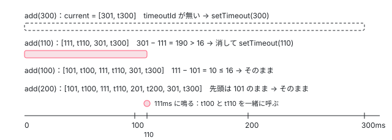

[目次](../README.md) › [@defer とインクリメンタルハイドレーションの内側](README.md) › 第 10 回 / 全 20 回

# on timer：TimerScheduler が 1 つの setTimeout で並べる

> ɵɵdeferOnTimer と scheduleTimerTrigger、TimerScheduler が「時刻と関数」を平らな配列に並べて、いちばん早い時刻にだけ setTimeout を張り直す行（add・remove・scheduleTimer）。minimum と after もこれを使う。後片付けで予定を消す行。

angular/angular · 読了 約 12 分 · 発展 · [サイトで読む（デモが動きます）](https://angular-deep-dive-cyan.vercel.app/chapter/defer-timer)

---

`@defer (on timer(300ms))` の塊が 10 個あっても、`setTimeout` は 10 本張られません。この章では、`TimerScheduler` が「いつ呼ぶか（時刻）と何を呼ぶか（関数）」を 1 本の平らな配列に時刻の順で並べ、いちばん早い時刻にだけ `setTimeout` を 1 本張り直す仕組みを、配列の操作 1 つずつと記録で確かめます。

読む対象は `packages/core/src/defer/instructions.ts`（`ɵɵdeferOnTimer`）と `timer_scheduler.ts`（230 行）の全体です。

1. [1. 全体像](01-defer-overview.md)
2. [2. ɵɵdefer 命令](02-defer-instruction.md)
3. [3. 塊の記録](03-defer-details.md)
4. [4. 状態を描く](04-defer-render-state.md)
5. [5. minimum と after](05-defer-minimum-after.md)
6. [6. 依存を読み込む](06-defer-resource-loading.md)
7. [7. トリガーから描画まで](07-defer-trigger-flow.md)
8. [8. when](08-defer-when.md)
9. [9. idle と immediate](09-defer-idle-immediate.md)
10. **10. timer**（この章）
11. [11. interaction と hover](11-defer-dom-triggers.md)
12. [12. viewport](12-defer-viewport.md)
13. [13. prefetch](13-defer-prefetch.md)
14. [14. 入れ子・注入器・クエリ](14-defer-nested-di.md)
15. [15. サーバーでの @defer](15-defer-server.md)
16. [16. hydrate トリガー](16-defer-hydrate-triggers.md)
17. [17. 親から順にハイドレート](17-defer-hydration-queue.md)
18. [18. hydrate のイベント](18-defer-hydrate-events.md)
19. [19. テストを読む](19-defer-tests.md)
20. [20. issue と PR を読む](20-defer-issues.md)

## 1. ɵɵdeferOnTimer：idle と同じ入口に onTimer を渡す

📄 `angular/packages/core/src/defer/instructions.ts` L499–515 （▶ の行: 504, 509, 512, 514）

```ts
499 │ /**
500 │  * Creates runtime data structures for the `on timer` deferred trigger.
501 │  * @param delay Amount of time to wait before loading the content.
502 │  * @codeGenApi
503 │  */
504 ▶ export function ɵɵdeferOnTimer(delay: number) {
505 │   const lView = getLView();
506 │   const tNode = getCurrentTNode()!;
507 │ 
508 │   if (ngDevMode) {
509 ▶     trackTriggerForDebugging(lView[TVIEW], tNode, `on timer(${delay}ms)`);
510 │   }
511 │ 
512 ▶   if (!shouldAttachTrigger(TriggerType.Regular, lView, tNode)) return;
513 │ 
514 ▶   scheduleDelayedTrigger(onTimer(delay));
515 │ }
```

504 行目の `delay` は、コンパイラーが `timer(300ms)`・`timer(1s)` を ms の数にしたものです。512 行目で付けてよいかを確かめ（[第 7 回](07-defer-trigger-flow.md)）、514 行目で `scheduleDelayedTrigger(onTimer(delay))` を呼びます。`scheduleDelayedTrigger` は on idle と同じ関数で、placeholder を描き、予定を作り、取り消しの関数を塊にしまいます（[第 9 回](09-defer-idle-immediate.md)の 2 節）。違うのは渡す関数だけです。

## 2. onTimer と scheduleTimerTrigger：TimerScheduler に add する

📄 `angular/packages/core/src/defer/timer_scheduler.ts` L14–36 （▶ の行: 18–20, 31–35）

```ts
14 │ /**
15 │  * Returns a function that captures a provided delay.
16 │  * Invoking the returned function schedules a trigger.
17 │  */
18 ▶ export function onTimer(delay: number) {
19 ▶   return (callback: VoidFunction, injector: Injector) =>
20 ▶     scheduleTimerTrigger(delay, callback, injector);
21 │ }
22 │ 
23 │ /**
24 │  * Schedules a callback to be invoked after a given timeout.
25 │  *
26 │  * @param delay A number of ms to wait until firing a callback.
27 │  * @param callback A function to be invoked after a timeout.
28 │  * @param injector injector for the app.
29 │  */
30 │ export function scheduleTimerTrigger(delay: number, callback: VoidFunction, injector: Injector) {
31 ▶   const scheduler = injector.get(TimerScheduler);
32 ▶   const ngZone = injector.get(NgZone);
33 ▶   const cleanupFn = () => scheduler.remove(callback);
34 ▶   scheduler.add(delay, callback, ngZone);
35 ▶   return cleanupFn;
36 │ }
```

18〜21 行目の `onTimer(delay)` は delay を閉じ込めて、`scheduleDelayedTrigger` が呼ぶ形（callback と injector を受け取る関数）を返します。30〜36 行目の `scheduleTimerTrigger` が中身です。31 行目で `TimerScheduler`（`providedIn: 'root'`、アプリに 1 つ）を、32 行目で `NgZone` を取り出し、34 行目で `add`、35 行目で「`remove(callback)` を呼ぶ関数」を返します。

> [!NOTE]
> **ポイント**
>
> `scheduleTimerTrigger` は on timer だけのものではありません。@placeholder の `minimum` と @loading の `after`・`minimum` も、rendering.ts の中からこの関数を呼んで同じ `TimerScheduler` に予定を入れます（[第 5 回](05-defer-minimum-after.md)）。この章で読む配列は、on timer と minimum・after の予定が混ざって並ぶ 1 本です。

## 3. 欄：時刻と関数を交互に並べた 1 本の配列

📄 `angular/packages/core/src/defer/timer_scheduler.ts` L38–64 （▶ の行: 45, 48, 51, 57–58, 64）

```ts
38 │ /**
39 │  * Helper service to schedule `setTimeout`s for batches of defer blocks,
40 │  * to avoid calling `setTimeout` for each defer block (e.g. if defer blocks
41 │  * are created inside a for loop).
42 │  */
43 │ export class TimerScheduler implements OnDestroy {
44 │   // Indicates whether current callbacks are being invoked.
45 ▶   executingCallbacks = false;
46 │ 
47 │   // Currently scheduled `setTimeout` id.
48 ▶   timeoutId: number | null = null;
49 │ 
50 │   // When currently scheduled timer would fire.
51 ▶   invokeTimerAt: number | null = null;
52 │ 
53 │   // List of callbacks to be invoked.
54 │   // For each callback we also store a timestamp on when the callback
55 │   // should be invoked. We store timestamps and callback functions
56 │   // in a flat array to avoid creating new objects for each entry.
57 ▶   // [timestamp1, callback1, timestamp2, callback2, ...]
58 ▶   current: Array<number | VoidFunction> = [];
59 │ 
60 │   // List of callbacks collected while invoking current set of callbacks.
61 │   // Those callbacks are added to the "current" queue at the end of
62 │   // the current callback invocation. The shape of this list is the same
63 │   // as the shape of the `current` list.
64 ▶   deferred: Array<number | VoidFunction> = [];
```

1. **58 行目：`current` は `[時刻1, 関数1, 時刻2, 関数2, …]`**

   53〜57 行目のコメントのとおり、予定 1 つごとにオブジェクトを作らないよう、時刻（`Date.now()` の ms）と関数を 2 つずつ並べます。偶数の位置が時刻、その次が関数です。並びは常に時刻の早い順です（5 節）。
2. **48・51 行目：張っている setTimeout は 1 本だけ**

   `timeoutId` はその番号、`invokeTimerAt` はその setTimeout がいつ鳴るつもりで張られたかの時刻です。
3. **45・64 行目：呼んでいる最中に来た予定は別の配列へ**

   関数を呼んでいる間（`executingCallbacks` が true）に足された予定は `deferred` に入れ、呼び終わってから `current` に移します（7 節）。呼んでいる最中の配列を書き換えないためです。

## 4. add と remove

📄 `angular/packages/core/src/defer/timer_scheduler.ts` L66–84 （▶ の行: 67–69, 74–75, 78, 81–82）

```ts
66 │   add(delay: number, callback: VoidFunction, ngZone: NgZone) {
67 ▶     const target = this.executingCallbacks ? this.deferred : this.current;
68 ▶     this.addToQueue(target, Date.now() + delay, callback);
69 ▶     this.scheduleTimer(ngZone);
70 │   }
71 │ 
72 │   remove(callback: VoidFunction) {
73 │     const {current, deferred} = this;
74 ▶     const callbackIndex = this.removeFromQueue(current, callback);
75 ▶     if (callbackIndex === -1) {
76 │       // Try cleaning up deferred queue only in case
77 │       // we didn't find a callback in the "current" queue.
78 ▶       this.removeFromQueue(deferred, callback);
79 │     }
80 │     // If the last callback was removed and there is a pending timeout - cancel it.
81 ▶     if (current.length === 0 && deferred.length === 0) {
82 ▶       this.clearTimeout();
83 │     }
84 │   }
```

67 行目で入れる先（`current` か `deferred`）を選び、68 行目で「今の時刻 + delay」を鳴らす時刻にして並べ、69 行目で `scheduleTimer` を呼んで setTimeout を張り直すかを決めます。`remove` は 74 行目でまず `current` から探し、無ければ 78 行目で `deferred` から消します。81〜83 行目：両方が空になったときだけ setTimeout を消します。予定が 1 つでも残っていれば、消された予定のために張った setTimeout も残し、鳴ったときに何も呼ばずに張り直します（6 節の 138 行目で、時刻の来ていない予定は呼ばれません）。

## 5. 時刻の順に差し込む・関数で探して 2 つ消す

📄 `angular/packages/core/src/defer/timer_scheduler.ts` L86–121 （▶ の行: 91–92, 94, 99, 103, 108, 110, 118）

```ts
 86 │   private addToQueue(
 87 │     target: Array<number | VoidFunction>,
 88 │     invokeAt: number,
 89 │     callback: VoidFunction,
 90 │   ) {
 91 ▶     let insertAtIndex = target.length;
 92 ▶     for (let i = 0; i < target.length; i += 2) {
 93 │       const invokeQueuedCallbackAt = target[i] as number;
 94 ▶       if (invokeQueuedCallbackAt > invokeAt) {
 95 │         // We've reached a first timer that is scheduled
 96 │         // for a later time than what we are trying to insert.
 97 │         // This is the location at which we need to insert,
 98 │         // no need to iterate further.
 99 ▶         insertAtIndex = i;
100 │         break;
101 │       }
102 │     }
103 ▶     arrayInsert2(target, insertAtIndex, invokeAt, callback);
104 │   }
105 │ 
106 │   private removeFromQueue(target: Array<number | VoidFunction>, callback: VoidFunction) {
107 │     let index = -1;
108 ▶     for (let i = 0; i < target.length; i += 2) {
109 │       const queuedCallback = target[i + 1];
110 ▶       if (queuedCallback === callback) {
111 │         index = i;
112 │         break;
113 │       }
114 │     }
115 │     if (index > -1) {
116 │       // Remove 2 elements: a timestamp slot and
117 │       // the following slot with a callback function.
118 ▶       arraySplice(target, index, 2);
119 │     }
120 │     return index;
121 │   }
```

1. **91 行目：差し込む場所の初期値は末尾**

   自分より遅い予定が無ければ、いちばん後ろに付きます。
2. **92〜102 行目：時刻だけを 2 つ飛びに見て、自分より遅い最初の場所で止まる**

   94 行目の比べ方は `>` です。同じ時刻の予定がすでにあれば、その後ろに入ります（先に足した方が先に呼ばれます）。
3. **103 行目：`arrayInsert2` で時刻と関数を 2 つまとめて差し込む**

   配列はいつも時刻の早い順なので、先頭（位置 0）がいちばん早い予定です。
4. **106〜121 行目：remove は関数（奇数の位置）で探す**

   110 行目で同じ関数を見つけたら、118 行目でその時刻と関数の 2 つを `arraySplice` で消します。関数は塊ごとに作られるので、塊の分だけが消えます。

## 6. 鳴ったとき：時刻が来た予定を先頭から呼ぶ

📄 `angular/packages/core/src/defer/timer_scheduler.ts` L123–158 （▶ の行: 124–125, 127, 131, 134, 138–139, 142, 148, 150, 153）

```ts
123 │   private scheduleTimer(ngZone: NgZone) {
124 ▶     const callback = () => {
125 ▶       this.clearTimeout();
126 │ 
127 ▶       this.executingCallbacks = true;
128 │ 
129 │       // Clone the current state of the queue, since it might be altered
130 │       // as we invoke callbacks.
131 ▶       const current = [...this.current];
132 │ 
133 │       // Invoke callbacks that were scheduled to run before the current time.
134 ▶       const now = Date.now();
135 │       for (let i = 0; i < current.length; i += 2) {
136 │         const invokeAt = current[i] as number;
137 │         const callback = current[i + 1] as VoidFunction;
138 ▶         if (invokeAt <= now) {
139 ▶           callback();
140 │         } else {
141 │           // We've reached a timer that should not be invoked yet.
142 ▶           break;
143 │         }
144 │       }
145 │       // The state of the queue might've changed after callbacks invocation,
146 │       // run the cleanup logic based on the *current* state of the queue.
147 │       let lastCallbackIndex = -1;
148 ▶       for (let i = 0; i < this.current.length; i += 2) {
149 │         const invokeAt = this.current[i] as number;
150 ▶         if (invokeAt <= now) {
151 │           // Add +1 to account for a callback function that
152 │           // goes after the timestamp in events array.
153 ▶           lastCallbackIndex = i + 1;
154 │         } else {
155 │           // We've reached a timer that should not be invoked yet.
156 │           break;
157 │         }
158 │       }
```

1. **124〜127 行目：setTimeout の番号を捨て、呼んでいる印を立てる**

   125 行目の `clearTimeout` は、鳴り終わった setTimeout の番号を `null` にするためのものです（記録では鳴った直後に `clearTimeout` が出ます）。
2. **131 行目：配列を写してから回す**

   呼んだ関数の中で `remove` が走ると `current` が縮むので、写しの上で回します。
3. **134〜144 行目：`Date.now()` を 1 回だけ読み、それ以前の予定を呼ぶ**

   138 行目の `invokeAt <= now` の予定を 139 行目で呼び、まだの予定に当たったら 142 行目で止まります。並びが時刻の順なので、そこから先も全部まだです。
4. **147〜158 行目：呼んだあとの本物の `current` で、消す範囲を数え直す**

   145〜146 行目のコメントのとおり、呼んでいる間に配列が変わっているかもしれないので、もう一度先頭から時刻が来た予定の最後の位置（153 行目の `i + 1` は関数の位置）を探します。

📄 `angular/packages/core/src/defer/timer_scheduler.ts` L159–177 （▶ の行: 160, 163, 168, 172, 174, 176）

```ts
159 │       if (lastCallbackIndex >= 0) {
160 ▶         arraySplice(this.current, 0, lastCallbackIndex + 1);
161 │       }
162 │ 
163 ▶       this.executingCallbacks = false;
164 │ 
165 │       // If there are any callbacks added during an invocation
166 │       // of the current ones - move them over to the "current"
167 │       // queue.
168 ▶       if (this.deferred.length > 0) {
169 │         for (let i = 0; i < this.deferred.length; i += 2) {
170 │           const invokeAt = this.deferred[i] as number;
171 │           const callback = this.deferred[i + 1] as VoidFunction;
172 ▶           this.addToQueue(this.current, invokeAt, callback);
173 │         }
174 ▶         this.deferred.length = 0;
175 │       }
176 ▶       this.scheduleTimer(ngZone);
177 │     };
```

160 行目で呼び終わった予定を先頭からまとめて消し、163 行目で印を下ろします。168〜175 行目で、呼んでいる間に `deferred` に入った予定を、5 節の差し込みで `current` に移します。176 行目で、残った予定のために setTimeout を張り直します。

## 7. 張り直すかどうか：16ms より早くなるときだけ

📄 `angular/packages/core/src/defer/timer_scheduler.ts` L179–209 （▶ の行: 183, 185, 189, 191, 195, 200, 202–205）

```ts
179 │     // Avoid running timer callbacks more than once per
180 │     // average frame duration. This is needed for better
181 │     // batching and to avoid kicking off excessive change
182 │     // detection cycles.
183 ▶     const FRAME_DURATION_MS = 16; // 1000ms / 60fps
184 │ 
185 ▶     if (this.current.length > 0) {
186 │       const now = Date.now();
187 │       // First element in the queue points at the timestamp
188 │       // of the first (earliest) event.
189 ▶       const invokeAt = this.current[0] as number;
190 │       if (
191 ▶         this.timeoutId === null ||
192 │         // Reschedule a timer in case a queue contains an item with
193 │         // an earlier timestamp and the delta is more than an average
194 │         // frame duration.
195 ▶         (this.invokeTimerAt && this.invokeTimerAt - invokeAt > FRAME_DURATION_MS)
196 │       ) {
197 │         // There was a timeout already, but an earlier event was added
198 │         // into the queue. In this case we drop an old timer and setup
199 │         // a new one with an updated (smaller) timeout.
200 ▶         this.clearTimeout();
201 │ 
202 ▶         const timeout = Math.max(invokeAt - now, FRAME_DURATION_MS);
203 ▶         this.invokeTimerAt = invokeAt;
204 ▶         this.timeoutId = ngZone.runOutsideAngular(() => {
205 ▶           return setTimeout(() => ngZone.run(callback), timeout) as unknown as number;
206 │         });
207 │       }
208 │     }
209 │   }
```

1. **185・189 行目：予定があれば、先頭（いちばん早い時刻）を見る**

   予定が無ければ何もしません。
2. **190〜196 行目：張るのは 2 つの場合だけ**

   191 行目：まだ setTimeout が無いとき。195 行目：張ってある setTimeout が鳴るつもりの時刻より、先頭の予定が 16ms（183 行目の `FRAME_DURATION_MS`、60fps の 1 コマ）より多く早いとき。後から遅い予定が来ても、早い予定が来ても 16ms 以内の差なら、張り直しません。
3. **200〜203 行目：古いのを消して、間隔は最低 16ms**

   202 行目の `Math.max(invokeAt - now, FRAME_DURATION_MS)` で、もう時刻が過ぎた予定でも 16ms は待ちます。179〜182 行目のコメントのとおり、1 コマに 1 回より多く変更検知を起こさないためです。
4. **204〜205 行目：setTimeout は zone の外、鳴ったら zone の中**

   setTimeout は `runOutsideAngular` の中で張り、鳴ったら `ngZone.run` で 6 節の関数を呼びます。zone.js のアプリでは、Angular の zone の外で張った setTimeout は `NgZone` の待ち（`hasPendingMacrotasks`）に数えられません（[zone-ngzone-stability](../zone/10-zone-ngzone-stability.md)）。zoneless（既定）では `NgZone` は `NoopNgZone` なので、どちらもそのまま関数を呼ぶだけです（[zoneless-default](../zoneless/01-zoneless-default.md)）。



*300→110→100→200 の順に足すと、setTimeout は 300 で張られ、110 で張り直され、100 と 200 では張り直されない*

## 8. 消すときとアプリの破棄

📄 `angular/packages/core/src/defer/timer_scheduler.ts` L211–230 （▶ の行: 212–214, 219–221, 227）

```ts
211 │   private clearTimeout() {
212 ▶     if (this.timeoutId !== null) {
213 ▶       clearTimeout(this.timeoutId);
214 ▶       this.timeoutId = null;
215 │     }
216 │   }
217 │ 
218 │   ngOnDestroy() {
219 ▶     this.clearTimeout();
220 ▶     this.current.length = 0;
221 ▶     this.deferred.length = 0;
222 │   }
223 │ 
224 │   /** @nocollapse */
225 │   static ɵprov = /** @pureOrBreakMyCode */ /* @__PURE__ */ ɵɵdefineInjectable({
226 │     token: TimerScheduler,
227 ▶     providedIn: 'root',
228 │     factory: () => new TimerScheduler(),
229 │   });
230 │ }
```

211〜216 行目は張ってある setTimeout があれば消して番号を捨てるだけです。218〜222 行目の `ngOnDestroy` は、ルートの注入器が壊されるときに setTimeout を消し、2 つの配列を空にします（`length = 0` で同じ配列を空にする）。227 行目の `providedIn: 'root'` なので、アプリの中の on timer・minimum・after はすべてこの 1 つの `TimerScheduler` を使います。

## 9. 記録で確かめる

> **🧪 DEMO — TimerScheduler の配列と setTimeout（記録の再生）**
>
> これは記録です。本物の @angular/core 22.1.6（開発モード・JIT）を Node で、domino の DOM の上で動かした結果です。`TimerScheduler` は @angular/core が `ɵTimerScheduler` として出しているクラスで、スクリプトはアプリの注入器から取り出して、中の `current`・`timeoutId`・`invokeTimerAt` を読みました。どの関数がどの塊のものかを見分けるために `add` を包み（元の `add` をそのまま呼んで、呼ばれた直後の配列を写すだけ）、`setTimeout`・`clearTimeout` も包んで、スタックに `scheduleTimer` があるものだけを残しました（#1 などはスクリプトが振った番号です）。時刻は「@if を開く直前」を 0 にした ms です。本物の時計で待ったので、1〜3ms ずれます。
>
> 段のボタンを押してください。
>
> ▶ [このデモはサイトで動かせます](https://angular-deep-dive-cyan.vercel.app/chapter/defer-timer)

記録から読み取れることです。

1. **2 段目：4 つの塊で setTimeout は 2 回、残るのは 1 本**

   300 で張り（#1）、110 で 301 − 111 = 190 &gt; 16 なので #1 を消して #2 を張り直しました。100 は 111 − 101 = 10 で 16 以内、200 は先頭より遅いので、どちらも張り直しません（7 節の 190〜196 行目）。配列は時刻の順に `t100, t110, t200, t300` です。
2. **3 段目：111ms に t100 と t110 が一緒に Complete**

   t100 は 101ms の予定でしたが、張ってあったのは 111ms の setTimeout なので、10ms 遅れて t110 と一緒に呼ばれました（6 節の 138 行目）。そのあと 201ms の t200 のために 89ms の #3 が張られました。
3. **4〜5 段目：1 つずつ鳴って、配列が空になる**

   最後の段では `timeoutId` は無く、`invokeTimerAt` は 301 のまま残っています。191 行目で `timeoutId === null` を先に見るので、古い値が残っていても次の予定は必ず張られます。
4. **6〜7 段目：鳴る前に閉じると、clearTimeout は 1 回だけ**

   塊が壊されるたびに `remove` が呼ばれますが、4 節の 81 行目のとおり、配列が空になった最後の 1 回だけが `clearTimeout` を呼びました。

📄 `scratchpad の記録スクリプト（timer.ts。共通の build.mjs で束ねて node で実行。共通の harness.ts と build.mjs は第 1 回に全文）`

```
// 第 10 回（defer-timer）の記録。
// on timer(300ms)・(110ms)・(100ms)・(200ms) の塊を @if で一度に描き、
// TimerScheduler（@angular/core の ɵTimerScheduler を注入したもの）の配列と、
// TimerScheduler が張った setTimeout・消した clearTimeout を段ごとに残す。
// 時刻は「@if を開く直前の Date.now()」からの差（ms）に直して残す。本物の時計で待つので、数 ms ずれることがある。
import { Component, VERSION, signal, ɵTimerScheduler as TimerScheduler } from '@angular/core';
import { installDom, bootBrowser, blocks, text, tick, writeJson } from '../_shared/harness';

const OUT = process.argv[2];
const g = globalThis as any;

// TimerScheduler.scheduleTimer の中から呼ばれた setTimeout だけを記録する（呼び出し元はスタックで見分ける）。
let t0 = Date.now();
const timerLog: { kind: string; serial: number; delay?: number; at: number }[] = [];
const serials = new Map<unknown, number>();
let serial = 0;
const realSetTimeout = g.setTimeout;
const realClearTimeout = g.clearTimeout;
g.setTimeout = (fn: Function, delay?: number, ...rest: unknown[]) => {
  const id = realSetTimeout(fn, delay, ...rest);
  if ((new Error().stack ?? '').includes('scheduleTimer')) {
    serials.set(id, ++serial);
    timerLog.push({ kind: 'setTimeout', serial, delay, at: Date.now() - t0 });
  }
  return id;
};
g.clearTimeout = (id: unknown) => {
  if (serials.has(id)) timerLog.push({ kind: 'clearTimeout', serial: serials.get(id)!, at: Date.now() - t0 });
  return realClearTimeout(id);
};

const TEMPLATE = `@if (show()) {
  @defer (on timer(300ms)) { <b>t300</b> } @placeholder { <i>.</i> }
  @defer (on timer(110ms)) { <b>t110</b> } @placeholder { <i>.</i> }
  @defer (on timer(100ms)) { <b>t100</b> } @placeholder { <i>.</i> }
  @defer (on timer(200ms)) { <b>t200</b> } @placeholder { <i>.</i> }
}`;

@Component({ selector: 'app-root', template: TEMPLATE })
class Root {
  show = signal(false);
}

const NAMES = ['t300', 't110', 't100', 't200'];
installDom();
const { appRef, ref } = await bootBrowser(Root);
const cmp = ref.instance as Root;
const scheduler = appRef.injector.get(TimerScheduler) as any;

// 配列の関数が「どの塊の関数か」を見分けるため、add を包んで delay の名前（t300 など）を付ける。
// 包んだ関数は元の add をそのまま呼び、呼ばれた直後の配列と setTimeout の様子を adds に残すだけ。
const fnNames = new Map<unknown, string>();
const adds: any[] = [];
const realAdd = scheduler.add.bind(scheduler);
scheduler.add = (delay: number, callback: Function, ngZone: unknown) => {
  fnNames.set(callback, `t${delay}`);
  const before = timerLog.length;
  realAdd(delay, callback, ngZone);
  adds.push({ delay, current: queue(scheduler.current), invokeTimerAt: scheduler.invokeTimerAt - t0, timerLog: timerLog.slice(before) });
};
const steps: any[] = [];
let seen = 0;
function queue(list: Array<number | Function>) {
  const out: { at: number; fn: string }[] = [];
  for (let i = 0; i < list.length; i += 2) {
    const fn = list[i + 1];
    out.push({ at: (list[i] as number) - t0, fn: fnNames.get(fn) ?? '?' });
  }
  return out;
}
function record(id: string, title: string, action: string) {
  steps.push({
    id,
    title,
    action,
    now: Date.now() - t0,
    text: text(ref),
    scheduler: {
      current: queue(scheduler.current),
      deferred: queue(scheduler.deferred),
      timeoutIdSet: scheduler.timeoutId !== null,
      invokeTimerAt: scheduler.invokeTimerAt === null ? null : scheduler.invokeTimerAt - t0,
      executingCallbacks: scheduler.executingCallbacks,
    },
    timerLog: timerLog.slice(seen),
    adds: adds.splice(0),
    blocks: blocks(ref).map((b, i) => ({ name: NAMES[i], state: b.lDetails.DEFER_BLOCK_STATE, triggerCleanupFns: b.lDetails.TRIGGER_CLEANUP_FNS })),
  });
  seen = timerLog.length;
}

record('boot', '起動した直後', 'show = false のまま');

t0 = Date.now();
cmp.show.set(true);
appRef.tick();
record('show', '@if を開いた直後', 'show.set(true) のあと appRef.tick() を同期で 1 回（塊は上から 300・110・100・200 の順に作られる）');

await tick(130);
await appRef.whenStable();
record('after-130', '130ms 待つ', 'await tick(130)');

await tick(100);
await appRef.whenStable();
record('after-230', 'さらに 100ms', 'await tick(100)');

await tick(100);
await appRef.whenStable();
record('after-330', 'さらに 100ms', 'await tick(100)');

// 2 つ目の場面: もう一度描いて、時間が来る前に @if を閉じる。
cmp.show.set(false);
await appRef.whenStable();
t0 = Date.now();
cmp.show.set(true);
await appRef.whenStable();
record('show-again', 'もう一度開く', '@if を閉じて開き直す（ここから時刻を 0 に取り直す）');

cmp.show.set(false);
await appRef.whenStable();
record('hide', '時間が来る前に閉じる', 'show.set(false)');

await writeJson(OUT, { core: VERSION.full, template: TEMPLATE, steps });
process.exit(0);

```

共通の部品（`installDom`・`bootBrowser`・`blocks`）の全文は [第 1 回](01-defer-overview.md)にあります。

## ここまでの呼び出し

- 👤 `@defer (on timer(300ms))` — テンプレート — *コンパイルで ɵɵdeferOnTimer(300)*
  - `ɵɵdeferOnTimer(delay)` — instructions.ts 504
    - `scheduleDelayedTrigger(onTimer(delay))` — instructions.ts 514 → triggering.ts 78 — *第 9 回の 2 節*
      - `scheduleTimerTrigger(delay, callback, injector)` — timer\_scheduler.ts 30 — *minimum・after も rendering.ts からここへ*
        - `TimerScheduler.add` → `addToQueue` — timer\_scheduler.ts 66・86 — *時刻の順に差し込む*
        - `scheduleTimer(ngZone)` — timer\_scheduler.ts 123 — *先頭が 16ms より早くなったときだけ setTimeout を張り直す*
- `（setTimeout が鳴る）` → `ngZone.run(callback)` — timer\_scheduler.ts 205
  - `callback()` — timer\_scheduler.ts 124 — *時刻が来た予定を先頭から呼ぶ*
    - `triggerDeferBlock(Regular, lView, tNode)` — triggering.ts 320 — *第 7 回*
  - `scheduleTimer(ngZone)` — timer\_scheduler.ts 176 — *残りのために張り直す*

## テストと直し方

### spec と describe

| spec | describe / it | 確かめていること |
| --- | --- | --- |
| packages/core/test/acceptance/defer\_spec.ts | describe ``@defer > `on timer` triggers``（3823 行目）の it ``should trigger based on `on timer` condition``（3824 行目）・``should trigger nested `on timer` condition``（3908 行目） | on timer の塊が発火して本体になること。**`TimerScheduler` は偽物に替えている** |
| 同じファイル | describe `@defer > minimum and after conditions`（894 行目） | 本物の `TimerScheduler` と本物の時計で、placeholder・loading・本体が出る時刻を並べて確かめる（[第 5 回](05-defer-minimum-after.md)） |

📄 `angular/packages/core/test/acceptance/defer_spec.ts` L3864–3890 （▶ の行: 3867, 3871, 3883, 3885, 3890）

```ts
3864 │       TestBed.configureTestingModule({
3865 │         providers: [
3866 │           {provide: ɵDEFER_BLOCK_DEPENDENCY_INTERCEPTOR, useValue: deferDepsInterceptor},
3867 ▶           {provide: TimerScheduler, useClass: FakeTimerScheduler},
3868 │         ],
3869 │       });
3870 │ 
3871 ▶       const fakeScheduler = TestBed.inject(TimerScheduler) as unknown as FakeTimerScheduler;
3872 │ 
3873 │       clearDirectiveDefs(RootCmp);
3874 │ 
3875 │       const fixture = TestBed.createComponent(RootCmp);
3876 │       fixture.detectChanges();
3877 │ 
3878 │       expect(fixture.nativeElement.outerHTML).toContain('Placeholder `a`');
3879 │       expect(fixture.nativeElement.outerHTML).toContain('Placeholder `b`');
3880 │       expect(fixture.nativeElement.outerHTML).toContain('Placeholder `c`');
3881 │ 
3882 │       // Make sure loading function is not yet invoked.
3883 ▶       expect(loadingFnInvokedTimes).toBe(0);
3884 │ 
3885 ▶       fakeScheduler.invoke();
3886 │       await allPendingDynamicImports(); // fetching dependencies of the defer block
3887 │       fixture.detectChanges();
3888 │ 
3889 │       // Expect that the loading resources function was invoked once.
3890 ▶       expect(loadingFnInvokedTimes).toBe(1);
```

3867 行目で `TimerScheduler` を、ファイルの先頭の方で定義した `FakeTimerScheduler` に替えています。この偽物は `add` で関数を配列に積むだけで時刻を見ず、3885 行目の `invoke()` で積んだ関数をすべて呼びます。だからこの it が確かめるのは「on timer の塊が `TimerScheduler` に予定を入れ、呼ばれたら本体になる」までで、この章の 5〜7 節（時刻の順・16ms・張り直し）は通りません。

📄 `angular/packages/core/test/acceptance/defer_spec.ts` L3929–3953 （▶ の行: 3930, 3940, 3944–3945, 3947, 3952）

```ts
3929 │       TestBed.configureTestingModule({
3930 ▶         providers: [{provide: TimerScheduler, useClass: FakeTimerScheduler}],
3931 │       });
3932 │       const fakeScheduler = TestBed.inject(TimerScheduler) as unknown as FakeTimerScheduler;
3933 │ 
3934 │       clearDirectiveDefs(RootCmp);
3935 │ 
3936 │       const fixture = TestBed.createComponent(RootCmp);
3937 │ 
3938 │       expect(fixture.nativeElement.outerHTML).toContain('placeholder[top]');
3939 │ 
3940 ▶       fakeScheduler.invoke();
3941 │       await allPendingDynamicImports(); // fetching dependencies of the defer block
3942 │ 
3943 │       // Verify primary blocks content after triggering top-level @defer.
3944 ▶       expect(fixture.nativeElement.outerHTML).toContain('primary[top]');
3945 ▶       expect(fixture.nativeElement.outerHTML).toContain('placeholder[nested]');
3946 │ 
3947 ▶       fakeScheduler.invoke();
3948 │       await allPendingDynamicImports(); // fetching dependencies of the defer block
3949 │ 
3950 │       // Verify that nested @defer block was triggered as well.
3951 │       expect(fixture.nativeElement.outerHTML).toContain('primary[top]');
3952 ▶       expect(fixture.nativeElement.outerHTML).toContain('primary[nested]');
3953 │     });
```

入れ子の it も同じ偽物です。3940 行目の 1 回目の `invoke()` で外側が本体になり（3944 行目）、中の塊がその描画で予定を入れるので、3947 行目の 2 回目の `invoke()` で内側も本体になります（3952 行目）。

### 手元で走らせた結果

📄 `ターミナル（../angular で）`

```
cd ~/angular-research/angular
pnpm bazel test //packages/core/test/acceptance:acceptance \
  '--test_arg=--filter=`on timer` triggers' \
  --nocache_test_results --test_output=all
```

📄 `出力（2026-11-06 に実行。抜粋。ログは scratchpad/defer-logs/c-timer.log）`

```
Ran 2 of 2693 specs
2 specs, 0 failures
Finished in 0.119 seconds
INFO: Elapsed time: 2.168s, Critical Path: 1.45s
//packages/core/test/acceptance:acceptance   PASSED in 1.4s
```

- 2 件は上の 2 つの it です。describe の名前にバッククォートが入るので、シェルでは引数全体を単引用符で囲みます。
- `timer_scheduler.ts` だけを確かめる単体の spec はありません（`grep -rn TimerScheduler packages/*/test` で出てくるのは、defer\_spec.ts と incremental\_hydration\_spec.ts の偽物への差し替えだけ）。配列の並べ方と張り直しは、minimum・after の it が本物の時計で間接に通るだけです。`deferred` の配列（呼んでいる最中の `add`）を通る it も見当たりません。記録でも `deferred` は一度も使われていません。

### 直すとしたら

- 「timer が遅れる」「早く鳴る」は `timer_scheduler.ts` の `scheduleTimer`（7 節）と `addToQueue`（5 節）です。16ms の遅れは 7 節のとおり仕様です。
- 直したら spec を足す先は、`TimerScheduler` を `TestBed.inject` して `add` を直接呼び、`current` と `timeoutId` を見る単体の it が一番短く書けます（describe `IdleScheduler` の形の真似）。本物の時計を待つより、jasmine の `jasmine.clock()` や偽の `Date.now` を使う方が速く安定します。
- 関係する issue：#61233（`on timer(2s)` の塊を AOT と `fakeAsync` で試すと落ちる。2025-12-20 に not planned で閉じた）。コメントでは `fakeAsync` の中で後片付けが先に始まることが原因とされ、zoneless のテストに移すと通ると書かれています。表は [第 20 回](20-defer-issues.md)。
- 本家に PR を出すことは勧めません。記録と同じように `ɵTimerScheduler` を注入して配列を読むのが、手元で確かめる一番の近道です。

## 聞かれそうな質問

**Q. @for の中に `on timer(500ms)` の塊が 100 個あると、setTimeout は 100 本ですか？**

1 本です。100 個の予定は 5 節の 103 行目で 1 本の配列に並び、setTimeout は 7 節の 191 行目（まだ無いとき）か 195 行目（16ms より早くなるとき）にしか張られません。同じ時刻の予定は 94 行目の `>` で後ろに並び、鳴ったら 6 節の 135〜144 行目で 1 回の中でまとめて呼ばれます。

**Q. `on timer(100ms)` は、ちょうど 100ms で出ますか？**

出るとは限りません。張ってある setTimeout より 16ms 以内しか早くない予定では張り直さない（195 行目）ので、記録の 3 段目では 101ms の予定が 111ms に呼ばれました。また 202 行目で setTimeout の間隔は最低 16ms です。そこから依存の読み込みと描画の時間が足されます。

**Q. 塊が消えたら、setTimeout は消えますか？**

予定は消えます。setTimeout が消えるのは、配列が空になったときだけです（4 節の 81〜83 行目）。ほかの予定が残っていれば setTimeout は残り、鳴ったときに時刻の来た予定が無ければ何も呼ばずに張り直します。

**Q. minimum や after も同じ TimerScheduler ですか？**

同じです。rendering.ts の中から 2 節の `scheduleTimerTrigger` が呼ばれ、227 行目の `providedIn: 'root'` の 1 つの `TimerScheduler` に入ります（[第 5 回](05-defer-minimum-after.md)）。だから on timer と minimum の予定が近い時刻なら、同じ setTimeout で一緒に呼ばれます。

**Q. zoneless で、setTimeout が zone の外で張られても画面は更新されますか？**

されます。zoneless では 204〜205 行目の `runOutsideAngular`・`run` は関数をそのまま呼ぶだけで、画面の更新は `triggerDeferBlock` が塊の状態を描くときにスケジューラへ知らせて起こします（[zoneless-notification-source](../zoneless/02-zoneless-notification-source.md)）。

## 読み終えて

- `ɵɵdeferOnTimer` は on idle と同じ `scheduleDelayedTrigger` に `onTimer(delay)` を渡すだけです。
- `TimerScheduler` は `[時刻, 関数, 時刻, 関数, …]` の 1 本の配列を時刻の順に保ちます。
- setTimeout は 1 本だけで、先頭の予定が 16ms より多く早くなったときだけ張り直します。そのため予定は最大 16ms 遅れてまとめて呼ばれます。
- 呼んでいる最中の予定は `deferred` に入れて、呼び終わってから並べ直します。
- minimum と after も同じ `TimerScheduler` を使います。on timer の spec は偽物に替えているので、配列の動きは別の it と記録で確かめます。

---

← 前: [on idle と on immediate：requestIdleCallback と次の描画](09-defer-idle-immediate.md)  
次: [on interaction と on hover：トリガーの要素を見つけてリスナーを共有する](11-defer-dom-triggers.md) →
