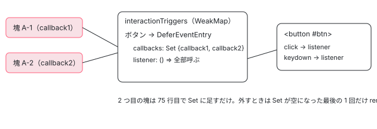

[目次](../README.md) › [@defer とインクリメンタルハイドレーションの内側](README.md) › 第 11 回 / 全 20 回

# on interaction と on hover：トリガーの要素を見つけてリスナーを共有する

> ɵɵdeferOnInteraction・ɵɵdeferOnHover が registerDomTrigger で、placeholder の中や親のビューにあるトリガーの要素（getTriggerLView・getTriggerElement と walkUpTimes）を探し、要素が描かれるのを待ってから primitives/defer の onInteraction・onHover（click と keydown、mouseenter・mouseover・focusin）を付ける行。同じ要素に付いた複数の塊がリスナーを共有する WeakMap。

angular/angular · 読了 約 13 分 · 発展 · [サイトで読む（デモが動きます）](https://angular-deep-dive-cyan.vercel.app/chapter/defer-dom-triggers)

---

`@defer (on interaction(btn))` と `@defer (on hover(box))` は、テンプレートの中の要素にイベントのリスナーを付けて待ちます。この章では、命令が受け取る 2 つの数（要素の番号と、ビューをいくつさかのぼるか）から要素を見つける行、要素がまだ描かれていないときに描画のあとまで待つ行、同じ要素を使う塊が何個あってもリスナーは 1 組だけにする `WeakMap` の行を、1 ステップずつ追います。

読む対象は `packages/core/src/defer/instructions.ts`（`ɵɵdeferOnHover`・`ɵɵdeferOnInteraction`）、`dom_triggers.ts`、`packages/core/primitives/defer/src/triggers.ts` です。

1. [1. 全体像](01-defer-overview.md)
2. [2. ɵɵdefer 命令](02-defer-instruction.md)
3. [3. 塊の記録](03-defer-details.md)
4. [4. 状態を描く](04-defer-render-state.md)
5. [5. minimum と after](05-defer-minimum-after.md)
6. [6. 依存を読み込む](06-defer-resource-loading.md)
7. [7. トリガーから描画まで](07-defer-trigger-flow.md)
8. [8. when](08-defer-when.md)
9. [9. idle と immediate](09-defer-idle-immediate.md)
10. [10. timer](10-defer-timer.md)
11. **11. interaction と hover**（この章）
12. [12. viewport](12-defer-viewport.md)
13. [13. prefetch](13-defer-prefetch.md)
14. [14. 入れ子・注入器・クエリ](14-defer-nested-di.md)
15. [15. サーバーでの @defer](15-defer-server.md)
16. [16. hydrate トリガー](16-defer-hydrate-triggers.md)
17. [17. 親から順にハイドレート](17-defer-hydration-queue.md)
18. [18. hydrate のイベント](18-defer-hydrate-events.md)
19. [19. テストを読む](19-defer-tests.md)
20. [20. issue と PR を読む](20-defer-issues.md)

## 1. 2 つの命令：placeholder を描いて registerDomTrigger へ

📄 `angular/packages/core/src/defer/instructions.ts` L664–692 （▶ の行: 664, 672, 676, 678, 681–682, 686–689）

```ts
664 ▶ export function ɵɵdeferOnInteraction(triggerIndex: number, walkUpTimes?: number) {
665 │   const lView = getLView();
666 │   const tNode = getCurrentTNode()!;
667 │ 
668 │   if (ngDevMode) {
669 │     trackTriggerForDebugging(
670 │       lView[TVIEW],
671 │       tNode,
672 ▶       `on interaction${walkUpTimes === -1 ? '' : '(<target>)'}`,
673 │     );
674 │   }
675 │ 
676 ▶   if (!shouldAttachTrigger(TriggerType.Regular, lView, tNode)) return;
677 │ 
678 ▶   renderPlaceholder(lView, tNode);
679 │ 
680 │   // Avoid adding event listeners when this instruction is invoked on the server.
681 ▶   if (!(typeof ngServerMode !== 'undefined' && ngServerMode)) {
682 ▶     registerDomTrigger(
683 │       lView,
684 │       tNode,
685 │       triggerIndex,
686 ▶       walkUpTimes,
687 ▶       onInteraction,
688 ▶       () => triggerDeferBlock(TriggerType.Regular, lView, tNode),
689 ▶       TriggerType.Regular,
690 │     );
691 │   }
692 │ }
```

1. **664 行目：2 つの数を受け取る**

   `triggerIndex` はトリガーの要素がビューのどの番号（スロット）にあるか、`walkUpTimes` はその要素のあるビューが塊のあるビューから見てどこか、です。どちらもコンパイラーがテンプレート参照 `#btn` を探して決めます（[compiler-control-flow-phases](../compiler/15-compiler-control-flow-phases.md)）。塊と同じビューなら `walkUpTimes` は渡されず、placeholder の中なら `-1`、外側のビューなら 1 以上です。
2. **672 行目：`-1` は「トリガーを書かない」形**

   開発モードの印で、`walkUpTimes === -1` のときは `on interaction`、それ以外は `on interaction(<target>)` と残します。トリガーを書かないと、コンパイラーは placeholder の最初の要素を選び、`-1` を渡します。
3. **676・678 行目：付けてよいかを確かめ、placeholder を描く**

   placeholder の中の要素をトリガーにするには、placeholder が描かれていないといけないので、ここで描きます（[第 4 回](04-defer-render-state.md)）。
4. **681〜691 行目：サーバーでなければ registerDomTrigger**

   687 行目の `onInteraction` が primitives の関数（5 節）、688 行目が発火したときに呼ぶ `triggerDeferBlock` です。

📄 `angular/packages/core/src/defer/instructions.ts` L567–595 （▶ の行: 567, 579, 581, 584, 590–591）

```ts
567 ▶ export function ɵɵdeferOnHover(triggerIndex: number, walkUpTimes?: number) {
568 │   const lView = getLView();
569 │   const tNode = getCurrentTNode()!;
570 │ 
571 │   if (ngDevMode) {
572 │     trackTriggerForDebugging(
573 │       lView[TVIEW],
574 │       tNode,
575 │       `on hover${walkUpTimes === -1 ? '' : '(<target>)'}`,
576 │     );
577 │   }
578 │ 
579 ▶   if (!shouldAttachTrigger(TriggerType.Regular, lView, tNode)) return;
580 │ 
581 ▶   renderPlaceholder(lView, tNode);
582 │ 
583 │   // Avoid adding event listeners when this instruction is invoked on the server.
584 ▶   if (!(typeof ngServerMode !== 'undefined' && ngServerMode)) {
585 │     registerDomTrigger(
586 │       lView,
587 │       tNode,
588 │       triggerIndex,
589 │       walkUpTimes,
590 ▶       onHover,
591 ▶       () => triggerDeferBlock(TriggerType.Regular, lView, tNode),
592 │       TriggerType.Regular,
593 │     );
594 │   }
595 │ }
```

`ɵɵdeferOnHover` は 590 行目の関数が `onHover` なだけで、残りは同じです。どちらも 584 行目でサーバーのときはリスナーを付けません（サーバーでは 579 行目の `shouldAttachTrigger` が先に false を返すこともあります。[第 15 回](15-defer-server.md)）。

## 2. 要素のあるビューを探す：getTriggerLView

📄 `angular/packages/core/src/defer/dom_triggers.ts` L66–99 （▶ の行: 72–73, 77–78, 82, 84, 86–87, 92, 98）

```ts
66 │ export function getTriggerLView(
67 │   deferredHostLView: LView,
68 │   deferredTNode: TNode,
69 │   walkUpTimes: number | undefined | null,
70 │ ): LView | null {
71 │   // The trigger is in the same view, we don't need to traverse.
72 ▶   if (walkUpTimes == null) {
73 ▶     return deferredHostLView;
74 │   }
75 │ 
76 │   // A positive value or zero means that the trigger is in a parent view.
77 ▶   if (walkUpTimes >= 0) {
78 ▶     return walkUpViews(walkUpTimes, deferredHostLView);
79 │   }
80 │ 
81 │   // If the value is negative, it means that the trigger is inside the placeholder.
82 ▶   const deferredContainer = deferredHostLView[deferredTNode.index];
83 │   ngDevMode && assertLContainer(deferredContainer);
84 ▶   const triggerLView = deferredContainer[CONTAINER_HEADER_OFFSET] ?? null;
85 │ 
86 ▶   // We need to null check, because the placeholder might not have been rendered yet.
87 ▶   if (ngDevMode && triggerLView !== null) {
88 │     const lDetails = getLDeferBlockDetails(deferredHostLView, deferredTNode);
89 │     const renderedState = lDetails[DEFER_BLOCK_STATE];
90 │     assertEqual(
91 │       renderedState,
92 ▶       DeferBlockState.Placeholder,
93 │       'Expected a placeholder to be rendered in this defer block.',
94 │     );
95 │     assertLView(triggerLView);
96 │   }
97 │ 
98 ▶   return triggerLView;
99 │ }
```

1. **72〜74 行目：`walkUpTimes` が無ければ、塊と同じビュー**

   `== null` なので、渡されなかった（`undefined`）ときも、viewport の命令が options のために `null` を渡したとき（[第 12 回](12-defer-viewport.md)）も、ここに入ります。
2. **77〜79 行目：0 以上なら、その回数だけ親のビューへ**

   `walkUpViews` は LView の親をたどる関数です（[ivy-view-tree](../ivy/12-ivy-view-tree.md)）。たとえば `@if` の中の塊が `@if` の外のボタンを使うと、塊のあるビュー（`@if` の中のビュー）から 1 つ上がったコンポーネントのビューにボタンがあります。
3. **82〜84 行目：負なら、塊の LContainer の最初のビュー（placeholder）**

   塊の番号の位置にある LContainer（[ivy-lcontainer](../ivy/11-ivy-lcontainer.md)）の、最初のビューの位置（`CONTAINER_HEADER_OFFSET`）を読みます。86 行目のコメントのとおり、placeholder がまだ描かれていなければここは空で、`null` を返します。
4. **87〜96 行目：開発モードでは、そのビューが本当に placeholder かを確かめる**

   92 行目で、塊の今の状態が `Placeholder` でなければエラーにします。

📄 `angular/packages/core/src/defer/dom_triggers.ts` L101–110 （▶ の行: 107–108）

```ts
101 │ /**
102 │  * Gets the element that a deferred block's trigger is pointing to.
103 │  * @param triggerLView LView in which the trigger is defined.
104 │  * @param triggerIndex Index at which the trigger element should've been rendered.
105 │  */
106 │ export function getTriggerElement(triggerLView: LView, triggerIndex: number): Element {
107 ▶   const element = getNativeByIndex(HEADER_OFFSET + triggerIndex, triggerLView);
108 ▶   ngDevMode && assertElement(element);
109 │   return element as Element;
110 │ }
```

ビューが決まれば、要素はその LView の `HEADER_OFFSET + triggerIndex` の位置にある DOM のノードです（107 行目。[ivy-lview](../ivy/06-ivy-lview.md)）。108 行目で要素であることを確かめます。テンプレート参照の付いた `<ng-container>` などを指すと、開発モードではここで落ちます。

## 3. registerDomTrigger：描画のあとに、要素ができるまで待つ

📄 `angular/packages/core/src/defer/dom_triggers.ts` L123–150 （▶ の行: 138–139, 142–143, 145, 147–148）

```ts
123 │ export function registerDomTrigger<O>(
124 │   initialLView: LView,
125 │   tNode: TNode,
126 │   triggerIndex: number,
127 │   walkUpTimes: number | undefined | null,
128 │   registerFn: (
129 │     element: Element,
130 │     callback: VoidFunction,
131 │     injector: Injector,
132 │     options?: O,
133 │   ) => VoidFunction,
134 │   callback: VoidFunction,
135 │   type: TriggerType,
136 │   options?: O,
137 │ ) {
138 ▶   if (!shouldTriggerDeferBlock(type, initialLView)) {
139 ▶     return;
140 │   }
141 │ 
142 ▶   const injector = initialLView[INJECTOR];
143 ▶   const zone = injector.get(NgZone);
144 │   let poll: AfterRenderRef;
145 ▶   function pollDomTrigger() {
146 │     // If the initial view was destroyed, we don't need to do anything.
147 ▶     if (isDestroyed(initialLView)) {
148 ▶       poll.destroy();
149 │       return;
150 │     }
```

1. **138〜140 行目：手で描くテストではリスナーを付けない**

   `shouldTriggerDeferBlock` は TestBed の `DeferBlockBehavior.Manual` のとき false です。この 3 行は abc61aaf7c0（2026-05-22、issue #68800）で足されました。それまでは Manual でも要素を探してリスナーや `IntersectionObserver` を付けに行き、`IntersectionObserver` の無い Jest + JSDOM でエラーのログが出ていました。on timer・on idle は前から 2 節の入口（`scheduleDelayedTrigger`）で同じ確かめをしていたので、そろえた修正です。
2. **145 行目：探す関数を作り、209 行目で afterEveryRender に登録する**

   命令は塊のビューの creation pass の途中で呼ばれます。トリガーの要素が塊より後ろに書かれていれば（spec の多くがそうです）、この時点ではまだ作られていません。だから要素を探すのは「描画が終わったあと」の `afterEveryRender` の read の段（[cd-after-render](../cd/08-cd-after-render.md)）に回します。
3. **147〜150 行目：塊のビューが壊されていたら、探すのをやめる**

   `poll.destroy()` で afterEveryRender の登録を外します。

📄 `angular/packages/core/src/defer/dom_triggers.ts` L151–180 （▶ の行: 153, 157–158, 160, 164, 167, 169, 172, 175, 179–180）

```ts
151 │ 
152 │     const lDetails = getLDeferBlockDetails(initialLView, tNode);
153 ▶     const renderedState = lDetails[DEFER_BLOCK_STATE];
154 │ 
155 │     // If the block was loaded before the trigger was resolved, we don't need to do anything.
156 │     if (
157 ▶       renderedState !== DeferBlockInternalState.Initial &&
158 ▶       renderedState !== DeferBlockState.Placeholder
159 │     ) {
160 ▶       poll.destroy();
161 │       return;
162 │     }
163 │ 
164 ▶     const triggerLView = getTriggerLView(initialLView, tNode, walkUpTimes);
165 │ 
166 │     // Keep polling until we resolve the trigger's LView.
167 ▶     if (!triggerLView) {
168 │       // Keep polling.
169 ▶       return;
170 │     }
171 │ 
172 ▶     poll.destroy();
173 │ 
174 │     // It's possible that the trigger's view was destroyed before we resolved the trigger element.
175 ▶     if (isDestroyed(triggerLView)) {
176 │       return;
177 │     }
178 │ 
179 ▶     const element = getTriggerElement(triggerLView, triggerIndex);
180 ▶     const cleanup = registerFn(
```

1. **156〜162 行目：もう本体などに進んでいたら、何もしない**

   ほかのトリガー（たとえば同じ塊の `when`）が先に発火していれば、状態は Initial でも Placeholder でもないので、リスナーを付けずに終わります。
2. **164〜170 行目：ビューが見つからなければ、次の描画でもう一度**

   2 節の `null`（placeholder がまだ無い）のときは、`poll` を残したまま帰ります。次の描画のあとにまた呼ばれます。
3. **172 行目：見つかったら、探すのは 1 回で終わり**

   afterEveryRender の登録を外します。リスナーを付けるのは塊ごとに 1 回だけです。
4. **179〜180 行目：要素を取り、registerFn（onInteraction か onHover）を呼ぶ**

   戻り値の `cleanup` は、その塊の分のリスナーを外す関数です（5 節）。

📄 `angular/packages/core/src/defer/dom_triggers.ts` L181–210 （▶ の行: 183, 185–187, 189, 201–202, 205, 209）

```ts
181 │       element,
182 │       () => {
183 ▶         // `pollDomTrigger` runs outside the zone (because of `afterNextRender`) and registers its
184 │         // listeners outside the zone, so we jump back into the zone prior to running the callback.
185 ▶         zone.run(() => {
186 ▶           if (initialLView !== triggerLView) {
187 ▶             removeLViewOnDestroy(triggerLView, cleanup);
188 │           }
189 ▶           callback();
190 │         });
191 │       },
192 │       injector,
193 │       options,
194 │     );
195 │ 
196 │     // The trigger and deferred block might be in different LViews.
197 │     // For the main LView the cleanup would happen as a part of
198 │     // `storeTriggerCleanupFn` logic. For trigger LView we register
199 │     // a cleanup function there to remove event handlers in case an
200 │     // LView gets destroyed before a trigger is invoked.
201 ▶     if (initialLView !== triggerLView) {
202 ▶       storeLViewOnDestroy(triggerLView, cleanup);
203 │     }
204 │ 
205 ▶     storeTriggerCleanupFn(type, lDetails, cleanup);
206 │   }
207 │ 
208 │   // Begin polling for the trigger.
209 ▶   poll = afterEveryRender({read: pollDomTrigger}, {injector});
210 │ }
```

182〜190 行目：渡す関数は、183〜184 行目のコメントのとおり、zone の外で付けたリスナーから zone の中に戻ってから塊の関数を呼びます。186〜188 行目と 201〜203 行目は、トリガーの要素が塊と違うビューにあるときの片付けです。要素のビューが先に壊されたらリスナーも外れるよう、要素のビューの破棄に `cleanup` を登録し（202 行目）、発火したらその登録を外します（187 行目）。205 行目で塊の `TRIGGER_CLEANUP_FNS` にもしまうので、塊が発火したとき・塊が壊されたときにもリスナーが外れます（[第 7 回](07-defer-trigger-flow.md)）。

## 4. primitives：リスナーの付け方と、要素ごとの入れ物

実際に `addEventListener` するのは `packages/core/primitives/defer/src/triggers.ts` です。LView を知らない「要素と関数だけ」の層で、ハイドレーションのイベントの道（[第 18 回](18-defer-hydrate-events.md)）もイベント名の配列をここから読みます。

📄 `angular/packages/core/primitives/defer/src/triggers.ts` L9–20 （▶ の行: 11–12, 16, 19）

```ts
 9 │ /** Configuration object used to register passive and capturing events. */
10 │ const eventListenerOptions: AddEventListenerOptions = {
11 ▶   passive: true,
12 ▶   capture: true,
13 │ };
14 │ 
15 │ /** Keeps track of the currently-registered `on hover` triggers. */
16 ▶ const hoverTriggers = new WeakMap<Element, DeferEventEntry>();
17 │ 
18 │ /** Keeps track of the currently-registered `on interaction` triggers. */
19 ▶ const interactionTriggers = new WeakMap<Element, DeferEventEntry>();
20 │ 
```

10〜13 行目：リスナーは `passive: true`（`preventDefault` しない）・`capture: true`（捕捉の段で受ける）で付けます。capture なので、トリガーの要素の子をクリックしても、子に届く前にこのリスナーが動きます。16・19 行目の 2 つの `WeakMap` は、要素から 4 節の入れ物を引く表です。`WeakMap` なので、要素が DOM から消えて誰も持たなくなれば表の行も一緒に消えます。どのイベントを聞くか（`click`・`keydown` と、`mouseenter`・`mouseover`・`focusin`）は、そのすぐ下の配列で、[defer の章](../template/03-defer.md)で引用しました。

📄 `angular/packages/core/primitives/defer/src/triggers.ts` L33–42 （▶ の行: 35, 37–39）

```ts
33 │ /** Object keeping track of registered callbacks for a deferred block trigger. */
34 │ class DeferEventEntry {
35 ▶   callbacks = new Set<VoidFunction>();
36 │ 
37 ▶   listener = () => {
38 ▶     for (const callback of this.callbacks) {
39 ▶       callback();
40 │     }
41 │   };
42 │ }
```

要素ごとの入れ物は、塊の関数の `Set`（35 行目）と、それを全部呼ぶ 1 つのリスナー（37〜41 行目）です。`addEventListener` に渡すのはこの `listener` だけなので、塊がいくつあっても要素のリスナーの数は変わりません。

## 5. onInteraction と onHover：最初の 1 つだけが addEventListener する

📄 `angular/packages/core/primitives/defer/src/triggers.ts` L51–89 （▶ の行: 52, 55, 67–68, 70–71, 75, 79, 81–82, 84–85）

```ts
51 │ export function onInteraction(trigger: Element, callback: VoidFunction): VoidFunction {
52 ▶   let entry = interactionTriggers.get(trigger);
53 │ 
54 │   // If this is the first entry for this element, add the listeners.
55 ▶   if (!entry) {
56 │     // Note that managing events centrally like this lends itself well to using global
57 │     // event delegation. It currently does delegation at the element level, rather than the
58 │     // document level, because:
59 │     // 1. Global delegation is the most effective when there are a lot of events being registered
60 │     // at the same time. Deferred blocks are unlikely to be used in such a way.
61 │     // 2. Matching events to their target isn't free. For each `click` and `keydown` event we
62 │     // would have look through all the triggers and check if the target either is the element
63 │     // itself or it's contained within the element. Given that `click` and `keydown` are some
64 │     // of the most common events, this may end up introducing a lot of runtime overhead.
65 │     // 3. We're still registering only two events per element, no matter how many deferred blocks
66 │     // are referencing it.
67 ▶     entry = new DeferEventEntry();
68 ▶     interactionTriggers.set(trigger, entry);
69 │ 
70 ▶     for (const name of interactionEventNames) {
71 ▶       trigger.addEventListener(name, entry!.listener, eventListenerOptions);
72 │     }
73 │   }
74 │ 
75 ▶   entry.callbacks.add(callback);
76 │ 
77 │   return () => {
78 │     const {callbacks, listener} = entry!;
79 ▶     callbacks.delete(callback);
80 │ 
81 ▶     if (callbacks.size === 0) {
82 ▶       interactionTriggers.delete(trigger);
83 │ 
84 ▶       for (const name of interactionEventNames) {
85 ▶         trigger.removeEventListener(name, listener, eventListenerOptions);
86 │       }
87 │     }
88 │   };
89 │ }
```

1. **52・55 行目：その要素の入れ物があるかを見る**

   無ければ、この要素を使う最初の塊です。
2. **67〜72 行目：入れ物を作り、click と keydown に 1 つの listener を付ける**

   56〜66 行目のコメントは、document に 1 つだけ付ける（全体の委譲）にしなかった理由です。塊が大量に一度に使われることは少ないこと、click と keydown のたびに全トリガーと照らし合わせると重いこと、要素ごとでも 2 つで済むこと、の 3 つです。
3. **75 行目：塊の関数を Set に足す**

   2 つ目以降の塊はここだけを通ります。
4. **77〜88 行目：外す関数は、自分の関数を消し、最後の 1 つなら listener も外す**

   81 行目で Set が空になったときだけ、82 行目で表から消し、84〜86 行目で 2 つの `removeEventListener` をします。

📄 `angular/packages/core/primitives/defer/src/triggers.ts` L98–124 （▶ の行: 99, 102, 106–107, 111, 117–119, 121）

```ts
 98 │ export function onHover(trigger: Element, callback: VoidFunction): VoidFunction {
 99 ▶   let entry = hoverTriggers.get(trigger);
100 │ 
101 │   // If this is the first entry for this element, add the listener.
102 ▶   if (!entry) {
103 │     entry = new DeferEventEntry();
104 │     hoverTriggers.set(trigger, entry);
105 │ 
106 ▶     for (const name of hoverEventNames) {
107 ▶       trigger.addEventListener(name, entry!.listener, eventListenerOptions);
108 │     }
109 │   }
110 │ 
111 ▶   entry.callbacks.add(callback);
112 │ 
113 │   return () => {
114 │     const {callbacks, listener} = entry!;
115 │     callbacks.delete(callback);
116 │ 
117 ▶     if (callbacks.size === 0) {
118 ▶       for (const name of hoverEventNames) {
119 ▶         trigger.removeEventListener(name, listener, eventListenerOptions);
120 │       }
121 ▶       hoverTriggers.delete(trigger);
122 │     }
123 │   };
124 │ }
```

`onHover` は聞くイベントが 3 つになるだけで、形は同じです（106〜108 行目・117〜122 行目）。`focusin` が入っているので、キーボードの Tab で要素にフォーカスが来たときも hover として発火します。

> [!WARNING]
> **ハマりどころ**
>
> interaction の `keydown` は、どのキーでも発火します。トリガーのボタンにフォーカスがある状態で **Tab を押して離れるとき**にも、そのボタンに `keydown`（Tab）が届くので発火します。逆に、Tab でそのボタンに来ただけでは発火しません（そのときの `keydown` は前の要素に届きます）。下のデモの記録で確かめられます。



*A-1 と A-2 が同じボタンを使うと、WeakMap の 1 行・Set に 2 つの関数・addEventListener は 2 つ（click と keydown）だけ*

## 6. ページの上で動かす

> **🧪 DEMO — on interaction と on hover（ライブ）**
>
> このページの中に本物の `@defer` の塊を 4 つ置いています（@angular/core 22.1.6）。本体の部品 `defer-dom-panel` は塊の中でしか使っていないので、別の chunk になり、発火してから `import()` で読み込まれます（2026-11-06 の本番ビルドで、この部品は 699 バイトの chunk に入り、章の chunk の依存の関数（`() => [import(…).then(…)]`）から読まれていることを確かめました。chunk の名前はビルドごとに変わります）。トリガーの要素には、この章の側でも `(click)`・`(keydown)`・`(mouseenter)`・`(mouseover)`・`(focusin)` のリスナーを付け、届いたイベントを記録します。@defer のリスナーは capture で付くので、同じ要素ではこの章のリスナーより先に動きます。そこで章のリスナーの中で `ɵgetDeferBlocks`（@angular/core の内部の関数）を読み、そのイベントの間に塊の `TRIGGER_CLEANUP_FNS`（LDeferBlockDetails の 4 番の欄。interfaces.ts の 240 行目）が `null` になったら「このイベントで発火した」と書きます。**内部の形を読んでいるだけで、塊を動かすことはしません。**欄の位置は `lView[tNode.index + 1]`（utils.ts の `getDeferBlockDataIndex`）、状態は 1 番の欄（237 行目の `DEFER_BLOCK_STATE`）です（欄の全体は [第 3 回](03-defer-details.md)）。
>
> 「塊を描く」を押すと、4 つの塊が placeholder の状態で現れます。ページを開いただけでは何も描きません。
>
> ▶ [このデモはサイトで動かせます](https://angular-deep-dive-cyan.vercel.app/chapter/defer-dom-triggers)

試すと分かることです。

1. **A を 1 回押すと、A-1 と A-2 が一緒に発火する**

   記録の 1 行に「発火：A-1・A-2」と出ます。1 つの listener が Set の 2 つの関数を呼ぶからです（4 節の 37〜41 行目、5 節の 75 行目）。発火のあと `TRIGGER_CLEANUP_FNS` は `null` になり、2 回目の click は何も発火させません。
2. **A に Tab でフォーカスして Enter を押すと、keydown（Enter）で発火する**

   そのあとに来る click は「発火」なしで記録されます。Enter を押さずに Tab で離れても、keydown（Tab）で発火します（5 節の注意）。
3. **B にマウスを乗せると mouseover で、Tab で来ると focusin で発火する**

   Chrome で確かめると、マウスを乗せたときは `mouseover` が `mouseenter` より先に届くので、「発火」は最初の `mouseover` に付き、すぐ後の `mouseenter` には付きません（どちらが先かは 3 つのイベント名の配列の順ではなく、ブラウザがイベントを出す順で決まります）。
4. **C は placeholder の中のボタンそのものがトリガー**

   押すと C が発火し、ボタンごと本体に置き換わります。2 節の 82〜84 行目で、塊の LContainer の最初のビュー（placeholder）からボタンを取ったからです。
5. **本体が描かれるのは、イベントより少し後**

   発火で依存の読み込み（別の chunk の `import()`）が始まり、読み込めた次の描画で本体になります（[第 6 回](06-defer-resource-loading.md)）。2 回目に描き直したときは読み込み済みなので、すぐ出ます。

## ここまでの呼び出し

- 👤 `@defer (on interaction(btn))` — テンプレート — *コンパイルで ɵɵdeferOnInteraction(要素の番号, walkUpTimes?)*
  - `ɵɵdeferOnInteraction(triggerIndex, walkUpTimes)` — instructions.ts 664 — *placeholder を描く*
    - `registerDomTrigger(…, onInteraction, callback, Regular)` — dom\_triggers.ts 123 — *Manual なら 138 行目で終わり*
      - `afterEveryRender({read: pollDomTrigger})` — dom\_triggers.ts 209
- `（描画のあと）pollDomTrigger()` — dom\_triggers.ts 145
  - `getTriggerLView(initialLView, tNode, walkUpTimes)` — dom\_triggers.ts 66 — *同じビュー／親へ walkUpViews／placeholder*
  - `getTriggerElement(triggerLView, triggerIndex)` — dom\_triggers.ts 106
  - `onInteraction(element, callback)` — primitives/defer/src/triggers.ts 51 — *最初の塊だけ addEventListener*
- `（click / keydown）DeferEventEntry.listener` — triggers.ts 37 — *Set の関数を全部呼ぶ*
  - `zone.run(() => callback())` — dom\_triggers.ts 185
    - `triggerDeferBlock(Regular, lView, tNode)` — triggering.ts 320 — *後片付けの関数で removeEventListener*

## テストと直し方

### spec と describe

| describe（defer\_spec.ts） | it（行） | 注意 |
| --- | --- | --- |
| `@defer > interaction triggers`（3138 行目、it 11 件） | クリック（3139）・キーボード（3165）・トリガーを書かない形（3197）・子をクリック（3222）・同じトリガーに 2 つ（3252）・読み込んだら外す（3284）・要素が壊れたら外す（3312）・塊が壊れたら外す（3343）・prefetch（3408・3455） | キーボードの it は 3167 行目で Node では何もせずに終わる |
| `@defer > hover triggers`（3504 行目、it 8 件） | 乗せる（3505）・トリガーを書かない形（3537）・同じトリガー（3568）・外す 3 件（3606・3640・3677）・prefetch（3715・3768） | **8 件すべてが Node では何もせずに終わる**（domino でイベントを作れないため、3507 行目などの `if (!isBrowser) return;`） |
| `@defer > DOM-based events cleanup`（4703 行目、it 2 件） | interaction（4704）・hover（4757）の読み込み後の `removeEventListener` | prefetch のトリガーの要素も外れることを見る |

📄 `angular/packages/core/test/acceptance/defer_spec.ts` L3197–3220 （▶ の行: 3200, 3203, 3215, 3219）

```ts
3197 │     it('should load the deferred content when an implicit trigger is clicked', async () => {
3198 │       @Component({
3199 │         template: `
3200 ▶           @defer (on interaction) {
3201 │             Main content
3202 │           } @placeholder {
3203 ▶             <button>Placeholder</button>
3204 │           }
3205 │         `,
3206 │ 
3207 │         changeDetection: ChangeDetectionStrategy.Eager,
3208 │       })
3209 │       class MyCmp {}
3210 │ 
3211 │       const fixture = TestBed.createComponent(MyCmp);
3212 │       fixture.detectChanges();
3213 │       expect(fixture.nativeElement.textContent.trim()).toBe('Placeholder');
3214 │ 
3215 ▶       fixture.nativeElement.querySelector('button').click();
3216 │       fixture.detectChanges();
3217 │       await fixture.whenStable();
3218 │       fixture.detectChanges();
3219 ▶       expect(fixture.nativeElement.textContent.trim()).toBe('Main content');
3220 │     });
```

3200 行目のトリガーを書かない `on interaction` で、3203 行目の placeholder のボタンがトリガーになります（2 節の 82〜84 行目の道）。3215 行目でそのボタンを押すと、3219 行目で本体です。

📄 `angular/packages/core/test/acceptance/defer_spec.ts` L3252–3283 （▶ の行: 3255, 3261, 3267, 3278, 3281）

```ts
3252 │     it('should support multiple deferred blocks with the same trigger', async () => {
3253 │       @Component({
3254 │         template: `
3255 ▶           @defer (on interaction(trigger)) {
3256 │             Main content 1
3257 │           } @placeholder {
3258 │             Placeholder 1
3259 │           }
3260 │ 
3261 ▶           @defer (on interaction(trigger)) {
3262 │             Main content 2
3263 │           } @placeholder {
3264 │             Placeholder 2
3265 │           }
3266 │ 
3267 ▶           <button #trigger></button>
3268 │         `,
3269 │ 
3270 │         changeDetection: ChangeDetectionStrategy.Eager,
3271 │       })
3272 │       class MyCmp {}
3273 │ 
3274 │       const fixture = TestBed.createComponent(MyCmp);
3275 │       fixture.detectChanges();
3276 │       expect(fixture.nativeElement.textContent.trim()).toBe('Placeholder 1  Placeholder 2');
3277 │ 
3278 ▶       fixture.nativeElement.querySelector('button').click();
3279 │       fixture.detectChanges();
3280 │       await fixture.whenStable();
3281 ▶       expect(fixture.nativeElement.textContent.trim()).toBe('Main content 1  Main content 2');
3282 │     });
3283 │ 
```

3255・3261 行目の 2 つの塊が、3267 行目の同じボタンを使います。3278 行目の 1 回の click で、3281 行目で両方が本体になります。この it は「両方出る」までを見ていて、`addEventListener` が 2 回（click と keydown）だけであることは見ていません。

📄 `angular/packages/core/test/acceptance/defer_spec.ts` L3640–3675 （▶ の行: 3642, 3648–3649, 3652, 3666, 3668, 3671）

```ts
3640 │     it('should unbind the trigger events when the trigger is destroyed', async () => {
3641 │       // Domino doesn't support creating custom events so we have to skip this test.
3642 ▶       if (!isBrowser) {
3643 │         return;
3644 │       }
3645 │ 
3646 │       @Component({
3647 │         template: `
3648 ▶           @if (renderBlock) {
3649 ▶             @defer (on hover(trigger)) {
3650 │               Main content
3651 │             }
3652 ▶             <button #trigger></button>
3653 │           }
3654 │         `,
3655 │ 
3656 │         changeDetection: ChangeDetectionStrategy.Eager,
3657 │       })
3658 │       class MyCmp {
3659 │         renderBlock = true;
3660 │       }
3661 │ 
3662 │       const fixture = TestBed.createComponent(MyCmp);
3663 │       fixture.detectChanges();
3664 │ 
3665 │       const button: HTMLButtonElement = fixture.nativeElement.querySelector('button');
3666 ▶       const spy = spyOn(button, 'removeEventListener');
3667 │ 
3668 ▶       fixture.componentInstance.renderBlock = false;
3669 │       fixture.detectChanges();
3670 │ 
3671 ▶       expect(spy).toHaveBeenCalledTimes(3);
3672 │       expect(spy).toHaveBeenCalledWith('mouseenter', jasmine.any(Function), jasmine.any(Object));
3673 │       expect(spy).toHaveBeenCalledWith('mouseover', jasmine.any(Function), jasmine.any(Object));
3674 │       expect(spy).toHaveBeenCalledWith('focusin', jasmine.any(Function), jasmine.any(Object));
3675 │     });
```

3648 行目の `@if` で塊とボタンを一緒に消すと、3671〜3674 行目で 3 つのイベントの `removeEventListener` が呼ばれます。3642 行目のとおり、ブラウザでしか中身が走りません。

### 手元で走らせた結果

📄 `ターミナル（../angular で）`

```
cd ~/angular-research/angular
pnpm bazel test //packages/core/test/acceptance:acceptance \
  '--test_arg=--filter=interaction triggers|hover triggers|DOM-based events cleanup' \
  --nocache_test_results --test_output=all
pnpm bazel test //packages/core/test/acceptance:acceptance_web_chromium \
  --nocache_test_results --test_output=all
```

📄 `出力（2026-11-06 に実行。抜粋。ログは scratchpad/defer-logs/c-dom.log と c-web.log）`

```
（Node）Ran 21 of 2693 specs
21 specs, 0 failures
Finished in 0.128 seconds
//packages/core/test/acceptance:acceptance              PASSED in 1.5s

（Chromium）Chromium: 1/1 test files | 2743 passed, 0 failed, 3 skipped
Finished running tests in 6.3s, all tests passed!
//packages/core/test/acceptance:acceptance_web_chromium  PASSED in 6.9s
```

- Node の 21 件は、上の 3 つの describe の it 11 + 8 + 2 件です。そのうち hover の 8 件とキーボードの 1 件は、中身を走らせずに成功しています。
- ブラウザで同じ spec を走らせる `acceptance_web_chromium` では、`--test_arg=--filter=` の絞り込みが効かず、acceptance の全部（2743 件成功・3 件 skip）が 6.9 秒で走りました。hover の it の中身が本当に走るのはこちらです。hover を直したときは、必ずこちらでも走らせます。

### 直すとしたら

- 「トリガーの要素が見つからない」「placeholder の中の要素で動かない」は `dom_triggers.ts` の `getTriggerLView` と、コンパイラーが渡す `walkUpTimes` の両方を見ます。spec は describe `trigger resolution`（2892 行目。[第 19 回](19-defer-tests.md)）の形が近いです。
- 「リスナーが外れない」「同じ要素で片方だけ動く」は primitives の `onInteraction`・`onHover` の Set と外す関数です。spec は 3284 行目の形（`spyOn(button, 'removeEventListener')` で回数を数える）で足し、hover ならブラウザのターゲットで走らせます。
- 関係するコミットと issue：abc61aaf7c0（Manual のときに DOM のトリガーを付けない。issue #68800）。表は [第 20 回](20-defer-issues.md)。
- 本家に PR を出すことは勧めません。issue を読むときは、このページのデモのように、トリガーの要素に自分のリスナーを付けて「どのイベントが届いたか」と塊の状態を並べると、手元で確かめられます。

## 聞かれそうな質問

**Q. 同じボタンを 10 個の塊が `on interaction` で使うと、リスナーは 10 組ですか？**

1 組（click と keydown の 2 つ）です。5 節の 55〜73 行目で `addEventListener` するのは最初の塊だけで、2 つ目からは 75 行目で Set に足すだけです。外すのも 81 行目で Set が空になった最後の 1 回だけです。

**Q. トリガーのボタンを `@defer` より後ろに書いても動くのはなぜですか？**

命令は要素を探さず、3 節の 209 行目で `afterEveryRender` に探す関数を登録するだけだからです。描画が終わったあとに 164・179 行目で要素を探すので、テンプレートのどこに書いてあっても、そのときには作られています。

**Q. キーボードだけの人でも hover の塊は出ますか？**

出ます。`onHover` は `focusin` も聞く（5 節の 106〜108 行目でイベント名の配列のすべてに付ける）ので、Tab でフォーカスが来たときに発火します。デモの B で確かめられます。

**Q. トリガーの要素がボタンの子（アイコンなど）をクリックされても発火しますか？**

発火します。4 節の 10〜13 行目の `capture: true` でトリガーの要素に付いているので、子に向かう click も捕捉の段でこのリスナーを通ります。spec では 3222 行目の it です。

**Q. TestBed の `DeferBlockBehavior.Manual` でもリスナーは付きますか？**

付きません。3 節の 138〜140 行目で `registerDomTrigger` が最初に帰ります（abc61aaf7c0、issue #68800。22.0.0 には cherry-pick の 61a48e99aad で入りました）。それより前の版では Manual でも付いていました。

## 読み終えて

- `ɵɵdeferOnInteraction`・`ɵɵdeferOnHover` は要素の番号と `walkUpTimes` を受け取り、placeholder を描いて `registerDomTrigger` に渡します。
- 要素を探すのは描画のあと（`afterEveryRender`）で、見つかるまで毎回の描画のあとに探し、見つかったら 1 回で終わります。
- `walkUpTimes` は「無い＝同じビュー、0 以上＝親へ、負＝placeholder」です。
- primitives の `WeakMap` と `Set` で、同じ要素を使う塊は 1 組の capture・passive のリスナーを共有します。
- hover の spec は Node では中身が走りません。ブラウザのターゲットで確かめます。

---

← 前: [on timer：TimerScheduler が 1 つの setTimeout で並べる](10-defer-timer.md)  
次: [on viewport：IntersectionObserver を共有する](12-defer-viewport.md) →
