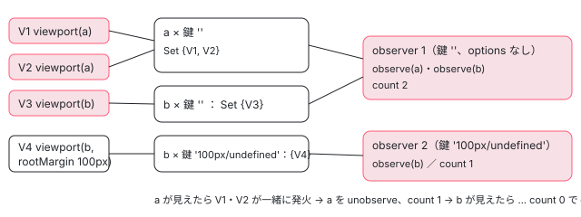

[目次](../README.md) › [@defer とインクリメンタルハイドレーションの内側](README.md) › 第 12 回 / 全 20 回

# on viewport：IntersectionObserver を共有する

> ɵɵdeferOnViewport と onViewportWrapper、primitives/defer の onViewport と createIntersectionObserver が、同じ options の IntersectionObserver を 1 つにまとめて数を数える行（getIntersectionObserverKey）、rootMargin などの options、要素が見えたときに呼ぶ関数と後片付け。

angular/angular · 読了 約 12 分 · 発展 · [サイトで読む（デモが動きます）](https://angular-deep-dive-cyan.vercel.app/chapter/defer-viewport)

---

`@defer (on viewport(el))` は、要素が画面に入ったことを `IntersectionObserver` で知ります。この章では、塊がいくつあっても options が同じなら `IntersectionObserver` を 1 つだけ作り、見ている要素の数を数えて、0 になったら `disconnect` する行を、`rootMargin` などの options が命令から observer に届くまでと合わせて追います。

読む対象は `packages/core/src/defer/instructions.ts`（`ɵɵdeferOnViewport`）、`dom_triggers.ts`（`onViewportWrapper`）、`packages/core/primitives/defer/src/triggers.ts` の後半です。要素を探す `registerDomTrigger` は [第 11 回](11-defer-dom-triggers.md)で読みました。

1. [1. 全体像](01-defer-overview.md)
2. [2. ɵɵdefer 命令](02-defer-instruction.md)
3. [3. 塊の記録](03-defer-details.md)
4. [4. 状態を描く](04-defer-render-state.md)
5. [5. minimum と after](05-defer-minimum-after.md)
6. [6. 依存を読み込む](06-defer-resource-loading.md)
7. [7. トリガーから描画まで](07-defer-trigger-flow.md)
8. [8. when](08-defer-when.md)
9. [9. idle と immediate](09-defer-idle-immediate.md)
10. [10. timer](10-defer-timer.md)
11. [11. interaction と hover](11-defer-dom-triggers.md)
12. **12. viewport**（この章）
13. [13. prefetch](13-defer-prefetch.md)
14. [14. 入れ子・注入器・クエリ](14-defer-nested-di.md)
15. [15. サーバーでの @defer](15-defer-server.md)
16. [16. hydrate トリガー](16-defer-hydrate-triggers.md)
17. [17. 親から順にハイドレート](17-defer-hydration-queue.md)
18. [18. hydrate のイベント](18-defer-hydrate-events.md)
19. [19. テストを読む](19-defer-tests.md)
20. [20. issue と PR を読む](20-defer-issues.md)

> [!TIP]
> **新卒エンジニアへ**
>
> **IntersectionObserver** は「見張る要素が、画面（またはある要素の枠）と重なったか」を知らせるブラウザの API です。`new IntersectionObserver(callback, options)` で作り、`observe(el)` で見張る要素を足し、`unobserve(el)` で外し、`disconnect()` で全部やめます。1 つの observer で何個の要素でも見張れます。`rootMargin` は枠を広げる（`'100px'` なら 100px 手前で知らせる）、`threshold` はどれだけ重なったら知らせるかの割合です。

## 1. ɵɵdeferOnViewport：options を registerDomTrigger まで運ぶ

📄 `angular/packages/core/src/defer/instructions.ts` L761–800 （▶ の行: 763–764, 771, 774–775, 784, 786, 789, 795, 798）

```ts
761 │ export function ɵɵdeferOnViewport(
762 │   triggerIndex: number,
763 ▶   walkUpTimes?: number | null,
764 ▶   options?: IntersectionObserverInit,
765 │ ) {
766 │   const lView = getLView();
767 │   const tNode = getCurrentTNode()!;
768 │ 
769 │   if (ngDevMode) {
770 │     const args: string[] = [];
771 ▶     if (walkUpTimes !== undefined && walkUpTimes !== -1) {
772 │       args.push('<target>');
773 │     }
774 ▶     if (options) {
775 ▶       args.push(JSON.stringify(options));
776 │     }
777 │     trackTriggerForDebugging(
778 │       lView[TVIEW],
779 │       tNode,
780 │       `on viewport${args.length === 0 ? '' : `(${args.join(', ')})`}`,
781 │     );
782 │   }
783 │ 
784 ▶   if (!shouldAttachTrigger(TriggerType.Regular, lView, tNode)) return;
785 │ 
786 ▶   renderPlaceholder(lView, tNode);
787 │ 
788 │   // Avoid adding event listeners when this instruction is invoked on the server.
789 ▶   if (!(typeof ngServerMode !== 'undefined' && ngServerMode)) {
790 │     registerDomTrigger(
791 │       lView,
792 │       tNode,
793 │       triggerIndex,
794 │       walkUpTimes,
795 ▶       onViewportWrapper,
796 │       () => triggerDeferBlock(TriggerType.Regular, lView, tNode),
797 │       TriggerType.Regular,
798 ▶       options,
799 │     );
800 │   }
```

1. **762〜764 行目：3 つ目の引数が options**

   `on viewport({trigger: el, rootMargin: '100px'})` と書くと、コンパイラーは `trigger` を外した残りの `{rootMargin: '100px'}` を options にします。options を渡すために 2 つ目を飛ばせないので、`walkUpTimes` が 0（塊と同じビュー）でも `null` を入れて渡します（763 行目の型が `number | null` なのはこのため。第 11 回の 2 節の `getTriggerLView` の `== null` がこれを受けます）。`root` を書くとコンパイラーがエラーにします。
2. **770〜781 行目：開発モードの印に options を文字で入れる**

   774〜776 行目で `JSON.stringify(options)` を足すので、DevTools には `on viewport(<target>, {"rootMargin":"100px"})` のように出ます。
3. **784〜786 行目：付けてよいかを確かめ、placeholder を描く**

   interaction・hover と同じです。
4. **789〜799 行目：サーバーでなければ registerDomTrigger に、onViewportWrapper と options を渡す**

   要素を探して描画のあとまで待つのは [第 11 回](11-defer-dom-triggers.md)の 3 節と同じ関数です。要素が見つかると、`registerDomTrigger` の中の `registerFn(element, …, injector, options)` として 795 行目の `onViewportWrapper` が呼ばれ、798 行目の options が 4 つ目の引数で届きます。

📄 `angular/packages/core/src/defer/dom_triggers.ts` L49–55 （▶ の行: 49, 52–54）

```ts
49 ▶   const ngZone = injector.get(NgZone);
50 │   return onViewport(
51 │     trigger,
52 ▶     () => ngZone.run(callback),
53 ▶     (options) => ngZone.runOutsideAngular(() => createIntersectionObserver(options)),
54 ▶     wrapperOptions,
55 │   );
```

`onViewportWrapper` の全体は [defer の章](../template/03-defer.md)で引用したので、中の 7 行だけを見ます。52 行目で「見えたら呼ぶ関数」を `ngZone.run` で包み、53 行目で「observer を作る関数」を `runOutsideAngular` で包んで、54 行目の options と一緒に primitives の `onViewport` に渡します。observer を作る関数を外から渡すのは、primitives の層が `NgZone` を知らないままにするためです（49 行目で `NgZone` を取り出すのはこの包みの側です）。

## 2. 2 つの表：要素の表と、observer の表

📄 `angular/packages/core/primitives/defer/src/triggers.ts` L30–31 （▶ の行: 31）

```ts
30 │ /** `IntersectionObserver` used to observe `viewport` triggers. */
31 ▶ const intersectionObservers = new Map<string, {observer: IntersectionObserver; count: number}>();
```

31 行目の `intersectionObservers` は「options の鍵 → observer と、その observer で見ている要素の数」の表です。もう 1 つの表 `viewportTriggers`（要素 → 鍵 → 入れ物）は、同じファイルの少し上にあり、[defer の章](../template/03-defer.md)で引用しました。入れ物は interaction・hover と同じ `DeferEventEntry`（関数の `Set` と、それを全部呼ぶ `listener`。[第 11 回](11-defer-dom-triggers.md)の 4 節）です。

> [!WARNING]
> **ハマりどころ**
>
> 2 つの表はどちらもモジュールの一番外側の変数です。注入器にも LView にも属さないので、同じページで動くアプリが 2 つあれば observer を分け合い、テストでは前の it の observer が次の it まで残ります。870a525bd3c（2026-08-11、test）は、incremental\_hydration\_spec.ts の it が最後に要素を「見えた」ことにして observer を消すようにしたもので、コミットの説明は「ランダムな順で後に走る spec の前に、キャッシュされた observer を消す」です。

## 3. 鍵：rootMargin と threshold だけで作る

📄 `angular/packages/core/primitives/defer/src/triggers.ts` L213–220 （▶ の行: 215–216, 219）

```ts
213 │ /** Generates a string that can be used to find identical intersection observer option objects. */
214 │ function getIntersectionObserverKey(options: IntersectionObserverInit | undefined): string {
215 ▶   if (!options) {
216 ▶     return '';
217 │   }
218 │ 
219 ▶   return `${options.rootMargin}/${typeof options.threshold === 'number' ? options.threshold : options.threshold?.join('\n')}`;
220 │ }
```

options が無ければ 215〜217 行目で `''`。あれば 219 行目で `rootMargin/threshold` の文字列です（threshold が配列なら改行でつなぐ）。だから `{rootMargin: '100px'}` の鍵は `'100px/undefined'` で、options の無い `''` とは別の observer になります。オブジェクトそのものではなく中身で比べるので、別の塊が別々に書いた同じ options も 1 つにまとまります。

## 4. onViewport：observer は鍵に 1 つ、observe は要素と鍵の組に 1 回

📄 `angular/packages/core/primitives/defer/src/triggers.ts` L150–183 （▶ の行: 156–157, 159–160, 163, 165–167, 172, 175, 178–179, 182）

```ts
150 │ export function onViewport(
151 │   trigger: Element,
152 │   callback: VoidFunction,
153 │   observerFactoryFn: (options?: IntersectionObserverInit) => IntersectionObserver,
154 │   options?: IntersectionObserverInit,
155 │ ): VoidFunction {
156 ▶   const key = getIntersectionObserverKey(options);
157 ▶   let entry = viewportTriggers.get(trigger)?.get(key);
158 │ 
159 ▶   if (!intersectionObservers.has(key)) {
160 ▶     intersectionObservers.set(key, {observer: observerFactoryFn(options), count: 0});
161 │   }
162 │ 
163 ▶   const config = intersectionObservers.get(key)!;
164 │ 
165 ▶   if (!entry) {
166 ▶     entry = new DeferEventEntry();
167 ▶     config.observer.observe(trigger);
168 │ 
169 │     let triggerConfig = viewportTriggers.get(trigger);
170 │ 
171 │     if (triggerConfig) {
172 ▶       triggerConfig.set(key, entry);
173 │     } else {
174 │       triggerConfig = new Map();
175 ▶       viewportTriggers.set(trigger, triggerConfig);
176 │     }
177 │ 
178 ▶     triggerConfig.set(key, entry);
179 ▶     config.count++;
180 │   }
181 │ 
182 ▶   entry.callbacks.add(callback);
183 │ 
```

1. **156〜157 行目：鍵を作り、この要素・この鍵の入れ物を探す**

   同じ要素を同じ options で見る塊が前にあれば、入れ物が見つかります。
2. **159〜161 行目：その鍵の observer が無ければ作る（数は 0 から）**

   160 行目の `observerFactoryFn(options)` は 1 節の 53 行目の関数で、中で次の 5 節の `createIntersectionObserver` を呼びます。**observer に渡る options は、その鍵で最初に来た塊の options です。**
3. **165〜180 行目：この要素・この鍵が初めてなら、observe して数を 1 つ増やす**

   167 行目で `observe(trigger)`、169〜178 行目で要素の表に鍵と入れ物を入れ（172 行目と 178 行目で同じ `set` を 2 回しますが、結果は同じです）、179 行目で数を増やします。数えているのは塊の数ではなく「この observer で見ている要素」の数です。
4. **182 行目：塊の関数を入れ物に足す**

   同じ要素・同じ鍵の 2 つ目の塊は、ここだけを通ります。

## 5. 見えたとき：createIntersectionObserver の callback

📄 `angular/packages/core/primitives/defer/src/triggers.ts` L126–139 （▶ の行: 131–132, 134–135, 138）

```ts
126 │ /**
127 │  * Used to create an IntersectionObserver instance.
128 │  * @return IntersectionObserver that is used by onViewport
129 │  */
130 │ export function createIntersectionObserver(options?: IntersectionObserverInit) {
131 ▶   const key = getIntersectionObserverKey(options);
132 ▶   return new IntersectionObserver((entries) => {
133 │     for (const current of entries) {
134 ▶       if (current.isIntersecting && viewportTriggers.has(current.target)) {
135 ▶         viewportTriggers.get(current.target)?.get(key)?.listener();
136 │       }
137 │     }
138 ▶   }, options);
139 │ }
```

131 行目で、この observer の鍵を閉じ込めます。ブラウザから届いた entries のうち、134 行目で「重なっている」かつ「要素の表にまだある」ものだけを選び、135 行目で要素の表からこの鍵の入れ物を引いて `listener`（その要素・その鍵の塊の関数を全部呼ぶ）を呼びます。ブラウザは `observe` した直後に 1 回 callback を呼ぶ（そのとき見えていなければ `isIntersecting` は false）ので、134 行目の条件で読み飛ばされます。最初から画面の中にある要素なら、その 1 回目で発火します。

## 6. 後片付け：数が 0 になったら disconnect

📄 `angular/packages/core/primitives/defer/src/triggers.ts` L184–211 （▶ の行: 185, 189, 191–193, 198, 201, 206–208）

```ts
184 │   return () => {
185 ▶     if (!viewportTriggers.get(trigger)?.has(key)) {
186 │       return;
187 │     }
188 │ 
189 ▶     entry!.callbacks.delete(callback);
190 │ 
191 ▶     if (entry!.callbacks.size === 0) {
192 ▶       config.observer.unobserve(trigger);
193 ▶       config.count--;
194 │ 
195 │       const triggerConfig = viewportTriggers.get(trigger);
196 │ 
197 │       if (triggerConfig) {
198 ▶         triggerConfig.delete(key);
199 │ 
200 │         if (triggerConfig.size === 0) {
201 ▶           viewportTriggers.delete(trigger);
202 │         }
203 │       }
204 │     }
205 │ 
206 ▶     if (config.count === 0) {
207 ▶       config.observer.disconnect();
208 ▶       intersectionObservers.delete(key);
209 │     }
210 │   };
211 │ }
```

1. **185〜187 行目：もう表に無ければ何もしない**

   同じ塊の後片付けが 2 回呼ばれても、2 回目はここで帰ります。
2. **189〜204 行目：自分の関数を消し、入れ物が空なら unobserve して数を減らす**

   191 行目で入れ物の Set が空になったときだけ、192 行目で `unobserve`、193 行目で数を 1 つ減らし、198・201 行目で要素の表から消します。
3. **206〜209 行目：その observer の数が 0 になったら disconnect して、observer の表から消す**

   次にその鍵の塊が来たら、4 節の 159〜161 行目で新しい observer が作られます。



*V1・V2（a）と V3（b）は鍵 '' の observer 1 を、V4（b, rootMargin 100px）は observer 2 を使う。数は「見ている要素」の数*

## 7. 記録で確かめる

> **🧪 DEMO — IntersectionObserver の数と observe / unobserve / disconnect（記録の再生）**
>
> これは記録です。本物の @angular/core 22.1.6（開発モード・JIT）を Node で、domino の DOM の上で動かした結果です。domino には `IntersectionObserver` が無いので、記録の共通の部品の `FakeIntersectionObserver`（作られたものを配列に残し、observe された要素を覚えるだけの代わり）を使い、スクリプトがその `observe`・`unobserve`・`disconnect` を包んで呼ばれた順を残しました。これは環境の代わりで、Angular のロジックではありません。「見えた」は、スクリプトが選んだ 1 つの observer の callback に `{target, isIntersecting: true}` を 1 つ渡して知らせています（本物のブラウザのように observe した直後に callback を呼ぶことはしません）。observer の番号は作られた順です。domino には描画が無いので、大きさや位置はありません。
>
> 段のボタンを押してください。
>
> ▶ [このデモはサイトで動かせます](https://angular-deep-dive-cyan.vercel.app/chapter/defer-viewport)

記録から読み取れることです。

1. **2 段目：塊 4 つで observer は 2 つ、observe は 3 回**

   observer 1（options なし）が a と b を、observer 2（`{"rootMargin":"100px"}`）が b を見ています。V2 は V1 と同じ要素・同じ鍵なので、4 節の 182 行目で Set に足すだけで、observe は増えません。observe は描画のあと（第 11 回の 3 節の afterEveryRender）なので、同期の `appRef.tick()` の中で済んでいます。
2. **3 段目：a が見えると V1 と V2 が一緒に Complete、a だけ unobserve**

   observer 1 の数は 2 から 1 になっただけなので、`disconnect` はまだです（6 節の 206 行目）。
3. **4〜5 段目：数が 0 になった observer から disconnect**

   observer 2 は b だけを見ていたので、V4 の発火で 0 になって `disconnect` されました。observer 1 も V3 の発火で 0 になって `disconnect`。
4. **6 段目：開き直すと、新しい observer が作られる**

   前の observer は 6 節の 208 行目で表から消えているので、observer 3・4 が新しく作られました。
5. **7 段目：見える前に閉じると、unobserve と disconnect が全部呼ばれる**

   塊のビューが壊されると、しまっておいた後片付けの関数（[第 11 回](11-defer-dom-triggers.md)の 3 節の `storeTriggerCleanupFn`）が呼ばれ、6 節の道を通ります。
6. **8〜9 段目：scrollMargin だけが違う 2 つの塊は、1 つの observer を分け合う**

   `{scrollMargin: '1px'}` と `{scrollMargin: '2px'}` は、3 節の 219 行目の鍵がどちらも `'undefined/undefined'` です。だから observer 5 は 1 つだけ作られ、options は最初の塊の `{"scrollMargin":"1px"}` です。d（2px のつもりの塊）もこの observer に observe され、observer 5 の callback で発火しました。次の「テストと直し方」で、この振る舞いが main でどう変わったかを見ます。

📄 `scratchpad の記録スクリプト（viewport.ts。共通の build.mjs で束ねて node で実行。共通の harness.ts と build.mjs は第 1 回に全文）`

```
// 第 12 回（defer-viewport）の記録。
// 要素 a・b と、on viewport の塊 4 つ（a・a・b・rootMargin 付きの b）を @if で一度に描き、
// IntersectionObserver が何個・どの options で作られ、どの要素を observe / unobserve / disconnect したかを段ごとに残す。
// IntersectionObserver は harness の FakeIntersectionObserver（環境の代わりで、Angular のロジックではない）。
// 「見えた」は、選んだ 1 つの observer の callback だけを呼んで知らせる（harness の intersect() は全部の observer を呼ぶため使わない）。
import { Component, VERSION, signal } from '@angular/core';
import { installDom, bootBrowser, blocks, text, writeJson, observers, FakeIntersectionObserver } from '../_shared/harness';

const OUT = process.argv[2];

// 代わりの observer の操作を記録する（元の操作はそのまま行う）。
const log: { op: string; observer: number; target?: string }[] = [];
const num = (o: FakeIntersectionObserver) => observers.indexOf(o) + 1;
const name = (el: Element) => (el.textContent ?? '').trim();
const proto = FakeIntersectionObserver.prototype as any;
for (const op of ['observe', 'unobserve', 'disconnect']) {
  const real = proto[op];
  proto[op] = function (this: FakeIntersectionObserver, el?: Element) {
    log.push({ op, observer: num(this), ...(el ? { target: name(el) } : {}) });
    return real.call(this, el);
  };
}

const TEMPLATE = `@if (show()) {
  <div #a>a</div>
  <div #b>b</div>
  @defer (on viewport(a)) { <b>V1</b> } @placeholder { <i>.</i> }
  @defer (on viewport(a)) { <b>V2</b> } @placeholder { <i>.</i> }
  @defer (on viewport(b)) { <b>V3</b> } @placeholder { <i>.</i> }
  @defer (on viewport({trigger: b, rootMargin: '100px'})) { <b>V4</b> } @placeholder { <i>.</i> }
}
@if (show2()) {
  <div #c>c</div>
  <div #d>d</div>
  @defer (on viewport({trigger: c, scrollMargin: '1px'})) { <b>S1</b> } @placeholder { <i>.</i> }
  @defer (on viewport({trigger: d, scrollMargin: '2px'})) { <b>S2</b> } @placeholder { <i>.</i> }
}`;

@Component({ selector: 'app-root', template: TEMPLATE })
class Root {
  show = signal(false);
  show2 = signal(false);
}

installDom();
const { appRef, ref } = await bootBrowser(Root);
const cmp = ref.instance as Root;
const NAMES = ['V1', 'V2', 'V3', 'V4'];
let names = NAMES;
const steps: any[] = [];
let seen = 0;
function record(id: string, title: string, action: string) {
  steps.push({
    id,
    title,
    action,
    text: text(ref),
    log: log.slice(seen),
    observers: observers.map((o, i) => ({
      no: i + 1,
      options: o.options === undefined ? 'undefined' : JSON.stringify(o.options),
      targets: [...o.targets].map(name),
    })),
    blocks: blocks(ref).map((b, i) => ({
      name: names[i],
      state: b.lDetails.DEFER_BLOCK_STATE,
      triggerCleanupFns: b.lDetails.TRIGGER_CLEANUP_FNS,
      debug: (b.tDetails.debug as any)?.triggers ?? null,
    })),
  });
  seen = log.length;
}
function element(label: string) {
  // domino の NodeList は配列に広げられないので、Array.prototype.find を借りて探す。
  const list = (ref.location.nativeElement as Element).querySelectorAll('div');
  return Array.prototype.find.call(list, (d: Element) => name(d) === label) as Element;
}
/** observer（1 から数えた番号）の callback を、el が見えたとして 1 回だけ呼ぶ。 */
function seen1(no: number, label: string) {
  const o = observers[no - 1];
  o.callback([{ target: element(label), isIntersecting: true, intersectionRatio: 1 }], o);
}

record('boot', '起動した直後', 'show = false のまま');

cmp.show.set(true);
appRef.tick();
record('show', '@if を開いた直後', 'show.set(true) のあと appRef.tick() を同期で 1 回');

seen1(1, 'a');
await appRef.whenStable();
record('o1-a', 'observer 1 で a が見えた', 'observers[0].callback([{target: a, isIntersecting: true}])');

seen1(2, 'b');
await appRef.whenStable();
record('o2-b', 'observer 2 で b が見えた', 'observers[1].callback([{target: b, isIntersecting: true}])');

seen1(1, 'b');
await appRef.whenStable();
record('o1-b', 'observer 1 で b が見えた', 'observers[0].callback([{target: b, isIntersecting: true}])');

// 2 つ目の場面: 開き直して、見える前に閉じる。
cmp.show.set(false);
await appRef.whenStable();
cmp.show.set(true);
await appRef.whenStable();
record('show-again', 'もう一度開く', '@if を閉じて開き直す');

cmp.show.set(false);
await appRef.whenStable();
record('hide', '見える前に閉じる', 'show.set(false)');

// 3 つ目の場面: scrollMargin だけが違う 2 つの塊（22.1.6 の getIntersectionObserverKey は scrollMargin を見ない）。
names = ['S1', 'S2'];
cmp.show2.set(true);
await appRef.whenStable();
record('scroll-margin', 'scrollMargin だけが違う 2 つ', "show2.set(true)（{trigger: c, scrollMargin: '1px'} と {trigger: d, scrollMargin: '2px'}）");

seen1(observers.length, 'd');
await appRef.whenStable();
record('scroll-margin-d', '最後の observer で d が見えた', `observers[${observers.length - 1}].callback([{target: d, isIntersecting: true}])`);

await writeJson(OUT, { core: VERSION.full, template: TEMPLATE, steps });
process.exit(0);

```

共通の部品（`installDom`・`bootBrowser`・`blocks`・`FakeIntersectionObserver`）の全文は [第 1 回](01-defer-overview.md)にあります。

## ここまでの呼び出し

- 👤 `@defer (on viewport({trigger: b, rootMargin: '100px'}))` — テンプレート — *ɵɵdeferOnViewport(番号, null, {rootMargin: '100px'})*
  - `ɵɵdeferOnViewport(triggerIndex, walkUpTimes, options)` — instructions.ts 761
    - `registerDomTrigger(…, onViewportWrapper, callback, Regular, options)` — dom\_triggers.ts 123 — *第 11 回。描画のあとに要素を探す*
      - `onViewportWrapper(element, callback, injector, options)` — dom\_triggers.ts 43
        - `onViewport(trigger, callback, observerFactoryFn, options)` — primitives/defer/src/triggers.ts 150 — *鍵に 1 つの observer、要素と鍵に 1 回の observe*
          - `createIntersectionObserver(options)` — triggers.ts 130 — *その鍵で最初の塊のときだけ*
- `（重なった）IntersectionObserver の callback` — triggers.ts 132
  - `DeferEventEntry.listener()` → `ngZone.run(callback)` — triggers.ts 135・dom\_triggers.ts 52
    - `triggerDeferBlock(Regular, lView, tNode)` — triggering.ts 320 — *後片付けで unobserve、数が 0 なら disconnect*

## テストと直し方

### spec と describe

| describe（defer\_spec.ts） | it（行） |
| --- | --- |
| `@defer > viewport triggers`（4085 行目、it 15 件） | 見えたら出る（4183）・トリガーを書かない形（4211）・まだ要素が無い（4238）・同じトリガーに 2 つ（4277）・ observe をやめる 3 件（4310・4339・4371）・全部済んだら disconnect（4404）・prefetch 2 件（4445・4493）・@for の中（4542）・ options 2 件（4582・4605）・options ごとに別の observer（4628）・Manual では付けない（4672） |
| packages/platform-server/test/incremental\_hydration\_spec.ts | `hydrate on viewport` の it（870a525bd3c で後片付けを足した it を含む。[第 16 回](16-defer-hydrate-triggers.md)） |

📄 `angular/packages/core/test/acceptance/defer_spec.ts` L4162–4176 （▶ の行: 4164–4166, 4169, 4173）

```ts
4162 │       observe(element: Element) {
4163 │         this.observedElements.add(element);
4164 ▶         // Native observers fire their callback as soon as an
4165 ▶         // element is observed so we try to mimic it here.
4166 ▶         this.invokeCallback();
4167 │       }
4168 │ 
4169 ▶       unobserve(element: Element) {
4170 │         this.observedElements.delete(element);
4171 │       }
4172 │ 
4173 ▶       disconnect() {
4174 │         this.observedElements.clear();
4175 │         this.elementsInView.clear();
4176 │       }
```

describe の中の `MockIntersectionObserver` は、記録の代わりより本物に近く、4164〜4166 行目のコメントのとおり observe した直後に callback を呼びます（5 節の 134 行目が読み飛ばす 1 回目を真似ている）。この describe は `beforeEach` で `globalThis.IntersectionObserver` をこれに替え、`afterEach` で戻します。

📄 `angular/packages/core/test/acceptance/defer_spec.ts` L4404–4443 （▶ の行: 4424, 4430, 4432, 4435–4436, 4438, 4441–4442）

```ts
4404 │     it('should disconnect the intersection observer once all deferred blocks have been loaded', async () => {
4405 │       @Component({
4406 │         template: `
4407 │           <button #triggerOne></button>
4408 │           @defer (on viewport(triggerOne)) {
4409 │             One
4410 │           }
4411 │ 
4412 │           <button #triggerTwo></button>
4413 │           @defer (on viewport(triggerTwo)) {
4414 │             Two
4415 │           }
4416 │         `,
4417 │ 
4418 │         changeDetection: ChangeDetectionStrategy.Eager,
4419 │       })
4420 │       class MyCmp {}
4421 │ 
4422 │       const fixture = TestBed.createComponent(MyCmp);
4423 │       fixture.detectChanges();
4424 ▶       expect(activeObservers.length).toBe(1);
4425 │ 
4426 │       const buttons = Array.from<HTMLElement>(fixture.nativeElement.querySelectorAll('button'));
4427 │       const observer = activeObservers[0];
4428 │       const disconnectSpy = spyOn(observer, 'disconnect').and.callThrough();
4429 │ 
4430 ▶       expect(Array.from(observer.observedElements)).toEqual(buttons);
4431 │ 
4432 ▶       MockIntersectionObserver.invokeCallbacksForElement(buttons[0], true);
4433 │       fixture.detectChanges();
4434 │ 
4435 ▶       expect(disconnectSpy).not.toHaveBeenCalled();
4436 ▶       expect(Array.from(observer.observedElements)).toEqual([buttons[1]]);
4437 │ 
4438 ▶       MockIntersectionObserver.invokeCallbacksForElement(buttons[1], true);
4439 │       fixture.detectChanges();
4440 │ 
4441 ▶       expect(disconnectSpy).toHaveBeenCalled();
4442 ▶       expect(observer.observedElements.size).toBe(0);
4443 │     });
```

記録の 2〜5 段目と同じことを確かめています。4424 行目で observer は 1 つ、4430 行目で 2 つのボタンを見ていて、4432 行目で 1 つ目が見えても 4435 行目で `disconnect` されず、4438 行目で 2 つ目が見えて 4441 行目で `disconnect` です。

📄 `angular/packages/core/test/acceptance/defer_spec.ts` L4628–4662 （▶ の行: 4631, 4634, 4637, 4640, 4643, 4658, 4661）

```ts
4628 │     it('should create different intersection observers depending on their options', async () => {
4629 │       @Component({
4630 │         template: `
4631 ▶           @defer (on viewport(trigger)) {
4632 │             One
4633 │           }
4634 ▶           @defer (on viewport({trigger, rootMargin: '123px'})) {
4635 │             Two
4636 │           }
4637 ▶           @defer (on viewport({trigger, rootMargin: '1vh'})) {
4638 │             Three
4639 │           }
4640 ▶           @defer (on viewport(trigger)) {
4641 │             One Duplicate
4642 │           }
4643 ▶           @defer (on viewport({trigger, rootMargin: '123px'})) {
4644 │             Two Duplicate
4645 │           }
4646 │ 
4647 │           <button #trigger></button>
4648 │         `,
4649 │ 
4650 │         changeDetection: ChangeDetectionStrategy.Eager,
4651 │       })
4652 │       class MyCmp {}
4653 │ 
4654 │       const fixture = TestBed.createComponent(MyCmp);
4655 │       fixture.detectChanges();
4656 │ 
4657 │       const button: HTMLButtonElement = fixture.nativeElement.querySelector('button');
4658 ▶       expect(activeObservers.length).toBe(3);
4659 │       expect(activeObservers[0].observedElements.size).toBe(1);
4660 │       expect(activeObservers[0].observedElements.has(button)).toBe(true);
4661 ▶       expect(activeObservers[0].options).toBe(null);
4662 │ 
```

5 つの塊のうち、4640・4643 行目は 4631・4634 行目と同じ options なので、4658 行目で observer は 3 つです。4661 行目の `null` は、options が無いときに Mock の constructor の既定値（`null`）が入ったものです。

### 手元で走らせた結果

📄 `ターミナル（../angular で）`

```
cd ~/angular-research/angular
pnpm bazel test //packages/core/test/acceptance:acceptance \
  '--test_arg=--filter=viewport triggers' \
  --nocache_test_results --test_output=all
```

📄 `出力（2026-11-06 に実行。抜粋。ログは scratchpad/defer-logs/c-viewport.log）`

```
Ran 15 of 2693 specs
15 specs, 0 failures
Finished in 0.117 seconds
INFO: Elapsed time: 2.072s, Critical Path: 1.43s
//packages/core/test/acceptance:acceptance   PASSED in 1.3s
```

15 件は describe `viewport triggers` の it 15 件です。この describe は Node でも中身が走ります（Mock を使うので、domino に `IntersectionObserver` が無くても困りません）。

### main で変わったこと：鍵に scrollMargin が入った

記録の 8〜9 段目の振る舞い（scrollMargin だけが違う塊が 1 つの observer を分け合い、2 つ目の options が使われない）は、この章が読んでいる 8576f161ae4 より新しい main の 61fd731e6a5（2026-10-01 に main へ。feat、v22.3.0-next.1 から）で変わりました。3 節の鍵に `scrollMargin` が足され、spec には ``should create different intersection observers for different `scrollMargin` values`` などの it が足されています。手元の ../angular にはこのコミットのオブジェクトがあるので、`git -C ../angular show 61fd731e6a5` で読めます（HEAD には入っていません）。

📄 `git -C ../angular show 61fd731e6a5 -- packages/core/primitives/defer/src/triggers.ts`

```ts
diff --git a/packages/core/primitives/defer/src/triggers.ts b/packages/core/primitives/defer/src/triggers.ts
@@ -216,5 +216,6 @@ function getIntersectionObserverKey(options: IntersectionObserverInit | undefine
     return '';
   }

-  return `${options.rootMargin}/${typeof options.threshold === 'number' ? options.threshold : options.threshold?.join('\n')}`;
+  // TODO: Remove the cast once G3 uses the TypeScript 6.0 DOM types.
+  return `${options.rootMargin}/${(options as any).scrollMargin}/${typeof options.threshold === 'number' ? options.threshold : options.threshold?.join('\n')}`;
 }
```

22.1.6 で scrollMargin を書けるのかは、コンパイラーの側で決まります。テンプレートの解析は `root` だけを拒み、ほかのキーは通します。AOT の型検査は options を `IntersectionObserverInit` の型と比べるので（compiler-cli の template\_typecheck\_spec.ts の ``should check the options of the `viewport` trigger``）、`scrollMargin` がその型にある TypeScript の DOM の型なら通ります（コミットの TODO のとおり、TypeScript 6.0 の DOM の型にあります）。記録は JIT なので、型検査を通らずにそのまま動きました。

### 直すとしたら

- 「observer が多すぎる／少なすぎる」「別の options の塊が同じ observer を使う」は `getIntersectionObserverKey`（3 節）と `onViewport`（4 節）です。足す spec は 4628 行目の形（`activeObservers` の数と `options` を見る）です。
- 「見えたのに出ない」は 5 節の 134 行目（`isIntersecting` と要素の表）と、要素を探す側（[第 11 回](11-defer-dom-triggers.md)）を分けて確かめます。
- 関係する issue：#68285（translateX で画面の外に動かした要素の塊がすぐ出る。2026-04-20 に not planned で閉じた）。コメントでは、ブラウザの IntersectionObserver が重なりと判定するためで、フレームワークの側でできることは少ないとされています。#68800（Manual でも observer を付けていた。abc61aaf7c0 で修正。4672 行目の it）。表は [第 20 回](20-defer-issues.md)。
- 本家に PR を出すことは勧めません。手元では、記録のように `IntersectionObserver` を包んで、作られた数と options と observe の順を残すと、issue の再現に使えます。

## 聞かれそうな質問

**Q. @for で 100 個の塊が on viewport を使うと、IntersectionObserver は 100 個ですか？**

options が同じなら 1 つです。4 節の 159〜161 行目で鍵ごとに 1 つしか作らず、要素ごとに 167 行目で `observe` を足すだけです。数（179 行目）は見ている要素の数で、全部済んで 0 になったら 6 節の 206〜208 行目で `disconnect` されます。

**Q. `rootMargin` を変えた塊は、同じ observer を使いますか？**

使いません。3 節の 219 行目の鍵が変わるので、4 節の 160 行目で別の observer が作られます（記録の observer 1 と 2）。ただし鍵に入るのは rootMargin と threshold だけなので、22.1.6 では scrollMargin だけが違う塊は分け合います（記録の 8〜9 段目。main の 61fd731e6a5 で鍵に入った）。

**Q. 最初から画面の中にある要素の塊は、いつ出ますか？**

描画のあとに要素が見つかって `observe` された直後です。ブラウザは observe した直後に 1 回 callback を呼ぶので、そのとき重なっていれば 5 節の 134〜135 行目で発火します。

**Q. observer を作るのが zone の外なのはなぜですか？**

1 節の 53 行目で `runOutsideAngular` の中で作り、見えたときだけ 52 行目の `ngZone.run` で中に戻るからです。zone.js は `IntersectionObserver` の callback を、observer を作ったときの zone で呼ぶように包む（zone.js の browser.ts の `patchClass('IntersectionObserver')`）ので、zone.js のアプリでも callback のたびに変更検知が走ることはありません（[defer の章](../template/03-defer.md)の 5 節）。zoneless ではどちらもそのまま呼ぶだけです。

**Q. テストで、前の it の observer が残るのはなぜですか？**

2 節の 31 行目の表がモジュールの一番外側の変数で、アプリやテストの注入器と一緒には消えないからです。見ている要素が 0 になって 6 節の 208 行目で消えるまでは残ります。870a525bd3c はそのための spec の後片付けです。

## 読み終えて

- `ɵɵdeferOnViewport` は options を 3 つ目の引数で受け取り、`registerDomTrigger` を通して `onViewportWrapper` に届けます。
- primitives の `onViewport` は、options の鍵ごとに observer を 1 つ作り、要素と鍵の組ごとに 1 回だけ `observe` し、見ている要素の数を数えます。
- 見えたら、その要素・その鍵の塊の関数を全部呼び、後片付けで `unobserve`、数が 0 で `disconnect` します。
- 鍵は rootMargin と threshold（main では scrollMargin も）だけで、observer の options はその鍵で最初の塊のものです。
- 2 つの表はモジュールの変数なので、ページの中のアプリやテストのあいだで共有されます。

---

← 前: [on interaction と on hover：トリガーの要素を見つけてリスナーを共有する](11-defer-dom-triggers.md)  
次: [prefetch：本体を出さずに依存だけ先に読む](13-defer-prefetch.md) →
