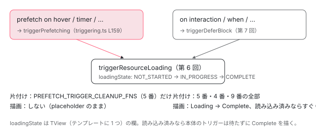

[目次](../README.md) › [@defer とインクリメンタルハイドレーションの内側](README.md) › 第 13 回 / 全 20 回

# prefetch：本体を出さずに依存だけ先に読む

> prefetch on・prefetch when の命令が、triggerPrefetching で依存の読み込みだけを始める行と、そのあと本体のトリガーが来たときに読み込み済みの依存を使う流れ。scheduleDelayedPrefetching、prefetch と本体のトリガーで後片付けの関数を分けてしまう理由。

angular/angular · 読了 約 12 分 · 中核 · [サイトで読む（デモが動きます）](https://angular-deep-dive-cyan.vercel.app/chapter/defer-prefetch)

---

`@defer (on interaction(btn); prefetch on hover(btn))` と書くと、ボタンに乗せた時点で中身の依存（`import()` で分けた chunk）を読み始め、押したときには読み終わった依存ですぐ本体を出せます。この章では、`prefetch` の命令が**本体のトリガーとどこが違うのか**（placeholder を描かない・本体を描かない・後片付けの関数を別の欄に入れる）を、命令の行を 1 つずつ読んで確かめます。最後に、このページの上の本物の `@defer` で、乗せた時刻・chunk が届いた時刻・押した時刻・本体が出た時刻を並べます。

読む対象は `packages/core/src/defer/instructions.ts` の `ɵɵdeferPrefetch*` の 6 つの命令と、`packages/core/src/defer/triggering.ts` の `scheduleDelayedPrefetching`・`triggerPrefetching`・`shouldAttachTrigger` です。

1. [1. 全体像](01-defer-overview.md)
2. [2. ɵɵdefer 命令](02-defer-instruction.md)
3. [3. 塊の記録](03-defer-details.md)
4. [4. 状態を描く](04-defer-render-state.md)
5. [5. minimum と after](05-defer-minimum-after.md)
6. [6. 依存を読み込む](06-defer-resource-loading.md)
7. [7. トリガーから描画まで](07-defer-trigger-flow.md)
8. [8. when](08-defer-when.md)
9. [9. idle と immediate](09-defer-idle-immediate.md)
10. [10. timer](10-defer-timer.md)
11. [11. interaction と hover](11-defer-dom-triggers.md)
12. [12. viewport](12-defer-viewport.md)
13. **13. prefetch**（この章）
14. [14. 入れ子・注入器・クエリ](14-defer-nested-di.md)
15. [15. サーバーでの @defer](15-defer-server.md)
16. [16. hydrate トリガー](16-defer-hydrate-triggers.md)
17. [17. 親から順にハイドレート](17-defer-hydration-queue.md)
18. [18. hydrate のイベント](18-defer-hydrate-events.md)
19. [19. テストを読む](19-defer-tests.md)
20. [20. issue と PR を読む](20-defer-issues.md)

## 1. コンパイラが出す prefetch の命令

まず、テンプレートに書いた `prefetch` がどんな命令になるかを、コンパイラの出力を確かめるテスト（compliance のテスト。入力と、期待する出力の JS を並べたもの）で見ます。

📄 `angular/packages/compiler-cli/test/compliance/test_cases/r3_view_compiler_deferred/deferred_with_prefetch_triggers.ts` L3–16 （▶ の行: 7–11, 14）

```ts
 3 │ @Component({
 4 │     template: `
 5 │     {{message}}
 6 │     @defer (
 7 ▶       prefetch when isVisible() || isReady;
 8 ▶       prefetch on idle, timer(1337);
 9 ▶       prefetch on immediate, hover(button);
10 ▶       prefetch on interaction(button);
11 ▶       prefetch on viewport(button)) {
12 │         {{message}}
13 │       } @placeholder {
14 ▶         <button #button>Click me</button>
15 │       }
16 │   `,
```

📄 `angular/packages/compiler-cli/test/compliance/test_cases/r3_view_compiler_deferred/deferred_with_prefetch_triggers_template.js` L1–19 （▶ の行: 5–12, 17）

```js
 1 │ function MyApp_Template(rf, ctx) {
 2 │   if (rf & 1) {
 3 │     $r3$.ɵɵtext(0);
 4 │     $r3$.ɵɵdomTemplate(1, MyApp_Defer_1_Template, 1, 1)(2, MyApp_DeferPlaceholder_2_Template, 3, 0);
 5 ▶     $r3$.ɵɵdefer(3, 1, null, null, 2);
 6 ▶     $r3$.ɵɵdeferPrefetchOnIdle();
 7 ▶     $r3$.ɵɵdeferPrefetchOnImmediate();
 8 ▶     $r3$.ɵɵdeferPrefetchOnTimer(1337);
 9 ▶     $r3$.ɵɵdeferPrefetchOnHover(0, -1);
10 ▶     $r3$.ɵɵdeferPrefetchOnInteraction(0, -1);
11 ▶     $r3$.ɵɵdeferPrefetchOnViewport(0, -1);
12 ▶     $r3$.ɵɵdeferOnIdle();
13 │   }
14 │   if (rf & 2) {
15 │     $r3$.ɵɵtextInterpolate1(" ", ctx.message, " ");
16 │     $r3$.ɵɵadvance(3);
17 ▶     $r3$.ɵɵdeferPrefetchWhen(ctx.isVisible() || ctx.isReady);
18 │   }
19 │ }
```

1. **6〜11 行目：トリガー 1 つにつき命令 1 つ**

   入力の 8〜11 行目の 6 種類が、出力の 6〜11 行目の `ɵɵdeferPrefetchOnIdle`〜`ɵɵdeferPrefetchOnViewport` になります。どれも `ɵɵdefer`（5 行目）の直後、つまり同じ塊の TNode が「いまの TNode」になっている間に呼ばれます。`hover(button)` などの `(0, -1)` は、トリガーの要素の番号と、ビューを何段たどるか（-1 は placeholder の中）です。この 2 つの数の読み方は [第 11 回](11-defer-dom-triggers.md)で読みます。
2. **17 行目：`prefetch when` だけは更新の段**

   式の値が変わったかを毎回比べる必要があるので、変更検知のたびに走る更新の段（`rf & 2`）に置かれます。`when` と同じ置き方です（[第 8 回](08-defer-when.md)）。
3. **12 行目：本体のトリガーを書かなかったので `ɵɵdeferOnIdle`**

   入力には `prefetch` しか書いていません。本体のトリガーが無い塊には、コンパイラが `on idle` を足します（どの段で足すかは [compiler-control-flow-phases](../compiler/15-compiler-control-flow-phases.md)）。**prefetch だけでは本体は出ない**ことが、この 1 行からも分かります。

## 2. 命令の入口：shouldAttachTrigger(Prefetch) と loadingState

📄 `angular/packages/core/src/defer/instructions.ts` L268–294 （▶ の行: 276, 280, 283, 285–286, 288）

```ts
268 │ export function ɵɵdeferPrefetchWhen(rawValue: unknown) {
269 │   const lView = getLView();
270 │   const tNode = getSelectedTNode();
271 │ 
272 │   if (ngDevMode) {
273 │     trackTriggerForDebugging(lView[TVIEW], tNode, 'prefetch when <expression>');
274 │   }
275 │ 
276 ▶   if (!shouldAttachTrigger(TriggerType.Prefetch, lView, tNode)) return;
277 │ 
278 │   const bindingIndex = nextBindingIndex();
279 │ 
280 ▶   if (bindingUpdated(lView, bindingIndex, rawValue)) {
281 │     const prevConsumer = setActiveConsumer(null);
282 │     try {
283 ▶       const value = Boolean(rawValue); // handle truthy or falsy values
284 │       const tView = lView[TVIEW];
285 ▶       const tDetails = getTDeferBlockDetails(tView, tNode);
286 ▶       if (value === true && tDetails.loadingState === DeferDependenciesLoadingState.NOT_STARTED) {
287 │         // If loading has not been started yet, trigger it now.
288 ▶         triggerPrefetching(tDetails, lView, tNode);
289 │       }
290 │     } finally {
291 │       setActiveConsumer(prevConsumer);
292 │     }
293 │   }
294 │ }
```

1. **276 行目：`shouldAttachTrigger(TriggerType.Prefetch, ...)`**

   prefetch のトリガーを付けてよいかを聞きます。答えは次の 4 行です。

📄 `angular/packages/core/src/defer/triggering.ts` L596–599 （▶ の行: 597–598）

```ts
596 │   }
597 ▶   // TriggerType.Prefetch is active only on the client
598 ▶   return !(typeof ngServerMode !== 'undefined' && ngServerMode);
599 │ }
```

1. **598 行目：prefetch は「ブラウザかどうか」だけで決まる**

   `Regular`（ふつう）と `Hydrate` の 2 つは、インクリメンタルハイドレーションの有無や hydrate トリガーの有無で答えが変わります（[第 15 回](15-defer-server.md)）。`Prefetch` は 597 行目のコメントのとおり、`ngServerMode`（サーバーの束でだけ true になる大域の定数）が立っていなければ常に付けます。サーバーは依存を先読みしても意味が無い（HTML を返したら終わり）からです。
2. **280 行目：式の値が前回と違うときだけ**

   `bindingUpdated` は LView の束縛の欄に前回の値を持っていて、同じなら何もしません。変更検知が 10 回走っても、値が変わらなければ 1 回だけです。
3. **285〜288 行目：TView の `loadingState` が `NOT_STARTED` なら `triggerPrefetching`**

   `loadingState` は `TDeferBlockDetails`（[第 3 回](03-defer-details.md)）、つまり**テンプレートに 1 つ**の記録の欄です。同じ `@defer` が `@for` で 3 つ並んでも、読み込みは 1 回です（6 節の spec）。

> [!NOTE]
> **ポイント**
>
> 本体の `ɵɵdeferWhen` は、値が `false` で何も描かれていなければ placeholder を描きます（[第 8 回](08-defer-when.md)）。`ɵɵdeferPrefetchWhen` には、その枝がありません。**prefetch の命令は画面に何も描かない**のが、この章のすべての命令に共通する性質です。

## 3. timer と idle：scheduleDelayedPrefetching

📄 `angular/packages/core/src/defer/instructions.ts` L386–398 （▶ の行: 395, 397）

```ts
386 │ export function ɵɵdeferPrefetchOnIdle(timeout?: number) {
387 │   const lView = getLView();
388 │   const tNode = getCurrentTNode()!;
389 │ 
390 │   if (ngDevMode) {
391 │     const expression = timeout ? `prefetch on idle(${timeout})` : 'prefetch on idle';
392 │     trackTriggerForDebugging(lView[TVIEW], tNode, expression);
393 │   }
394 │ 
395 ▶   if (!shouldAttachTrigger(TriggerType.Prefetch, lView, tNode)) return;
396 │ 
397 ▶   scheduleDelayedPrefetching(onIdleWrapper({timeout}));
398 │ }
```

📄 `angular/packages/core/src/defer/instructions.ts` L522–533 （▶ の行: 530, 532）

```ts
522 │ export function ɵɵdeferPrefetchOnTimer(delay: number) {
523 │   const lView = getLView();
524 │   const tNode = getCurrentTNode()!;
525 │ 
526 │   if (ngDevMode) {
527 │     trackTriggerForDebugging(lView[TVIEW], tNode, `prefetch on timer(${delay}ms)`);
528 │   }
529 │ 
530 ▶   if (!shouldAttachTrigger(TriggerType.Prefetch, lView, tNode)) return;
531 │ 
532 ▶   scheduleDelayedPrefetching(onTimer(delay));
533 │ }
```

397 行目と 532 行目、どちらも「いつ呼ぶか」を決める関数（`onIdleWrapper({timeout})` と `onTimer(delay)`）を作って `scheduleDelayedPrefetching` に渡すだけです。2 つの関数の中身（`IdleScheduler`・`TimerScheduler`）は [第 9 回](09-defer-idle-immediate.md)と [第 10 回](10-defer-timer.md)で読みます。

📄 `angular/packages/core/src/defer/triggering.ts` L106–126 （▶ の行: 109, 116, 118, 120, 122–124）

```ts
106 │ export function scheduleDelayedPrefetching(
107 │   scheduleFn: (callback: VoidFunction, injector: Injector) => VoidFunction,
108 │ ) {
109 ▶   if (typeof ngServerMode !== 'undefined' && ngServerMode) return;
110 │ 
111 │   const lView = getLView();
112 │   const injector = lView[INJECTOR];
113 │ 
114 │   // Only trigger the scheduled trigger on the browser
115 │   // since we don't want to delay the server response.
116 ▶   const tNode = getCurrentTNode()!;
117 │   const tView = lView[TVIEW];
118 ▶   const tDetails = getTDeferBlockDetails(tView, tNode);
119 │ 
120 ▶   if (tDetails.loadingState === DeferDependenciesLoadingState.NOT_STARTED) {
121 │     const lDetails = getLDeferBlockDetails(lView, tNode);
122 ▶     const prefetch = () => triggerPrefetching(tDetails, lView, tNode);
123 ▶     const cleanupFn = scheduleFn(prefetch, injector);
124 ▶     storeTriggerCleanupFn(TriggerType.Prefetch, lDetails, cleanupFn);
125 │   }
126 │ }
```

1. **109 行目：サーバーなら何もしない**

   命令の 395・530 行目ですでに止まっているので 2 回目の確かめです。`setTimeout` をサーバーで予約すると、HTML を返すのが遅れるからです（114〜115 行目のコメント）。
2. **116〜118 行目：この塊の `TDeferBlockDetails` を取る**

   命令の中から呼ばれるので、`getCurrentTNode()` がまだこの塊の TNode を指しています。
3. **120 行目：まだ読み込んでいなければ**

   ほかのトリガー（本体のトリガーや別の prefetch）がすでに読み込みを始めていたら、予約そのものをしません。
4. **122〜123 行目：時が来たら `triggerPrefetching` を呼ぶように予約する**

   `scheduleFn` は、予約を取り消す関数を返します。
5. **124 行目：取り消す関数を `TriggerType.Prefetch` の欄に入れる**

   `storeTriggerCleanupFn` は種類ごとに `LDeferBlockDetails` の別の欄に積みます。`Prefetch` なら `PREFETCH_TRIGGER_CLEANUP_FNS`（5 番の欄）です（関数の中身は [第 7 回](07-defer-trigger-flow.md)）。なぜ分けるのかは 7 節で読みます。

本体の `on idle`・`on timer` が通る `scheduleDelayedTrigger` は、予約の前にまず placeholder を描きます（[第 9 回](09-defer-idle-immediate.md)）。`scheduleDelayedPrefetching` には、その行がありません。

## 4. hover・interaction・viewport：registerDomTrigger に Prefetch を渡す

📄 `angular/packages/core/src/defer/instructions.ts` L603–631 （▶ の行: 615, 618, 620–621, 626–628）

```ts
603 │ export function ɵɵdeferPrefetchOnHover(triggerIndex: number, walkUpTimes?: number) {
604 │   const lView = getLView();
605 │   const tNode = getCurrentTNode()!;
606 │ 
607 │   if (ngDevMode) {
608 │     trackTriggerForDebugging(
609 │       lView[TVIEW],
610 │       tNode,
611 │       `prefetch on hover${walkUpTimes === -1 ? '' : '(<target>)'}`,
612 │     );
613 │   }
614 │ 
615 ▶   if (!shouldAttachTrigger(TriggerType.Prefetch, lView, tNode)) return;
616 │ 
617 │   const tView = lView[TVIEW];
618 ▶   const tDetails = getTDeferBlockDetails(tView, tNode);
619 │ 
620 ▶   if (tDetails.loadingState === DeferDependenciesLoadingState.NOT_STARTED) {
621 ▶     registerDomTrigger(
622 │       lView,
623 │       tNode,
624 │       triggerIndex,
625 │       walkUpTimes,
626 ▶       onHover,
627 ▶       () => triggerPrefetching(tDetails, lView, tNode),
628 ▶       TriggerType.Prefetch,
629 │     );
630 │   }
631 │ }
```

1. **620 行目：まだ読み込んでいなければ、リスナーを付ける**

   本体の `ɵɵdeferOnHover` は、ここで `renderPlaceholder` を呼んでからリスナーを付けます（[第 11 回](11-defer-dom-triggers.md)）。prefetch の方は呼びません。placeholder は本体のトリガーの命令か `ɵɵdefer` 側の仕組みが描くので、prefetch が描く必要はないのです。
2. **626〜628 行目：イベントは同じ `onHover`、呼ぶ関数と種類だけが違う**

   626 行目の `onHover` は本体の hover と同じ関数で、`mouseenter`・`focusin` などを聞きます（キーボードで Tab を当てても動きます）。627 行目で呼ぶのは `triggerDeferBlock` ではなく `triggerPrefetching`、628 行目で後片付けの欄を `TriggerType.Prefetch` にします。`registerDomTrigger` は描画のあとにトリガーの要素を探して付ける関数で、その中身は [第 11 回](11-defer-dom-triggers.md)で読みます。

📄 `angular/packages/core/src/defer/instructions.ts` L832–849 （▶ の行: 832, 837, 843–846）

```ts
832 ▶   if (!shouldAttachTrigger(TriggerType.Prefetch, lView, tNode)) return;
833 │ 
834 │   const tView = lView[TVIEW];
835 │   const tDetails = getTDeferBlockDetails(tView, tNode);
836 │ 
837 ▶   if (tDetails.loadingState === DeferDependenciesLoadingState.NOT_STARTED) {
838 │     registerDomTrigger(
839 │       lView,
840 │       tNode,
841 │       triggerIndex,
842 │       walkUpTimes,
843 ▶       onViewportWrapper,
844 ▶       () => triggerPrefetching(tDetails, lView, tNode),
845 ▶       TriggerType.Prefetch,
846 ▶       options,
847 │     );
848 │   }
849 │ }
```

`prefetch on viewport` も同じ形で、843 行目が `onViewportWrapper`（`IntersectionObserver`。[第 12 回](12-defer-viewport.md)）、846 行目で `viewport({rootMargin: ...})` の設定をそのまま渡します。`ɵɵdeferPrefetchOnInteraction` は、ここの `onViewportWrapper` が `onInteraction` になり、`options` が無いだけの同じ形です。

## 5. immediate と、triggerPrefetching の中身

📄 `angular/packages/core/src/defer/instructions.ts` L454–470 （▶ の行: 462, 467–468）

```ts
454 │ export function ɵɵdeferPrefetchOnImmediate() {
455 │   const lView = getLView();
456 │   const tNode = getCurrentTNode()!;
457 │ 
458 │   if (ngDevMode) {
459 │     trackTriggerForDebugging(lView[TVIEW], tNode, 'prefetch on immediate');
460 │   }
461 │ 
462 ▶   if (!shouldAttachTrigger(TriggerType.Prefetch, lView, tNode)) return;
463 │ 
464 │   const tView = lView[TVIEW];
465 │   const tDetails = getTDeferBlockDetails(tView, tNode);
466 │ 
467 ▶   if (tDetails.loadingState === DeferDependenciesLoadingState.NOT_STARTED) {
468 ▶     triggerResourceLoading(tDetails, lView, tNode);
469 │   }
470 │ }
```

468 行目、`prefetch on immediate` は予約もリスナーも作らず、命令の中でいきなり `triggerResourceLoading` を呼びます。ほかの 5 つは `triggerPrefetching` を通りますが、それも次の通り 1 行です。

📄 `angular/packages/core/src/defer/triggering.ts` L152–161 （▶ の行: 159–160）

```ts
152 │ /**
153 │  * Trigger prefetching of dependencies for a defer block.
154 │  *
155 │  * @param tDetails Static information about this defer block.
156 │  * @param lView LView of a host view.
157 │  * @param tNode TNode that represents a defer block.
158 │  */
159 ▶ export function triggerPrefetching(tDetails: TDeferBlockDetails, lView: LView, tNode: TNode) {
160 ▶   triggerResourceLoading(tDetails, lView, tNode);
161 │ }
```

160 行目。**prefetch の正体は `triggerResourceLoading` を呼ぶことだけ**です。`triggerResourceLoading` は、`loadingState` を `IN_PROGRESS` にし、`dependencyResolverFn()`（コンパイラが作った `import()` の並び）を呼び、読み終わったら `COMPLETE` にしてテンプレートの部品の登録簿に足します（中身は [第 6 回](06-defer-resource-loading.md)）。この関数は `renderDeferBlockState` を呼ばないので、画面は placeholder のままです。



*prefetch と本体のトリガーは、同じ triggerResourceLoading を呼ぶが、描画するかどうかと、片付ける欄が違う。*

## 6. 本体のトリガーが来たとき：読み込み済みの依存をそのまま使う

本体のトリガーは `triggerDeferBlock` を呼び、その中の `switch (tDetails.loadingState)` で枝が分かれます（[第 7 回](07-defer-trigger-flow.md)）。prefetch がすでに終わっていれば `COMPLETE` の枝で、読み込みを待たずに `Complete` を描きます。読み込みの途中なら `IN_PROGRESS` の枝で、`@loading` を出して同じ Promise の終わりを待ちます。どちらの枝も `import()` を 2 回呼びません。これを確かめている spec を 3 つ読みます。

### prefetch when で先に読み、when で出す

📄 `angular/packages/core/test/acceptance/defer_spec.ts` L1848–1878 （▶ の行: 1852, 1867, 1869–1871, 1877）

```ts
1848 │       @Component({
1849 │         selector: 'root-app',
1850 │         imports: [NestedCmp],
1851 │         template: `
1852 ▶           @defer (when deferCond; prefetch when prefetchCond) {
1853 │             <nested-cmp [block]="'primary'" />
1854 │           } @placeholder {
1855 │             Placeholder
1856 │           }
1857 │         `,
1858 │ 
1859 │         changeDetection: ChangeDetectionStrategy.Eager,
1860 │       })
1861 │       class RootCmp {
1862 │         deferCond = false;
1863 │         prefetchCond = false;
1864 │       }
1865 │ 
1866 │       let loadingFnInvokedTimes = 0;
1867 ▶       const deferDepsInterceptor = {
1868 │         intercept() {
1869 ▶           return () => {
1870 ▶             loadingFnInvokedTimes++;
1871 ▶             return [dynamicImportOf(NestedCmp)];
1872 │           };
1873 │         },
1874 │       };
1875 │ 
1876 │       TestBed.configureTestingModule({
1877 ▶         providers: [{provide: ɵDEFER_BLOCK_DEPENDENCY_INTERCEPTOR, useValue: deferDepsInterceptor}],
1878 │       });
```

1867〜1874 行目の `deferDepsInterceptor` は、`ɵDEFER_BLOCK_DEPENDENCY_INTERCEPTOR`（開発モードだけで読まれる、読み込み関数を包むためのトークン。[testing-defer](../testing/18-testing-defer.md)）に渡すもので、読み込み関数が呼ばれた回数を 1870 行目で数えます。

📄 `angular/packages/core/test/acceptance/defer_spec.ts` L1885–1917 （▶ の行: 1888, 1891, 1898, 1901, 1904, 1912, 1917）

```ts
1885 │       expect(fixture.nativeElement.outerHTML).toContain('Placeholder');
1886 │ 
1887 │       // Make sure loading function is not yet invoked.
1888 ▶       expect(loadingFnInvokedTimes).toBe(0);
1889 │ 
1890 │       // Trigger prefetching.
1891 ▶       fixture.componentInstance.prefetchCond = true;
1892 │       fixture.detectChanges();
1893 │ 
1894 │       await allPendingDynamicImports();
1895 │       fixture.detectChanges();
1896 │ 
1897 │       // Expect that the loading resources function was invoked once.
1898 ▶       expect(loadingFnInvokedTimes).toBe(1);
1899 │ 
1900 │       // Expect that placeholder content is still rendered.
1901 ▶       expect(fixture.nativeElement.outerHTML).toContain('Placeholder');
1902 │ 
1903 │       // Trigger main content.
1904 ▶       fixture.componentInstance.deferCond = true;
1905 │       fixture.detectChanges();
1906 │ 
1907 │       await allPendingDynamicImports();
1908 │       fixture.detectChanges();
1909 │ 
1910 │       // Verify primary block content.
1911 │       const primaryBlockHTML = fixture.nativeElement.outerHTML;
1912 ▶       expect(primaryBlockHTML).toContain(
1913 │         '<nested-cmp ng-reflect-block="primary">Rendering primary block.</nested-cmp>',
1914 │       );
1915 │ 
1916 │       // Expect that the loading resources function was not invoked again (counter remains 1).
1917 ▶       expect(loadingFnInvokedTimes).toBe(1);
```

1. **1888 行目：最初は 0 回**

   どちらの条件も `false` です。
2. **1891〜1898 行目：`prefetchCond = true` で 1 回**

   2 節の 286〜288 行目を通って読み込みが始まります。
3. **1901 行目：画面は placeholder のまま**

   5 節の 160 行目のとおり、描画はしません。
4. **1904〜1917 行目：`deferCond = true` で本体が出ても、まだ 1 回**

   `COMPLETE` の枝を通ったので、読み込み関数は呼ばれていません。

### 同じ値で両方が同時に動いたとき

📄 `angular/packages/core/test/acceptance/defer_spec.ts` L2056–2069 （▶ の行: 2057, 2066）

```ts
2056 │       // Trigger prefetching and loading at the same time.
2057 ▶       fixture.componentInstance.deferCond = true;
2058 │       fixture.detectChanges();
2059 │ 
2060 │       await allPendingDynamicImports();
2061 │       fixture.detectChanges();
2062 │ 
2063 │       // Expect that the loading resources function was invoked once,
2064 │       // even though both main loading and prefetching were kicked off
2065 │       // at the same time.
2066 ▶       expect(loadingFnInvokedTimes).toBe(1);
2067 │ 
2068 │       // Expect the main content to be rendered.
2069 │       expect(fixture.nativeElement.outerHTML).toContain('Rendering primary block');
```

テンプレートは `@defer (when deferCond; prefetch when deferCond)` です（it の名前は `should work when loading and prefetching were kicked off at the same time`）。同じ変更検知の中で両方の命令が動いても、2066 行目で 1 回です。先に動いた方が `loadingState` を `IN_PROGRESS` にし、後の方は 286 行目（prefetch）か `triggerDeferBlock` の `IN_PROGRESS` の枝（本体）で、新しく読み込みを始めないからです。

### @for の中の 3 つの塊は、1 回の prefetch を分け合う

📄 `angular/packages/core/test/acceptance/defer_spec.ts` L4009–4036 （▶ の行: 4019, 4024, 4027–4028, 4031–4033, 4036）

```ts
4009 │       const fixture = TestBed.createComponent(RootCmp);
4010 │       fixture.detectChanges();
4011 │ 
4012 │       expect(fixture.nativeElement.outerHTML).toContain('Placeholder `a`');
4013 │       expect(fixture.nativeElement.outerHTML).toContain('Placeholder `b`');
4014 │       expect(fixture.nativeElement.outerHTML).toContain('Placeholder `c`');
4015 │ 
4016 │       // Make sure loading function is not yet invoked.
4017 │       expect(loadingFnInvokedTimes).toBe(0);
4018 │ 
4019 ▶       fakeScheduler.invoke();
4020 │       await allPendingDynamicImports(); // fetching dependencies of the defer block
4021 │       fixture.detectChanges();
4022 │ 
4023 │       // Expect that the loading resources function was invoked once.
4024 ▶       expect(loadingFnInvokedTimes).toBe(1);
4025 │ 
4026 │       // Trigger rendering of all defer blocks.
4027 ▶       fixture.componentInstance.shouldTrigger = true;
4028 ▶       fixture.detectChanges();
4029 │ 
4030 │       // Verify primary blocks content.
4031 ▶       expect(fixture.nativeElement.outerHTML).toContain('Rendering primary for `a` block');
4032 ▶       expect(fixture.nativeElement.outerHTML).toContain('Rendering primary for `b` block');
4033 ▶       expect(fixture.nativeElement.outerHTML).toContain('Rendering primary for `c` block');
4034 │ 
4035 │       // Make sure the loading function wasn't invoked again (count remains `1`).
4036 ▶       expect(loadingFnInvokedTimes).toBe(1);
```

テンプレートは `@for (item of items; track item) { @defer (when shouldTrigger; prefetch on timer(100ms)) {…} }`（it は ``should trigger prefetching based on `on timer` condition``）で、塊が 3 つできます。4019 行目で偽物の `TimerScheduler` の予約を全部呼ぶと、4024 行目で読み込みは 1 回です。**4027〜4033 行目、`shouldTrigger = true` の `detectChanges()` のすぐあと、`await` を挟まずに 3 つとも本体が出ています**。読み込みを待つ必要が無いので、`COMPLETE` の枝がその場で `Complete` を描いたことが分かります。

## 7. 後片付けの関数を 2 つの欄に分ける理由

3 節の 124 行目と 4 節の 628 行目で、prefetch のトリガーの取り消し関数は `PREFETCH_TRIGGER_CLEANUP_FNS`（5 番の欄）に入りました。本体のトリガーの取り消し関数は `TRIGGER_CLEANUP_FNS`（4 番の欄）です。欄が別なので、片付けるときに**片方だけ**を選べます。

1. **prefetch が発火したとき：prefetch の欄だけを片付ける**

   `triggerResourceLoading` は読み込みを始める直前に `invokeTriggerCleanupFns(TriggerType.Prefetch, lDetails)` を呼びます（[第 6 回](06-defer-resource-loading.md)）。hover のリスナーや prefetch の timer はもう要らないので消します。**本体のトリガー（たとえば interaction のリスナー）は残します**。本体はまだ出ていないので、押されるのを待ち続ける必要があるからです。欄が 1 つだったら、prefetch の発火で本体のリスナーまで消えてしまいます。
2. **本体が発火したとき：全部を片付ける**

   `triggerDeferBlock` は最初に `invokeAllTriggerCleanupFns(lDetails)` で、prefetch・本体・hydrate の 3 つの欄を全部片付けます（[第 7 回](07-defer-trigger-flow.md)）。本体を出すなら、まだ発火していない prefetch のトリガーも要りません。

📄 `angular/packages/core/test/acceptance/defer_spec.ts` L4055–4081 （▶ の行: 4058, 4075–4076, 4078–4081）

```ts
4055 │       @Component({
4056 │         selector: 'root-app',
4057 │         template: `
4058 ▶           @defer (when isVisible; on timer(200ms); prefetch on timer(100ms)) {
4059 │             Hello world!
4060 │           }
4061 │         `,
4062 │ 
4063 │         changeDetection: ChangeDetectionStrategy.Eager,
4064 │       })
4065 │       class RootCmp {
4066 │         isVisible = false;
4067 │       }
4068 │ 
4069 │       clearDirectiveDefs(RootCmp);
4070 │ 
4071 │       const fixture = TestBed.createComponent(RootCmp);
4072 │       fixture.detectChanges();
4073 │ 
4074 │       // Trigger defer block
4075 ▶       fixture.componentInstance.isVisible = true;
4076 ▶       fixture.detectChanges();
4077 │ 
4078 ▶       // The `clearTimeout` was called synchronously, because the `when`
4079 ▶       // condition was triggered, which resulted in timers cleanup.
4080 ▶       expect(setSpy).toHaveBeenCalledTimes(2);
4081 ▶       expect(clearSpy).toHaveBeenCalledTimes(2);
```

4058 行目の塊には `on timer(200ms)` と `prefetch on timer(100ms)` の 2 つの予約があります。4075〜4076 行目で `when` が先に真になると、4078〜4079 行目のコメントのとおり、同じ呼び出しの中で（同期で）予約が取り消されます。prefetch の 100 ms も待たずに消えたことを、4081 行目の `clearTimeout` の回数で確かめています（`setTimeout` と `clearTimeout` がそれぞれ 2 回になる内訳は `TimerScheduler` の予約のまとめ方によります。[第 10 回](10-defer-timer.md)）。

## 8. DEMO：乗せて、押す

> **🧪 DEMO — @defer (on interaction(pfBtn); prefetch on hover(pfBtn))（ライブ）**
>
> このページの上の本物の `@defer` です。中の `defer-pf-heavy` は章の隣の別のファイルで、この塊の中だけで使うので別の chunk になります。表の「loadingState」と 3 つの欄は、`ɵgetDeferBlocks`（@angular/core の内部の関数）で LView を読んだ値で、**内部の形を読んでいるだけ**です。欄の番号は `interfaces.ts` 232〜245 行目（1 = `DEFER_BLOCK_STATE`、4 = `TRIGGER_CLEANUP_FNS`、5 = `PREFETCH_TRIGGER_CLEANUP_FNS`）に従っています。chunk の行は、ブラウザの `PerformanceObserver`（resource）が知らせた `.js` の読み込みで、時刻は「塊を置く」を押したときからの ms です。
>
> ▶ [このデモはサイトで動かせます](https://angular-deep-dive-cyan.vercel.app/chapter/defer-prefetch)

このページで試すと、次の順になります。

1. **塊を置いた直後：`NOT_STARTED`・`Placeholder`、4 番が 2 個、5 番が 1 個**

   4 番の 2 個は、`ɵɵdefer` 命令が入れる「LView が消えたときの後始末を外す関数」と、interaction のリスナーの取り消し関数です。5 番の 1 個が、4 節の 628 行目で入った hover のリスナーの取り消し関数です。リスナーは描画のあとに付くので（`registerDomTrigger`）、この行はそのあとに読んでいます。
2. **乗せた直後：`IN_PROGRESS`、5 番が `null`、4 番は 2 個のまま**

   `triggerResourceLoading` が prefetch の欄だけを片付けました（7 節）。画面は placeholder のまま、下の表に `defer-pf-heavy` の chunk の読み込みが現れます。chunk がすでにブラウザのキャッシュにあると、この行の時点で `COMPLETE` になっていることもあります。
3. **押した直後：`COMPLETE`・`Complete`、4 番も `null`**

   chunk が届いたあとに押せば、`loading` の文は出ずに本体が出ます（6 節の `COMPLETE` の枝）。届く前に押すと `loading` が一瞬出ます（`IN_PROGRESS` の枝）。
4. **片付けてもう一度置くと：最初から `COMPLETE`、5 番は `null`**

   `loadingState` は TView の欄なので、塊を作り直しても `COMPLETE` のままです。4 節の 620 行目で hover のリスナーは付かず、押せばすぐ本体が出ます。JS の読み込みも起きません。もう一度先読みを見たいときは、ページを読み込み直してください。

> [!WARNING]
> **ハマりどころ**
>
> 開発サーバー（`ng serve`）では chunk の名前や大きさが本番と違います。本番ビルドでも `defer-pf-heavy` が別の chunk になることは、このサイトをビルドした出力（`browser/chunk-*.js`）で、`defer-pf-heavy` の文字列が章の chunk とは別のファイルにだけあることで確かめました。「転送 byte」が 0 なのは、ブラウザのキャッシュから読まれたときか、別のオリジンで時刻の詳細を隠されたときです。

## ここまでの呼び出し

- 👤 `@defer (on interaction(btn); prefetch on hover(btn))` — テンプレート
  - `ɵɵdeferPrefetchOnHover(triggerIndex, walkUpTimes)` — instructions.ts L603
    - `shouldAttachTrigger(TriggerType.Prefetch, …)` — triggering.ts L591 — *サーバーなら false（L598）*
    - `registerDomTrigger(…, onHover, () => triggerPrefetching(…), TriggerType.Prefetch)` — dom\_triggers.ts（第 11 回） — *取り消し関数は 5 番の欄へ*
  - `mouseenter / focusin` → `triggerPrefetching(tDetails, lView, tNode)` — triggering.ts L159
    - `triggerResourceLoading(…)` — triggering.ts L169（第 6 回） — *5 番の欄だけ片付け、import() を呼ぶ。描画はしない*
  - `click` → `triggerDeferBlock(TriggerType.Regular, …)` — triggering.ts L320（第 7 回） — *全部の欄を片付け、COMPLETE ならすぐ Complete を描く*

## テストと直し方

### spec と describe

| spec | describe / it | 確かめていること |
| --- | --- | --- |
| packages/core/test/acceptance/defer\_spec.ts | describe `prefetch`（1735 行目）の it 13 件。`should be able to prefetch resources`（1837）・`should handle a case when prefetching fails`（1920）・`should work when loading and prefetching were kicked off at the same time`（2002）・``should support `prefetch on immediate` condition``（2597）ほか | 読み込みの回数（interceptor で数える）と、placeholder が残ること |
| 同じ describe の ``should trigger prefetching based on `on idle(<timeout>)` with timeout only once``（2260）・`should support mixed prefetch triggers with and without timeout`（2354）・``should support `prefetch on idle(3000)` condition with timeout``（2514） | `prefetch on idle(timeout)`。describe の先頭の偽物の `requestIdleCallback` が「timeout ごとに予約は 1 つ」を確かめる |   |
| describe `` `prefetch on timer` triggers ``（3956 行目）の it 3 件 | 6 節・7 節の 2 つ |   |

### 手元で走らせた結果

📄 `ターミナル（../angular で）`

```
cd ~/angular-research/angular
pnpm bazel test //packages/core/test/acceptance:acceptance \
  '--test_arg=--filter=@defer (prefetch|.prefetch on timer.)' \
  --nocache_test_results --test_output=all
```

📄 `出力（2026-11-06 に実行。抜粋。ログは scratchpad/defer-logs/d-prefetch.log）`

```
Ran 16 of 2693 specs
16 specs, 0 failures
INFO: Elapsed time: 6.951s, Critical Path: 2.11s
//packages/core/test/acceptance:acceptance   PASSED in 1.9s
```

- Node の jasmine なので `--filter` が効きます。`@defer prefetch` の 13 件と ``@defer `prefetch on timer` triggers`` の 3 件で、合わせて 16 件です（バッククォートは正規表現の `.` で受けています）。

### 直すとしたら

- 「prefetch が 2 回読み込む」「prefetch のあとに本体が出ない」は、まず 2〜4 節の `loadingState` の確かめ（286・467・620・837 行目と scheduleDelayedPrefetching の 120 行目）と、後片付けの欄（124・628 行目）を疑います。spec は describe `prefetch` に、interceptor で回数を数える形（1867〜1877 行目）で足すのが近道です。
- 98eb24cea04（2026-03-03、feat）は `on idle(timeout)` を足したコミットで、397 行目が `onIdle` から `onIdleWrapper({timeout})` に変わり、上の表の 2260・2354・2514 行目の it が足されました。前は timeout を受け取れず、どの `prefetch on idle` も同じ 1 つの予約にまとめられていました。
- abc61aaf7c0（2026-05-22、fix、#68800）は `registerDomTrigger` の最初に `shouldTriggerDeferBlock(type, …)` の確かめを足しました。テストの `DeferBlockBehavior.Manual` のときに DOM のトリガーを付けないためで、`TriggerType.Prefetch` を渡す hover・interaction・viewport の prefetch もこの確かめを通ります（[第 11 回](11-defer-dom-triggers.md)）。
- 本家に PR を出すことは勧めません。prefetch の issue を読むときは、このページのデモのように `loadingState` と 4 番・5 番の欄を並べて確かめます（[第 20 回](20-defer-issues.md)）。

## 聞かれそうな質問

**Q. prefetch のトリガーが発火すると、画面に何か変化はありますか？**

ありません。`triggerPrefetching` は `triggerResourceLoading` を呼ぶだけで（triggering.ts 160 行目）、状態を描く `renderDeferBlockState` を呼びません。placeholder も、本体のトリガーの命令が描いたものがそのまま残ります。

**Q. prefetch が終わる前に押したらどうなりますか？もう一度読み込みますか？**

読み込みません。`loadingState` が `IN_PROGRESS` なので、`triggerDeferBlock` は `@loading` を描いて、同じ読み込みの終わりを待ちます。spec の 2066 行目で、同時に動いても読み込み関数は 1 回です。

**Q. サーバー（SSR）で prefetch は動きますか？**

動きません。`shouldAttachTrigger` の 598 行目が、`ngServerMode` が立っていれば `Prefetch` に `false` を返すので、どの prefetch の命令も入口で止まります。timer と idle は `scheduleDelayedPrefetching` の 109 行目でも止まります。

**Q. 同じコンポーネントが 10 個並んでいたら、prefetch は 10 回ですか？**

1 回です。`loadingState` は `TDeferBlockDetails`、つまりテンプレートに 1 つの欄で、2 回目以降の命令は 286・620 行目などの `NOT_STARTED` の確かめで止まります。spec の 4024 行目（`@for` の 3 つの塊で 1 回）が確かめています。

**Q. prefetch だけを書いた塊はいつ本体が出ますか？**

コンパイラが本体のトリガーに `on idle` を足すので（compliance の出力の 12 行目）、ブラウザが暇になったときです。prefetch だけでは本体は出ません。

## 読み終えて

- prefetch の 6 つの命令は、`shouldAttachTrigger(Prefetch)`（サーバーでは false）と `loadingState === NOT_STARTED` を確かめてから、予約かリスナーを作るだけ。画面には何も描かない。
- 発火したときに呼ばれるのは `triggerResourceLoading` だけ（`triggerPrefetching` は 1 行の包み）。読み込みの状態は TView に残るので、本体のトリガーは `COMPLETE` の枝ですぐ本体を出す。
- 取り消し関数を `PREFETCH_TRIGGER_CLEANUP_FNS` に分けるのは、prefetch の発火で prefetch のトリガーだけを消し、本体のトリガーを残すため。本体が発火したら全部を消す。
- 確かめる spec は defer\_spec.ts の describe `prefetch` と `` `prefetch on timer` triggers ``。読み込みの回数を interceptor で数える形が基本。

---

← 前: [on viewport：IntersectionObserver を共有する](12-defer-viewport.md)  
次: [入れ子・注入器・クエリ：塊の中のビューが外とつながる所](14-defer-nested-di.md) →
