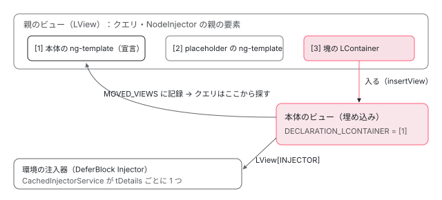

[目次](../README.md) › [@defer とインクリメンタルハイドレーションの内側](README.md) › 第 14 回 / 全 20 回

# 入れ子・注入器・クエリ：塊の中のビューが外とつながる所

> 塊の中の塊、本体のビューの注入器の親（NodeInjector の道と、読み込んだ依存の providers を持つ環境の注入器）、@defer の中の要素を外のクエリが見つけるまで、content projection を塊に入れたとき。defer\_spec.ts の nested blocks・DI・queries・content projection の場面で確かめる。

angular/angular · 読了 約 13 分 · 発展 · [サイトで読む（デモが動きます）](https://angular-deep-dive-cyan.vercel.app/chapter/defer-nested-di)

---

`@defer` の本体は、あとから作られる 1 つの埋め込みビュー（`ng-template` から作るビュー）です。この章では、そのビューが**外の世界とつながる 3 つの所**を、defer\_spec.ts の場面を 1 つずつ読んで確かめます。(1) 塊の中の塊はいつできるか、(2) 塊の中のコンポーネントの `inject()` はどの注入器をたどるか、(3) 外のコンポーネントの `viewChild` や `ViewChildren` が塊の中の要素をどうやって見つけるか、です。

読む対象は `packages/core/test/acceptance/defer_spec.ts` の describe `queries`・`content projection`・`nested blocks`・`DI`・`NgModules`・`Router` と、それを支える `render3/queries/query.ts`・`render3/view_manipulation.ts`・`cached_injector_service.ts` です。

1. [1. 全体像](01-defer-overview.md)
2. [2. ɵɵdefer 命令](02-defer-instruction.md)
3. [3. 塊の記録](03-defer-details.md)
4. [4. 状態を描く](04-defer-render-state.md)
5. [5. minimum と after](05-defer-minimum-after.md)
6. [6. 依存を読み込む](06-defer-resource-loading.md)
7. [7. トリガーから描画まで](07-defer-trigger-flow.md)
8. [8. when](08-defer-when.md)
9. [9. idle と immediate](09-defer-idle-immediate.md)
10. [10. timer](10-defer-timer.md)
11. [11. interaction と hover](11-defer-dom-triggers.md)
12. [12. viewport](12-defer-viewport.md)
13. [13. prefetch](13-defer-prefetch.md)
14. **14. 入れ子・注入器・クエリ**（この章）
15. [15. サーバーでの @defer](15-defer-server.md)
16. [16. hydrate トリガー](16-defer-hydrate-triggers.md)
17. [17. 親から順にハイドレート](17-defer-hydration-queue.md)
18. [18. hydrate のイベント](18-defer-hydrate-events.md)
19. [19. テストを読む](19-defer-tests.md)
20. [20. issue と PR を読む](20-defer-issues.md)

前提として、状態を描く関数 `applyDeferBlockState` が、本体のビューを `createAndRenderEmbeddedLView(hostLView, 本体の TNode, null, {injector, dehydratedView})` で作り、**塊の LContainer** に足すことを覚えておいてください（その行は [第 4 回](04-defer-render-state.md)で読みます）。この章の 3 つの話は、すべてこの 1 回の呼び出しから始まります。

## 1. 塊の中の塊：外が Complete になるまで、内の塊は存在しない

📄 `angular/packages/core/test/acceptance/defer_spec.ts` L1622–1645 （▶ の行: 1626, 1629, 1634）

```ts
1622 │       @Component({
1623 │         selector: 'root-app',
1624 │         imports: [NestedCmp, CmpA],
1625 │         template: `
1626 ▶           @defer (when isVisible) {
1627 │             <nested-cmp [block]="'primary'" />
1628 │ 
1629 ▶             @defer (when isInViewport) {
1630 │               <cmp-a />
1631 │             } @placeholder {
1632 │               Nested defer block placeholder.
1633 │             }
1634 ▶           } @placeholder {
1635 │             <nested-cmp [block]="'placeholder'" />
1636 │           }
1637 │         `,
1638 │ 
1639 │         changeDetection: ChangeDetectionStrategy.Eager,
1640 │       })
1641 │       class RootCmp {
1642 │         isVisible = false;
1643 │         isInViewport = false;
1644 │       }
1645 │ 
```

📄 `angular/packages/core/test/acceptance/defer_spec.ts` L1653–1677 （▶ の行: 1653, 1656, 1666, 1669, 1673, 1677）

```ts
1653 ▶       fixture.componentInstance.isVisible = true;
1654 │       fixture.detectChanges();
1655 │ 
1656 ▶       await allPendingDynamicImports();
1657 │       fixture.detectChanges();
1658 │ 
1659 │       // Verify primary block content.
1660 │       const primaryBlockHTML = fixture.nativeElement.outerHTML;
1661 │       expect(primaryBlockHTML).toContain(
1662 │         '<nested-cmp ng-reflect-block="primary">Rendering primary block.</nested-cmp>',
1663 │       );
1664 │ 
1665 │       // Make sure we have a nested block in a placeholder state.
1666 ▶       expect(primaryBlockHTML).toContain('Nested defer block placeholder.');
1667 │ 
1668 │       // Trigger condition for the nested block.
1669 ▶       fixture.componentInstance.isInViewport = true;
1670 │       fixture.detectChanges();
1671 │ 
1672 │       // Wait for nested block dependencies to load.
1673 ▶       await allPendingDynamicImports();
1674 │       fixture.detectChanges();
1675 │ 
1676 │       // Nested defer block was triggered and the `CmpB` content got rendered.
1677 ▶       expect(fixture.nativeElement.outerHTML).toContain('<cmp-a>CmpA</cmp-a>');
```

1. **1629 行目の内の `@defer` は、外の本体のテンプレート関数の中にある**

   コンパイラは `@defer` の本体を 1 つのテンプレート関数（`RootCmp_Defer_1_Template` のようなもの）にし、内の塊の `ɵɵdomTemplate`・`ɵɵdefer`・`ɵɵdeferWhen` はその関数の中に出ます（[compiler-control-flow-phases](../compiler/15-compiler-control-flow-phases.md)）。その関数が初めて動くのは、外の塊が `Complete` を描いて本体のビューを作ったときです。**それまで、内の塊の `ɵɵdefer` 命令は 1 回も呼ばれていません**。
2. **1653〜1666 行目：外を出すと、内は placeholder で現れる**

   `isVisible = true` で外が出たとき、内の `ɵɵdefer` が初めて動き、`isInViewport` はまだ `false` なので内の placeholder が描かれます。
3. **1669〜1677 行目：内の条件を真にすると、内の依存を読んで内の本体**

   内の塊は外の塊と別の `TDeferBlockDetails`（外の本体のテンプレートの TView にある）を持つので、読み込みも別です。

> [!NOTE]
> **ポイント**
>
> だから、内の塊のトリガーを外より先に満たしても、何も起きません（下のデモの「内を先に」）。外が出て内の `ɵɵdeferWhen` が初めて評価された瞬間に、条件はすでに真なので、内はそのまま読み込みに進みます。インクリメンタルハイドレーションで「親の塊から順にハイドレートする」必要があるのも同じ理由です（[第 17 回](17-defer-hydration-queue.md)）。

📄 `angular/packages/core/test/acceptance/defer_spec.ts` L1692–1731 （▶ の行: 1693, 1696, 1709, 1722, 1726, 1729–1730）

```ts
1692 │         template: `
1693 ▶           @defer (on immediate) {
1694 │             <cmp-a />
1695 │ 
1696 ▶             @defer (on immediate) {
1697 │               <cmp-a />
1698 │             }
1699 │           }
1700 │         `,
1701 │ 
1702 │         changeDetection: ChangeDetectionStrategy.Eager,
1703 │       })
1704 │       class RootCmp {}
1705 │ 
1706 │       const deferDepsInterceptor = {
1707 │         intercept() {
1708 │           return () => {
1709 ▶             return [dynamicImportOf(CmpA)];
1710 │           };
1711 │         },
1712 │       };
1713 │ 
1714 │       TestBed.configureTestingModule({
1715 │         providers: [{provide: ɵDEFER_BLOCK_DEPENDENCY_INTERCEPTOR, useValue: deferDepsInterceptor}],
1716 │       });
1717 │ 
1718 │       const fixture = TestBed.createComponent(RootCmp);
1719 │       fixture.detectChanges();
1720 │ 
1721 │       // Wait for the dependency fn promise to resolve.
1722 ▶       await allPendingDynamicImports();
1723 │       fixture.detectChanges();
1724 │ 
1725 │       // Await all async work to be completed.
1726 ▶       await fixture.whenStable();
1727 │ 
1728 │       // Expect both <cmp-a> components to be rendered.
1729 ▶       expect(fixture.nativeElement.innerHTML.replaceAll('<!--container-->', '')).toBe(
1730 ▶         '<cmp-a>CmpA</cmp-a><cmp-a>CmpA</cmp-a>',
1731 │       );
```

外と内が同じ `CmpA` を使う場面です。1709 行目の interceptor は、どちらの塊の読み込み関数も `dynamicImportOf(CmpA)` に差し替えます。1722 行目で外の読み込みが終わり、外の本体ができると内の `on immediate`（1696 行目）がその場で動き、内の読み込みが始まります。1726 行目の `whenStable()` は、内の読み込みが `PendingTasks` に入れた仕事（[zoneless-pending-tasks](../zoneless/09-zoneless-pending-tasks.md)）の終わりまで待つので、1729〜1730 行目で 2 つの `<cmp-a>` がそろいます。同じ依存でも、塊ごとに `loadingState` を持ち、塊ごとに 1 回ずつ読み込み関数を呼びます。

## 2. クエリ：塊の本体は「宣言した所と違う LContainer に入ったビュー」

塊の本体のビューは、どの LContainer で宣言され、どの LContainer に入るのでしょうか。コンパイラの出力では `ɵɵdomTemplate(1, …)`（本体）・`ɵɵdomTemplate(2, …)`（placeholder）と `ɵɵdefer(3, 1, …)` は**別のスロット**です（[第 13 回](13-defer-prefetch.md)の 1 節の compliance の出力と同じ形）。本体のテンプレートは 1 番、塊の LContainer は 3 番にあります。

📄 `angular/packages/core/src/render3/view_manipulation.ts` L55–61 （▶ の行: 55, 57, 59–61）

```ts
55 ▶     const declarationLContainer = declarationLView[templateTNode.index];
56 │     ngDevMode && assertLContainer(declarationLContainer);
57 ▶     embeddedLView[DECLARATION_LCONTAINER] = declarationLContainer;
58 │ 
59 ▶     const declarationViewLQueries = declarationLView[QUERIES];
60 ▶     if (declarationViewLQueries !== null) {
61 ▶       embeddedLView[QUERIES] = declarationViewLQueries.createEmbeddedView(embeddedTView);
```

`createAndRenderEmbeddedLView` の 55〜57 行目で、作ったビューの `DECLARATION_LCONTAINER` は「テンプレートを宣言したスロット」（1 番）の LContainer になります。59〜61 行目で、宣言した側の LView のクエリ（`LQueries`）から、このビュー用の写しを作ります。そのあと `addLViewToLContainer` で、ビューは**塊の LContainer（3 番）**に入ります。

📄 `angular/packages/core/src/render3/view/container.ts` L214–217 （▶ の行: 215–217）

```ts
214 │   // track views where declaration and insertion points are different
215 ▶   const declarationLContainer = lView[DECLARATION_LCONTAINER];
216 ▶   if (declarationLContainer !== null && lContainer !== declarationLContainer) {
217 ▶     trackMovedView(declarationLContainer, lView);
```

ビューを LContainer に入れる `insertView` の 215〜217 行目。宣言した LContainer（1 番）と入れた LContainer（3 番）が違うので、`trackMovedView` が宣言した側の `MOVED_VIEWS` にこのビューを記録します （`insertView` 全体は [ivy-lcontainer](../ivy/11-ivy-lcontainer.md)）。`@defer` の本体も placeholder も、いつも「動かされたビュー」です。

📄 `angular/packages/core/src/render3/queries/query.ts` L432–458 （▶ の行: 434, 437, 439, 443, 445–446, 452–453, 456）

```ts
432 │     for (let i = 0; i < tQueryMatches.length; i += 2) {
433 │       const tNodeIdx = tQueryMatches[i];
434 ▶       if (tNodeIdx > 0) {
435 │         result.push(lViewResults[i / 2] as T);
436 │       } else {
437 ▶         const childQueryIndex = tQueryMatches[i + 1];
438 │ 
439 ▶         const declarationLContainer = lView[-tNodeIdx] as LContainer;
440 │         ngDevMode && assertLContainer(declarationLContainer);
441 │ 
442 │         // collect matches for views inserted in this container
443 ▶         for (let i = CONTAINER_HEADER_OFFSET; i < declarationLContainer.length; i++) {
444 │           const embeddedLView = declarationLContainer[i];
445 ▶           if (embeddedLView[DECLARATION_LCONTAINER] === embeddedLView[PARENT]) {
446 ▶             collectQueryResults(embeddedLView[TVIEW], embeddedLView, childQueryIndex, result);
447 │           }
448 │         }
449 │ 
450 │         // collect matches for views created from this declaration container and inserted into
451 │         // different containers
452 ▶         if (declarationLContainer[MOVED_VIEWS] !== null) {
453 ▶           const embeddedLViews = declarationLContainer[MOVED_VIEWS]!;
454 │           for (let i = 0; i < embeddedLViews.length; i++) {
455 │             const embeddedLView = embeddedLViews[i];
456 ▶             collectQueryResults(embeddedLView[TVIEW], embeddedLView, childQueryIndex, result);
457 │           }
458 │         }
```

1. **434 行目：自分のビューの中で見つかった結果はそのまま**

   `tQueryMatches` は「TNode の番号, 結果の番号」の並びです。番号が正ならこのビューの要素です。
2. **437〜439 行目：負の番号は「この番号のテンプレートの中にも探せ」という印**

   クエリは最初の作成の段で、`ng-template`（ここでは本体と placeholder の `ɵɵdomTemplate`）にぶつかると、その中の分の子のクエリを作り、ここに負の番号で残します。439 行目でそのスロットの LContainer（宣言した側、1 番）を取ります。
3. **443〜447 行目：その LContainer に入っているビューを見る**

   445 行目の条件は「宣言した所と入れた所が同じ」ビューだけです。`@defer` の本体はここには入っていないので、何も見つかりません。
4. **452〜457 行目：`MOVED_VIEWS` を見る。`@defer` の本体はこちらで見つかる**

   上の 216〜217 行目で記録されたビューです。**塊の中の要素が外の `viewChild` に見つかるのは、この 4 行のおかげ**です。

クエリの結果が変わったと知らせるのは、ビューを入れた・外したときの `LQueries` の `insertView`・`detachView` で、結果のある クエリに「汚れた」印を付けます（その行は [authoring](../signals/11-authoring.md)）。signal のクエリ（`viewChild()`）は、その印を見て次に読まれたときに作り直します。

📄 `angular/packages/core/test/acceptance/defer_spec.ts` L1430–1454 （▶ の行: 1434, 1436, 1438–1439, 1441–1442, 1453）

```ts
1430 │       @Component({
1431 │         selector: 'simple-app',
1432 │         imports: [NestedCmp],
1433 │         template: `
1434 ▶           @defer (when isVisible) {
1435 │             <nested-cmp [block]="'primary'" />
1436 ▶           } @loading {
1437 │             Loading...
1438 ▶             <nested-cmp [block]="'loading'" />
1439 ▶           } @placeholder {
1440 │             Placeholder!
1441 ▶             <nested-cmp [block]="'placeholder'" />
1442 ▶           } @error {
1443 │             Failed to load dependencies :(
1444 │             <nested-cmp [block]="'error'" />
1445 │           }
1446 │         `,
1447 │ 
1448 │         changeDetection: ChangeDetectionStrategy.Eager,
1449 │       })
1450 │       class MyCmp {
1451 │         isVisible = false;
1452 │ 
1453 ▶         @ViewChildren(NestedCmp) cmps!: QueryList<NestedCmp>;
1454 │       }
```

📄 `angular/packages/core/test/acceptance/defer_spec.ts` L1456–1482 （▶ の行: 1459–1460, 1465, 1468–1469, 1475, 1478–1479）

```ts
1456 │       const fixture = TestBed.createComponent(MyCmp);
1457 │       fixture.detectChanges();
1458 │ 
1459 ▶       expect(fixture.componentInstance.cmps.length).toBe(1);
1460 ▶       expect(fixture.componentInstance.cmps.get(0)?.block).toBe('placeholder');
1461 │       expect(fixture.nativeElement.outerHTML).toContain(
1462 │         '<nested-cmp ng-reflect-block="placeholder">Rendering placeholder block.</nested-cmp>',
1463 │       );
1464 │ 
1465 ▶       fixture.componentInstance.isVisible = true;
1466 │       fixture.detectChanges();
1467 │ 
1468 ▶       expect(fixture.componentInstance.cmps.length).toBe(1);
1469 ▶       expect(fixture.componentInstance.cmps.get(0)?.block).toBe('loading');
1470 │       expect(fixture.nativeElement.outerHTML).toContain(
1471 │         '<nested-cmp ng-reflect-block="loading">Rendering loading block.</nested-cmp>',
1472 │       );
1473 │ 
1474 │       // Wait for dependencies to load.
1475 ▶       await allPendingDynamicImports();
1476 │       fixture.detectChanges();
1477 │ 
1478 ▶       expect(fixture.componentInstance.cmps.length).toBe(1);
1479 ▶       expect(fixture.componentInstance.cmps.get(0)?.block).toBe('primary');
1480 │       expect(fixture.nativeElement.outerHTML).toContain(
1481 │         '<nested-cmp ng-reflect-block="primary">Rendering primary block.</nested-cmp>',
1482 │       );
```

4 つのテンプレート（本体・loading・placeholder・error）のどれにも `nested-cmp` があります。1453 行目の `@ViewChildren(NestedCmp)` は、1459〜1460 行目では placeholder の 1 つ、1468〜1469 行目では loading の 1 つ、1478〜1479 行目では本体の 1 つだけを持ちます。塊の LContainer には常にビューが 1 つだけ入り、状態が変わると前のビューを外して次のビューを入れるので（[第 4 回](04-defer-render-state.md)）、その都度 `MOVED_VIEWS` の中身が入れ替わるからです。

## 3. content projection：塊の中の &lt;ng-content&gt; と、投影される塊

📄 `angular/packages/core/test/acceptance/defer_spec.ts` L1514–1537 （▶ の行: 1518, 1520, 1536）

```ts
1514 │       @Component({
1515 │         selector: 'my-app',
1516 │         imports: [NestedCmp],
1517 │         template: `
1518 ▶           @defer (when isVisible) {
1519 │             <nested-cmp [block]="'primary'" />
1520 ▶             <ng-content />
1521 │           } @loading {
1522 │             Loading...
1523 │             <nested-cmp [block]="'loading'" />
1524 │           } @placeholder {
1525 │             Placeholder!
1526 │             <nested-cmp [block]="'placeholder'" />
1527 │           } @error {
1528 │             Failed to load dependencies :(
1529 │             <nested-cmp [block]="'error'" />
1530 │           }
1531 │         `,
1532 │ 
1533 │         changeDetection: ChangeDetectionStrategy.Eager,
1534 │       })
1535 │       class MyCmp {
1536 ▶         @Input() isVisible = false;
1537 │       }
```

📄 `angular/packages/core/test/acceptance/defer_spec.ts` L1539–1560 （▶ の行: 1543–1544, 1546–1547, 1550）

```ts
1539 │       @Component({
1540 │         selector: 'root-app',
1541 │         imports: [MyCmp, CmpA, CmpB],
1542 │         template: `
1543 ▶           <my-app [isVisible]="isVisible">
1544 ▶             Projected content.
1545 │             <b>Including tags</b>
1546 ▶             <cmp-a />
1547 ▶             @defer (when isInViewport) {
1548 │               <cmp-b />
1549 │             } @placeholder {
1550 ▶               Projected defer block placeholder.
1551 │             }
1552 │           </my-app>
1553 │         `,
1554 │ 
1555 │         changeDetection: ChangeDetectionStrategy.Eager,
1556 │       })
1557 │       class RootCmp {
1558 │         isVisible = false;
1559 │         isInViewport = false;
1560 │       }
```

📄 `angular/packages/core/test/acceptance/defer_spec.ts` L1580–1598 （▶ の行: 1585, 1587–1588, 1590, 1598）

```ts
1580 │       // Verify primary block content.
1581 │       const primaryBlockHTML = fixture.nativeElement.outerHTML;
1582 │       expect(primaryBlockHTML).toContain(
1583 │         '<nested-cmp ng-reflect-block="primary">Rendering primary block.</nested-cmp>',
1584 │       );
1585 ▶       expect(primaryBlockHTML).toContain('Projected content.');
1586 │       expect(primaryBlockHTML).toContain('<b>Including tags</b>');
1587 ▶       expect(primaryBlockHTML).toContain('<cmp-a>CmpA</cmp-a>');
1588 ▶       expect(primaryBlockHTML).toContain('Projected defer block placeholder.');
1589 │ 
1590 ▶       fixture.componentInstance.isInViewport = true;
1591 │       fixture.detectChanges();
1592 │ 
1593 │       // Wait for projected block dependencies to load.
1594 │       await allPendingDynamicImports();
1595 │       fixture.detectChanges();
1596 │ 
1597 │       // Nested defer block was triggered and the `CmpB` content got rendered.
1598 ▶       expect(fixture.nativeElement.outerHTML).toContain('<cmp-b>CmpB</cmp-b>');
```

1. **1520 行目：`<ng-content />` を塊の本体に置ける**

   `ɵɵprojection` 命令は本体のテンプレート関数の中にあるので、本体のビューができたときに初めて、親（`root-app`）が渡したノードをそこへ付けます（命令の中身は [projection](../template/02-projection.md)）。投影されるノード自体は、1543〜1551 行目を書いた `RootCmp` のビューがはじめから作っています。だから 1585〜1588 行目で、本体が出ると投影された中身が全部見えます。
2. **1547 行目：投影される側に `@defer` を置ける**

   この塊を宣言しているのは `RootCmp` のテンプレートなので、`ɵɵdefer` と `ɵɵdeferWhen(isInViewport)` は `RootCmp` のビューで動きます。どこに投影されるかとは関係なく、条件は `RootCmp` の値で決まり、1590〜1598 行目で `isInViewport = true` にすると `<cmp-b>` が出ます。1588 行目の時点で placeholder が見えているのは、placeholder を描いたのも `RootCmp` の変更検知だからです。

## 4. 注入器：NodeInjector の道と、塊ごとの環境の注入器

塊の中のコンポーネントが `inject()` すると、まず NodeInjector（要素ごとの注入器。[di-node-injector-lookup](../di/11-di-node-injector-lookup.md)）の道を、**宣言したテンプレートの親の要素**へたどります。見つからなければ、そのビューの `LView[INJECTOR]`、つまり環境の注入器へ進みます。

📄 `angular/packages/core/test/acceptance/defer_spec.ts` L4830–4866 （▶ の行: 4833, 4846–4847, 4853–4855, 4860）

```ts
4830 │       @Component({
4831 │         selector: 'parent-cmp',
4832 │         template: '<ng-content />',
4833 ▶         providers: [{provide: TokenA, useValue: 'TokenA.ParentCmp'}],
4834 │ 
4835 │         changeDetection: ChangeDetectionStrategy.Eager,
4836 │       })
4837 │       class ParentCmp {}
4838 │ 
4839 │       @Component({
4840 │         selector: 'child-cmp',
4841 │         template: 'Token A: {{ parentTokenA }} | Token B: {{ parentTokenB }}',
4842 │ 
4843 │         changeDetection: ChangeDetectionStrategy.Eager,
4844 │       })
4845 │       class ChildCmp {
4846 ▶         parentTokenA = inject(TokenA);
4847 ▶         parentTokenB = inject(TokenB);
4848 │       }
4849 │ 
4850 │       @Component({
4851 │         selector: 'app-root',
4852 │         template: `
4853 ▶           <parent-cmp>
4854 ▶             @defer (when isVisible) {
4855 ▶               <child-cmp />
4856 │             }
4857 │           </parent-cmp>
4858 │         `,
4859 │         imports: [ChildCmp, ParentCmp],
4860 ▶         providers: [{provide: TokenB, useValue: 'TokenB.RootCmp'}],
4861 │ 
4862 │         changeDetection: ChangeDetectionStrategy.Eager,
4863 │       })
4864 │       class RootCmp {
4865 │         isVisible = true;
4866 │       }
```

📄 `angular/packages/core/test/acceptance/defer_spec.ts` L4887–4894 （▶ の行: 4892–4893）

```ts
4887 │       // Verify that tokens from parent components are available for injection
4888 │       // inside a component within a `@defer` block.
4889 │       const tokenA = 'TokenA.ParentCmp';
4890 │       const tokenB = 'TokenB.RootCmp';
4891 │ 
4892 ▶       expect(fixture.nativeElement.innerHTML).toContain(
4893 ▶         `<child-cmp>Token A: ${tokenA} | Token B: ${tokenB}</child-cmp>`,
4894 │       );
```

1. **4853〜4857 行目：`<child-cmp>` は `<parent-cmp>` の中の塊の中**

   塊の本体のビューの親は、本体の `ng-template` の TNode です。その TNode のテンプレートの上での親が `<parent-cmp>` の要素なので、NodeInjector の道は `child-cmp` → `parent-cmp`（4833 行目の `TokenA`）→ `app-root` のホスト（4860 行目の `TokenB`）と進みます。
2. **4892〜4893 行目：両方とも見つかる**

   塊は、この道を変えません。`@defer` を外して書いた場合と同じ値が入ります。

### 読み込んだ依存が持ってくる providers

📄 `angular/packages/core/test/acceptance/defer_spec.ts` L5018–5051 （▶ の行: 5019, 5028, 5037–5039, 5044）

```ts
5018 │       @NgModule({
5019 ▶         providers: [Service],
5020 │         declarations: [Chart],
5021 │         exports: [Chart],
5022 │       })
5023 │       class ChartsModule {}
5024 │ 
5025 │       @Component({
5026 │         selector: 'chart-collection',
5027 │         template: '<chart />',
5028 ▶         imports: [ChartsModule],
5029 │ 
5030 │         changeDetection: ChangeDetectionStrategy.Eager,
5031 │       })
5032 │       class ChartCollectionComponent {}
5033 │ 
5034 │       @Component({
5035 │         selector: 'app-root',
5036 │         template: `
5037 ▶           @for (item of items; track $index) {
5038 ▶             @defer (when isVisible) {
5039 ▶               <chart-collection />
5040 │             }
5041 │           }
5042 │         `,
5043 │         imports: [ChartCollectionComponent],
5044 ▶         providers: [{provide: TokenA, useValue: 'MyCmp.A'}],
5045 │ 
5046 │         changeDetection: ChangeDetectionStrategy.Eager,
5047 │       })
5048 │       class MyCmp {
5049 │         items = [1, 2, 3];
5050 │         isVisible = true;
5051 │       }
```

📄 `angular/packages/core/test/acceptance/defer_spec.ts` L5074–5090 （▶ の行: 5077–5078, 5087, 5089）

```ts
5074 │       // Verify that the `Service` injectable was initialized only once,
5075 │       // even though it was injected in 3 instances of the `<chart>` component,
5076 │       // used within defer blocks.
5077 ▶       expect(serviceInitCount).toBe(1);
5078 ▶       expect(fixture.nativeElement.querySelectorAll('chart').length).toBe(3);
5079 │ 
5080 │       // Verify that a service defined within an NgModule can inject services
5081 │       // provided within the same NgModule.
5082 │       const serviceFromNgModule = 'Service:ChartsModule.Service';
5083 │ 
5084 │       // Make sure sure that a nested `<chart>` component from the defer block
5085 │       // can inject tokens provided in parent component (that contains `@defer`
5086 │       // in its template).
5087 ▶       const tokenFromRootComponent = 'TokenA:MyCmp.A';
5088 │       expect(fixture.nativeElement.innerHTML).toContain(
5089 ▶         `<chart>${serviceFromNgModule}|${tokenFromRootComponent}</chart>`,
5090 │       );
```

1. **5028 行目：塊の中で読み込むコンポーネントが、providers を持つ NgModule を import している**

   依存を読み終えた `triggerResourceLoading` は、読み込んだコンポーネントの型から `internalImportProvidersFrom` で providers を集め、`tDetails.providers` に入れます（[第 6 回](06-defer-resource-loading.md)）。本体を描くとき、`providers` が空でなければ `createDeferBlockInjector` が新しい環境の注入器を作り、本体のビューの注入器にします（[第 4 回](04-defer-render-state.md)）。
2. **5037〜5041 行目：`@for` で 3 つの塊、5077 行目で `Service` は 1 回だけ作られる**

   3 つの塊が同じ環境の注入器を使っているからです。その注入器を作るのが次の関数です。

📄 `angular/packages/core/src/cached_injector_service.ts` L22–39 （▶ の行: 23, 25–26, 31, 33–34, 36, 38）

```ts
22 │ export class CachedInjectorService implements OnDestroy {
23 ▶   private cachedInjectors = new Map<unknown, EnvironmentInjector | null>();
24 │ 
25 ▶   getOrCreateInjector(
26 ▶     key: unknown,
27 │     parentInjector: EnvironmentInjector,
28 │     providers: Provider[],
29 │     debugName?: string,
30 │   ) {
31 ▶     if (!this.cachedInjectors.has(key)) {
32 │       const injector =
33 ▶         providers.length > 0
34 ▶           ? createEnvironmentInjector(providers, parentInjector, debugName)
35 │           : null;
36 ▶       this.cachedInjectors.set(key, injector);
37 │     }
38 ▶     return this.cachedInjectors.get(key)!;
39 │   }
```

`createDeferBlockInjector` は `getOrCreateInjector(tDetails, 親の環境の注入器, providers, 'DeferBlock Injector')` を呼びます（第 4 回）。26 行目の `key` が `tDetails`、つまり**テンプレートに 1 つ**の記録なので、31 行目で 2 つ目以降の塊は 38 行目のキャッシュを受け取ります。3 つの塊は 1 つの注入器を共有し、その中の `Service` も 1 つです。5087〜5089 行目の `TokenA:MyCmp.A` は、NodeInjector の道（`app-root` の 5044 行目の providers）で見つかったものです。

### Router の中の塊

📄 `angular/packages/core/test/acceptance/defer_spec.ts` L5113–5142 （▶ の行: 5115, 5121–5122, 5124, 5132–5133, 5140）

```ts
5113 │       @Component({
5114 │         selector: 'another-child',
5115 ▶         imports: [CommonModule, MyModuleA],
5116 │         template: 'another child: {{route.snapshot.url[0]}} | token: {{tokenA}}',
5117 │ 
5118 │         changeDetection: ChangeDetectionStrategy.Eager,
5119 │       })
5120 │       class AnotherChild {
5121 ▶         route = inject(ActivatedRoute);
5122 ▶         tokenA = inject(TokenA);
5123 │         constructor() {
5124 ▶           deferCmpEnvInjector = inject(EnvironmentInjector);
5125 │         }
5126 │       }
5127 │ 
5128 │       @Component({
5129 │         imports: [CommonModule, AnotherChild],
5130 │         template: `
5131 │           child: {{ route.snapshot.url[0] }} | token: {{ tokenA }}
5132 ▶           @defer (on immediate) {
5133 ▶             <another-child />
5134 │           }
5135 │         `,
5136 │ 
5137 │         changeDetection: ChangeDetectionStrategy.Eager,
5138 │       })
5139 │       class Child {
5140 ▶         route = inject(ActivatedRoute);
5141 │         tokenA = inject(TokenA);
5142 │       }
```

📄 `angular/packages/core/test/acceptance/defer_spec.ts` L5182–5194 （▶ の行: 5186, 5188, 5193–5194）

```ts
5182 │       // Make sure that the `getInjectorResolutionPath` debugging utility
5183 │       // (used by DevTools) doesn't expose Router's `OutletInjector` in
5184 │       // the resolution path. `OutletInjector` is a special case, because it
5185 │       // doesn't store any tokens itself, we point to the parent injector instead.
5186 ▶       const resolutionPath = getInjectorResolutionPath(deferCmpEnvInjector!);
5187 │       for (const inj of resolutionPath) {
5188 ▶         expect(inj).not.toBeInstanceOf(ChainedInjector);
5189 │       }
5190 │ 
5191 │       // Expect that `ActivatedRoute` information get updated inside
5192 │       // of a component used in a `@defer` block.
5193 ▶       expect(app.nativeElement.innerHTML).toContain('child: b | token: root');
5194 ▶       expect(app.nativeElement.innerHTML).toContain('another child: b | token: nested');
```

1. **5132〜5134 行目：ルートで出した `Child` の中の塊**

   `RouterOutlet` はコンポーネントを `OutletInjector`（`ActivatedRoute` を持つ注入器）と環境の注入器を渡して作るので、`Child` の LView の注入器は `ChainedInjector`（2 つの注入器を順に聞く包み）になります。`createDeferBlockInjector` は親が `ChainedInjector` のとき、その形を保ったまま、環境の注入器の側だけを新しいもの（`MyModuleA` の providers を持つ）に差し替えます（[第 4 回](04-defer-render-state.md)）。
2. **5193〜5194 行目：`/b` へ移ると、塊の中の `ActivatedRoute` も `b` を返す**

   `AnotherChild` の 5121 行目の `ActivatedRoute` は `OutletInjector` から来るので、ルートと同じものです。5122 行目の `TokenA` は新しい環境の注入器の `nested` が勝ちます。
3. **5186〜5189 行目：DevTools 向けの注入器の道に `ChainedInjector` が出ない**

   `getInjectorResolutionPath`（DevTools が使う関数）が、包みではなく中の注入器を並べることを確かめています。



*塊の本体のビュー（右下）が外とつながる 3 本の線。クエリは MOVED\_VIEWS から、inject は宣言したテンプレートの親の要素から、環境の注入器は塊ごと（tDetails ごと）にキャッシュされたものから。*

## 5. DEMO：入れ子の塊と、外の viewChild

> **🧪 DEMO — 入れ子の @defer と viewChild（ライブ）**
>
> このページの上の本物の `@defer` です。テンプレートは `@defer (when outerOn()) { <p #ndOuter>…</p> @defer (when innerOn()) { <defer-nd-leaf #ndLeaf /> } }` で、`defer-nd-leaf` は章の隣の別のファイル（内の塊の中だけで使うので別の chunk）にあり、`NdModule`（providers を持つ NgModule）を import しています。章のコンポーネントは `providers` に `ND_PARENT` を持ち、`viewChild('ndOuter')` と `viewChild('ndLeaf')` の 2 つの signal のクエリを持っています。表の「塊の数」と状態は、`ɵgetDeferBlocks`（@angular/core の内部の関数）で LView を読んだ値で、**内部の形を読んでいるだけ**です。`ɵgetDeferBlocks` は塊の LContainer の中までは入らないので、外の塊が今描いているビュー（LContainer の 10 番。`CONTAINER_HEADER_OFFSET`）を渡してもう一段探しています。状態は `lView[tNode.index + 1]` の 1 番の欄（`interfaces.ts` 232〜245 行目）です。
>
> ▶ [このデモはサイトで動かせます](https://angular-deep-dive-cyan.vercel.app/chapter/defer-nested-di)

このページで試すと、次のようになります（「外を出す」→「内を出す」の順）。

1. **塊を置いた：塊は 1 + 0、外は `Placeholder`、どちらのクエリも `undefined`**

   内の塊はまだ存在しません（1 節）。`#ndOuter` は外の本体のテンプレートの中なので、まだ作られていません。
2. **外を出す：1 + 1、外は `Complete`、内は `Placeholder`、`ndOuter` が見つかる**

   外の本体のビューが塊の LContainer に入り、`MOVED_VIEWS` 経由で `viewChild('ndOuter')` に見つかりました（2 節の 452〜457 行目）。
3. **内を出す：内は `Loading` を経て `Complete`、`ndLeaf` が見つかる**

   `ndLeaf` は 2 段の「動かされたビュー」の中ですが、クエリは外の本体のビューの `LQueries` の写し（2 節の 59〜61 行目）を通して、もう一段同じ探し方をします。本体の文には `ND_PARENT`（章のコンポーネントの providers。NodeInjector の道）と `ND_MODULE`（`NdModule` の providers。塊ごとの環境の注入器）の両方が出ます。
4. **片付けて置き直し、「内を出す」を先に押す：内は `（まだ無い）` のまま**

   内の `ɵɵdeferWhen` がまだ動いていないので何も起きません。そのあと「外を出す」を押すと、外の本体ができた瞬間に内の条件が評価され、内も続けて出ます。

## ここまでの呼び出し

- `renderDeferBlockState(Complete, …)` → `applyDeferBlockState` — rendering.ts（第 4 回）
  - `createDeferBlockInjector(hostLView[INJECTOR], tDetails, providers)` — rendering.ts（第 4 回） — *providers があるときだけ*
    - `CachedInjectorService.getOrCreateInjector(tDetails, …)` — cached\_injector\_service.ts L25 — *tDetails ごとに 1 つ*
  - `createAndRenderEmbeddedLView(hostLView, 本体の TNode, null, {injector})` — view\_manipulation.ts — *DECLARATION\_LCONTAINER と LQueries の写し（L55〜61）*
    - `renderView` → 本体のテンプレート関数 — 内の塊の ɵɵdefer はここで初めて動く
  - `addLViewToLContainer(塊の LContainer, …)` → `insertView` — view/container.ts L214〜217 — *trackMovedView で MOVED\_VIEWS へ*
- 👤 `viewChild('ndOuter')()` — 利用者のコード
  - `collectQueryResults` — queries/query.ts L452〜457 — *MOVED\_VIEWS の中を探す*

## テストと直し方

### spec と describe

| describe（defer\_spec.ts） | it | この章の節 |
| --- | --- | --- |
| `queries`（1418 行目） | `should query for components within each block`（1419） | 2 節 |
| `content projection`（1486 行目） | `should be able to project content into each block`（1487） | 3 節 |
| `nested blocks`（1602 行目） | `should be able to have nested blocks`（1603）・`should handle nested blocks that defer load the same dep`（1680） | 1 節 |
| `DI`（4825 行目） | `should provide access to tokens from a parent component`（4826）・`createComponent` で作って ApplicationRef に付けた場合（4897） | 4 節 |
| `NgModules`（4992 行目） | `should provide access to tokens from imported NgModules`（4993） | 4 節 |
| `Router`（5094 行目） | ``should inject correct `ActivatedRoutes` in components within defer blocks``（5095） | 4 節 |

### 手元で走らせた結果

📄 `ターミナル（../angular で）`

```
cd ~/angular-research/angular
pnpm bazel test //packages/core/test/acceptance:acceptance \
  '--test_arg=--filter=@defer (queries|content projection|nested blocks|DI|NgModules|Router) ' \
  --nocache_test_results --test_output=all
```

📄 `出力（2026-11-06 に実行。抜粋。ログは scratchpad/defer-logs/d-nested.log）`

```
Ran 8 of 2693 specs
8 specs, 0 failures
INFO: Elapsed time: 4.224s, Critical Path: 1.57s
//packages/core/test/acceptance:acceptance   PASSED in 1.5s
```

- 上の表の 8 件だけが走りました（6 つの describe の it の合計）。絞り込みの正規表現の最後に空白を入れているのは、`DI` が別の describe の名前の途中に当たらないようにするためです。

### 直すとしたら

- 「塊の中の要素がクエリに出ない／古いまま」は、まず `collectQueryResults` の `MOVED_VIEWS` の枝（query.ts 452〜457 行目）と、状態が変わったときにビューを外す・入れるときのクエリの汚れの印（`LQueries.insertView`・`detachView`）を疑います。spec は describe `queries` に、signal のクエリ（`viewChild`）で同じ場面を足すのが近道です（今の it は `@ViewChildren` だけです）。
- 「塊の中で providers が見つからない／2 回作られる」は、`createDeferBlockInjector`（rendering.ts、第 4 回）と `CachedInjectorService`（26・31 行目の key）です。spec は describe `NgModules` の、`serviceInitCount` で作った回数を数える形（5077 行目）に足します。
- この章の spec は、注入器の直しと一緒に足されてきました。9894278e712（2024-04-16、#54864）が Router の it を足したときは、`RouterOutlet` の `OutletInjector` を名前で見分ける特別扱いで直していました。00d9cd240d4（2024-06-28、#56372）が `createDeferBlockInjector` を作り、親が `ChainedInjector` なら形を保つ一般の分岐に置き換え、`createComponent` で作って `ApplicationRef` に付けた場合の it（4897 行目）を足しました。1fed7dc5a7c（2024-10-24）で残りの特別扱いも消え、今の core の `src/` には `OutletInjector` を見分けるコードがありません（`grep -rn OutletInjector packages/core/src` はコメントだけ）。2026 年の defer の修正の一覧（[第 20 回](20-defer-issues.md)）には、この章の行に当たるものはありません。
- 本家に PR を出すことは勧めません。入れ子や注入器の issue を読むときは、このページのデモのように、塊の数と状態とクエリの値を並べて確かめます。

## 聞かれそうな質問

**Q. 外の塊の placeholder の間に、内の塊のトリガーは付いていますか？**

付いていません。内の塊の `ɵɵdefer` と トリガーの命令は外の本体のテンプレート関数の中にあり、外が `Complete` を描いて本体のビューを作るまで 1 回も動きません。spec の 1666 行目で、外が出た時点で初めて内の placeholder が現れます。

**Q. なぜ `@defer` の中の要素が `viewChild` で見つかるのですか？別のビューなのに。**

本体のビューは、宣言したテンプレートのスロットとは別の、塊の LContainer に入るので「動かされたビュー」として `MOVED_VIEWS` に記録され（container.ts 215〜217 行目）、クエリはそこも探すからです（query.ts 452〜457 行目）。塊の状態が変わるたびにビューが入れ替わり、クエリの結果も入れ替わります（spec の 1459・1468・1478 行目）。

**Q. 塊の中のコンポーネントは、塊の外の親コンポーネントの providers を inject できますか？**

できます。NodeInjector の道は、宣言したテンプレートの上での親の要素をたどるので、塊が無い場合と同じです（spec の 4892〜4893 行目）。

**Q. 塊の中で読み込んだコンポーネントの NgModule の providers は、どこに入りますか？塊が 3 つあれば 3 つ作られますか？**

塊ごとに作る環境の注入器に入りますが、その注入器は `CachedInjectorService` が `tDetails`（テンプレートに 1 つ）を key にしてキャッシュするので、同じテンプレートの塊の間で 1 つです（cached\_injector\_service.ts 31・38 行目、spec の 5077 行目）。

**Q. `<ng-content>` を塊の中に置くと、投影する中身はいつ作られますか？**

投影する中身は、それを書いた親のビューがはじめから作っています。塊の本体ができたときに `ɵɵprojection` がそれを付けるだけです。spec の 1585〜1588 行目で、本体が出ると投影された中身（投影された別の塊の placeholder も）が見えます。

## 読み終えて

- 塊の中の塊は、外の本体のテンプレート関数の中にある。外が `Complete` になって本体のビューができるまで、内の `ɵɵdefer` もトリガーも存在しない。
- 塊の本体のビューは、宣言したスロットと別の LContainer に入る「動かされたビュー」。クエリは `MOVED_VIEWS` を通して塊の中を探す。
- `inject()` はまず宣言したテンプレートの親の要素へ NodeInjector の道をたどり、次に塊ごとの環境の注入器（`tDetails` ごとにキャッシュ）へ進む。Router の中では `ChainedInjector` の形を保つ。
- 確かめる spec は defer\_spec.ts の queries・content projection・nested blocks・DI・NgModules・Router の 8 件。

---

← 前: [prefetch：本体を出さずに依存だけ先に読む](13-defer-prefetch.md)  
次: [サーバーでの @defer：placeholder を出す理由](15-defer-server.md) →
