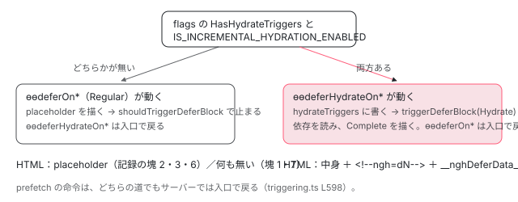

[目次](../README.md) › [@defer とインクリメンタルハイドレーションの内側](README.md) › 第 15 回 / 全 20 回

# サーバーでの @defer：placeholder を出す理由

> platform-server で描画するとき、shouldAttachTrigger がトリガーの種類ごとに答えを変え、ふつうのトリガーは placeholder を描いて shouldTriggerDeferBlock で止まる行（when が最初から true の塊と on immediate ＋ @loading の塊は placeholder も出ない）。hydrate トリガーの付いた塊だけが triggerDeferBlock(Hydrate) で依存を読んで中身まで描かれる分かれ道と、ハイドレーションの情報（s・dN・\_\_nghDeferData\_\_・ngh=dN・jsaction）に塊がどう記録されるか（詳しくは hydration-annotate・incremental-hydration へリンク）。

angular/angular · 読了 約 12 分 · 中核 · [サイトで読む（デモが動きます）](https://angular-deep-dive-cyan.vercel.app/chapter/defer-server)

---

サーバー（platform-server）で `@defer` を描くと、ふつうは placeholder だけが HTML に入ります。トリガーは付けられず、依存も読まれません。ところが `hydrate` トリガーの付いた塊は、サーバーで中身まで描かれます。この章では、その分かれ道が**どの関数のどの行で決まるか**を読み、同じテンプレートを 3 通りの設定でサーバーに描いた記録を並べて、HTML に残る印（`ngh`・`<!--ngh=d0-->`・`jsaction`・`__nghDeferData__`）の違いを確かめます。

読む対象は `packages/core/src/defer/triggering.ts` の `shouldAttachTrigger`・`hasHydrateTriggers`、`packages/core/src/defer/instructions.ts` の `ɵɵdeferHydrateOnIdle`、`packages/core/src/hydration/annotate.ts` の塊を記録する行と、platform-server の spec です。

1. [1. 全体像](01-defer-overview.md)
2. [2. ɵɵdefer 命令](02-defer-instruction.md)
3. [3. 塊の記録](03-defer-details.md)
4. [4. 状態を描く](04-defer-render-state.md)
5. [5. minimum と after](05-defer-minimum-after.md)
6. [6. 依存を読み込む](06-defer-resource-loading.md)
7. [7. トリガーから描画まで](07-defer-trigger-flow.md)
8. [8. when](08-defer-when.md)
9. [9. idle と immediate](09-defer-idle-immediate.md)
10. [10. timer](10-defer-timer.md)
11. [11. interaction と hover](11-defer-dom-triggers.md)
12. [12. viewport](12-defer-viewport.md)
13. [13. prefetch](13-defer-prefetch.md)
14. [14. 入れ子・注入器・クエリ](14-defer-nested-di.md)
15. **15. サーバーでの @defer**（この章）
16. [16. hydrate トリガー](16-defer-hydrate-triggers.md)
17. [17. 親から順にハイドレート](17-defer-hydration-queue.md)
18. [18. hydrate のイベント](18-defer-hydrate-events.md)
19. [19. テストを読む](19-defer-tests.md)
20. [20. issue と PR を読む](20-defer-issues.md)

> [!TIP]
> **新卒エンジニアへ**
>
> サーバーかどうかは、大域の定数 `ngServerMode` で見分けます。CLI はサーバーの束を作るときにこれを `true` に決めて埋め込み（esbuild の define）、platform-server も起動のときに立てます（[ssr-platform-server](../platform/03-ssr-platform-server.md)）。この章の「サーバーでは」は、すべて「`ngServerMode` が立っているとき」の意味です。

## 1. 3 種類のトリガーに、3 つの答え：shouldAttachTrigger

📄 `angular/packages/core/src/defer/triggering.ts` L591–607 （▶ の行: 592–595, 598, 605）

```ts
591 │ export function shouldAttachTrigger(triggerType: TriggerType, lView: LView, tNode: TNode): boolean {
592 ▶   if (triggerType === TriggerType.Regular) {
593 ▶     return shouldAttachRegularTrigger(lView, tNode);
594 ▶   } else if (triggerType === TriggerType.Hydrate) {
595 ▶     return !shouldAttachRegularTrigger(lView, tNode);
596 │   }
597 │   // TriggerType.Prefetch is active only on the client
598 ▶   return !(typeof ngServerMode !== 'undefined' && ngServerMode);
599 │ }
600 │ 
601 │ /** Whether a given defer block has `hydrate` triggers. */
602 │ export function hasHydrateTriggers(flags: TDeferDetailsFlags | null | undefined): boolean {
603 │   return (
604 │     flags != null &&
605 ▶     (flags & TDeferDetailsFlags.HasHydrateTriggers) === TDeferDetailsFlags.HasHydrateTriggers
606 │   );
607 │ }
```

`@defer` のトリガーの命令は、どれも最初にこの関数で「付けてよいか」を聞きます（`ɵɵdeferOn*` は `Regular`、`ɵɵdeferPrefetch*` は `Prefetch`、`ɵɵdeferHydrate*` は `Hydrate`）。

1. **592〜593 行目：ふつうのトリガーは `shouldAttachRegularTrigger` の答え**

   サーバーでの答えは「インクリメンタルハイドレーションが有効でない、または、この塊に hydrate トリガーが無い」なら `true` です（関数の中身は [incremental-hydration](../platform/15-incremental-hydration.md) の 3 節）。つまり hydrate トリガーの無い塊では、サーバーでもふつうのトリガーの命令が先へ進みます。進んだ先で何をするかは 2 節です。
2. **594〜595 行目：hydrate のトリガーは、その*逆***

   ふつうのトリガーと hydrate のトリガーは、同じ塊で必ずどちらか一方だけが動きます。サーバーでは「インクリメンタルが有効で、hydrate トリガーがある」ときだけ hydrate 側が動きます。
3. **598 行目：prefetch はサーバーでは常に付けない**

   先に読んでおく意味が無いからです（[第 13 回](13-defer-prefetch.md)）。
4. **602〜606 行目：「hydrate トリガーがある」は、コンパイラが立てたビット**

   `ɵɵdefer` の最後の引数 `flags` の `HasHydrateTriggers`（値 1）です。テンプレートに `hydrate` を 1 つでも書くと、コンパイラは `ɵɵdefer(…, 1)` と出します（[第 16 回](16-defer-hydrate-triggers.md)の compliance の出力）。実行時の Map を見ずにフラグで決めるのは、トリガーの命令より先、`ɵɵdefer` の時点で分かっている必要があるからです。

## 2. ふつうのトリガー：placeholder を描いて、そこで止まる

ふつうのトリガーの命令は、`shouldAttachTrigger` を通ったあと、サーバーでは次のように止まります（どれも持ち場の章で行を読みます）。

| トリガー | サーバーですること | 止まる場所 |
| --- | --- | --- |
| `on idle`・`on timer` | `scheduleDelayedTrigger` が placeholder を描く | 予約の前の `shouldTriggerDeferBlock(Regular)` が false（[第 9 回](09-defer-idle-immediate.md)）。`setTimeout` を呼ばない |
| `on viewport`・`on interaction`・`on hover` | 命令が placeholder を描く | `ngServerMode` ならリスナーを付けない（[第 11 回](11-defer-dom-triggers.md)） |
| `on immediate` | `@loading` が**無ければ** placeholder を描く | `triggerDeferBlock` の最初の `shouldTriggerDeferBlock(Regular)` が false（[第 7 回](07-defer-trigger-flow.md)） |
| `when 式` | 式が `false` なら placeholder を描く。**`true` なら描かない** | 同じく `triggerDeferBlock` の最初（[第 8 回](08-defer-when.md)） |

`shouldTriggerDeferBlock` は「`TriggerType.Regular` でサーバーなら false」を返す関数で、**依存の読み込みも状態の描画も、ここで全部止まります**。下の表の太字の 2 つは、placeholder を描く行を通らないまま止まるので、HTML に placeholder が入りません。下の記録の塊 1 と塊 7 がそれで、DEMO で確かめます（ドキュメントの「サーバーでは placeholder を描く」と違う動きです。テストと直し方の節でもう一度触れます）。

📄 `angular/packages/platform-server/test/full_app_hydration_spec.ts` L2853–2883 （▶ の行: 2859, 2864, 2871, 2875–2876, 2879）

```ts
2853 │         @Component({
2854 │           selector: 'app',
2855 │           imports: [MyLazyCmp],
2856 │           template: `
2857 │             Visible: {{ isVisible() }}.
2858 │ 
2859 ▶             @defer (when isVisible()) {
2860 │               <my-lazy-cmp />
2861 │             } @loading {
2862 │               Loading...
2863 │             } @placeholder {
2864 ▶               Placeholder!
2865 │             } @error {
2866 │               Failed to load dependencies :(
2867 │             }
2868 │           `,
2869 │         })
2870 │         class SimpleComponent {
2871 ▶           isVisible = signal(false);
2872 │           pendingTasks = inject(PendingTasks);
2873 │ 
2874 │           ngOnInit() {
2875 ▶             const removeTask = this.pendingTasks.add();
2876 ▶             setTimeout(() => {
2877 │               // This changes the triggering condition of the defer block,
2878 │               // but it should be ignored and the placeholder content should be visible.
2879 ▶               this.isVisible.set(true);
2880 │               removeTask();
2881 │             });
2882 │           }
2883 │         }
```

📄 `angular/packages/platform-server/test/full_app_hydration_spec.ts` L2885–2893 （▶ の行: 2885, 2888, 2892–2893）

```ts
2885 ▶         const html = await ssr(SimpleComponent);
2886 │ 
2887 │         const ssrContents = getAppContents(html);
2888 ▶         expect(ssrContents).toContain('<app ngh');
2889 │ 
2890 │         // Even though trigger condition is `true`,
2891 │         // the defer block remains in the "placeholder" mode on the server.
2892 ▶         expect(ssrContents).toContain('Visible: true.');
2893 ▶         expect(ssrContents).toContain('Placeholder');
```

1. **2875〜2881 行目：最初の描画のあとで条件を `true` にする**

   `PendingTasks` に仕事を 1 つ入れておくと、サーバーはそれが終わるまで HTML にしません（[zoneless-pending-tasks](../zoneless/09-zoneless-pending-tasks.md)）。`setTimeout` の中で `isVisible` を `true` にしてから仕事を終えます。
2. **2892〜2893 行目：式は `true` になったのに、HTML は placeholder のまま**

   最初の変更検知では式が `false` なので placeholder が描かれ、2 回目の変更検知で `true` になって `triggerDeferBlock` が呼ばれても、`shouldTriggerDeferBlock(Regular)` で止まります。この it は最初の値が `false` の場合だけを確かめています。最初から `true` だとどうなるかは、下の記録の塊 1 です。

📄 `angular/packages/platform-server/test/full_app_hydration_spec.ts` L2928–2949 （▶ の行: 2932, 2939, 2946–2948）

```ts
2928 │         @Component({
2929 │           selector: 'app',
2930 │           imports: [MyLazyCmp],
2931 │           template: `
2932 ▶             @defer (on timer(123ms)) {
2933 │               <my-lazy-cmp />
2934 │             }
2935 │           `,
2936 │         })
2937 │         class SimpleComponent {}
2938 │ 
2939 ▶         const html = await ssr(SimpleComponent);
2940 │ 
2941 │         const ssrContents = getAppContents(html);
2942 │         expect(ssrContents).toContain('<app ngh');
2943 │ 
2944 │         // Make sure that there were no `setTimeout` calls with the # of ms
2945 │         // defined in the `on timer` trigger.
2946 ▶         for (let i = 0; i < setTimeoutSpy.calls.count(); i++) {
2947 ▶           const args = setTimeoutSpy.calls.argsFor(i);
2948 ▶           expect(args[1]).not.toBe(123, 'on timer was triggered during SSR unexpectedly');
2949 │         }
```

2946〜2948 行目で、サーバーで描いている間に `setTimeout(…, 123)` が 1 回も呼ばれなかったことを確かめています。`on timer(123ms)` の予約をサーバーでしてしまうと、その時間だけ HTML を返すのが遅れるからです。

## 3. hydrate トリガー：サーバーでは中身まで描く

📄 `angular/packages/core/src/defer/instructions.ts` L404–424 （▶ の行: 413, 415–416, 418–420, 422）

```ts
404 │ export function ɵɵdeferHydrateOnIdle(timeout?: number) {
405 │   const lView = getLView();
406 │   const tNode = getCurrentTNode()!;
407 │ 
408 │   if (ngDevMode) {
409 │     const expression = timeout ? `hydrate on idle(${timeout})` : 'hydrate on idle';
410 │     trackTriggerForDebugging(lView[TVIEW], tNode, expression);
411 │   }
412 │ 
413 ▶   if (!shouldAttachTrigger(TriggerType.Hydrate, lView, tNode)) return;
414 │ 
415 ▶   const hydrateTriggers = getHydrateTriggers(getTView(), tNode);
416 ▶   hydrateTriggers.set(DeferBlockTrigger.Idle, null);
417 │ 
418 ▶   if (typeof ngServerMode !== 'undefined' && ngServerMode) {
419 ▶     // We are on the server and SSR for defer blocks is enabled.
420 ▶     triggerDeferBlock(TriggerType.Hydrate, lView, tNode);
421 │   } else {
422 ▶     scheduleDelayedHydrating(onIdleWrapper({timeout}), lView, tNode);
423 │   }
424 │ }
```

1. **413 行目：1 節の 594〜595 行目に聞く**

   インクリメンタルが有効で hydrate トリガーがあれば通ります。無効なら、ここで何もせずに戻ります（下の記録の (1)・(2) で `hydrateTriggers` が `null` のまま）。
2. **415〜416 行目：トリガーの種類を TView の Map に書く**

   `hydrateTriggers` は `TDeferBlockDetails` の欄で、あとで annotate.ts がこれを HTML のための記録にします（5 節）。この Map のことは [第 16 回](16-defer-hydrate-triggers.md)で読みます。
3. **418〜420 行目：サーバーなら、その場で `triggerDeferBlock(TriggerType.Hydrate, …)`**

   `Hydrate` なので `shouldTriggerDeferBlock` は止めません（止めるのは `Regular` だけ）。`loadingState` が `NOT_STARTED` なら `@loading` を描いて依存の読み込み（`import()`）を始め、読み終えたら `Complete` を描きます（[第 7 回](07-defer-trigger-flow.md)・[第 6 回](06-defer-resource-loading.md)）。読み込みは `PendingTasks` に仕事を入れるので、サーバーは読み終えて描き終わるまで HTML にしません。**サーバーで依存を読むのは、この道だけ**です。
4. **422 行目：ブラウザでは予約する**

   ブラウザで何をするかは [第 16 回](16-defer-hydrate-triggers.md)です。

ほかの `ɵɵdeferHydrateOn*`（timer・immediate・viewport・interaction・hover）と `ɵɵdeferHydrateNever` も、サーバーの枝は同じ 1 行 `triggerDeferBlock(TriggerType.Hydrate, lView, tNode)` です。`hydrate when` だけは、式が変わったとき（`bindingUpdated`）にこの 1 行を呼ぶので、式の値が `false` でもサーバーでは中身を描きます（その行は [incremental-hydration](../platform/15-incremental-hydration.md) の 8 節）。



*サーバーでの分かれ道。hydrate トリガーがあり、インクリメンタルが有効なときだけ、hydrate の命令が triggerDeferBlock(Hydrate) で中身を描く。そうでなければ、ふつうのトリガーの命令が placeholder を描いて止まる。*

## 4. ハイドレーションの情報：塊ごとに何が書かれるか

HTML にする直前、platform-server は `annotateForHydration` を呼び、ビューを 1 つずつ回してハイドレーションのための記録（`__nghData__`）を作ります（流れは [ssr-render-application](../platform/02-ssr-render-application.md) の 5 節、記録の形は [hydration-annotate](../platform/08-hydration-annotate.md)）。`@defer` の塊はコンテナ（LContainer）なので、コンテナの中のビューを書く `serializeLContainer` で、塊のための欄が足されます。

📄 `angular/packages/core/src/hydration/annotate.ts` L437–463 （▶ の行: 437–440, 443, 457–459）

```ts
437 ▶         // DEFER_BLOCK_STATE is used for reconciliation in hydration, both regular and incremental.
438 ▶         // We need to know which template is rendered when hydrating. So we serialize this state
439 ▶         // regardless of hydration type.
440 ▶         serializedView[DEFER_BLOCK_STATE] = lDetails[CURRENT_DEFER_BLOCK_STATE];
441 │       }
442 │ 
443 ▶       if (!isHydrateNeverBlock) {
444 │         // Skip serialization for component views that opted out of hydration via
445 │         // ngSkipHydration. This mirrors the guard in serializeLView for inline
446 │         // child components (see the Array.isArray branch below), but applies to
447 │         // components hosted inside an LContainer (e.g. created via
448 │         // ViewContainerRef.createComponent). Without this check, NG0503 is thrown
449 │         // when such a component receives projectable nodes even if ngSkipHydration
450 │         // is present on its host element (#67928).
451 │         const childHostElement = unwrapRNode(childLView[HOST]!);
452 │         if (
453 │           childLView[TVIEW].type !== TViewType.Component ||
454 │           childHostElement === null ||
455 │           !(childHostElement as HTMLElement).hasAttribute(SKIP_HYDRATION_ATTR_NAME)
456 │         ) {
457 ▶           Object.assign(
458 ▶             serializedView,
459 ▶             serializeLView(lContainer[i] as LView, parentDeferBlockId, context),
460 │           );
461 │         }
462 │       }
463 │     }
```

1. **437〜440 行目：`s` ＝ どの状態のビューを描いたか（すべての塊で）**

   `DEFER_BLOCK_STATE`（キーは `s`）に、サーバーが描いた状態（placeholder なら 0、Complete なら 2）を書きます。インクリメンタルでなくても書く（438〜439 行目のコメント）のは、ブラウザが「サーバーが描いたのはどのテンプレートか」を知らないと、DOM を正しく使い回せないからです。下の記録の (2) でも、`__nghData__` の `c`（コンテナ）の中に `{"i":"t4","r":1,"s":0}` のような値が並びます。
2. **その直前の行：hydrate トリガーのある塊だけ、番号 `dN` と `__nghDeferData__`**

   インクリメンタルが有効で `hydrateTriggers` が `null` でない塊だけに `d0`, `d1`, … の番号を振り、根のノードの数・状態・トリガー・親の番号を `__nghDeferData__` に書きます。この部分は [incremental-hydration](../platform/15-incremental-hydration.md) の 4 節で行を読んでいます。3 節の 415〜416 行目の Map が、ここで使われます。
3. **443 行目・457〜460 行目：`hydrate never` の中身は書かない**

   `hydrate never` の塊は、ブラウザで二度とハイドレートしないので、中のビューの記録（`serializeLView`）を作りません。459 行目の `parentDeferBlockId` は、この中で見つかる塊にとっての親の番号で、入れ子の塊の `p` になります。

📄 `angular/packages/core/src/hydration/annotate.ts` L845–853 （▶ の行: 851–852）

```ts
845 │ /**
846 │  * Annotates defer block comment node for hydration:
847 │  *
848 │  * @param comment The Host element to be annotated
849 │  * @param deferBlockId the id of the target defer block
850 │  */
851 ▶ function annotateDeferBlockAnchorForHydration(comment: RComment, deferBlockId: string): void {
852 ▶   comment.textContent = `ngh=${deferBlockId}`;
853 │ }
```

852 行目、番号を振った塊のコンテナの目印のコメント（`<!--container-->`）の中身を `ngh=d0` に書き換えます。ブラウザはこのコメントを探して、塊の DOM の場所を知ります（[第 16 回](16-defer-hydrate-triggers.md)）。

### spec：annotation

📄 `angular/packages/platform-server/test/incremental_hydration_spec.ts` L138–161 （▶ の行: 143–144, 150–152）

```ts
138 │         @Component({
139 │           selector: 'app',
140 │           imports: [DepB],
141 │           template: `
142 │             <main (click)="fnA()">
143 ▶               @defer (on viewport; hydrate on interaction) {
144 ▶                 <div (click)="fnA()">
145 │                   Main defer block rendered!
146 │                   @if (visible) {
147 │                     Defer events work!
148 │                   }
149 │                   <div id="outer-trigger" (mouseover)="showMessage()"></div>
150 ▶                   @defer (on viewport; hydrate on interaction) {
151 ▶                     <p (click)="fnA()">Nested defer block</p>
152 ▶                     <dep-b />
153 │                   } @placeholder {
154 │                     <span>Inner block placeholder</span>
155 │                   }
156 │                 </div>
157 │               } @placeholder {
158 │                 <span>Outer block placeholder</span>
159 │               }
160 │             </main>
161 │           `,
```

📄 `angular/packages/platform-server/test/incremental_hydration_spec.ts` L172–184 （▶ の行: 174, 179, 181–184）

```ts
172 │         const appId = 'custom-app-id';
173 │         const providers = [{provide: APP_ID, useValue: appId}];
174 ▶         const hydrationFeatures = () => [withIncrementalHydration(), withEventReplay()];
175 │ 
176 │         const html = await ssr(SimpleComponent, {envProviders: providers, hydrationFeatures});
177 │         const ssrContents = getAppContents(html);
178 │ 
179 ▶         expect(ssrContents).toContain('<main jsaction="click:;">');
180 │         // Buttons inside nested components inherit parent defer block namespace.
181 ▶         expect(ssrContents).toContain('<button jsaction="click:;" ngb="d1">Click A</button>');
182 ▶         expect(ssrContents).toContain('<button jsaction="click:;" ngb="d1">Click B</button>');
183 ▶         expect(ssrContents).toContain('<!--ngh=d0-->');
184 ▶         expect(ssrContents).toContain('<!--ngh=d1-->');
```

📄 `angular/packages/platform-server/test/incremental_hydration_spec.ts` L242–247 （▶ の行: 246）

```ts
242 │         const html = await ssr(SimpleComponent, {envProviders: providers, hydrationFeatures});
243 │         const ssrContents = getAppContents(html);
244 │ 
245 │         expect(ssrContents).toContain(
246 ▶           '"__nghDeferData__":{"d0":{"r":1,"s":2},"d1":{"r":2,"s":2,"p":"d0"}}',
247 │         );
```

📄 `angular/packages/platform-server/test/incremental_hydration_spec.ts` L305–310 （▶ の行: 309）

```ts
305 │         const html = await ssr(SimpleComponent, {envProviders: providers, hydrationFeatures});
306 │         const ssrContents = getAppContents(html);
307 │ 
308 │         expect(ssrContents).toContain(
309 ▶           '"__nghDeferData__":{"d0":{"r":1,"s":2},"d1":{"r":2,"s":2,"t":[2],"p":"d0"}}',
310 │         );
```

1. **183〜184 行目：外と内の塊のコメントが `ngh=d0`・`ngh=d1`**

   143 行目の外の塊と、150 行目の内の塊です。内の塊はサーバーで外の中身が描かれたから存在し、番号を振られました。
2. **181〜182 行目：`hydrate on interaction` の塊の中のボタンに `jsaction` と `ngb="d1"`**

   152 行目の `<dep-b>` の中のボタン（入れ子のコンポーネントの中）も、塊の番号 `d1` を受け継ぎます。ブラウザでクリックされると、イベントの再生の仕組みがこの番号で塊を探します（[第 18 回](18-defer-hydrate-events.md)）。
3. **246 行目と 309 行目：`t` が書かれるのは interaction・hover 以外のトリガーのときだけ**

   内の塊が `hydrate on interaction` の 246 行目では `"d1":{"r":2,"s":2,"p":"d0"}`、`hydrate on viewport` に変えた 309 行目では `"t":[2]`（2 は `DeferBlockTrigger.Viewport`）が増えます。interaction と hover は `t` ではなく 181〜182 行目の `jsaction` で伝えるからです。

## 5. DEMO：同じテンプレートを 3 通りの設定でサーバーに描く

> **🧪 DEMO — renderApplication の HTML と、サーバーの中の塊の記録（記録の再生）**
>
> これは記録です。本物の @angular/core 22.1.6（開発モード・JIT）と @angular/platform-server 22.1.6 を Node で、domino の DOM の上で動かした結果です。同じテンプレート（下）を、共通の部品の `renderServer`（platform-server の `renderApplication`。[第 1 回](01-defer-overview.md)に全文）で 3 通りの providers で描き、HTML と、`BEFORE_APP_SERIALIZED`（HTML にする直前に呼ばれるトークン）の中で読んだ塊の記録（`ɵgetDeferBlocks`）を残しました。JIT なので塊の依存は `import()` にならず、読み込みはすぐ終わります（`dependencyResolverFn` が null）。本物のサーバーの束では `ngServerMode` はビルドのときに `true` に決まっているので、記録のスクリプトも providers を作る前に自分で `true` にしています（環境の代わりで、Angular のロジックではありません）。
>
> 上のボタンで描き方を選んでください。
>
> ▶ [このデモはサイトで動かせます](https://angular-deep-dive-cyan.vercel.app/chapter/defer-server)

記録から読み取れることです。

1. **塊 2・3・6：どの設定でも placeholder のまま、`loadingState` は `NOT_STARTED`**

   2 節の表のとおりです。`TRIGGER_CLEANUP_FNS` の 1 つは `ɵɵdefer` 命令が必ず入れる「LView が消えたときの後始末を外す関数」で（[第 2 回](02-defer-instruction.md)）、timer の予約やリスナーの取り消し関数は 1 つもありません。
2. **塊 4・5：(3) だけ `Complete` / `COMPLETE`、flags は 3 通りとも 1**

   flags はコンパイラが決めるので設定によりません。(1)・(2) ではインクリメンタルが無効なので、1 節の 594〜595 行目で hydrate の命令が戻り、`hydrateTriggers` は `null`、ふつうのトリガーが placeholder を描きました。(3) では `Map { 2（viewport）}`・`Map { 3（interaction）}` が書かれ、中身の `srv-leaf` がサーバーで作られています。(1) の描画の間に、`ɵɵdefer` が最初の作成の段で出す警告 NG0508（hydrate トリガーがあるのにインクリメンタルが無効）が 1 回出ました。この警告は 1 つのプロセスで 1 回しか出さない作りなので、(2) では出ていません。
3. **(3) の HTML：`<!--ngh=d0-->`・`<!--ngh=d1-->`、`section` と `button` に `jsaction`**

   `__nghDeferData__` は `{"d0":{"r":1,"s":2,"t":[2]},"d1":{"r":1,"s":2}}` で、4 節の spec の 309 行目・246 行目と同じ形です。`__nghData__` のコンテナの欄では、番号を振った塊のビューにだけ `"di":"d0"` が付き、ほかは `"s":0` だけです。
4. **塊 1（`when` が最初から `true`）と塊 7（`on immediate` ＋ `@loading`）：どの設定でも `Initial`、HTML に何も無い**

   塊 1 は、`ɵɵdeferWhen` が最初の評価で `true` を見て、placeholder を描かずに `triggerDeferBlock` を呼び、サーバーなのでそこで止まりました。塊 7 は、`ɵɵdeferOnImmediate` が「`@loading` があれば placeholder を描かない」ので、同じく何も描かれずに止まりました。比べると、`@loading` の無い塊 6 には placeholder があります。どちらも、記録の環境（Node・domino・JIT）ではなく命令の行で決まる動きです（テストと直し方の節）。

📄 `scratchpad の記録スクリプト（server.ts、共通の build.mjs で束ねて node で実行。共通の harness.ts は第 1 回に全文）`

```
// 第 15 回 defer-server の記録。
// 同じテンプレートを platform-server の renderApplication（共通の renderServer）で 3 通りに描き、
//   - HTML（ngh・<!--ngh=dN-->・jsaction・ngb・<script id="ng-state">）
//   - HTML にする直前（BEFORE_APP_SERIALIZED）のサーバーの中の塊の記録（共通の blocks()）
//   - サーバーで作られたコンポーネント（コンストラクタが呼ばれた名前）
// を残す。3 通り: (1) ハイドレーション無し (2) provideClientHydration(withNoIncrementalHydration()) (3) provideClientHydration()
// 使い方: node ../_shared/build.mjs server.ts server.mjs && node server.mjs server.json
import '@angular/compiler'; // JIT に要る。platform-browser より先に読む
import { ApplicationRef, Component, Input, VERSION, inject, signal, ɵgetComponentDef as getComponentDef } from '@angular/core';
import { provideClientHydration, withNoIncrementalHydration } from '@angular/platform-browser';
import { BEFORE_APP_SERIALIZED } from '@angular/platform-server';
import { blocks, renderServer, writeJson } from '../_shared/harness';

const OUT = process.argv[2] ?? new URL('./server.json', import.meta.url).pathname;
let created: string[] = [];

@Component({ selector: 'srv-leaf', template: '<b>{{ name }}</b>' })
class SrvLeaf {
  @Input() name = '';
  ngOnInit() {
    created.push(this.name);
  }
}

const TEMPLATE = `<p>top: {{ ready() }}</p>
@defer (when ready(); prefetch on idle) {
  <srv-leaf name="when" />
} @placeholder {
  <i>placeholder 1</i>
}
@defer (when later()) {
  <srv-leaf name="later" />
} @placeholder {
  <i>placeholder 2</i>
}
@defer (on timer(10ms)) {
  <srv-leaf name="timer" />
} @placeholder {
  <i>placeholder 3</i>
}
@defer (on viewport; hydrate on viewport) {
  <article><srv-leaf name="hydrate-viewport" /></article>
} @placeholder {
  <i>placeholder 4</i>
}
@defer (hydrate on interaction) {
  <section><button (click)="hit()">push</button></section>
} @placeholder {
  <i>placeholder 5</i>
}
@defer (on immediate) {
  <srv-leaf name="immediate" />
} @placeholder {
  <i>placeholder 6</i>
}
@defer (on immediate) {
  <srv-leaf name="immediate-with-loading" />
} @loading {
  <i>loading 7</i>
} @placeholder {
  <i>placeholder 7</i>
}`;

@Component({ selector: 'app-root', imports: [SrvLeaf], template: TEMPLATE })
class SrvRoot {
  ready = signal(false);
  later = signal(false);
  hit() {}
  constructor() {
    // サーバーでも when の式が true になる。それでも塊は placeholder のまま（full_app_hydration_spec と同じ確かめ方）
    this.ready.set(true);
  }
}

// HTML から読みやすい所だけを抜き出す
function pick(html: string) {
  const body = (html.match(/<body>([\s\S]*?)<\/body>/) ?? [, html])[1]!;
  const app = (body.match(/<app-root[\s\S]*?<\/app-root>/) ?? [''])[0];
  const state = html.match(/<script id="ng-state" type="application\/json">([\s\S]*?)<\/script>/);
  const scripts = [...html.matchAll(/<script([^>]*)>([\s\S]*?)<\/script>/g)].map((m) => ({
    attrs: m[1].trim(),
    head: m[2].slice(0, 80),
    length: m[2].length,
  }));
  return {
    app,
    nghAttrs: [...app.matchAll(/ ngh="([^"]*)"/g)].map((m) => m[1]),
    nghComments: [...app.matchAll(/<!--ngh=([^-]*)-->/g)].map((m) => m[1]),
    jsaction: [...html.matchAll(/<([a-z-]+)[^>]*\sjsaction="([^"]*)"[^>]*>/g)].map((m) => ({ tag: m[1], jsaction: m[2], ngb: (m[0].match(/ ngb="([^"]*)"/) ?? [])[1] ?? null })),
    ngState: state ? JSON.parse(state[1].replace(/&q;/g, '"')) : null,
    scripts,
    bodyAttrs: (html.match(/<body([^>]*)>/) ?? ['', ''])[1].trim(),
  };
}

// 本物のサーバーの束では ngServerMode はビルドの時に true に決まっている（esbuild の define）。
// ここでは providers を作る前に自分で true にする（withIncrementalHydration などは、呼ばれた時に ngServerMode を見て中身を変えるため）。
(globalThis as any).ngServerMode = true;

const variants = [
  { id: 'none', title: '(1) ハイドレーション無し', providers: [] as any[] },
  { id: 'no-incremental', title: '(2) provideClientHydration(withNoIncrementalHydration())', providers: [provideClientHydration(withNoIncrementalHydration())] },
  { id: 'default', title: '(3) provideClientHydration()（22.1.6 では incremental が既定で入る）', providers: [provideClientHydration()] },
];

// 描画の間に出た警告（NG0508 など）を残す。表示はそのまま続ける
let warnings: string[] = [];
for (const k of ['warn', 'error'] as const) {
  const orig = console[k].bind(console);
  console[k] = (...a: any[]) => {
    warnings.push(`console.${k}: ${String(a[0]).slice(0, 160)}`);
    orig(...a);
  };
}

const results: any[] = [];
for (const v of variants) {
  warnings = [];
  // 前の描画の TView（TDeferBlockDetails を含む）を捨てる。platform-server の spec の resetTViewsFor と同じ
  getComponentDef(SrvRoot)!.tView = null;
  getComponentDef(SrvLeaf)!.tView = null;
  created = [];
  let serverBlocks: any = null;
  const html = await renderServer(SrvRoot, {
    providers: [
      ...v.providers,
      {
        provide: BEFORE_APP_SERIALIZED,
        multi: true,
        useFactory: () => {
          const appRef = inject(ApplicationRef);
          return () => {
            serverBlocks = blocks(appRef);
          };
        },
      },
    ],
  });
  results.push({ id: v.id, title: v.title, created: [...created], warnings: [...warnings], serverBlocks, ...pick(html) });
}

await writeJson(OUT, { core: VERSION.full, template: TEMPLATE, variants: results });
process.exit(0);

```

## ここまでの呼び出し

- 👤 `renderApplication(bootstrap, {document, url})` — platform-server（ssr-render-application）
  - `ɵɵdefer(…, flags)` → `ɵɵdeferOnViewport` など — instructions.ts — *最初の変更検知の中*
    - `shouldAttachTrigger(Regular)` → `shouldAttachRegularTrigger` — triggering.ts L591・L615 — *hydrate トリガーが無い／インクリメンタル無効なら true*
      - `renderPlaceholder` → `triggerDeferBlock(Regular)` は `shouldTriggerDeferBlock` で止まる — rendering.ts（第 7 回）
    - `ɵɵdeferHydrateOnIdle` など → `shouldAttachTrigger(Hydrate)` — instructions.ts L404・triggering.ts L594
      - `getHydrateTriggers(…).set(…)` → `triggerDeferBlock(TriggerType.Hydrate, …)` — instructions.ts L415・L420 — *依存を読み、Complete を描く*
  - `annotateForHydration` → `serializeLContainer` — hydration/annotate.ts — *s・di・\_\_nghDeferData\_\_・ngh=dN・jsaction*
  - `renderToString` — platform-server — *HTML とともに &lt;script id="ng-state"&gt;*

## テストと直し方

### spec と describe

| spec | describe / it | 確かめていること |
| --- | --- | --- |
| packages/platform-server/test/full\_app\_hydration\_spec.ts | describe `defer blocks`（2844 行目）の `should not trigger defer blocks on the server`（2845）・``should not trigger `setTimeout` calls for `on timer` triggers on the server``（2917）ほか | 2 節：サーバーでは placeholder のまま、timer を予約しない |
| packages/platform-server/test/incremental\_hydration\_spec.ts | describe `annotation`（120 行目）の it 4 件（121・187・250・313） | 4 節：`ngh=dN`・`jsaction`/`ngb`・`__nghDeferData__` の `t` と `p` |

### 手元で走らせた結果

📄 `ターミナル（../angular で）`

```
cd ~/angular-research/angular
pnpm bazel test //packages/platform-server/test:test \
  '--test_arg=--filter=(full application hydration integration.*defer blocks|partial hydration integration core functionality annotation)' \
  --nocache_test_results --test_output=all
```

📄 `出力（2026-11-06 に実行。抜粋。ログは scratchpad/defer-logs/d-server.log）`

```
Ran 11 of 399 specs
11 specs, 0 failures
INFO: Elapsed time: 1.530s, Critical Path: 0.94s
//packages/platform-server/test:test   PASSED in 0.9s
```

- `//packages/platform-server/test:test` は shard に分かれていない 1 つのターゲットで、全部で 399 件です（自分のログで確かめました）。そのうち 11 件が絞り込みに当たりました。

### 直すとしたら

- 「サーバーで placeholder が出ない」は、まずトリガーの命令が `renderPlaceholder` を呼ぶ前に戻っていないかを見ます。この章の記録で、塊 1（`when` が最初から `true`）と塊 7（`on immediate` ＋ `@loading`）は HTML に何も入りませんでした。
- 塊 7 は、2024 年に一度直されたものと同じ形です。#54385（`@loading` があると SSR で placeholder が出ない）を 383e093e6a1（2024-02-12）が「サーバーでは `@loading` があっても placeholder を描く」条件を足して直しましたが、その spec は足されていませんでした。そのあとの 30891d8dec1（2024-11-19、refactor #58833）で `ɵɵdeferOnImmediate` の条件が `tDetails.loadingTmplIndex === null` だけになり、コメント（「and we're on the client」）だけが残っています（`git -C ../angular show 30891d8dec1 -- packages/core/src/defer/instructions.ts` で確かめました。今の main も同じです）。`gh` で探した範囲では、これを報告している開いた issue は見つかりませんでした。
- 塊 1 の `when` の動きは、2024-02 の時点の `ɵɵdeferWhen` から同じで（`git show 383e093e6a1:packages/core/src/defer/instructions.ts`）、最近の変更ではありません。
- 確かめるなら、full\_app\_hydration\_spec.ts の describe `defer blocks` の形（2885 行目の `ssr(…)` で HTML を作り、2893 行目のように `toContain('Placeholder')`）で、テンプレートを上の 2 つにした it を書けば足ります。直す場所は instructions.ts の `ɵɵdeferOnImmediate`（第 9 回）と `ɵɵdeferWhen`（第 8 回）で、それぞれの章の持ち場です。
- 本家に PR を出すことは勧めません。issue を読むときに「その塊にどのトリガーと `@loading` があるか」を最初に見る手がかりにしてください（[第 20 回](20-defer-issues.md)）。

## 聞かれそうな質問

**Q. SSR で `@defer` の中身が HTML に入らないのはなぜですか？**

ふつうのトリガーは、サーバーでは `triggerDeferBlock` の最初の `shouldTriggerDeferBlock(Regular)` で止まり、依存の読み込みも状態の描画もしないからです。命令が先に描いた placeholder だけが HTML に入ります（記録の塊 2・3・6）。

**Q. では、サーバーで中身を描かせる方法はありますか？**

`hydrate` トリガーを付けて、インクリメンタルハイドレーションを有効にします（22.1.6 の `provideClientHydration()` では既定）。triggering.ts 594〜595 行目で hydrate の命令が動き、instructions.ts 420 行目の `triggerDeferBlock(TriggerType.Hydrate, …)` で中身まで描きます。

**Q. `hydrate on viewport` を書いたのに、サーバーで placeholder になります。**

インクリメンタルが無効になっていないかを見ます（`withNoIncrementalHydration()` や、`provideClientHydration()` を入れていない）。無効なら 1 節の 594〜595 行目で hydrate の命令は何もせず、ふつうのトリガーが placeholder を描きます。開発モードなら NG0508 の警告が出ます（記録の (1)）。

**Q. ハイドレーションの情報に、塊ごとに何が書かれますか？**

すべての塊のビューに、描いた状態 `s`（annotate.ts 440 行目）。hydrate トリガーのある塊だけ、さらに番号 `di` と `__nghDeferData__` の 1 件（根のノードの数 `r`・状態 `s`・トリガー `t`・親 `p`）、目印のコメント `ngh=dN`（852 行目）、interaction・hover なら最上位の要素の `jsaction` と `ngb` です。

**Q. サーバーで `on timer` の予約は走りますか？**

走りません。spec の 2946〜2948 行目が、描いている間に指定の ms の `setTimeout` が 1 回も無いことを確かめています。予約の前の `shouldTriggerDeferBlock(Regular)` で止まるからです。

## 読み終えて

- `shouldAttachTrigger` はトリガーの種類ごとに答えを変える。サーバーでは、ふつうと hydrate のどちらか一方だけが動き、prefetch は動かない。
- ふつうのトリガーは placeholder を描き、`shouldTriggerDeferBlock(Regular)` で止まる。ただし `when` が最初から true の塊と、`on immediate` ＋ `@loading` の塊は placeholder も描かれない（22.1.6 と今の main）。
- hydrate トリガーの命令はサーバーで `triggerDeferBlock(Hydrate)` を呼び、依存を読んで中身まで描く。`hydrateTriggers` の Map に種類を書く。
- annotate.ts は全部の塊のビューに `s` を書き、hydrate トリガーのある塊だけに `dN`・`__nghDeferData__`・`ngh=dN`・`jsaction` を書く。

---

← 前: [入れ子・注入器・クエリ：塊の中のビューが外とつながる所](14-defer-nested-di.md)  
次: [hydrate トリガーの命令：ɵɵdeferHydrateOn と processAndInitTriggers](16-defer-hydrate-triggers.md) →
