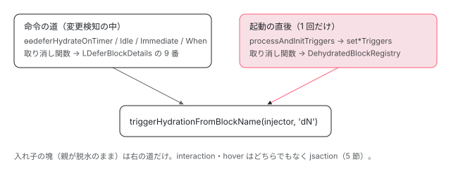

[目次](../README.md) › [@defer とインクリメンタルハイドレーションの内側](README.md) › 第 16 回 / 全 20 回

# hydrate トリガーの命令：ɵɵdeferHydrateOn と processAndInitTriggers

> ɵɵdeferHydrateOnTimer・ɵɵdeferHydrateOnImmediate・ɵɵdeferHydrateWhen・ɵɵdeferHydrateOnHover などが、どれも shouldAttachTrigger(Hydrate) を確かめて hydrateTriggers の Map に書き、サーバーではその場で triggerDeferBlock(Hydrate) で中身を描き、ブラウザでは timer・idle を予約・immediate をすぐ開始・viewport・hover・interaction・never は何もしない行。ハイドレーションの後に processAndInitTriggers が入れ子の塊も含めて timer・idle・immediate・viewport のトリガーを張る行と、interaction・hover が jsaction の道に回る理由。

angular/angular · 読了 約 13 分 · 発展 · [サイトで読む（デモが動きます）](https://angular-deep-dive-cyan.vercel.app/chapter/defer-hydrate-triggers)

---

`hydrate on viewport` や `hydrate on timer(500ms)` は、サーバーで描いた塊を**ブラウザでいつハイドレートするか**を決めるトリガーです。この章では、`ɵɵdeferHydrateOn*` の命令がサーバーとブラウザでそれぞれ何をするか（`hydrateTriggers` の Map に書く・その場で描く・予約する・何もしない）を 1 つずつ読み、ハイドレーションの直後に `processAndInitTriggers` が timer・idle・immediate・viewport のトリガーを張る行と、interaction・hover だけが jsaction の道に回る理由を確かめます。最後に、サーバーの HTML を Node でハイドレーションした記録で、塊が 1 つずつ目を覚ます段を見ます。

読む対象は `packages/core/src/defer/instructions.ts` の `ɵɵdeferHydrate*`、`packages/core/src/defer/triggering.ts` の `getHydrateTriggers`・`scheduleDelayedHydrating`・`set*Triggers`、`packages/core/src/hydration/utils.ts` の `appendDeferBlocksToJSActionMap` です。

1. [1. 全体像](01-defer-overview.md)
2. [2. ɵɵdefer 命令](02-defer-instruction.md)
3. [3. 塊の記録](03-defer-details.md)
4. [4. 状態を描く](04-defer-render-state.md)
5. [5. minimum と after](05-defer-minimum-after.md)
6. [6. 依存を読み込む](06-defer-resource-loading.md)
7. [7. トリガーから描画まで](07-defer-trigger-flow.md)
8. [8. when](08-defer-when.md)
9. [9. idle と immediate](09-defer-idle-immediate.md)
10. [10. timer](10-defer-timer.md)
11. [11. interaction と hover](11-defer-dom-triggers.md)
12. [12. viewport](12-defer-viewport.md)
13. [13. prefetch](13-defer-prefetch.md)
14. [14. 入れ子・注入器・クエリ](14-defer-nested-di.md)
15. [15. サーバーでの @defer](15-defer-server.md)
16. **16. hydrate トリガー**（この章）
17. [17. 親から順にハイドレート](17-defer-hydration-queue.md)
18. [18. hydrate のイベント](18-defer-hydrate-events.md)
19. [19. テストを読む](19-defer-tests.md)
20. [20. issue と PR を読む](20-defer-issues.md)

> [!NOTE]
> **ポイント**
>
> 全体の流れ（有効にする方法、サーバーの記録の形、親から順のハイドレート）は [incremental-hydration](../platform/15-incremental-hydration.md) で一通り読んでいます。この章はそのうち「トリガー」の部分を、命令ごとに細かく見ます。

## 1. コンパイラが出す hydrate の命令

📄 `angular/packages/compiler-cli/test/compliance/test_cases/r3_view_compiler_deferred/defer_with_hydrate_triggers.ts` L3–15 （▶ の行: 7–11）

```ts
 3 │ @Component({
 4 │   template: `
 5 │     {{message}}
 6 │     @defer (
 7 ▶       hydrate when isVisible() || isReady;
 8 ▶       hydrate on idle, timer(1337);
 9 ▶       hydrate on immediate, hover;
10 ▶       hydrate on interaction;
11 ▶       hydrate on viewport) {
12 │       {{message}}
13 │     }
14 │   `,
15 │ })
```

📄 `angular/packages/compiler-cli/test/compliance/test_cases/r3_view_compiler_deferred/defer_with_hydrate_triggers_template.js` L1–20 （▶ の行: 5–7, 12–13, 18）

```js
 1 │ function MyApp_Template(rf, ctx) {
 2 │   if (rf & 1) {
 3 │     $r3$.ɵɵtext(0);
 4 │     $r3$.ɵɵdomTemplate(1, MyApp_Defer_1_Template, 1, 1);
 5 ▶     $r3$.ɵɵenableIncrementalHydrationRuntime();
 6 ▶     $r3$.ɵɵdefer(2, 1, null, null, null, null, null, null, null, 1);
 7 ▶     $r3$.ɵɵdeferHydrateOnIdle();
 8 │     $r3$.ɵɵdeferHydrateOnImmediate();
 9 │     $r3$.ɵɵdeferHydrateOnTimer(1337);
10 │     $r3$.ɵɵdeferHydrateOnHover();
11 │     $r3$.ɵɵdeferHydrateOnInteraction();
12 ▶     $r3$.ɵɵdeferHydrateOnViewport();
13 ▶     $r3$.ɵɵdeferOnIdle();
14 │   }
15 │   if (rf & 2) {
16 │     $r3$.ɵɵtextInterpolate1(" ", ctx.message, " ");
17 │     $r3$.ɵɵadvance(2);
18 ▶     $r3$.ɵɵdeferHydrateWhen(ctx.isVisible() || ctx.isReady);
19 │   }
20 │ }
```

1. **6 行目：`ɵɵdefer` の最後の引数が `1`**

   `TDeferDetailsFlags.HasHydrateTriggers` です。これがあるので、トリガーの命令より先に「この塊は hydrate トリガーを持つ」と分かります（[第 15 回](15-defer-server.md)の `hasHydrateTriggers`）。
2. **5 行目：`ɵɵenableIncrementalHydrationRuntime()`**

   hydrate トリガーを使うテンプレートだけに出る命令で、インクリメンタルハイドレーションの本体のコードを有効にします（[incremental-hydration](../platform/15-incremental-hydration.md) の 2 節）。
3. **7〜12 行目：hydrate のトリガー 1 つにつき命令 1 つ。引数は少ない**

   `hover`・`interaction`・`viewport` に、ふつうのトリガーのような「要素の番号」がありません。**hydrate のトリガーは、いつも塊そのもの（サーバーが描いた中身の最上位の要素）に付く**からです。18 行目の `hydrate when` だけは更新の段です。
4. **13 行目：ふつうのトリガーを書かなかったので `ɵɵdeferOnIdle`**

   ブラウザだけで描くとき（サーバーの HTML が無いとき）に使われる、ふつうのトリガーです（2 節の終わり）。

## 2. 命令の共通の形：Map に書き、サーバーなら描く

📄 `angular/packages/core/src/defer/instructions.ts` L540–559 （▶ の行: 548, 550–551, 553, 555, 557）

```ts
540 │ export function ɵɵdeferHydrateOnTimer(delay: number) {
541 │   const lView = getLView();
542 │   const tNode = getCurrentTNode()!;
543 │ 
544 │   if (ngDevMode) {
545 │     trackTriggerForDebugging(lView[TVIEW], tNode, `hydrate on timer(${delay}ms)`);
546 │   }
547 │ 
548 ▶   if (!shouldAttachTrigger(TriggerType.Hydrate, lView, tNode)) return;
549 │ 
550 ▶   const hydrateTriggers = getHydrateTriggers(getTView(), tNode);
551 ▶   hydrateTriggers.set(DeferBlockTrigger.Timer, {type: DeferBlockTrigger.Timer, delay});
552 │ 
553 ▶   if (typeof ngServerMode !== 'undefined' && ngServerMode) {
554 │     // We are on the server and SSR for defer blocks is enabled.
555 ▶     triggerDeferBlock(TriggerType.Hydrate, lView, tNode);
556 │   } else {
557 ▶     scheduleDelayedHydrating(onTimer(delay), lView, tNode);
558 │   }
559 │ }
```

1. **548 行目：`shouldAttachTrigger(TriggerType.Hydrate, …)`**

   答えは「ふつうのトリガーを付けない」の逆です（[第 15 回](15-defer-server.md)の 1 節）。ブラウザでは、**hydrate トリガーがあり、サーバーで描かれていて（`SSR_UNIQUE_ID` がある）、インクリメンタルが有効**なときだけ通ります。サーバーの HTML が無い（ルートをブラウザで移って初めて描く、など）ときは通らず、代わりに 1 節の 13 行目のふつうのトリガーが動きます。
2. **550〜551 行目：`hydrateTriggers` の Map に書く**

   timer は時間も書きます。キーは `DeferBlockTrigger`（Idle = 0 … Timer = 5, When = 6, Never = 7）です。

📄 `angular/packages/core/src/defer/triggering.ts` L639–649 （▶ の行: 647–648）

```ts
639 │ 
640 │ /**
641 │  * Retrives a Defer Block's list of hydration triggers
642 │  */
643 │ export function getHydrateTriggers(
644 │   tView: TView,
645 │   tNode: TNode,
646 │ ): Map<DeferBlockTrigger, HydrateTriggerDetails | null> {
647 ▶   const tDetails = getTDeferBlockDetails(tView, tNode);
648 ▶   return (tDetails.hydrateTriggers ??= new Map());
649 │ }
```

648 行目、Map は `TDeferBlockDetails`（テンプレートに 1 つ）の欄に、最初に聞かれたときに作られます。サーバーでは annotate.ts がこれを読んで `__nghDeferData__` の `t` にします（第 15 回）。ブラウザでも同じように作られますが、ブラウザのトリガーを張るのに使うのはこの Map ではなく、サーバーから届いた `__nghDeferData__` の方です（4 節）。

1. **553〜555 行目：サーバーならその場で描く**

   `triggerDeferBlock(TriggerType.Hydrate, …)` で依存を読み、中身を描きます（第 15 回の 3 節）。
2. **557 行目：ブラウザなら予約する**

   `onTimer(delay)`（[第 10 回](10-defer-timer.md)）を `scheduleDelayedHydrating` に渡します。

📄 `angular/packages/core/src/defer/triggering.ts` L131–150 （▶ の行: 136, 142, 145–146, 149）

```ts
131 │ export function scheduleDelayedHydrating(
132 │   scheduleFn: (callback: VoidFunction, injector: Injector) => VoidFunction,
133 │   lView: LView,
134 │   tNode: TNode,
135 │ ) {
136 ▶   if (typeof ngServerMode !== 'undefined' && ngServerMode) return;
137 │ 
138 │   // Only trigger the scheduled trigger on the browser
139 │   // since we don't want to delay the server response.
140 │   const injector = lView[INJECTOR];
141 │   const lDetails = getLDeferBlockDetails(lView, tNode);
142 ▶   const ssrUniqueId = lDetails[SSR_UNIQUE_ID]!;
143 │   ngDevMode && assertSsrIdDefined(ssrUniqueId);
144 │ 
145 ▶   const cleanupFn = scheduleFn(
146 ▶     () => triggerHydrationFromBlockName(injector, ssrUniqueId),
147 │     injector,
148 │   );
149 ▶   storeTriggerCleanupFn(TriggerType.Hydrate, lDetails, cleanupFn);
150 │ }
```

1. **142 行目：塊の番号（`d0` など）を取る**

   `SSR_UNIQUE_ID` は、`ɵɵdefer` がサーバーの記録から読んで `LDeferBlockDetails` に入れた番号です（[第 2 回](02-defer-instruction.md)）。
2. **145〜148 行目：時が来たら `triggerHydrationFromBlockName(injector, 番号)`**

   ふつうのトリガーの `triggerDeferBlock` ではありません。番号から親の塊までの並びを作り、親から順に依存を読んでハイドレートする関数です（[第 17 回](17-defer-hydration-queue.md)）。
3. **149 行目：取り消し関数は `TriggerType.Hydrate` の欄（9 番、`HYDRATE_TRIGGER_CLEANUP_FNS`）へ**

   記録の「ハイドレーションの直後」で、timer と idle の塊だけこの欄が 1 個になっています。

`ɵɵdeferHydrateOnIdle` も同じ形で、ブラウザの枝は `scheduleDelayedHydrating(onIdleWrapper({timeout}), …)` です（命令の行は [第 15 回](15-defer-server.md)の 3 節）。

## 3. ブラウザの枝は、トリガーの種類で 4 通り

### immediate：その場でハイドレートを始める

📄 `angular/packages/core/src/defer/instructions.ts` L476–498 （▶ の行: 484, 487, 489–490, 492, 494, 496）

```ts
476 │ export function ɵɵdeferHydrateOnImmediate() {
477 │   const lView = getLView();
478 │   const tNode = getCurrentTNode()!;
479 │ 
480 │   if (ngDevMode) {
481 │     trackTriggerForDebugging(lView[TVIEW], tNode, 'hydrate on immediate');
482 │   }
483 │ 
484 ▶   if (!shouldAttachTrigger(TriggerType.Hydrate, lView, tNode)) return;
485 │ 
486 │   const hydrateTriggers = getHydrateTriggers(getTView(), tNode);
487 ▶   hydrateTriggers.set(DeferBlockTrigger.Immediate, null);
488 │ 
489 ▶   if (typeof ngServerMode !== 'undefined' && ngServerMode) {
490 ▶     triggerDeferBlock(TriggerType.Hydrate, lView, tNode);
491 │   } else {
492 ▶     const injector = lView[INJECTOR];
493 │     const lDetails = getLDeferBlockDetails(lView, tNode);
494 ▶     const ssrUniqueId = lDetails[SSR_UNIQUE_ID]!;
495 │     ngDevMode && assertSsrIdDefined(ssrUniqueId);
496 ▶     triggerHydrationFromBlockName(injector, ssrUniqueId);
497 │   }
498 │ }
```

492〜496 行目。予約もせずに、命令の中で `triggerHydrationFromBlockName` を呼びます（`await` はしません）。

### when：式が真になった変更検知でハイドレートを始める

📄 `angular/packages/core/src/defer/instructions.ts` L300–316 （▶ の行: 308, 312, 314–315）

```ts
300 │ export function ɵɵdeferHydrateWhen(rawValue: unknown) {
301 │   const lView = getLView();
302 │   const tNode = getSelectedTNode();
303 │ 
304 │   if (ngDevMode) {
305 │     trackTriggerForDebugging(lView[TVIEW], tNode, 'hydrate when <expression>');
306 │   }
307 │ 
308 ▶   if (!shouldAttachTrigger(TriggerType.Hydrate, lView, tNode)) return;
309 │ 
310 │   // TODO(incremental-hydration): audit all defer instructions to reduce unnecessary work by
311 │   // moving function calls inside their relevant control flow blocks
312 ▶   const bindingIndex = nextBindingIndex();
313 │   const tView = getTView();
314 ▶   const hydrateTriggers = getHydrateTriggers(tView, tNode);
315 ▶   hydrateTriggers.set(DeferBlockTrigger.When, null);
316 │ 
```

315 行目で Map に `When` を書きます（値は無いので `null`）。このあと、式の値が変わって `true` になったら `triggerHydrationFromBlockName` を呼ぶ部分は [incremental-hydration](../platform/15-incremental-hydration.md) の 8 節で読んでいます。**`When` は `__nghDeferData__` の `t` に書かれません**。式を評価できるのは親のビューの変更検知だけなので、親のテンプレートが動くこの命令でしか扱えないからです。

### hover・interaction：ブラウザでは何もしない

📄 `angular/packages/core/src/defer/instructions.ts` L637–656 （▶ の行: 645, 648, 650, 652, 654–655）

```ts
637 │ export function ɵɵdeferHydrateOnHover() {
638 │   const lView = getLView();
639 │   const tNode = getCurrentTNode()!;
640 │ 
641 │   if (ngDevMode) {
642 │     trackTriggerForDebugging(lView[TVIEW], tNode, 'hydrate on hover');
643 │   }
644 │ 
645 ▶   if (!shouldAttachTrigger(TriggerType.Hydrate, lView, tNode)) return;
646 │ 
647 │   const hydrateTriggers = getHydrateTriggers(getTView(), tNode);
648 ▶   hydrateTriggers.set(DeferBlockTrigger.Hover, null);
649 │ 
650 ▶   if (typeof ngServerMode !== 'undefined' && ngServerMode) {
651 │     // We are on the server and SSR for defer blocks is enabled.
652 ▶     triggerDeferBlock(TriggerType.Hydrate, lView, tNode);
653 │   }
654 ▶   // The actual triggering of hydration on hover is handled by JSAction in
655 ▶   // event_replay.ts.
656 │ }
```

📄 `angular/packages/core/src/defer/instructions.ts` L742–753 （▶ の行: 742, 745, 747, 749, 751–752）

```ts
742 ▶   if (!shouldAttachTrigger(TriggerType.Hydrate, lView, tNode)) return;
743 │ 
744 │   const hydrateTriggers = getHydrateTriggers(getTView(), tNode);
745 ▶   hydrateTriggers.set(DeferBlockTrigger.Interaction, null);
746 │ 
747 ▶   if (typeof ngServerMode !== 'undefined' && ngServerMode) {
748 │     // We are on the server and SSR for defer blocks is enabled.
749 ▶     triggerDeferBlock(TriggerType.Hydrate, lView, tNode);
750 │   }
751 ▶   // The actual triggering of hydration on interaction is handled by JSAction in
752 ▶   // event_replay.ts.
753 │ }
```

サーバーの枝（650〜653 行目・747〜750 行目）しかありません。654〜655 行目と 751〜752 行目のコメントのとおり、ブラウザで発火させるのは `event_replay.ts` の jsaction の仕組みです（5 節）。

### viewport：ブラウザでは何もしない（4 節の processAndInitTriggers が張る）

`ɵɵdeferHydrateOnViewport` も、ブラウザの枝がありません。命令の最後のコメントは「これらの命令は脱水された中身には存在しないので、viewport のハイドレートは triggering.ts で起きる」です（命令の行は [incremental-hydration](../platform/15-incremental-hydration.md) の 3 節）。`hydrate never` もブラウザでは Map に書くだけです（同じく 8 節）。

| hydrate トリガー | 命令のブラウザの枝 | ハイドレーションの後に張るもの（4 節） | サーバーの記録 |
| --- | --- | --- | --- |
| `on timer(ms)` | `scheduleDelayedHydrating(onTimer)` | `setTimerTriggers` | `t` に `{trigger:5, delay}` |
| `on idle` | `scheduleDelayedHydrating(onIdleWrapper)` | `setIdleTriggers` | `t` に 0 |
| `on immediate` | その場で `triggerHydrationFromBlockName` | `setImmediateTriggers` | `t` に 1 |
| `on viewport` | なし | `setViewportTriggers` | `t` に 2（設定があればオブジェクト） |
| `on interaction`・`on hover` | なし | なし（jsaction の対応表に足すだけ。5 節） | 最上位の要素の `jsaction` と `ngb` |
| `when 式` | 式が真になったら `triggerHydrationFromBlockName` | なし | なし |
| `never` | なし | なし | なし（jsaction も付けない） |

## 4. ハイドレーションの後：processAndInitTriggers が張るトリガー

命令が動くのは、その塊を宣言したテンプレートが動いたときだけです。**脱水のまま残っている塊の中にある塊**（記録の `d6`）の命令は、親がハイドレートされるまで動きません。そこで、アプリの起動の直後に一度だけ、サーバーから届いた `__nghDeferData__` の**全部の塊**について、DOM の上でトリガーを張ります。呼ばれるまでの流れ（ブートストラップと `ɵɵenableIncrementalHydrationRuntime` の両方がそろったら `processAndInitTriggers`）と、塊の目印のコメントから最上位の要素を集める前半は [incremental-hydration](../platform/15-incremental-hydration.md) の 2 節・6 節で読んでいます。ここでは最後の 4 つの `set*Triggers` を読みます（`setViewportTriggers` の行も 6 節）。



*hydrate のトリガーを張る 2 つの道。命令の道は、宣言したテンプレートが動いた塊（最上位など）だけ。processAndInitTriggers の道は、\_\_nghDeferData\_\_ にある全部の塊。どちらも最後は triggerHydrationFromBlockName を呼ぶ。*

📄 `angular/packages/core/src/defer/triggering.ts` L701–710 （▶ の行: 703–707）

```ts
701 │ 
702 │ function setIdleTriggers(injector: Injector, elementTriggers: ElementTrigger[]) {
703 ▶   for (const elementTrigger of elementTriggers) {
704 ▶     const registry = injector.get(DEHYDRATED_BLOCK_REGISTRY);
705 ▶     const onInvoke = () => triggerHydrationFromBlockName(injector, elementTrigger.blockName);
706 ▶     const cleanupFn = onIdle(onInvoke, injector);
707 ▶     registry.addCleanupFn(elementTrigger.blockName, cleanupFn);
708 │   }
709 │ }
710 │ 
```

📄 `angular/packages/core/src/defer/triggering.ts` L725–742 （▶ の行: 729–732, 738–740）

```ts
725 │ 
726 │ function setTimerTriggers(injector: Injector, elementTriggers: ElementTrigger[]) {
727 │   for (const elementTrigger of elementTriggers) {
728 │     const registry = injector.get(DEHYDRATED_BLOCK_REGISTRY);
729 ▶     const onInvoke = () => triggerHydrationFromBlockName(injector, elementTrigger.blockName);
730 ▶     const timerFn = onTimer(elementTrigger.delay!);
731 ▶     const cleanupFn = timerFn(onInvoke, injector);
732 ▶     registry.addCleanupFn(elementTrigger.blockName, cleanupFn);
733 │   }
734 │ }
735 │ 
736 │ function setImmediateTriggers(injector: Injector, elementTriggers: ElementTrigger[]) {
737 │   for (const elementTrigger of elementTriggers) {
738 ▶     // Note: we intentionally avoid awaiting each call and instead kick off
739 ▶     // the hydration process simultaneously for all defer blocks with this trigger;
740 ▶     triggerHydrationFromBlockName(injector, elementTrigger.blockName);
741 │   }
742 │ }
```

1. **705〜707 行目・729〜732 行目：呼ぶのは同じ `triggerHydrationFromBlockName`、取り消し関数は登録簿へ**

   命令の道（2 節）とちがい、取り消し関数を `LDeferBlockDetails` ではなく `DehydratedBlockRegistry`（塊の番号ごとの登録簿）の `addCleanupFn` に入れます。脱水のままの入れ子の塊には、まだ `LDeferBlockDetails` が無いからです。ハイドレートが済んだ塊の番号で、登録簿がまとめて呼びます（[第 17 回](17-defer-hydration-queue.md)）。
2. **738〜740 行目：immediate は待たずに全部いっせいに**

   コメントのとおり、1 つずつ `await` せずに、全部の塊のハイドレートを同時に始めます。
3. **同じ塊が 2 つの道で予約されることがある**

   最上位の `hydrate on timer`・`hydrate on idle` の塊は、2 節の命令の道と、ここの `set*Triggers` の道の両方で予約されます（記録の「ハイドレーションの直後」で、`d0`・`d2` の 9 番の欄が 1 個、登録簿の取り消し関数も 1 個）。先に発火した方がハイドレートを始め、あとの方は `triggerHydrationFromBlockName` の最初の「すでにハイドレート中の番号なら何もしない」で止まります（その行は [第 17 回](17-defer-hydration-queue.md)）。また、前半の集め方は「最上位の要素 1 つにつき 1 件」なので、最上位の要素が 2 つある塊は timer・idle の予約も 2 件になります（viewport は要素ごとに見張る必要があるのでこの形です）。

### cfe2cda1100：ランタイムを後から有効にしたときの初期化

cfe2cda1100（2026-07-23、fix、#69908「ルートの中の `@defer (hydrate …)` が発火しない」）は、この「起動の直後に一度だけ」の所の直しです（22.1.6 にも aa6d3189c14 として入っています）。`git show cfe2cda1100` で読むと、直す前は `APP_BOOTSTRAP_LISTENER` が起動の時に 1 回だけ `runIncrementalHydrationBootstrap(injector, doc)` を呼び、その時点でランタイムが有効でなければ何もしない作りでした。ルートのコンポーネントのテンプレートだけが hydrate トリガーを持つアプリでは、`ɵɵenableIncrementalHydrationRuntime()` が起動より後に動くので、トリガーを張る一度きりの処理が飛ばされていました。直した後は、`INCREMENTAL_HYDRATION_BOOTSTRAP` の `requested`（起動した）と `activated`（ランタイムが有効になった）の両方がそろったときに張ります（今の行は incremental-hydration の 2 節）。足された spec がこれです。

📄 `angular/packages/platform-server/test/incremental_hydration_spec.ts` L1362–1384 （▶ の行: 1363, 1366, 1377–1378, 1381, 1384）

```ts
1362 │           // Internal cleanup before we do server->client transition in this test.
1363 ▶           resetTViewsFor(SimpleComponent, RoutedComponent);
1364 │           // The root view has no hydration triggers, so verify that the routed view activates a
1365 │           // cold client runtime.
1366 ▶           resetIncrementalHydrationRuntimeForTests();
1367 │ 
1368 │           ////////////////////////////////
1369 │           const doc = getDocument();
1370 │           const appRef = await prepareEnvironmentAndHydrate(doc, html, SimpleComponent, {
1371 │             envProviders: [...providers, {provide: PLATFORM_ID, useValue: 'browser'}],
1372 │             hydrationFeatures,
1373 │           });
1374 │           appRef.tick();
1375 │           await appRef.whenStable();
1376 │ 
1377 ▶           expect(activeObservers.length).toBe(1);
1378 ▶           expect(activeObservers[0].options).toEqual({rootMargin: '123px', threshold: 0.5});
1379 │ 
1380 │           const article = doc.getElementsByTagName('article')[0];
1381 ▶           MockIntersectionObserver.invokeCallbacksForElement(article, true);
1382 │           await appRef.whenStable();
1383 │ 
1384 ▶           expect(activeObservers[0].observedElements.size).toBe(0);
```

1366 行目の `resetIncrementalHydrationRuntimeForTests()` で、サーバーの描画で有効になったランタイムを「まだ有効でない」に戻し、ブラウザの起動のあとにルートのコンポーネントが初めて有効にする場面を作ります。1377〜1378 行目で、内の塊（`hydrate on interaction` の外の塊の中にある `hydrate on viewport`）の `IntersectionObserver` が 1 つ作られ、設定が渡っていることを、1384 行目で「見えた」あとに見張りが外れたことを確かめます。

## 5. interaction・hover が jsaction の道に回る理由

📄 `angular/packages/core/src/hydration/utils.ts` L647–653 （▶ の行: 648–651）

```ts
647 │ export function appendDeferBlocksToJSActionMap(doc: Document, injector: Injector) {
648 ▶   const blockMap = gatherDeferBlocksByJSActionAttribute(doc);
649 ▶   const jsActionMap = injector.get(JSACTION_BLOCK_ELEMENT_MAP);
650 ▶   for (let rNode of blockMap) {
651 ▶     sharedMapFunction(rNode, jsActionMap);
652 │   }
653 │ }
```

起動の直後の処理の最後に、この関数が `jsaction` と `ngb` の付いた要素（サーバーが interaction・hover の塊の最上位の要素とその中に付けたもの）を集め、塊の番号ごとの対応表 `JSACTION_BLOCK_ELEMENT_MAP` に入れます（集める側の行は [incremental-hydration](../platform/15-incremental-hydration.md) の 6 節）。クリックやホバーは、ページの JS が読み終わる前にも起きます。jsaction の仕組み（[event-replay](../platform/14-event-replay.md)）は、JS より先に読まれる小さなスクリプトで文書全体のイベントを受け止めて貯めておけるので、**「脱水の塊の中で押されたら、その塊をハイドレートしてから、押されたイベントを流し直す」**ことができます。命令の中で `addEventListener` をしても、命令が動く前のイベントは拾えず、入れ子の塊では命令がそもそも動きません。受け止めたイベントからハイドレートまでの道は [第 18 回](18-defer-hydrate-events.md)で読みます。

## 6. spec：入れ子の timer・when・never

📄 `angular/packages/platform-server/test/incremental_hydration_spec.ts` L1853–1881 （▶ の行: 1855, 1858, 1876–1878）

```ts
1853 │             template: `
1854 │               <main (click)="fnA()">
1855 ▶                 @defer (on viewport; hydrate on interaction) {
1856 │                   <div id="main" (click)="fnA()">
1857 │                     defer block rendered!
1858 ▶                     @defer (on viewport; hydrate on timer(150)) {
1859 │                       <article>
1860 │                         <p id="nested">Nested defer block</p>
1861 │                         <span id="test">{{ value() }}</span>
1862 │                       </article>
1863 │                     } @placeholder {
1864 │                       <span>Inner block placeholder</span>
1865 │                     }
1866 │                   </div>
1867 │                 } @placeholder {
1868 │                   <span>Outer block placeholder</span>
1869 │                 }
1870 │               </main>
1871 │             `,
1872 │           })
1873 │           class SimpleComponent {
1874 │             value = signal('start');
1875 │             fnA() {}
1876 ▶             constructor() {
1877 ▶               if (!isPlatformServer(inject(PLATFORM_ID))) {
1878 ▶                 this.value.set('end');
1879 │               }
1880 │             }
1881 │           }
```

📄 `angular/packages/platform-server/test/incremental_hydration_spec.ts` L1910–1918 （▶ の行: 1914, 1916, 1918）

```ts
1910 │           await appRef.whenStable();
1911 │ 
1912 │           const appHostNode = compRef.location.nativeElement;
1913 │ 
1914 ▶           expect(appHostNode.outerHTML).toContain('<article>');
1915 │ 
1916 ▶           await allPendingDynamicImports();
1917 │ 
1918 ▶           expect(appHostNode.outerHTML).toContain('<span id="test">end</span>');
```

1858 行目の内の塊は、1855 行目の外の塊（`hydrate on interaction`）の中です。内の命令は外がハイドレートされるまで動かないので、内の timer を張るのは 4 節の `setTimerTriggers` だけです。1918 行目で `end` が出ているのは、timer で内のハイドレートが始まり、親の外から順にハイドレートされて（第 17 回）、1876〜1879 行目のブラウザの側の値で描き直されたからです（この spec の `TimerScheduler` は、予約されるとすぐ呼ぶ偽物です）。

📄 `angular/packages/platform-server/test/incremental_hydration_spec.ts` L1976–2005 （▶ の行: 1985, 1987–1988, 1990, 1992, 1994, 2001–2002, 2004）

```ts
1976 │         const registry = compRef.instance.registry;
1977 │         spyOn(registry, 'cleanup').and.callThrough();
1978 │         appRef.tick();
1979 │         await appRef.whenStable();
1980 │ 
1981 │         const appHostNode = compRef.location.nativeElement;
1982 │ 
1983 │         const article = appHostNode.querySelector('article');
1984 │ 
1985 ▶         verifyNodeWasNotHydrated(article);
1986 │ 
1987 ▶         expect(appHostNode.outerHTML).toContain(
1988 ▶           '<span id="test" jsaction="click:;" ngb="d0">start</span>',
1989 │         );
1990 ▶         expect(registry.has('d0')).toBeTruthy();
1991 │ 
1992 ▶         const testElement = doc.getElementById('hydrate-me')!;
1993 │         const clickEvent = new CustomEvent('click');
1994 ▶         testElement.dispatchEvent(clickEvent);
1995 │ 
1996 │         await allPendingDynamicImports();
1997 │         appRef.tick();
1998 │ 
1999 │         await appRef.whenStable();
2000 │ 
2001 ▶         verifyNodeWasHydrated(article);
2002 ▶         expect(registry.cleanup).toHaveBeenCalledTimes(1);
2003 │ 
2004 ▶         expect(registry.has('d0')).toBeFalsy();
2005 │         expect(appHostNode.outerHTML).toContain('<span id="test">start</span>');
```

1985〜1990 行目、起動の直後は脱水のまま（`verifyNodeWasNotHydrated`）、中のボタンに `jsaction` と `ngb="d0"` があり、登録簿に `d0` があります。1992〜1994 行目で、塊の外のボタンを押して `iSaySo` を `true` にすると、2001〜2004 行目でハイドレートされ、登録簿の `cleanup` が 1 回呼ばれて `d0` が消えます。

📄 `angular/packages/platform-server/test/incremental_hydration_spec.ts` L2052–2066 （▶ の行: 2058, 2060, 2066）

```ts
2052 │         const compRef = getComponentRef<SimpleComponent>(appRef);
2053 │         appRef.tick();
2054 │         await appRef.whenStable();
2055 │ 
2056 │         const appHostNode = compRef.location.nativeElement;
2057 │ 
2058 ▶         expect(appHostNode.outerHTML).toContain('<article>');
2059 │ 
2060 ▶         await timeout(500); // wait for timer
2061 │         appRef.tick();
2062 │ 
2063 │         await allPendingDynamicImports();
2064 │         appRef.tick();
2065 │ 
2066 ▶         expect(appHostNode.outerHTML).not.toContain('Outer block placeholder');
```

`hydrate never` の塊は、500 ms 待っても（2060 行目）サーバーの中身のままで、placeholder にもなりません（2066 行目）。ふつうのトリガー（ここではコンパイラが足した `on idle`）も付かないからです。

## 7. DEMO：サーバーの HTML を Node でハイドレーションする

> **🧪 DEMO — hydrate トリガーの塊が目を覚ます段（記録の再生）**
>
> これは記録です。本物の @angular/core 22.1.6（開発モード・JIT）を Node で、domino の DOM の上で動かした結果です。まず共通の部品の `renderServer`（`provideClientHydration()`。22.1.6 ではインクリメンタルが既定で入る）でサーバーの HTML を作り、その HTML を `installDom` に渡して、`bootBrowser`（ブラウザのプラットフォーム。共通の部品は [第 1 回](01-defer-overview.md)に全文）で同じアプリをハイドレーションしました。platform-server の spec と同じく、サーバーで作った TView を捨て（`resetTViewsFor` と同じ）、core が持っているサーバーの document をブラウザの document に戻しています（`ɵsetDocument`）。`IntersectionObserver` と `requestIdleCallback` は共通の部品の代わり（`intersect()`・`runIdle()`）で、**環境の代わりで、Angular のロジックではありません**。jsaction のイベントを受け止める小さなスクリプト（CLI が HTML に入れるもの）は記録の HTML に無いので、interaction・hover の塊を押す段はありません。表の塊は `ɵgetDeferBlocks` がルートのビューから見つけた 7 つで、`d5` の中の `d6` は含みません（`ɵgetDeferBlocks` は塊の中まで入らない）。「作られた」は `hy-leaf` の `ngOnInit` が呼ばれた順、「setTimeout」はブラウザ側で 10 ms 以上の `setTimeout` が呼ばれた ms の並びです（9000 と 10000 は開発モードの安定の見張りで、塊とは関係ありません）。
>
> 段のボタンを押してください。
>
> ▶ [このデモはサイトで動かせます](https://angular-deep-dive-cyan.vercel.app/chapter/defer-hydrate-triggers)

記録から読み取れることです。

1. **1 段目（ハイドレーションの直後）：全部 `Initial`、`hy-leaf` は 1 つも作られていない**

   DOM はサーバーの HTML のまま（`ngh="0"` が残っている）で、コンポーネントは作られていません。`SSR_BLOCK_STATE` は 2（サーバーが Complete を描いた）、`hydrateTriggers` はブラウザでも命令が書いています。登録簿には `d6` 以外の 7 件（`d6` の `ɵɵdefer` はまだ動いていない）、登録簿の取り消し関数は `d0`・`d1`・`d2`・`d6`（4 節の timer・viewport・idle）、見張りは `spot`（`d1` の `article`）です。`d0`・`d2` の 9 番の欄の 1 個が、2 節の命令の道の予約です。setTimeout の `50` と `30` が、`d0` と `d6` の timer です（2 つの道の `d0` の予約は、`TimerScheduler` が 1 つの `setTimeout` にまとめています。第 10 回）。
2. **2 段目（60 ms 後）：`d0` と、`d5`（hover）と `d6`**

   30 ms で `d6` の timer が発火し、親の `d5` から順にハイドレートされました（`hover` → `nested-timer` の順に作られる。第 17 回）。`d5` の hover のトリガーは使われていません。そのあと 50 ms で `d0`。`18` の setTimeout は、30 ms の発火のあとで残りの 50 ms の予約を張り直したものです。登録簿から `d0`・`d5` が消え、取り消し関数も `d0`・`d6` の分が呼ばれて消えました。
3. **3 段目（`intersect()`）：`d1`。見張りが外れる**

   `setViewportTriggers` の見張りが発火し、ハイドレートのあとの片付けで見張りが外れました（`targets` が空）。spec の 1384 行目と同じことです。
4. **4 段目（`runIdle()`）：`d2`**

   貯まっていた 1 つの `requestIdleCallback` を流すと、`d2` だけがハイドレートされました。2 つの道の予約は、idle の予約を 1 つにまとめる `IdleScheduler`（第 9 回）の中で 1 つになっています。
5. **5 段目（`ready.set(true)`）：`d3`。`d4`（interaction）と `d7`（never）は最後まで `Initial`**

   `hydrate when` は、親のビューの変更検知で式が `true` になったときに始まります。`d4` は jsaction のイベントでしか目を覚まさず、`d7` は `never` なので、DOM はサーバーの中身のまま残ります。

📄 `scratchpad の記録スクリプト（hydrate.ts、共通の build.mjs で束ねて node で実行。共通の harness.ts は第 1 回に全文）`

```
// 第 16 回 defer-hydrate-triggers の記録。
// 1) サーバー: hydrate トリガーの付いた塊を renderServer で描く（provideClientHydration()。22.1.6 では incremental が既定）
// 2) ブラウザ: そのサーバーの HTML を installDom に渡し、bootBrowser（platformBrowser）でハイドレーションする
// 3) 段ごとに、塊の記録（blocks()）・DehydratedBlockRegistry の中身・作られたコンポーネント・IntersectionObserver の代わりを残す
// 使い方: node ../_shared/build.mjs hydrate.ts hydrate.mjs && node hydrate.mjs hydrate.json
import '@angular/compiler'; // JIT に要る。platform-browser より先に読む
import {
  ApplicationRef, Component, Input, VERSION, signal,
  ɵDEHYDRATED_BLOCK_REGISTRY as DEHYDRATED_BLOCK_REGISTRY,
  ɵgetComponentDef as getComponentDef, ɵsetDocument as setDocument,
} from '@angular/core';
import { provideClientHydration } from '@angular/platform-browser';
import { blocks, bootBrowser, installDom, installIdle, intersect, observers, idleQueue, renderServer, runIdle, writeJson } from '../_shared/harness';

const OUT = process.argv[2] ?? new URL('./hydrate.json', import.meta.url).pathname;
const created: string[] = [];

@Component({ selector: 'hy-leaf', template: '<b>{{ name }}</b>' })
class HyLeaf {
  @Input() name = '';
  ngOnInit() {
    created.push(this.name);
  }
}

const TEMPLATE = `@defer (hydrate on timer(50ms)) {
  <div><hy-leaf name="timer" /></div>
}
@defer (hydrate on viewport) {
  <article id="spot"><hy-leaf name="viewport" /></article>
}
@defer (hydrate on idle) {
  <div><hy-leaf name="idle" /></div>
}
@defer (hydrate when ready()) {
  <div><hy-leaf name="when" /></div>
}
@defer (hydrate on interaction) {
  <section><hy-leaf name="interaction" /></section>
}
@defer (hydrate on hover) {
  <div>
    <hy-leaf name="hover" />
    @defer (hydrate on timer(30ms)) {
      <p><hy-leaf name="nested-timer" /></p>
    }
  </div>
}
@defer (hydrate never) {
  <div><hy-leaf name="never" /></div>
}`;

@Component({ selector: 'app-root', imports: [HyLeaf], template: TEMPLATE })
class HyRoot {
  ready = signal(false);
}

const resetTViews = () => {
  getComponentDef(HyRoot)!.tView = null;
  getComponentDef(HyLeaf)!.tView = null;
};

// ---- 1) サーバー ----
// 本物のサーバーの束では ngServerMode はビルドの時に true（esbuild の define）。providers を作る前に true にする。
(globalThis as any).ngServerMode = true;
const html = await renderServer(HyRoot, { providers: [provideClientHydration()] });
const serverCreated = created.splice(0);
const state = html.match(/<script id="ng-state" type="application\/json">([\s\S]*?)<\/script>/);
const server = {
  app: (html.match(/<app-root[\s\S]*?<\/app-root>/) ?? [''])[0],
  nghDeferData: state ? JSON.parse(state[1]).__nghDeferData__ ?? null : null,
  created: serverCreated,
};

// ---- 2) ブラウザ ----
(globalThis as any).ngServerMode = undefined; // ブラウザの束では ngServerMode は未定義
resetTViews(); // サーバーで作った TView（TDeferBlockDetails を含む）を捨てる（platform-server の spec の resetTViewsFor と同じ）
const doc = installDom(html);
setDocument(doc); // platform-server が core に入れたサーバーの document を、ブラウザの document に戻す
installIdle();
// ブラウザ側で setTimeout がどの時間で呼ばれたかを残す（呼び方は変えない）
const timeouts: number[] = [];
const realSetTimeout = globalThis.setTimeout;
(globalThis as any).setTimeout = (fn: any, ms?: number, ...a: any[]) => {
  if ((ms ?? 0) >= 10) timeouts.push(Math.round(ms!));
  return realSetTimeout(fn, ms, ...a);
};
// 記録の側の待ち時間は、上の記録に混ざらないように元の setTimeout で待つ
const wait = (ms: number) => new Promise((r) => realSetTimeout(r, ms));
const { appRef, ref } = await bootBrowser(HyRoot, { providers: [provideClientHydration()] });
const registry = appRef.injector.get(DEHYDRATED_BLOCK_REGISTRY);

const steps: any[] = [];
function record(id: string, title: string, action: string) {
  steps.push({
    id,
    title,
    action,
    created: [...created],
    blocks: blocks(ref).map((b) => ({
      index: b.index,
      flags: b.tDetails.flags,
      hydrateTriggers: b.tDetails.hydrateTriggers,
      loadingState: b.tDetails.loadingState,
      state: b.lDetails.DEFER_BLOCK_STATE,
      ssrId: b.lDetails.SSR_UNIQUE_ID,
      ssrState: b.lDetails.SSR_BLOCK_STATE,
      triggerCleanup: b.lDetails.TRIGGER_CLEANUP_FNS,
      hydrateCleanup: b.lDetails.HYDRATE_TRIGGER_CLEANUP_FNS,
    })),
    registry: {
      size: registry.size,
      ids: ['d0', 'd1', 'd2', 'd3', 'd4', 'd5', 'd6', 'd7'].filter((id) => registry.has(id)),
      hydrating: [...registry.hydrating.keys()],
      // 内部の private の欄（processAndInitTriggers の set*Triggers が addCleanupFn で入れたもの）を読むだけ
      cleanupFns: Object.fromEntries([...(registry as any).cleanupFns.entries()].map(([k, v]: any) => [k, v.length])),
    },
    timeouts: [...timeouts],
    observers: observers.map((o) => ({ options: o.options ?? null, targets: [...o.targets].map((t) => (t as Element).id || t.nodeName.toLowerCase()) })),
    idleQueue: idleQueue.length,
    app: (doc.querySelector('app-root') as Element).innerHTML,
  });
}

record('boot', 'ハイドレーションの直後', 'bootBrowser(HyRoot, {providers: [provideClientHydration()]}) と whenStable()');

await wait(60);
await appRef.whenStable();
record('timer', '50ms を過ぎた', '60ms 待って whenStable()');

intersect(doc.getElementById('spot')!);
await wait(10);
await appRef.whenStable();
record('viewport', 'article が画面に入った', "intersect(document.getElementById('spot'))（IntersectionObserver の代わり）");

runIdle();
await wait(10);
await appRef.whenStable();
record('idle', 'ブラウザが暇になった', 'runIdle()（requestIdleCallback の代わり）');

(ref.instance as HyRoot).ready.set(true);
await wait(10);
await appRef.whenStable();
record('when', 'ready を true に', 'ready.set(true)');

await writeJson(OUT, { core: VERSION.full, template: TEMPLATE, server, steps });
process.exit(0);

```

## ここまでの呼び出し

- `ɵɵenableIncrementalHydrationRuntime()` → `ɵɵdefer(…, 1)` — テンプレート関数
  - `ɵɵdeferHydrateOnTimer(delay)` など — instructions.ts L540
    - `shouldAttachTrigger(Hydrate)` → `getHydrateTriggers(…).set(…)` — triggering.ts L591・L643
    - `triggerDeferBlock(TriggerType.Hydrate, …)` — *サーバー* — 第 15 回
    - `scheduleDelayedHydrating(onTimer(delay), …)` — *ブラウザ* — triggering.ts L131 — *immediate はその場、hover・interaction・viewport・never は何もしない*
- `APP_BOOTSTRAP_LISTENER` と `activated` がそろう → `processAndInitTriggers` — incremental\_runtime.ts（incremental-hydration）
  - `setIdleTriggers`・`setImmediateTriggers`・`setViewportTriggers`・`setTimerTriggers` — triggering.ts L702・L736・L711・L726 — *取り消し関数は登録簿へ*
  - `appendDeferBlocksToJSActionMap(doc, injector)` — hydration/utils.ts L647 — *interaction・hover の要素*
- `triggerHydrationFromBlockName(injector, 'dN')` — triggering.ts L374（第 17 回）

## テストと直し方

### spec と describe

| describe（incremental\_hydration\_spec.ts の core functionality &gt; triggers） | it |
| --- | --- |
| `viewport`（1099 行目） | `viewport`（1197）・``should create IntersectionObserver with the options from the `hydrate on viewport` trigger``（1280）・`should create an IntersectionObserver for a nested routed viewport block`（1322、cfe2cda1100 で追加） |
| （triggers の直下） | `immediate`（1388）・`when`（1922）・`never`（2008）・`defer triggers should not fire when hydrate never is used`（2069）・`should not annotate jsaction events for events inside a hydrate never block`（2144） |
| `idle`（1450 行目） | `idle`（1546）・`idle with timeout`（1616）・``should hydrate a `hydrate on idle` block that lives inside a deferred-loaded child component``（1689） |
| `timer`（1779 行目） | `top level timer`（1789）・`nested timer`（1850） |

コンパイラが出す命令は compliance の `defer_with_hydrate_triggers`・`defer_hydrate_order`（hydrate の命令をほかのトリガーより先に出す）・`deferred_hydrate_on_viewport_with_options` で確かめています。

### 手元で走らせた結果

📄 `ターミナル（../angular で）`

```
cd ~/angular-research/angular
pnpm bazel test //packages/platform-server/test:test \
  '--test_arg=--filter=partial hydration integration core functionality triggers (viewport|immediate|idle|timer|when|never)' \
  --nocache_test_results --test_output=all
```

📄 `出力（2026-11-06 に実行。抜粋。ログは scratchpad/defer-logs/d-hydrate.log）`

```
Ran 11 of 399 specs
11 specs, 0 failures
INFO: Elapsed time: 3.018s, Critical Path: 2.46s
//packages/platform-server/test:test   PASSED in 2.4s
```

- 11 件は上の表の it 13 件のうち、絞り込みの正規表現（`triggers (viewport|immediate|idle|timer|when|never)`）に当たったものです。jasmine は describe と it の名前をつないだ全体の名前で比べるので、triggers の直下の `defer triggers should not fire …` と `should not annotate jsaction …` の 2 件は、全体の名前が `… triggers defer …`・`… triggers should …` になって当たりません。

### 直すとしたら

- 「hydrate トリガーが発火しない」は、まず `__nghDeferData__` に `t` があるか（サーバー側、第 15 回）、ブラウザで `processAndInitTriggers` が呼ばれたか（起動とランタイムの両方がそろったか。cfe2cda1100）を見ます。命令の道だけを見ると、入れ子の塊で何も起きない理由を見落とします（4 節）。
- トリガーごとの張り方を直すなら triggering.ts の `set*Triggers`（701〜710 行目・725〜742 行目。viewport は incremental-hydration）と `scheduleDelayedHydrating`（131〜150 行目）、spec は incremental\_hydration\_spec.ts の describe `triggers` の中の、そのトリガーの describe に足します。サーバーで描いて（`ssr`）、`resetTViewsFor` してから `prepareEnvironmentAndHydrate` する形が決まりです。
- 98eb24cea04（`on idle(timeout)`）では `hydrate on idle` にも timeout が足され、上の表の `idle with timeout`（1616）が入りました。
- 本家に PR を出すことは勧めません。hydrate トリガーの issue（開いている #71296 など）を読むときは、この章の記録のように、登録簿の番号・取り消し関数・塊の状態を段ごとに並べて確かめます（[第 20 回](20-defer-issues.md)）。

## 聞かれそうな質問

**Q. `hydrate on viewport` の命令は、ブラウザで何をしますか？**

`hydrateTriggers` の Map に書くだけです。見張り（`IntersectionObserver`）を張るのは、起動の直後の `processAndInitTriggers` の `setViewportTriggers` です。脱水の塊の中の塊は命令が動かないので、全部の塊を `__nghDeferData__` から張る必要があるからです。

**Q. サーバーで `hydrate` の命令は何もしないのですか？**

します。Map に書いたうえで、`triggerDeferBlock(TriggerType.Hydrate, …)` で中身を描きます（instructions.ts 553〜555 行目など）。サーバーで中身が HTML に入るのはこの行のおかげです。

**Q. なぜ `hydrate on hover` には要素を指定できないのですか？**

hydrate のトリガーは、サーバーが描いた塊の最上位の要素に付く決まりだからです。サーバーはその要素に `jsaction` と `ngb` を書き、ブラウザは `appendDeferBlocksToJSActionMap`（utils.ts 647〜653 行目）で対応表に入れます。コンパイラの出力（1 節の 10〜11 行目）も引数がありません。

**Q. SSR をしないでブラウザだけで描いたとき、hydrate トリガーはどうなりますか？**

使われません。`shouldAttachTrigger(Hydrate)`（548 行目など）は、サーバーで描かれた印（`SSR_UNIQUE_ID`）が無いと通らないので、代わりにふつうのトリガー（書かなければコンパイラが足した `on idle`）が本体を出します。

**Q. `hydrate on timer` の塊が 2 回ハイドレートされることはありませんか？予約が 2 つあるのに。**

ありません。最上位の塊は命令の道と `setTimerTriggers` の道で 2 回予約されますが（記録の 1 段目）、`triggerHydrationFromBlockName` はすでにハイドレート中の番号なら何もしません（第 17 回）。ハイドレートが済むと、両方の取り消し関数が呼ばれます。

## 読み終えて

- `ɵɵdeferHydrateOn*` は、どれも `shouldAttachTrigger(Hydrate)` を確かめて `hydrateTriggers` の Map に書き、サーバーなら `triggerDeferBlock(Hydrate)` で中身を描く。
- ブラウザの枝はトリガーで違う。timer・idle は `scheduleDelayedHydrating`、immediate はその場、when は式が真になったとき、viewport・hover・interaction・never は何もしない。
- 起動の直後に `processAndInitTriggers` が `__nghDeferData__` の全部の塊（入れ子も）に timer・idle・immediate・viewport を張る。取り消し関数は登録簿へ。
- interaction・hover は jsaction の道。JS より前のイベントも受け止め、ハイドレートしてから流し直すため。cfe2cda1100 は「起動とランタイムの両方がそろったら張る」に直した。

---

← 前: [サーバーでの @defer：placeholder を出す理由](15-defer-server.md)  
次: [塊のハイドレーション：親から順に目を覚ます](17-defer-hydration-queue.md) →
