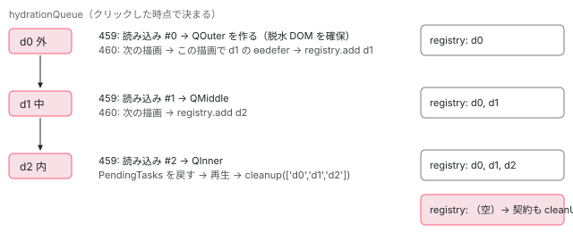

[目次](../README.md) › [@defer とインクリメンタルハイドレーションの内側](README.md) › 第 17 回 / 全 20 回

# 塊のハイドレーション：親から順に目を覚ます

> triggerHydrationFromBlockName が DehydratedBlockRegistry から塊と親の連なり（getParentBlockHydrationQueue）を取り、triggerHydrationForBlockQueue が親の塊から 1 つずつ依存を読み込み、描画を待ち（nextRender）、子へ進む行。失敗した塊の後始末（cleanupRemainingHydrationQueue）と、ハイドレーションが済んだ塊を registry から消す行。

angular/angular · 読了 約 13 分 · 発展 · [サイトで読む（デモが動きます）](https://angular-deep-dive-cyan.vercel.app/chapter/defer-hydration-queue)

---

入れ子になった hydrate の塊（`@defer (hydrate …)`）の内側でイベントが起きたとき、Angular は内側の塊だけをハイドレートすることはしません。まだ眠っている（dehydrated、サーバーの DOM だけがあり、中身のコンポーネントがまだ作られていない）親の塊から順に、1 つずつ依存を読み込み、描画を待ち、子へ進みます。この章では、その「列」を進める `triggerHydrationForBlockQueue` の行を 1 段ずつ追い、途中で読み込みが失敗したときの後始末と、済んだ塊を登録簿（`DehydratedBlockRegistry`）から消すまでを読みます。最後に、3 段の入れ子の塊を Node で本当にハイドレートした記録を、段ごとに見比べます。

読む対象は `packages/core/src/defer/triggering.ts`（374〜590 行目のハイドレーションの部分）・`defer/registry.ts`・`hydration/cleanup.ts` です。列を作る `getParentBlockHydrationQueue` と、列の入口と出口の行は[incremental-hydration の章](../platform/15-incremental-hydration.md)の 7 節で引用済みなので、この章ではリンクして短く触れ、まだ引用されていない行を中心に読みます。

1. [1. 全体像](01-defer-overview.md)
2. [2. ɵɵdefer 命令](02-defer-instruction.md)
3. [3. 塊の記録](03-defer-details.md)
4. [4. 状態を描く](04-defer-render-state.md)
5. [5. minimum と after](05-defer-minimum-after.md)
6. [6. 依存を読み込む](06-defer-resource-loading.md)
7. [7. トリガーから描画まで](07-defer-trigger-flow.md)
8. [8. when](08-defer-when.md)
9. [9. idle と immediate](09-defer-idle-immediate.md)
10. [10. timer](10-defer-timer.md)
11. [11. interaction と hover](11-defer-dom-triggers.md)
12. [12. viewport](12-defer-viewport.md)
13. [13. prefetch](13-defer-prefetch.md)
14. [14. 入れ子・注入器・クエリ](14-defer-nested-di.md)
15. [15. サーバーでの @defer](15-defer-server.md)
16. [16. hydrate トリガー](16-defer-hydrate-triggers.md)
17. **17. 親から順にハイドレート**（この章）
18. [18. hydrate のイベント](18-defer-hydrate-events.md)
19. [19. テストを読む](19-defer-tests.md)
20. [20. issue と PR を読む](20-defer-issues.md)

## 0. この章の場面と、すでに読んだところ

この章を通して、次の 3 段の入れ子を例にします（6 節の記録と同じテンプレートです）。

📄 `記録のアプリのテンプレート（QRoot。outerReady は signal で、最後まで false のまま）`

```
<main>
  @defer (hydrate when outerReady()) {
    <section class="outer"><q-outer />
      @defer (hydrate on interaction) {
        <div class="middle"><q-middle />
          @defer (hydrate on interaction) {
            <p class="inner"><q-inner />
              <button type="button" (click)="clicked()">押す</button>
            </p>
          } @error { <i>inner error</i> }
        </div>
      } @error { <i>middle error</i> }
    </section>
  } @error { <i>outer error</i> }
</main>
```

サーバーで描くと、塊には見つけた順に `d0`（外）・`d1`（中）・`d2`（内）の番号が振られ、TransferState の `__nghDeferData__` に次の記録が入ります（記録のスクリプトが HTML の `<script id="ng-state">` から読んだ実物です）。`p` が親の番号です（書き出しの行は[incremental-hydration の章](../platform/15-incremental-hydration.md)の 4 節）。

📄 `記録の __nghDeferData__（サーバーの HTML から）`

```
{"d0":{"r":1,"s":2},"d1":{"r":1,"s":2,"p":"d0"},"d2":{"r":1,"s":2,"p":"d1"}}
```

- ブラウザでは、ハイドレーションのあいだに親のテンプレートが実行され、そこで `ɵɵdefer` が動いた塊だけが登録簿に入ります（[第 16 回](16-defer-hydrate-triggers.md)と incremental-hydration の 5 節）。この場面では、起動の直後に登録簿にあるのは `d0` だけです。`d1` と `d2` の `ɵɵdefer` は、それぞれの親の塊の中身のテンプレートにあるので、親が眠っているあいだは 1 度も実行されません。
- 内の塊のボタンを押すと、jsaction の道（[第 18 回](18-defer-hydrate-events.md)）を通って `triggerHydrationFromBlockName(injector, 'd2', …)` が呼ばれます。この関数が `getParentBlockHydrationQueue` で `p` を上へたどり、`['d0', 'd1', 'd2']` の列を作ります。ここまでの行は incremental-hydration の 7 節で 1 行ずつ読んでいます。

## 1. 列の先頭がまだ登録簿に無いとき：awaitParentBlock

📄 `angular/packages/core/src/defer/triggering.ts` L414–427 （▶ の行: 414–415, 421–424）

```ts
414 ▶     await triggerHydrationForBlockQueue(injector, hydrationQueue, replayQueuedEventsFn);
415 ▶   } else {
416 │     // the topmost parent block is not yet in the registry, which may mean
417 │     // a lazy loaded route, a control flow branch was taken, a route has
418 │     // been navigated, etc. So we need to queue up the hydration process
419 │     // so that it can be finished after the top block has had its defer
420 │     // instruction executed.
421 ▶     dehydratedBlockRegistry.awaitParentBlock(
422 ▶       topmostParentBlock,
423 ▶       async () =>
424 ▶         await triggerHydrationForBlockQueue(injector, hydrationQueue, replayQueuedEventsFn),
425 │     );
426 │   }
427 │ }
```

`triggerHydrationFromBlockName` の最後の分岐の、もう片方です。列の先頭（一番上の親）が登録簿に入っていれば、すぐ前の 414 行目で `triggerHydrationForBlockQueue` を待ちます（incremental-hydration の 7 節）。入っていなければ、415 行目からの else に来て、421〜425 行目で「その塊が登録されたら、この列のハイドレーションを始める」関数を登録簿に預けます。416〜420 行目のコメントのとおり、遅延読み込みのルートや、`@if` の枝がまだ描かれていないときがこれに当たります。

📄 `angular/packages/core/src/defer/registry.ts` L75–110 （▶ の行: 76–77, 82, 88, 91, 94, 96, 100, 103, 105–108）

```ts
 75 │ 
 76 ▶   get size(): number {
 77 ▶     return this.registry.size;
 78 │   }
 79 │ 
 80 │   // we have to leave the lowest block Id in the registry
 81 │   // unless that block has no children
 82 ▶   addCleanupFn(blockId: string, fn: Function) {
 83 │     let cleanupFunctions: Function[] = [];
 84 │     if (this.cleanupFns.has(blockId)) {
 85 │       cleanupFunctions = this.cleanupFns.get(blockId)!;
 86 │     }
 87 │     cleanupFunctions.push(fn);
 88 ▶     this.cleanupFns.set(blockId, cleanupFunctions);
 89 │   }
 90 │ 
 91 ▶   invokeTriggerCleanupFns(blockId: string) {
 92 │     const fns = this.cleanupFns.get(blockId) ?? [];
 93 │     for (let fn of fns) {
 94 ▶       fn();
 95 │     }
 96 ▶     this.cleanupFns.delete(blockId);
 97 │   }
 98 │ 
 99 │   // Blocks that are being hydrated.
100 ▶   hydrating = new Map<string, PromiseWithResolvers<void>>();
101 │ 
102 │   // Blocks that are awaiting a defer instruction finish.
103 ▶   private awaitingCallbacks = new Map<string, Function[]>();
104 │ 
105 ▶   awaitParentBlock(topmostParentBlock: string, callback: Function) {
106 ▶     const parentBlockAwaitCallbacks = this.awaitingCallbacks.get(topmostParentBlock) ?? [];
107 ▶     parentBlockAwaitCallbacks.push(callback);
108 ▶     this.awaitingCallbacks.set(topmostParentBlock, parentBlockAwaitCallbacks);
109 │   }
110 │ 
```

📄 `angular/packages/core/src/defer/registry.ts` L46–51 （▶ の行: 46–49）

```ts
46 ▶     if (this.awaitingCallbacks.has(blockId)) {
47 ▶       const awaitingCallbacks = this.awaitingCallbacks.get(blockId)!;
48 ▶       for (const cb of awaitingCallbacks) {
49 ▶         cb();
50 │       }
51 │     }
```

1. **105〜109 行目：塊の番号ごとに関数を積む**

   103 行目の `awaitingCallbacks` は「番号 → 関数の配列」の Map です。同じ塊を待つ列が 2 本あれば、2 つ積まれます。
2. **呼ぶのは add の中**

   預けた関数は、その塊の `ɵɵdefer` が `add` を呼んだときに、下の 46〜50 行目で順に呼ばれます（`add` の全体は incremental-hydration の 7 節）。`add` は `ɵɵdefer` の中から呼ばれるので、「親のテンプレートが描かれて、その塊の命令が実行されたら」続きが動く、という意味になります。
3. **100 行目の hydrating と、82〜97 行目の cleanupFns**

   登録簿はこのほかに 2 つの Map を持ちます。100 行目の `hydrating` は「いまハイドレート中の塊 → Promise と resolve・reject の組」（2 節）、`cleanupFns`（82〜89 行目の `addCleanupFn` で積む）は viewport・idle・timer の hydrate トリガーの解除の関数で、94 行目で呼んでから 96 行目で消します（積む側は [第 16 回](16-defer-hydrate-triggers.md)の `processAndInitTriggers`）。76〜78 行目の `size` は登録されている塊の数です。

## 2. 列の全部に Promise を作る：populateHydratingStateForQueue

📄 `angular/packages/core/src/defer/triggering.ts` L400–402 （▶ の行: 402）

```ts
400 │   // The hydrating map in the registry prevents re-triggering hydration for a block that's already in
401 │   // the hydration queue. Here we generate promises for each of the blocks about to be hydrated
402 ▶   populateHydratingStateForQueue(dehydratedBlockRegistry, hydrationQueue);
```

📄 `angular/packages/core/src/defer/triggering.ts` L538–562 （▶ の行: 553–555, 560–561）

```ts
538 │ 
539 │ function cleanupRemainingHydrationQueue(
540 │   hydrationQueue: string[],
541 │   dehydratedBlockRegistry: DehydratedBlockRegistry,
542 │ ) {
543 │   const blocksBeingHydrated = dehydratedBlockRegistry.hydrating;
544 │   for (const dehydratedBlockId of hydrationQueue) {
545 │     blocksBeingHydrated.get(dehydratedBlockId)?.reject();
546 │   }
547 │   dehydratedBlockRegistry.cleanup(hydrationQueue);
548 │ }
549 │ 
550 │ /**
551 │  * Generates a new promise for every defer block in the hydrating queue
552 │  */
553 ▶ function populateHydratingStateForQueue(registry: DehydratedBlockRegistry, queue: string[]) {
554 ▶   for (let blockId of queue) {
555 ▶     registry.hydrating.set(blockId, promiseWithResolvers<void>());
556 │   }
557 │ }
558 │ 
559 │ // Waits for the next render cycle to complete
560 ▶ function nextRender(injector: Injector): Promise<void> {
561 ▶   return new Promise<void>((resolveFn) => afterNextRender(resolveFn, {injector}));
562 │ }
```

`triggerHydrationFromBlockName` は列を作るとすぐ 402 行目で、553〜557 行目のこの関数を呼び、列の**全部の**塊について 555 行目の `promiseWithResolvers()`（Promise と、その resolve・reject をまとめた組）を `hydrating` に入れます。記録の 2 段目（クリックした直後）を見ると、`hydrating` には `d0・d1・d2` の 3 つがそろっているのに、登録簿にはまだ `d0` しかありません。`hydrating` は「これから目を覚ます予定の塊」の一覧で、まだ `ɵɵdefer` が動いていない塊も入ります。

📄 `angular/packages/core/src/defer/triggering.ts` L380–386 （▶ の行: 383–384）

```ts
380 │   const blocksBeingHydrated = dehydratedBlockRegistry.hydrating;
381 │ 
382 │   // Make sure we don't hydrate/trigger the same thing multiple times
383 ▶   if (blocksBeingHydrated.has(blockName)) {
384 ▶     return;
385 │   }
386 │ 
```

- この Map が重複よけになります。383〜384 行目で、すでに `hydrating` にある塊の番号で呼ばれたら何もしません。ボタンの click は、泡立ちの真似で `p.inner`（`d2`）と `div.middle`（`d1`）の jsaction にも届きますが（[第 18 回](18-defer-hydrate-events.md)）、どちらもここで止まります。
- 途中の塊の Promise は、別の列が「その塊のハイドレーションが済むのを待つ」ためにも使います（`getParentBlockHydrationQueue` の `parentBlockPromise`。incremental-hydration の 7 節）。

## 3. 1 段ずつ進める：triggerHydrationForBlockQueue

📄 `angular/packages/core/src/defer/triggering.ts` L429–449 （▶ の行: 434–435, 439–442, 444–445, 448–449）

```ts
429 │ /**
430 │  * The core mechanism for incremental hydration. This triggers
431 │  * hydration for all the blocks in the tree that need to be hydrated
432 │  * and keeps track of all those blocks that were hydrated along the way.
433 │  *
434 ▶  * Note: the `replayQueuedEventsFn` is only provided when hydration is invoked
435 ▶  * as a result of an event replay (via JsAction). When hydration is invoked from
436 │  * an instruction set (e.g. `deferOnImmediate`) - there is no need to replay any
437 │  * events.
438 │  */
439 ▶ export async function triggerHydrationForBlockQueue(
440 ▶   injector: Injector,
441 ▶   hydrationQueue: string[],
442 ▶   replayQueuedEventsFn?: Function,
443 │ ): Promise<void> {
444 ▶   const dehydratedBlockRegistry = injector.get(DEHYDRATED_BLOCK_REGISTRY);
445 ▶   const blocksBeingHydrated = dehydratedBlockRegistry.hydrating;
446 │ 
447 │   // Indicate that we have some pending async work.
448 ▶   const pendingTasks = injector.get(PendingTasksInternal);
449 ▶   const taskId = pendingTasks.add();
```

440〜442 行目の引数は、注入器・列・再生の関数です。434〜437 行目のコメントのとおり、3 つ目の `replayQueuedEventsFn` は jsaction のイベントで始まったときだけ渡され、viewport や idle で始まったときは `undefined` です。448〜449 行目で `PendingTasksInternal` に 1 つ足すので、列が終わるまでアプリは安定しません（[zoneless-pending-tasks の章](../zoneless/09-zoneless-pending-tasks.md)）。記録では、クリックの直後に `isStable false` が出ています。

📄 `angular/packages/core/src/defer/triggering.ts` L454–460 （▶ の行: 454, 456, 459–460）

```ts
454 ▶     const dehydratedDeferBlock = dehydratedBlockRegistry.get(dehydratedBlockId);
455 │ 
456 ▶     if (dehydratedDeferBlock != null) {
457 │       // trigger the block resources and await next render for hydration. This should result
458 │       // in the next block ɵɵdefer instruction being called and that block being added to the dehydrated registry.
459 ▶       await triggerResourceLoadingForHydration(dehydratedDeferBlock);
460 ▶       await nextRender(injector);
```

ループの本体は incremental-hydration の 7 節で引用済みなので、ここでは中心の 7 行だけを見ます。454 行目で、列のいまの番号の塊を登録簿から引きます。見つかれば、459 行目で依存の読み込みと描画を始めて待ち、460 行目で「次の描画」を待ちます。この 2 つの `await` が、「親を描き終えてから子へ」を作っています。

📄 `angular/packages/core/src/defer/triggering.ts` L567–573 （▶ の行: 568, 571–572）

```ts
567 │   const {tNode, lView} = dehydratedBlock;
568 ▶   const lDetails = getLDeferBlockDetails(lView, tNode);
569 │ 
570 │   return new Promise<void>((resolve) => {
571 ▶     onDeferBlockCompletion(lDetails, resolve);
572 ▶     triggerDeferBlock(TriggerType.Hydrate, lView, tNode);
573 │   });
```

📄 `angular/packages/core/src/defer/triggering.ts` L575–586 （▶ の行: 580–582, 584）

```ts
575 │ 
576 │ /**
577 │  * Registers cleanup functions for a defer block when the block has finished
578 │  * fetching and rendering
579 │  */
580 ▶ function onDeferBlockCompletion(lDetails: LDeferBlockDetails, callback: VoidFunction) {
581 ▶   if (!Array.isArray(lDetails[ON_COMPLETE_FNS])) {
582 ▶     lDetails[ON_COMPLETE_FNS] = [];
583 │   }
584 ▶   lDetails[ON_COMPLETE_FNS].push(callback);
585 │ }
586 │ 
```

1. **571 行目 → 580〜585 行目：「描き終えたら呼んで」を LView に預ける**

   塊の LView 側の記録（`LDeferBlockDetails`）の `ON_COMPLETE_FNS` の欄（欄の番号は 8。[第 3 回](03-defer-details.md)）に、Promise の resolve を積みます。581〜583 行目、まだ配列が無ければ作ります。
2. **572 行目：TriggerType.Hydrate で塊を発火する**

   ふつうのトリガーと同じ `triggerDeferBlock` を、種類 `Hydrate` で呼びます。依存の読み込み（[第 6 回](06-defer-resource-loading.md)）が済むと本体（Complete）を描き、そのときサーバーの DOM（脱水ビュー）を確保します（[hydration-claim の章](../platform/10-hydration-claim.md)）。サーバーで描いたときの状態が記録にあるので、Loading を飛ばします（[第 4 回](04-defer-render-state.md)）。
3. **預けた関数を呼ぶのは rendering.ts**

   状態を描く `applyDeferBlockState` の最後で、新しい状態が Complete か Error のときにだけ `ON_COMPLETE_FNS` を順に呼び、欄を `null` に戻します（[第 4 回](04-defer-render-state.md)）。これで 459 行目の `await` が解けます。**描くテンプレートが無い状態では、この最後の部分まで来ません**（7 節で、これが効いてくる場面を見ます）。
4. **560〜561 行目：次の描画を待つ**

   `afterNextRender`（[cd-after-render の章](../cd/08-cd-after-render.md)）を Promise にしただけです。本体を描いた変更検知で、その中身のテンプレートにある子の `ɵɵdefer` が実行され、子が登録簿に入ります。だから次の段（子）に進む前に、ここで描画の終わりを待ちます。記録では、`QOuter` の constructor の直後に `registry.add d1` が出ています。



*記録の ok の場面で、内の塊のボタンを押してから 3 段が目を覚ますまで。左の列は TransferState の p をたどって作った列、右は登録簿（registry）の中身の移り変わり。*

## 4. 読み込みに失敗したら：deferBlockHasErrored と後始末

📄 `angular/packages/core/src/defer/triggering.ts` L509–537 （▶ の行: 510, 512–513, 523, 529–532, 534–535）

```ts
509 │ 
510 ▶ export function deferBlockHasErrored(deferBlock: DehydratedDeferBlock): boolean {
511 │   return (
512 ▶     getLDeferBlockDetails(deferBlock.lView, deferBlock.tNode)[DEFER_BLOCK_STATE] ===
513 ▶     DeferBlockState.Error
514 │   );
515 │ }
516 │ 
517 │ /**
518 │  * Clean up the parent container of a block where content changed between server and client.
519 │  * The parent of a block going through `triggerHydrationFromBlockName` will contain the
520 │  * dehydrated content that needs to be cleaned up. So we have to do the clean up from that location
521 │  * in the tree.
522 │  */
523 ▶ function cleanupParentContainer(
524 │   currentBlockIdx: number,
525 │   hydrationQueue: string[],
526 │   dehydratedBlockRegistry: DehydratedBlockRegistry,
527 │ ) {
528 │   // If a parent block exists, it's in the hydration queue in front of the current block.
529 ▶   const parentDeferBlockIdx = currentBlockIdx - 1;
530 ▶   const parentDeferBlock =
531 ▶     parentDeferBlockIdx > -1
532 ▶       ? dehydratedBlockRegistry.get(hydrationQueue[parentDeferBlockIdx])
533 │       : null;
534 ▶   if (parentDeferBlock) {
535 ▶     cleanupLContainer(parentDeferBlock.lContainer);
536 │   }
537 │ }
```

📄 `angular/packages/core/src/defer/triggering.ts` L465–471 （▶ の行: 465, 469–471）

```ts
465 ▶       if (deferBlockHasErrored(dehydratedDeferBlock)) {
466 │         // Either the expected block has not yet had its ɵɵdefer instruction called or the block errored out when fetching
467 │         // resources. In the former case, either we're hydrating too soon or the client and server differ. In both cases,
468 │         // we need to clean up child content and promises.
469 ▶         removeDehydratedViewList(dehydratedDeferBlock);
470 ▶         cleanupRemainingHydrationQueue(
471 ▶           hydrationQueue.slice(blockQueueIdx),
```

1. **510〜515 行目：「失敗した」とは Error の状態が描かれたこと**

   塊の LView 側の記録の `DEFER_BLOCK_STATE` が `DeferBlockState.Error` かどうかだけを見ます。ループは 460 行目の次の描画のあとでこれを聞き（下の 465 行目）、真なら 469 行目で塊のサーバーの DOM を消して（下の `removeDehydratedViewList`）、470〜471 行目で列の残りを片付けて止まります。
2. **523〜537 行目：塊が登録簿に無かったときは、親の入れ物を片付ける**

   親を描き終えたのに、次の番号の塊が登録簿に無い（サーバーとブラウザで中身が変わった）ときに、下の 482 行目から呼ばれます。529 行目、列の 1 つ前が親です。532 行目で親の塊を引き、535 行目の `cleanupLContainer`（[hydration-containers の章](../platform/11-hydration-containers.md)）で、親の入れ物の中に残った使われない脱水ビューを消します。

📄 `angular/packages/core/src/defer/triggering.ts` L476–491 （▶ の行: 478–479, 482–484, 488, 491）

```ts
476 │       // The defer block has not errored and we've finished fetching resources and rendering.
477 │       // At this point it is safe to resolve the hydration promise.
478 ▶       blocksBeingHydrated.get(dehydratedBlockId)!.resolve();
479 ▶     } else {
480 │       // The expected block has not yet had its ɵɵdefer instruction called. This is likely due to content changing between
481 │       // client and server. We need to clean up the dehydrated DOM in the container since it no longer is valid.
482 ▶       cleanupParentContainer(blockQueueIdx, hydrationQueue, dehydratedBlockRegistry);
483 ▶       cleanupRemainingHydrationQueue(hydrationQueue.slice(blockQueueIdx), dehydratedBlockRegistry);
484 ▶       break;
485 │     }
486 │   }
487 │ 
488 ▶   const lastBlockName = hydrationQueue[hydrationQueue.length - 1];
489 │ 
490 │   // Await hydration completion for the last block.
491 ▶   await blocksBeingHydrated.get(lastBlockName)?.promise;
```

📄 `angular/packages/core/src/hydration/cleanup.ts` L55–67 （▶ の行: 56, 58–59, 62–63）

```ts
55 │ 
56 ▶ export function removeDehydratedViewList(deferBlock: DehydratedDeferBlock) {
57 │   const {lContainer} = deferBlock;
58 ▶   const dehydratedViews = lContainer[DEHYDRATED_VIEWS];
59 ▶   if (dehydratedViews === null) return;
60 │   const parentLView = lContainer[PARENT];
61 │   const renderer = parentLView[RENDERER];
62 ▶   for (const view of dehydratedViews) {
63 ▶     removeDehydratedView(view, renderer);
64 │     ngDevMode && ngDevMode.dehydratedViewsRemoved++;
65 │   }
66 │ }
67 │ 
```

`removeDehydratedViewList` は、塊の LContainer に残っている脱水ビューを**全部**消します。59 行目、もう無ければ（`null`）何もしません。同じファイルの `removeDehydratedViews`（hydration-containers の章で引用済み）が `@defer` のビューだけを残すのと違い、こちらは `@defer` の塊そのものの中身を消すための関数です。

📄 `angular/packages/core/src/defer/triggering.ts` L538–562 （▶ の行: 539, 543–545, 547）

```ts
538 │ 
539 ▶ function cleanupRemainingHydrationQueue(
540 │   hydrationQueue: string[],
541 │   dehydratedBlockRegistry: DehydratedBlockRegistry,
542 │ ) {
543 ▶   const blocksBeingHydrated = dehydratedBlockRegistry.hydrating;
544 ▶   for (const dehydratedBlockId of hydrationQueue) {
545 ▶     blocksBeingHydrated.get(dehydratedBlockId)?.reject();
546 │   }
547 ▶   dehydratedBlockRegistry.cleanup(hydrationQueue);
548 │ }
549 │ 
550 │ /**
551 │  * Generates a new promise for every defer block in the hydrating queue
552 │  */
553 │ function populateHydratingStateForQueue(registry: DehydratedBlockRegistry, queue: string[]) {
554 │   for (let blockId of queue) {
555 │     registry.hydrating.set(blockId, promiseWithResolvers<void>());
556 │   }
557 │ }
558 │ 
559 │ // Waits for the next render cycle to complete
560 │ function nextRender(injector: Injector): Promise<void> {
561 │   return new Promise<void>((resolveFn) => afterNextRender(resolveFn, {injector}));
562 │ }
```

1. **544〜546 行目：残りの塊の Promise を reject する**

   失敗した塊から後ろ（`hydrationQueue.slice(blockQueueIdx)`）の Promise を reject します。その塊を待っている別の列（`parentBlockPromise` を `await` している `triggerHydrationFromBlockName`）を止めるためです。
2. **547 行目：登録簿から消す**

   registry.ts の `cleanup`（incremental-hydration の 7 節で引用済み）が、jsaction と `ngb` を外し、登録・`cleanupFns`・`hydrating`・`awaitingCallbacks` から消します。

> [!NOTE]
> **さらに深く**
>
> 544 行目は、もとは `for (const dehydratedBlockId in hydrationQueue)` でした。配列に `for…in` を使うと、値ではなく番号の文字列（`'0'`・`'1'`…）が回るので、`blocksBeingHydrated.get('0')` は何も見つけず、reject は 1 度も呼ばれていませんでした。565dbb2fe54（2026-08-07、fix(core): incorrect loop in defer blocks、#70113）がこの 1 行を `for…of` に直しました。`git show` で読むと、変わったのはこの 1 行だけで、spec は足されていません。サイトが使う 22.1.6 の配布物（`node_modules/@angular/core/fesm2022/_debug_node-chunk.mjs`）にもこの直しが入っています。

## 5. 済んだあと：登録簿から消すのは「最後の塊」が登録簿にあるときだけ

ループを抜けたあとの行です（全体は incremental-hydration の 7 節）。上の `queueElse` の引用の 488〜491 行目と、次の引用を合わせて読みます。

📄 `angular/packages/core/src/defer/triggering.ts` L501–507 （▶ の行: 502–504）

```ts
501 │   // Cleanup after hydration of all affected defer blocks.
502 ▶   cleanupHydratedDeferBlocks(
503 ▶     dehydratedBlockRegistry.get(lastBlockName),
504 ▶     hydrationQueue,
505 │     dehydratedBlockRegistry,
506 │     injector.get(ApplicationRef),
507 │   );
```

📄 `angular/packages/core/src/hydration/cleanup.ts` L157–162 （▶ の行: 158–161）

```ts
157 │ ): void {
158 ▶   if (deferBlock !== null) {
159 ▶     registry.cleanup(hydratedBlocks);
160 ▶     cleanupLContainer(deferBlock.lContainer);
161 ▶     cleanupDehydratedViews(appRef);
162 │   }
```

1. **488・491 行目：列の最後の塊の Promise を待つ**

   ふつうはループの中で最後の塊まで resolve 済みなので、すぐ進みます。491 行目は `?.` なので、`hydrating` にもう無ければ `undefined` を待つだけです。そのあと PendingTasks を戻し、再生の関数があれば呼びます（[第 18 回](18-defer-hydrate-events.md)）。
2. **502〜503 行目 → 158 行目：最後の塊を登録簿から引いて渡す**

   `cleanupHydratedDeferBlocks` は、158 行目で渡された塊が `null` でないときだけ、159 行目で列の全部を登録簿から消し、160〜161 行目で脱水ビューを片付けます。列の全部がうまくいけば、最後の塊（記録の `d2`）は 3 節の「次の描画」の段で登録簿に入っているので、ここで 3 つまとめて消えます。
3. **途中で失敗したとき**

   4 節の後始末で、失敗した塊から後ろはもう登録簿にありません。最後の塊を引くと `null` なので、158 行目で何もしません。**失敗より前にハイドレートできた塊は、登録簿と `hydrating` に残ったまま**になります。6 節の記録の fail-middle の場面で、最後の段に `registry: d0`・`hydrating: d0` が残っているのがこれです。

## 6. DEMO：3 段の塊が目を覚ます順を、段ごとに見る（記録の再生）

> **🧪 DEMO — 内の塊のボタンを押したときの、登録簿・hydrating・DOM の印（記録の再生）**
>
> これは記録です。本物の @angular/core 22.1.6（開発モード・JIT）を Node で、domino の DOM の上で動かした結果です。0 節のテンプレートを platform-server の `renderApplication` でサーバーとして描き（`provideClientHydration(withIncrementalHydration())`）、その HTML を domino の DOM に入れて、同じ Node の中でブラウザのプラットフォームとしてハイドレートしました。domino は `<script>` を実行しないので、JSAction の契約のスクリプト（`event-dispatch-contract.min.js`）と `window.__jsaction_bootstrap(…)` の 1 行は、記録のスクリプトが `eval` で代わりに実行しています。これは環境の代わりで、Angular のロジックではありません。登録簿の `add`・`cleanup`・`awaitParentBlock` と `hydrating` の `set`・`delete` は、元の処理を呼ぶ前に記録を残すだけの包みをかぶせて数えています。JIT では依存がすべて最初から読み込まれているので、読み込みは `ɵDEFER_BLOCK_DEPENDENCY_INTERCEPTOR` で包んで回数を数え、fail の場面では 2 回目（`d1`）だけを失敗させました。
>
> 場面を選んで、段のボタンを押してください。
>
> ▶ [このデモはサイトで動かせます](https://angular-deep-dive-cyan.vercel.app/chapter/defer-hydration-queue)

記録から読み取れることです。

1. **1 段目：起動の直後、登録簿は d0 だけ**

   記録の 2〜4 番の constructor はサーバーで描いたときのもので、ブラウザで起動しても 1 つも作られません（5 番の後に constructor が無い）。中と内の塊の `ɵɵdefer` はまだ実行されていないので、登録簿は `d0` だけです。外の塊は `hydrate when` なので jsaction が無く、中と内の塊の一番上の要素と、`(click)` のあるボタンに jsaction と `ngb` が付いています。
2. **2 段目：押した直後（同期）に hydrating が 3 つ、読み込み #0 が始まる**

   7〜9 番の `hydrating.set` が 2 節の 553〜557 行目、10 番の `isStable false` が 3 節の 448〜449 行目、11 番の読み込み #0 が 572 行目から始まった `d0` の読み込みです。ここまでがクリックの処理の中で同期に起きています（12 番の印が最後）。
3. **3 段目：外が目を覚まし、その描画で d1 が登録される**

   13 番の `QOuter` の constructor が、外の塊の本体を描いたところです。`q-outer` の `ngh` が消えています（脱水 DOM を確保した印）。続く 14 番の `registry.add d1` は、外の塊の中身の描画の中で中の塊の `ɵɵdefer` が動いたものです。
4. **4 段目（ok）：中 → 内の順に同じことを繰り返し、再生してから 3 つまとめて消す**

   15〜19 番で中と内が同じ順で目を覚まします。20 番で PendingTasks が戻って一度安定し、22 番で押したボタンの `(click)` が渡し直され（[第 18 回](18-defer-hydrate-events.md)）、23 番の `cleanup(["d0","d1","d2"])` で jsaction と `ngb` が全部消えます。
5. **4 段目（fail-middle）：中で止まり、外だけが残る**

   15 番で `d1` の読み込みが失敗し、`@error` の `<i>middle error</i>` が描かれます（画面の文字が `outermiddle error`）。16 番の `cleanup(["d1","d2"])` が 4 節の 547 行目です。5 節の 3 つ目のとおり、ハイドレートできた `d0` は登録簿と `hydrating` に残ります。20〜21 番は、544〜546 行目で reject した `d1`・`d2` の Promise を、だれも受け取っていないという Node の報告（`unhandledRejection`）です。押したボタンの `(click)` は呼ばれていません（`clicks = 0`）。
6. **4 段目（@error の無い形）：安定に戻らない**

   同じ失敗でも、`@error` の塊が無いと、500 ms 待っても安定しませんでした。`hydrating` に 3 つ、登録簿に `d0`・`d1` が残り、中と内の jsaction もそのままです。理由は 7 節で読みます。

📄 `scratchpad の記録スクリプト（queue.ts、共通の build.mjs で束ねて node で実行。共通の harness.ts は第 1 回に全文）`

```
// 第 17 回 defer-hydration-queue の記録。
// 3 段の入れ子の hydrate の塊（外: hydrate when・中: hydrate on interaction・内: hydrate on interaction）を
// サーバーで描き、その HTML を domino の DOM に入れてブラウザのプラットフォームでハイドレートする。
// 内の塊のボタンを押したときに、外 → 中 → 内の順に目を覚ますのを、DehydratedBlockRegistry の出入りと
// コンポーネントの constructor の順で記録する。
// 使い方: node ../_shared/build.mjs queue.ts queue.mjs && node queue.mjs queue.json
// JIT の compiler を先に読む（共通の harness と同じ。順番を逆にすると @angular/common の部分宣言が JIT できない）。
import '@angular/compiler';
import {
  ApplicationRef, Component, VERSION, signal, ɵDEHYDRATED_BLOCK_REGISTRY as DEHYDRATED_BLOCK_REGISTRY,
  ɵDEFER_BLOCK_DEPENDENCY_INTERCEPTOR as DEFER_BLOCK_DEPENDENCY_INTERCEPTOR,
} from '@angular/core';
import { provideClientHydration, withIncrementalHydration } from '@angular/platform-browser';
import { readFileSync } from 'node:fs';
import { installDom, bootBrowser, blocks, renderServer, tick, writeJson } from '../_shared/harness';

// 拾われなかった Promise の reject を記録する（Node はこれが起きるとプロセスを止めるので、止めずに記録に残す）。
process.on('unhandledRejection', (reason) => note('unhandledRejection', `reason = ${String(reason)}`));

const OUT = process.argv[2] ?? new URL('./queue.json', import.meta.url).pathname;
const SITE = '~/angular-research/angular-deep-dive';

// 時系列の記録。どの場面でも同じ配列に積む。
let log: { seq: number; kind: string; detail: string }[] = [];
let seq = 0;
const note = (kind: string, detail: string) => log.push({ seq: ++seq, kind, detail });

@Component({ selector: 'q-outer', template: '<b>outer</b>' })
class QOuter { constructor() { note('constructor', 'QOuter（外の塊の中身）'); } }
@Component({ selector: 'q-middle', template: '<b>middle</b>' })
class QMiddle { constructor() { note('constructor', 'QMiddle（中の塊の中身）'); } }
@Component({ selector: 'q-inner', template: '<b>inner</b>' })
class QInner { constructor() { note('constructor', 'QInner（内の塊の中身）'); } }

const TEMPLATE = `<main>
  @defer (hydrate when outerReady()) {
    <section class="outer"><q-outer />
      @defer (hydrate on interaction) {
        <div class="middle"><q-middle />
          @defer (hydrate on interaction) {
            <p class="inner"><q-inner />
              <button type="button" (click)="clicked()">押す</button>
            </p>
          } @error { <i>inner error</i> }
        </div>
      } @error { <i>middle error</i> }
    </section>
  } @error { <i>outer error</i> }
</main>`;

@Component({ selector: 'app-root', imports: [QOuter, QMiddle, QInner], template: TEMPLATE })
class QRoot {
  outerReady = signal(false);
  clicks = 0;
  clicked() { this.clicks++; note('listener', `(click)="clicked()" が呼ばれた（clicks = ${this.clicks}）`); }
}

// 同じ形で @error の塊を持たないもの（読み込みの失敗の扱いの違いを見る）。
const TEMPLATE_NO_ERROR = TEMPLATE.replace(/\} @error \{ <i>\w+ error<\/i> \}/g, '}');
@Component({ selector: 'app-root', imports: [QOuter, QMiddle, QInner], template: TEMPLATE_NO_ERROR })
class QRootNoError extends QRoot {}

const ALL = [QRoot, QRootNoError, QOuter, QMiddle, QInner];
const DOC = '<html><head></head><body><script type="text/javascript" id="ng-event-dispatch-contract"></script><app-root></app-root></body></html>';

/** DOM のうち、ハイドレーションの印（ngh・jsaction・ngb）と <!--ngh=dN--> を拾う。 */
function marks(doc: Document) {
  const out: string[] = [];
  const walk = (n: Node, depth: number) => {
    for (const c of Array.from(n.childNodes)) {
      if (c.nodeType === 1) {
        const el = c as Element;
        const attrs = ['ngh', 'jsaction', 'ngb'].filter((a) => el.hasAttribute(a)).map((a) => `${a}="${el.getAttribute(a)}"`);
        out.push(`${'  '.repeat(depth)}<${el.nodeName.toLowerCase()}${el.className ? '.' + el.className : ''}${attrs.length ? ' ' + attrs.join(' ') : ''}>`);
        walk(el, depth + 1);
      } else if (c.nodeType === 8 && /^ngh=d\d+$/.test((c as Comment).data)) {
        out.push(`${'  '.repeat(depth)}<!--${(c as Comment).data}-->`);
      }
    }
  };
  walk(doc.querySelector('app-root')!, 0);
  return out;
}

async function scenario(id: string, title: string, failIndex: number | null, Root: typeof QRoot = QRoot) {
  log = []; seq = 0;
  for (const t of ALL) (t as any).ɵcmp.tView = null;
  (globalThis as any).ngServerMode = undefined;
  // 依存の読み込みを包む: failIndex 番目（0 始まり）に呼ばれた塊だけ読み込みを失敗させる。
  // JIT では dependencyResolverFn が null なので、包まないときは読み込みが即座に済む。
  let calls = 0;
  const interceptor = {
    intercept: (fn: any) => () => {
      const i = calls++;
      note('load', `依存の読み込み #${i}${i === failIndex ? '（失敗させる）' : ''}`);
      return i === failIndex ? [Promise.reject(new Error('load failed'))] : (fn ? fn() : []);
    },
  };
  // provideClientHydration は呼ばれた時点の ngServerMode でサーバー用かブラウザ用かを分けるので、
  // サーバー用は ngServerMode = true の間に作る（incremental_hydration_spec の ssr() と同じ）。
  (globalThis as any).ngServerMode = true;
  const serverHydration = provideClientHydration(withIncrementalHydration());
  note('phase', 'サーバーで描画する（renderServer）');
  const html = await renderServer(Root, { providers: [serverHydration], html: DOC });
  note('phase', 'ブラウザで起動する（bootstrapApplication）');
  (globalThis as any).ngServerMode = undefined;
  const hydration = provideClientHydration(withIncrementalHydration());
  for (const t of ALL) (t as any).ɵcmp.tView = null;
  const state = /<script id="ng-state" type="application\/json">([\s\S]*?)<\/script>/.exec(html)?.[1] ?? '';
  const deferData = JSON.parse(state || '{}').__nghDeferData__ ?? null;
  const serverMarks = (() => { const d = installDom(html); return marks(d); })();

  // ブラウザの側。サーバーの HTML をそのまま DOM にして、JSAction の契約のスクリプトを実行する
  // （本物のブラウザなら <script> が実行される部分。domino はスクリプトを実行しないので eval で代わりをする）。
  const doc = installDom(html);
  (0, eval)(readFileSync(`${SITE}/node_modules/@angular/core/event-dispatch-contract.min.js`, 'utf8'));
  for (const s of Array.from(doc.querySelectorAll('script'))) {
    if (s.textContent?.startsWith('window.__jsaction_bootstrap')) (0, eval)(s.textContent);
  }
  const { appRef, ref } = await bootBrowser(Root, {
    providers: [hydration, { provide: DEFER_BLOCK_DEPENDENCY_INTERCEPTOR, useValue: interceptor }],
  });
  const registry: any = appRef.injector.get(DEHYDRATED_BLOCK_REGISTRY);
  // 登録簿の出入りを記録する（読むだけの包み。元の処理はそのまま呼ぶ）。
  const wrap = (obj: any, name: string, describe: (...a: any[]) => string) => {
    const orig = obj[name].bind(obj);
    obj[name] = (...a: any[]) => { note(`registry.${name}`, describe(...a)); return orig(...a); };
  };
  wrap(registry, 'add', (id) => id);
  wrap(registry, 'cleanup', (ids) => JSON.stringify(ids));
  wrap(registry, 'awaitParentBlock', (id) => id);
  wrap(registry.hydrating, 'set', (id) => `hydrating.set(${id})`);
  wrap(registry.hydrating, 'delete', (id) => `hydrating.delete(${id})`);
  appRef.isStable.subscribe((v) => note('isStable', String(v)));

  const steps: any[] = [];
  const snap = (sid: string, stitle: string, action: string) => {
    steps.push({
      id: sid, title: stitle, action,
      registry: [...(registry as any).registry.keys()],
      hydrating: [...registry.hydrating.keys()],
      blocks: blocks(ref).map((b) => ({ index: b.index, state: b.lDetails.DEFER_BLOCK_STATE, ssrId: b.lDetails.SSR_UNIQUE_ID, ssrState: b.lDetails.SSR_BLOCK_STATE })),
      marks: marks(doc),
      text: (doc.querySelector('app-root')!.textContent ?? '').replace(/\s+/g, ' ').trim(),
      log: log.splice(0),
    });
  };
  snap('boot', 'ハイドレーションの直後', 'bootstrapApplication して whenStable を待った');

  doc.querySelector('button')!.dispatchEvent(new (globalThis as any).CustomEvent('click', { bubbles: true }));
  note('test', 'button で click を発火した（ここまで同期）');
  snap('clicked', 'クリックした直後（同期）', "button.dispatchEvent(new CustomEvent('click', {bubbles: true}))");

  await tick(0);
  snap('tick0', 'マクロタスクを 1 回待った', 'await setTimeout(0)');
  await tick(50);
  // 安定しないこともあるので、whenStable は 500ms で打ち切る。
  const stable = await Promise.race([appRef.whenStable().then(() => true), tick(500).then(() => false)]);
  snap('stable', stable ? '安定まで待った' : '500ms 待っても安定しなかった', `await setTimeout(50) → appRef.whenStable()（500ms で打ち切り）→ ${stable ? '安定した' : '安定しなかった'}`);
  const clicks = (ref.instance as QRoot).clicks;
  appRef.destroy();
  return { id, title, failIndex, deferData, serverMarks, steps, clicks };
}

const scenarios = [];
scenarios.push(await scenario('ok', '3 段がすべて目を覚ます', null));
scenarios.push(await scenario('fail-middle', '中の塊の読み込みが失敗する', 1));
scenarios.push(await scenario('fail-middle-no-error', '@error の無い形で、中の塊の読み込みが失敗する', 1, QRootNoError));
await writeJson(OUT, { core: VERSION.full, template: TEMPLATE, templateNoError: TEMPLATE_NO_ERROR, scenarios });
process.exit(0);

```

共通の部品（`installDom`・`bootBrowser`・`renderServer`・`blocks`）は[第 1 回](01-defer-overview.md)に全文があります。

## 7. @error が無い塊の読み込みが失敗すると、列が終わらない

6 節の最後の場面を、行で確かめます。`@error` の無い塊の依存の読み込みが失敗すると、読み込みの関数は NG0750 のエラーを `ErrorHandler` に渡し（[第 6 回](06-defer-resource-loading.md)）、そのあと塊を Error の状態で描こうとします。ところが、3 節の 3 つ目で見たとおり、`ON_COMPLETE_FNS` を呼ぶ処理は「その状態のテンプレートがあるとき」の中にあります（rendering.ts の `applyDeferBlockState`。`@error` が無いと Error のテンプレートの番号が `null` です）。そのため 571 行目で預けた resolve が呼ばれず、459 行目の `await` が解けません。4 節の `deferBlockHasErrored` まで進まないので後始末もされず、448〜449 行目で足した PendingTasks も戻りません。

> [!WARNING]
> **ハマりどころ**
>
> これはこの章を書く途中で記録から見つけたことです。本家の issue を探すと、同じ関数で「PendingTasks が戻らないことがある」と書いた #71769（2026-11-02、開いている）と、`try/finally` で戻す PR #71798（開いている）がありますが、そこで挙げているのは 478 行目の `!` が投げる場合です。`await` がいつまでも解けない形は `finally` にも届きません。手元で確かめた手順は[第 19 回](19-defer-tests.md)の 5 節、issue の表は[第 20 回](20-defer-issues.md)です。

## ここまでの呼び出し

- 👤 `button の click` — 記録のアプリ — *内の塊（d2）の中*
  - `invokeRegisteredReplayListeners` → `hydrateAndInvokeBlockListeners` — hydration/event\_replay.ts 275・289 — *第 18 回*
    - `triggerHydrationFromBlockName(injector, 'd2', replayFn)` — defer/triggering.ts 374
      - `getParentBlockHydrationQueue('d2')` — hydration/utils.ts 600 — *\['d0', 'd1', 'd2'\]*
      - `populateHydratingStateForQueue` — triggering.ts 553 — *hydrating に 3 つ*
      - `registry.awaitParentBlock(…)` — registry.ts 105 — *先頭が未登録のときだけ*
      - `triggerHydrationForBlockQueue(injector, queue, replayFn)` — triggering.ts 439 — *PendingTasks に 1 つ*
        - `triggerResourceLoadingForHydration(block)` → `onDeferBlockCompletion` → `triggerDeferBlock(Hydrate)` — triggering.ts 564・580・320 — *段ごと*
        - `nextRender(injector)` — triggering.ts 560 — *この描画で子の ɵɵdefer → registry.add*
        - `deferBlockHasErrored` → `removeDehydratedViewList` → `cleanupRemainingHydrationQueue` — triggering.ts 510・cleanup.ts 56・triggering.ts 539 — *失敗したとき*
        - `cleanupParentContainer` — triggering.ts 523 — *塊が登録簿に無いとき*
      - `replayQueuedEventsFn(queue)` — triggering.ts 497 — *第 18 回*
      - `cleanupHydratedDeferBlocks(registry.get(last), …)` → `registry.cleanup(queue)` — cleanup.ts 152・registry.ts 62

## テストと直し方

### spec と describe

| spec | describe / it | この章のどこ |
| --- | --- | --- |
| packages/platform-server/test/incremental\_hydration\_spec.ts | describe `cleanup`（2564 行目、it 5 件）の `should clear registry of blocks as they are hydrated`（2644 行目）・`should clear registry of multiple blocks if they are hydrated in one go`（2725 行目）・`should clean up only one time per stack of blocks post hydration`（2793 行目） | 5 節（登録簿から消す） |
| 同じ | describe `basic hydration behavior`（343 行目）の ``should SSR and hydrate nested `@defer` blocks``（461 行目） | 3 節（親から順に） |
| 同じ | describe `control flow`（2289 行目）の `should render an error block when loading fails and cleanup the original content`（2480 行目） | 4 節（失敗）。[第 19 回](19-defer-tests.md)で引用 |

📄 `angular/packages/platform-server/test/incremental_hydration_spec.ts` L2692–2722 （▶ の行: 2695–2696, 2698, 2700, 2704, 2708–2709, 2711, 2715, 2719, 2721–2722）

```ts
2692 │       const registry = compRef.instance.registry;
2693 │       const jsActionMap = compRef.instance.jsActionMap;
2694 │       const contract = compRef.instance.contract;
2695 ▶       spyOn(contract.instance!, 'cleanUp').and.callThrough();
2696 ▶       spyOn(registry, 'cleanup').and.callThrough();
2697 │ 
2698 ▶       expect(registry.size).toBe(1);
2699 │       expect(jsActionMap.size).toBe(2);
2700 ▶       expect(registry.has('d0')).toBeTruthy();
2701 │ 
2702 │       const mainBlock = doc.getElementById('main')!;
2703 │       const clickEvent = new CustomEvent('click', {bubbles: true});
2704 ▶       mainBlock.dispatchEvent(clickEvent);
2705 │ 
2706 │       await allPendingDynamicImports();
2707 │ 
2708 ▶       expect(registry.size).toBe(1);
2709 ▶       expect(registry.has('d0')).toBeFalsy();
2710 │       expect(jsActionMap.size).toBe(1);
2711 ▶       expect(registry.cleanup).toHaveBeenCalledTimes(1);
2712 │ 
2713 │       const nested = doc.getElementById('nested')!;
2714 │       const clickEvent2 = new CustomEvent('click', {bubbles: true});
2715 ▶       nested.dispatchEvent(clickEvent2);
2716 │       await allPendingDynamicImports();
2717 │       appRef.tick();
2718 │ 
2719 ▶       expect(registry.size).toBe(0);
2720 │       expect(jsActionMap.size).toBe(0);
2721 ▶       expect(contract.instance!.cleanUp).toHaveBeenCalled();
2722 ▶       expect(registry.cleanup).toHaveBeenCalledTimes(2);
```

2 段の塊（外 `d0`・内 `d1`）で、外を押してから内を押す it です。2695〜2696 行目で契約の `cleanUp` と登録簿の `cleanup` を spy で包みます（6 節の記録の包みと同じ考え方です）。2704 行目で外を押すと、2708〜2709 行目で登録簿の数は 1 のまま `d0` が消えています。外のハイドレーションの描画で `d1` が入れ替わりに登録されたからです。2715 行目で内を押すと、2719 行目で空になり、2721 行目で契約が片付きます。片付けるのは registry.ts の次の行です。

📄 `angular/packages/core/src/defer/registry.ts` L71–73 （▶ の行: 71–72）

```ts
71 ▶     if (this.size === 0) {
72 ▶       this.contract.instance?.cleanUp();
73 │     }
```

### 手元で走らせた結果

📄 `ターミナル（../angular で）`

```
cd ~/angular-research/angular
pnpm bazel test //packages/platform-server/test:test \
  '--test_arg=--filter=partial hydration integration cleanup' \
  --nocache_test_results --test_output=all
pnpm bazel test //packages/platform-server/test:test \
  '--test_arg=--filter=partial hydration' \
  --nocache_test_results --test_output=all
```

📄 `出力（2026-11-06 に実行。抜粋。ログは scratchpad/defer-logs/e-cleanup.log・e-partial.log）`

```
# 1 つ目（cleanup の describe だけ）
Ran 5 of 399 specs
5 specs, 0 failures
INFO: Elapsed time: 1.894s
//packages/platform-server/test:test   PASSED in 1.5s

# 2 つ目（incremental_hydration_spec.ts の describe 全部）
Ran 41 of 399 specs
41 specs, 0 failures
INFO: Elapsed time: 7.128s
//packages/platform-server/test:test   PASSED in 5.9s
```

- `//packages/platform-server/test:test` は shard に分かれておらず、全部で 399 件のうち、`partial hydration integration cleanup` で 5 件（2564 行目の describe の it 5 件）、`partial hydration` で 41 件（incremental\_hydration\_spec.ts の it 全部。93 行目の一番外の describe の名前が `platform-server partial hydration integration`）が走りました。
- 4 節の失敗の後始末（`cleanupRemainingHydrationQueue`）が本当に reject したかと、5 節の「失敗より前の塊が残る」ことを確かめる it はありません（`grep -n "hydrating" incremental_hydration_spec.ts` で 0 件）。

### 直すとしたら

- 列の進め方を直すなら `triggering.ts` の `triggerHydrationForBlockQueue`（439 行目）、失敗の後始末なら `cleanupRemainingHydrationQueue`（539 行目）と `cleanupParentContainer`（523 行目）、登録簿の掃除なら `cleanup.ts` の `cleanupHydratedDeferBlocks`（5 節の引用）です。spec は incremental\_hydration\_spec.ts の `cleanup` の describe に、上の it と同じ形（spy と `registry.size`・`registry.has`）で足すのが近道です。
- 8576f161ae4 より新しい main では、80dba4b997c（2026-09-05、fix(core): wait for app stability before cleaning up dehydrated views、#70796）が、503 行目の前に「ほかの PendingTasks があれば `appRef.whenStable()` を待つ」行を足しています。`git show` で読むと、triggering.ts に 33 行、incremental\_hydration\_spec.ts に 277 行の it が足されています。このページの 502〜507 行目は main ではずれます。
- 開いている #71769 と PR #71798（7 節）は、この関数の 478 行目と PendingTasks の戻し忘れを扱っています。PR は `try/finally` と `?.` を足し、cleanup の describe に it を 1 つ足す形です（`gh pr diff 71798` で読むだけ）。
- 本家に PR を出すことは勧めません。7 節の形は、[第 19 回](19-defer-tests.md)の手順で、spec と同じ形で再現できることを手元で確かめるところまでにします。

## 聞かれそうな質問

**Q. 内側の塊のボタンを押したのに、外側の塊のコンポーネントまで作られるのはなぜですか？**

内側の塊の `ɵɵdefer` は外側の塊の中身のテンプレートにあるので、外側を描かないと実行されず、登録簿にも入らないからです。`getParentBlockHydrationQueue` が TransferState の `p` をたどって `['d0', 'd1', 'd2']` の列を作り、`triggerHydrationForBlockQueue` が 459〜460 行目で 1 段ずつ「読み込み → 次の描画」を待ちます。記録では `QOuter` の constructor の直後に `registry.add d1` が出ます。

**Q. 同じ塊のハイドレーションが 2 回始まることはありますか？**

ありません。列を作った直後に 402 行目 → 553〜557 行目で列の全部を `hydrating` に入れ、383〜384 行目で、すでに入っている番号なら何もせずに戻るからです。泡立ちの真似で同じクリックが `d1` や `d2` の jsaction にも届きますが、ここで止まります。

**Q. 読み込みに失敗した塊の中にある、さらに内側の塊はどうなりますか？**

ハイドレートされず、登録簿から消されます。465 行目で `deferBlockHasErrored`（510〜515 行目）が真になると、失敗した塊のサーバーの DOM を `removeDehydratedViewList`（cleanup.ts 56〜66 行目）で消し、`cleanupRemainingHydrationQueue`（539〜548 行目）で、失敗した塊から後ろの Promise を reject して登録簿から消します。記録の fail-middle では `cleanup(["d1","d2"])` です。

**Q. hydrate の塊に `@error` を書かないとどうなりますか？**

読み込みが失敗すると NG0750 が `ErrorHandler` に届きますが、Error のテンプレートが無いので `ON_COMPLETE_FNS`（580〜585 行目で積んだ resolve）が呼ばれず、459 行目の `await` が解けません。PendingTasks が戻らず、記録では 500 ms 待ってもアプリが安定しませんでした（7 節）。hydrate の塊には `@error` を書いておくと、4 節の後始末の道に乗ります。

**Q. ハイドレーションが済んだ塊が登録簿から消えるのはいつですか？**

列の最後の塊まで済み、再生の関数を呼んだあとです。502〜503 行目で最後の塊を登録簿から引き、cleanup.ts 158〜159 行目で列の全部をまとめて `registry.cleanup` に渡します。登録簿が空になると、registry.ts の 71〜72 行目で JSAction の契約も片付けます。

## 読み終えて

- hydrate の塊のハイドレーションは、TransferState の `p` から作った「親 → 子」の列を、`triggerHydrationForBlockQueue` が 1 段ずつ「読み込み（459 行目）→ 次の描画（460 行目）」で進めます。子が登録簿に入るのは、親の中身を描いたときです。
- 列の全部に、始める前に `hydrating` の Promise を作ります。これが重複よけと、ほかの列の待ち合わせに使われます。
- 先頭の塊がまだ登録されていなければ、`awaitParentBlock` で登録を待ちます。
- 読み込みに失敗すると、その塊の DOM を消し、残りの列を reject して登録簿から消します。`for…in` で reject されていなかった不具合は 565dbb2fe54 で直りました。
- 済んだ塊は最後にまとめて登録簿から消えます。`@error` の無い塊の失敗では、列そのものが終わりません。

---

← 前: [hydrate トリガーの命令：ɵɵdeferHydrateOn と processAndInitTriggers](16-defer-hydrate-triggers.md)  
次: [hydrate on interaction のイベント：jsaction から塊のハイドレーションへ](18-defer-hydrate-events.md) →
