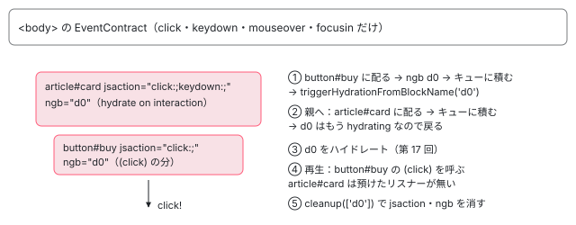

[目次](../README.md) › [@defer とインクリメンタルハイドレーションの内側](README.md) › 第 18 回 / 全 20 回

# hydrate on interaction のイベント：jsaction から塊のハイドレーションへ

> hydrate on interaction・hover の塊で、サーバーが付けた jsaction の属性から、ブラウザの EventContract がイベントを捕まえ、塊の id を見つけてハイドレーションを始め、ハイドレーションの後にそのイベントを本物のリスナーに渡し直すまで。event-replay の章の道との違い。

angular/angular · 読了 約 13 分 · 発展 · [サイトで読む（デモが動きます）](https://angular-deep-dive-cyan.vercel.app/chapter/defer-hydrate-events)

---

`hydrate on interaction` と `hydrate on hover` の塊は、ブラウザで IntersectionObserver やタイマーを使いません。サーバーが塊の要素に付けた `jsaction` 属性を手がかりに、JSAction の `EventContract`（`<body>` に置いたイベント委譲の受け口）がイベントを捕まえ、要素の `ngb` 属性から塊の番号を見つけてハイドレーションを始め、終わったあとで、そのイベントを本物のリスナーに渡し直します。この章では、その道を「どのイベントの種類が登録されるか」「どの要素が担当になるか」「いつ、だれに渡し直すか」の 3 つに分けて行で追い、Node で本当にハイドレートした記録で確かめます。

読む対象は `packages/core/src/hydration/event_replay.ts`・`core/src/event_delegation_utils.ts` と、`core/primitives/event-dispatch/src/` の `eventcontract.ts`・`action_resolver.ts`・`event_dispatcher.ts`・`dispatcher.ts`・`event_contract_defines.ts`、それに `defer/triggering.ts` の再生を呼ぶ行です。

> [!NOTE]
> **ポイント**
>
> **[event-replay の章](../platform/14-event-replay.md)との違い。**あちらは「JS が届く前に押されたクリックを、ハイドレーションが済んで安定したあとに 1 回だけ再生する」道で、再生が終わると契約（`EventContract`）を片付けます。この章の道は、インクリメンタルハイドレーションが有効なときに**契約を残し続け**、安定したあとに眠っている塊の中で起きたイベントも受けて、**そのイベントがきっかけでハイドレーションを始める**ところが違います。再生の仕組み（`__jsaction_fns` に預けたリスナー、`EventPhase.REPLAY`、泡立ちの真似）はあちらで読んだものをそのまま使います。

1. [1. 全体像](01-defer-overview.md)
2. [2. ɵɵdefer 命令](02-defer-instruction.md)
3. [3. 塊の記録](03-defer-details.md)
4. [4. 状態を描く](04-defer-render-state.md)
5. [5. minimum と after](05-defer-minimum-after.md)
6. [6. 依存を読み込む](06-defer-resource-loading.md)
7. [7. トリガーから描画まで](07-defer-trigger-flow.md)
8. [8. when](08-defer-when.md)
9. [9. idle と immediate](09-defer-idle-immediate.md)
10. [10. timer](10-defer-timer.md)
11. [11. interaction と hover](11-defer-dom-triggers.md)
12. [12. viewport](12-defer-viewport.md)
13. [13. prefetch](13-defer-prefetch.md)
14. [14. 入れ子・注入器・クエリ](14-defer-nested-di.md)
15. [15. サーバーでの @defer](15-defer-server.md)
16. [16. hydrate トリガー](16-defer-hydrate-triggers.md)
17. [17. 親から順にハイドレート](17-defer-hydration-queue.md)
18. **18. hydrate のイベント**（この章）
19. [19. テストを読む](19-defer-tests.md)
20. [20. issue と PR を読む](20-defer-issues.md)

## 0. 場面：サーバーが付けた 2 種類の jsaction

この章の記録のアプリです（6 節）。`@defer` の中のボタンと span には、ふつうのリスナーもあります。

📄 `記録のアプリのテンプレート（EvRoot）`

```
<main>
  @defer (hydrate on interaction) {
    <article id="card"><ev-card />
      <button id="buy" type="button" (click)="onClick($event)">買う</button>
    </article>
  }
  @defer (hydrate on hover) {
    <aside id="tip"><ev-tip />
      <span id="label" (mouseover)="onOver($event)">ヒント</span>
    </aside>
  }
</main>
```

サーバーで描いた HTML の、`jsaction` を持つ要素は次の 4 つでした（記録のスクリプトがサーバーの HTML から拾った実物です）。

📄 `記録：サーバーの HTML の [jsaction]`

```
article#card[ngb=d0] jsaction="click:;keydown:;"
button#buy[ngb=d0] jsaction="click:;"
aside#tip[ngb=d1] jsaction="mouseenter:;mouseover:;focusin:;"
span#label[ngb=d1] jsaction="mouseover:;"
```

- **塊の一番上の要素（`article#card`・`aside#tip`）**の `click:;keydown:;` と `mouseenter:;mouseover:;focusin:;` は hydrate トリガーの分です。`convertHydrateTriggersToJsAction` が interaction を click・keydown に、hover を mouseenter・mouseover・focusin に変え、塊の一番上の要素に付けます（[incremental-hydration の章](../platform/15-incremental-hydration.md)の 4 節）。
- **塊の中のリスナーのある要素（`button#buy`・`span#label`）**の `click:;` と `mouseover:;` は、ふつうのイベントの再生の分です（[event-replay の章](../platform/14-event-replay.md)の 2 節）。塊の中なので、こちらにも塊の番号の `ngb` が付きます。
- どちらも、要素の `ngb` が「この要素で起きたイベントは、どの塊を起こすか」の手がかりです。

HTML に入った契約の 1 行は次のとおりです。hover の 3 つが、そのまま第 3 引数（泡立つ種類として登録するもの）に入っています。

📄 `記録：サーバーの HTML の window.__jsaction_bootstrap(…)`

```
window.__jsaction_bootstrap(document.body,"ng",["click","keydown","mouseenter","mouseover","focusin"],[]);
```

このサイトでも、シリーズを 1 ページで読むページの章は `hydrate on viewport` の塊なので（incremental-hydration の 0 節）、まだハイドレートしていない章の中のボタンやリンクには `jsaction="click:;" ngb="dN"` が付きます。2026-11-02 に作った本番ビルド（scratchpad/build-prod/browser）を `grep` すると、`series/animations/index.html` には `jsaction="click:;" ngb="d19"` の要素が 137 個ありました。そのボタンを押すと、この章の道でその章がハイドレートされます。

## 1. 契約が登録するイベントの種類：mouseenter は登録されない

ハイドレーションのあと、アプリが安定すると、event-replay の章の 6 節の `initEventReplay` が本物の `EventContract` を作り、HTML の 1 行と同じ種類を `addEvent` で 1 つずつ登録します。

📄 `angular/packages/core/primitives/event-dispatch/src/eventcontract.ts` L152–185 （▶ の行: 153, 157–158, 161–162, 166, 168, 176–177, 180）

```ts
152 │   addEvent(eventType: string, prefixedEventType?: string, passive?: boolean) {
153 ▶     if (eventType in this.eventHandlers || !this.containerManager) {
154 │       return;
155 │     }
156 │ 
157 ▶     if (!EventContract.MOUSE_SPECIAL_SUPPORT && MOUSE_SPECIAL_EVENT_TYPES.indexOf(eventType) >= 0) {
158 ▶       return;
159 │     }
160 │ 
161 ▶     const eventHandler = (eventType: string, event: Event, container: Element) => {
162 ▶       this.handleEvent(eventType, event, container);
163 │     };
164 │ 
165 │     // Store the callback to allow us to replay events.
166 ▶     this.eventHandlers[eventType] = eventHandler;
167 │ 
168 ▶     const browserEventType = eventLib.getBrowserEventType(prefixedEventType || eventType);
169 │ 
170 │     if (browserEventType !== eventType) {
171 │       const eventTypes = this.browserEventTypeToExtraEventTypes[browserEventType] || [];
172 │       eventTypes.push(eventType);
173 │       this.browserEventTypeToExtraEventTypes[browserEventType] = eventTypes;
174 │     }
175 │ 
176 ▶     this.containerManager.addEventListener(
177 ▶       browserEventType,
178 │       (element: Element) => {
179 │         return (event: Event) => {
180 ▶           eventHandler(eventType, event, element);
181 │         };
182 │       },
183 │       passive,
184 │     );
185 │   }
```

📄 `angular/packages/core/primitives/event-dispatch/src/event_contract_defines.ts` L9–14 （▶ の行: 10, 13–14）

```ts
 9 │ /**
10 ▶  * @define Support for the non-bubbling mouseenter and mouseleave events.  This
11 │  * flag can be overridden in a build rule.
12 │  */
13 ▶ // g3-only export const MOUSE_SPECIAL_SUPPORT = goog.define('jsaction.EventContract.MOUSE_SPECIAL_SUPPORT', false,);
14 ▶ export const MOUSE_SPECIAL_SUPPORT = false; // 3p-only
```

1. **157〜159 行目：mouseenter と mouseleave は、何もせずに戻る**

   `MOUSE_SPECIAL_EVENT_TYPES` は mouseenter・mouseleave・pointerenter・pointerleave の 4 つです。`MOUSE_SPECIAL_SUPPORT` は 14 行目のとおり `false`（13 行目のコメントのとおり、Google の中のビルドだけで切り替えられる値）なので、Angular の配布物では mouseenter は登録されません。
2. **161〜166 行目：種類ごとの受け手を 1 つ作って控える**

   受け手は 162 行目で `handleEvent`（3 節）を呼ぶだけです。
3. **168・176〜184 行目：&lt;body&gt; に 1 つだけ addEventListener**

   要素ごとには付けません。180 行目で、どの入れ物（`<body>`）で受けたかも一緒に渡します。

記録では、契約に登録された種類は `click・keydown・mouseover・focusin` の 4 つで、HTML の 1 行にあった `mouseenter` がありません。だから hover の塊を起こすのは、実際には mouseover と focusin です。6 節の mouseenter だけを起こす場面では、何も起きませんでした（mouseenter は泡立たないので、JS が届く前の箱が `<body>` に付けた mouseenter のリスナーにも届きません）。

📄 `angular/packages/core/src/hydration/event_replay.ts` L184–189 （▶ の行: 184–185, 189）

```ts
184 ▶               if (isIncrementalHydrationEnabled(injector)) {
185 ▶                 // When incremental hydration is enabled, we cannot clean up the event
186 │                 // contract immediately because we're unaware if there are any deferred
187 │                 // blocks to hydrate. We can only schedule a contract cleanup when the
188 │                 // app is destroyed.
189 ▶                 appRef.onDestroy(() => eventContract.cleanUp());
```

📄 `angular/packages/core/src/event_delegation_utils.ts` L93–102 （▶ の行: 93–94, 97, 100）

```ts
 93 ▶ export interface EventContractDetails {
 94 ▶   instance?: EventContract;
 95 │ }
 96 │ 
 97 ▶ export const JSACTION_EVENT_CONTRACT = new InjectionToken<EventContractDetails>(
 98 │   typeof ngDevMode !== 'undefined' && ngDevMode ? 'EVENT_CONTRACT_DETAILS' : '',
 99 │   {
100 ▶     factory: () => ({}),
101 │   },
102 │ );
```

ふつうのイベントの再生では、再生が済むとこの契約を `cleanUp()` します。インクリメンタルハイドレーションが有効なら、184〜189 行目でアプリが壊れるときまで残します。契約は 97〜102 行目の `JSACTION_EVENT_CONTRACT`（中身は `{ instance }` の 1 つの欄だけ）に入っていて、塊がすべてハイドレートして登録簿が空になると、登録簿の `cleanup` がこの `instance` の `cleanUp()` を呼びます（[第 17 回](17-defer-hydration-queue.md)の 5 節）。

## 2. イベントが来たら：EventInfo にまとめ、担当の要素を探す

📄 `angular/packages/core/primitives/event-dispatch/src/eventcontract.ts` L108–125 （▶ の行: 112–113, 116–117, 120）

```ts
108 │   constructor(containerManager: EventContractContainerManager) {
109 │     this.containerManager = containerManager;
110 │   }
111 │ 
112 ▶   private handleEvent(eventType: string, event: Event, container: Element) {
113 ▶     const eventInfo = eventInfoLib.createEventInfoFromParameters(
114 │       /* eventType= */ eventType,
115 │       /* event= */ event,
116 ▶       /* targetElement= */ event.target as Element,
117 ▶       /* container= */ container,
118 │       /* timestamp= */ Date.now(),
119 │     );
120 ▶     this.handleEventInfo(eventInfo);
121 │   }
122 │ 
123 │   /**
124 │    * Handle an `EventInfo`.
125 │    */
```

113〜119 行目で、種類・イベント・`target`・入れ物・時刻を 1 つの `EventInfo` にまとめ、120 行目で配り役へ渡します（配り役がまだいなければ積んでおく形は event-replay の章の 6 節）。インクリメンタルハイドレーションで契約が残っている間は、安定したあとのイベントもここを通ります。

📄 `angular/packages/core/primitives/event-dispatch/src/action_resolver.ts` L230–241 （▶ の行: 230–231, 233–235）

```ts
230 ▶   private populateActionOnElement(actionElement: Element, eventInfo: eventInfoLib.EventInfo) {
231 ▶     const actionMap = this.parseActions(actionElement);
232 │ 
233 ▶     const actionName = actionMap[eventInfoLib.getEventType(eventInfo)];
234 ▶     if (actionName !== undefined) {
235 ▶       eventInfoLib.setAction(eventInfo, actionName, actionElement);
236 │     }
237 │ 
238 │     if (this.a11yClickSupport) {
239 │       this.populateClickOnlyAction!(actionElement, eventInfo, actionMap);
240 │     }
241 │   }
```

1. **target から親へ上り、jsaction のある要素を探す**

   配り役は `target` から親へ上り、要素ごとに 230 行目の `populateActionOnElement` を呼びます（上り方は event-replay の章の 7 節の 137〜149 行目）。
2. **233〜235 行目：処理名が空文字でも「担当あり」**

   231 行目で `jsaction` を読んだ表を引き、233 行目でこの種類の処理名を取ります。サーバーが書いた `click:;` の処理名は空文字 `''` ですが、234 行目は `!== undefined` なので、235 行目でこの要素が担当になります。hydrate トリガーの `click:;keydown:;` も、リスナーの `click:;` も、ここでは区別されません。

📄 `angular/packages/core/primitives/event-dispatch/src/event_dispatcher.ts` L140–149 （▶ の行: 142–144, 146）

```ts
140 │ function prepareEventForDispatch(eventInfoWrapper: EventInfoWrapper) {
141 │   const event = eventInfoWrapper.getEvent();
142 ▶   const currentTarget = eventInfoWrapper.getAction()?.element;
143 ▶   if (currentTarget) {
144 ▶     patchEventInstance(event, 'currentTarget', currentTarget, {
145 │       // `currentTarget` is going to get reassigned every dispatch.
146 ▶       configurable: true,
147 │     });
148 │   }
149 │ }
```

担当が決まると、配り役（`EventDispatcher`）は 142〜148 行目でイベントの `currentTarget` を担当の要素に貼り替えてから、Angular が渡した関数（event\_replay.ts の `invokeRegisteredReplayListeners`）を呼びます。146 行目の `configurable: true` は、泡立ちの真似で次の担当に進むたびに貼り替えるためです（event-replay の章の 7 節）。

## 3. ngb があれば、塊を起こしてイベントを積む

📄 `angular/packages/core/src/hydration/event_replay.ts` L280–286 （▶ の行: 281–285）

```ts
280 │   const blockName =
281 ▶     (currentTarget && currentTarget.getAttribute(DEFER_BLOCK_SSR_ID_ATTRIBUTE)) ?? '';
282 ▶   if (/d\d+/.test(blockName)) {
283 ▶     hydrateAndInvokeBlockListeners(blockName, injector, event, currentTarget!);
284 ▶   } else if (event.eventPhase === EventPhase.REPLAY) {
285 ▶     invokeListeners(event, currentTarget);
286 │   }
```

📄 `angular/packages/core/src/hydration/event_replay.ts` L295–297 （▶ の行: 295–297）

```ts
295 ▶   const queue = injector.get(EVENT_REPLAY_QUEUE);
296 ▶   queue.push({event, currentTarget});
297 ▶   triggerHydrationFromBlockName(injector, blockName, createReplayQueuedBlockEventsFn(queue));
```

1. **281〜283 行目：担当の要素の ngb が d0 のような番号なら、塊の道へ**

   ここが event-replay の章の道との分かれ目です。`ngb` が無ければ、再生（`EventPhase.REPLAY`）のイベントのときだけ 285 行目で預けたリスナーを呼び、安定したあとの生のイベントでは何もしません（本物のリスナーがもう付いているからです）。
2. **295〜296 行目：イベントと担当の要素を EVENT\_REPLAY\_QUEUE に積む**

   アプリに 1 つの配列です。この時点では塊の中身のコンポーネントがまだ無く、渡す先のリスナーも預けられていないので、イベントを取っておきます。
3. **297 行目：塊のハイドレーションを始める**

   `triggerHydrationFromBlockName`（[第 17 回](17-defer-hydration-queue.md)）に、3 つ目の引数として「積んだイベントを渡し直す関数」を付けて呼びます。親の塊が眠っていれば、親から順にハイドレートされます。

📄 `angular/packages/core/primitives/event-dispatch/src/action_resolver.ts` L104–121 （▶ の行: 112–116, 120）

```ts
104 │   resolveAction(eventInfo: eventInfoLib.EventInfo) {
105 │     if (eventInfoLib.getResolved(eventInfo)) {
106 │       return;
107 │     }
108 │     this.populateAction(eventInfo, eventInfoLib.getTargetElement(eventInfo));
109 │     eventInfoLib.setResolved(eventInfo, true);
110 │   }
111 │ 
112 ▶   resolveParentAction(eventInfo: eventInfoLib.EventInfo) {
113 ▶     const action = eventInfoLib.getAction(eventInfo);
114 ▶     const actionElement = action && eventInfoLib.getActionElement(action);
115 ▶     eventInfoLib.unsetAction(eventInfo);
116 ▶     const parentNode = actionElement && this.getParentNode(actionElement);
117 │     if (!parentNode) {
118 │       return;
119 │     }
120 ▶     this.populateAction(eventInfo, parentNode);
121 │   }
```

1 つの担当に配ったあと、配り役は泡立ちを真似て 112〜121 行目の `resolveParentAction` で、いまの担当の親から次の jsaction の要素を探します（ループは event-replay の章の 7 節）。だから `button#buy` の click は、`button#buy` と `article#card`（どちらも `ngb="d0"`）の 2 回、3 節の道を通ります。2 回目の `triggerHydrationFromBlockName` は、`d0` がもう `hydrating` にあるので何もせずに戻ります（[第 17 回](17-defer-hydration-queue.md)の 2 節）が、295〜296 行目の積む処理はその前なので、**キューには 2 つ積まれます**。記録の click の場面の 2 段目がこれです。

## 4. ハイドレーションのあと：ハイドレートした塊のイベントだけを渡す

📄 `angular/packages/core/src/defer/triggering.ts` L496–499 （▶ の行: 497–498）

```ts
496 │   // Replay any queued events, if any exist and the replay operation was requested.
497 ▶   if (replayQueuedEventsFn) {
498 ▶     replayQueuedEventsFn(hydrationQueue);
499 │   }
```

📄 `angular/packages/core/src/hydration/event_replay.ts` L304–310 （▶ の行: 304–308, 310）

```ts
304 ▶     for (let {event, currentTarget} of queue) {
305 ▶       const blockName = currentTarget.getAttribute(DEFER_BLOCK_SSR_ID_ATTRIBUTE)!;
306 ▶       if (hydrated.has(blockName)) {
307 ▶         invokeListeners(event, currentTarget);
308 ▶       } else {
309 │         // requeue events that weren't yet hydrated
310 ▶         newQueue.push({event, currentTarget});
```

1. **497〜498 行目：列の全部が済み、PendingTasks を戻したあとに呼ぶ**

   渡すのはハイドレートした塊の番号の列（`hydrationQueue`）です。このあとで、jsaction と `ngb` の片付けが走ります（[第 17 回](17-defer-hydration-queue.md)の 5 節）。
2. **304〜307 行目：積んだイベントのうち、ハイドレートした塊のものだけを渡す**

   305 行目で担当の要素の `ngb` を読み直し、306 行目でその塊がいま済んだ列にあれば、307 行目の `invokeListeners`（event-replay の章の 7 節）で、ハイドレーションの間に要素に預けられたリスナーを呼びます。`button#buy` には `(click)` が預けられているので呼ばれ、`article#card` には預けられたリスナーが無いので何もしません。
3. **308〜310 行目：ほかの塊のイベントは積み直す**

   別の塊がまだ眠っていれば、そのイベントはキューに残り、その塊のハイドレーションが済んだときに渡されます。



*記録の click の場面。button#buy の click が泡立ちの真似で 2 回 3 節の道を通り、ハイドレーションのあとで (click) のある button#buy の分だけが渡し直される。*

## 5. 渡し直されたイベントの中身

- **JS が届く前のイベント**は、契約の箱からまとめて再生されるので、配る前に `eventPhase` が `EventPhase.REPLAY`（101）に、`target` が元の要素に貼り替えられています（event-replay の章の 7 節）。記録の early-click の場面では、リスナーが `eventPhase = 101` を受け取りました。
- **安定したあとの生のイベント**には、その貼り替えがありません。ハイドレーションは非同期なので、リスナーが呼ばれるのはブラウザがそのイベントを配り終えたあとです。`preventDefault()` はもう効きません（`<a>` のクリックは、配る前に契約が既定の動きを止めます。下の 7 節）。記録の click の場面では `eventPhase = 2` でしたが、これは domino の Event が配り終えたあとに残す値で、ブラウザでの値ではありません。
- **`currentTarget`** は、2 節の 144 行目で配るたびに貼り替えた値のうち、最後のものが残ります。記録の early-click の場面では、`button#buy` の `(click)` が受け取った `currentTarget` は `article#card`（泡立ちの真似で最後に配った担当）でした。click の場面の `null` は、domino が配り終えたときに書き戻した値です。

## 6. DEMO：イベントを起こしてから渡し直されるまで（記録の再生）

> **🧪 DEMO — jsaction・契約の種類・EVENT\_REPLAY\_QUEUE・登録簿（記録の再生）**
>
> これは記録です。本物の @angular/core 22.1.6（開発モード・JIT）を Node で、domino の DOM の上で動かした結果です。0 節のテンプレートを platform-server でサーバーとして描き、その HTML を domino の DOM に入れて、ブラウザのプラットフォームとしてハイドレートしました。domino は `<script>` を実行しないので、契約のスクリプトと `window.__jsaction_bootstrap(…)` の 1 行は記録のスクリプトが `eval` で実行しています（環境の代わりで、Angular のロジックではありません）。イベントは `CustomEvent` を `dispatchEvent` したもので、domino の Event の `eventPhase` と `currentTarget` の値はブラウザと同じではありません（5 節）。最後の場面だけは、`hydrate when ready()` の塊を使います。
>
> 場面を選んで、段のボタンを押してください。
>
> ▶ [このデモはサイトで動かせます](https://angular-deep-dive-cyan.vercel.app/chapter/defer-hydrate-events)

記録から読み取れることです。

1. **どの場面でも、契約の種類に mouseenter が無い**

   1 節の 157 行目のとおりです。HTML の 1 行には 5 つ書かれていても、契約が受けるのは 4 つです。
2. **click：キューに 2 つ積まれ、ハイドレーションのあとで (click) が 1 回だけ呼ばれる**

   2 段目のキューの `button#buy` と `article#card` が 3 節の泡立ちの真似の 2 回分です。3 段目で `(click)` が 1 回呼ばれ、`cleanup(["d0"])` のあと、`d0` の要素から jsaction が消えています。hover の塊（`d1`）はそのままです。
3. **JSACTION\_BLOCK\_ELEMENT\_MAP に button#buy が無い**

   起動の直後の表には、塊の一番上の要素（`article#card`・`aside#tip`）しかありません。この表は hover か interaction のイベント名の並びを含む jsaction の要素だけを集めるからです（`gatherDeferBlocksByJSActionAttribute`。incremental-hydration の 6 節）。`button#buy` は、塊がハイドレートしてリスナーが預けられるときに表に入り（event-replay の章の 5 節の 120 行目）、そのあとの `cleanup` で jsaction を外されます。
4. **early-click：JS が届く前のクリックでも、同じ道で塊が起きる**

   箱に入った click が、安定したときの再生で 3 節の道に入り、`d0` がハイドレートされてから `eventPhase = 101` でリスナーに届きました。起動の直後の段にはもう `d0` がありません（この場面では、登録簿の包みをかぶせる前にハイドレーションが済んだので、`hydrating.set` の記録は残っていません）。
5. **mouseover：hover の塊は mouseover で起きる**

   `span#label` の mouseover が `span#label` と `aside#tip` の 2 回積まれ、ハイドレーションのあとで `(mouseover)` が呼ばれました。mouseenter だけの場面では、キューも `hydrating` も空のままでした。
6. **inflight：ハイドレーションの途中で押した click は、渡し直されない**

   `hydrate when` でハイドレーションが始まった直後に押すと、キューには積まれます（2 段目）が、3 節の 297 行目から呼んだ `triggerHydrationFromBlockName` は、`d0` がもう `hydrating` にあるので、渡し直す関数ごと何もせずに戻ります（[第 17 回](17-defer-hydration-queue.md)の 2 節）。最初にハイドレーションを始めた `hydrate when` は渡し直す関数を持っていないので、4 節の 497 行目が呼ばれません。3 段目で、`(click)` は 1 度も呼ばれず、キューにイベントが残ったまま、jsaction だけが消えています。この場面では塊が 1 つだけなので、登録簿が空になり、契約も `cleanUp()` されています（契約の種類が空）。これは開いている #71296（2026-10-11）が報告している形です。

📄 `scratchpad の記録スクリプト（events.ts、共通の build.mjs で束ねて node で実行。共通の harness.ts は第 1 回に全文）`

```
// 第 18 回 defer-hydrate-events の記録。
// hydrate on interaction と hydrate on hover の塊をサーバーで描き、その HTML を domino の DOM に入れて
// ブラウザのプラットフォームでハイドレートする。サーバーが付けた jsaction、JSAction の契約が登録したイベントの種類、
// 押したときに EVENT_REPLAY_QUEUE に積まれたもの、ハイドレーションの後にリスナーへ渡し直された様子を記録する。
// 使い方: node ../_shared/build.mjs events.ts events.mjs && node events.mjs events.json
// JIT の compiler を先に読む（共通の harness と同じ）。
import '@angular/compiler';
import {
  Component, VERSION, signal, ɵDEHYDRATED_BLOCK_REGISTRY as DEHYDRATED_BLOCK_REGISTRY,
  ɵEVENT_REPLAY_QUEUE as EVENT_REPLAY_QUEUE, ɵJSACTION_EVENT_CONTRACT as JSACTION_EVENT_CONTRACT,
  ɵJSACTION_BLOCK_ELEMENT_MAP as JSACTION_BLOCK_ELEMENT_MAP,
} from '@angular/core';
import { provideClientHydration, withIncrementalHydration } from '@angular/platform-browser';
import { readFileSync } from 'node:fs';
import { installDom, bootBrowser, renderServer, tick, writeJson } from '../_shared/harness';

process.on('unhandledRejection', (reason) => note('unhandledRejection', `reason = ${String(reason)}`));
const OUT = process.argv[2] ?? new URL('./events.json', import.meta.url).pathname;
const SITE = '~/angular-research/angular-deep-dive';

let log: { seq: number; kind: string; detail: string }[] = [];
let seq = 0;
const note = (kind: string, detail: string) => log.push({ seq: ++seq, kind, detail });
const tag = (el: Element | null | undefined) =>
  !el ? String(el) : `${el.nodeName.toLowerCase()}${el.id ? '#' + el.id : ''}${el.getAttribute?.('ngb') ? `[ngb=${el.getAttribute('ngb')}]` : ''}`;

@Component({ selector: 'ev-card', template: '<span>card</span>' })
class EvCard { constructor() { note('constructor', 'EvCard（interaction の塊の中身）'); } }
@Component({ selector: 'ev-tip', template: '<span>tip</span>' })
class EvTip { constructor() { note('constructor', 'EvTip（hover の塊の中身）'); } }

const TEMPLATE = `<main>
  @defer (hydrate on interaction) {
    <article id="card"><ev-card />
      <button id="buy" type="button" (click)="onClick($event)">買う</button>
    </article>
  }
  @defer (hydrate on hover) {
    <aside id="tip"><ev-tip />
      <span id="label" (mouseover)="onOver($event)">ヒント</span>
    </aside>
  }
</main>`;

@Component({ selector: 'app-root', imports: [EvCard, EvTip], template: TEMPLATE })
class EvRoot {
  onClick(e: Event) {
    note('listener', `(click) が呼ばれた: eventPhase = ${e.eventPhase}, target = ${tag(e.target as Element)}, currentTarget = ${tag(e.currentTarget as Element)}`);
  }
  onOver(e: Event) {
    note('listener', `(mouseover) が呼ばれた: eventPhase = ${e.eventPhase}, target = ${tag(e.target as Element)}`);
  }
}
// #71296 の形: hydrate when で始まったハイドレーションの途中に、同じ塊の中のボタンを押す。
const TEMPLATE_WHEN = `<main>
  @defer (hydrate when ready()) {
    <article id="card"><ev-card />
      <button id="buy" type="button" (click)="onClick($event)">買う</button>
    </article>
  }
</main>`;
@Component({ selector: 'app-root', imports: [EvCard], template: TEMPLATE_WHEN })
class EvRootWhen extends EvRoot { ready = signal(false); }

const ALL = [EvRoot, EvRootWhen, EvCard, EvTip];
const DOC = '<html><head></head><body><script type="text/javascript" id="ng-event-dispatch-contract"></script><app-root></app-root></body></html>';

function jsactionElements(doc: Document) {
  return Array.from(doc.querySelectorAll('[jsaction]')).map((el) => `${tag(el)} jsaction="${el.getAttribute('jsaction')}"`);
}

/** early: ブートストラップの前（JS がまだ届いていないとき）にイベントを起こすか */
async function scenario(id: string, title: string, fire: (doc: Document, app?: any) => string, early: boolean, Root: typeof EvRoot = EvRoot) {
  log = []; seq = 0;
  for (const t of ALL) (t as any).ɵcmp.tView = null;
  (globalThis as any).ngServerMode = true;
  const serverHydration = provideClientHydration(withIncrementalHydration());
  note('phase', 'サーバーで描画する（renderServer）');
  const html = await renderServer(Root, { providers: [serverHydration], html: DOC });
  (globalThis as any).ngServerMode = undefined;
  for (const t of ALL) (t as any).ɵcmp.tView = null;
  const hydration = provideClientHydration(withIncrementalHydration());
  const bootstrapLine = /window\.__jsaction_bootstrap\([^<]*\);/.exec(html)?.[0] ?? null;

  // ブラウザの側。本物のブラウザなら HTML の <script> が実行されるところを eval で代わりにする（domino はスクリプトを実行しない）。
  const doc = installDom(html);
  const serverJsaction = jsactionElements(doc);
  (0, eval)(readFileSync(`${SITE}/node_modules/@angular/core/event-dispatch-contract.min.js`, 'utf8'));
  if (bootstrapLine) (0, eval)(bootstrapLine);
  const g = globalThis as any;
  const early0 = g._ejsas?.ng ? { et: [...g._ejsas.ng.et], etc: [...g._ejsas.ng.etc] } : null;
  const steps: any[] = [];
  let earlyQueued: string[] | null = null;
  if (early) {
    const what = fire(doc);
    note('test', what + '（Angular の JS はまだ動いていない）');
    earlyQueued = (g._ejsas?.ng?.q ?? []).map((e: any) => `${e.eventType} on ${tag(e.targetElement)}`);
  }
  note('phase', 'ブラウザで起動する（bootstrapApplication）');
  const { appRef, ref } = await bootBrowser(Root, { providers: [hydration] });
  const inj = appRef.injector;
  const registry: any = inj.get(DEHYDRATED_BLOCK_REGISTRY);
  const queue: any[] = inj.get(EVENT_REPLAY_QUEUE);
  const contract = inj.get(JSACTION_EVENT_CONTRACT);
  const blockMap: Map<string, Set<Element>> = inj.get(JSACTION_BLOCK_ELEMENT_MAP);
  const origCleanup = registry.cleanup.bind(registry);
  registry.cleanup = (ids: string[]) => { note('registry.cleanup', JSON.stringify(ids)); return origCleanup(ids); };
  const origSet = registry.hydrating.set.bind(registry.hydrating);
  registry.hydrating.set = (k: string, v: any) => { note('hydrating.set', k); return origSet(k, v); };

  const snap = (sid: string, stitle: string, action: string) => {
    steps.push({
      id: sid, title: stitle, action,
      registry: [...registry.registry.keys()],
      hydrating: [...registry.hydrating.keys()],
      queue: queue.map((q) => `${q.event.type} → currentTarget ${tag(q.currentTarget)}`),
      contractEvents: contract.instance ? Object.keys((contract.instance as any).eventHandlers) : null,
      blockMap: [...blockMap.entries()].map(([k, set]) => `'${k}' → ${[...set].map(tag).join(', ')}`),
      jsaction: jsactionElements(doc),
      ejsas: g._ejsas?.ng === undefined ? 'undefined' : 'あり',
      log: log.splice(0),
    });
  };
  snap('boot', 'ハイドレーションの直後（whenStable の後）', 'bootstrapApplication して whenStable を待った');
  if (!early) {
    const what = fire(doc, { appRef, ref });
    note('test', what);
    snap('fired', 'イベントを起こした直後（同期）', what);
  }
  await tick(0);
  await tick(50); await appRef.whenStable();
  snap('stable', '安定まで待った', 'await setTimeout(0) → setTimeout(50) → appRef.whenStable()');
  appRef.destroy();
  return { id, title, early, bootstrapLine, early0, earlyQueued, serverJsaction, steps };
}

const bubble = (type: string) => new (globalThis as any).CustomEvent(type, { bubbles: true });
const scenarios = [];
scenarios.push(await scenario('click', 'interaction の塊のボタンを押す', (d) => {
  d.getElementById('buy')!.dispatchEvent(bubble('click'));
  return "button#buy で click（bubbles: true）";
}, false));
scenarios.push(await scenario('early-click', 'JS が届く前にボタンを押す', (d) => {
  d.getElementById('buy')!.dispatchEvent(bubble('click'));
  return "button#buy で click（bubbles: true）";
}, true));
scenarios.push(await scenario('mouseenter', 'hover の塊に mouseenter だけを起こす', (d) => {
  d.getElementById('tip')!.dispatchEvent(new (globalThis as any).CustomEvent('mouseenter', { bubbles: false }));
  return 'aside#tip で mouseenter（bubbles: false）';
}, false));
scenarios.push(await scenario('mouseover', 'hover の塊の中で mouseover を起こす', (d) => {
  d.getElementById('label')!.dispatchEvent(bubble('mouseover'));
  return 'span#label で mouseover（bubbles: true）';
}, false));
scenarios.push(await scenario('inflight', 'hydrate when で始まったハイドレーションの途中で押す（#71296 の形）', (d, app) => {
  (app.ref.instance as EvRootWhen).ready.set(true);
  app.appRef.tick(); // hydrate when の式が評価され、ハイドレーションが始まる（同期）
  d.getElementById('buy')!.dispatchEvent(bubble('click'));
  return "ready.set(true) → appRef.tick() → すぐに button#buy で click（bubbles: true）";
}, false, EvRootWhen));
await writeJson(OUT, { core: VERSION.full, template: TEMPLATE, templateWhen: TEMPLATE_WHEN, scenarios });
process.exit(0);

```

共通の部品は[第 1 回](01-defer-overview.md)に全文があります。記録の 2 つ目のスクリプトの書き方（サーバーで描いてから同じ Node でハイドレートする）は[第 17 回](17-defer-hydration-queue.md)と同じです。

## 7. 契約が残ることの副作用：&lt;a&gt; の既定の動きを止める行

📄 `angular/packages/core/primitives/event-dispatch/src/dispatcher.ts` L123–140 （▶ の行: 127–129, 131, 135–138）

```ts
123 │ /**
124 │  * Returns true if the default action of this event should be prevented before
125 │  * this event is dispatched.
126 │  */
127 ▶ function shouldPreventDefaultBeforeDispatching(
128 ▶   actionElement: Element,
129 ▶   eventInfoWrapper: EventInfoWrapper,
130 │ ): boolean {
131 ▶   // Prevent browser from following <a> node links if a jsaction is present
132 │   // and we are dispatching the action now. Note that the targetElement may be
133 │   // a child of an anchor that has a jsaction attached. For that reason, we
134 │   // need to check the actionElement rather than the targetElement.
135 ▶   return (
136 ▶     actionElement.tagName === 'A' &&
137 ▶     (eventInfoWrapper.getEventType() === EventType.CLICK ||
138 ▶       eventInfoWrapper.getEventType() === EventType.CLICKMOD)
139 │   );
140 │ }
```

配り役（`Dispatcher.dispatch`。event-replay の章の 7 節）は、担当の要素が `<a>` で種類が click なら、配る前にこの関数で `preventDefault()` します。131〜134 行目のコメントのとおり、リンクの遷移を止めて、JS の処理に任せるためです。契約はインクリメンタルハイドレーションの間ずっと残るので、ハイドレートする前の塊の中の `routerLink` を押すと、ブラウザの遷移が止まり、ハイドレーションのあとで渡し直された `(click)` がルーターの遷移をします（下の spec の Router の it）。一方で、開いている #71545（2026-10-22）は、早いクリックで要素に残った jsaction の解析結果の控え（要素の `__jsaction` のプロパティ。`action_resolver.ts` の `parseActions` が書く）が、jsaction の属性を外したあとも残り、`target="_blank"` のリンクが押せなくなると報告しています。`removeListeners`（event\_delegation\_utils.ts。event-replay の章の 8 節）が消すのは属性と `__jsaction_fns` だけで、`__jsaction` は消しません。

## ここまでの呼び出し

- `convertHydrateTriggersToJsAction` → `setJSActionAttributes` — hydration/utils.ts 578・event\_delegation\_utils.ts 25 — *サーバー。incremental-hydration の 4 節*
- `initEventReplay` → `EventContract.addEvent(type)` — event\_replay.ts 204・eventcontract.ts 152 — *安定したとき。mouseenter は 157 行目で戻る*
- 👤 `ユーザーの click / mouseover / focusin` — &lt;body&gt; のリスナー
  - `EventContract.handleEvent` → `handleEventInfo` — eventcontract.ts 112・126
    - `Dispatcher.dispatch` → `ActionResolver.resolveAction` → `populateActionOnElement` — dispatcher.ts 78・action\_resolver.ts 104・230 — *処理名が '' でも担当*
    - `EventDispatcher.dispatchToDelegate` → `prepareEventForDispatch` — event\_dispatcher.ts 82・140 — *currentTarget を貼り替え*
      - `invokeRegisteredReplayListeners(injector, event, currentTarget)` — event\_replay.ts 275 — *ngb があれば*
        - `hydrateAndInvokeBlockListeners` → `EVENT_REPLAY_QUEUE.push` → `triggerHydrationFromBlockName(…, replayFn)` — event\_replay.ts 289・296・297
    - `ActionResolver.resolveParentAction` — action\_resolver.ts 112 — *泡立ちの真似。次の担当でもう 1 回積む*
  - `triggerHydrationForBlockQueue` — defer/triggering.ts 439 — *第 17 回*
    - `replayQueuedEventsFn(hydrationQueue)` → `invokeListeners(event, currentTarget)` — triggering.ts 497・event\_replay.ts 307
    - `cleanupHydratedDeferBlocks` → `removeListenersFromBlocks` — hydration/cleanup.ts 152・event\_delegation\_utils.ts 71 — *jsaction・ngb を消す*

## テストと直し方

### spec と describe

| spec | describe / it | この章のどこ |
| --- | --- | --- |
| packages/platform-server/test/incremental\_hydration\_spec.ts | describe `triggers > hydrate on interaction`（818 行目）の it `click`（819 行目）・`keydown`（884 行目）、`triggers > hydrate on hover`（953 行目）の it `mouseover`（954 行目）・`focusin`（1026 行目） | 0〜4 節 |
| 同じ | describe `Router`（2944 行目）の it `should trigger event replay after next render`（2945 行目） | 3〜4 節・7 節 |
| packages/platform-server/test/event\_replay\_spec.ts | ふつうのイベントの再生の spec（[event-replay の章](../platform/14-event-replay.md)） | 2 節の前半 |

📄 `angular/packages/platform-server/test/incremental_hydration_spec.ts` L868–881 （▶ の行: 870, 875–878, 881）

```ts
868 │           const appHostNode = compRef.location.nativeElement;
869 │ 
870 ▶           expect(appHostNode.outerHTML).toContain('<article jsaction="click:;keydown:;"');
871 │ 
872 │           // Emit an event inside of a defer block, which should result
873 │           // in triggering the defer block (start loading deps, etc) and
874 │           // subsequent hydration.
875 ▶           const article = doc.getElementsByTagName('article')![0];
876 ▶           const clickEvent = new CustomEvent('click', {bubbles: true});
877 ▶           article.dispatchEvent(clickEvent);
878 ▶           await allPendingDynamicImports();
879 │ 
880 │           appRef.tick();
881 ▶           expect(appHostNode.outerHTML).not.toContain('<div jsaction="click:;keydown:;"');
```

📄 `angular/packages/platform-server/test/incremental_hydration_spec.ts` L1014–1023 （▶ の行: 1014–1016, 1021–1022）

```ts
1014 ▶           const article = doc.getElementsByTagName('article')![0];
1015 ▶           const hoverEvent = new CustomEvent('mouseover', {bubbles: true});
1016 ▶           article.dispatchEvent(hoverEvent);
1017 │           await allPendingDynamicImports();
1018 │ 
1019 │           appRef.tick();
1020 │ 
1021 ▶           expect(appHostNode.outerHTML).not.toContain(
1022 ▶             '<div jsaction="mouseenter:;mouseover:;focusin:;"',
1023 │           );
```

click と mouseover の it です。870 行目でハイドレーションの前に `article` に jsaction があることを確かめ、875〜877 行目で `article` にイベントを送ります。ところが、ハイドレーションの後の 881 行目と 1021〜1023 行目が「無いこと」を確かめているのは `<div jsaction=…` で、テンプレートの要素は `<article>` です。**この 2 つの `expect` は、ハイドレーションが起きても起きなくても通ります**。テンプレートの `span` にある `(click)="fnB()"` が渡し直されたかも確かめていません。この道を spec で確かめるなら、ハイドレーションの後に `<article jsaction=` が無いことと、`value()` が `'end'` になったことを見る形にします。

📄 `angular/packages/platform-server/test/incremental_hydration_spec.ts` L3038–3054 （▶ の行: 3043–3046, 3052, 3054）

```ts
3038 │       const compRef = getComponentRef<SimpleComponent>(appRef);
3039 │       await appRef.whenStable();
3040 │       const appHostNode = compRef.location.nativeElement;
3041 │       const location = compRef.instance.location;
3042 │ 
3043 ▶       const routeLink = doc.getElementById('route-link')!;
3044 ▶       routeLink.click();
3045 ▶       await appRef.whenStable();
3046 ▶       await allPendingDynamicImports();
3047 │       appRef.tick();
3048 │ 
3049 │       await allPendingDynamicImports();
3050 │       await appRef.whenStable();
3051 │ 
3052 ▶       expect(location.path()).toBe('/other/thing/stuff');
3053 │ 
3054 ▶       expect(appHostNode.outerHTML).toContain('<p>OtherCmp content</p>');
```

hover の塊の中の `routerLink` を `click()` する it です。塊のトリガーは hover ですが、`<a>` には `routerLink` の click のリスナーがあるので、jsaction は `click:;`・`ngb` 付きです。3044 行目の click で 3 節の道に入り、親から順にハイドレートしたあと、渡し直された click でルーターが遷移したことを 3052 行目で確かめています。

### 手元で走らせた結果

📄 `ターミナル（../angular で）`

```
cd ~/angular-research/angular
pnpm bazel test //packages/platform-server/test:test \
  '--test_arg=--filter=hydrate on interaction|hydrate on hover' \
  --nocache_test_results --test_output=all
```

📄 `出力（2026-11-06 に実行。抜粋。ログは scratchpad/defer-logs/e-events.log）`

```
Ran 4 of 399 specs
4 specs, 0 failures
INFO: Elapsed time: 1.508s
//packages/platform-server/test:test   PASSED in 1.3s
```

- 絞り込みの正規表現は it の名前全体に当たるので、`hydrate on interaction|hydrate on hover` で 818 行目と 953 行目の describe の it 4 件が走りました。
- 記録の inflight の場面（ハイドレーションの途中のクリック）と、mouseenter だけでは起きないことを確かめる it はありません。

### 直すとしたら

- ハイドレーションの途中のクリック（#71296）を直すなら、`triggering.ts` の `triggerHydrationFromBlockName` の重複よけ（[第 17 回](17-defer-hydration-queue.md)の 2 節）で、渡された `replayQueuedEventsFn` を捨てずに、進行中のハイドレーションの Promise の後で呼ぶ、という形になります。issue の本文はこの 2 つの案を書いています。この issue に付いた PR #71301 は、マージされずに閉じられています（2026-10-11）。spec は incremental\_hydration\_spec.ts の `hydrate on interaction` の describe に、記録の inflight と同じ順（`when` を真にして `appRef.tick()` → すぐに click）で足せます。
- 早いクリックの控え（#71545）を直すなら、`event_delegation_utils.ts` の `removeListeners` です。PR #71550 はマージされずに閉じられています（2026-10-22）。
- 8576f161ae4 より新しい main では、8d8859cb211（2026-09-01、fix(core): don't use plain objects as maps for jsaction data）が、2 節の 231 行目で引く表を `Object.create(null)` にしています。`toString` のような `Object.prototype` の名前のイベントが、234 行目の `!== undefined` を通ってしまうのを防ぐ直しです（`git show` で読むと action\_resolver.ts と cache.ts の 2 ファイルだけで、失敗する spec は 1 つ前の 5cb3ed2958a（event-dispatch の test/dispatcher\_test.ts）で先に足されています）。3a0835b3328（2026-09-22）は、同じ `APP_ID` のアプリが 2 つあるときに `initEventReplay` が落ちないようにしています。
- 3 節の `EVENT_REPLAY_QUEUE` は、30e9c62bdfb（2026-01-07、fix(core): fix memory leak with event replay、#59261）で、モジュールの変数（`blockEventQueue`）からアプリごとの注入トークンに移りました。`git show` で読むと、event\_replay.ts の 295〜297 行目と 300〜316 行目の形はこの commit で入り、event\_replay\_spec.ts に 146 行の it が足されています。
- 本家に PR を出すことは勧めません。issue を読むときは、記録と同じように、契約の種類・キュー・`hydrating` を並べて、どの行で止まったかを確かめます（[第 20 回](20-defer-issues.md)）。

## 聞かれそうな質問

**Q. `hydrate on hover` は mouseenter で起きますか？**

起きません。サーバーは mouseenter も jsaction と契約の 1 行に書きますが、eventcontract.ts の 157〜159 行目で、`MOUSE_SPECIAL_SUPPORT`（event\_contract\_defines.ts の 14 行目で `false`）のときは mouseenter を登録しないからです。実際に塊を起こすのは mouseover と focusin です。記録でも、mouseenter だけでは何も起きませんでした。

**Q. サーバーが書く jsaction の処理名が空（`click:;`）なのに、なぜ担当として見つかるのですか？**

action\_resolver.ts の 234 行目が `actionName !== undefined` で判定するからです。空文字は `undefined` ではないので、235 行目でその要素が担当になります。Angular は処理名を使わず、要素の `ngb`（event\_replay.ts の 281 行目）と、要素に預けたリスナーで決めます。

**Q. 眠っている塊の中のボタンを押すと、そのクリックはどうなりますか？**

event\_replay.ts の 295〜296 行目で `EVENT_REPLAY_QUEUE` に積まれ、297 行目でその塊（と眠っている親）のハイドレーションが始まります。済むと triggering.ts の 497 行目から渡し直す関数が呼ばれ、event\_replay.ts の 306〜307 行目で、ハイドレートした塊のイベントだけが、ハイドレーションの間に預けられた `(click)` に渡されます。

**Q. アプリが安定したあとも、インクリメンタルハイドレーションでは JSAction の契約が残るのはなぜですか？**

まだ眠っている塊の中のイベントを受けるためです。event\_replay.ts の 184〜189 行目で、インクリメンタルハイドレーションが有効ならアプリが壊れるときまで契約を残します。塊が全部ハイドレートして登録簿が空になると、登録簿の `cleanup` が契約の `cleanUp()` を呼びます（第 17 回の 5 節）。

**Q. ハイドレーションが始まった直後に押したクリックが無視されることはありますか？**

あります。ハイドレーションが viewport・idle・timer・`when` のように渡し直す関数を持たないトリガーで始まっていると、あとから来たクリックの `triggerHydrationFromBlockName` は、その塊がもう `hydrating` にあるという重複よけ（第 17 回の 2 節）で関数ごと戻るので、キューに積まれたクリックは渡されません。記録の inflight の場面で確かめた形で、#71296 として開いています。

## 読み終えて

- hydrate on interaction・hover の塊は、サーバーが付けた jsaction と `ngb` を、安定したあとも残る JSAction の契約が見て起こします。
- 契約が受ける種類は click・keydown・mouseover・focusin です。mouseenter は登録されません。
- 担当の要素の `ngb` が塊の番号なら、イベントをキューに積んでから塊のハイドレーションを始め、済んだら、その塊のイベントだけを預けたリスナーに渡します。泡立ちの真似で、1 つのクリックが複数回積まれます。
- ハイドレーションの途中で来たイベントは渡し直されないことがあります（#71296）。
- incremental\_hydration\_spec.ts の click・mouseover の it は、ハイドレーション後の確かめが別の要素（`div`）を見ていて、この道を強くは確かめていません。

---

← 前: [塊のハイドレーション：親から順に目を覚ます](17-defer-hydration-queue.md)  
次: [@defer のテストを読む：defer\_spec と incremental\_hydration\_spec](19-defer-tests.md) →
