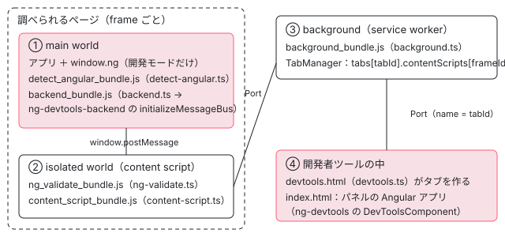

[目次](../README.md) › [Angular DevTools の内側](README.md) › 第 1 回 / 全 20 回

# DevTools の全体像：ページ・content script・background・パネル

> devtools/projects の分担（shell-browser・protocol・ng-devtools-backend・ng-devtools・shared-utils・demo のアプリ）と、拡張が動く 4 つの場所（ページ・content script・background・DevTools のパネル）。バックエンドが頼る core の窓口 window.ng と、開発モードでだけそれが置かれる理由。各章へのリンク。

angular/angular · 読了 約 12 分 · 基礎 · [サイトで読む（デモが動きます）](https://angular-deep-dive-cyan.vercel.app/chapter/devtools-overview)

---

Angular DevTools は、Chrome（と Firefox）の開発者ツールに「Angular」のタブを足す拡張です。ところが、そのタブに出るコンポーネントの木やプロパティは、タブの中で計算されているのではありません。**調べられるページの中に差し込まれた「バックエンド」が `window.ng` の関数を呼んで集め、メッセージにして何段も中継して届けています。** この章では、`devtools/projects` の 6 つの project の分担と、拡張が動く 4 つの場所、バックエンドが頼る core の窓口 `window.ng` を、manifest とソースの行で 1 枚の地図にします。

読む対象は `devtools/projects/shell-browser/src/manifest/manifest.chrome.json`・`shell-browser/src/devtools.ts`・`ng-devtools-backend/src/lib/index.ts`・`client-event-subscribers.ts`（前半）・ `packages/core/src/render3/util/global_utils.ts`・開発用の殻 `devtools/src` です。

1. **1. 全体像**（この章）
2. [2. Angular を見つける](02-devtools-detect.md)
3. [3. メッセージの道](03-devtools-messaging.md)
4. [4. プロトコル](04-devtools-protocol.md)
5. [5. コンポーネントの木](05-devtools-component-tree.md)
6. [6. 制御フローの塊](06-devtools-control-flow.md)
7. [7. 同じノードを見分ける](07-devtools-identity.md)
8. [8. パネルの木](08-devtools-forest-ui.md)
9. [9. プロパティの直列化](09-devtools-state-serializer.md)
10. [10. 入れ子を開く](10-devtools-property-resolver.md)
11. [11. 値を書き換える](11-devtools-property-mutation.md)
12. [12. 選ぶ・光らせる](12-devtools-inspector-highlight.md)
13. [13. プロファイラーの記録](13-devtools-profiler-capture.md)
14. [14. 記録を描く](14-devtools-profiler-formatters.md)
15. [15. 変更検知を見張る](15-devtools-cd-analyzer.md)
16. [16. 注入器の木](16-devtools-injector-tree.md)
17. [17. signal のグラフ](17-devtools-signal-graph.md)
18. [18. ルーター・TransferState](18-devtools-router-transfer.md)
19. [19. テストとビルド](19-devtools-test-build.md)
20. [20. issue と PR を読む](20-devtools-issues.md)

## 1. devtools/projects の分担

DevTools のソースは angular/angular の中の `devtools/` にあります（別のリポジトリではありません）。`devtools/projects` の下の 6 つの project を、.ts の行数（`*.spec.ts` と `*_spec.ts` を除く。2026-11-05、22.2.0-next.7 の 8576f161ae4）で並べます。役目は各 project の入口のファイルと README を読んで書きました。

| project | 行数 | どこで動くか | 役目（主なファイル） |
| --- | --- | --- | --- |
| ng-devtools | 13418 | DevTools のパネル | パネルの画面そのもの。`DevToolsComponent`（`ng-devtools` という selector）、タブ（Components・Profiler・Injector Tree・Router Tree・Transfer State）、`FrameManager` |
| ng-devtools-backend | 6884 | 調べられるページの中 | `window.ng` を呼んで木・プロパティ・プロファイル・注入器・signal のグラフを集める。入口は `initializeMessageBus` |
| shell-browser | 1726 | ブラウザ拡張の殻 | manifest・`detect-angular.ts`・`content-script.ts`・`background.ts`・`tab_manager.ts`・`backend.ts`（バックエンドを起動する場所）・パネルの `main.ts` と `app.config.ts` |
| protocol | 632 | 両側から import される | メッセージの型 `Events`（`messages.ts`）、`MessageBus` の約束、`PriorityAwareMessageBus` |
| shared-utils | 118 | 両側から import される | `angular-check.ts`（版・開発モード・Ivy・ハイドレーションの判定）と `arrayEquals` |
| demo-no-zone | 36 | 手で試すためのアプリ | `bootstrapApplication(AppComponent, {providers: []})` だけの zone.js 無しのデモ |

このほかに `devtools/src`（開発用の殻とデモのアプリ、1825 行。5 節）、`devtools/docs`（`connection.md` に接続の公式の説明があります）、`devtools/tools`（ビルドの規則）、`devtools/cypress`（画面の E2E テスト）があります。

> [!TIP]
> **新卒エンジニアへ**
>
> shell-browser の「殻（shell）」は、ブラウザに依存する部分だけを集めた入れ物という意味です。パネル（ng-devtools）とバックエンド（ng-devtools-backend）は、メッセージを送る手段を `MessageBus` という抽象クラスでしか知りません。だから同じパネルを、拡張ではなく 1 枚の Web ページ（5 節の開発用の殻）の中でも動かせます。

## 2. 拡張が動く 4 つの場所：manifest を読む

拡張のどのスクリプトがどこで動くかは、すべて manifest に書いてあります。Chrome 用（Manifest V3）を読みます。

📄 `angular/devtools/projects/shell-browser/src/manifest/manifest.chrome.json` L25–58 （▶ の行: 25, 28, 34, 41, 43, 48, 54）

```json
25 ▶   "devtools_page": "devtools.html",
26 │   "web_accessible_resources": [
27 │     {
28 ▶       "resources": ["app/backend_bundle.js", "app/detect_angular_bundle.js"],
29 │       "matches": ["<all_urls>"],
30 │       "extension_ids": []
31 │     }
32 │   ],
33 │   "background": {
34 ▶     "service_worker": "app/background_bundle.js"
35 │   },
36 │   "permissions": ["scripting", "activeTab", "storage", "debugger"],
37 │   "host_permissions": ["<all_urls>"],
38 │   "content_scripts": [
39 │     {
40 │       "matches": ["<all_urls>"],
41 ▶       "js": ["app/devtools_connected_flag_bundle.js"],
42 │       "run_at": "document_start",
43 ▶       "world": "MAIN",
44 │       "all_frames": true
45 │     },
46 │     {
47 │       "matches": ["<all_urls>"],
48 ▶       "js": ["app/ng_validate_bundle.js"],
49 │       "run_at": "document_idle",
50 │       "all_frames": true
51 │     },
52 │     {
53 │       "matches": ["<all_urls>"],
54 ▶       "js": ["app/content_script_bundle.js"],
55 │       "run_at": "document_idle",
56 │       "all_frames": true
57 │     }
58 │   ]
```

1. **25 行目：`devtools_page`**

   開発者ツールを開くたびに、見えないページ `devtools.html` が読み込まれます。中身は `devtools_bundle.js`（`devtools.ts`）を読むだけで、そこで「Angular」のタブを作ります（次の引用）。
2. **34 行目：`background.service_worker`**

   拡張全体で 1 つの service worker（画面を持たない裏方のスクリプト）が `background_bundle.js`（`background.ts`）を動かします。タブごと・frame ごとの接続をつなぐ `TabManager` がここにいます（[第 3 回](03-devtools-messaging.md)）。
3. **48・54 行目：2 つの content script**

   `ng_validate_bundle.js` と `content_script_bundle.js` が、すべてのページのすべての frame（50・56 行目の `all_frames`）で `document_idle`（読み込みが落ち着いたころ）に動きます。content script は **isolated world**（ページと DOM は共有するが、`window` のグローバル変数は別）で動くので、`chrome.runtime` は使えても、ページの `window.ng` は見えません。
4. **28 行目：`web_accessible_resources`**

   `backend_bundle.js` と `detect_angular_bundle.js` は、ページの側から読める資源として公開されています。content script が `<script src>` の要素を足してページの **main world**（アプリと同じグローバル）で動かすためです。だからこの 2 つは `window.ng` を呼べます（[第 2 回](02-devtools-detect.md)）。
5. **41・43 行目：`devtools_connected_flag_bundle.js`**

   3 つ目の content script だけは `document_start`・`"world": "MAIN"` で、アプリより先にページのグローバルに `__NG_DEVTOOLS_CONNECTED__ = true` を置きます。@angular/core のプロファイラーが Performance パネルへのリンクを出すかの判断に使う印です（[第 15 回](15-devtools-cd-analyzer.md)）。

📄 `angular/devtools/projects/shell-browser/src/devtools.ts` L16–31 （▶ の行: 20, 22, 26, 31）

```ts
16 │ const DEEP_LINK_SCHEME = 'angular-devtools';
17 │ 
18 │ const theme = chrome.devtools.panels.themeName;
19 │ 
20 ▶ chrome.storage.local.get('isGoogler', (res) => {
21 │   const isGoogler = res['isGoogler'] === true;
22 ▶   createDevToolsPanel(isGoogler ? 'Angular & Wiz' : 'Angular');
23 │ });
24 │ 
25 │ function createDevToolsPanel(title: string) {
26 ▶   chrome.devtools.panels.create(
27 │     title,
28 │     // Firefox specifically displays the icon in the tab.
29 │     // the bw icon wasn't visible in dark mode
30 │     theme === 'dark' ? 'assets/icon16.png' : 'assets/icon-bw16.png',
31 ▶     'index.html',
```

20〜22 行目で `chrome.storage` に入っている `isGoogler` を読み、タブの名前を `'Angular & Wiz'` か `'Angular'` にします（Wiz は Google の社内のフレームワークで、DevTools はそれも表示できます）。26〜31 行目の `chrome.devtools.panels.create` の第 3 引数 `'index.html'` が、パネルの中で動く Angular のアプリ（shell-browser の `main.ts` → `<ng-devtools />`）です。



*拡張が動く 4 つの場所。点線の箱は同じタブの中のページ（main world と isolated world は DOM と window.postMessage だけを共有する）*

メッセージは ④ → ③ → ② → ① と渡り、返事は逆にたどります。どの箱でどのクラスが中継するかは [第 3 回](03-devtools-messaging.md)で 1 つずつ追います。この章では、いちばん奥の ① で何が待っているかを先に見ます。

## 3. バックエンドの入口：topic ごとの購読を並べるだけ

📄 `angular/devtools/projects/ng-devtools-backend/src/lib/index.ts` L9–19 （▶ の行: 14, 18）

```ts
 9 │ import {Events, MessageBus} from '../../../protocol';
10 │ import {DevtoolsBackendConfig} from './shared/interfaces';
11 │ 
12 │ import {subscribeToClientEvents} from './client-event-subscribers';
13 │ 
14 ▶ export const initializeMessageBus = (
15 │   messageBus: MessageBus<Events>,
16 │   config?: DevtoolsBackendConfig,
17 │ ) => {
18 ▶   subscribeToClientEvents(messageBus, config);
19 │ };
```

ng-devtools-backend が外に見せる入口は 14 行目の `initializeMessageBus` だけです。受け取る `MessageBus<Events>` がどんな手段でメッセージを運ぶかは知りません。拡張では `SamePageMessageBus`（`window.postMessage`）、5 節の開発用の殻では `ZoneUnawareIFrameMessageBus` が渡されます。18 行目の先の `subscribeToClientEvents` の前半です。

📄 `angular/devtools/projects/ng-devtools-backend/src/lib/client-event-subscribers.ts` L85–118 （▶ の行: 93–94, 96, 100–102, 105, 107, 112）

```ts
 85 │ export const subscribeToClientEvents = (
 86 │   messageBus: MessageBus<Events>,
 87 │   config?: DevtoolsBackendConfig & {
 88 │     depsForTestOnly?: {
 89 │       profiler?: new (...args: any[]) => Profiler;
 90 │     };
 91 │   },
 92 │ ): void => {
 93 ▶   const inspector: InspectorRef = {ref: null};
 94 ▶   setupLogging(config?.devtoolsDevMode ?? false);
 95 │ 
 96 ▶   messageBus.on('shutdown', shutdownCallback(messageBus));
 97 │ 
 98 │   messageBus.on('devtoolsShutdown', devtoolsShutdownCallback(inspector));
 99 │ 
100 ▶   messageBus.on(
101 ▶     'getLatestComponentExplorerView',
102 ▶     getLatestComponentExplorerViewCallback(messageBus),
103 │   );
104 │ 
105 ▶   messageBus.on('queryNgAvailability', checkForAngularCallback(messageBus));
106 │ 
107 ▶   messageBus.on('startProfiling', startProfilingCallback(messageBus));
108 │   messageBus.on('stopProfiling', stopProfilingCallback(messageBus));
109 │ 
110 │   messageBus.on('setSelectedComponent', selectedComponentCallback);
111 │ 
112 ▶   messageBus.on('getNestedProperties', getNestedPropertiesCallback(messageBus));
113 │   messageBus.on('getRoutes', getRoutesCallback(messageBus));
114 │   messageBus.on('navigateRoute', navigateRouteCallback(messageBus));
115 │ 
116 │   messageBus.on('getSignalNestedProperties', getSignalNestedPropertiesCallback(messageBus));
117 │ 
118 │   messageBus.on('updateState', updateState);
```

1. **93〜94 行目：状態はほとんど持たない**

   要素を選ぶ inspector の参照（`InspectorRef`）と、ログの設定だけです。コンポーネントの木などの状態は、それぞれの部品の中（`getDirectiveForestManager()` など）にあります。
2. **96 行目以降：`messageBus.on(topic, コールバック)` を並べる**

   パネルから来る topic（メッセージの種類の名前）ごとに 1 つのコールバックを登録します。100〜103 行目の `getLatestComponentExplorerView` は木を返す道（[第 5 回](05-devtools-component-tree.md)）、105 行目の `queryNgAvailability` は「Angular はあるか」に答える道（[第 2 回](02-devtools-detect.md)）、107 行目の `startProfiling` はプロファイラー（[第 13 回](13-devtools-profiler-capture.md)）、112 行目の `getNestedProperties` は入れ子のプロパティ（[第 10 回](10-devtools-property-resolver.md)）です。
3. **返事は `messageBus.emit`**

   コールバックは結果を `messageBus.emit('latestComponentExplorerView', [...])` のように送り返します。どの topic がどちら向きかの一覧は [第 4 回](04-devtools-protocol.md)の表にあります。

## 4. バックエンドが頼る窓口：window.ng

バックエンドは Angular の内部（`LView` など）を自分で読むのではなく、@angular/core が `window.ng` に置く関数を呼びます。その関数の集合の型が `global_utils.ts` にあります。

📄 `angular/packages/core/src/render3/util/global_utils.ts` L78–116 （▶ の行: 88, 92, 95–96, 102–103, 105–106）

```ts
 78 │ /**
 79 │  * A type of the internal (meaning inside google3) global utils. This definition needs to exist
 80 │  * in a place where it can be used by DevTools and also synced into google3 and consumed internally.
 81 │  *
 82 │  * Since versioning in google3 works differently, we do not have the same constraint as
 83 │  * {@link ExternalCoreGlobalUtils}. We can change these definitions more or less as much as we want
 84 │  * without fear of breaking applications on older framework versions (note that http://go/build-horizon
 85 │  * does technically apply). The trade-off is that external Angular developers cannot use such APIs,
 86 │  * as they would be broken whenever the APIs changed.
 87 │  *
 88 ▶  * `InternalCoreGlobalUtils` serves as a "beta" channel for new APIs which can be implemented and supported
 89 │  * in DevTools. We can then iterate and change these APIs, landing whatever breaking changes necessary,
 90 │  * and update DevTools accordingly without actually breaking any users. Once a given function's design
 91 │  * fully validated, we can move it to {@link ExternalCoreGlobalUtils} and ship the function externally in
 92 ▶  * Angular. This allows fast iteration on new global utils and only applies Angular's long-lived
 93 │  * versioning constraint when we are ready to accept it.
 94 │  */
 95 ▶ interface InternalCoreGlobalUtils {
 96 ▶   toggleWatchSignal(id: string): void;
 97 │ }
 98 │ 
 99 │ /**
100 │  * The set of external (meaning outside google3) global utils implemented by `@angular/core`.
101 │  * Other packages may provided their own global utilities with their own types. Any functions
102 ▶  * which have *ever* been in this set exist in long-lived public Angular versions which DevTools
103 ▶  * needs to support.
104 │  */
105 ▶ export interface ExternalCoreGlobalUtils {
106 ▶   ɵgetDependenciesFromInjectable<T>(
107 │     injector: Injector,
108 │     token: Type<T> | InjectionToken<T>,
109 │   ): {instance: T; dependencies: Omit<InjectedService, 'injectedIn'>[]} | undefined;
110 │   ɵgetInjectorProviders(injector: Injector): ProviderRecord[];
111 │   ɵgetInjectorResolutionPath(injector: Injector): Injector[];
112 │   ɵgetInjectorMetadata(
113 │     injector: Injector,
114 │   ):
115 │     | {type: 'element'; source: RElement}
116 │     | {type: 'environment'; source: string | null}
```

- **99〜104 行目の約束が DevTools の作りを決めています。**`ExternalCoreGlobalUtils` に一度でも入った関数は、長く使われる公開の版に含まれるので、DevTools はそれらを「ある版にはあり、ない版にはない」ものとして扱い続けなければなりません。だからバックエンドは関数を呼ぶ前に `typeof ng[api] === 'function'` を確かめます（`ngDebugApiIsSupported`、[第 2 回](02-devtools-detect.md)）。
- **88〜92 行目の `InternalCoreGlobalUtils` は「ベータの窓口」です。** Google の社内（google3）では版の縛りが違うので、新しい関数をまずここに入れて DevTools と一緒に変え、固まったら External に移す、と書いてあります。95〜96 行目の `toggleWatchSignal` がいまその段にいます（[signals-debug の章](../signals/18-signals-debug.md)の 9 節）。
- この型の続き（関数の一覧）と、それを `window.ng` に載せる `publishDefaultGlobalUtils` は [di-debug の章](../di/16-di-debug.md)の 6 節と [contrib-debugging の章](../contrib/14-contrib-debugging.md)の 2 節が読んでいます。要点は 1 つで、`publishDefaultGlobalUtils` は `ngDevMode` が真のときだけ中身を呼ぶので、**本番モードのアプリには `window.ng` が置かれません**。DevTools が開発ビルドでしか動かない理由はここです。

📄 `angular/packages/core/src/render3/util/global_utils.ts` L199–228 （▶ の行: 206, 215–217, 223, 227）

```ts
199 │ /**
200 │  * Publishes the given function to `window.ng` so that it can be
201 │  * used from the browser console when an application is not in production.
202 │  */
203 │ export function publishGlobalUtil<
204 │   K extends keyof InternalCoreGlobalUtils | keyof ExternalCoreGlobalUtils,
205 │ >(name: K, fn: (InternalCoreGlobalUtils & ExternalCoreGlobalUtils)[K]): void {
206 ▶   publishUtil(name, fn);
207 │ }
208 │ 
209 │ /**
210 │  * Defines the framework-agnostic `ng` global type, not just the `@angular/core` implementation.
211 │  *
212 │  * ExternalCoreGlobalUtils is specifically the `@angular/core` implementation, so we
213 │  * overwrite some properties to make them more framework-agnostic.
214 │  */
215 ▶ export type FrameworkAgnosticGlobalUtils = ExternalCoreGlobalUtils &
216 ▶   InternalCoreGlobalUtils &
217 ▶   NonCoreGlobalUtils;
218 │ 
219 │ /**
220 │  * Publishes the given function to `window.ng` from package other than @angular/core
221 │  * So that it can be used from the browser console when an application is not in production.
222 │  */
223 ▶ export function publishNonCoreGlobalUtil<K extends keyof NonCoreGlobalUtils>(
224 │   name: K,
225 │   fn: NonCoreGlobalUtils[K],
226 │ ): void {
227 ▶   publishUtil(name, fn);
228 │ }
```

206 行目と 227 行目は、どちらも同じ `publishUtil`（`window.ng[name] = fn` をする関数。[di-debug の章](../di/16-di-debug.md)）に渡ります。違いは型だけで、215〜217 行目の `FrameworkAgnosticGlobalUtils` は「core の External ＋ Internal ＋ core 以外のパッケージが置くもの」をまとめた型です。DevTools のバックエンドはこの型（`ɵFrameworkAgnosticGlobalUtils`）の `Partial` として `window.ng` を読みます。core 以外が置く関数の例はルーターです。

📄 `angular/packages/router/src/provide_router.ts` L108–113 （▶ の行: 108, 110–112）

```ts
108 ▶   if (typeof ngDevMode === 'undefined' || ngDevMode) {
109 │     // Publish this util when the router is provided so that the devtools can use it.
110 ▶     ɵpublishNonCoreGlobalUtil('ɵgetLoadedRoutes', getLoadedRoutes);
111 ▶     ɵpublishNonCoreGlobalUtil('ɵgetRouterInstance', getRouterInstance);
112 ▶     ɵpublishNonCoreGlobalUtil('ɵnavigateByUrl', navigateByUrl);
113 │   }
```

`provideRouter` を呼んだときに、開発モードなら 110〜112 行目の 3 つが足されます。だから **ルーターを使わないアプリでは DevTools の Router Tree のタブが出ません**（6 節のデモで `routes: false` になるのはこのためです）。

## 5. 開発用の殻：devtools/src は 1 枚のページに iframe で並べる

DevTools の開発者は、拡張を入れ直さなくても試せるように、パネルとデモのアプリを 1 枚のページに並べる殻を使います（`pnpm devtools:devserver`）。メッセージの手段だけを差し替えて、パネルとバックエンドは本物をそのまま使います。

📄 `angular/devtools/src/app/devtools-app/devtools-app.component.html` L8–24 （▶ の行: 10, 19, 21）

```html
 8 │   <as-split-area size="40">
 9 │     <iframe
10 ▶       src="demo-app/todos/app"
11 │       id="sample-app"
12 │       title="todos-app"
13 │       [style.pointer-events]="resizingDevtools() ? 'none' : 'auto'"
14 │       (load)="iframeLoaded.set(true)"
15 │     ></iframe>
16 │   </as-split-area>
17 │   <as-split-area size="60">
18 │     <div class="devtools-wrapper">
19 ▶       @if (iframeLoaded()) {
20 │         <!-- We want to ensure that the extension is loaded after the client app. -->
21 ▶         <ng-devtools />
22 │       }
23 │     </div>
24 │   </as-split-area>
```

10 行目の iframe にデモのアプリ（`demo-app/todos/app`）を読み込み、19〜22 行目で iframe の `load` を待ってからパネル `<ng-devtools />` を置きます（20 行目のコメントのとおり、アプリが先に動いていてほしいからです）。

📄 `angular/devtools/src/app/devtools-app/devtools-app.routes.ts` L17–38 （▶ の行: 26–27, 30, 35）

```ts
17 │ export const DEVTOOL_ROUTES: Routes = [
18 │   {
19 │     path: '',
20 │     component: AppDevToolsComponent,
21 │     pathMatch: 'full',
22 │     providers: [
23 │       {
24 │         provide: MessageBus,
25 │         useFactory(): MessageBus<Events> {
26 ▶           return new PriorityAwareMessageBus(
27 ▶             new IFrameMessageBus(
28 │               DEVTOOLS_FRONTEND_URI,
29 │               DEVTOOLS_BACKEND_URI,
30 ▶               () => (document.querySelector('#sample-app') as HTMLIFrameElement).contentWindow!,
31 │             ),
32 │           );
33 │         },
34 │       },
35 ▶       {provide: FrameManager, useFactory: () => FrameManager.initialize(null)},
36 │     ],
37 │   },
38 │ ];
```

📄 `angular/devtools/src/app/demo-app/demo-app.routes.ts` L36–50 （▶ の行: 45–46, 48）

```ts
36 │     providers: [
37 │       provideEnvironmentInitializer(() => {
38 │         const el = createCustomElement(ZippyComponent, {injector: inject(Injector)});
39 │         customElements.define('app-zippy', el as any);
40 │       }),
41 │     ],
42 │   },
43 │ ];
44 │ 
45 ▶ initializeMessageBus(
46 ▶   new ZoneUnawareIFrameMessageBus(DEVTOOLS_BACKEND_URI, DEVTOOLS_FRONTEND_URI, () => window.parent),
47 │   {
48 ▶     devtoolsDevMode: true,
49 │   },
50 │ );
```

📄 `angular/devtools/src/iframe-message-bus.ts` L52–69 （▶ の行: 53, 63–64）

```ts
52 │   override emit<E extends keyof Events>(topic: E, args?: Parameters<Events[E]>): boolean {
53 ▶     this.docWindow().postMessage(
54 │       {
55 │         source: this.source,
56 │         topic,
57 │         args,
58 │         // Since both the devtools app and the demo app use IframeMessageBus,
59 │         // we want to only ignore the ngZone for the demo app. This will let us
60 │         // prevent infinite change detection loops triggered by message
61 │         // event listeners but also not prevent the NgZone in the devtools app
62 │         // from updating its UI.
63 ▶         __ignore_ng_zone__: this.source === 'angular-devtools',
64 ▶         __NG_DEVTOOLS_EVENT__: true,
65 │       },
66 │       '*',
67 │     );
68 │     return true;
69 │   }
```

1. **パネル側：`PriorityAwareMessageBus(new IFrameMessageBus(…))`（devtools-app.routes.ts 26〜32 行目）**

   送り先は 30 行目の iframe の `contentWindow` です。拡張でも同じ `PriorityAwareMessageBus` で包みます（[第 4 回](04-devtools-protocol.md)）。
2. **アプリ側：`initializeMessageBus` を直接呼ぶ（demo-app.routes.ts 45〜50 行目）**

   拡張のような「Angular を見つける → バックエンドを差し込む → handshake」の段は無く、デモのアプリのルートのファイルが読み込まれた時点で 45 行目が走ります。送り先は 46 行目の `window.parent`（パネルのいるページ）です。48 行目の `devtoolsDevMode: true` は DevTools の開発者向けのログ（`debugLog`）を出す設定です。
3. **53 行目：相手の window に `postMessage`**

   63 行目の `__ignore_ng_zone__` は、デモのアプリの側（送り元が `angular-devtools`）だけ zone.js にこのイベントを無視させる印です。64 行目の `__NG_DEVTOOLS_EVENT__` は拡張と同じく「DevTools のメッセージ」という印です（[第 3 回](03-devtools-messaging.md)）。
4. **35 行目：`FrameManager.initialize(null)`**

   tab の id が `null` なので、frame を選ぶ `inspectFrame` は何もしません（[第 3 回](03-devtools-messaging.md)の 6 節）。殻には background も frame の選択もありません。

> [!WARNING]
> **ハマりどころ**
>
> 開発用の殻で動いたからといって、拡張でも動くとは限りません。殻では detect-angular・content script・`TabManager`・`SamePageMessageBus` の status（[第 3 回](03-devtools-messaging.md)）を通らないからです。逆に、拡張だけで起きる不具合の多くは、この 4 つのどれかにあります。

## 6. DEMO：小さなアプリに本物のバックエンドをつなぐ

> **🧪 DEMO — window.ng とメッセージの往復（記録の再生）**
>
> これは記録です。本物の devtools のソース（angular/angular の `devtools/`、8576f161ae4）を、本物の @angular/core 22.1.6（開発モード）のアプリにつないで Node で動かした結果です。アプリはコンポーネント 3 つ（`Root` → `TodoList` → `@for` の中の `TodoItem` × 2）、signal 1 つ、サービス 1 つ（`TodoStore`）です。パネルや content script は通さず、共通の部品の手作りの bus（`makeBus`）でバックエンドに直接メッセージを渡しています（その道は [第 3 回](03-devtools-messaging.md)）。ブラウザでは何も動かしません。
>
> 「次の段へ」か段のボタンを押してください。
>
> ▶ [このデモはサイトで動かせます](https://angular-deep-dive-cyan.vercel.app/chapter/devtools-overview)

記録から読み取れることです。

1. **1 段目：22 個の名前のうち、4 節の型に無いものが 1 つ・型にあるのに無いものが 1 つ**

   `ɵcompilerFacade` は core ではなく @angular/compiler の JIT コンパイラが置くものです（記録は JIT で描画しているため。AOT のアプリにはありません）。逆に、型にある `toggleWatchSignal` がありません。`window.ng` に載せる変更（d45bd2f53d8、2026-07-20）が 22.1.6 より後だからです。バックエンドはそれを `ng.toggleWatchSignal?.(id)` と呼ぶので、無くても投げません。ルーターを使っていないので `ɵgetLoadedRoutes` などもありません。
2. **2 段目：`supportedApis.routes` だけが false**

   4 節の最後の理由です。ほかの 5 つは、対応する関数が `window.ng` にあるので true です。`transferState` が true なのは関数 `ɵgetTransferState` があるからで、アプリが SSR かどうかとは別です（ハイドレーションの有無は `hydration` の項目）。判定の 1 行ずつは [第 2 回](02-devtools-detect.md)で読みます。
3. **3 段目：`@for` も木のノードになる**

   `TodoItem` の 2 つは `@for` という名前のノードの子です。これは DOM の要素ではなく、制御フローの塊を木に出したものです（[第 6 回](06-devtools-control-flow.md)）。各ノードの `resolutionPath` は注入器の道のりで（[第 16 回](16-devtools-injector-tree.md)）、部品に `changeDetection` を書いていないのに `ng-on-push` なのは、v22 で OnPush が既定になったからです（core の `change_detection/constants.ts` のコメント「OnPush is enabled by default」）。
4. **1 段目のあと、`initializeMessageBus` は何も送らない**

   記録の最初の段（`initializeMessageBus` の直後）にバックエンドが送ったメッセージは 0 件でした。バックエンドは聞かれてから答える側で、自分から送るのは変更検知のあとの `componentTreeDirty` などに限られます（[第 3 回](03-devtools-messaging.md)のデモで見ます）。

### 記録に使った共通の部品（このシリーズのデモはすべてこれを使います）

`harness.ts` は、本物の @angular/core 22.1.6 を開発モード（JIT）で platform-server（domino という Node 向けの DOM）に描画し、`window`・`document` をグローバルに置きます。domino に無い `ResizeObserver` などは「何もしない代わり」を置いています。これは環境の代わりで、devtools のロジックではありません。domino では大きさ・位置・時間が 0 になるので、ほかの章でもそういう値は意味を持ちません。`build.mjs` は、記録のスクリプトと devtools のソースと @angular/\* を esbuild で 1 つのファイルに束ねます。

📄 `scratchpad の共通の部品（_shared/harness.ts）`

```
// devtools シリーズの記録用の共通部品。
// 本物の @angular/core 22.1.6（開発モード・JIT）でアプリを platform-server（domino）に描画し、
// 本物の devtools のバックエンド（../angular/devtools のソース）を、手で作った MessageBus でつなぐ。
// ブラウザの API のうち domino に無いもの（ResizeObserver など）は何もしない代わりを置く（環境の代わりで、devtools のロジックではない）。
import '@angular/compiler';
import { ApplicationRef, Type, EnvironmentProviders, Provider, provideZonelessChangeDetection } from '@angular/core';
import { bootstrapApplication } from '@angular/platform-browser';
import { platformServer, provideServerRendering, INITIAL_CONFIG } from '@angular/platform-server';
import { DOCUMENT } from '@angular/common';

export const DEVTOOLS = '~/angular-research/angular/devtools/projects';

/** アプリを描画し、window・document などをグローバルに置く。backend を読み込む前に呼ぶ。 */
export async function bootApp(
  root: Type<unknown>,
  opts: { providers?: (Provider | EnvironmentProviders)[]; html?: string } = {},
): Promise<{ appRef: ApplicationRef; doc: Document }> {
  const html = opts.html ?? '<html><head></head><body><app-root></app-root></body></html>';
  const platform = platformServer([{ provide: INITIAL_CONFIG, useValue: { document: html, url: '/' } }]);
  const appRef = await bootstrapApplication(
    root,
    { providers: [provideServerRendering(), provideZonelessChangeDetection(), ...(opts.providers ?? [])] },
    { platformRef: platform },
  );
  await appRef.whenStable();
  const doc = appRef.injector.get(DOCUMENT) as Document;
  installGlobals(doc);
  return { appRef, doc };
}

function installGlobals(doc: Document) {
  const g = globalThis as any;
  const win = (doc as any).defaultView ?? {};
  g.window = g;
  g.document = doc;
  for (const k of ['Node', 'Element', 'HTMLElement', 'Text', 'Comment', 'Event', 'CustomEvent']) g[k] ??= win[k];
  const et = new EventTarget();
  for (const k of ['addEventListener', 'removeEventListener', 'dispatchEvent']) g[k] ??= (et as any)[k].bind(et);
  g.innerWidth ??= 1024;
  g.innerHeight ??= 768;
  g.requestAnimationFrame ??= (cb: (t: number) => void) => setTimeout(() => cb(performance.now()), 0);
  g.cancelAnimationFrame ??= (id: any) => clearTimeout(id);
  class NoopObserver { observe() {} unobserve() {} disconnect() {} takeRecords() { return []; } }
  g.ResizeObserver ??= NoopObserver;
  g.MutationObserver ??= NoopObserver;
  g.IntersectionObserver ??= NoopObserver;
}

/** devtools の MessageBus の約束（protocol/src/lib/message-bus.ts）を満たす、手で作った bus。 */
export function makeBus() {
  const handlers = new Map<string, Function[]>();
  const log: { topic: string; args: unknown[] }[] = [];
  const add = (t: string, cb: Function) => {
    const list = handlers.get(t) ?? [];
    list.push(cb);
    handlers.set(t, list);
    return () => handlers.set(t, (handlers.get(t) ?? []).filter((h) => h !== cb));
  };
  const bus = {
    on: (t: string, cb: Function) => add(t, cb),
    once(t: string, cb: Function) {
      const off = add(t, (...a: unknown[]) => { off(); cb(...a); });
    },
    // backend が emit したものを記録する（フロントエンドへ送られるはずのもの）
    emit(t: string, args: unknown[] = []) { log.push({ topic: t, args: clone(args) }); return true; },
    destroy() { handlers.clear(); },
  };
  /** フロントエンドの代わりに backend へメッセージを送る */
  const send = (t: string, args: unknown[] = []) => { for (const h of [...(handlers.get(t) ?? [])]) h(...args); };
  const take = () => log.splice(0, log.length);
  return { bus, send, take, log };
}

/** JSON にできる形に写す（関数・循環は文字列に）。 */
export function clone<T>(v: T): T {
  const seen = new WeakSet();
  return JSON.parse(JSON.stringify(v, (_k, x) => {
    if (typeof x === 'function') return `[function ${x.name || 'anonymous'}]`;
    if (typeof x === 'bigint') return `${x}n`;
    if (x && typeof x === 'object') { if (seen.has(x)) return '[circular]'; seen.add(x); }
    return x;
  }) ?? null);
}

/** 本物の backend を読み込む（bootApp のあとで呼ぶ。version.ts などが読み込み時に document を見るため）。 */
export async function loadBackend() {
  return await import('~/angular-research/angular/devtools/projects/ng-devtools-backend/src/lib/index');
}

export const tick = (ms = 0) => new Promise((r) => setTimeout(r, ms));

/** 記録を JSON のファイルに書く（stdout には Angular の「development mode」の行が混ざるので使わない）。 */
export async function writeJson(path: string, data: unknown) {
  const { writeFileSync } = await import('node:fs');
  writeFileSync(path, JSON.stringify(data, null, 2) + '\n');
}

```

📄 `scratchpad の共通の部品（_shared/build.mjs）`

```
// 使い方: node build.mjs <記録のスクリプト.ts> <出力.mjs>  →  node <出力.mjs> > 記録.json
// devtools のソース（../angular/devtools、読むだけ）と記録のスクリプトを 1 つの ESM に束ねる。
// パッケージ（@angular/*・rxjs・semver）は必ず angular-deep-dive/node_modules（22.1.6）から読む。
import { build } from '~/angular-research/angular-deep-dive/node_modules/esbuild/lib/main.js';
const SITE = '~/angular-research/angular-deep-dive';
const [entry, out] = process.argv.slice(2);
const sitePackages = {
  name: 'site-packages',
  setup(b) {
    b.onResolve({ filter: /^[^./]/ }, async (args) => {
      if (args.pluginData === 'site') return undefined;
      const r = await b.resolve(args.path, { kind: args.kind, resolveDir: SITE, pluginData: 'site' });
      return r.errors.length ? undefined : r;
    });
  },
};
await build({ entryPoints: [entry], outfile: out, bundle: true, platform: 'node', format: 'esm', target: 'es2022',
  plugins: [sitePackages], logLevel: 'warning',
  tsconfigRaw: { compilerOptions: { experimentalDecorators: true, useDefineForClassFields: false } },
  banner: { js: "import { createRequire as __cr } from 'module'; const require = __cr(import.meta.url);" } });

```

📄 `scratchpad の記録スクリプト（a/overview.ts。build.mjs で束ねて node で実行）`

```
// devtools-overview の記録: 小さなアプリを描画し、
// (1) window.ng に置かれた関数の名前、(2) queryNgAvailability → ngAvailability、
// (3) getLatestComponentExplorerView → latestComponentExplorerView を順に記録する。
// 使い方: node ../_shared/build.mjs overview.ts overview.mjs && node overview.mjs
import { Component, Injectable, Input, inject, signal } from '@angular/core';
import { bootApp, makeBus, loadBackend, tick, writeJson, clone } from '../_shared/harness';

@Injectable({ providedIn: 'root' })
class TodoStore {
  readonly items = signal(['牛乳を買う', '本を返す']);
}

@Component({ selector: 'app-todo-item', template: '<li>{{ title }}</li>' })
class TodoItem {
  @Input() title = '';
}

@Component({
  selector: 'app-todo-list',
  imports: [TodoItem],
  template: '<ul>@for (t of store.items(); track t) { <app-todo-item [title]="t" /> }</ul>',
})
class TodoList {
  protected readonly store = inject(TodoStore);
}

@Component({ selector: 'app-root', imports: [TodoList], template: '<h1>{{ title }}</h1><app-todo-list />' })
class Root {
  title = 'Todo';
}

const steps: { label: string; sent: { topic: string; args: unknown[] } | null; received: unknown[] }[] = [];

await bootApp(Root);
const ng = (globalThis as any).ng ?? {};
const ngNames = Object.keys(ng).sort();
const versionAttr = document.querySelector('[ng-version]')?.getAttribute('ng-version') ?? null;

const { initializeMessageBus } = await loadBackend();
const { bus, send, take } = makeBus();
initializeMessageBus(bus as any);
await tick(10);
steps.push({ label: 'initializeMessageBus の直後', sent: null, received: take() });

send('queryNgAvailability');
await tick(10);
steps.push({ label: 'queryNgAvailability', sent: { topic: 'queryNgAvailability', args: [] }, received: take() });

send('getLatestComponentExplorerView', [undefined]);
await tick(10);
steps.push({
  label: 'getLatestComponentExplorerView',
  sent: { topic: 'getLatestComponentExplorerView', args: [] },
  received: take(),
});

await writeJson(new URL('./overview.json', import.meta.url).pathname, clone({
  versionAttr,
  ngNames,
  steps,
}));
process.exit(0);

```

## 7. 各章で読むもの

| 回 | 主な場所 | 読むもの |
| --- | --- | --- |
| [2. Angular を見つける](02-devtools-detect.md) | ① ② | `detect-angular.ts`・`angular-check.ts`・`backend.ts`・`ngAvailability`・`supportedApis` |
| [3. メッセージの道](03-devtools-messaging.md) | ① ② ③ ④ | `SamePageMessageBus`・content script・`TabManager`・`ChromeMessageBus`・`FrameManager` |
| [4. プロトコル](04-devtools-protocol.md) | 共通 | `Events` の topic の一覧とデータの形・`PriorityAwareMessageBus` |
| [5](05-devtools-component-tree.md)・[6](06-devtools-control-flow.md)・[7](07-devtools-identity.md) | ① | コンポーネントの木を集める・制御フローの塊・同じノードの id |
| [8. パネルの木](08-devtools-forest-ui.md) | ④ | パネルで木を平らにして描く |
| [9](09-devtools-state-serializer.md)・[10](10-devtools-property-resolver.md)・[11](11-devtools-property-mutation.md) | ① ④ | プロパティを送れる形にする・入れ子を開く・値を書き換える |
| [12. 選ぶ・光らせる](12-devtools-inspector-highlight.md) | ① | ページの上で要素を選ぶ・重ねて光らせる |
| [13](13-devtools-profiler-capture.md)・[14](14-devtools-profiler-formatters.md)・[15](15-devtools-cd-analyzer.md) | ① ④ | プロファイラーの記録・描き方・変更検知の見張り |
| [16](16-devtools-injector-tree.md)・[17](17-devtools-signal-graph.md)・[18](18-devtools-router-transfer.md) | ① ④ | 注入器の木・signal のグラフ・ルーターと TransferState |
| [19](19-devtools-test-build.md)・[20](20-devtools-issues.md) | — | テストとビルドの仕組み・issue と PR の読み方 |

## ここまでの呼び出し

- 👤 `開発者ツールを開いて「Angular」のタブを押す` — あなたのブラウザ
  - `chrome.devtools.panels.create(…, 'index.html')` — shell-browser/src/devtools.ts — *26 行目。パネルのアプリが起動する*
    - `<ng-devtools />` → `messageBus.emit('queryNgAvailability')` — ng-devtools/src/lib/devtools.component.ts — *第 2 回*
      - `PriorityAwareMessageBus` → Port → `TabManager` → Port → content script → `window.postMessage` — protocol・shell-browser — *第 3・4 回*
        - `initializeMessageBus()` → `subscribeToClientEvents()` — ng-devtools-backend/src/lib/index.ts — *105 行目の購読が受ける*
          - `window.ng.getComponent()` など — packages/core/src/render3/util/global\_utils.ts — *開発モードでだけ置かれる*
        - `messageBus.emit('ngAvailability', [...])` — client-event-subscribers.ts — *同じ道を逆にたどってパネルへ*

## テストと直し方

### この 4 回で使う spec と bazel のターゲット

| spec | describe（行） | ターゲット | 件数 |
| --- | --- | --- | --- |
| protocol/src/lib/priority-aware-message-bus.spec.ts | `PriorityAwareMessageBus`（30） | `//devtools/projects/protocol:test` | 3 |
| shared-utils/src/lib/angular-check.spec.ts・shared-utils.spec.ts | `angular-check`（21）・`arrayEquals`（11） | `//devtools/projects/shared-utils:test` | 22 |
| shell-browser/src/app/tab\_manager\_spec.ts | `Tab Manager - `（78） | `//devtools/projects/shell-browser/src/app:tab_manager_test` | 10 |
| shell-browser/src/app/comm-utils.spec.ts | `Communication utils`（11） | `…/shell-browser/src/app:comm_utils_test` | 4 |
| ng-devtools-backend/…/ng-debug-api/ng-debug-api.spec.ts・supported-apis.spec.ts | `ng-debug-api`（61）・`supported-apis`（11） | `…/shared/ng-debug-api:ng-debug-api_test` | 16 |
| ng-devtools/…/application-services/\*\_spec.ts（frame\_manager\_spec.ts ほか） | `FrameManager`（14）ほか | `…/application-services:test_application_services` | 29 |
| ng-devtools/src/lib/devtools.component.spec.ts | `DevtoolsComponent`（64） | `//devtools/projects/ng-devtools/src/lib:test` | 5 |

### 手元で走らせた結果

📄 `ターミナル（../angular で）`

```
cd ~/angular-research/angular
pnpm bazel test //devtools/projects/protocol:test //devtools/projects/shared-utils:test \
  //devtools/projects/shell-browser/src/app:tab_manager_test //devtools/projects/shell-browser/src/app:comm_utils_test \
  //devtools/projects/ng-devtools-backend/src/lib/shared/ng-debug-api:ng-debug-api_test \
  //devtools/projects/ng-devtools/src/lib/application-services:test_application_services \
  //devtools/projects/ng-devtools/src/lib:test \
  --nocache_test_results --test_output=all
```

📄 `出力（2026-11-05 に実行。抜粋。ログは scratchpad/devtools-logs/a-tests.log）`

```
//devtools/projects/protocol:test_chromium                       PASSED in 1.9s   (3 passed)
//devtools/projects/protocol:test_firefox                        PASSED in 5.1s   (3 passed)
//devtools/projects/shared-utils:test_chromium                   PASSED in 2.4s   (22 passed)
//devtools/projects/shell-browser/src/app:tab_manager_test_chromium PASSED in 2.3s (10 passed)
//devtools/projects/shell-browser/src/app:comm_utils_test_chromium  PASSED in 2.5s (4 passed)
//devtools/projects/ng-devtools-backend/src/lib/shared/ng-debug-api:ng-debug-api_test_chromium PASSED in 2.3s (16 passed)
//devtools/projects/ng-devtools/src/lib/application-services:test_application_services_chromium PASSED in 2.3s (29 passed)
//devtools/projects/ng-devtools/src/lib:test_chromium            PASSED in 1.4s   (5 passed)
（_firefox の側も同じ件数ですべて PASSED。Executed 14 out of 14 tests: 14 tests pass. Elapsed time: 47.4s）
```

- devtools の spec はブラウザで走ります。1 つの `:test` などが `_chromium` と `_firefox` の 2 つのターゲットになり、上の 7 つで 14 ターゲット、bazel の Elapsed は 47.4 秒でした（ほかの担当の bazel と同時に走ったため、待ちを含みます）。
- `--test_filter=throttle` を付けて `//devtools/projects/protocol:test_chromium` だけを走らせても、3 件すべてが走りました（4.1 秒）。**it の名前での絞り込みは効かない**ので、ターゲットを `_chromium` 1 つにするのが手元で速く回すやり方です。

### 直すとしたら

- **「拡張でだけ起きる」不具合は shell-browser から読みます。** 開発用の殻（5 節）で起きるかどうかを先に確かめると、殻に無い 4 つの部品の話か、パネル・バックエンドの話かが分かれます。
- **「古い版の Angular で落ちる」不具合は `window.ng` の関数の有無です。** 4 節の約束のとおり、バックエンドは関数があるかを確かめてから呼びます。直す場所は `ng-devtools-backend/src/lib/shared/ng-debug-api/ng-debug-api.ts` とその呼び出し側で、spec は `ng-debug-api.spec.ts` の偽の `ng`（`fakeNgGlobal`）で足します（[第 2 回](02-devtools-detect.md)）。
- 最近の例では 50c0ce8275b（2026-03-20）が、`window.ng` に `getComponentForest` があればそれで木を作るようにしました。core にはまだ無い関数で（22.1.6 の記録にもありません）、DOM を描かないコンポーネントも木に出せるようにするための、フレームワークの側からの窓口です（[第 5 回](05-devtools-component-tree.md)）。
- 本家に PR を出すことは勧めません。issue を読むときに「4 つの場所のどこで起きているか」「開発用の殻で起きるか」を最初に切り分けると、読むべきファイルが半分以下になります（[第 20 回](20-devtools-issues.md)）。

## 聞かれそうな質問

**Q. パネルのタブは、ページの Angular を直接触っているのですか？**

触っていません。パネルは開発者ツールの中の別のページ（`devtools.ts` の 26〜31 行目が作る `index.html`）で、ページの `window` には届きません。ページの main world に差し込まれたバックエンド（manifest の 28 行目の `backend_bundle.js`）が `window.ng` を呼び、結果をメッセージにして返します。

**Q. 本番ビルドのアプリで DevTools が使えないのはなぜですか？**

バックエンドが頼る `window.ng` が開発モードでしか置かれないからです。`publishDefaultGlobalUtils` は `ngDevMode` が真のときだけ中身を呼びます（[di-debug の章](../di/16-di-debug.md)）。パネルはそれを `ngAvailability` の `devMode: false` として受け取り、「production configuration」の画面を出します（[第 2 回](02-devtools-detect.md)）。

**Q. content script が直接 `window.ng` を呼ばないのはなぜですか？**

content script は isolated world で動くので、ページのグローバル変数が見えないからです。だから manifest の 28 行目で `backend_bundle.js` を公開し、`<script>` の要素でページの main world に差し込みます。content script はその代わりに `chrome.runtime` を使えるので、2 つの世界の間の中継役になります（[第 3 回](03-devtools-messaging.md)）。

**Q. ルーターを使っているのに Router Tree のタブが出ません。**

ルーターの 3 つの関数は `provideRouter` の 108〜113 行目で、開発モードのときだけ `window.ng` に足されます。`packages/router/src` の中でこの 3 つを置くのはこの場所だけで、`RouterModule.forRoot`（`router_module.ts`）には同じ呼び出しがありません。だから `provideRouter` を呼ばずに `RouterModule.forRoot` だけで組んだアプリや、本番モードのアプリでは `supportedApis.routes` が false になり、タブが出ません。タブを出す条件は [第 2 回](02-devtools-detect.md)の `devtools-tabs.component.ts` です。

**Q. `pnpm devtools:devserver` の殻と拡張では、何が違いますか？**

パネルとバックエンドは同じで、メッセージの運び方だけが違います。殻はパネル側が `IFrameMessageBus`、アプリ側が `ZoneUnawareIFrameMessageBus` で、iframe と親の window の間で直接 `postMessage` します（5 節）。detect-angular・content script・background・frame の選択は通りません。

## 読み終えて

- DevTools は ①ページの main world（バックエンド）・②isolated world（content script）・③background・④開発者ツールの中のパネル の 4 か所で動き、manifest がその置き場所を決めています。
- バックエンドの入口は `initializeMessageBus` 1 つで、中身は topic ごとの `messageBus.on` の並びです。
- バックエンドは `window.ng` の関数だけを頼り、関数があるかを確かめてから呼びます。`window.ng` は開発モードでだけ置かれます。
- 開発用の殻はメッセージの運び方だけを差し替えた同じパネルとバックエンドで、拡張に固有の 4 つの部品を通りません。

---

← 前: [issue と PR を読む：ngtsc の今](../ngtsc/20-ngtsc-issues.md)  
次: [Angular を見つける：detect-angular と ngAvailability](02-devtools-detect.md) →
