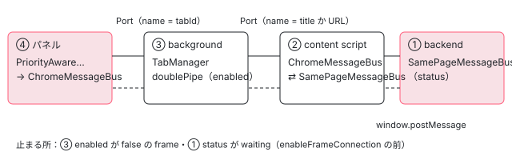

[目次](../README.md) › [Angular DevTools の内側](README.md) › 第 3 回 / 全 20 回

# メッセージの道：ページから DevTools のパネルまで

> ページの中の SamePageMessageBus（window.postMessage）、content script、background の TabManager、パネルの ChromeMessageBus（chrome.runtime の Port）がメッセージを中継する順番。iframe ごとの接続（frame の id）と、パネルを閉じたときの後始末。

angular/angular · 読了 約 13 分 · 中核 · [サイトで読む（デモが動きます）](https://angular-deep-dive-cyan.vercel.app/chapter/devtools-messaging)

---

パネルが送った `getLatestComponentExplorerView` は、ページの中のバックエンドに届くまでに 4 回渡し替えられます。パネルの `ChromeMessageBus` → background の `TabManager` → content script → `window.postMessage` → バックエンドの `SamePageMessageBus` です。この章では、その中継の 1 つずつを行で読み、**どこで止められることがあるか**（frame が選ばれていない・bus が `waiting`）と、iframe ごとの接続、パネルを閉じたときの後始末を追います。最後に、本物のソースを 1 つのプロセスに並べて流した記録で順番を確かめます。

読む対象は `shell-browser/src/app/` の `content-script.ts`・`same-page-message-bus.ts`・`comm-utils.ts`・`chrome-message-bus.ts`・`tab_manager.ts`・`app.config.ts` と、パネルの `ng-devtools/src/lib/application-services/frame_manager.ts` です。公式の説明は `devtools/docs/connection.md` にもあります。

1. [1. 全体像](01-devtools-overview.md)
2. [2. Angular を見つける](02-devtools-detect.md)
3. **3. メッセージの道**（この章）
4. [4. プロトコル](04-devtools-protocol.md)
5. [5. コンポーネントの木](05-devtools-component-tree.md)
6. [6. 制御フローの塊](06-devtools-control-flow.md)
7. [7. 同じノードを見分ける](07-devtools-identity.md)
8. [8. パネルの木](08-devtools-forest-ui.md)
9. [9. プロパティの直列化](09-devtools-state-serializer.md)
10. [10. 入れ子を開く](10-devtools-property-resolver.md)
11. [11. 値を書き換える](11-devtools-property-mutation.md)
12. [12. 選ぶ・光らせる](12-devtools-inspector-highlight.md)
13. [13. プロファイラーの記録](13-devtools-profiler-capture.md)
14. [14. 記録を描く](14-devtools-profiler-formatters.md)
15. [15. 変更検知を見張る](15-devtools-cd-analyzer.md)
16. [16. 注入器の木](16-devtools-injector-tree.md)
17. [17. signal のグラフ](17-devtools-signal-graph.md)
18. [18. ルーター・TransferState](18-devtools-router-transfer.md)
19. [19. テストとビルド](19-devtools-test-build.md)
20. [20. issue と PR を読む](20-devtools-issues.md)



*パネルからバックエンドまでの中継。番号は第 1 回の 4 つの場所。上の線が行き、下の線が返り*

## 1. 宛先の名前：URL から作る 3 つの URI

📄 `angular/devtools/projects/shell-browser/src/app/comm-utils.ts` L22–38 （▶ の行: 24–25, 31, 37）

```ts
22 │ /** Returns the URI of the extension content script. */
23 │ export function getContentScriptUri() {
24 ▶   const url = stripUrlQueryParamsAndFragment(window.location.href);
25 ▶   return 'angular-devtools-content-script-' + url;
26 │ }
27 │ 
28 │ /** Returns the URI of the extension backend. */
29 │ export function getBackendUri() {
30 │   const url = stripUrlQueryParamsAndFragment(window.location.href);
31 ▶   return 'angular-devtools-backend-' + url;
32 │ }
33 │ 
34 │ /** Returns the URI of the Angular detection script. */
35 │ export function getDetectAngularScriptUri() {
36 │   const url = stripUrlQueryParamsAndFragment(window.location.href);
37 ▶   return 'angular-devtools-detect-angular-' + url;
38 │ }
```

ページの中には 3 者（detect-angular・content script・バックエンド）がいて、どれも同じ `window` に `postMessage` します。誰が送ったかを見分けるため、24〜25 行目のように「役の名前 ＋ ページの URL（`?` と `#` の後ろを除く）」の文字列を作り、メッセージの `source` に入れます。URL を入れるのは、frame ごと（iframe の中のページ）に別の名前になるようにするためです。この 3 つの関数は 302ea2ee46f（2026-02-10、「scope the message bus with URLs to prevent cross message interference」）で足されました。前は `communication.ts` に URL を含まない固定の文字列（`CONTENT_SCRIPT_URI` など）があり、コミットの説明には「detectAngular が止まらずに走り続けるのを防ぐ」とあります。同じコミットで `comm-utils.spec.ts`（4 件）が足されています。

## 2. SamePageMessageBus：window.postMessage と status

📄 `angular/devtools/projects/shell-browser/src/app/same-page-message-bus.ts` L15–52 （▶ の行: 20, 26, 39, 41, 44, 46）

```ts
15 │ // We use a bus status to know if we should send the message between the context
16 │ // eg: We don't want to send events until the devtools tab has been focused to present spaming the message bus
17 │ // init: initial state, until the backend is ready
18 │ // waiting: blocking message, until we see the 'enableFrameConnection' event
19 │ // ready: we send every message through the bus
20 ▶ export type BusStatus = 'init' | 'waiting' | 'ready';
21 │ 
22 │ /**
23 │  * Note: This Bus implementation implements a filter based of topic. It might not be suitable for others messages than the ones currently used.
24 │  */
25 │ export class SamePageMessageBus extends MessageBus<Events> {
26 ▶   private status: BusStatus = 'init';
27 │   private _listeners: ListenerFn[] = [];
28 │ 
29 │   constructor(
30 │     private debugName: string,
31 │     private _source: string,
32 │     private _destination: string,
33 │   ) {
34 │     super();
35 │   }
36 │ 
37 │   onAny(cb: AnyEventCallback<Events>): () => void {
38 │     const listener: ListenerFn = (e) => {
39 ▶       this.updateStatus(e.data?.topic);
40 │ 
41 ▶       if (e.source !== window || !e.data || !e.data.topic || e.data.source !== this._destination) {
42 │         return;
43 │       }
44 ▶       cb(e.data.topic, e.data.args);
45 │     };
46 ▶     window.addEventListener('message', listener);
47 │     this._listeners.push(listener);
48 │     return () => {
49 │       this._listeners.splice(this._listeners.indexOf(listener), 1);
50 │       window.removeEventListener('message', listener);
51 │     };
52 │   }
```

1. **41 行目：自分の window から来た、相手の名前のメッセージだけ**

   `e.source !== window` で、ほかの window（iframe の親子など）から届いたものを捨てます。`e.data.source !== this._destination` で、相手の役の名前でないものを捨てます。content script の bus は `destination` がバックエンドの URI なので、自分が送ったメッセージ（`source` が自分の URI）は受けません。
2. **39 行目：status の更新は、捨てるかどうかの前**

   どの bus から来た `backendReady`・`enableFrameConnection` でも、同じページのすべての bus の status が変わります。20 行目の 3 つの状態です。

📄 `angular/devtools/projects/shell-browser/src/app/same-page-message-bus.ts` L86–119 （▶ の行: 87, 91, 93, 96–97, 110, 114–117）

```ts
 86 │   override emit<E extends keyof Events>(topic: E, args?: Parameters<Events[E]>): boolean {
 87 ▶     if (this.shouldSkipMessage(topic)) {
 88 │       return false;
 89 │     }
 90 │ 
 91 ▶     window.postMessage(
 92 │       {
 93 ▶         source: this._source,
 94 │         topic,
 95 │         args,
 96 ▶         __ignore_ng_zone__: true,
 97 ▶         __NG_DEVTOOLS_EVENT__: true,
 98 │       },
 99 │       '*',
100 │     );
101 │     return true;
102 │   }
103 │ 
104 │   override destroy(): void {
105 │     this._listeners.forEach((l) => window.removeEventListener('message', l));
106 │     this._listeners = [];
107 │   }
108 │ 
109 │   private shouldSkipMessage(topic: string): boolean {
110 ▶     return this.status === 'waiting' && topic !== 'enableFrameConnection';
111 │   }
112 │ 
113 │   private updateStatus(topic: string): void {
114 ▶     if (topic === 'enableFrameConnection') {
115 ▶       this.status = 'ready';
116 ▶     } else if (topic === 'backendReady') {
117 ▶       this.status = 'waiting';
118 │     }
119 │   }
```

1. **91〜100 行目：送るのは 1 つのオブジェクト**

   `source`・`topic`・`args` と 2 つの印です。96 行目の `__ignore_ng_zone__` は、zone.js のアプリでこのイベントのたびに変更検知が走らないようにする印、97 行目の `__NG_DEVTOOLS_EVENT__` は「DevTools のメッセージ」の印です（3 節で効きます）。
2. **113〜119 行目：`init` → `waiting` → `ready`**

   `backendReady` を見たら `waiting`、`enableFrameConnection` を見たら `ready` です。
3. **87・110 行目：`waiting` のあいだは `enableFrameConnection` 以外を送らない**

   バックエンドが起動して `backendReady` を送ってから、パネルが frame を選ぶ（5 節の `enableFrameConnection`）までのあいだ、バックエンドの `componentTreeDirty` などは `window.postMessage` に乗りません。17〜19 行目のコメントのとおり、パネルを開いていないタブでメッセージを流し続けないためです。デモの「ページが先」の場面の記録の #16 で、実際に止められています。

## 3. content script：Port と window の橋

📄 `angular/devtools/projects/shell-browser/src/app/content-script.ts` L15–38 （▶ の行: 18–19, 27, 29, 33–35）

```ts
15 │ let backgroundDisconnected = false;
16 │ let backendInitialized = false;
17 │ 
18 ▶ const port = chrome.runtime.connect({
19 ▶   name: `${document.title || location.href}`,
20 │ });
21 │ 
22 │ // Since Manifest V3, the service worker (background)
23 │ // gets terminated after 30s of inactivity. This can
24 │ // break the initialization phase of DevTools or the
25 │ // BE-FE communication channel, if already initialized.
26 │ // To prevent that, we emit a heartbeat in a >30s interval.
27 ▶ const HEARTBEAT_INTERVAL = 20000; // Keep below 30s
28 │ const heartbeatInterval = setInterval(() => {
29 ▶   port.postMessage('__NG_DEVTOOLS_BEAT');
30 │ }, HEARTBEAT_INTERVAL);
31 │ 
32 │ const handleDisconnect = (): void => {
33 ▶   localMessageBus.emit('shutdown');
34 ▶   localMessageBus.destroy();
35 ▶   chromeMessageBus.destroy();
36 │   clearInterval(heartbeatInterval);
37 │   backgroundDisconnected = true;
38 │ };
```

1. **18〜20 行目：読み込まれた瞬間に background へ Port をつなぐ**

   Angular のページかどうかに関係なく、すべての frame でつなぎます。名前は 19 行目の `document.title || location.href` です。
2. **27〜30 行目：20 秒ごとの心拍**

   22〜26 行目のコメントのとおり、Manifest V3 の service worker は 30 秒何もないと止められるので、Port に `'__NG_DEVTOOLS_BEAT'` を流して起こしておきます。
3. **32〜38 行目：background との Port が切れたら**

   33 行目でバックエンドに `shutdown` を送り（バックエンドは自分の bus を `destroy` する。下の引用）、自分の 2 つの bus を壊して心拍を止めます。拡張を更新・再読み込みしたときや、service worker が止められたときに起きます（心拍はその最後のものを防ぐためです）。

📄 `angular/devtools/projects/ng-devtools-backend/src/lib/client-event-subscribers.ts` L168–175 （▶ の行: 169, 173–174）

```ts
168 │ const shutdownCallback = (messageBus: MessageBus<Events>) => () => {
169 ▶   messageBus.destroy();
170 │ };
171 │ 
172 │ const devtoolsShutdownCallback = (inspector: InspectorRef) => () => {
173 ▶   inspector.ref?.stopInspecting();
174 ▶   removeAllHighlights();
175 │ };
```

バックエンドの側の 2 つの後始末です。`shutdown`（content script が background を失った）は 169 行目で bus ごと壊し、`devtoolsShutdown`（パネルが閉じた。6 節）は 173〜174 行目で要素を選ぶ inspector を止めて、ページに重ねた光の枠を消すだけです。

📄 `angular/devtools/projects/shell-browser/src/app/content-script.ts` L40–56 （▶ の行: 46, 49–50, 56）

```ts
40 │ function attemptBackendHandshake() {
41 │   if (!backendInitialized) {
42 │     // tslint:disable-next-line:no-console
43 │     console.log('Attempting handshake with backend', new Date());
44 │ 
45 │     const retry = () => {
46 ▶       if (backendInitialized || backgroundDisconnected) {
47 │         return;
48 │       }
49 ▶       handshakeWithBackend();
50 ▶       setTimeout(retry, 500);
51 │     };
52 │     retry();
53 │   }
54 │ }
55 │ 
56 ▶ port.onDisconnect.addListener(handleDisconnect);
```

バックエンドを差し込んだあと（[第 2 回](02-devtools-detect.md)の 4 節）、49〜50 行目で 500ms ごとに `handshake` を送ります。46 行目のとおり、`backendReady` を受けるか background を失うまで続きます。差し込んだ script がまだ読み込み中だと、最初の handshake は誰にも受けられずに消えるからです。

📄 `angular/devtools/projects/shell-browser/src/app/content-script.ts` L91–114 （▶ の行: 91, 93–94, 96, 103–104, 108–109, 112–113）

```ts
 91 ▶ const localMessageBus = new SamePageMessageBus(
 92 │   '[ConstentScript=>BackEnd]',
 93 ▶   getContentScriptUri(),
 94 ▶   getBackendUri(),
 95 │ );
 96 ▶ const chromeMessageBus = new ChromeMessageBus(port);
 97 │ 
 98 │ const handshakeWithBackend = (): void => {
 99 │   localMessageBus.emit('handshake');
100 │ };
101 │ 
102 │ // Relaying messages from FE to BE
103 ▶ chromeMessageBus.onAny((topic, args) => {
104 ▶   localMessageBus.emit(topic, args);
105 │ });
106 │ 
107 │ // Relaying messages from BE to FE
108 ▶ localMessageBus.onAny((topic, args) => {
109 ▶   chromeMessageBus.emit(topic, args);
110 │ });
111 │ 
112 ▶ localMessageBus.on('backendReady', () => {
113 ▶   backendInitialized = true;
114 │ });
```

1. **103〜105 行目：パネル → バックエンド**

   Port から来たものは topic を問わず `localMessageBus.emit` で `window.postMessage` に載せます。
2. **108〜110 行目：バックエンド → パネル**

   93〜94 行目のとおり、`localMessageBus` の `destination` はバックエンドの URI なので、`onAny` が受けるのはバックエンドが送ったものだけです。それを Port に流します。
3. **content script は topic を読まない**

   112 行目の `backendReady` だけは自分でも聞きますが、ほかは中身を見ずに渡すだけです。だから新しい topic を足しても content script は変わりません（[第 4 回](04-devtools-protocol.md)）。

📄 `angular/devtools/projects/shell-browser/src/app/content-script.ts` L116–133 （▶ の行: 117, 119, 122, 126）

```ts
116 │ const proxyEventFromWindowToDevToolsExtension = (event: MessageEvent) => {
117 ▶   if (event.source === window && event.data && event.data.__NG_DEVTOOLS_EVENT__) {
118 │     try {
119 ▶       chrome.runtime.sendMessage(event.data);
120 │     } catch (e) {
121 │       const {message} = e as Error;
122 ▶       if (message.includes('Extension context invalidated.')) {
123 │         console.error(
124 │           'Angular DevTools: Disconnecting content script due to invalid extension context. Please reload the page.',
125 │         );
126 ▶         window.removeEventListener('message', proxyEventFromWindowToDevToolsExtension);
127 │       }
128 │       throw e;
129 │     }
130 │   }
131 │ };
132 │ 
133 │ window.addEventListener('message', proxyEventFromWindowToDevToolsExtension);
```

もう 1 つの中継です。117 行目で自分の window から来た、`__NG_DEVTOOLS_EVENT__` の印のあるメッセージを、119 行目で `chrome.runtime.sendMessage` に丸ごと渡します。印を見るようにしたのは a6b2d7dd109（2025-07-19、#62645）で、印の無いメッセージを大量に `postMessage` するサイトが content script を溢れさせていたのを止めるためでした。122〜127 行目は、拡張が更新されて古い content script が残ったときに、listener を外して例外を繰り返さないための守りです。

> [!NOTE]
> **さらに深く**
>
> 119 行目が渡した先の background の受け手（[第 2 回](02-devtools-detect.md)の 4 節）は、`isAngularDevTools` の無いメッセージを捨てます。bus のメッセージの形（`source`・`topic`・`args`）は `isAngularDevTools` を持たないので、background では何にも使われません。それでも、デモの記録ではページの中のメッセージ 1 つごとに `sendMessage` が 1 回ずつ出ています（大きな `latestComponentExplorerView` も）。一方、detect-angular が印を付けずに送る検出の結果（[第 2 回](02-devtools-detect.md)の 2 節）は、ここを通りません。

## 4. background の TabManager：tab と frame で Port を分ける

📄 `angular/devtools/projects/shell-browser/src/app/tab_manager.ts` L45–67 （▶ の行: 46, 48, 50–51, 56, 59, 65）

```ts
45 │   private initialize(runtime: typeof chrome.runtime): void {
46 ▶     this.runtime.onConnect.addListener((port) => {
47 │       // Verify that the connection is actually from the extension's DevTools page
48 ▶       const isFromExtension = port.sender?.url?.startsWith(runtime.getURL(''));
49 │ 
50 ▶       if (isNumeric(port.name) && isFromExtension) {
51 ▶         this.registerDevToolsForTab(port);
52 │         return;
53 │       }
54 │ 
55 │       if (
56 ▶         !port.sender ||
57 │         !port.sender.tab ||
58 │         port.sender.tab.id === undefined ||
59 ▶         port.sender.frameId === undefined
60 │       ) {
61 │         console.warn('Received a connection from an unknown sender', port);
62 │         return;
63 │       }
64 │ 
65 ▶       this.registerContentScriptForTab(port);
66 │     });
67 │   }
```

どちらの Port も `chrome.runtime.connect` でつながるので、46 行目の `onConnect` は 1 つです。50 行目で「名前が数字で、送り手の URL が拡張の中」ならパネル、そうでなく 56〜59 行目の送り手の tab と frame の id がそろっていれば content script です。パネルの名前が数字なのは、パネルの側が tab の id を名前にしてつなぐからです。

📄 `angular/devtools/projects/shell-browser/src/app/app.config.ts` L30–39 （▶ の行: 33–34, 37）

```ts
30 │     {
31 │       provide: MessageBus,
32 │       useFactory(): MessageBus<Events> {
33 ▶         const port = chrome.runtime.connect({
34 ▶           name: '' + chrome.devtools.inspectedWindow.tabId,
35 │         });
36 │ 
37 ▶         return new PriorityAwareMessageBus(new ChromeMessageBus(port));
38 │       },
39 │     },
```

34 行目の `chrome.devtools.inspectedWindow.tabId` は、開発者ツールが調べているタブの id です。37 行目で `ChromeMessageBus` を `PriorityAwareMessageBus`（[第 4 回](04-devtools-protocol.md)）で包んだものが、パネル全体の `MessageBus` になります。

📄 `angular/devtools/projects/shell-browser/src/app/chrome-message-bus.ts` L20–43 （▶ の行: 27, 29, 33, 35, 37）

```ts
20 │ export class ChromeMessageBus extends MessageBus<Events> {
21 │   private _disconnected = false;
22 │   private _listeners: any[] = [];
23 │ 
24 │   constructor(private _port: chrome.runtime.Port) {
25 │     super();
26 │ 
27 ▶     _port.onDisconnect.addListener(() => {
28 │       // console.log('Disconnected the port');
29 ▶       this._disconnected = true;
30 │     });
31 │   }
32 │ 
33 ▶   onAny(cb: AnyEventCallback<Events>): () => void {
34 │     const listener = (msg: ChromeMessage<Events, keyof Events>): void => {
35 ▶       cb(msg.topic, msg.args);
36 │     };
37 ▶     this._port.onMessage.addListener(listener);
38 │     this._listeners.push(listener);
39 │     return () => {
40 │       this._listeners.splice(this._listeners.indexOf(listener), 1);
41 │       this._port.onMessage.removeListener(listener);
42 │     };
43 │   }
```

📄 `angular/devtools/projects/shell-browser/src/app/chrome-message-bus.ts` L69–80 （▶ の行: 70–71, 73–75）

```ts
69 │   override emit<E extends keyof Events>(topic: E, args?: Parameters<Events[E]>): boolean {
70 ▶     if (this._disconnected) {
71 ▶       return false;
72 │     }
73 ▶     this._port.postMessage({
74 ▶       topic,
75 ▶       args,
76 │       __ignore_ng_zone__: true,
77 │       __NG_DEVTOOLS_EVENT__: true,
78 │     });
79 │     return true;
80 │   }
```

`ChromeMessageBus` は Port を `MessageBus` の形に包むだけで、パネルと content script の両方で同じクラスを使います。Port には相手が 1 つしかいないので、`SamePageMessageBus` のような `source` の判定はありません。33〜43 行目の `onAny` は、届いた `{topic, args}` を 35 行目でそのまま渡します。27〜30 行目で Port が切れたことを覚え、70〜72 行目でそれ以降の `emit` を `false` にします。Chrome では、切れた Port の `postMessage` は「Attempting to use a disconnected port object」という例外になります。

📄 `angular/devtools/projects/shell-browser/src/app/tab_manager.ts` L112–143 （▶ の行: 115–116, 121, 130, 132, 137, 139–140）

```ts
112 │   private registerContentScriptForTab(port: chrome.runtime.Port): void {
113 │     // A content script connection will have a sender and a tab id.
114 │     const sender = port.sender!;
115 ▶     const frameId = sender.frameId!;
116 ▶     const tabId = sender.tab!.id!;
117 │ 
118 │     this.ensureTabExists(tabId);
119 │     const tab = this.tabs[tabId]!;
120 │ 
121 ▶     if (tab.contentScripts[frameId] === undefined) {
122 │       tab.contentScripts[frameId] = {
123 │         port: null,
124 │         enabled: false,
125 │         frameId: -1,
126 │       };
127 │     }
128 │ 
129 │     const contentScript = tab.contentScripts[frameId]!;
130 ▶     contentScript.port = port;
131 │     contentScript.frameId = frameId;
132 ▶     contentScript.enabled = contentScript.enabled ?? false;
133 │ 
134 │     // When the content script disconnects, clean up the connection state we're storing in the
135 │     // background page.
136 │     port.onDisconnect.addListener(() => {
137 ▶       delete tab.contentScripts[frameId];
138 │ 
139 ▶       if (Object.keys(tab.contentScripts).length === 0) {
140 ▶         delete this.tabs[tabId];
141 │       }
142 │     });
143 │ 
```

📄 `angular/devtools/projects/shell-browser/src/app/tab_manager.ts` L144–171 （▶ の行: 144, 146, 149, 153–154, 156, 162）

```ts
144 ▶     contentScript.backendReady = new Promise((resolveBackendReady) => {
145 │       const onBackendReady = (message: {topic: string}) => {
146 ▶         if (message.topic === 'backendReady') {
147 │           // If DevTools is not yet connected, this resolve will enable devtools to eventually connect to this
148 │           // content script (even though the content script connected first)
149 ▶           resolveBackendReady();
150 │ 
151 │           // If the devtools connection is already established, set up the double pipe between the
152 │           // devtools and the content script.
153 ▶           if (tab.devtools) {
154 ▶             this.doublePipe(tab.devtools, contentScript);
155 │ 
156 ▶             tab.devtools.postMessage({
157 │               topic: 'contentScriptConnected',
158 │               args: [frameId, contentScript.port!.name, contentScript.port!.sender!.url],
159 │             });
160 │           }
161 │ 
162 ▶           port.onMessage.removeListener(onBackendReady);
163 │         }
164 │       };
165 │ 
166 │       port.onMessage.addListener(onBackendReady);
167 │       port.onDisconnect.addListener(() => {
168 │         port.onMessage.removeListener(onBackendReady);
169 │       });
170 │     });
171 │   }
```

1. **115〜116 行目・121〜127 行目：`tabs[tabId].contentScripts[frameId]` に入れる**

   frame の id は Chrome が付ける数で、ページそのものが 0、iframe は別の数です。132 行目のとおり、最初は `enabled` が false です。
2. **144〜170 行目：`backendReady` を Promise にする**

   content script の Port に最初の `backendReady` が流れたら 149 行目で解決し、そのときすでにパネルがいれば 154 行目で 2 本の Port をつなぎ（`doublePipe`）、156〜159 行目でパネルに `contentScriptConnected`（frame の id・Port の名前・URL）を知らせます。
3. **136〜142 行目：content script が切れたら**

   frame の項目を消し、tab に 1 つも残らなければ tab ごと消します。

📄 `angular/devtools/projects/shell-browser/src/app/tab_manager.ts` L76–110 （▶ の行: 78, 83–84, 88–89, 96–97, 103–104）

```ts
 76 │   private registerDevToolsForTab(port: chrome.runtime.Port): void {
 77 │     // For the devtools page, our port name is the tab id.
 78 ▶     const tabId = parseInt(port.name, 10);
 79 │ 
 80 │     this.ensureTabExists(tabId);
 81 │     const tab = this.tabs[tabId]!;
 82 │ 
 83 ▶     tab.devtools = port;
 84 ▶     tab.devtools.onDisconnect.addListener(() => {
 85 │       tab.devtools = null;
 86 │ 
 87 │       for (const connection of Object.values(tab.contentScripts)) {
 88 ▶         connection.port?.postMessage({topic: 'devtoolsShutdown'});
 89 ▶         connection.enabled = false;
 90 │       }
 91 │     });
 92 │ 
 93 │     // DevTools may register after the content script has already registered. If that's the case,
 94 │     // we need to set up the double pipe between the devtools and each content script, and send
 95 │     // the contentScriptConnected message to the devtools page to inform it of all frames on the page.
 96 ▶     for (const [frameId, connection] of Object.entries(tab.contentScripts)) {
 97 ▶       connection.backendReady!.then(() => {
 98 │         if (connection.port === null) {
 99 │           throw new Error(
100 │             'Expected Content to have already connected before the backendReady event on the same page.',
101 │           );
102 │         }
103 ▶         this.doublePipe(tab.devtools, connection);
104 ▶         tab.devtools!.postMessage({
105 │           topic: 'contentScriptConnected',
106 │           args: [parseInt(frameId, 10), connection.port.name, connection.port.sender!.url],
107 │         });
108 │       });
109 │     }
110 │   }
```

パネルが後から来たときの側です。96〜109 行目で、すでにいる frame ごとに `backendReady` の Promise を待ってから（解決済みならすぐ）、同じ `doublePipe` と `contentScriptConnected` をします。`backendReady` を真偽値でなく Promise にしたのは、パネルと content script のどちらが先に来ても同じ結果にするためです（`connection.md` の Q&A に、真偽値だった版で「not detected」のまま止まった経緯が書かれています）。84〜91 行目はパネルが閉じたときの後始末で、6 節で読みます。

## 5. doublePipe：選ばれた frame だけを通す

📄 `angular/devtools/projects/shell-browser/src/app/tab_manager.ts` L190–226 （▶ の行: 191, 196, 198, 205–206, 209–211, 220, 224）

```ts
190 │     const onDevToolsMessage = (message: {topic: Topic; args: Parameters<Events[Topic]>}) => {
191 ▶       if (message.topic === 'enableFrameConnection') {
192 │         if (message.args.length !== 2) {
193 │           throw new Error('Expected two arguments for enableFrameConnection');
194 │         }
195 │ 
196 ▶         const [frameId, tabId] = message.args as [frameId: number, tabId: number];
197 │ 
198 ▶         if (frameId === contentScriptConnection.frameId) {
199 │           const tab = this.tabs[tabId];
200 │ 
201 │           if (tab === undefined) {
202 │             throw new Error(`Expected tab to be registered with tabId ${tabId}`);
203 │           }
204 │ 
205 ▶           for (const frameId of Object.keys(tab.contentScripts)) {
206 ▶             tab.contentScripts[frameId].enabled = false;
207 │           }
208 │ 
209 ▶           contentScriptConnection.enabled = true;
210 ▶           devtoolsPort.postMessage({
211 ▶             topic: 'frameConnected',
212 │             args: [contentScriptConnection.frameId],
213 │           });
214 │         }
215 │       }
216 │ 
217 │       // Do not allow any message to be sent if a content script is not enabled. This is the
218 │       // mechanism that lets us select which content script connection Angular Devtools is connected
219 │       // to.
220 ▶       if (!contentScriptConnection.enabled) {
221 │         return;
222 │       }
223 │ 
224 ▶       contentScriptPort.postMessage(message);
225 │     };
226 │     devtoolsPort.onMessage.addListener(onDevToolsMessage);
```

📄 `angular/devtools/projects/shell-browser/src/app/tab_manager.ts` L228–250 （▶ の行: 232, 236, 242–244, 249）

```ts
228 │     const onContentScriptMessage = (message: {topic: Topic; args: Parameters<Events[Topic]>}) => {
229 │       // Do not allow any message to be sent if a content script is not enabled. This is the
230 │       // mechanism that lets us select which content script connection Angular Devtools is connected
231 │       // to.
232 ▶       if (!contentScriptConnection.enabled) {
233 │         return;
234 │       }
235 │ 
236 ▶       devtoolsPort.postMessage(message);
237 │     };
238 │     contentScriptPort.onMessage.addListener(onContentScriptMessage);
239 │ 
240 │     const shutdownContentScript = () => {
241 │       devtoolsPort.onMessage.removeListener(onDevToolsMessage);
242 ▶       devtoolsPort.postMessage({
243 ▶         topic: 'contentScriptDisconnected',
244 ▶         args: [contentScriptConnection.frameId, contentScriptConnection.port!.name],
245 │       });
246 │ 
247 │       contentScriptPort.onMessage.removeListener(onContentScriptMessage);
248 │     };
249 ▶     contentScriptPort.onDisconnect.addListener(() => shutdownContentScript());
250 │   }
```

1. **191〜215 行目：`enableFrameConnection` だけは background が読む**

   引数の frame の id がこの Port の frame と同じなら、205〜207 行目で同じ tab のすべての frame を無効にし、209 行目で自分だけを有効にして、210〜213 行目でパネルに `frameConnected` を返します。
2. **220〜224 行目・232〜236 行目：有効でない frame は両方向とも捨てる**

   frame がいくつあっても、パネルとやり取りするのは 1 つだけです。`enableFrameConnection` 自体も、有効になった直後の 224 行目で content script に渡り、ページの中の bus の status を `ready` にします（2 節）。
3. **240〜249 行目：content script が切れたら**

   パネルに `contentScriptDisconnected` を送り、2 本の listener を外します。

> [!NOTE]
> **ポイント**
>
> `enableFrameConnection` を送るのはパネルの `FrameManager` です。1 つ目の frame が知らされたときに自動で選び、2 つ目からは画面の frame の選択（`devtools-tabs` の `emitSelectedFrame`）で選びます。

📄 `angular/devtools/projects/ng-devtools/src/lib/application-services/frame_manager.ts` L56–73 （▶ の行: 56, 58, 62, 65–66, 68, 70–71）

```ts
56 ▶     this._messageBus.on('frameConnected', (frameId: number) => {
57 │       if (this._frames().has(frameId)) {
58 ▶         this._selectedFrameId.set(frameId);
59 │       }
60 │     });
61 │ 
62 ▶     this._messageBus.on('contentScriptConnected', (frameId: number, name: string, url: string) => {
63 │       // fragments are not considered when doing URL matching on a page
64 │       // https://bugs.chromium.org/p/chromium/issues/detail?id=841429
65 ▶       const urlWithoutHash = new URL(url);
66 ▶       urlWithoutHash.hash = '';
67 │ 
68 ▶       this.addFrame({name, id: frameId, url: urlWithoutHash});
69 │ 
70 ▶       if (this.frames().length === 1) {
71 ▶         this.inspectFrame(this._frames().get(frameId)!);
72 │       }
73 │     });
```

📄 `angular/devtools/projects/ng-devtools/src/lib/application-services/frame_manager.ts` L104–115 （▶ の行: 105, 113–114）

```ts
104 │   inspectFrame(frame: Frame): void {
105 ▶     if (this._inspectedWindowTabId === null) {
106 │       return;
107 │     }
108 │ 
109 │     if (!this._frames().has(frame.id)) {
110 │       throw new Error('Attempted to inspect a frame that is not connected to Angular DevTools.');
111 │     }
112 │ 
113 ▶     this._selectedFrameId.set(null);
114 ▶     this._messageBus.emit('enableFrameConnection', [frame.id, this._inspectedWindowTabId]);
115 │   }
```

62〜73 行目：`contentScriptConnected` を受けたら、66 行目で URL の `#` を外して frame を足し、70 行目でそれが 1 つ目なら 71 行目ですぐ `inspectFrame` します。114 行目が `enableFrameConnection [frame の id, tab の id]` を送り、113 行目で選択をいったん空にして、56〜60 行目の `frameConnected` が返ってきたところで選択が決まります。105 行目で tab の id が null（[第 1 回](01-devtools-overview.md)の開発用の殻）なら何もしません。

## 6. パネルを閉じたとき・frame が消えたとき

📄 `angular/devtools/projects/ng-devtools/src/lib/application-services/frame_manager.ts` L75–98 （▶ の行: 75, 81, 92–94）

```ts
75 ▶     this._messageBus.on('contentScriptDisconnected', (frameId: number) => {
76 │       const frame = this._frames().get(frameId);
77 │       if (!frame) {
78 │         return;
79 │       }
80 │ 
81 ▶       this.removeFrame(frame);
82 │ 
83 │       // Defensive check. This case should never happen, since we're always connected to at least
84 │       // the top level frame.
85 │       if (this.frames().length === 0) {
86 │         this._selectedFrameId.set(null);
87 │         console.error('Angular DevTools is not connected to any frames.');
88 │         return;
89 │       }
90 │ 
91 │       const selectedFrameId = this._selectedFrameId();
92 ▶       if (frameId === selectedFrameId) {
93 ▶         this._selectedFrameId.set(TOP_LEVEL_FRAME_ID);
94 ▶         this.inspectFrame(this._frames().get(TOP_LEVEL_FRAME_ID)!);
95 │         return;
96 │       }
97 │     });
98 │   }
```

- **パネルを閉じる**：パネルの Port が切れ、4 節の 84〜91 行目が `tab.devtools` を null にし、その tab のすべての content script に `devtoolsShutdown` を送って `enabled` を false にします。content script は 3 節の 103〜105 行目でそれをバックエンドへ渡し、バックエンドは inspector と光の枠を片づけます（3 節の 173〜174 行目）。**バックエンドそのものは止まりません。** 次にパネルを開いたときは、4 節の 96〜109 行目から同じ手順で `contentScriptConnected` がやり直されます。
- **iframe が消える（または遷移する）**：その frame の content script の Port が切れ、5 節の 242〜245 行目の `contentScriptDisconnected` がパネルに届きます。`FrameManager` は 81 行目で frame を外し、それが選ばれていた frame なら 92〜94 行目でページそのもの（frame 0）を選び直します。

## 7. DEMO：本物の中継を 1 つのプロセスに並べて流す

> **🧪 DEMO — ページからパネルまで、メッセージが通った順番（記録の再生）**
>
> これは記録です。本物の devtools のソース（angular/angular の `devtools/`、8576f161ae4）を、本物の @angular/core 22.1.6（開発モード）のアプリにつないで Node で動かした結果です。本物の `content-script.ts`・`detect-angular.ts`・`backend.ts`（そのまま import した）と、本物の `TabManager`・`ChromeMessageBus`・`PriorityAwareMessageBus`・`FrameManager` を 1 つのプロセスに並べ、`window.postMessage` と `chrome.runtime` だけを記録のスクリプトの代わり（`fake-extension.ts`。どちらも次のタスクで届ける非同期）にしました。ブラウザなら isolated world と main world は別ですが、記録では同じグローバルにいます（`window.postMessage` と DOM だけを共有するのは同じです）。domino は `<script>` を実行しないので、`backend_bundle.js` が足されたところで `backend.ts` を import しています。時刻（ms）は記録したときの値で、走らせるたびに少し変わります。
>
> ページを読み込み、backendReady が出たあとで変更検知を 1 回走らせ、それからパネルを開いた。
>
> 「1 行進める」などのボタンを押してください。
>
> ▶ [このデモはサイトで動かせます](https://angular-deep-dive-cyan.vercel.app/chapter/devtools-messaging)

記録から読み取れること（# の番号は「ページが先」の場面の記録の行）です。

1. **#3〜#14：パネルがいなくてもページの側は準備を終える**

   detect-angular の結果 → backend を差し込む → `backendInstalled` → `handshake` → `backendReady` が、パネルを開く前に済みます。#13 の `backendReady` は Port で background に届き、4 節の 149 行目の Promise を解決します。
2. **#16：status が `waiting` のあいだの `componentTreeDirty` は止められる**

   #15 で signal を書き換えると、約 250ms 後（バックエンドの `debounceTime(250)`、[第 2 回](02-devtools-detect.md)の 6 節）に `componentTreeDirty` が出ますが、2 節の 87 行目で止められ、`window.postMessage` に乗りません。frame をつないだあとの #41〜#45 では、同じメッセージがパネルまで届いています。
3. **#18：最初の `queryNgAvailability` は消える**

   パネルを開いた直後の問い合わせは、まだ `doublePipe` が無いので background で消えます。#19〜#24 で `contentScriptConnected` → `enableFrameConnection` → `frameConnected` とつながり、500ms 後の #25 の問い合わせで初めて #32 の返事が来ます。パネルが 500ms ごとに聞き直すのは、この取りこぼしがあるからです（[第 2 回](02-devtools-detect.md)の 8 節）。
4. **#46〜#48：パネルを閉じると `devtoolsShutdown`**

   最後の `tabs` では、`devtools` が null、frame 0 の `enabled` が false で、content script の Port は残っています。
5. **「パネルが先」の場面：`contentScriptConnected` は `backendReady` の直後**

   パネルが先にいるので、その場面の記録の #14 で `backendReady` が届いたその場で 4 節の 153〜159 行目が走り、#16 で `contentScriptConnected` がパネルに届きます。そのあとの並びは「ページが先」と同じです。

📄 `scratchpad の記録スクリプト（a/messaging.ts。node messaging.mjs と場面の名前で実行）`

```
// devtools-messaging の記録: ページ（detect-angular・content script・backend）→ background（TabManager）→ パネル（ChromeMessageBus）
// を本物のソースのまま 1 つの Node のプロセスに並べ、メッセージがどの道をどの順で通ったかを記録する。
// 使い方: node ../_shared/build.mjs messaging.ts messaging.mjs && node messaging.mjs page-first && node messaging.mjs panel-first
import { Component, Injector, runInInjectionContext, signal } from '@angular/core';
import { bootApp, tick, writeJson } from '../_shared/harness';
import { installFakeExtension, onScriptAppended, hops, record, summarize, TAB_ID } from './fake-extension';
import { TabManager } from '~/angular-research/angular/devtools/projects/shell-browser/src/app/tab_manager';
import { ChromeMessageBus } from '~/angular-research/angular/devtools/projects/shell-browser/src/app/chrome-message-bus';
import { SamePageMessageBus } from '~/angular-research/angular/devtools/projects/shell-browser/src/app/same-page-message-bus';
import { MessageBus, PriorityAwareMessageBus } from '~/angular-research/angular/devtools/projects/protocol';
import { FrameManager } from '~/angular-research/angular/devtools/projects/ng-devtools/src/lib/application-services/frame_manager';

const scenario = (process.argv[2] ?? 'page-first') as 'page-first' | 'panel-first';

@Component({ selector: 'app-root', template: '<p>{{ n() }}</p>' })
class Root {
  n = signal(1);
}

const { appRef } = await bootApp(Root);
// アプリの signal を書き換えて変更検知を 1 回走らせる（backend は変更検知を見て 250ms 後に componentTreeDirty を送る）
async function changeSomething(label: string) {
  record({ hop: 'アプリの signal を書き換える', topic: label });
  (appRef.components[0].instance as Root).n.update((v) => v + 1);
  await tick(400);
}
const ext = installFakeExtension();

// 記録のための見張り: SamePageMessageBus.emit が status で止めたとき（false を返したとき）を記録する
const origEmit = SamePageMessageBus.prototype.emit;
SamePageMessageBus.prototype.emit = function (this: any, topic: any, args?: any) {
  const ok = origEmit.call(this, topic, args);
  if (!ok) record({ hop: `SamePageMessageBus.emit が止めた（${this.debugName}）`, topic, args: summarize(args) });
  return ok;
};

// background（background.ts の 103-104 行目と同じ呼び方。background.ts 自体は外部と通信する checkGoogler を含むので読み込まない）
const tabs = {};
TabManager.initialize(tabs, (globalThis as any).chrome.runtime);

// パネル（shell-browser/src/app/app.config.ts の 33-37 行目と同じ組み立て）
const received: { topic: string; args?: string }[] = [];
let panelPort: any;
let panelBus: MessageBus<any>;
function openPanel() {
  panelPort = ext.connectFromPanel();
  panelBus = new PriorityAwareMessageBus(new ChromeMessageBus(panelPort));
  const injector = Injector.create({ providers: [{ provide: MessageBus, useValue: panelBus }] });
  runInInjectionContext(injector, () => FrameManager.initialize(TAB_ID));
  for (const t of ['contentScriptConnected', 'frameConnected', 'ngAvailability', 'latestComponentExplorerView', 'contentScriptDisconnected']) {
    panelBus.on(t as any, ((...a: unknown[]) => received.push({ topic: t, args: summarize(a) })) as any);
  }
  record({ hop: 'パネルを開く', topic: '(chrome.runtime.connect)' });
}

// ページ: 本物の content-script.ts を読み込む（読み込んだ時点で chrome.runtime.connect する）
let backendLoaded: Promise<unknown> | null = null;
onScriptAppended((src) => {
  // ブラウザなら script が実行される。domino では実行されないので、同じファイルを import する
  if (src.endsWith('app/backend_bundle.js')) {
    backendLoaded ??= import('~/angular-research/angular/devtools/projects/shell-browser/src/app/backend');
  }
});

if (scenario === 'panel-first') {
  openPanel();
  await tick(20);
}
record({ hop: 'content script を読み込む', topic: '(content-script.ts)' });
await import('~/angular-research/angular/devtools/projects/shell-browser/src/app/content-script');
await tick(20);
// ng-validate.ts が足す detect_angular_bundle.js の代わりに detect-angular.ts を import する
record({ hop: 'detect-angular を読み込む', topic: '(detect-angular.ts)' });
await import('~/angular-research/angular/devtools/projects/shell-browser/src/app/detect-angular');

// backendReady まで待つ（content script は 500ms ごとに handshake をやり直す）
for (let i = 0; i < 40 && !hops.some((h) => h.topic === 'backendReady'); i++) await tick(50);
await tick(50);

if (scenario === 'page-first') {
  // パネルを開く前の変更検知: backend の bus は backendReady のあと 'waiting' なので止められるはず
  await changeSomething('パネルを開く前');
  openPanel();
}

// パネルの DevToolsComponent（ng-devtools/src/lib/devtools.component.ts 79-84 行目）と同じく、500ms ごとに queryNgAvailability を送る。
// DevToolsComponent 自体は @angular/material を引くので動かさず、その数行だけを書いた（移植）。
let gotAvailability = false;
panelBus!.once('ngAvailability' as any, (() => (gotAvailability = true)) as any);
for (let attempt = 0; attempt < 10 && !gotAvailability; attempt++) {
  panelBus!.emit('queryNgAvailability' as any);
  for (let i = 0; i < 10 && !gotAvailability; i++) await tick(50);
}
panelBus!.emit('getLatestComponentExplorerView' as any, [undefined] as any);
await tick(100);
// enableFrameConnection のあとの変更検知: 今度は通るはず
await changeSomething('frame をつないだあと');

// パネルを閉じる
panelPort.disconnect();
await tick(100);

const out = new URL(`./messaging-${scenario}.json`, import.meta.url).pathname;
await writeJson(out, {
  scenario,
  tabsAfter: JSON.parse(JSON.stringify(tabs, (k, v) => (k === 'port' || k === 'devtools' ? (v ? `[Port ${v.name}]` : null) : k === 'backendReady' ? '[Promise]' : v))),
  hops,
  received,
});
process.exit(0);

```

📄 `scratchpad の記録スクリプト（a/fake-extension.ts。window.postMessage と chrome.runtime の代わり）`

```
// devtools-messaging / devtools-detect の記録用: ページの window.postMessage と chrome.runtime の代わり。
// devtools のロジックではなく、拡張が動くブラウザの環境の代わり（Node と domino には無いもの）。
// ・window.postMessage: 次のタスクで、data と source（= window）を持つ message イベントを window に配る（ブラウザと同じく非同期）。
// ・chrome.runtime.connect: 2 つの端を持つ Port を作り、相手の端を onConnect の購読者に渡す。Port の postMessage は JSON で写して次のタスクで届ける。
// ・chrome.runtime.sendMessage: 記録するだけ（background.ts の onMessage は、外部と通信する checkGoogler を含むので読み込まない）。
export type Hop = { seq: number; t: number; hop: string; topic: string; from?: string; args?: string; note?: string };

// harness の EventTarget は Node のものなので、Node の Event で配る（platform-server が描画のときに globalThis.Event を domino のものに置き換えるため、読み込み時に取っておく）
const NodeEvent: typeof Event = globalThis.Event;
const start = performance.now();
export const hops: Hop[] = [];
let seq = 0;
export function record(h: Omit<Hop, 'seq' | 't'>) {
  hops.push({ seq: ++seq, t: Math.round(performance.now() - start), ...h });
}

export function summarize(args: unknown): string | undefined {
  if (args === undefined) return undefined;
  let s: string;
  try {
    s = JSON.stringify(args) ?? 'undefined';
  } catch {
    s = String(args);
  }
  return s.length > 140 ? `${s.slice(0, 120)}…（${s.length} 文字）` : s;
}

export const EXTENSION_URL = 'chrome-extension://fake-extension-id/';
export const TAB_ID = 7;

type Listener = (...a: any[]) => void;
class Event_ {
  listeners: Listener[] = [];
  addListener = (l: Listener) => void this.listeners.push(l);
  removeListener = (l: Listener) => void (this.listeners = this.listeners.filter((x) => x !== l));
  fire(...a: unknown[]) {
    for (const l of [...this.listeners]) l(...a);
  }
}

export class FakePort {
  onMessage = new Event_();
  onDisconnect = new Event_();
  peer!: FakePort;
  constructor(
    public name: string,
    public label: string,
    public sender?: { url?: string; tab?: { id: number }; frameId?: number },
  ) {}
  postMessage(msg: any) {
    const data = JSON.parse(JSON.stringify(msg ?? null));
    record({ hop: `port: ${this.label}`, topic: typeof msg === 'string' ? msg : msg?.topic ?? '?', args: summarize(msg?.args) });
    setTimeout(() => this.peer.onMessage.fire(data, this.peer), 0);
  }
  disconnect() {
    record({ hop: `port: ${this.label}`, topic: '(disconnect)' });
    setTimeout(() => this.peer.onDisconnect.fire(this.peer), 0);
  }
}

function pair(name: string, aLabel: string, bLabel: string, bSender: FakePort['sender']) {
  const a = new FakePort(name, aLabel);
  const b = new FakePort(name, bLabel, bSender);
  a.peer = b;
  b.peer = a;
  return { a, b };
}

export function installFakeExtension() {
  const g = globalThis as any;
  const doc = g.document;
  g.location ??= doc.defaultView.location;
  g.postMessage = (data: any, _origin: string) => {
    record({
      hop: 'window.postMessage',
      topic: data?.topic ?? (data?.isAngularDevTools ? '(検出の結果そのもの)' : '?'),
      from: data?.source,
      args: summarize(data?.args),
      note: data?.__NG_DEVTOOLS_EVENT__ ? undefined : '__NG_DEVTOOLS_EVENT__ なし',
    });
    const copy = structuredClone(data);
    setTimeout(() => {
      const ev = new NodeEvent('message');
      Object.defineProperty(ev, 'data', { value: copy });
      Object.defineProperty(ev, 'source', { value: g });
      g.dispatchEvent(ev);
    }, 0);
  };
  const onConnect = new Event_();
  const onMessage = new Event_();
  const runtime = {
    id: 'fake-extension-id',
    onConnect,
    onMessage,
    getURL: (p: string) => EXTENSION_URL + p,
    getManifest: () => ({ manifest_version: 3, version: 'record' }),
    // content script から呼ばれる（送り手はページの frame 0）
    connect({ name }: { name: string }) {
      const { a, b } = pair(name, 'content script → background', 'background → content script', {
        url: g.location.href,
        tab: { id: TAB_ID },
        frameId: 0,
      });
      setTimeout(() => onConnect.fire(b), 0);
      return a;
    },
    sendMessage(msg: any) {
      record({ hop: 'chrome.runtime.sendMessage', topic: msg?.topic ?? (msg?.isAngularDevTools ? '(検出の結果そのもの)' : '?'), from: msg?.source, args: summarize(msg?.args ?? msg) });
      onMessage.fire(msg, { tab: { id: TAB_ID }, frameId: 0 });
      return Promise.resolve();
    },
  };
  g.chrome = { runtime };
  return {
    runtime,
    /** パネル（index.html）から chrome.runtime.connect({name: '' + tabId}) したときの代わり */
    connectFromPanel() {
      const { a, b } = pair(String(TAB_ID), 'panel → background', 'background → panel', {
        url: EXTENSION_URL + 'index.html',
      });
      setTimeout(() => onConnect.fire(b), 0);
      return a;
    },
  };
}

/** domino は <script> を実行しないので、appendChild された script の src を見て代わりの関数を呼ぶ。 */
export function onScriptAppended(cb: (src: string) => void) {
  const root = (globalThis as any).document.documentElement;
  const orig = root.appendChild.bind(root);
  Object.defineProperty(root, 'appendChild', {
    configurable: true,
    value: (node: any) => {
      const r = orig(node);
      if (node?.tagName === 'SCRIPT') {
        record({ hop: '<script> を足す', topic: node.src });
        cb(node.src);
      }
      return r;
    },
  });
}

```

共通の部品（`harness.ts`・`build.mjs`）は [第 1 回](01-devtools-overview.md)に全文があります。

## ここまでの呼び出し（パネル → バックエンド → パネル）

- 👤 `messageBus.emit('getLatestComponentExplorerView')` — パネルの部品
  - `PriorityAwareMessageBus.emit()` → `ChromeMessageBus.emit()` — protocol・chrome-message-bus.ts — *Port（name = tabId）へ postMessage*
    - `onDevToolsMessage()` — tab\_manager.ts（background） — *enabled な frame なら 224 行目で渡す*
      - `chromeMessageBus.onAny()` → `localMessageBus.emit()` — content-script.ts — *103〜105 行目*
        - `window.postMessage({source, topic, args, …})` — same-page-message-bus.ts — *status が waiting なら止まる*
          - `SamePageMessageBus.on()` の listener → コールバック — backend.ts → client-event-subscribers.ts — *source がこちらの destination か*
          - `messageBus.emit('latestComponentExplorerView')` — client-event-subscribers.ts
        - `localMessageBus.onAny()` → `chromeMessageBus.emit()` — content-script.ts — *108〜110 行目*
      - `onContentScriptMessage()` — tab\_manager.ts — *236 行目でパネルの Port へ*
    - `ChromeMessageBus.on()` → `PriorityAwareMessageBus` の包み — パネル — *第 4 回*

## テストと直し方

### spec と describe

| spec | describe / it | bazel のターゲット |
| --- | --- | --- |
| shell-browser/src/app/tab\_manager\_spec.ts | describe `Tab Manager - `（78 行目）の下に `Single Frame`（139）6 件・`Multiple Frames`（301）4 件。例：`should set frame connection as enabled when an enableFrameConnection message is received`（215）、`should not pipe messages … when the content script frame is disabled`（253） | `//devtools/projects/shell-browser/src/app:tab_manager_test`（10 件） |
| shell-browser/src/app/comm-utils.spec.ts | describe `Communication utils` › `stripUrlQueryParamsAndFragment`（11・12 行目）4 件 | `…/shell-browser/src/app:comm_utils_test`（4 件） |
| ng-devtools/src/lib/application-services/frame\_manager\_spec.ts | describe `FrameManager`（14 行目）15 件。例：`should set selected frame to top level frame when contentScriptDisconnected event is emitted for selected frame`（102） | `…/application-services:test_application_services`（ほかの spec と合わせて 29 件） |

📄 `angular/devtools/projects/shell-browser/src/app/tab_manager_spec.ts` L163–199 （▶ の行: 163, 169, 174, 180, 191）

```ts
163 ▶     async function* eachOrderingOfDevToolsInitialization(): AsyncGenerator<{
164 │       tab: DevToolsConnection;
165 │       contentScriptPort: MockPort;
166 │       devtoolsPort: MockPort;
167 │     }> {
168 │       {
169 ▶         // Content Script -> Backend Ready -> Devtools
170 │         const contentScriptPort = createContentScriptPort();
171 │         emitBackendReadyToPort(contentScriptPort);
172 │         const devtoolsPort = createDevToolsPort();
173 │         const tab = tabs[tabId]!;
174 ▶         await tab.contentScripts[contentScriptFrameId].backendReady;
175 │         yield {tab, contentScriptPort, devtoolsPort};
176 │         delete tabs[tabId];
177 │       }
178 │ 
179 │       {
180 ▶         // Content Script -> Devtools -> Backend Ready
181 │         const contentScriptPort = createContentScriptPort();
182 │         const devtoolsPort = createDevToolsPort();
183 │         emitBackendReadyToPort(contentScriptPort);
184 │         const tab = tabs[tabId]!;
185 │         await tab.contentScripts[contentScriptFrameId].backendReady;
186 │         yield {tab, contentScriptPort, devtoolsPort};
187 │         delete tabs[tabId];
188 │       }
189 │ 
190 │       {
191 ▶         // Devtools -> Content Script -> Backend Ready
192 │         const devtoolsPort = createDevToolsPort();
193 │         const contentScriptPort = createContentScriptPort();
194 │         emitBackendReadyToPort(contentScriptPort);
195 │         const tab = tabs[tabId]!;
196 │         await tab.contentScripts[contentScriptFrameId].backendReady;
197 │         yield {tab, contentScriptPort, devtoolsPort};
198 │       }
199 │     }
```

tab\_manager\_spec の中心はこの非同期のジェネレーターです。169・180・191 行目のコメントのとおり、content script・`backendReady`・パネルの 3 つの来る順番を 3 通りに並べ、各 it はその 3 通りすべてで同じことを確かめます（174 行目で Promise を待ってから yield）。4 節の「どちらが先でも同じ結果」という性質を壊さないための作りです。

📄 `angular/devtools/projects/shell-browser/src/app/tab_manager_spec.ts` L215–230 （▶ の行: 217, 219–221, 224–226）

```ts
215 │     it('should set frame connection as enabled when an enableFrameConnection message is received', async () => {
216 │       for await (const {tab, devtoolsPort} of eachOrderingOfDevToolsInitialization()) {
217 ▶         expect(tab?.contentScripts[contentScriptFrameId]?.enabled).toBe(false);
218 │ 
219 ▶         emitMessageToPort(devtoolsPort, {
220 ▶           topic: 'enableFrameConnection',
221 ▶           args: [contentScriptFrameId, tabId],
222 │         });
223 │ 
224 ▶         expect(tab?.contentScripts[contentScriptFrameId]?.enabled).toBe(true);
225 ▶         assertArrayHasObj(devtoolsPort.messagesPosted, {
226 ▶           topic: 'frameConnected',
227 │           args: [contentScriptFrameId],
228 │         });
229 │       }
230 │     });
```

5 節の 205〜213 行目の確かめです。偽の Port（`MockPort`）の `onMessageListeners` を直接呼んで `enableFrameConnection` を流し、`enabled` が true になること、パネルの Port の `messagesPosted` に `frameConnected` があることを見ます。デモの `fake-extension.ts` の Port も、同じく「listener の配列と postMessage の記録」という形で作りました。

### 手元で走らせた結果

📄 `ターミナル（../angular で）`

```
cd ~/angular-research/angular
pnpm bazel test //devtools/projects/shell-browser/src/app:tab_manager_test \
  //devtools/projects/shell-browser/src/app:comm_utils_test \
  //devtools/projects/ng-devtools/src/lib/application-services:test_application_services \
  --nocache_test_results --test_output=all
```

📄 `出力（2026-11-05 に実行。抜粋。ログは scratchpad/devtools-logs/a-tests.log）`

```
//devtools/projects/shell-browser/src/app:tab_manager_test_chromium   10 passed, 0 failed   PASSED in 2.3s
//devtools/projects/shell-browser/src/app:tab_manager_test_firefox    10 passed, 0 failed   PASSED in 4.4s
//devtools/projects/shell-browser/src/app:comm_utils_test_chromium     4 passed, 0 failed   PASSED in 2.5s
//devtools/projects/shell-browser/src/app:comm_utils_test_firefox      4 passed, 0 failed   PASSED in 4.4s
//devtools/projects/ng-devtools/src/lib/application-services:test_application_services_chromium  29 passed  PASSED in 2.3s
//devtools/projects/ng-devtools/src/lib/application-services:test_application_services_firefox   29 passed  PASSED in 5.5s
```

- 第 1 回の表のほかの 4 つと同じ 1 回の bazel で走らせました（全体の Elapsed は 47.4 秒）。絞り込みは効かないので、ターゲット全体です。

### 最近の修正：7896e742227（2026-06-02）タブをまたぐ権限の格上げを防ぐ

前の 50 行目は `if (isNumeric(port.name))` だけでした。Port の名前は、つなぐ側が自由に決められます。content script の名前は 3 節の 19 行目の `document.title || location.href` なので、**ページが自分の `document.title` を数字（ほかのタブの id）にすると、その content script がパネルとして登録されてしまう**形でした。すると 4 節の 76〜110 行目で、別のタブの content script と `doublePipe` され、別のタブのバックエンドとやり取りできてしまいます。後は 48 行目で `port.sender.url` が拡張の URL（`runtime.getURL('')`）で始まることも確かめます。送り手の URL は Chrome が付けるので、ページからは偽れません。spec は、パネルの偽の Port に `sender.url`（`chrome-extension://test-extension-id/devtools.html`）を足し、`getURL` の偽物が拡張の URL を返すように書き換えています。ただし「数字の名前で、拡張の外から来た Port」がパネルとして扱われないことを直接確かめる it は足されていません。足すなら tab\_manager\_spec の `Single Frame` の describe に、`sender.url` がページの URL で名前が数字の Port をつないで `tab.devtools` が null のままであることを見る it になります。

### 直すとしたら

- 「パネルを開いても何も来ない」「iframe を選ぶと固まる」は `tab_manager.ts` の `registerDevToolsForTab`・`registerContentScriptForTab`・`doublePipe` です。spec は tab\_manager\_spec の `eachOrderingOfDevToolsInitialization` を使って、3 通りの順番すべてで確かめます。
- 「ページの中で届かない」は `same-page-message-bus.ts` の `source` の判定と status です。この bus には spec がありません。デモのように `window.postMessage` を差し替えれば、単体で確かめられます。
- frame の選び方は `frame_manager.ts` で、spec は `frame_manager_spec.ts` の偽の `MessageBus` にイベントを流す形で足します。
- 本家に PR を出すことは勧めません。issue を読むときは、デモの表の「どこで」の列のどこまで届いているか（ページの中・Port・パネル）を考えると、読むファイルが 1 つに絞れます（[第 20 回](20-devtools-issues.md)）。

## 聞かれそうな質問

**Q. content script はメッセージの中身を見ていますか？**

ほとんど見ません。`content-script.ts` の 103〜105 行目と 108〜110 行目は topic を問わず渡すだけで、自分で聞くのは 112 行目の `backendReady` だけです。topic で判断するのは background の `enableFrameConnection`（`tab_manager.ts` の 191 行目）と、ページの中の bus の status（`same-page-message-bus.ts` の 113〜119 行目）です。

**Q. iframe の中の Angular アプリも調べられますか？**

調べられます。manifest の `all_frames` で content script が frame ごとに入り、`TabManager` が `tabs[tabId].contentScripts[frameId]` に Port を分けて持ちます（115〜116 行目）。パネルが `enableFrameConnection` で選んだ 1 つだけが 209 行目で有効になり、ほかは 220〜222 行目と 232〜234 行目で捨てられます。

**Q. 同じページの中で、メッセージが別の frame に混ざらないのはなぜですか？**

2 つの守りがあります。`same-page-message-bus.ts` の 41 行目の `e.source !== window` がほかの window からのイベントを捨て、`comm-utils.ts` の 24〜25 行目が URI にページの URL を入れるので、frame ごとに役の名前が違います。

**Q. パネルを閉じるとバックエンドは止まりますか？**

止まりません。パネルの Port が切れると `tab_manager.ts` の 84〜91 行目が `devtoolsShutdown` を送り、バックエンドは inspector と光の枠を片づけるだけです（`client-event-subscribers.ts` の 173〜174 行目）。bus ごと壊す `shutdown` は、content script が background との Port を失ったとき（`content-script.ts` の 33 行目）だけです。

**Q. パネルを開いた直後の問い合わせが消えるのは不具合ですか？**

作りの上で起きることです。`doublePipe` は `backendReady` の Promise の `then`（`tab_manager.ts` の 97 行目）で張られるので、パネルの Port がつながった直後の 1 通は、まだ渡す相手がいません。パネルは 500ms ごとに聞き直すので、次の問い合わせで返事が来ます。デモの「ページが先」の記録の #18 と #25 です。

## 読み終えて

- 道は パネル → Port → `TabManager` → Port → content script → `window.postMessage` → バックエンド。content script は中身を見ずに渡します。
- 止まる所は 2 つ：background の `enabled`（選ばれた frame だけ）と、ページの中の bus の status（`enableFrameConnection` まで `waiting`）。
- `TabManager` は tab と frame の id で Port を分け、`backendReady` の Promise でパネルと content script の来る順番の違いを吸収します。
- パネルを閉じても、バックエンドは inspector と光を片づけるだけで動き続けます。
- パネルかどうかは Port の名前だけでなく送り手の URL でも確かめます（7896e742227）。

---

← 前: [Angular を見つける：detect-angular と ngAvailability](02-devtools-detect.md)  
次: [プロトコル：Events の型と PriorityAwareMessageBus](04-devtools-protocol.md) →
