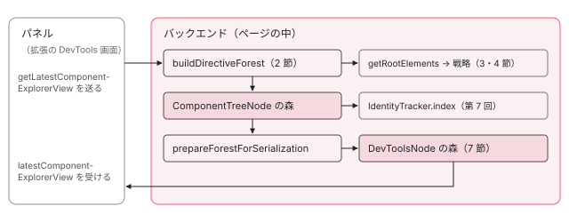

[目次](../README.md) › [Angular DevTools の内側](README.md) › 第 5 回 / 全 20 回

# コンポーネントの木を集める：getDirectiveForest

> バックエンドの component-tree.ts がルートの要素（get-roots.ts）から LView をたどる戦略（ltree.ts）と DOM をたどる戦略（render-tree.ts）、ng.getComponentForest があるときの道、ComponentTreeNode から送れる形の DevToolsNode を作る行、注入器の道筋（resolutionPath）を付ける行。

angular/angular · 読了 約 13 分 · 中核 · [サイトで読む（デモが動きます）](https://angular-deep-dive-cyan.vercel.app/chapter/devtools-component-tree)

---

DevTools の Components タブに出る木は、パネルが持っているものではありません。パネルが頼むたびに、ページの中で動くバックエンドが DOM と `window.ng` から**集め直して**送っています。この章では、その「集め直し」を入口の `getLatestComponentExplorerView` から順に追います。ルートの要素を探す行、2 つの戦略（DOM をたどる `RTreeStrategy` と LView をたどる `LTreeStrategy`）のどちらを使うかを決める行、そして集めた `ComponentTreeNode` を送れる形の `DevToolsNode` に写す行です。

読む対象は `ng-devtools-backend/src/lib/` の `client-event-subscribers.ts`（177〜203・451〜490 行目）、`directive-forest/component-tree/component-tree.ts`・`get-roots.ts`、`directive-forest/index.ts`、`directive-forest/tree-strategies/` の `index.ts`・`render-tree.ts`・`ltree.ts` です（パスは `devtools/projects/` の下）。

1. [1. 全体像](01-devtools-overview.md)
2. [2. Angular を見つける](02-devtools-detect.md)
3. [3. メッセージの道](03-devtools-messaging.md)
4. [4. プロトコル](04-devtools-protocol.md)
5. **5. コンポーネントの木**（この章）
6. [6. 制御フローの塊](06-devtools-control-flow.md)
7. [7. 同じノードを見分ける](07-devtools-identity.md)
8. [8. パネルの木](08-devtools-forest-ui.md)
9. [9. プロパティの直列化](09-devtools-state-serializer.md)
10. [10. 入れ子を開く](10-devtools-property-resolver.md)
11. [11. 値を書き換える](11-devtools-property-mutation.md)
12. [12. 選ぶ・光らせる](12-devtools-inspector-highlight.md)
13. [13. プロファイラーの記録](13-devtools-profiler-capture.md)
14. [14. 記録を描く](14-devtools-profiler-formatters.md)
15. [15. 変更検知を見張る](15-devtools-cd-analyzer.md)
16. [16. 注入器の木](16-devtools-injector-tree.md)
17. [17. signal のグラフ](17-devtools-signal-graph.md)
18. [18. ルーター・TransferState](18-devtools-router-transfer.md)
19. [19. テストとビルド](19-devtools-test-build.md)
20. [20. issue と PR を読む](20-devtools-issues.md)

## 1. 入口：getLatestComponentExplorerView

パネルは木を見せたいとき、`getLatestComponentExplorerView` というメッセージをバックエンドへ送ります（送る側は[第 8 回](08-devtools-forest-ui.md)、メッセージが届くまでの道は[第 3 回](03-devtools-messaging.md)）。受け取るのがこのコールバックです。

📄 `angular/devtools/projects/ng-devtools-backend/src/lib/client-event-subscribers.ts` L177–203 （▶ の行: 182, 184–186, 189–190, 194, 198）

```ts
177 │ const getLatestComponentExplorerViewCallback =
178 │   (messageBus: MessageBus<Events>) => (query?: ComponentExplorerViewQuery) => {
179 │     // We want to force re-indexing of the component tree.
180 │     // Pressing the refresh button means the user saw stuck UI.
181 │ 
182 ▶     getDirectiveForestManager().indexForest();
183 │ 
184 ▶     const forest = prepareForestForSerialization(
185 ▶       getDirectiveForestManager().getIndexedDirectiveForest(),
186 ▶       ngDebugDependencyInjectionApiIsSupported(),
187 │     );
188 │ 
189 ▶     if (!query) {
190 ▶       messageBus.emit('latestComponentExplorerView', [{forest}]);
191 │       return;
192 │     }
193 │ 
194 ▶     const state = getLatestComponentState(query, getDirectiveForestManager().getDirectiveForest());
195 │ 
196 │     if (state) {
197 │       const {directiveProperties} = state;
198 ▶       messageBus.emit('latestComponentExplorerView', [{forest, properties: directiveProperties}]);
199 │     } else {
200 │       // if the node is not found in the tree, we assume its gone and send the tree as is.
201 │       messageBus.emit('latestComponentExplorerView', [{forest}]);
202 │     }
203 │   };
```

1. **182 行目：毎回、木を集め直す**

   `getDirectiveForestManager().indexForest()` は、中で `IdentityTracker.index()` を呼び、その最初の行で `buildDirectiveForest()`（2 節）を呼びます。集めた木に id と位置を付けるところは[第 7 回](07-devtools-identity.md)で読みます。179〜180 行目のコメントのとおり、前の結果を使い回さず必ず集め直します。
2. **184〜187 行目：送れる形に写す**

   位置の付いた木（`getIndexedDirectiveForest()`）を `prepareForestForSerialization`（6 節）に通します。186 行目の `ngDebugDependencyInjectionApiIsSupported()` は、`window.ng` に注入器を調べる 5 つの関数がそろっているかで、そろっていれば各ノードに注入器の道筋（`resolutionPath`）も付けます。
3. **189〜190 行目と 194・198 行目：選んだノードがあるかどうか**

   パネルで何も選んでいなければ `query` は無く、木だけを `latestComponentExplorerView` で返します。選んでいれば、194 行目で同じ木から選んだノードのプロパティも集め（[第 9 回](09-devtools-state-serializer.md)）、198 行目で一緒に返します。



*1 回の頼みで起きること。ページの中のバックエンドが木を集め直し、id を付け、送れる形に写してから返す。*

## 2. buildDirectiveForest：2 つの道

📄 `angular/devtools/projects/ng-devtools-backend/src/lib/directive-forest/component-tree/component-tree.ts` L687–704 （▶ の行: 689–690, 695–696, 703）

```ts
687 │ export const buildDirectiveForest = (): ComponentTreeNode[] => {
688 │   const ng = ngDebugClient();
689 ▶   if ((ng as any).getComponentForest) {
690 ▶     const forest: ComponentTreeNode[] = (ng as any).getComponentForest();
691 │     const frontier = [...forest];
692 │     while (frontier.length) {
693 │       const node = frontier.pop()!;
694 │       const rawNode = node as any;
695 ▶       node.tagName ??= rawNode.element ?? rawNode.nativeElement?.nodeName.toLowerCase() ?? '';
696 ▶       node.component!.isElement ??= false;
697 │       for (const child of node.children) {
698 │         frontier.push(child);
699 │       }
700 │     }
701 │     return forest;
702 │   }
703 ▶   return buildDirectiveForestWithStrategy(getRootElements());
704 │ };
```

道は 2 つです。689 行目、`window.ng` に `getComponentForest` があれば、木そのものをフレームワークに作ってもらいます。無ければ 703 行目で、ルートの要素を集めて（3 節）戦略に渡します（4 節）。

- `getComponentForest` の道は 50c0ce8275b（2026-03-20、refactor）で足されました。`git show` で読むと、そのときの差分は 689〜690 行目にあたる 4 行だけで、コミットのメッセージは「DOM にメタデータを書かずにフレームワークが木を渡せるようにする。DOM を描かないコンポーネントも出せるようにする」です。続く 3c255bccc18（2026-04-13）が、691〜700 行目のループ（Angular 以外のフレームワークが返す木に、無い欄の既定値を入れる）を足しました。そのときは `element` と `hydration` も埋めていましたが、6b3e46a8722（2026-06-03）で欄の名前が `tagName` に変わり、695 行目の形になっています。
- `packages/core` には `getComponentForest` がありません（`grep -rn getComponentForest packages/core/src` で 0 件）。このサイトの `@angular/core` 22.1.6 にもありません。記録（7 節）でも `hasGetComponentForest` は 4 つの場面すべてで `false` でした。**Angular のアプリでは、いつも 703 行目の道を通ります。**
- 696 行目は `node.component!` と書いているので、このループは「どのノードにも `component` がある」木を前提にしています。

## 3. ルートの要素を探す：getRootElements と getAppRoots

📄 `angular/devtools/projects/ng-devtools-backend/src/lib/directive-forest/component-tree/component-tree.ts` L587–602 （▶ の行: 589, 591, 594, 599, 601）

```ts
587 │ /** Gets the all the root components in the Dom, including those outside the application root */
588 │ export function getRootElements(): Element[] {
589 ▶   if (!ngDebugClient().getComponent) {
590 │     // If the ngDebugClient does not support getComponent, we cannot proceed.
591 ▶     return [];
592 │   }
593 │ 
594 ▶   const roots = getAppRoots();
595 │   const rootSet = new Set(roots);
596 │ 
597 │   // Traverse the DOM tree for other non application root Angular components.
598 │   // Pass in the existing roots to inform the traversal that we can skip those paths.
599 ▶   discoverNonApplicationRootComponents(document.body, rootSet);
600 │ 
601 ▶   return [...rootSet];
602 │ }
```

📄 `angular/devtools/projects/ng-devtools-backend/src/lib/directive-forest/component-tree/get-roots.ts` L9–27 （▶ の行: 11, 16, 18–19, 26）

```ts
 9 │ /** Returns all app roots. */
10 │ export function getAppRoots(): Element[] {
11 ▶   const roots = Array.from(document.documentElement.querySelectorAll('[ng-version]'));
12 │ 
13 │   const isTopLevel = (element: Element) => {
14 │     let parent: Element | null = element;
15 │ 
16 ▶     while (parent?.parentElement) {
17 │       parent = parent.parentElement;
18 ▶       if (parent.hasAttribute('ng-version')) {
19 ▶         return false;
20 │       }
21 │     }
22 │ 
23 │     return true;
24 │   };
25 │ 
26 ▶   return roots.filter(isTopLevel);
27 │ }
```

1. **589〜591 行目：getComponent が無ければ何もしない**

   `window.ng.getComponent` が無いアプリでは空の配列を返します。`window.ng` そのものが無い（本番モード）ときは、`ngDebugClient()` が例外を投げます。どの関数があるかで機能を決める話は[第 2 回](02-devtools-detect.md)です。
2. **get-roots.ts 11 行目：ng-version の付いた要素**

   Angular は起動したルートのコンポーネントの要素に `ng-version` 属性を付けます。11 行目でそれを全部集め、13〜24 行目の `isTopLevel` で「祖先に `ng-version` を持つ要素がある」もの（入れ子のアプリ）を外します（26 行目）。
3. **599 行目：アプリのルートの外にあるコンポーネント**

   ダイアログのように `body` の直下に置かれたコンポーネントには `ng-version` が付きません。それを `document.body` から探すのが次の関数です。

📄 `angular/devtools/projects/ng-devtools-backend/src/lib/directive-forest/component-tree/component-tree.ts` L666–685 （▶ の行: 667, 672, 677–678, 680, 683）

```ts
666 │ function discoverNonApplicationRootComponents(element: Element, roots: Set<Element>): void {
667 ▶   if (roots.has(element)) {
668 │     return;
669 │   }
670 │   const children = Array.from(element.children);
671 │   for (const child of children) {
672 ▶     if (roots.has(child)) {
673 │       continue;
674 │     }
675 │ 
676 │     const ng = ngDebugClient();
677 ▶     if (ng.getComponent && ng.getComponent(child)) {
678 ▶       roots.add(child);
679 │       // If the child is an Angular component, we can skip traversing its children.
680 ▶       continue;
681 │     }
682 │ 
683 ▶     discoverNonApplicationRootComponents(child, roots);
684 │   }
685 │ }
```

667・672 行目、すでにルートとして持っている要素の下には入りません。677 行目で `ng.getComponent(child)` が値を返す要素はコンポーネントのホストなので、678 行目でルートに足し、680 行目でその下には入りません（その中は戦略がたどるため）。コンポーネントでなければ 683 行目で子へ降ります。記録の「ルートの外のコンポーネント」の場面では、`createComponent` で作って `body` に置いた `app-badge` が、`getAppRoots` には出ず、`getRootElements` には 2 つ目のルートとして出ます。

## 4. 戦略を選ぶ：ルートごとに 1 つ

📄 `angular/devtools/projects/ng-devtools-backend/src/lib/directive-forest/index.ts` L9–27 （▶ の行: 17, 20–21, 25）

```ts
 9 │ import {selectTreeStrategy} from './tree-strategies';
10 │ 
11 │ export const buildDirectiveForestWithStrategy = (elements: Element[]) => {
12 │   if (!elements || !elements.length) {
13 │     return [];
14 │   }
15 │ 
16 │   let i = 0;
17 ▶   return elements.flatMap((element) => {
18 │     // Different roots can have different Angular versions.
19 │     // Different versions depend on different component tree discovery strategies.
20 ▶     const strategy = selectTreeStrategy(element);
21 ▶     if (!strategy) {
22 │       return [];
23 │     }
24 │ 
25 ▶     return strategy.build(element, i++);
26 │   });
27 │ };
```

📄 `angular/devtools/projects/ng-devtools-backend/src/lib/directive-forest/tree-strategies/index.ts` L12–24 （▶ の行: 12, 15, 19）

```ts
12 ▶ // The order of the strategies matters. Lower indices have higher priority.
13 │ const rTreeStrategy = new RTreeStrategy();
14 │ const lTreeStrategy = new LTreeStrategy();
15 ▶ const STRATEGIES = [rTreeStrategy, lTreeStrategy];
16 │ 
17 │ export function selectTreeStrategy(element: Element): RTreeStrategy | LTreeStrategy | null {
18 │   for (const s of STRATEGIES) {
19 ▶     if (s.supports(element)) {
20 │       return s;
21 │     }
22 │   }
23 │   return null;
24 │ }
```

17〜20 行目のとおり、戦略は**ルートの要素ごとに**選びます（18〜19 行目のコメント：ルートごとに Angular の版が違うことがある）。25 行目の `i++` は、ルートの番号を `rootId` として渡すもので、[第 6 回](06-devtools-control-flow.md)の `forId-0-1` のような id の真ん中の数になります。戦略の並びは 15 行目の `[rTreeStrategy, lTreeStrategy]` で、12 行目のコメントのとおり前が優先です。19 行目で最初に `supports(element)` が真になったものを使います。

📄 `angular/devtools/projects/ng-devtools-backend/src/lib/directive-forest/tree-strategies/render-tree.ts` L180–203 （▶ の行: 182–183, 189, 193–195, 199）

```ts
180 │ export class RTreeStrategy {
181 │   supports(): boolean {
182 ▶     return (['getDirectiveMetadata', 'getComponent'] as const).every(
183 ▶       (method) => typeof ngDebugClient()[method] === 'function',
184 │     );
185 │   }
186 │ 
187 │   build(element: Element, rootId: number = 0): ComponentTreeNode[] {
188 │     const ng = ngDebugClient();
189 ▶     const controlFlowBlocks = ng.ɵgetControlFlowBlocks?.(element) ?? [];
190 │     const ctx: TreeExtractionContext = {
191 │       blocksIterator: new ControlFlowBlocksIterator(controlFlowBlocks),
192 │       rootId,
193 ▶       getComponent: ng.getComponent,
194 ▶       getDirectives: ng.getDirectives,
195 ▶       getDirectiveMetadata: ng.getDirectiveMetadata,
196 │     };
197 │ 
198 │     const tree: ComponentTreeNode[] = [];
199 ▶     extractViewTree(element, tree, ctx);
200 │ 
201 │     return tree;
202 │   }
203 │ }
```

`RTreeStrategy` を使える条件は 182〜183 行目、`window.ng` に `getDirectiveMetadata` と `getComponent` の 2 つの関数があることです。`LTreeStrategy` の条件（6 節の 84〜86 行目）は「要素に `__ngContext__` がある」だけです。3 節の 589 行目で `getComponent` が無いアプリは先に空になるので、`LTreeStrategy` が選ばれるのは「`getComponent` はあるが `getDirectiveMetadata` は無い」古い版のアプリだけです。22.1.6 の記録では両方の `supports` が `true` で、選ばれたのは `RTreeStrategy` でした。

## 5. RTreeStrategy：DOM を上から順にたどる

`build` は 189 行目で制御フローの塊の一覧を取り（[第 6 回](06-devtools-control-flow.md)）、193〜195 行目で `window.ng` の 3 つの関数を ctx に入れて、199 行目の `extractViewTree` に渡します。`extractViewTree` の前半（制御フローの塊を見分ける行）は第 6 回で読むので、ここでは 49 行目からです。

📄 `angular/devtools/projects/ng-devtools-backend/src/lib/directive-forest/tree-strategies/render-tree.ts` L49–73 （▶ の行: 49–51, 59, 62–63, 69, 71）

```ts
49 ▶   const directives = ctx.getDirectives?.(domNode) ?? [];
50 ▶   if (!directives.length && !(domNode instanceof Element)) {
51 ▶     return;
52 │   }
53 │   const componentTreeNode: ComponentTreeNode = {
54 │     children: [],
55 │     component: null,
56 │     directives: directives.map((dir) => {
57 │       return {
58 │         instance: dir,
59 ▶         name: dir.constructor.name,
60 │       };
61 │     }),
62 ▶     tagName: domNode.nodeName.toLowerCase(),
63 ▶     nativeElement: domNode,
64 │     hydration: hydrationStatus(domNode),
65 │     static: false,
66 │     controlFlowBlock: null,
67 │   };
68 │ 
69 ▶   if (!(domNode instanceof Element)) {
70 │     // In case we show the Comment nodes
71 ▶     result.push(componentTreeNode);
72 │     return;
73 │   }
```

1. **49〜52 行目：ディレクティブを聞き、要素でもないものは捨てる**

   `ng.getDirectives(domNode)` がディレクティブを返さず、要素でもない（テキストやコメント）ノードは、ここで終わりです。
2. **53〜67 行目：ノードを作る**

   ディレクティブの名前は 59 行目の `dir.constructor.name`（クラスの名前）、`tagName` は 62 行目の `nodeName` の小文字です。63 行目で DOM のノードそのものを `nativeElement` として持ちます。
3. **69〜73 行目：ディレクティブの付いたコメント**

   要素でないのにディレクティブがある（`ng-container` のコメントなど）ノードは、そのまま足して終わります（子はたどらない）。

📄 `angular/devtools/projects/ng-devtools-backend/src/lib/directive-forest/tree-strategies/render-tree.ts` L74–98 （▶ の行: 76, 81, 85–86, 88, 91, 93, 95）

```ts
74 │ 
75 │   const isDehydratedElement = componentTreeNode.hydration?.status === 'dehydrated';
76 ▶   const component = ctx.getComponent?.(domNode);
77 │   if (component) {
78 │     componentTreeNode.component = {
79 │       instance: component,
80 │       isElement: isCustomElement(domNode),
81 ▶       name: ctx.getDirectiveMetadata?.(component)?.name ?? domNode.nodeName.toLowerCase(),
82 │     };
83 │   }
84 │ 
85 ▶   const isDisplayableNode =
86 ▶     component || componentTreeNode.directives?.length || isDehydratedElement;
87 │   if (isDisplayableNode) {
88 ▶     result.push(componentTreeNode);
89 │   }
90 │ 
91 ▶   const childrenResult = isDisplayableNode ? componentTreeNode.children : result;
92 │ 
93 ▶   for (const child of domNode.childNodes) {
94 │     if (!nodesToSkip.has(child)) {
95 ▶       extractViewTree(child, childrenResult, ctx, nodesToSkip);
96 │     }
97 │   }
98 │ }
```

1. **76〜82 行目：コンポーネントの名前**

   81 行目、名前は `getDirectiveMetadata(component)?.name`、無ければ要素の名前です。core の `getDirectiveMetadata` は Angular のコンポーネントに `name` を入れません（下の引用）。だから Angular のアプリでは、木のコンポーネントの名前は**タグ名**（`app-root` など）になります。
2. **85〜89 行目：見せる価値のあるノードだけを足す**

   コンポーネントがある、ディレクティブがある、ハイドレーションを待っている（75 行目）、のどれかのときだけ結果に足します。
3. **91 行目：足さなかったノードの子は、親の列に入る**

   見せないノード（ただの `div` や `ul`）の子は、93〜97 行目で**今の親の `result`** に足されます。HTML だけの要素は木から消え、その中のコンポーネントは 1 段上に詰まります。
4. **93〜97 行目：DOM の子の順にたどる**

   `childNodes` の順なので、木の並びは DOM の並びです。コンテンツ投影（`ng-content`）された子は、DOM で置かれた場所（投影先のコンポーネントの中）に出ます。

📄 `angular/packages/core/src/render3/util/discovery_utils.ts` L316–326 （▶ の行: 316, 319–323）

```ts
316 ▶   const componentDef = getComponentDef(constructor);
317 │   if (componentDef) {
318 │     const inputs = extractInputDebugMetadata(componentDef.inputs);
319 ▶     return {
320 ▶       inputs,
321 ▶       outputs: componentDef.outputs,
322 ▶       encapsulation: componentDef.encapsulation,
323 ▶       changeDetection: componentDef.onPush
324 │         ? ChangeDetectionStrategy.OnPush
325 │         : ChangeDetectionStrategy.Eager,
326 │     };
```

319〜326 行目の返り値には `inputs`・`outputs`・`encapsulation`・`changeDetection` しかありません。`name` は型（`BaseDirectiveDebugMetadata`）では任意の欄で、Angular 以外のフレームワークが入れるためのものです。

## 6. LTreeStrategy：LView の配列をたどる（古い版のため）

📄 `angular/devtools/projects/ng-devtools-backend/src/lib/directive-forest/tree-strategies/ltree.ts` L20–48 （▶ の行: 20, 23, 26, 35–37, 43, 47）

```ts
20 ▶ let HEADER_OFFSET = 19;
21 │ 
22 │ const latest = () => {
23 ▶   HEADER_OFFSET = 20;
24 │ };
25 │ 
26 ▶ if (semver.gte(VERSION, '10.0.0-next.4')) {
27 │   latest();
28 │ }
29 │ 
30 │ // In g3 everyone has version 0.0.0, using the currently synced commits in the g3 codebase.
31 │ if (semver.eq(VERSION, '0.0.0')) {
32 │   latest();
33 │ }
34 │ 
35 ▶ const TYPE = 1;
36 ▶ const ELEMENT = 0;
37 ▶ const LVIEW_TVIEW = 1;
38 │ 
39 │ // Big oversimplification of the LView structure.
40 │ type LView = Array<any>;
41 │ 
42 │ export const isLContainer = (value: unknown): boolean => {
43 ▶   return Array.isArray(value) && value[TYPE] === true;
44 │ };
45 │ 
46 │ const isLView = (value: unknown): value is LView => {
47 ▶   return Array.isArray(value) && typeof value[TYPE] === 'object';
48 │ };
```

LView（コンポーネントのインスタンスごとの配列。[ivy-lview の章](../ivy/06-ivy-lview.md)）を直接読む戦略です。20〜28 行目で「ヘッダーの後ろの最初の番号」を 20 にしていますが、22 の core の `HEADER_OFFSET` は 28 です。43 行目は 1 番目が `true` なら LContainer（[ivy-lcontainer の章](../ivy/11-ivy-lcontainer.md)）、47 行目は 1 番目がオブジェクト（TView）なら LView、と見分けます。

📄 `angular/devtools/projects/ng-devtools-backend/src/lib/directive-forest/tree-strategies/ltree.ts` L83–120 （▶ の行: 85, 91–92, 105, 108–109, 114, 116）

```ts
 83 │ export class LTreeStrategy {
 84 │   supports(element: Element): boolean {
 85 ▶     return typeof (element as any).__ngContext__ !== 'undefined';
 86 │   }
 87 │ 
 88 │   private _getNode(lView: LView, data: any, idx: number): ComponentTreeNode {
 89 │     const directives: DirectiveInstanceType[] = [];
 90 │     let component: ComponentInstanceType | null = null;
 91 ▶     const tNode = data[idx];
 92 ▶     const node = lView[idx][ELEMENT];
 93 │     const element = (node.tagName || node.nodeName).toLowerCase();
 94 │     if (!tNode) {
 95 │       return {
 96 │         nativeElement: node,
 97 │         children: [],
 98 │         tagName: element,
 99 │         directives: [],
100 │         component: null,
101 │         controlFlowBlock: null, // neither there will be any control flow block
102 │         static: false,
103 │       };
104 │     }
105 ▶     for (let i = tNode.directiveStart; i < tNode.directiveEnd; i++) {
106 │       const instance = lView[i];
107 │       const dirMeta = data[i];
108 ▶       if (dirMeta && dirMeta.template) {
109 ▶         component = {
110 │           name: element,
111 │           isElement: isCustomElement(node),
112 │           instance,
113 │         };
114 ▶       } else if (dirMeta) {
115 │         directives.push({
116 ▶           name: getDirectiveName(instance),
117 │           instance,
118 │         });
119 │       }
120 │     }
```

📄 `angular/devtools/projects/ng-devtools-backend/src/lib/directive-forest/tree-strategies/ltree.ts` L132–162 （▶ の行: 134, 143, 145, 149, 151, 160–161）

```ts
132 │   private _extract(lViewOrLContainer: any, nodes: ComponentTreeNode[] = []): ComponentTreeNode[] {
133 │     if (isLContainer(lViewOrLContainer)) {
134 ▶       for (let i = 9; i < lViewOrLContainer.length; i++) {
135 │         if (lViewOrLContainer[i]) {
136 │           this._extract(lViewOrLContainer[i], nodes);
137 │         }
138 │       }
139 │       return nodes;
140 │     }
141 │     const lView = lViewOrLContainer;
142 │     const tView = lView[LVIEW_TVIEW];
143 ▶     for (let i = HEADER_OFFSET; i < lView.length; i++) {
144 │       const lViewItem = lView[i];
145 ▶       if (tView.data && Array.isArray(lViewItem) && lViewItem[ELEMENT] instanceof Node) {
146 │         const node = this._getNode(lView, tView.data, i);
147 │ 
148 │         // TODO(mgechev): verify if this won't make us skip projected content.
149 ▶         if (node.component || node.directives?.length) {
150 │           nodes.push(node);
151 ▶           this._extract(lViewItem, node.children);
152 │         }
153 │       }
154 │     }
155 │     return nodes;
156 │   }
157 │ 
158 │   build(element: Element, _: number): ComponentTreeNode[] {
159 │     const ctx = (element as any).__ngContext__;
160 ▶     const rootLView = ctx.lView ?? ctx;
161 ▶     return this._extract(rootLView);
162 │   }
```

1. **160〜161 行目：ルートの要素の \_\_ngContext\_\_ から始める**

   ルートの要素に付いた `__ngContext__` から LView を取り、`_extract` に渡します。
2. **143〜145 行目：配列で、0 番目が DOM のノードのものだけを見る**

   LView の中で配列になっているのは、コンポーネントのホスト（その子の LView）と LContainer です。ただの要素は DOM のノードがそのまま入っているので、145 行目の `Array.isArray` で外れます。**だから `<div appHighlight>` のように、ただの要素にだけ付いたディレクティブは、この戦略では木に出ません。**
3. **105〜120 行目：TNode のディレクティブの範囲を読む**

   `directiveStart` から `directiveEnd` までの定義を見て、108 行目で `template` を持つ定義ならコンポーネント、そうでなければディレクティブです。コンポーネントの名前は 109〜110 行目のとおりタグ名です。
4. **149〜151 行目：子は、そのホストの LView から集める**

   コンポーネントのノードの子は、そのコンポーネント自身の LView（151 行目の `lViewItem`）から集めます。投影された子はそれを書いた親の LView にあるので、**投影先の子ではなく、兄弟として**出ます。

> [!NOTE]
> **ポイント**
>
> `ltree.ts` の中の数（20 行目のヘッダーの長さ、134 行目の LContainer の 9）は、22 の LView・LContainer の形（ヘッダー 28、LContainer のヘッダー 10）と合っていません。始まりが手前にずれているので、ヘッダーの一部（LView の 20〜27 番、LContainer の 9 番）まで見に行きます。この戦略は 4 節のとおり 22 のアプリでは選ばれないので、記録の LTreeStrategy の列は「直接 `build` を呼んだらこうなる」という比較です。`LTreeStrategy` を確かめる spec はありません（`grep -rln LTreeStrategy devtools/projects --include='*.spec.ts'` で 0 件）。

## 7. 送れる形へ：prepareForestForSerialization

📄 `angular/devtools/projects/ng-devtools-backend/src/lib/client-event-subscribers.ts` L451–490 （▶ の行: 461–462, 466–467, 470, 472, 474, 478, 481, 485–486）

```ts
451 │ // Here we drop properties to prepare the tree for serialization.
452 │ // We don't need the component instance, so we just traverse the tree
453 │ // and leave the component name.
454 │ const prepareForestForSerialization = (
455 │   roots: ComponentTreeNode[],
456 │   includeResolutionPath = false,
457 │ ): SerializableComponentTreeNode[] => {
458 │   const serializedNodes: SerializableComponentTreeNode[] = [];
459 │   for (const node of roots) {
460 │     const serializedNode: SerializableComponentTreeNode = {
461 ▶       tagName: node.tagName,
462 ▶       component: node.component
463 │         ? {
464 │             name: node.component.name,
465 │             isElement: node.component.isElement,
466 ▶             id: getDirectiveForestManager().getDirectiveId(node.component.instance)!,
467 ▶             instanceId: ngDebugClient()?.ɵgetComponentInstanceDeepLinkId?.(node.component.instance),
468 │           }
469 │         : null,
470 ▶       directives: node.directives?.map((d) => ({
471 │         name: d.name,
472 ▶         id: getDirectiveForestManager().getDirectiveId(d.instance)!,
473 │       })),
474 ▶       children: prepareForestForSerialization(node.children, includeResolutionPath),
475 │       hydration: node.hydration,
476 │       controlFlowBlock: node.controlFlowBlock,
477 │       static: node.static,
478 ▶       changeDetection: node.component ? getDirectiveCdStrategy(node.component) : undefined,
479 │ 
480 │       // native elements are not serializable
481 ▶       hasNativeElement: !!node.nativeElement,
482 │     };
483 │     serializedNodes.push(serializedNode);
484 │ 
485 ▶     if (includeResolutionPath) {
486 ▶       serializedNode.resolutionPath = getNodeDIResolutionPath(node);
487 │     }
488 │   }
489 │ 
490 │   return serializedNodes;
```

`ComponentTreeNode` にはコンポーネントのインスタンスや DOM のノードが入っていて、メッセージで送れません（451〜453 行目のコメント：インスタンスは要らないので名前だけを残す）。ここで送れる値だけの `DevToolsNode` に写します。

1. **461〜469 行目：名前と id**

   インスタンスの代わりに、466 行目で `getDirectiveId` の数を入れます。パネルはこの数でノードを見分けます（[第 7 回](07-devtools-identity.md)）。467 行目の `instanceId` は Chrome の Performance パネルからのリンク用です。core がそのインスタンスにリンクの番号を割り当てていなければ `undefined` で、記録では JSON に出ていません（Performance パネルとのつながりは[第 15 回](15-devtools-cd-analyzer.md)）。
2. **470〜473 行目：ディレクティブも名前と id だけ**

   474 行目で子にも同じことをします。
3. **478 行目：変更検知の戦略**

   コンポーネントのノードにだけ `getDirectiveCdStrategy` の結果（記録では `ng-on-push`）を入れます。
4. **481 行目：DOM のノードがあったかどうか**

   DOM のノードそのものの代わりに真偽値を送ります。パネルはこれで「光らせられるか」を決めます（[第 8 回](08-devtools-forest-ui.md)）。
5. **485〜487 行目：注入器の道筋**

   1 節の 186 行目が真のときだけ、`getNodeDIResolutionPath` の結果を付けます（作りは[第 16 回](16-devtools-injector-tree.md)）。

## 8. DEMO：2 つの戦略で同じアプリを集める

> **🧪 DEMO — RTreeStrategy と LTreeStrategy の木、送れる形の forest（記録の再生）**
>
> これは記録です。本物の devtools のソース（angular/angular の devtools/、8576f161ae4）を、本物の @angular/core 22.1.6（開発モード）のアプリにつないで Node で動かした結果です。アプリは platform-server（domino）に描画しました。場面ごとに `RTreeStrategy` と `LTreeStrategy` の `build` を**両方とも直接**呼び、さらに bus で `getLatestComponentExplorerView` を頼んで、返ってきた forest も残しました。ノードの名前のボタンで子を閉じたり開いたりできます。左の列の行を選ぶと、同じ位置の送れる形のノードが下に出ます。
>
> 場面のボタンを押してください。
>
> ▶ [このデモはサイトで動かせます](https://angular-deep-dive-cyan.vercel.app/chapter/devtools-component-tree)

記録から読み取れることです。

1. **入れ子：HTML だけの要素は消える**

   `main` と `ul` は 5 節の 85〜91 行目で足されず、`app-item` の 2 つは `app-root` の直下に詰まります。2 つの戦略の木は同じです。
2. **コンテンツ投影：戦略で親が変わる**

   `RTreeStrategy` では `app-badge` が `app-card` の子（DOM の場所）、`LTreeStrategy` では `app-root` の子で `app-card` の兄弟（書いた LView の場所）です。6 節の 149〜151 行目のとおりです。
3. **ディレクティブ付きの要素：LTreeStrategy は div を落とす**

   `RTreeStrategy` には `div [HighlightDirective]` が出ますが、`LTreeStrategy` には出ません（6 節の 145 行目）。`p` の中の `app-badge` は、どちらでも `app-root` の直下です。ディレクティブの名前はクラスの名前（59 行目・116 行目）、コンポーネントの名前はタグ名（81 行目・110 行目）です。
4. **ルートの外のコンポーネント：forest の根が 2 つ**

   送れる形の forest は `app-root` と `app-badge` の 2 本の木になります。木を 1 本ではなく**森（forest）**と呼ぶのはこのためです。
5. **送れる形：id は場面をまたいで増え続ける**

   4 つの場面は 1 つの Node のプロセスで順に描画したので、2 つ目以降の場面の `component.id` は 0 から始まりません。id を配る `IdentityTracker` がプロセスに 1 つだからです（[第 7 回](07-devtools-identity.md)）。`resolutionPath` の注入器の id も同じく増え続けます。

domino（Node の上の DOM の代わり）で意味の無い値はありません。この章で使う値は、どれも DOM の形と `window.ng` の返り値だけで決まります。記録のスクリプトの全文です（共通の部品 harness.ts は[第 1 回](01-devtools-overview.md)に全文があります）。

📄 `scratchpad の記録スクリプト（component-tree.ts、共通の build.mjs で束ねて node で実行）`

```
// 第 5 回 devtools-component-tree の記録。
// 3 つの形のアプリを順に描画し、本物の devtools のバックエンドの関数で木を集める。
//   - getAppRoots / getRootElements（ルートの要素）
//   - selectTreeStrategy が選ぶ戦略と、RTreeStrategy・LTreeStrategy をそれぞれ直接呼んだ結果
//   - getLatestComponentExplorerView を bus で頼んだときに返る forest（prepareForestForSerialization の出力）
// 使い方: node ../_shared/build.mjs component-tree.ts component-tree.mjs && node component-tree.mjs
import { Component, Directive, EnvironmentInjector, Input, PlatformRef, VERSION, createComponent } from '@angular/core';
import { bootApp, makeBus, loadBackend, tick, writeJson } from '../_shared/harness';

const OUT = new URL('./component-tree.json', import.meta.url).pathname;

@Directive({ selector: '[appHighlight]' })
class HighlightDirective {}
@Directive({ selector: '[appTooltip]' })
class TooltipDirective {}
@Component({ selector: 'app-badge', template: '<b>new</b>' })
class Badge {}
@Component({ selector: 'app-item', template: '<li>{{ name }}</li>' })
class Item {
  @Input() name = '';
}
@Component({ selector: 'app-header', template: '<h1>title</h1>' })
class Header {}
@Component({ selector: 'app-card', template: '<section><ng-content /></section>' })
class Card {}
@Component({ selector: 'app-button', template: '<button>ok</button>' })
class Button {}

// 場面ごとの app-root のテンプレート（ページにもこの文字列を見せる）
const SCENES = [
  {
    id: 'nested',
    title: '入れ子',
    template: '<app-header /><main><ul><app-item name="a" /><app-item name="b" /></ul></main>',
    imports: [Header, Item],
  },
  {
    id: 'projection',
    title: 'コンテンツ投影',
    template: '<app-card><app-badge /><p>text</p></app-card>',
    imports: [Card, Badge],
  },
  {
    id: 'directives',
    title: 'ディレクティブ付きの要素',
    template:
      '<div appHighlight><span>plain</span></div><app-button appTooltip appHighlight /><p><app-badge /></p>',
    imports: [HighlightDirective, TooltipDirective, Button, Badge],
  },
  {
    id: 'outside',
    title: 'ルートの外のコンポーネント',
    template: '<app-header />',
    imports: [Header],
    // ダイアログのように、createComponent で作って body に直接置く
    outside: true,
  },
];

// ComponentTreeNode を、ページで見せる形（名前と子だけ）に写す
const view = (n: any): any => ({
  tagName: n.tagName,
  component: n.component ? n.component.name : null,
  directives: (n.directives ?? []).map((d: any) => d.name),
  nativeElement: n.nativeElement ? n.nativeElement.nodeName.toLowerCase() : null,
  children: n.children.map(view),
});
// bus で返ってきた DevToolsNode（送れる形）から、resolutionPath を短くして残す
const wire = (n: any): any => ({
  ...n,
  resolutionPath: n.resolutionPath?.map((i: any) => `${i.id}:${i.type}:${i.name}`),
  children: n.children.map(wire),
});

const results: any[] = [];
let backend: any = null;
for (const s of SCENES) {
  const Root = Component({ selector: 'app-root', imports: s.imports, template: s.template })(class Root {});
  const { appRef } = await bootApp(Root);
  if ((s as any).outside) {
    const ref = createComponent(Badge, { environmentInjector: appRef.injector.get(EnvironmentInjector) });
    appRef.attachView(ref.hostView);
    document.body.appendChild(ref.location.nativeElement);
    appRef.tick();
  }
  // backend は 1 回だけ読み込む（モジュールの中の状態は場面をまたいで続く）
  backend ??= {
    ...(await loadBackend()),
    ...(await import('~/angular-research/angular/devtools/projects/ng-devtools-backend/src/lib/directive-forest/component-tree/get-roots')),
    ...(await import('~/angular-research/angular/devtools/projects/ng-devtools-backend/src/lib/directive-forest/component-tree/component-tree')),
    ...(await import('~/angular-research/angular/devtools/projects/ng-devtools-backend/src/lib/directive-forest/tree-strategies')),
    ...(await import('~/angular-research/angular/devtools/projects/ng-devtools-backend/src/lib/directive-forest/tree-strategies/ltree')),
    ...(await import('~/angular-research/angular/devtools/projects/ng-devtools-backend/src/lib/directive-forest/tree-strategies/render-tree')),
  };
  const { getAppRoots, getRootElements, selectTreeStrategy, LTreeStrategy, RTreeStrategy, initializeMessageBus } = backend;
  const ng = (globalThis as any).ng;
  const roots: Element[] = getRootElements();
  const root = roots[0];
  // 戦略は要素ごとに選ぶ（index.ts の buildDirectiveForestWithStrategy と同じく、ルートごとに build する）
  const perRoot = roots.map((el, i) => ({
    root: el.nodeName.toLowerCase(),
    rtree: new RTreeStrategy().build(el, i).map(view),
    ltree: new LTreeStrategy().build(el, i).map(view),
  }));

  const { bus, send, take } = makeBus();
  initializeMessageBus(bus as any);
  send('getLatestComponentExplorerView', [undefined]);
  await tick(10);
  const msg = take().find((m) => m.topic === 'latestComponentExplorerView');

  results.push({
    id: s.id,
    title: s.title,
    template: s.template,
    html: document.body.innerHTML,
    appRoots: getAppRoots().map((e: Element) => e.nodeName.toLowerCase()),
    rootElements: roots.map((e) => e.nodeName.toLowerCase()),
    hasGetComponentForest: typeof ng.getComponentForest === 'function',
    selectedStrategy: selectTreeStrategy(root)?.constructor.name ?? null,
    supports: {
      RTreeStrategy: new RTreeStrategy().supports(root),
      LTreeStrategy: new LTreeStrategy().supports(root),
    },
    perRoot,
    forest: (msg?.args[0] as any).forest.map(wire),
  });
  bus.destroy();
  appRef.injector.get(PlatformRef).destroy();
}

await writeJson(OUT, { core: VERSION.full, results });
process.exit(0);

```

## ここまでの呼び出し

- 👤 `messageBus.emit('getLatestComponentExplorerView', [query])` — ng-devtools（パネル） — *第 8 回*
  - `getLatestComponentExplorerViewCallback(query)` — client-event-subscribers.ts 177
    - `getDirectiveForestManager().indexForest()` → `IdentityTracker.index()` — client-event-subscribers.ts 182 — *第 7 回*
      - `buildDirectiveForest()` — component-tree.ts 687
        - `getRootElements()` → `getAppRoots()` ＋ `discoverNonApplicationRootComponents(document.body, …)` — component-tree.ts 588・get-roots.ts 10・component-tree.ts 666
        - `buildDirectiveForestWithStrategy(roots)` → `selectTreeStrategy(root)` — directive-forest/index.ts 11・tree-strategies/index.ts 17
          - `RTreeStrategy.build(root, i)` → `extractViewTree(root, …)` — render-tree.ts 187・33
    - `prepareForestForSerialization(indexedForest, includeResolutionPath)` — client-event-subscribers.ts 454
  - `messageBus.emit('latestComponentExplorerView', [{forest}])` — client-event-subscribers.ts 190

## テストと直し方

### spec と describe

| spec | describe / it | bazel のターゲット |
| --- | --- | --- |
| directive-forest/tree-strategies/render-tree.spec.ts | describe `render tree extraction`（18 行目）の it 8 件：`should detect Angular Ivy apps`（50）・`should fail with detection of non-Ivy apps`（54）・`should extract trees without structural directives`（63）・`should skip nodes without directives`（86）・`` should use component name from `ng.getDirectiveMetadata` ``（103）・制御フローの 2 件（119・196、第 6 回）など | `//devtools/projects/ng-devtools-backend/src/lib/directive-forest/tree-strategies:test` |
| directive-forest/component-tree/component-tree.spec.ts ・ get-roots.spec.ts | describe `component-tree`（37）の中の `getRootElements`（66、it 4 件：86・99・113・122）ほか、describe `getRoots`（get-roots.spec.ts 17、it 2 件）。2 つのファイルで it 12 件 | `//devtools/projects/ng-devtools-backend/src/lib/directive-forest/component-tree:test` |

📄 `angular/devtools/projects/ng-devtools-backend/src/lib/directive-forest/tree-strategies/render-tree.spec.ts` L63–84 （▶ の行: 64, 73–75, 77, 79, 81, 83）

```ts
63 │   it('should extract trees without structural directives', () => {
64 ▶     const appNode = document.createElement('app');
65 │     const childNode = document.createElement('child');
66 │     const childDirectiveNode = document.createElement('div');
67 │     appNode.appendChild(childNode);
68 │     appNode.appendChild(childDirectiveNode);
69 │ 
70 │     const appComponent: any = {};
71 │     const childComponent: any = {};
72 │     const childDirective: any = {};
73 ▶     componentMap.set(appNode, appComponent);
74 ▶     componentMap.set(childNode, childComponent);
75 ▶     directiveMap.set(childDirectiveNode, [childDirective]);
76 │ 
77 ▶     const rtree = treeStrategy.build(appNode);
78 │     expect(rtree.length).toBe(1);
79 ▶     expect(rtree[0].children.length).toBe(2);
80 │     expect(rtree[0].children[0].component?.instance).toBe(childComponent);
81 ▶     expect(rtree[0].children[1].component).toBe(null);
82 │     expect(rtree[0].children[1].directives).toBeDefined();
83 ▶     expect(rtree[0].children[1].directives![0].instance).toBe(childDirective);
84 │   });
```

バックエンドの spec はアプリを作りません。この describe の `beforeEach` で `window.ng` を**手で作った偽物**にし、73〜75 行目の Map に「この要素はコンポーネント」「この要素にはこのディレクティブ」と書き込んで、77 行目で `build` を呼びます。79〜83 行目で、ディレクティブだけの `div` が子として出ることを確かめます。書き方の全体は[第 19 回](19-devtools-test-build.md)です。

📄 `angular/devtools/projects/ng-devtools-backend/src/lib/directive-forest/component-tree/component-tree.spec.ts` L122–135 （▶ の行: 125, 129, 133–134）

```ts
122 │     it('should return all root elements with all non-application root components', () => {
123 │       const rootElement = createRoot();
124 │       const childElement = createRoot();
125 ▶       const nonAppRootCmp = document.createElement('ng-cmp');
126 │ 
127 │       rootElement.appendChild(childElement);
128 │       document.body.appendChild(rootElement);
129 ▶       document.body.appendChild(nonAppRootCmp);
130 │ 
131 │       const roots = getRootElements();
132 │ 
133 ▶       expect(roots.length).toEqual(2);
134 ▶       expect(roots).toEqual([rootElement, nonAppRootCmp]);
135 │     });
```

3 節の `discoverNonApplicationRootComponents` を確かめる it です。この describe の `beforeEach` の偽物の `getComponent` は「タグ名が `ng-` で始まる要素はコンポーネント」と答えるので、125 行目の `ng-cmp` が 134 行目で 2 つ目のルートになります。記録の「ルートの外のコンポーネント」と同じ形です。

### 手元で走らせた結果

📄 `ターミナル（../angular で）`

```
cd ~/angular-research/angular
pnpm bazel test //devtools/projects/ng-devtools-backend/src/lib/directive-forest/component-tree:test \
  //devtools/projects/ng-devtools-backend/src/lib/directive-forest/tree-strategies:test \
  --nocache_test_results --test_output=all
```

📄 `出力（2026-11-05 に実行。抜粋。ログは scratchpad/devtools-logs/b-bazel.log）`

```
component-tree/test_bundle.spec.js   Chromium 1/1 test files | 12 passed, 0 failed
tree-strategies/test_bundle.spec.js  Chromium 1/1 test files | 8 passed, 0 failed
（Firefox も同じ件数）
//…/directive-forest/component-tree:test_chromium    PASSED in 1.7s
//…/directive-forest/component-tree:test_firefox     PASSED in 5.2s
//…/directive-forest/tree-strategies:test_chromium   PASSED in 1.7s
//…/directive-forest/tree-strategies:test_firefox    PASSED in 6.5s
（ほかの章の 6 つのターゲットと一緒に 1 回で走らせて INFO: Elapsed time: 9.521s）
```

- 1 つの `:test` が `:test_chromium` と `:test_firefox` の 2 つのターゲットになり、同じ spec が 2 つのブラウザで走ります。
- it を絞り込めるかは、`--test_arg=--grep=selectMode` を identity-tracker のターゲットで試しました。件数は 11 件のまま変わらず、効きませんでした（scratchpad/devtools-logs/b-bazel-filter.log）。この章ではターゲット全体を走らせています。

### 直すとしたら

- 「木にコンポーネントが出ない／2 回出る」は、まず 3 節（ルートの要素）か 5 節（`extractViewTree`）のどちらかです。ルートの側は `component-tree.spec.ts` の `getRootElements` の it の形、木の側は `render-tree.spec.ts` の形で、偽物の `window.ng` と DOM を組んで再現できます。
- 名前の出方（タグ名かクラス名か）は render-tree.ts 81 行目と core の `getDirectiveMetadata` の組み合わせです。spec の it `` should use component name from `ng.getDirectiveMetadata` `` は偽物の `getDirectiveMetadata` に `name` を入れているので、Angular のアプリとは違う道を確かめています。
- 8576f161ae4 より新しい main では、7c8c8d177b1（2026-10-30、refactor）が `component-tree.ts` を消して、中身を `directive-forest/index.ts`・`utils/app-roots.ts`・`injector-tree/injector-tree.ts` などに分けました（コミットのメッセージ：ロジックは変えない）。main で読むときは、この章の行番号ではなく関数の名前で探します。
- 本家に PR を出すことは勧めません。Components タブの木の issue を読むときは、記録と同じように「どの戦略が選ばれ、DOM がどういう形か」をまず手元で確かめます（[第 20 回](20-devtools-issues.md)）。

## 聞かれそうな質問

**Q. DevTools の木で、コンポーネントの名前がクラス名ではなく `app-root` のようなタグ名なのはなぜですか？**

render-tree.ts 81 行目が `getDirectiveMetadata(component)?.name` を使い、無ければ要素の名前にするからです。core の `getDirectiveMetadata` は 319〜326 行目のとおり Angular のコンポーネントに `name` を入れません。ディレクティブの方は 59 行目の `dir.constructor.name` なのでクラス名です。

**Q. ただの `<div>` に付けたディレクティブは木に出ますか？**

`RTreeStrategy`（22 のアプリで使われる方）では出ます。49 行目で `getDirectives` が返し、85〜88 行目で「ディレクティブがある」ので足されます。`LTreeStrategy` では 145 行目の `Array.isArray` で外れて出ません（記録の 3 つ目の場面）。

**Q. `ng-content` で投影したコンポーネントは、木のどこに出ますか？**

`RTreeStrategy` は 93〜97 行目で DOM の `childNodes` の順にたどるので、DOM で置かれた場所、つまり投影先のコンポーネントの子に出ます。

**Q. CDK のオーバーレイのように `body` の直下に置かれたコンポーネントも木に出ますか？**

出ます。`getRootElements` の 599 行目が `document.body` から探し、677〜678 行目で `getComponent` が値を返す要素をルートに足すからです。`ng-version` の付いたルートの下には 667・672 行目で入りません。

**Q. 木は変更検知のたびに作り直しているのですか？**

パネルが `getLatestComponentExplorerView` を送るたびに、182 行目で必ず集め直します。変更検知のたびにパネルへ「木が古くなった」と知らせる仕組み（`componentTreeDirty`）は[第 3 回](03-devtools-messaging.md)、それを受けて送り直すパネルの側は[第 8 回](08-devtools-forest-ui.md)です。

## 読み終えて

- 木は、パネルが頼むたびにバックエンドが `buildDirectiveForest` で集め直します。`ng.getComponentForest` の道は Angular 以外のフレームワーク向けで、22.1.6 にも core にもありません。
- ルートは `ng-version` の付いた要素と、`body` から探したルートの外のコンポーネントです。戦略はルートごとに選びます。
- 22 のアプリでは `RTreeStrategy` が DOM の順にたどり、コンポーネントかディレクティブのある要素だけを残します。HTML だけの要素の中身は 1 段上に詰まります。
- `LTreeStrategy` は LView を読む古い版向けの戦略で、ただの要素のディレクティブを落とし、投影された子を兄弟として出します。
- 送る前に `prepareForestForSerialization` が、インスタンスを id に、DOM のノードを `hasNativeElement` に置き換えます。

---

← 前: [プロトコル：Events の型と PriorityAwareMessageBus](04-devtools-protocol.md)  
次: [@for・@defer を木に出す：制御フローの塊と静的なノード](06-devtools-control-flow.md) →
