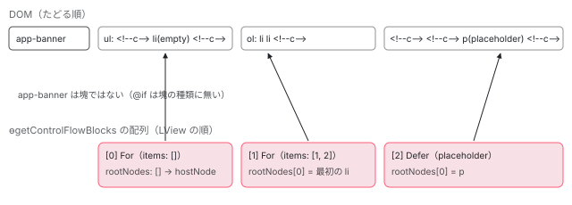

[目次](../README.md) › [Angular DevTools の内側](README.md) › 第 6 回 / 全 20 回

# @for・@defer を木に出す：制御フローの塊と静的なノード

> ng.ɵgetControlFlowBlocks（core の control\_flow.ts）が LView から @for と @defer の塊だけを返し（@if は塊の種類に無いので木に出ない）、directive-forest/utils/control-flow.ts と render-tree.ts が DOM をたどる途中でその中身を合成したノードに束ねる行、HTML だけの中身を静的なノード（&lt;html\_content&gt;）として足す行、ハイドレーションの状態（hydration）を付ける行。

angular/angular · 読了 約 12 分 · 発展 · [サイトで読む（デモが動きます）](https://angular-deep-dive-cyan.vercel.app/chapter/devtools-control-flow)

---

Components タブの木には、コンポーネントやディレクティブのほかに `@for` と `@defer` の行が出ます。これらは DOM の要素ではありません。core の `ɵgetControlFlowBlocks` が LView から「塊（block）」を見つけて返し、DevTools のバックエンドが DOM をたどる途中でその塊の中身を**束ねて**、合成したノードにしています。この章では、core が塊を見つける行、バックエンドが束ねる行、中身が HTML だけのときに足す静的なノード（`<html_content>`）、ハイドレーションの状態を付ける行を追います。`@if` が木に出ない理由もここで分かります。

読む対象は core の `packages/core/src/render3/util/control_flow.ts`・`control_flow_types.ts` と、`devtools/projects/ng-devtools-backend/src/lib/directive-forest/` の `utils/control-flow.ts`・`tree-strategies/render-tree.ts` です。

1. [1. 全体像](01-devtools-overview.md)
2. [2. Angular を見つける](02-devtools-detect.md)
3. [3. メッセージの道](03-devtools-messaging.md)
4. [4. プロトコル](04-devtools-protocol.md)
5. [5. コンポーネントの木](05-devtools-component-tree.md)
6. **6. 制御フローの塊**（この章）
7. [7. 同じノードを見分ける](07-devtools-identity.md)
8. [8. パネルの木](08-devtools-forest-ui.md)
9. [9. プロパティの直列化](09-devtools-state-serializer.md)
10. [10. 入れ子を開く](10-devtools-property-resolver.md)
11. [11. 値を書き換える](11-devtools-property-mutation.md)
12. [12. 選ぶ・光らせる](12-devtools-inspector-highlight.md)
13. [13. プロファイラーの記録](13-devtools-profiler-capture.md)
14. [14. 記録を描く](14-devtools-profiler-formatters.md)
15. [15. 変更検知を見張る](15-devtools-cd-analyzer.md)
16. [16. 注入器の木](16-devtools-injector-tree.md)
17. [17. signal のグラフ](17-devtools-signal-graph.md)
18. [18. ルーター・TransferState](18-devtools-router-transfer.md)
19. [19. テストとビルド](19-devtools-test-build.md)
20. [20. issue と PR を読む](20-devtools-issues.md)

## 1. 塊は 2 種類だけ：ControlFlowBlockType

📄 `angular/packages/core/src/render3/util/control_flow_types.ts` L13–24 （▶ の行: 13–15, 20, 23）

```ts
13 ▶ export enum ControlFlowBlockType {
14 ▶   Defer,
15 ▶   For,
16 │ }
17 │ 
18 │ export interface ControlFlowBlockDataBase {
19 │   /** The comment host/container node next to which all of the root nodes are rendered. */
20 ▶   hostNode: Node;
21 │ 
22 │   /** Element root nodes that are currently being shown in the block. */
23 ▶   rootNodes: Node[];
24 │ }
```

core が「塊」として返すのは 14〜15 行目の `Defer` と `For` の 2 つだけです。`@if` と `@switch` はこの中にありません。だから DevTools の木には `@if` の行が出ず、`@if` の中のコンポーネントは、その場所のふつうの子として出ます（記録の 1・2 段目）。どちらの塊も、20 行目の `hostNode`（塊の場所の印のコメントのノード）と 23 行目の `rootNodes`（いま描かれている中身の一番上の DOM のノード）を持ちます。DevTools はこの 2 つで DOM の上の場所を突き合わせます（3 節）。

## 2. core の側：LView から塊を探す

📄 `angular/packages/core/src/render3/util/control_flow.ts` L52–60 （▶ の行: 53, 55–56）

```ts
52 │ export function getControlFlowBlocks(node: Node): ControlFlowBlock[] {
53 ▶   const lView = getLContext(node)?.lView;
54 │ 
55 ▶   if (lView) {
56 ▶     return findControlFlowBlocks(node, lView);
57 │   }
58 │ 
59 │   return [];
60 │ }
```

渡された DOM のノードの LView を `getLContext` で取り、`findControlFlowBlocks` に渡します。この関数は開発モードで `window.ng.ɵgetControlFlowBlocks` として置かれます（`window.ng` の置き方は[第 1 回](01-devtools-overview.md)）。

📄 `angular/packages/core/src/render3/util/control_flow.ts` L223–260 （▶ の行: 230, 233–234, 236–237, 241, 247, 250–251, 253, 255）

```ts
223 │ function findControlFlowBlocks(
224 │   node: Node,
225 │   lView: LView,
226 │   results: ControlFlowBlock[] = [],
227 │ ): ControlFlowBlock[] {
228 │   const tView = lView[TVIEW];
229 │ 
230 ▶   for (let i = HEADER_OFFSET; i < tView.bindingStartIndex; i++) {
231 │     const slot = lView[i];
232 │ 
233 ▶     for (const finder of CONTROL_FLOW_BLOCK_FINDERS) {
234 ▶       const block = finder({node, lView, tView, slotIdx: i});
235 │       if (block) {
236 ▶         results.push(block);
237 ▶         break;
238 │       }
239 │     }
240 │ 
241 ▶     if (isLContainer(slot)) {
242 │       const lContainer = slot;
243 │ 
244 │       // The host can be an `LView` if this is the container
245 │       // for a component that injects `ViewContainerRef`.
246 │       if (isLView(lContainer[HOST])) {
247 ▶         findControlFlowBlocks(node, lContainer[HOST], results);
248 │       }
249 │ 
250 ▶       for (let j = CONTAINER_HEADER_OFFSET; j < lContainer.length; j++) {
251 ▶         findControlFlowBlocks(node, lContainer[j], results);
252 │       }
253 ▶     } else if (isLView(slot)) {
254 │       // This is a component, enter the `findControlFlowBlocks` recursively.
255 ▶       findControlFlowBlocks(node, slot, results);
256 │     }
257 │   }
258 │ 
259 │   return results;
260 │ }
```

1. **230 行目：LView のスロットを前から順に**

   ヘッダーの後ろからバインディングの前まで（テンプレートのノードの並び）を見ます。番号の並びはテンプレートに書いた順です。
2. **233〜238 行目：探し手（finder）を順に試す**

   同じファイルで定義された `[deferBlockFinder, forLoopFinder]`（`CONTROL_FLOW_BLOCK_FINDERS`）を順に呼び、どれかが塊を返したら結果に足します。
3. **241〜256 行目：入れ物と子のコンポーネントの中へも降りる**

   LContainer なら 250〜251 行目でその中のビュー（`@if` や `@for` の中身）へ、LView（子のコンポーネント）なら 255 行目でその中へ、同じ関数で降ります。**結果は木ではなく、見つけた順の 1 本の配列**です。子のコンポーネントの中の塊も、同じ配列に続けて入ります。

📄 `angular/packages/core/src/render3/util/control_flow.ts` L166–185 （▶ の行: 172, 177, 180, 182）

```ts
166 │ const forLoopFinder: ControlFlowBlockViewFinder = ({
167 │   lView,
168 │   slotIdx,
169 │ }: ControlFlowBlockViewFinderConfig) => {
170 │   const slot = lView[slotIdx];
171 │ 
172 ▶   if (!isRepeaterMetadata(slot)) {
173 │     return null;
174 │   }
175 │ 
176 │   const metadata = slot;
177 ▶   const liveCollection = metadata.liveCollection;
178 │   const items: unknown[] = [];
179 │ 
180 ▶   if (liveCollection) {
181 │     for (let j = 0; j < liveCollection.length; j++) {
182 ▶       items.push(liveCollection.at(j));
183 │     }
184 │   }
185 │ 
```

📄 `angular/packages/core/src/render3/util/control_flow.ts` L186–210 （▶ の行: 186–187, 192, 196–197, 204–205, 207–208）

```ts
186 ▶   const containerIndex = slotIdx + 1;
187 ▶   const lContainer = lView[containerIndex];
188 │   const rootNodes: Node[] = [];
189 │ 
190 │   if (isLContainer(lContainer)) {
191 │     // Collect root nodes from each view in the container
192 ▶     for (let viewIdx = CONTAINER_HEADER_OFFSET; viewIdx < lContainer.length; viewIdx++) {
193 │       const viewAtIdx = lContainer[viewIdx];
194 │       if (isLView(viewAtIdx)) {
195 │         const viewTView = viewAtIdx[TVIEW];
196 ▶         const viewNodes = collectNativeNodes(viewTView, viewAtIdx, viewTView.firstChild, []);
197 ▶         rootNodes.push(...viewNodes);
198 │       }
199 │     }
200 │   }
201 │ 
202 │   return {
203 │     type: ControlFlowBlockType.For,
204 ▶     items,
205 ▶     hasEmptyBlock: metadata.hasEmptyBlock,
206 │     rootNodes,
207 ▶     hostNode: lContainer[HOST] as Node,
208 ▶     trackExpression: getTrackExpression(metadata),
209 │   } satisfies ForLoopBlockData;
210 │ };
```

📄 `angular/packages/core/src/render3/util/control_flow.ts` L343–352 （▶ の行: 345–346, 348–349, 351）

```ts
343 │ function getTrackExpression(metadata: RepeaterMetadataShape): string {
344 │   const trackByFn = metadata.trackByFn;
345 ▶   if (trackByFn.name === 'ɵɵrepeaterTrackByIndex') {
346 ▶     return '$index';
347 │   }
348 ▶   if (trackByFn.name === 'ɵɵrepeaterTrackByIdentity') {
349 ▶     return 'item';
350 │   }
351 ▶   return 'function';
352 │ }
```

1. **172 行目：@for の目印は「repeater のメタデータ」**

   `ɵɵrepeaterCreate` がスロットに置くメタデータ（`hasEmptyBlock` と `trackByFn` を持つオブジェクト）かどうかを、形だけで見分けます。177〜184 行目で、いまの並び（`liveCollection`）から項目を取り出します。
2. **186〜200 行目：中身はその次のスロットの LContainer**

   メタデータの次の番号が `@for` の LContainer です。192 行目でその中のビュー（項目ごとの埋め込みビュー）を回り、196 行目でそれぞれの一番上の DOM のノードを集めます。
3. **202〜209 行目と 343〜352 行目：返す形**

   207 行目の `hostNode` は LContainer の `HOST`、208 行目の `trackExpression` は track の関数の名前から決めます。`track $index` は `'$index'`、`track item` は `'item'`、それ以外（`track item.id` を含む）は 351 行目の `'function'` です。

📄 `angular/packages/core/src/render3/util/control_flow.ts` L84–113 （▶ の行: 84, 88, 90, 96, 103, 105, 107–108）

```ts
 84 ▶   const isLast = slotIdx === tView.bindingStartIndex - 1;
 85 │ 
 86 │   if (!isLast) {
 87 │     const tNode = tView.data[slotIdx] as TNode;
 88 ▶     const tDetails = getTDeferBlockDetails(tView, tNode);
 89 │ 
 90 ▶     if (isTDeferBlockDetails(tDetails)) {
 91 │       const native = getNativeByTNode(tNode, lView);
 92 │       const lDetails = getLDeferBlockDetails(lView, tNode);
 93 │ 
 94 │       // The LView from `getLContext` might be the view the element is placed in.
 95 │       // Filter out defer blocks that aren't inside the specified root node.
 96 ▶       if (!node.contains(native as Node)) {
 97 │         return null;
 98 │       }
 99 │ 
100 │       const viewInjector = lView[INJECTOR];
101 │       const registry = viewInjector.get(DEHYDRATED_BLOCK_REGISTRY, null, {optional: true});
102 │ 
103 ▶       const renderedLView = getRendererLView(lContainer);
104 │       const rootNodes: Node[] = [];
105 ▶       const hydrationState = inferHydrationState(tDetails, lDetails, registry);
106 │ 
107 ▶       if (renderedLView !== null) {
108 ▶         collectNativeNodes(
109 │           renderedLView[TVIEW],
110 │           renderedLView,
111 │           renderedLView[TVIEW].firstChild,
112 │           rootNodes,
113 │         );
```

📄 `angular/packages/core/src/render3/util/control_flow.ts` L114–153 （▶ の行: 114, 121, 129–130, 138–139, 150–152）

```ts
114 ▶       } else if (hydrationState === 'dehydrated') {
115 │         // We'll find the number of root nodes in the transfer state and
116 │         // collect that number of elements that precede the defer block comment node.
117 │ 
118 │         const transferState = viewInjector.get(TransferState);
119 │         const deferBlockParents = transferState.get(NGH_DEFER_BLOCKS_KEY, {});
120 │ 
121 ▶         const deferId = lDetails[SSR_UNIQUE_ID]!;
122 │         const deferData = deferBlockParents[deferId];
123 │         const numberOfRootNodes = deferData[NUM_ROOT_NODES];
124 │ 
125 │         let collectedNodeCount = 0;
126 │         const deferBlockCommentNode = lContainer[NATIVE] as Node;
127 │         let currentNode: Node | null = deferBlockCommentNode.previousSibling;
128 │ 
129 ▶         while (collectedNodeCount < numberOfRootNodes && currentNode) {
130 ▶           rootNodes.unshift(currentNode);
131 │           currentNode = currentNode.previousSibling;
132 │           collectedNodeCount++;
133 │         }
134 │       }
135 │ 
136 │       return {
137 │         type: ControlFlowBlockType.Defer,
138 ▶         state: stringifyState(lDetails[DEFER_BLOCK_STATE]),
139 ▶         incrementalHydrationState: hydrationState,
140 │         hasErrorBlock: tDetails.errorTmplIndex !== null,
141 │         loadingBlock: {
142 │           exists: tDetails.loadingTmplIndex !== null,
143 │           minimumTime: tDetails.loadingBlockConfig?.[MINIMUM_SLOT] ?? null,
144 │           afterTime: tDetails.loadingBlockConfig?.[LOADING_AFTER_SLOT] ?? null,
145 │         },
146 │         placeholderBlock: {
147 │           exists: tDetails.placeholderTmplIndex !== null,
148 │           minimumTime: tDetails.placeholderBlockConfig?.[MINIMUM_SLOT] ?? null,
149 │         },
150 ▶         triggers: tDetails.debug?.triggers ? Array.from(tDetails.debug.triggers).sort() : [],
151 ▶         hostNode: lContainer[HOST] as Node,
152 ▶         rootNodes,
153 │       } satisfies DeferBlockData;
```

1. **88〜90 行目：TNode に defer の情報があるか**

   スロットが LContainer で、その TNode に defer の静的な情報（`TDeferBlockDetails`）があれば `@defer` です。96 行目、渡されたノードの外にあるものは外します。
2. **103〜113 行目：いま描かれている中身**

   LContainer にビューがあれば（placeholder・loading・本体・error のどれか）、その一番上のノードを `rootNodes` にします。仕組みの全体は[defer の章](../template/03-defer.md)です。
3. **114〜134 行目：まだハイドレーションしていない（dehydrated）塊**

   インクリメンタル ハイドレーションで、サーバーが描いた DOM がまだ使われていない塊は、ビューが無いので、TransferState に残った数（121〜123 行目）だけ、印のコメントの前のノードを集めます（129〜133 行目）。
4. **136〜153 行目：返す形**

   138 行目の `state` は文字列（`placeholder`・`loading`・`complete`・`error`・`initial`）、139 行目はハイドレーションの状態、150 行目の `triggers` は `on idle` のような文字列の並び（開発モードでコンパイラーが残した `debug` から）です。

## 3. DevTools の側：DOM をたどりながら塊を束ねる

📄 `angular/devtools/projects/ng-devtools-backend/src/lib/directive-forest/tree-strategies/render-tree.ts` L187–193 （▶ の行: 189, 191）

```ts
187 │   build(element: Element, rootId: number = 0): ComponentTreeNode[] {
188 │     const ng = ngDebugClient();
189 ▶     const controlFlowBlocks = ng.ɵgetControlFlowBlocks?.(element) ?? [];
190 │     const ctx: TreeExtractionContext = {
191 ▶       blocksIterator: new ControlFlowBlocksIterator(controlFlowBlocks),
192 │       rootId,
193 │       getComponent: ng.getComponent,
```

📄 `angular/devtools/projects/ng-devtools-backend/src/lib/directive-forest/utils/control-flow.ts` L90–107 （▶ の行: 93, 100–101, 104–105）

```ts
 90 │ export class ControlFlowBlocksIterator<
 91 │   T extends ControlFlowBlockInternal = ControlFlowBlockInternal,
 92 │ > {
 93 ▶   public currentIndex = 0;
 94 │   private blocks: T[] = [];
 95 │ 
 96 │   constructor(blocks: T[]) {
 97 │     this.blocks = blocks;
 98 │   }
 99 │ 
100 ▶   advance() {
101 ▶     this.currentIndex++;
102 │   }
103 │ 
104 ▶   get currentBlock(): T | undefined {
105 ▶     return this.blocks[this.currentIndex];
106 │   }
107 │ }
```

`RTreeStrategy.build`（全体は[第 5 回](05-devtools-component-tree.md)）は 189 行目でルートの要素の塊を**全部まとめて**取り、191 行目で `ControlFlowBlocksIterator` に包みます。この入れ物は「いま待っている塊」（104〜106 行目の `currentBlock`）を 1 つだけ指し、100〜102 行目の `advance` で次へ進めます。つまり DevTools は、**core が LView の順に返した塊が、DOM をたどる順にも同じ順で現れる**ことを前提にしています。

📄 `angular/devtools/projects/ng-devtools-backend/src/lib/directive-forest/tree-strategies/render-tree.ts` L33–48 （▶ の行: 40, 44–46）

```ts
33 │ function extractViewTree(
34 │   domNode: Node | Element,
35 │   result: ComponentTreeNode[],
36 │   ctx: TreeExtractionContext,
37 │   nodesToSkip = new Set<Node>(),
38 │ ): void {
39 │   // Ignore DOM Node if it came from a different frame. Use instanceof Node to check this.
40 ▶   if (!(domNode instanceof Node)) {
41 │     return;
42 │   }
43 │ 
44 ▶   if (isControlFlowBlock(domNode, ctx.blocksIterator)) {
45 ▶     groupControlFlowBlocksChildren(ctx, result, nodesToSkip);
46 ▶     return;
47 │   }
48 │ 
```

📄 `angular/devtools/projects/ng-devtools-backend/src/lib/directive-forest/utils/control-flow.ts` L24–35 （▶ の行: 25–26, 30, 34）

```ts
24 │ const ELEMENT_NAME_MAP: {[key in ControlFlowBlockType]: string} = {
25 ▶   [ControlFlowBlockType.Defer]: '@defer',
26 ▶   [ControlFlowBlockType.For]: '@for',
27 │ };
28 │ 
29 │ export function isControlFlowBlock(node: Node, iterator: ControlFlowBlocksIterator) {
30 ▶   const currentBlock = iterator.currentBlock;
31 │   // Handles the case where the @defer is still unresolved but doesn't
32 │   // have a placeholder, for instance, by which children we mark
33 │   // the position of the block normally. In this case, we use the host.
34 ▶   return node === currentBlock?.hostNode || node === currentBlock?.rootNodes[0];
35 │ }
```

`extractViewTree` は、どのノードでもまず 44 行目で「これは待っている塊の場所か」を聞きます。34 行目のとおり、そのノードが塊の `hostNode` か `rootNodes[0]`（最初に描かれた中身）なら塊です。31〜33 行目のコメントのとおり、中身がまだ無い `@defer`（placeholder も無いとき）は印のコメント（`hostNode`）で見つけます。`@for` の中身は印のコメントより**前**に置かれるので（記録の DOM では `<app-row>…<!--container-->`）、中身のある `@for` は最初の項目のノードで見つかります。

📄 `angular/devtools/projects/ng-devtools-backend/src/lib/directive-forest/tree-strategies/render-tree.ts` L100–126 （▶ の行: 109, 111, 114, 117, 121, 123）

```ts
100 │ /**
101 │  * Groups nodes under a @defer block if the given node is the first child of one.
102 │  * @returns true if a defer block was created, false otherwise.
103 │  */
104 │ function groupControlFlowBlocksChildren(
105 │   ctx: TreeExtractionContext,
106 │   result: ComponentTreeNode[],
107 │   nodesToSkip: Set<Node>,
108 │ ) {
109 ▶   const currentBlock = ctx.blocksIterator.currentBlock;
110 │   if (!currentBlock) {
111 ▶     throw new AngularDevtoolsError('There is no current block in the control flow block iterator.');
112 │   }
113 │ 
114 ▶   ctx.blocksIterator.advance();
115 │   // It's important to store the current index before the recursive call
116 │   // because it might change at the time of the passing to `createControlFlowTreeNode`.
117 ▶   const iteratorCurrentIdx = ctx.blocksIterator.currentIndex;
118 │ 
119 │   const childrenTree: ComponentTreeNode[] = [];
120 │   // Extract children
121 ▶   for (const child of currentBlock.rootNodes) {
122 │     if (!nodesToSkip.has(child)) {
123 ▶       extractViewTree(child, childrenTree, ctx, nodesToSkip);
124 │     }
125 │   }
126 │ 
```

📄 `angular/devtools/projects/ng-devtools-backend/src/lib/directive-forest/tree-strategies/render-tree.ts` L127–152 （▶ の行: 131–134, 141, 144, 148–149, 151）

```ts
127 │   // If the there isn't a children tree (i.e. child components)
128 │   // but the block has root nodes, we create a static node that
129 │   // informs the user that the control flow block
130 │   // has HTML-only content.
131 ▶   if (!childrenTree.length && currentBlock.rootNodes.length) {
132 ▶     childrenTree.push({
133 ▶       tagName: '<html_content>',
134 ▶       static: true,
135 │       controlFlowBlock: null,
136 │       component: null,
137 │       children: [],
138 │     });
139 │   }
140 │ 
141 ▶   const blockTreeNode = createControlFlowTreeNode(
142 │     currentBlock,
143 │     childrenTree,
144 ▶     iteratorCurrentIdx,
145 │     ctx.rootId,
146 │   );
147 │ 
148 ▶   for (const child of currentBlock.rootNodes) {
149 ▶     nodesToSkip.add(child);
150 │   }
151 ▶   result.push(blockTreeNode);
152 │ }
```

1. **109〜111 行目：待っている塊が無いのに呼ばれたら例外**

   44 行目の判定のあとなので、ふつうは起きません。
2. **114〜117 行目：先に進めてから番号を覚える**

   中身をたどる途中で入れ子の塊が見つかると `advance` がさらに進むので、その前の番号を 117 行目で覚えます（115〜116 行目のコメント）。`advance` のあとの番号なので、**1 つ目の塊の番号は 1** です（記録の `forId-0-1`）。
3. **121〜125 行目：中身を、塊の子として集める**

   `rootNodes` を、第 5 回と同じ `extractViewTree` で `childrenTree` にたどります。入れ子の塊もここで同じように束ねられます。
4. **131〜139 行目：中身が HTML だけなら静的なノードを 1 つ**

   中身はあるのに子のノードが 1 つもできなかった（コンポーネントもディレクティブも無い）ときは、`tagName: '<html_content>'`・`static: true` のノードを 1 つ置きます（4 節）。
5. **141〜151 行目：合成したノードを足し、中身を二度とたどらない**

   塊のノードを作り（4 節）、148〜150 行目で中身の DOM のノードを `nodesToSkip` に入れます。親の要素の `childNodes` を続けてたどるとき、同じノードを塊の外で二度数えないためです。



*記録の最初の段の、app-root の中の DOM（上）と、core が返した塊の配列（下）。DevTools は DOM を左から右へたどり、待っている塊の hostNode か rootNodes\[0\] に出会ったところで束ねる。*

## 4. 合成したノード：@for・@defer と &lt;html\_content&gt;

📄 `angular/devtools/projects/ng-devtools-backend/src/lib/directive-forest/utils/control-flow.ts` L70–88 （▶ の行: 80, 82–86）

```ts
70 │ /**
71 │  * Creates a synthetic ComponentTreeNode for control flow blocks (@defer, @for).
72 │  */
73 │ export function createControlFlowTreeNode(
74 │   controlFlowBlock: ControlFlowBlockInternal,
75 │   children: ComponentTreeNode[],
76 │   iteratorCurrentIdx: number,
77 │   rootId: number,
78 │ ): ComponentTreeNode {
79 │   return {
80 ▶     children,
81 │     component: null,
82 ▶     directives: [],
83 ▶     tagName: ELEMENT_NAME_MAP[controlFlowBlock.type],
84 ▶     nativeElement: undefined,
85 ▶     controlFlowBlock: mapToDevtoolsControlFlowModel(controlFlowBlock, iteratorCurrentIdx, rootId),
86 ▶     static: false,
87 │   };
88 │ }
```

📄 `angular/devtools/projects/ng-devtools-backend/src/lib/directive-forest/utils/control-flow.ts` L37–68 （▶ の行: 44, 47, 50–51, 56, 58–61）

```ts
37 │ export function mapToDevtoolsControlFlowModel(
38 │   block: ControlFlowBlockInternal,
39 │   iteratorCurrentIdx: number,
40 │   rootId: number,
41 │ ): ControlFlowBlock {
42 │   switch (block.type) {
43 │     case ControlFlowBlockTypeInternal.For:
44 ▶       const serializedItems = block.items.map((item) => serializeValue(item, 5));
45 │ 
46 │       return {
47 ▶         id: `forId-${rootId}-${iteratorCurrentIdx}`,
48 │         type: ControlFlowBlockType.For,
49 │         hasEmptyBlock: block.hasEmptyBlock,
50 ▶         items: serializedItems,
51 ▶         trackExpression: block.trackExpression,
52 │       } satisfies ForLoopBlock as ForLoopBlock;
53 │ 
54 │     case ControlFlowBlockTypeInternal.Defer:
55 │       return {
56 ▶         id: `deferId-${rootId}-${iteratorCurrentIdx}`,
57 │         type: ControlFlowBlockType.Defer,
58 ▶         state: block.state,
59 ▶         renderedBlock: getRenderedBlock(block),
60 ▶         triggers: groupTriggers(block.triggers),
61 ▶         blocks: {
62 │           hasErrorBlock: block.hasErrorBlock,
63 │           placeholderBlock: block.placeholderBlock,
64 │           loadingBlock: block.loadingBlock,
65 │         },
66 │       } satisfies DeferBlock as DeferBlock;
67 │   }
68 │ }
```

📄 `angular/devtools/projects/ng-devtools-backend/src/lib/directive-forest/utils/control-flow.ts` L109–134 （▶ の行: 115, 117, 120, 127–128, 130–131, 133）

```ts
109 │ function groupTriggers(triggers: string[]) {
110 │   const defer: string[] = [];
111 │   const hydrate: string[] = [];
112 │   const prefetch: string[] = [];
113 │ 
114 │   for (let trigger of triggers) {
115 ▶     if (trigger.startsWith('hydrate')) {
116 │       hydrate.push(trigger);
117 ▶     } else if (trigger.startsWith('prefetch')) {
118 │       prefetch.push(trigger);
119 │     } else {
120 ▶       defer.push(trigger);
121 │     }
122 │   }
123 │   return {defer, hydrate, prefetch};
124 │ }
125 │ 
126 │ function getRenderedBlock(deferBlock: DeferBlockDataInternal): RenderedDeferBlock | null {
127 ▶   if (['placeholder', 'loading', 'error'].includes(deferBlock.state)) {
128 ▶     return deferBlock.state as 'placeholder' | 'loading' | 'error';
129 │   }
130 ▶   if (deferBlock.state === 'complete') {
131 ▶     return 'defer';
132 │   }
133 ▶   return null;
134 │ }
```

1. **79〜87 行目：DOM のノードを持たないノード**

   `tagName` は 83 行目で `@for` か `@defer`（24〜27 行目の表）、84 行目の `nativeElement` は `undefined`、82 行目のとおりディレクティブも無しです。第 5 回の `prepareForestForSerialization` では `hasNativeElement: false` になり、パネルはこの行を光らせません。
2. **47・56 行目：id は「種類・ルートの番号・塊の番号」**

   `forId-0-1` のような文字列です。真ん中の 0 は第 5 回の 4 節の `rootId`、最後は 3 節の 117 行目の番号です。**描き直しても、塊の並びが変わらなければ同じ文字列になります**。パネルはこの文字列を行の id に使います（[第 8 回](08-devtools-forest-ui.md)）。
3. **44・50 行目：@for の項目は値まで直列化して送る**

   項目は深さ 5 までの `serializeValue`（[第 9 回](09-devtools-state-serializer.md)）で、送れる形にします。
4. **58〜65 行目と 109〜134 行目：@defer の状態**

   `renderedBlock` は「いま何が描かれているか」で、127〜128 行目で placeholder・loading・error はそのまま、130〜131 行目で `complete` は `'defer'`、まだ何も描いていない `initial` は 133 行目の `null` です。`triggers` は名前の頭で `hydrate`・`prefetch`・それ以外の 3 つに分けます。

`<html_content>` の静的なノードは f48d2769db3（2026-07-11、refactor）で足されました。`git show` で読むと、バックエンドでは 3 節の 127〜139 行目と、各ノードの `static` の欄（`createControlFlowTreeNode` の 86 行目など）が足され、render-tree.spec.ts に it が 1 つ増えました（6 節）。同じコミットでパネルの側にも、子が全部静的なら最初は閉じておく `collapsedByDefault` と、静的な行は選べないようにする変更が入っています（[第 8 回](08-devtools-forest-ui.md)）。このノードには `directives` も `nativeElement` もありません（132〜138 行目）。

## 5. ハイドレーションの状態：hydrationStatus

📄 `angular/devtools/projects/ng-devtools-backend/src/lib/directive-forest/tree-strategies/render-tree.ts` L154–178 （▶ の行: 155, 159–160, 163, 165, 167, 169, 171, 175）

```ts
154 │ function hydrationStatus(element: Node): HydrationStatus | undefined {
155 ▶   if (!(element instanceof Element)) {
156 │     return undefined;
157 │   }
158 │ 
159 ▶   if (!!element.getAttribute('ngh')) {
160 ▶     return {status: 'dehydrated'};
161 │   }
162 │ 
163 ▶   const hydrationInfo = (element as HydrationNode).__ngDebugHydrationInfo__;
164 │   switch (hydrationInfo?.status) {
165 ▶     case 'hydrated':
166 │       return {status: 'hydrated'};
167 ▶     case 'skipped':
168 │       return {status: 'skipped'};
169 ▶     case 'mismatched':
170 │       return {
171 ▶         status: 'mismatched',
172 │         expectedNodeDetails: hydrationInfo.expectedNodeDetails,
173 │         actualNodeDetails: hydrationInfo.actualNodeDetails,
174 │       };
175 ▶     default:
176 │       return undefined;
177 │   }
178 │ }
```

第 5 回の `extractViewTree` は、要素ごとにこの関数を呼んで `hydration` の欄に入れます。159〜160 行目、要素に `ngh` 属性（サーバーが書いたハイドレーションの情報。[hydration-annotate の章](../platform/08-hydration-annotate.md)）がまだ残っていれば `dehydrated`。残っていなければ、163 行目で core が開発モードで要素に付ける `__ngDebugHydrationInfo__` を読み、`hydrated`・`skipped`・`mismatched`（期待したノードと実際のノードの説明つき。[hydration-errors の章](../platform/12-hydration-errors.md)）に分けます。どれでもなければ 175〜176 行目で `undefined` です。パネルがこの欄をどう見せるかと、ハイドレーションのタブは[第 18 回](18-devtools-router-transfer.md)です。

> [!NOTE]
> **ポイント**
>
> この章の記録のアプリは、サーバーが描いた HTML をブラウザで使い直したもの（クライアントのハイドレーション）ではなく、platform-server の上で描いたままのアプリです。`ngh` も `__ngDebugHydrationInfo__` も無いので、記録の `hydration` はすべて `null`（`undefined` を JSON にしたもの）、`@defer` の `incrementalHydrationState` は `not-configured` です。

## 6. DEMO：状態を 1 つずつ変えて、木を見比べる

> **🧪 DEMO — ɵgetControlFlowBlocks と RTreeStrategy の木の前後（記録の再生）**
>
> これは記録です。本物の devtools のソース（angular/angular の devtools/、8576f161ae4）を、本物の @angular/core 22.1.6（開発モード）のアプリにつないで Node で動かした結果です。アプリは platform-server（domino）に描画し、signal を 1 つずつ変えるたびに、core の `ng.ɵgetControlFlowBlocks(app-root)`、`RTreeStrategy.build` の木、bus で頼んだ forest を残しました。**platform-server では `@defer (on idle)` は動かず**、50 ms 待っても placeholder のままでした（最後の段の操作の欄）。そこで最後の段だけは、TestBed の `DeferBlockFixture` が使うのと同じ core の内部の関数（`ɵgetDeferBlocks`・`ɵtriggerResourceLoading`・`ɵrenderDeferBlockState`）で本体を描かせています。
>
> 段のボタンを押してください。
>
> ▶ [このデモはサイトで動かせます](https://angular-deep-dive-cyan.vercel.app/chapter/devtools-control-flow)

記録から読み取れることです。

1. **1→2 段目（@if を偽に）：塊の配列は変わらず、app-banner が消えるだけ**

   `@if` は 1 節の 2 種類に無いので、配列は 3 つのまま同じです。真のときの `app-banner` は `app-root` の直下のふつうの子で、偽のときの `<p>hidden</p>` は HTML だけなので木に出ません。
2. **1 段目の空の @for：子の無い @for の行**

   項目が 0 件で `rootNodes` は空です。印のコメントで見つかり（3 節の 34 行目）、中身が無いので `<html_content>` も足されません（131 行目の 2 つ目の条件）。`@empty` の `<li>empty</li>` は塊の `rootNodes` に入らず、HTML だけなので木に出ません。
3. **3 段目（@for に 3 件）：項目のコンポーネントが @for の子に**

   `rootNodes` が 3 つの `app-row` になり、木では `@for（forId-0-1）` の子になります。id の文字列は 1 段目と同じです。`track item` なので `trackExpression` は `item`、もう 1 つは `$index` です。
4. **HTML だけの @for と placeholder：&lt;html\_content&gt;（static）**

   `<li>{{ n }}</li>` だけの `@for` と、`<p>placeholder</p>` を描いている `@defer` には、静的なノードが 1 つずつ付きます。
5. **4 段目（@defer の本体）：state が complete、renderedBlock が defer**

   `rootNodes` が `app-heavy` に替わり、静的なノードの代わりに `app-heavy` が子になります。`triggers` は `{defer: ['on idle'], hydrate: [], prefetch: []}` です。

📄 `scratchpad の記録スクリプト（control-flow.ts、共通の build.mjs で束ねて node で実行。共通の harness.ts は第 1 回に全文）`

```
// 第 6 回 devtools-control-flow の記録。
// @if・@for・@defer を持つアプリを描画し、状態を 1 つずつ変えるたびに
//   - ng.ɵgetControlFlowBlocks(ルートの要素) が返した塊（core の側）
//   - RTreeStrategy.build が作った木（ComponentTreeNode）
//   - getLatestComponentExplorerView で返る forest（送れる形）
// を記録する。
// 使い方: node ../_shared/build.mjs control-flow.ts control-flow.mjs && node control-flow.mjs
import { ApplicationRef, Component, Input, VERSION, signal, ɵgetDeferBlocks, ɵgetLContext, ɵDeferBlockState, ɵrenderDeferBlockState, ɵtriggerResourceLoading } from '@angular/core';
import { bootApp, makeBus, loadBackend, tick, writeJson } from '../_shared/harness';

const OUT = new URL('./control-flow.json', import.meta.url).pathname;

@Component({ selector: 'app-banner', template: '<strong>banner</strong>' })
class CfBanner {}
@Component({ selector: 'app-row', template: '<span>{{ label }}</span>' })
class CfRow {
  @Input() label = '';
}
@Component({ selector: 'app-heavy', template: '<em>heavy</em>' })
class CfHeavy {}

const TEMPLATE = `@if (show()) {
  <app-banner />
} @else {
  <p>hidden</p>
}
<ul>
  @for (item of items(); track item) {
    <app-row [label]="item" />
  } @empty {
    <li>empty</li>
  }
</ul>
<ol>
  @for (n of nums(); track $index) {
    <li>{{ n }}</li>
  }
</ol>
@defer (on idle) {
  <app-heavy />
} @placeholder {
  <p>placeholder</p>
}`;

@Component({ selector: 'app-root', imports: [CfBanner, CfRow, CfHeavy], template: TEMPLATE })
class CfRoot {
  show = signal(true);
  items = signal<string[]>([]);
  nums = signal<number[]>([1, 2]);
}

const { appRef } = await bootApp(CfRoot);
const { initializeMessageBus } = await loadBackend();
const { RTreeStrategy } = await import('~/angular-research/angular/devtools/projects/ng-devtools-backend/src/lib/directive-forest/tree-strategies/render-tree');
const ng = (globalThis as any).ng;
const rootEl = document.querySelector('app-root')!;
const cmp = ng.getComponent(rootEl) as CfRoot;

const nodeName = (n: Node) => (n.nodeType === 8 ? `#comment(${(n as Comment).data})` : n.nodeName.toLowerCase());
// core が返した塊を、ページで見せる形に写す（hostNode と rootNodes は DOM のノードなので名前にする）
const block = (b: any) => ({
  type: b.type === 0 ? 'Defer' : 'For',
  hostNode: nodeName(b.hostNode),
  rootNodes: b.rootNodes.map(nodeName),
  ...(b.type === 1
    ? { items: b.items, hasEmptyBlock: b.hasEmptyBlock, trackExpression: b.trackExpression }
    : {
        state: b.state,
        incrementalHydrationState: b.incrementalHydrationState,
        triggers: b.triggers,
        placeholderBlock: b.placeholderBlock,
        loadingBlock: b.loadingBlock,
        hasErrorBlock: b.hasErrorBlock,
      }),
});
const view = (n: any): any => ({
  tagName: n.tagName,
  component: n.component ? n.component.name : null,
  directives: (n.directives ?? []).map((d: any) => d.name),
  static: n.static,
  hydration: n.hydration ?? null,
  controlFlowBlock: n.controlFlowBlock,
  nativeElement: n.nativeElement ? nodeName(n.nativeElement) : null,
  children: n.children.map(view),
});
const strip = (n: any): any => {
  const { resolutionPath, ...rest } = n;
  return { ...rest, children: n.children.map(strip) };
};

const { bus, send, take } = makeBus();
initializeMessageBus(bus as any);

const steps: any[] = [];
async function record(id: string, title: string, action: string) {
  await appRef.whenStable();
  send('getLatestComponentExplorerView', [undefined]);
  await tick(10);
  const msg = take().find((m) => m.topic === 'latestComponentExplorerView');
  steps.push({
    id,
    title,
    action,
    state: { show: cmp.show(), items: cmp.items(), nums: cmp.nums() },
    html: rootEl.innerHTML,
    blocks: ng.ɵgetControlFlowBlocks(rootEl).map(block),
    rtree: new RTreeStrategy().build(rootEl, 0).map(view),
    forest: (msg?.args[0] as any).forest.map(strip),
  });
}

await record('initial', '最初', '描画したまま（show = true、items = []、nums = [1, 2]）');

cmp.show.set(false);
await record('if-false', '@if を偽に', 'show.set(false)');

cmp.items.set(['a', 'b', 'c']);
await record('for-3', '@for に 3 件', "items.set(['a', 'b', 'c'])");

// platform-server では @defer の on idle は動かない（記録で確かめる）。
// TestBed の DeferBlockFixture と同じ内部の関数で、本体を描画させる。
await tick(50);
const deferBefore = ng.ɵgetControlFlowBlocks(rootEl).find((b: any) => b.type === 0)?.state;
const found: any[] = [];
ɵgetDeferBlocks(ɵgetLContext(cmp)!.lView!, found);
const [deferBlock] = found;
let forced = 'not-found';
if (deferBlock) {
  await ɵtriggerResourceLoading(deferBlock.tDetails, deferBlock.lView, deferBlock.tNode);
  ɵrenderDeferBlockState(ɵDeferBlockState.Complete, deferBlock.tNode, deferBlock.lContainer);
  appRef.tick();
  forced = 'renderDeferBlockState(Complete)';
}
await record('defer-complete', '@defer の本体', `on idle の 50ms 後も ${deferBefore} のまま → ${forced}`);

await writeJson(OUT, { core: VERSION.full, template: TEMPLATE, steps });
process.exit(0);

```

## ここまでの呼び出し

- `RTreeStrategy.build(root, rootId)` — render-tree.ts 187 — *第 5 回*
  - `ng.ɵgetControlFlowBlocks(root)` → `getControlFlowBlocks(node)` — core: control\_flow.ts 52
    - `findControlFlowBlocks(node, lView)` → `deferBlockFinder`・`forLoopFinder` — control\_flow.ts 223・68・166
  - `new ControlFlowBlocksIterator(blocks)` — utils/control-flow.ts 90
  - `extractViewTree(node, …)` → `isControlFlowBlock(node, iterator)` — render-tree.ts 33・control-flow.ts 29
    - `groupControlFlowBlocksChildren(ctx, result, nodesToSkip)` — render-tree.ts 104 — *中身を extractViewTree で、無ければ &lt;html\_content&gt;*
      - `createControlFlowTreeNode(block, children, idx, rootId)` → `mapToDevtoolsControlFlowModel` — control-flow.ts 73・37
  - `hydrationStatus(element)` — render-tree.ts 154 — *要素ごと*

## テストと直し方

### spec と describe

| spec | describe / it | bazel のターゲット |
| --- | --- | --- |
| devtools の directive-forest/tree-strategies/render-tree.spec.ts | describe `render tree extraction` の it `should extract a control flow block`（119 行目）・``should add an `<html_content>` static node for a control flow block with HTML-only content``（196 行目） | `//devtools/projects/ng-devtools-backend/src/lib/directive-forest/tree-strategies:test` |
| core の packages/core/test/acceptance/control\_flow\_utils\_spec.ts | describe `getControlFlowBlocks`（18 行目、it 1 件）・`getControlFlowBlocks > @defer blocks`（52 行目、it 9 件）・`getControlFlowBlocks > @for blocks`（396 行目、it 6 件） | `//packages/core/test/acceptance:acceptance` |

📄 `angular/devtools/projects/ng-devtools-backend/src/lib/directive-forest/tree-strategies/render-tree.spec.ts` L152–176 （▶ の行: 153, 157, 163, 168, 173, 176）

```ts
152 │     // Create a the outer and the inner @defer blocks.
153 ▶     controlFlowBlocksMap.set(appNode, [
154 │       {
155 │         type: ControlFlowBlockType.Defer,
156 │         hostNode: deferHostNode,
157 ▶         rootNodes: [deferChildNode, nestedDeferHostNode, nestedDeferChildNode],
158 │         triggers: [],
159 │       },
160 │       {
161 │         type: ControlFlowBlockType.Defer,
162 │         hostNode: nestedDeferHostNode,
163 ▶         rootNodes: [nestedDeferChildNode],
164 │         triggers: [],
165 │       },
166 │     ]);
167 │ 
168 ▶     const rtree = treeStrategy.build(appNode);
169 │ 
170 │     expect(rtree.length).toBe(1);
171 │ 
172 │     const appRTreeNode = rtree[0];
173 ▶     expect(appRTreeNode.children.map((c) => c.tagName)).toEqual(['@defer', 'child']);
174 │ 
175 │     const outerDefer = appRTreeNode.children[0];
176 ▶     expect(outerDefer.children.length).toBe(2);
```

入れ子の `@defer` の it です。153〜166 行目で偽物の `ɵgetControlFlowBlocks` が返す配列を、外側・内側の順に書きます（core が返す順と同じ）。157 行目の外側の `rootNodes` に内側の印と中身が入っているので、3 節の 121〜125 行目で内側も外側の子として束ねられ、173 行目で `app` の子が `['@defer', 'child']`、176 行目で外側の子が 2 つになります。

📄 `angular/devtools/projects/ng-devtools-backend/src/lib/directive-forest/tree-strategies/render-tree.spec.ts` L205–238 （▶ の行: 206–207, 218, 229, 231, 233–234）

```ts
205 │     const appNode = document.createElement('app');
206 ▶     const forHostNode = document.createElement('comment');
207 ▶     const htmlContentNode = document.createElement('div');
208 │ 
209 │     appNode.appendChild(forHostNode);
210 │     appNode.appendChild(htmlContentNode);
211 │ 
212 │     componentMap.set(appNode, {});
213 │ 
214 │     controlFlowBlocksMap.set(appNode, [
215 │       {
216 │         type: ControlFlowBlockType.For,
217 │         hostNode: forHostNode,
218 ▶         rootNodes: [htmlContentNode],
219 │         items: [],
220 │       },
221 │     ]);
222 │ 
223 │     const rtree = treeStrategy.build(appNode);
224 │ 
225 │     expect(rtree[0].children.length).toBe(1);
226 │ 
227 │     const deferNode = rtree[0].children[0];
228 │ 
229 ▶     expect(deferNode.tagName).toBe('@for');
230 │     expect(deferNode.children.length).toBe(1);
231 ▶     expect(deferNode.children[0]).toEqual(
232 │       jasmine.objectContaining({
233 ▶         tagName: '<html_content>',
234 ▶         static: true,
235 │         controlFlowBlock: null,
236 │         component: null,
237 │         children: [],
238 │       }),
```

f48d2769db3 で足された it です。218 行目の `rootNodes` の `div` にはコンポーネントもディレクティブも無いので、231〜238 行目で `<html_content>` のノードを確かめます。206 行目の `createElement('comment')` は本物のコメントのノードではなく「comment という名前の要素」ですが、印として比べるだけなので形は問いません。

📄 `angular/packages/core/test/acceptance/control_flow_utils_spec.ts` L460–485 （▶ の行: 464, 472, 478, 484）

```ts
460 │   it('should get a @for block with a track by function', () => {
461 │     @Component({
462 │       template: `
463 │         <section>
464 ▶           @for (item of list; track trackFn()) {
465 │             <p>{{ item }}</p>
466 │           }
467 │         </section>
468 │       `,
469 │     })
470 │     class App {
471 │       list = [1, 2, 3];
472 ▶       trackFn = () => Math.random();
473 │     }
474 │ 
475 │     const fixture = TestBed.createComponent(App);
476 │     fixture.detectChanges();
477 │ 
478 ▶     const results = getForLoopBlocks(fixture.nativeElement);
479 │ 
480 │     expect(results.length).toBe(1);
481 │     const forLoop = results[0];
482 │ 
483 │     expect(forLoop.type).toBe(ControlFlowBlockType.For);
484 ▶     expect(forLoop.trackExpression).toBe('function');
485 │   });
```

core の側の it です。こちらは本物の TestBed でコンポーネントを描くので、2 節の `getTrackExpression` の 351 行目（どれにも当たらなければ `'function'`）を、464 行目の `track trackFn()` で確かめています。

### 手元で走らせた結果

📄 `ターミナル（../angular で）`

```
cd ~/angular-research/angular
pnpm bazel test //devtools/projects/ng-devtools-backend/src/lib/directive-forest/tree-strategies:test \
  --nocache_test_results --test_output=all
pnpm bazel test //packages/core/test/acceptance:acceptance '--test_arg=--filter=getControlFlowBlocks' \
  --nocache_test_results --test_output=all
```

📄 `出力（2026-11-05 に実行。抜粋。ログは scratchpad/devtools-logs/b-bazel.log・b-bazel-core-cf.log）`

```
tree-strategies/test_bundle.spec.js  Chromium 1/1 test files | 8 passed, 0 failed（Firefox も 8 件）
//…/directive-forest/tree-strategies:test_chromium   PASSED in 1.7s
//…/directive-forest/tree-strategies:test_firefox    PASSED in 6.5s

Ran 16 of 2693 specs
16 specs, 0 failures
INFO: Elapsed time: 2.933s
//packages/core/test/acceptance:acceptance   PASSED in 1.5s
```

- core の acceptance は jasmine を Node で走らせるターゲットなので、`--test_arg=--filter=` が効きます。`getControlFlowBlocks` で 2693 件のうち 16 件（it 1 + 9 + 6）だけが走りました。devtools の spec はブラウザで走るターゲットで、絞り込みは効きませんでした（[第 5 回](05-devtools-component-tree.md)）。
- `utils/control-flow.ts` そのものの spec（`mapToDevtoolsControlFlowModel`・`groupTriggers`・`getRenderedBlock`）はありません。`utils/BUILD.bazel` に test のターゲットがありません。`hydrationStatus` を確かめる it も render-tree.spec.ts にはありません（`grep -n hydration` で 0 件）。

### 直すとしたら

- 「@for や @defer の行が出ない／違う場所に出る」は、まず core の `findControlFlowBlocks` が返す順と、DOM をたどる順が食い違っていないかを疑います。3 節のとおり、DevTools は待っている塊を 1 つしか見ないからです。core の側は control\_flow\_utils\_spec.ts の形（本物の TestBed）で配列の順を、devtools の側は render-tree.spec.ts の形（偽物の配列）で束ね方を確かめます。
- 塊の欄（id・`renderedBlock`・`triggers`）を直すなら `utils/control-flow.ts` です。spec が無いので、直すなら render-tree.spec.ts の it の中で `controlFlowBlock` の欄まで確かめる形にするのが近道です。
- 8576f161ae4 より新しい main では、1881f9dc0d2（2026-09-23、feat）が設定で `@for` と `@defer` の塊を木に出すかどうかを切り替えられるようにし、render-tree.ts と utils/control-flow.ts に手が入っています（このページの行番号とはずれます）。
- 本家に PR を出すことは勧めません。制御フローの木の issue（たとえば閉じた #65849「Components タブに @for を出す」）を読むときは、記録と同じように `ng.ɵgetControlFlowBlocks` の配列と DOM を並べて確かめます（[第 20 回](20-devtools-issues.md)）。

## 聞かれそうな質問

**Q. DevTools の木に `@if` の行が出ないのはなぜですか？**

core の塊の種類が `control_flow_types.ts` の 14〜15 行目の `Defer` と `For` の 2 つだけだからです。`@if` の中身は、DOM の場所のふつうの子として出ます。

**Q. `@for` の中が `<li>` だけのとき、木に出る `<html_content>` は何ですか？**

render-tree.ts の 131〜139 行目が置く静的なノードです。塊に中身（`rootNodes`）はあるのに、コンポーネントやディレクティブの子が 1 つもできなかったときに 1 つだけ足します。DOM のノードは持たず、パネルでは選べません。

**Q. `forId-0-1` の数は何ですか？描き直すと変わりますか？**

真ん中がルートの番号、最後が塊の番号です（control-flow.ts 47 行目、render-tree.ts 117 行目）。番号は塊が DOM で現れる順なので、塊の並びが変わらない限り、項目が増えても同じ文字列です（記録の 1・3 段目）。

**Q. `track item.id` と書いたのに、DevTools に `function` と出るのはなぜですか？**

core の `getTrackExpression` は track の関数の名前しか見ず、`ɵɵrepeaterTrackByIndex` なら `$index`、`ɵɵrepeaterTrackByIdentity` なら `item`、それ以外は 351 行目の `'function'` を返すからです。コンパイラーが作った `item.id` の関数もそれ以外に入ります。

**Q. placeholder も無い `@defer` は木に出ますか？**

出ます。まだ何も描かれていないので `rootNodes` は空ですが、control-flow.ts 34 行目が `hostNode`（印のコメント）でも塊と判定します（31〜33 行目のコメント）。中身が無いので `<html_content>` も付かず、`renderedBlock` は 133 行目の `null` です。

## 読み終えて

- core の `ɵgetControlFlowBlocks` は LView をたどって `@for` と `@defer` の塊だけを 1 本の配列で返します。`@if` は塊ではありません。
- DevTools は DOM をたどりながら、待っている塊の `hostNode` か `rootNodes[0]` に出会ったところで、中身を合成したノードの子に束ねます。塊の順と DOM の順が同じであることが前提です。
- 中身が HTML だけの塊には `<html_content>` の静的なノードが 1 つ付きます（f48d2769db3）。
- 塊の id は `forId-ルート-番号` の文字列で、描き直しても並びが同じなら変わりません。
- 要素ごとのハイドレーションの状態は、`ngh` 属性と `__ngDebugHydrationInfo__` から決めます。

---

← 前: [コンポーネントの木を集める：getDirectiveForest](05-devtools-component-tree.md)  
次: [同じノードを見分ける：IdentityTracker と id](07-devtools-identity.md) →
