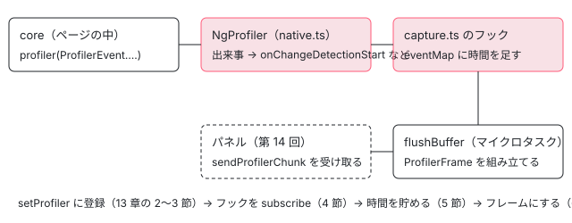

[目次](../README.md) › [Angular DevTools の内側](README.md) › 第 13 回 / 全 20 回

# プロファイラーの記録：ɵsetProfiler からフレームまで

> core の profiler（ProfilerEvent と setProfiler）にバックエンドが差し込むフック（profiling/profiler の native.ts・polyfill.ts・shared.ts）、変更検知のたびの記録を ProfilerFrame にまとめる capture.ts、startProfiling から profilerResults までの流れ。

angular/angular · 読了 約 13 分 · 発展 · [サイトで読む（デモが動きます）](https://angular-deep-dive-cyan.vercel.app/chapter/devtools-profiler-capture)

---

Angular DevTools の Profiler タブで「記録」を押すと、変更検知のたびに 1 本ずつ棒が増えていきます。この章では、その棒 1 本（`ProfilerFrame`）がどこで作られるかを、core が出す `ProfilerEvent` から順に追います。core の `setProfiler` にバックエンドがフックを差し込み、`capture.ts` がコンポーネントごとの時間を集めて、変更検知が終わった直後にパネルへ送るまでです。

読む対象は core の `primitives/devtools/src/profiler_types.ts`・`render3/profiler.ts` と、バックエンドの `profiling/profiler/`（`index.ts`・`native.ts`・`polyfill.ts`・`shared.ts`）・`profiling/capture.ts`、それに `client-event-subscribers.ts` の `startProfiling`・`stopProfiling` の行です。

1. [1. 全体像](01-devtools-overview.md)
2. [2. Angular を見つける](02-devtools-detect.md)
3. [3. メッセージの道](03-devtools-messaging.md)
4. [4. プロトコル](04-devtools-protocol.md)
5. [5. コンポーネントの木](05-devtools-component-tree.md)
6. [6. 制御フローの塊](06-devtools-control-flow.md)
7. [7. 同じノードを見分ける](07-devtools-identity.md)
8. [8. パネルの木](08-devtools-forest-ui.md)
9. [9. プロパティの直列化](09-devtools-state-serializer.md)
10. [10. 入れ子を開く](10-devtools-property-resolver.md)
11. [11. 値を書き換える](11-devtools-property-mutation.md)
12. [12. 選ぶ・光らせる](12-devtools-inspector-highlight.md)
13. **13. プロファイラーの記録**（この章）
14. [14. 記録を描く](14-devtools-profiler-formatters.md)
15. [15. 変更検知を見張る](15-devtools-cd-analyzer.md)
16. [16. 注入器の木](16-devtools-injector-tree.md)
17. [17. signal のグラフ](17-devtools-signal-graph.md)
18. [18. ルーター・TransferState](18-devtools-router-transfer.md)
19. [19. テストとビルド](19-devtools-test-build.md)
20. [20. issue と PR を読む](20-devtools-issues.md)



*この章の流れ。core が出来事を出し、バックエンドの Profiler がフックに配り、capture.ts がフレームにまとめてパネルへ送る*

## 1. core が出す出来事：ProfilerEvent

core は、利用者のコード（テンプレート関数・ライフサイクルフック・イベントの listener）を呼ぶ前と後に、決まった関数 `profiler` を呼びます。そのとき渡す「何が起きたか」の番号が `ProfilerEvent` です。

📄 `angular/packages/core/primitives/devtools/src/profiler_types.ts` L17–46 （▶ の行: 22, 28, 34, 40, 46）

```ts
17 │ export enum ProfilerEvent {
18 │   /**
19 │    * Corresponds to the point in time before the runtime has called the template function of a
20 │    * component with `RenderFlags.Create`.
21 │    */
22 ▶   TemplateCreateStart,
23 │ 
24 │   /**
25 │    * Corresponds to the point in time after the runtime has called the template function of a
26 │    * component with `RenderFlags.Create`.
27 │    */
28 ▶   TemplateCreateEnd,
29 │ 
30 │   /**
31 │    * Corresponds to the point in time before the runtime has called the template function of a
32 │    * component with `RenderFlags.Update`.
33 │    */
34 ▶   TemplateUpdateStart,
35 │ 
36 │   /**
37 │    * Corresponds to the point in time after the runtime has called the template function of a
38 │    * component with `RenderFlags.Update`.
39 │    */
40 ▶   TemplateUpdateEnd,
41 │ 
42 │   /**
43 │    * Corresponds to the point in time before the runtime has called a lifecycle hook of a component
44 │    * or directive.
45 │    */
46 ▶   LifecycleHookStart,
```

22・28 行目が「テンプレート関数を作成モードで呼ぶ前と後」、34・40 行目が「更新モードで呼ぶ前と後」、46 行目がライフサイクルフックの前です。この先も `…Start` と `…End` が必ず対になって並び、全部で 26 個あります（変更検知の 1 回 `ChangeDetectionStart`、その中の 1 周 `ChangeDetectionSyncStart`、コンポーネント 1 つ `ComponentStart`、`@defer` の状態の切り替え `DeferBlockStateStart` など）。`enum` なので実体は 0 から始まる番号です。

📄 `angular/packages/core/primitives/devtools/src/profiler_types.ts` L159–164 （▶ の行: 163）

```ts
159 │ /**
160 │  * Profiler function which the runtime will invoke before and after user code.
161 │  */
162 │ export interface Profiler {
163 ▶   (event: ProfilerEvent, instance?: {} | null, eventFn?: Function): void;
164 │ }
```

163 行目が、呼ばれる側（コールバック）の形です。出来事の番号・対象のインスタンス・そのとき呼ぶ関数（テンプレート関数やフックの関数）の 3 つを受け取ります。

### どこで呼ばれるか

`profiler(ProfilerEvent.…)` を呼ぶ行を grep した結果です（Start の側だけを抜き出しました。End は同じ関数の `finally` の中にあります）。

📄 `ターミナル（../angular の packages/core で）`

```
$ grep -rn "profiler(ProfilerEvent" packages/core/src   （抜粋、22.2.0-next.7）
src/application/create_application.ts:45:  profiler(ProfilerEvent.BootstrapApplicationStart);
src/application/application_ref.ts:542:    profiler(ProfilerEvent.ChangeDetectionStart);
src/application/application_ref.ts:595:      profiler(ProfilerEvent.ChangeDetectionSyncStart);
src/render3/instructions/change_detection.ts:470:  profiler(ProfilerEvent.ComponentStart);
src/render3/instructions/change_detection.ts:476:    profiler(ProfilerEvent.ComponentEnd, componentView[CONTEXT] as any as {});
src/render3/instructions/change_detection.ts:599:        profiler(ProfilerEvent.HostBindingsUpdateStart, context);
src/render3/instructions/render.ts:44:  profiler(ProfilerEvent.ComponentStart);
src/render3/hooks.ts:287:  profiler(ProfilerEvent.LifecycleHookStart, directive, hook);
src/render3/node_manipulation.ts:454:            profiler(ProfilerEvent.LifecycleHookStart, callContext, hook);
src/render3/view/listeners.ts:90:    profiler(ProfilerEvent.OutputStart, context as {} | null, listenerFn);
src/render3/after_render/manager.ts:75:      profiler(ProfilerEvent.AfterRenderHooksStart);
src/render3/component_ref.ts:276:    profiler(ProfilerEvent.DynamicComponentStart);
src/defer/rendering.ts:245:  profiler(ProfilerEvent.DeferBlockStateStart);
（TemplateCreate／TemplateUpdate は instructions/shared.ts の 103〜114 行目で、変数に入れた種類で呼ぶ）
```

3 つだけ実物を見ます。どれも変更検知の章で読んだ関数の中の数行です。

📄 `angular/packages/core/src/render3/instructions/shared.ts` L103–107 （▶ の行: 104, 106）

```ts
103 │     const preHookType = isUpdatePhase
104 ▶       ? ProfilerEvent.TemplateUpdateStart
105 │       : ProfilerEvent.TemplateCreateStart;
106 ▶     profiler(preHookType, context as unknown as {}, templateFn);
107 │     templateFn(rf, context);
```
*executeTemplate の中（関数の全体は ivy-template-function の章）*

📄 `angular/packages/core/src/render3/view/listeners.ts` L89–93 （▶ の行: 90, 92）

```ts
89 │   try {
90 ▶     profiler(ProfilerEvent.OutputStart, context as {} | null, listenerFn);
91 │     // Only explicitly returning false from a listener should preventDefault
92 ▶     return listenerFn(e) !== false;
93 │   } catch (error) {
```
*executeListenerWithErrorHandling の中（関数の全体は boot-click-to-paint の章）*

📄 `angular/packages/core/src/render3/hooks.ts` L286–292 （▶ の行: 287, 290）

```ts
286 │ function callHookInternal(directive: any, hook: () => void) {
287 ▶   profiler(ProfilerEvent.LifecycleHookStart, directive, hook);
288 │   const prevConsumer = setActiveConsumer(null);
289 │   try {
290 ▶     hook.call(directive);
291 │   } finally {
292 │     setActiveConsumer(prevConsumer);
```
*callHookInternal の中（フックの呼び方は ivy-hooks の章）*

- **テンプレート**：106 行目で、`TemplateUpdateStart`（104 行目）と一緒に `context`（コンポーネントのインスタンス、埋め込みビューならその文脈のオブジェクト）とテンプレート関数そのものを渡します。関数の中身は [ivy-template-function の章](../ivy/03-ivy-template-function.md)です。
- **listener**：90 行目で `OutputStart` と listener の関数を渡し、92 行目で listener を呼びます。listener の関数の名前（コンパイラが付ける `Root_Template_button_click_3_listener` のような名前）が、あとで出力の名前として表示されます。
- **ライフサイクルフック**：287 行目で `LifecycleHookStart` とフックの関数を渡し、290 行目でフックを呼びます（[ivy-hooks の章](../ivy/13-ivy-hooks.md)）。

> [!NOTE]
> **ポイント**
>
> `ComponentStart`（grep の `change_detection.ts:470`）はインスタンスを渡さず、`ComponentEnd`（476）だけが `componentView[CONTEXT]` を渡します。また `ComponentStart` はコンポーネントのビューを「訪ねた」印で、テンプレートを実行したかどうかは分かりません。実行したかどうかは `TemplateUpdateStart` が出たかで分かります（7 節のデモで確かめます）。

## 2. setProfiler：コールバックを配列に足すだけ

📄 `angular/packages/core/src/render3/profiler.ts` L11–44 （▶ の行: 11, 36–37, 39, 41）

```ts
11 ▶ const profilerCallbacks: Profiler[] = [];
12 │ 
13 │ const NOOP_PROFILER_REMOVAL = () => {};
14 │ 
15 │ function removeProfiler(profiler: Profiler) {
16 │   const profilerIdx = profilerCallbacks.indexOf(profiler);
17 │   if (profilerIdx !== -1) {
18 │     profilerCallbacks.splice(profilerIdx, 1);
19 │   }
20 │ }
21 │ 
22 │ /**
23 │  * Adds a callback function which will be invoked before and after performing certain actions at
24 │  * runtime (for example, before and after running change detection). Multiple profiler callbacks can be set:
25 │  * in this case profiling events are reported to every registered callback.
26 │  *
27 │  * Warning: this function is *INTERNAL* and should not be relied upon in application's code.
28 │  * The contract of the function might be changed in any release and/or the function can be removed
29 │  * completely.
30 │  *
31 │  * @param profiler function provided by the caller or null value to disable all profilers.
32 │  * @returns a cleanup function that, when invoked, removes a given profiler callback.
33 │  */
34 │ export function setProfiler(profiler: Profiler | null): () => void {
35 │   if (profiler !== null) {
36 ▶     if (!profilerCallbacks.includes(profiler)) {
37 ▶       profilerCallbacks.push(profiler);
38 │     }
39 ▶     return () => removeProfiler(profiler);
40 │   } else {
41 ▶     profilerCallbacks.length = 0;
42 │     return NOOP_PROFILER_REMOVAL;
43 │   }
44 │ }
```

1. **11 行目：モジュールの中の配列**

   `profilerCallbacks` はこのファイルの中だけの配列です。注入器や signal とは関係のない、ただの配列です。
2. **36〜37 行目：同じ関数は 2 回足さない**

   コメント（24 行目）のとおり、**複数のコールバックを同時に持てます**。DevTools の拡張と、core 自身の Chrome の Performance パネル向けの記録（[第 15 回](15-devtools-cd-analyzer.md)）が同時に登録されても、どちらにも届きます。
3. **39 行目：外すための関数を返す**

   呼び出し側は、戻り値を呼べば自分のコールバックだけを外せます。
4. **41 行目：`null` を渡すと全部消える**

   ほかの人が登録したものも消えます。DevTools のバックエンドは `null` を渡しません。

📄 `angular/packages/core/src/render3/profiler.ts` L46–60 （▶ の行: 55–56, 58）

```ts
46 │ /**
47 │  * Profiler function which wraps user code executed by the runtime.
48 │  *
49 │  * @param event ProfilerEvent corresponding to the execution context
50 │  * @param instance component instance
51 │  * @param eventFn function associated with event.
52 │  *    For example a template function, lifecycle hook, or output listener.
53 │  *    The value depends on the execution context
54 │  */
55 ▶ export const profiler: Profiler = function (event, instance = null, eventFn): void {
56 ▶   for (let i = 0; i < profilerCallbacks.length; i++) {
57 │     const profilerCallback = profilerCallbacks[i];
58 ▶     profilerCallback(event, instance, eventFn);
59 │   }
60 │ };
```

55 行目の `profiler` が、1 節の grep で出てきた各所から呼ばれる関数です。56〜58 行目で配列を前から順に呼ぶだけです。コールバックが 1 つも無ければループは 0 回で終わります。この関数は `window.ng.ɵsetProfiler` として開発モードのときだけページに出されます（出し方は [di-debug の章](../di/16-di-debug.md)の `publishDefaultGlobalUtils`）。

## 3. バックエンドが差し込む：NgProfiler と PatchingProfiler

📄 `angular/devtools/projects/ng-devtools-backend/src/lib/profiling/profiler/index.ts` L17–48 （▶ の行: 18, 25–26, 28, 41–42, 44–45）

```ts
17 │ // Global reference.
18 ▶ let profiler: Profiler;
19 │ 
20 │ /**
21 │  * Factory method for creating profiler object.
22 │  * Gives priority to NgProfiler, falls back on PatchingProfiler if framework APIs are not present.
23 │  */
24 │ const selectProfilerStrategy = (): Profiler => {
25 ▶   if (typeof ngDebugClient().ɵsetProfiler === 'function') {
26 ▶     return new NgProfiler();
27 │   }
28 ▶   return new PatchingProfiler();
29 │ };
30 │ 
31 │ /**
32 │  * Get the Profiler reference.
33 │  * Initializes the Profiler if it wasn't requested before.
34 │  */
35 │ export function getProfiler(
36 │   depsForTestOnly: {
37 │     profiler?: new (...args: any[]) => Profiler;
38 │   } = {},
39 │ ): Profiler {
40 │   // Allow for overriding the Profiler implementation for testing purposes.
41 ▶   if (depsForTestOnly.profiler) {
42 ▶     profiler = new depsForTestOnly.profiler();
43 │   }
44 ▶   if (!profiler) {
45 ▶     profiler = selectProfilerStrategy();
46 │   }
47 │   return profiler;
48 │ }
```

18 行目の `profiler` は、バックエンドの中でただ 1 つの Profiler です。最初に `getProfiler()` が呼ばれたとき 44〜45 行目で作られ、そのあとは同じものが返ります。25〜26 行目で、ページの `ng.ɵsetProfiler` が関数なら `NgProfiler`（native.ts）を、無ければ 28 行目で `PatchingProfiler`（polyfill.ts、古い版の Angular 向け）を選びます。41〜42 行目はテストのための入口で、spec は `depsForTestOnly.profiler` に偽物のクラスを渡します（テストと直し方の節）。

> [!TIP]
> **新卒エンジニアへ**
>
> 「本番モードのアプリではプロファイラーを始めない」修正（1a2bcb2295c）は [第 2 回](02-devtools-detect.md)で読みます。読み込んだだけで `getProfiler().subscribe(…)` が走っていた行を、Performance パネルの段（[第 15 回](15-devtools-cd-analyzer.md)）を有効にしたときまで遅らせた修正です。

### NgProfiler：出来事の番号をメソッドの名前にする

📄 `angular/devtools/projects/ng-devtools-backend/src/lib/profiling/profiler/native.ts` L20–51 （▶ の行: 22, 28–29, 33, 39–41, 49–50）

```ts
20 │ /** Implementation of Profiler that utilizes framework APIs fire profiler hooks. */
21 │ export class NgProfiler extends Profiler {
22 ▶   private _tracker = IdentityTracker.getInstance();
23 │   private _callbacks: ProfilerCallback[] = [];
24 │   private _lastDirectiveInstance: {} | null = null;
25 │ 
26 │   constructor(config: Partial<Hooks> = {}) {
27 │     super(config);
28 ▶     this._setProfilerCallback((event: ɵProfilerEvent, instanceOrLView: {} | null, eventFn: any) => {
29 ▶       if (this[event] === undefined) {
30 │         return;
31 │       }
32 │ 
33 ▶       this[event](instanceOrLView, eventFn);
34 │     });
35 │     this._initialize();
36 │   }
37 │ 
38 │   private _initialize(): void {
39 ▶     ngDebugClient().ɵsetProfiler!(
40 ▶       (event: ɵProfilerEvent, instanceOrLView: {} | null = null, eventFn: any) =>
41 ▶         this._callbacks.forEach((cb) => cb(event, instanceOrLView, eventFn)),
42 │     );
43 │   }
44 │ 
45 │   private _setProfilerCallback(callback: ProfilerCallback): void {
46 │     this._callbacks.push(callback);
47 │   }
48 │ 
49 ▶   override destroy(): void {
50 ▶     this._tracker.destroy();
51 │   }
```

1. **39〜41 行目：core に 1 つだけ登録する**

   `ngDebugClient().ɵsetProfiler`（`window.ng` のこと）に関数を 1 つ渡します。その関数は、受け取った出来事を `_callbacks` の全部に配ります。
2. **28〜33 行目：番号でメソッドを引く**

   29 行目の `this[event]` は、出来事の番号（たとえば `TemplateUpdateStart` の 2）をキーにしたメソッドです。クラスの中で `[ɵProfilerEvent.TemplateUpdateStart](…)` のように番号を名前にしたメソッドを並べているので、33 行目の 1 行で振り分けができます。
3. **22 行目：IdentityTracker**

   インスタンスに番号（id）と木の中の位置（`ElementPosition`、`[0, 1]` のような添字の列）を振る係です（[第 7 回](07-devtools-identity.md)）。プロファイラーは位置を使って、あとで木の形の記録を組み立てます。
4. **49〜50 行目：destroy は tracker を片付けるだけ**

   39 行目の `ɵsetProfiler` が返す「外す関数」はどこにも保存していません。つまり core 側のコールバックは、一度登録されるとページが閉じるまで残ります。フックを止めるのは、次に見る `Profiler.unsubscribe` の側です。

26 個の出来事のうち、中身があるのは次の 3 組だけです（ほかの番号のメソッドは「todo: implement」で何もしません）。

📄 `angular/devtools/projects/ng-devtools-backend/src/lib/profiling/profiler/native.ts` L171–203 （▶ の行: 172, 175–176, 182–183, 188–189, 193, 197–198）

```ts
171 │   [ɵProfilerEvent.TemplateUpdateStart](context: DirectiveInstance, _eventFn: any): void {
172 ▶     if (!this._inChangeDetection) {
173 │       this._inChangeDetection = true;
174 │       runOutsideAngular(() => {
175 ▶         Promise.resolve().then(() => {
176 ▶           this.changeDetection$.next();
177 │           this._inChangeDetection = false;
178 │         });
179 │       });
180 │     }
181 │ 
182 ▶     const position = this._tracker.getDirectivePosition(context);
183 ▶     const id = this._tracker.getDirectiveId(context);
184 │ 
185 │     // If we can find the position and the ID we assume that this is a component instance.
186 │     // Alternatively, if we can't find the ID or the position, we assume that this is a
187 │     // context of an embedded view (for example, NgForOfContext, NgIfContext, or a custom one).
188 ▶     if (position !== undefined && id !== undefined) {
189 ▶       this._lastDirectiveInstance = context;
190 │     }
191 │ 
192 │     if (id !== undefined && position !== undefined) {
193 ▶       this._onChangeDetectionStart(context, getDirectiveHostElement(context), id, position);
194 │       return;
195 │     }
196 │ 
197 ▶     this._onChangeDetectionStart(
198 ▶       this._lastDirectiveInstance,
199 │       getDirectiveHostElement(this._lastDirectiveInstance),
200 │       this._tracker.getDirectiveId(this._lastDirectiveInstance),
201 │       this._tracker.getDirectivePosition(this._lastDirectiveInstance),
202 │     );
203 │   }
```

1. **172〜180 行目：変更検知が始まったことを 1 回だけ知らせる**

   最初の `TemplateUpdateStart` で `_inChangeDetection` を立て、175 行目のマイクロタスクで `changeDetection$` に流します。同じ変更検知の中の 2 つめ以降のテンプレートでは何もしません。マイクロタスクは同期の変更検知が全部終わってから動くので、「1 回の変更検知に 1 回」になります。この `changeDetection$` を 250 ms 間引いたものが、パネルにコンポーネントの木の取り直しを頼む `componentTreeDirty` になります（[第 5 回](05-devtools-component-tree.md)）。
2. **182〜183 行目：位置と id を引く**

   コンポーネントのインスタンスなら IdentityTracker が知っています。
3. **188〜195 行目：知っているインスタンスなら、そのコンポーネントの開始**

   189 行目で「最後に見たコンポーネント」として覚え、193 行目でフックの `onChangeDetectionStart` を呼びます。
4. **197〜202 行目：知らない文脈なら、最後に見たコンポーネントの開始とみなす**

   埋め込みビュー（`@if` の中身や `*ngFor` の 1 行）のテンプレートは、文脈がコンポーネントではありません（185〜187 行目のコメント）。その時間は 198 行目の `_lastDirectiveInstance`、つまり直前のコンポーネントに足されます。

📄 `angular/devtools/projects/ng-devtools-backend/src/lib/profiling/profiler/native.ts` L222–255 （▶ の行: 225, 228, 247）

```ts
222 │   [ɵProfilerEvent.LifecycleHookStart](directive: DirectiveInstance, hook: any): void {
223 │     const id = this._tracker.getDirectiveId(directive);
224 │     const element = getDirectiveHostElement(directive);
225 ▶     const lifecycleHookName = getLifeCycleName(directive, hook);
226 │     const isComponent = !!this._tracker.isComponent.get(directive);
227 │ 
228 ▶     this._onLifecycleHookStart(directive, lifecycleHookName, element, id, isComponent);
229 │   }
230 │ 
231 │   [ɵProfilerEvent.LifecycleHookEnd](directive: DirectiveInstance, hook: any): void {
232 │     const id = this._tracker.getDirectiveId(directive);
233 │     const element = getDirectiveHostElement(directive);
234 │     const lifecycleHookName = getLifeCycleName(directive, hook);
235 │     const isComponent = !!this._tracker.isComponent.get(directive);
236 │ 
237 │     this._onLifecycleHookEnd(directive, lifecycleHookName, element, id, isComponent);
238 │   }
239 │ 
240 │   [ɵProfilerEvent.OutputStart](
241 │     componentOrDirective: DirectiveInstance,
242 │     listener: () => void,
243 │   ): void {
244 │     const isComponent = !!this._tracker.isComponent.get(componentOrDirective);
245 │     const node = getDirectiveHostElement(componentOrDirective);
246 │     const id = this._tracker.getDirectiveId(componentOrDirective);
247 ▶     this._onOutputStart(componentOrDirective, listener.name, node, id, isComponent);
248 │   }
249 │ 
250 │   [ɵProfilerEvent.OutputEnd](componentOrDirective: DirectiveInstance, listener: () => void): void {
251 │     const isComponent = !!this._tracker.isComponent.get(componentOrDirective);
252 │     const node = getDirectiveHostElement(componentOrDirective);
253 │     const id = this._tracker.getDirectiveId(componentOrDirective);
254 │     this._onOutputEnd(componentOrDirective, listener.name, node, id, isComponent);
255 │   }
```

フックは 225 行目でフックの名前を調べてから 228 行目で渡し、listener は 247 行目で **listener の関数の名前**（`listener.name`）を出力の名前として渡します。

📄 `angular/devtools/projects/ng-devtools-backend/src/lib/profiling/profiler/shared.ts` L244–279 （▶ の行: 258, 265–266, 269, 274–275）

```ts
244 │ const hookNames = [
245 │   'OnInit',
246 │   'OnDestroy',
247 │   'OnChanges',
248 │   'DoCheck',
249 │   'AfterContentInit',
250 │   'AfterContentChecked',
251 │   'AfterViewInit',
252 │   'AfterViewChecked',
253 │ ];
254 │ 
255 │ const hookMethodNames = new Set(hookNames.map((hook) => `ng${hook}`));
256 │ 
257 │ export const getLifeCycleName = (obj: {}, fn: any): keyof LifecycleProfile | 'unknown' => {
258 ▶   const proto = Object.getPrototypeOf(obj);
259 │   const keys = Object.getOwnPropertyNames(proto);
260 │   for (const propName of keys) {
261 │     // We don't want to touch random get accessors.
262 │     if (!hookMethodNames.has(propName)) {
263 │       continue;
264 │     }
265 ▶     if (proto[propName] === fn) {
266 ▶       return propName as keyof LifecycleProfile;
267 │     }
268 │   }
269 ▶   const fnName = fn.name;
270 │   if (typeof fnName !== 'string') {
271 │     return 'unknown';
272 │   }
273 │   for (const hookName of hookNames) {
274 ▶     if (fnName.indexOf(hookName) >= 0) {
275 ▶       return `ng${hookName}` as keyof LifecycleProfile;
276 │     }
277 │   }
278 │   return 'unknown';
279 │ };
```

`getLifeCycleName` は、まず 258〜266 行目でインスタンスのプロトタイプにある `ngOnInit` などのメソッドと同じ関数かを比べます。違えば 269〜275 行目で、**関数の名前に `OnChanges` などの文字が入っているか**で決めます。core は `ngOnChanges` を持つディレクティブに対して、自分の包み関数 `rememberChangeHistoryAndInvokeOnChangesHook` をフックとして呼ぶので、この関数は 274 行目の文字の一致で `ngOnChanges` になります。包み関数は入力が変わっていない回にも呼ばれる（中で変化が無ければ利用者の `ngOnChanges` を呼ばない）ので、**記録の `ngOnChanges` には、利用者の `ngOnChanges` が呼ばれなかった回の時間も入ります**（7 節のデモの (1)・(3)・(4) で見えます）。

### Profiler の基底クラス：フックの配列

📄 `angular/devtools/projects/ng-devtools-backend/src/lib/profiling/profiler/shared.ts` L88–114 （▶ の行: 96, 98, 101, 108–109, 112–113）

```ts
 88 │ /**
 89 │  *  Class for profiling angular applications. Handles hook subscriptions and emitting change
 90 │  * detection events.
 91 │  */
 92 │ export abstract class Profiler {
 93 │   /** @internal */
 94 │   protected _inChangeDetection = false;
 95 │ 
 96 ▶   changeDetection$ = new Subject<void>();
 97 │ 
 98 ▶   private _hooks: Partial<Hooks>[] = [];
 99 │ 
100 │   constructor(config: Partial<Hooks> = {}) {
101 ▶     this._hooks.push(config);
102 │   }
103 │ 
104 │   abstract destroy(): void;
105 │ 
106 │   abstract onIndexForest(newNodes: NodeArray, removedNodes: NodeArray): void;
107 │ 
108 ▶   subscribe(config: Partial<Hooks>): void {
109 ▶     this._hooks.push(config);
110 │   }
111 │ 
112 ▶   unsubscribe(config: Partial<Hooks>): void {
113 ▶     this._hooks.splice(this._hooks.indexOf(config), 1);
114 │   }
```

98 行目の `_hooks` が、`onChangeDetectionStart` などを持つオブジェクトの配列です。108〜113 行目の `subscribe`・`unsubscribe` で足したり外したりします。この章の `capture.ts` と、[第 15 回](15-devtools-cd-analyzer.md)の CD analyzer と Performance パネルの段が、同じ 1 つの Profiler に別々のフックを subscribe します（ハイドレーションの重ね表示は 96 行目の `changeDetection$` を購読します）。

📄 `angular/devtools/projects/ng-devtools-backend/src/lib/profiling/profiler/shared.ts` L144–168 （▶ の行: 151–152, 154, 164–165, 167）

```ts
144 │   /** @internal */
145 │   protected _onChangeDetectionStart(
146 │     _: ComponentInstance,
147 │     hook: Node,
148 │     id: number | undefined,
149 │     position: ElementPosition | undefined,
150 │   ): void {
151 ▶     if (id === undefined || position === undefined) {
152 ▶       return;
153 │     }
154 ▶     this._invokeCallback('onChangeDetectionStart', [_, hook, id, position]);
155 │   }
156 │ 
157 │   /** @internal */
158 │   protected _onChangeDetectionEnd(
159 │     _: ComponentInstance,
160 │     hook: Node,
161 │     id: number | undefined,
162 │     position: ElementPosition | undefined,
163 │   ): void {
164 ▶     if (id === undefined || position === undefined) {
165 ▶       return;
166 │     }
167 ▶     this._invokeCallback('onChangeDetectionEnd', [_, hook, id, position]);
168 │   }
```

151〜152・164〜165 行目で、**id か位置が分からないものは捨てます**。IdentityTracker がまだ木を索引していないコンポーネント（DevTools のパネルを開く前に一度も木を作っていないなど）の時間は、ここで消えます。154・167 行目の `_invokeCallback` が、`_hooks` の全部の同じ名前の関数を呼びます。

### PatchingProfiler：テンプレート関数を差し替える（古い版向け）

📄 `angular/devtools/projects/ng-devtools-backend/src/lib/profiling/profiler/polyfill.ts` L79–110 （▶ の行: 84, 89, 102–103, 105, 108）

```ts
 79 │   private _observeComponent(cmp: ComponentInstance): void {
 80 │     const declarations = componentMetadata(cmp);
 81 │     if (!declarations) {
 82 │       return;
 83 │     }
 84 ▶     const original = declarations.template;
 85 │     const self = this;
 86 │     if (original.patched) {
 87 │       return;
 88 │     }
 89 ▶     declarations.tView.template = function (_: any, component: ComponentInstance): void {
 90 │       if (!self._inChangeDetection) {
 91 │         self._inChangeDetection = true;
 92 │         runOutsideAngular(() => {
 93 │           Promise.resolve().then(() => {
 94 │             self.changeDetection$.next();
 95 │             self._inChangeDetection = false;
 96 │           });
 97 │         });
 98 │       }
 99 │       const position = self._tracker.getDirectivePosition(component);
100 │       const id = self._tracker.getDirectiveId(component);
101 │ 
102 ▶       self._onChangeDetectionStart(component, getDirectiveHostElement(component), id, position);
103 ▶       original.apply(this, arguments);
104 │       if (self._tracker.hasDirective(component) && id !== undefined && position !== undefined) {
105 ▶         self._onChangeDetectionEnd(component, getDirectiveHostElement(component), id, position);
106 │       }
107 │     };
108 ▶     declarations.tView.template.patched = true;
109 │     this._patched.set(cmp, original);
110 │   }
```

`ɵsetProfiler` が無い古い版の Angular では、core に出来事を出してもらえません。そこで 89 行目で、コンポーネントの `tView.template`（テンプレート関数）を自分の関数で差し替え、102 行目で開始を知らせ、103 行目で元の関数（84 行目で取っておいたもの）を呼び、105 行目で終了を知らせます。いまの Angular（このサイトの 22.1.6 も）では `ɵsetProfiler` があるので、こちらは使われません。

## 4. startProfiling：フックを subscribe する

📄 `angular/devtools/projects/ng-devtools-backend/src/lib/client-event-subscribers.ts` L236–243 （▶ の行: 237–238, 242）

```ts
236 │ const startProfilingCallback = (messageBus: MessageBus<Events>) => () =>
237 ▶   startProfiling((frame: ProfilerFrame) => {
238 ▶     messageBus.emit('sendProfilerChunk', [frame]);
239 │   });
240 │ 
241 │ const stopProfilingCallback = (messageBus: MessageBus<Events>) => () => {
242 ▶   messageBus.emit('profilerResults', [stopProfiling()]);
243 │ };
```

パネルが `startProfiling` を送ると 237 行目で `capture.ts` の `start` を呼び、フレームが 1 つできるたびに 238 行目で `sendProfilerChunk` として送ります。`stopProfiling` を送ると 242 行目で `stop` の戻り値を `profilerResults` として送ります。

📄 `angular/devtools/projects/ng-devtools-backend/src/lib/profiling/capture.ts` L28–65 （▶ の行: 40–41, 43, 50, 52–53, 58–59, 62）

```ts
28 │ let inProgress = false;
29 │ let inChangeDetection = false;
30 │ let eventMap: Map<any, DirectiveProfile>;
31 │ let frameDuration = 0;
32 │ let hooks: Partial<Hooks> = {};
33 │ 
34 │ const DIRECTIVE_CONTROL_FLOW: {[key in ControlFlowBlockType]: ElementProfile['type']} = {
35 │   [ControlFlowBlockType.For]: 'for',
36 │   [ControlFlowBlockType.Defer]: 'defer',
37 │ };
38 │ 
39 │ export const start = (onFrame: (frame: ProfilerFrame) => void): void => {
40 ▶   if (inProgress) {
41 ▶     throw new AngularDevtoolsError('Recording already in progress');
42 │   }
43 ▶   eventMap = new Map<any, DirectiveProfile>();
44 │   inProgress = true;
45 │ 
46 │   // Enable preservation mode. While it is active, removed directive
47 │   // entries are kept so the profiler can still resolve IDs and positions.
48 │   // When profiling stops, the mode is changed back to `normal` and
49 │   // deferred removals are flushed.
50 ▶   IdentityTracker.getInstance().selectMode('preservation');
51 │ 
52 ▶   hooks = getHooks(onFrame);
53 ▶   getProfiler().subscribe(hooks);
54 │ };
55 │ 
56 │ export const stop = (): ProfilerFrame => {
57 │   const directiveForestManager = getDirectiveForestManager();
58 ▶   const result = flushBuffer(directiveForestManager);
59 ▶   getProfiler().unsubscribe(hooks);
60 │   inProgress = false;
61 │   hooks = {};
62 ▶   IdentityTracker.getInstance().selectMode('normal');
63 │ 
64 │   return result;
65 │ };
```

1. **40〜41 行目：二重に始めない**

   記録中にもう一度 `start` されると例外を投げます。
2. **43 行目：`eventMap` を空にする**

   インスタンス → そのインスタンスの記録（`DirectiveProfile`：名前・`changeDetection` の時間・フックごとの時間・出力ごとの時間）の Map です。
3. **50 行目：IdentityTracker を「保存」のモードにする**

   記録中に壊されたコンポーネントの id と位置を消さずに残します（46〜49 行目のコメント）。7 節のデモの (4) で、壊された `Extra` の `ngOnDestroy` が位置つきで記録されるのはこのためです。
4. **52〜53 行目：フックを作って subscribe**

   中身は次の節です。
5. **58〜62 行目：stop は残りを吐き出して外す**

   58 行目で残っている記録をフレームにし、59 行目でフックを外し、62 行目で tracker を普通のモードに戻します（このとき保存していた削除がまとめて反映されます）。

## 5. 時間を貯める：capture.ts のフック

📄 `angular/devtools/projects/ng-devtools-backend/src/lib/profiling/capture.ts` L83–119 （▶ の行: 84, 89, 98–101, 103, 105, 109–110）

```ts
 83 │ const getHooks = (onFrame: (frame: ProfilerFrame) => void): Partial<Hooks> => {
 84 ▶   const timeStartMap: Record<string, number> = {};
 85 │   return {
 86 │     // We flush here because it's possible the current node to overwrite
 87 │     // an existing removed node.
 88 │     onCreate(directive: DirectiveInstance, node: Node, _: number, isComponent: boolean): void {
 89 ▶       eventMap.set(directive, {
 90 │         isElement: isCustomElement(node),
 91 │         name: getDirectiveName(directive),
 92 │         isComponent,
 93 │         lifecycle: {},
 94 │         outputs: {},
 95 │       });
 96 │     },
 97 │     onChangeDetectionStart(component: ComponentInstance, node: Node): void {
 98 ▶       startEvent(timeStartMap, component, 'changeDetection');
 99 ▶       if (!inChangeDetection) {
100 ▶         inChangeDetection = true;
101 ▶         const source = getChangeDetectionSource();
102 │         runOutsideAngular(() => {
103 ▶           Promise.resolve().then(() => {
104 │             inChangeDetection = false;
105 ▶             onFrame(flushBuffer(getDirectiveForestManager(), source));
106 │           });
107 │         });
108 │       }
109 ▶       if (!eventMap.has(component)) {
110 ▶         eventMap.set(component, {
111 │           isElement: isCustomElement(node),
112 │           name: getDirectiveName(component),
113 │           isComponent: true,
114 │           changeDetection: 0,
115 │           lifecycle: {},
116 │           outputs: {},
117 │         });
118 │       }
119 │     },
```

1. **98 行目：開始の時刻を覚える**

   84 行目の `timeStartMap` に、`startEvent` が `名前#changeDetection` というキーで `performance.now()` を入れます。キーが**インスタンスではなくクラスの名前**なので、同じクラスのコンポーネントが入れ子になると開始の時刻が上書きされます。
2. **99〜108 行目：変更検知の終わりにフレームを吐き出す予約**

   3 節の `changeDetection$` と同じ形で、最初の開始のときだけマイクロタスクを 1 つ予約します。103〜105 行目で、同期の変更検知が全部終わった直後に `flushBuffer` を呼び、できたフレームを `onFrame`（4 節の 238 行目の `sendProfilerChunk`）に渡します。
3. **101 行目：source（きっかけ）**

   `getChangeDetectionSource`（6 節）が zone.js の今のタスクの名前を返します。zone.js の無いアプリでは空の文字列です。
4. **109〜118 行目：初めて見るコンポーネントなら記録を作る**

   88〜95 行目の `onCreate`（記録中に作られたディレクティブ）でも同じ形の記録を作ります。

📄 `angular/devtools/projects/ng-devtools-backend/src/lib/profiling/capture.ts` L120–138 （▶ の行: 128, 132–134）

```ts
120 │     onChangeDetectionEnd(component: ComponentInstance): void {
121 │       const profile = eventMap.get(component);
122 │ 
123 │       if (profile) {
124 │         let current = profile.changeDetection;
125 │         if (current === undefined) {
126 │           current = 0;
127 │         }
128 ▶         const startTimestamp = getEventStart(timeStartMap, component, 'changeDetection');
129 │         if (startTimestamp === undefined) {
130 │           return;
131 │         }
132 ▶         const duration = performance.now() - startTimestamp;
133 ▶         profile.changeDetection = current + duration;
134 ▶         frameDuration += duration;
135 │       } else {
136 │         debugLog.warn('Could not find profile for', component);
137 │       }
138 │     },
```

128 行目で開始の時刻を引き、132 行目で差を取り、133 行目でそのコンポーネントの `changeDetection` に**足し**、134 行目でフレーム全体の `frameDuration` にも足します。1 回の変更検知で同じコンポーネントのテンプレートが何度も（埋め込みビューの分も）動けば、そのたびに足されます。フック（`onLifecycleHookEnd`）と出力（`onOutputEnd`）も同じ形で、`lifecycle[フックの名前]`・`outputs[listener の名前]` に足し、`frameDuration` にも足します（`onLifecycleHookEnd`・`onOutputEnd`。形が同じなので引用は省きます）。

> [!WARNING]
> **ハマりどころ**
>
> `changeDetection` の時間は、`TemplateUpdateStart` から `TemplateUpdateEnd` まで、つまり**テンプレート関数の実行だけ**です。子のコンポーネントの確認やフックは、テンプレート関数が終わってから `refreshView` が呼ぶので（[cd-refresh-view の章](../cd/03-cd-refresh-view.md)）、親の時間には入りません。その分、`frameDuration` は「テンプレート・フック・listener の時間の合計」で、変更検知 1 回の実際の長さ（DOM の操作や走査を含む）より短くなります。

## 6. フレームにする：flushBuffer

📄 `angular/devtools/projects/ng-devtools-backend/src/lib/profiling/capture.ts` L348–379 （▶ の行: 349, 353, 360, 362–363, 365, 367, 369, 374–375, 378）

```ts
348 │ const flushBuffer = (directiveForestManager: DirectiveForestManager, source: string = '') => {
349 ▶   const items = Array.from(eventMap.keys());
350 │   const positions: ElementPosition[] = [];
351 │   const positionDirective = new Map<ElementPosition, DirectiveInstance>();
352 │   items.forEach((dir) => {
353 ▶     const position = directiveForestManager.getDirectivePosition(dir);
354 │     if (position === undefined) {
355 │       return;
356 │     }
357 │     positions.push(position);
358 │     positionDirective.set(position, dir);
359 │   });
360 ▶   positions.sort(lexicographicOrder);
361 │ 
362 ▶   const result = prepareInitialFrame(source, frameDuration);
363 ▶   frameDuration = 0;
364 │ 
365 ▶   positions.forEach((position) => {
366 │     const dir = positionDirective.get(position);
367 ▶     insertElementProfile(result.directives, position, eventMap.get(dir));
368 │   });
369 ▶   eventMap = new Map<any, DirectiveProfile>();
370 │   return result;
371 │ };
372 │ 
373 │ const getChangeDetectionSource = () => {
374 ▶   const zone = (window as any).Zone;
375 ▶   if (!zone || !zone.currentTask) {
376 │     return '';
377 │   }
378 ▶   return zone.currentTask.source;
379 │ };
```

1. **349〜359 行目：記録のあるインスタンスの位置を集める**

   位置の分からないもの（353 行目が `undefined`）は飛ばします。
2. **360 行目：位置を並べる**

   `lexicographicOrder` は、短い位置（浅いノード）を先に、同じ長さなら添字の小さい順にします。親を子より先に入れるためです。
3. **362〜363 行目：木の形の枠を作って、時間の合計を入れる**

   枠は次の `prepareInitialFrame` が、**今の木の全部のノード**から作ります。記録の無いノードも、時間の無いディレクティブとして枠に入ります。
4. **365〜368 行目：枠に記録を差し込む**

   `insertElementProfile` が位置の添字をたどって枠のノードを探し、`insertOrMerge` で記録を混ぜます。
5. **369 行目：`eventMap` を空にする**

   次のフレームの記録は空から始まります。
6. **373〜379 行目：source**

   374 行目の `window.Zone` が無ければ 376 行目で空の文字列、あれば 378 行目で今のタスクの `source`（`HTMLButtonElement.addEventListener:click` のような文字列。[zone-task の章](../zone/04-zone-task.md)）です。

📄 `angular/devtools/projects/ng-devtools-backend/src/lib/profiling/capture.ts` L296–316 （▶ の行: 297–300, 303, 306, 308, 310）

```ts
296 │ const prepareInitialFrame = (source: string, duration: number) => {
297 ▶   const frame: ProfilerFrame = {
298 ▶     source,
299 ▶     duration,
300 ▶     directives: [],
301 │   };
302 │   const directiveForestManager = getDirectiveForestManager();
303 ▶   const directiveForest = directiveForestManager.getIndexedDirectiveForest();
304 │   const traverse = (node: ComponentTreeNode, children = frame.directives) => {
305 │     let position: ElementPosition | undefined;
306 ▶     if (node.component) {
307 │       position = directiveForestManager.getDirectivePosition(node.component.instance);
308 ▶     } else if (node.directives?.[0]) {
309 │       position = directiveForestManager.getDirectivePosition(node.directives[0].instance);
310 ▶     } else if (node.controlFlowBlock) {
311 │       position = directiveForestManager.getDirectivePosition(node.controlFlowBlock);
312 │     }
313 │ 
314 │     if (position === undefined) {
315 │       return;
316 │     }
```

297〜301 行目がパネルへ送る `ProfilerFrame` の形そのものです（`source`・`duration`・`directives`。型の定義は [第 4 回](04-devtools-protocol.md)）。303 行目で索引ずみのディレクティブの木（[第 5 回](05-devtools-component-tree.md)）を取り、306〜312 行目でコンポーネント・ディレクティブ・制御フローの塊（[第 6 回](06-devtools-control-flow.md)）の位置を引いて、同じ形の `ElementProfile` の木を作ります。

📄 `angular/devtools/projects/ng-devtools-backend/src/lib/profiling/capture.ts` L235–262 （▶ の行: 238, 244–245, 251, 260）

```ts
235 │ const insertOrMerge = (lastFrame: ElementProfile, profile: DirectiveProfile) => {
236 │   let exists = false;
237 │   lastFrame.directives.forEach((d) => {
238 ▶     if (d.name === profile.name) {
239 │       exists = true;
240 │       let current = d.changeDetection;
241 │       if (current === undefined) {
242 │         current = 0;
243 │       }
244 ▶       d.changeDetection = current + (profile.changeDetection ?? 0);
245 ▶       for (const key of Object.keys(profile.lifecycle) as (keyof LifecycleProfile)[]) {
246 │         if (!d.lifecycle[key]) {
247 │           d.lifecycle[key] = 0;
248 │         }
249 │         d.lifecycle[key]! += profile.lifecycle[key]!;
250 │       }
251 ▶       for (const key of Object.keys(profile.outputs)) {
252 │         if (!d.outputs[key]) {
253 │           d.outputs[key] = 0;
254 │         }
255 │         d.outputs[key] += profile.outputs[key];
256 │       }
257 │     }
258 │   });
259 │   if (!exists) {
260 ▶     lastFrame.directives.push(profile);
261 │   }
262 │ };
```

238 行目で、枠の同じノードに**同じ名前**のディレクティブがあれば 244 行目で `changeDetection` を足し、245〜256 行目でフックと出力を足します。無ければ 260 行目でそのまま入れます。244 行目は記録に `changeDetection` が無くても `?? 0` で 0 を入れるので、**フックだけが動いたコンポーネントも `changeDetection: 0` になります**。一度も記録の無いコンポーネントは `changeDetection` の項目そのものが無いままです。この違いを、パネルのフレームグラフが色分けに使います（[第 14 回](14-devtools-profiler-formatters.md)）。

## 7. DEMO：4 つの操作のフレームを開く

> **🧪 DEMO — core の ProfilerEvent と、バックエンドが送った ProfilerFrame（記録の再生）**
>
> これは記録です。本物の devtools のソース（angular/angular の devtools/、8576f161ae4）を、本物の @angular/core 22.1.6（開発モード）のアプリにつないで Node で動かした結果です。アプリは `Root`（`count`・`label`・`show` の 3 つの signal とボタン）・`Child`（`@Input() label` と `ngOnChanges`・`ngDoCheck`）・`Extra`（`@if` の中、`ngDoCheck`・`ngOnDestroy`）の 3 つで、どれも `changeDetection` を書いていないので v22 の既定の OnPush です。記録のスクリプトは、本物の `initializeMessageBus` に手で作った bus をつなぎ、`startProfiling` を送ってから 4 つの操作をし、`stopProfiling` を送りました。同時に `ng.ɵsetProfiler` に自分のコールバックも足して（2 節のとおり複数持てる）、core が出した出来事の並びも記録しました。共通の部品（harness）は [第 1 回](01-devtools-overview.md)に全文があります。
>
> 「記録を再生する」を押してください。
>
> ▶ [このデモはサイトで動かせます](https://angular-deep-dive-cyan.vercel.app/chapter/devtools-profiler-capture)

記録から読み取れることです。

1. **(1) signal を変えると、Child のテンプレートは動かない**

   出来事を進めると、`Root_Template` の `TemplateUpdateStart` のあとに `Child` の `ComponentStart`・`ComponentEnd` は出ますが、`Child_Template` は出ません。`Child` は OnPush で、入力も変わっていないので、ビューを訪ねただけで更新しなかったからです（[cd-targeted-traversal の章](../cd/06-cd-targeted-traversal.md)）。それでもフレームの `Child` は `changeDetection: 0.000` で、`ngOnChanges`・`ngDoCheck` の時間を持っています。フックは親の `refreshView` が呼ぶので動き、6 節の 244 行目が 0 を入れたからです。
2. **(2) 入力を変えると、Child のテンプレートが動く**

   入力の変化が OnPush の子に印を付けるので（[cd-onpush-markforcheck の章](../cd/04-cd-onpush-markforcheck.md)）、`Child_Template` の出来事が出て、`Child` の `changeDetection` に 0 でない時間が入ります。
3. **(3) クリックは変更検知の前に出力として記録される**

   最初の 2 つが `OutputStart`・`OutputEnd`（`Root_Template_button_click_3_listener`）で、その後に変更検知が始まります。listener の時間は `eventMap` に入ったまま待ち、次の変更検知のフレームに一緒に入るので、`Root` の outputs に出ます。
4. **(4) 壊されたコンポーネントも位置つきで残る**

   `Extra` は `@if` で消えたのに、位置 `[0, 1]` に `ngOnDestroy` の時間つきで入っています。4 節の 50 行目の「保存」のモードのためです。
5. **埋め込みビューの時間はコンポーネントに足される**

   (1)〜(3) の出来事には、インスタンスの無い `TemplateUpdateStart` がもう 1 組あります。`@if` の中身のテンプレートです。3 節の 197〜202 行目のとおり、この時間は直前の `Root` の `changeDetection` に足されます。
6. **source は空、stopProfiling の結果は時間 0**

   zone.js の無いアプリなので source はどれも `""` です。`profilerResults` は、4 つのフレームを送ったあとで `eventMap` が空なので、枠だけで duration 0 です（パネルがこれをどう扱うかは [第 14 回](14-devtools-profiler-formatters.md)）。

> [!WARNING]
> **ハマりどころ**
>
> 時間の値について：Node の `performance.now()` は本物の高分解能の時計なので、値は「Node の上で JavaScript を実行した時間」です。アプリが小さく、domino（Node の上の DOM）には描画もレイアウトも無いので、どれも 0.001〜0.4 ms ほどの小さな値になります。ブラウザで同じアプリを記録した値とは比べられません。値の大小ではなく、**どの出来事に、どのディレクティブの、どの項目に足されたか**を見てください。

📄 `scratchpad の記録スクリプト（capture.ts。共通の部品で束ねて node で実行）`

```
// 第 13 回 devtools-profiler-capture の記録。
// 本物の @angular/core 22.1.6（開発モード）のアプリに本物の devtools のバックエンドをつなぎ、
// startProfiling → (1) signal の変更 → (2) 入力の変更 → (3) クリック（listener）→ (4) @if で子を消す → stopProfiling を送る。
// Child と Extra は v22 の既定の OnPush（changeDetection を書いていない）。
// 同時に ng.ɵsetProfiler に自分のコールバックも足して、core が出した ProfilerEvent の並びも記録する。
import { Component, Input, OnChanges, DoCheck, OnDestroy, signal } from '@angular/core';
import { ɵProfilerEvent as ProfilerEvent } from '@angular/core';
import { bootApp, makeBus, loadBackend, tick, writeJson } from '../_shared/harness';

@Component({ selector: 'app-child', template: '<b>{{ label }}</b>' })
class Child implements OnChanges, DoCheck {
  @Input() label = '';
  ngOnChanges() {}
  ngDoCheck() {}
}

@Component({ selector: 'app-extra', template: 'extra' })
class Extra implements DoCheck, OnDestroy {
  ngDoCheck() {}
  ngOnDestroy() {}
}

@Component({
  selector: 'app-root',
  imports: [Child, Extra],
  template:
    '<p>{{ count() }}</p><app-child [label]="label()" /><button (click)="onClick()">+</button>' +
    '@if (show()) { <app-extra /> }',
})
class Root {
  count = signal(0);
  label = signal('a');
  show = signal(true);
  onClick() { this.count.update((n) => n + 1); }
}

const { appRef, doc } = await bootApp(Root);
const { initializeMessageBus } = await loadBackend();
const { bus, send, take } = makeBus();
initializeMessageBus(bus as any);

// core が出した ProfilerEvent をそのまま記録する（devtools と並んで 2 つめのコールバックになる）
const raw: { event: string; instance: string | null; fn: string | null }[] = [];
const ng = (globalThis as any).ng;
const removeRaw = ng.ɵsetProfiler((event: number, instance: any, fn: any) => {
  raw.push({
    event: ProfilerEvent[event],
    instance: instance ? instance.constructor?.name ?? typeof instance : null,
    fn: typeof fn === 'function' ? fn.name || 'anonymous' : null,
  });
});

send('getLatestComponentExplorerView', [undefined]); // 木を索引させる（IdentityTracker が id を振る）
await tick(10);
take();

const steps: any[] = [];
const root = appRef.components[0].instance as Root;
async function step(name: string, action: () => void) {
  raw.length = 0;
  const t0 = performance.now();
  action();
  appRef.tick();
  await tick(5);
  steps.push({ name, wallMs: +(performance.now() - t0).toFixed(3), events: [...raw], messages: take() });
}

send('startProfiling');
take();
await step('signal', () => root.count.set(1));
await step('input', () => root.label.set('b'));
await step('click', () => {
  const btn = doc.querySelector('button')!;
  btn.dispatchEvent(new (doc.defaultView as any).Event('click'));
});
await step('hide', () => root.show.set(false));
raw.length = 0;
send('stopProfiling');
const stop = take();
removeRaw();

await writeJson(process.argv[2] ?? 'capture.json', {
  core: '22.1.6',
  steps,
  stop,
});
process.exit(0);

```

## ここまでの呼び出し

- 👤 `Record` ボタン — パネル — *startProfiling を送る*
  - `startProfilingCallback()` — client-event-subscribers.ts — *237 行目*
    - `start(onFrame)` — profiling/capture.ts — *保存のモード・getHooks・subscribe*
      - `getProfiler()` → `new NgProfiler()` — profiling/profiler/index.ts・native.ts — *初回だけ ng.ɵsetProfiler に登録*
- 👤 `appRef.tick()` などの変更検知 — アプリ
  - `executeTemplate()` → `profiler(TemplateUpdateStart, ctx, fn)` — core: instructions/shared.ts → render3/profiler.ts — *登録された全部のコールバック*
    - `NgProfiler[TemplateUpdateStart]()` — native.ts — *位置と id を引く*
      - `_onChangeDetectionStart()` → `_invokeCallback()` — shared.ts — *id か位置が無ければ捨てる*
        - `onChangeDetectionStart()` — capture.ts — *時刻を覚え、マイクロタスクを予約*
  - （同期の変更検知が終わる）→ マイクロタスク
    - `flushBuffer()` — capture.ts — *枠 + 記録 = ProfilerFrame*
      - `messageBus.emit('sendProfilerChunk', [frame])` — client-event-subscribers.ts — *238 行目*

## テストと直し方

### spec と describe

`profiling/profiler/`（native.ts・polyfill.ts・shared.ts）と `capture.ts` には spec がありません（`find devtools -name '*.spec.ts'` で、`NgProfiler`・`PatchingProfiler`・`profiling/capture` を参照する spec は 0 件でした）。Profiler に触れる spec は 2 つで、どちらも 3 節の 41〜42 行目の口から `Profiler` を継いだ `MockProfiler` を差し込みます。

| spec | describe / it | bazel のターゲット |
| --- | --- | --- |
| ng-devtools-backend/src/lib/client-event-subscribers.spec.ts | describe `ClientEventSubscriber`（15 行目）。it `is it Angular ready (testing purposed)`（39）・`should setup inspector`（45。`depsForTestOnly: {profiler: MockProfiler}` を渡す）の 2 件 | `//devtools/projects/ng-devtools-backend/src/lib:client_event_subscribers_test` |
| ng-devtools-backend/src/lib/profiling/cd-analyzer/analyzer.spec.ts | CD analyzer の 9 件（[第 15 回](15-devtools-cd-analyzer.md)）。フックを手で呼んで確かめる形で、この章のフックの spec を書くときの手本になります | `…/profiling/cd-analyzer:test` |

### 手元で走らせた結果

📄 `ターミナル（../angular で）`

```
cd ~/angular-research/angular
pnpm bazel test //devtools/projects/ng-devtools-backend/src/lib:client_event_subscribers_test \
  --nocache_test_results --test_output=all
```

📄 `出力（2026-11-05 に実行。抜粋。ログは scratchpad/devtools-logs/d-bazel-capture.log）`

```
Chromium: 1/1 test files | 2 passed, 0 failed
Firefox:  1/1 test files | 2 passed, 0 failed
INFO: Elapsed time: 6.722s, Critical Path: 2.45s
//devtools/projects/ng-devtools-backend/src/lib:client_event_subscribers_test_chromium PASSED in 0.8s
//devtools/projects/ng-devtools-backend/src/lib:client_event_subscribers_test_firefox  PASSED in 2.0s
```

ターゲット全体を走らせました（絞り込みは使っていません）。Chromium と Firefox で 2 件ずつ通り、bazel の Elapsed は 6.7 秒でした。

### 直すとしたら

- 記録の数え方（どの出来事をどのディレクティブのどの項目に足すか）は `capture.ts` の `getHooks` と `insertOrMerge` です。spec が無いので、足すなら `analyzer.spec.ts` と同じように `Profiler` を継いだ偽物を作り、`subscribe` されたフックを手で呼んで、`stop()` の戻り値を比べる形になります。新しいファイル `capture.spec.ts` を足すには、`profiling/BUILD.bazel` に `ts_test_library` と `zoneless_web_test_suite` を足します（いまは `performance_track_test` だけがあります）。
- core が出す出来事（何をいつ渡すか）は core の側で、`render3/profiler.ts` と各所の呼び出しです。core の spec は `packages/core/test/acceptance/profiler_spec.ts` にあり、devtools の spec とは別のターゲットです。
- 5 節の 98 行目の「キーがクラスの名前」と、3 節の 274 行目の「包み関数の名前で `ngOnChanges` とみなす」は、記録で確かめた振る舞いです。issue を読むときに「同じクラスのコンポーネントが入れ子になっている」「入力が変わっていないのに ngOnChanges に時間がある」という報告があれば、この 2 か所が手がかりになります（[第 20 回](20-devtools-issues.md)）。
- 本家に PR を出すことは勧めません。上の 2 か所は、手元で spec の形にして確かめるところまでにします。

## 聞かれそうな質問

**Q. DevTools を開いているだけで、アプリは遅くなりますか？**

開発モードのアプリで、一度でも `getProfiler()` が呼ばれると、3 節の 39〜41 行目で core にコールバックが 1 つ登録され、外されません（49〜50 行目の `destroy` も外さない）。それ以後、テンプレート・フック・listener のたびに 2 節の 56〜58 行目のループがそのコールバックを呼び、native.ts のメソッドが位置と id を引きます。記録していないときは `_hooks` に capture.ts のフックが無いので時間は貯めませんが、呼び出しそのものは起きます。本番モードのアプリには `window.ng` が無いので、39〜41 行目の core への登録は起きません。

**Q. Chrome の Performance パネルへの記録と DevTools の Profiler は同時に使えますか？**

使えます。2 節の 36〜37 行目のとおり `setProfiler` はコールバックを配列に足すだけで、56〜58 行目で全部に配ります。どちらかが外しても、39 行目の関数は自分のものだけを外します。

**Q. フレームの `changeDetection` は、そのコンポーネントの変更検知の全体の時間ですか？**

違います。3 節の 193 行目（`TemplateUpdateStart`）から 5 節の 132 行目（`TemplateUpdateEnd`）までの、テンプレート関数の実行時間の合計です。子の確認やフック、DOM の更新以外の走査は入りません。埋め込みビューのテンプレートは 3 節の 197〜202 行目で直前のコンポーネントに足されます。

**Q. テンプレートが動かなかったコンポーネントもフレームに出るのはなぜですか？**

6 節の 362 行目の枠が、今の木の全部のノードから作られるからです（`prepareInitialFrame` の 303〜312 行目）。記録の無いものは `changeDetection` の項目が無く、フックだけが動いたものは 244 行目で 0 になります。

**Q. なぜ変更検知が終わったことが分かるのですか？core は `ChangeDetectionEnd` を出しているのに。**

native.ts は `ChangeDetectionEnd` を使わず（「todo: implement」）、最初のテンプレートの開始で予約したマイクロタスクを「終わり」とみなします（5 節の 99〜108 行目）。同期の変更検知が全部終わってから動くので、1 回の `tick` の分が 1 つのフレームになります。

## 読み終えて

- core は利用者のコードの前後で `profiler(ProfilerEvent.…)` を呼び、`setProfiler` で足されたコールバックの全部に配ります。複数持てます。
- バックエンドは `ng.ɵsetProfiler` があれば `NgProfiler`、無ければテンプレート関数を差し替える `PatchingProfiler` を使い、出来事を `onChangeDetectionStart` などのフックに変えます。
- `capture.ts` はフックの時間を `eventMap` に足し、変更検知の直後のマイクロタスクで `ProfilerFrame`（今の木の枠 + 記録）を作って `sendProfilerChunk` で送ります。
- `changeDetection` はテンプレート関数の時間だけ。フックだけが動いたコンポーネントは 0、記録の無いコンポーネントは項目が無い、という違いがあります。

---

← 前: [要素を選ぶ・光らせる：component-inspector と highlighter](12-devtools-inspector-highlight.md)  
次: [記録を描く：フレームのグラフとフレームグラフ・ツリーマップ](14-devtools-profiler-formatters.md) →
