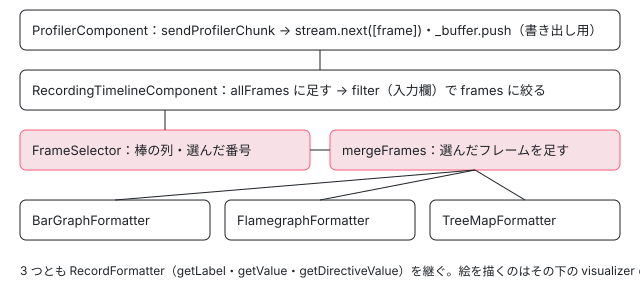

[目次](../README.md) › [Angular DevTools の内側](README.md) › 第 14 回 / 全 20 回

# 記録を描く：フレームのグラフとフレームグラフ・ツリーマップ

> パネルが sendProfilerChunk を貯めて入力欄で絞り、frame-selector で選んだフレームを mergeFrames で足し合わせてから、棒グラフ（bargraph-formatter.ts）・フレームグラフ（flamegraph-formatter.ts）・ツリーマップ（tree-map-formatter.ts）の形に直す行と、記録の書き出しと読み込み。足し合わせで listener の時間とあとから出たフックが落ちることも記録で確かめる。

angular/angular · 読了 約 12 分 · 中核 · [サイトで読む（デモが動きます）](https://angular-deep-dive-cyan.vercel.app/chapter/devtools-profiler-formatters)

---

[第 13 回](13-devtools-profiler-capture.md)で、変更検知 1 回ごとに `ProfilerFrame`（木の形の記録）がパネルへ送られるところまでを読みました。この章はパネルの側です。フレームを受け取って貯め、上の棒の列から選ばれたフレームを足し合わせ、**棒グラフ・フレームグラフ・ツリーマップ**の 3 つの形に直す行を順に読みます。記録の書き出しと読み込み、上の入力欄の絞り込みも同じ流れの中にあります。

読む対象は `ng-devtools/src/lib/devtools-tabs/profiler/` の `profiler.component.ts`・`file-api-service.ts`・`recording-timeline/` の `recording-timeline.component.ts`・`frame-selector/`・`record-formatter/`（`record-formatter.ts`・`frame-merger.ts`・3 つの formatter）・`recording-timeline-controls/filter.ts`・`recording-visualizer/profile-formatter/` です。

1. [1. 全体像](01-devtools-overview.md)
2. [2. Angular を見つける](02-devtools-detect.md)
3. [3. メッセージの道](03-devtools-messaging.md)
4. [4. プロトコル](04-devtools-protocol.md)
5. [5. コンポーネントの木](05-devtools-component-tree.md)
6. [6. 制御フローの塊](06-devtools-control-flow.md)
7. [7. 同じノードを見分ける](07-devtools-identity.md)
8. [8. パネルの木](08-devtools-forest-ui.md)
9. [9. プロパティの直列化](09-devtools-state-serializer.md)
10. [10. 入れ子を開く](10-devtools-property-resolver.md)
11. [11. 値を書き換える](11-devtools-property-mutation.md)
12. [12. 選ぶ・光らせる](12-devtools-inspector-highlight.md)
13. [13. プロファイラーの記録](13-devtools-profiler-capture.md)
14. **14. 記録を描く**（この章）
15. [15. 変更検知を見張る](15-devtools-cd-analyzer.md)
16. [16. 注入器の木](16-devtools-injector-tree.md)
17. [17. signal のグラフ](17-devtools-signal-graph.md)
18. [18. ルーター・TransferState](18-devtools-router-transfer.md)
19. [19. テストとビルド](19-devtools-test-build.md)
20. [20. issue と PR を読む](20-devtools-issues.md)



*パネルの中のデータの流れ。上から下へ*

## 1. 受け取る：ProfilerComponent

📄 `angular/devtools/projects/ng-devtools/src/lib/devtools-tabs/profiler/profiler.component.ts` L87–109 （▶ の行: 87–89, 94–96, 102, 107–108）

```ts
 87 ▶     this._messageBus.on('profilerResults', (remainingRecords) => {
 88 ▶       if (remainingRecords.duration > 0 && remainingRecords.source) {
 89 ▶         this.stream.next([remainingRecords]);
 90 │         this._buffer.push(remainingRecords);
 91 │       }
 92 │     });
 93 │ 
 94 ▶     this._messageBus.on('sendProfilerChunk', (chunkOfRecords: ProfilerFrame) => {
 95 ▶       this.stream.next([chunkOfRecords]);
 96 ▶       this._buffer.push(chunkOfRecords);
 97 │     });
 98 │   }
 99 │ 
100 │   startRecording(): void {
101 │     this.state.set('recording');
102 ▶     this._messageBus.emit('startProfiling');
103 │   }
104 │ 
105 │   stopRecording(): void {
106 │     this.state.set('visualizing');
107 ▶     this._messageBus.emit('stopProfiling');
108 ▶     this.stream.complete();
109 │   }
```

1. **94〜97 行目：フレームが届くたびに 2 か所へ**

   95 行目で `stream`（RxJS の `Subject`）に 1 つだけの配列として流し、96 行目で書き出し用の `_buffer` にも足します。
2. **87〜92 行目：stopProfiling の残りは、条件つきで足す**

   88 行目は `duration > 0`**かつ**`source` が空でないときだけ受け取ります。[第 13 回](13-devtools-profiler-capture.md)で読んだとおり、バックエンドの `stop()` は `flushBuffer` を source なしで呼ぶので、`profilerResults` の source はいつも空の文字列です。つまりこの条件は今のバックエンドでは成り立たず、残りのフレームは捨てられます（第 13 回のデモの `stopProfiling` も duration 0・source `""` でした）。変更検知のたびにマイクロタスクでフレームを送り終えているので、ふつうは捨てる中身もありません。
3. **102・107〜108 行目：始める・止める**

   107 行目で `stopProfiling` を送り、108 行目で `stream` を完了させます。完了が、次の節の「描いてよい」の合図になります。

### 書き出しと読み込み

📄 `angular/devtools/projects/ng-devtools/src/lib/devtools-tabs/profiler/profiler.component.ts` L111–127 （▶ の行: 112–114, 116, 120）

```ts
111 │   exportProfilerResults(): void {
112 ▶     const fileToExport = {
113 ▶       version: PROFILER_VERSION,
114 ▶       buffer: this._buffer,
115 │     };
116 ▶     this._fileApiService.saveObjectAsJSON(fileToExport);
117 │   }
118 │ 
119 │   importProfilerResults(event: Event): void {
120 ▶     this._fileApiService.publishFileUpload(event);
121 │   }
122 │ 
123 │   discardRecording(): void {
124 │     this.stream = new Subject<ProfilerFrame[]>();
125 │     this.state.set('idle');
126 │     this._buffer = [];
127 │   }
```

📄 `angular/devtools/projects/ng-devtools/src/lib/devtools-tabs/profiler/file-api-service.ts` L18–40 （▶ の行: 22, 24, 34, 36, 38）

```ts
18 │   publishFileUpload(parentEvent: Event): void {
19 │     const reader = new FileReader();
20 │     reader.onload = (event) => {
21 │       try {
22 ▶         this.uploadedData.next(JSON.parse((event.target as any).result));
23 │       } catch (e) {
24 ▶         this.uploadedData.next({error: e});
25 │       }
26 │       (parentEvent.target as any).value = '';
27 │     };
28 │     reader.readAsText((parentEvent.target as any).files[0]);
29 │   }
30 │ 
31 │   saveObjectAsJSON(object: object): void {
32 │     const downloadLink = document.createElement('a');
33 │     const isoString = new Date().toISOString().slice(0, -5); // remove milliseconds
34 ▶     downloadLink.download = `NgDevTools-Profile-${isoString}.json`;
35 │     downloadLink.href = URL.createObjectURL(
36 ▶       new Blob([JSON.stringify(object)], {type: 'application/json'}),
37 │     );
38 ▶     downloadLink.click();
39 │     setTimeout(() => URL.revokeObjectURL(downloadLink.href));
40 │   }
```

書き出しは 112〜115 行目の `{ version, buffer }`（`version` は同じファイルの先頭の `PROFILER_VERSION = 1`）を、36 行目で JSON の文字列にして Blob にし、38 行目でリンクを押してダウンロードさせるだけです。ファイルの名前は 34 行目の `NgDevTools-Profile-<日時>.json` です。中身は **受け取った `ProfilerFrame` の配列そのまま**なので、第 13 回の形がそのままファイルの形です（このページの記録の 4 フレームを同じ形にすると 2602 バイトでした）。読み込みは 22 行目で `JSON.parse` し、失敗したら 24 行目で `{error}` を流します。

📄 `angular/devtools/projects/ng-devtools/src/lib/devtools-tabs/profiler/profiler.component.ts` L63–84 （▶ の行: 63–64, 73–74, 76–77, 80, 82–83）

```ts
63 ▶       if (!SUPPORTED_VERSIONS.includes(importedFile.version)) {
64 ▶         const processDataDialog = this.dialog.open(ProfilerImportDialogComponent, {
65 │           width: '600px',
66 │           data: {
67 │             importedVersion: importedFile.version,
68 │             profilerVersion: PROFILER_VERSION,
69 │             status: 'INVALID_VERSION',
70 │           },
71 │         });
72 │ 
73 ▶         processDataDialog.afterClosed().subscribe((result) => {
74 ▶           if (result) {
75 │             this.state.set('visualizing');
76 ▶             this._buffer = importedFile.buffer;
77 ▶             setTimeout(() => this.stream.next(importedFile.buffer));
78 │           }
79 │         });
80 ▶       } else {
81 │         this.state.set('visualizing');
82 ▶         this._buffer = importedFile.buffer;
83 ▶         setTimeout(() => this.stream.next(importedFile.buffer));
84 │       }
```

63 行目で `version` が対応している版（同じファイルの `SUPPORTED_VERSIONS = [1]`）でなければ、64 行目で `profiler-import-dialog` を「版が違う」状態で開き、73〜77 行目で利用者が続けると答えたときだけ読み込みます。80〜83 行目が同じ版のときです。どちらも 77・83 行目の `setTimeout` のあとで、読み込んだ配列を**まとめて 1 回**`stream` に流します。読み込みのときは `stream` を完了させないので、次の節の `visualizing`（「何も無い」の表示に使う印）は立ちません。

## 2. 貯める・絞る・選ぶ：RecordingTimelineComponent

📄 `angular/devtools/projects/ng-devtools/src/lib/devtools-tabs/profiler/recording-timeline/recording-timeline.component.ts` L40–67 （▶ の行: 40–41, 43, 46, 49, 55–56, 60, 62, 65）

```ts
40 ▶   readonly visualizationMode = signal(VisualizationMode.BarGraph);
41 ▶   readonly changeDetection = signal(false);
42 │   readonly selectFrames = signal<number[]>([]);
43 ▶   readonly frame = computed(() => {
44 │     const indexes = this.selectFrames();
45 │     const data = this.frames();
46 ▶     return mergeFrames(indexes.map((index) => data[index]).filter(Boolean));
47 │   });
48 │ 
49 ▶   private readonly filter = signal<Filter>(noopFilter);
50 │   protected readonly visualizing = signal(false);
51 │ 
52 │   // Ensure that `allFrames` is always cleaned if the stream changes.
53 │   // This is a safe guard in case the component is not destroyed when a recording is cleared
54 │   // (i.e. don't rely on the UI).
55 ▶   private readonly allFrames = linkedSignal<Observable<ProfilerFrame[]>, ProfilerFrame[]>({
56 ▶     source: this.stream,
57 │     computation: () => [],
58 │   });
59 │ 
60 ▶   protected readonly frames = computed(() => {
61 │     const filter = this.filter();
62 ▶     return this.allFrames().filter((node) => filter(node));
63 │   });
64 │ 
65 ▶   readonly currentFrameRate = computed(() => calculateFrameRate(this.frame()?.duration ?? 0));
66 │ 
67 │   readonly hasFrames = computed(() => this.allFrames().length > 0);
```

1. **40〜41 行目：既定は棒グラフ、色分けは切**

   3 つの formatter のうち最初に出るのは棒グラフです。`changeDetection` はフレームグラフの「変更検知を色で見せる」の切り替えです（5 節）。
2. **55〜58 行目：全部のフレーム**

   `stream` が変わったら空に戻る `linkedSignal` です（同じクラスの constructor の `effect` が `stream` を購読し、届いたフレームを `concat` で足します）。
3. **60〜63 行目：絞り込み**

   49 行目の `filter`（7 節の入力欄から作る関数）を通ったフレームだけが `frames` になり、上の棒の列に渡ります。
4. **43〜47 行目：選ばれたフレームを 1 つにする**

   選ばれた番号（`selectFrames`）でフレームを引き、46 行目の `mergeFrames`（4 節）で 1 つの `ProfilerFrame` に足し合わせます。1 つだけ選べば、その写しです。番号は `frames`（絞り込んだ後）の添字です。
5. **65 行目：fps の表示**

   足し合わせたフレームの `duration` から計算します（次の節の `calculateFrameRate`）。

📄 `angular/devtools/projects/ng-devtools/src/lib/devtools-tabs/profiler/recording-timeline/recording-timeline.component.html` L8–34 （▶ の行: 13, 24, 30–33）

```html
 8 │ @if (hasFrames()) {
 9 │   <ng-recording-timeline-controls
10 │     (exportProfile)="exportProfile.emit($event)"
11 │     (filter)="setFilter($event)"
12 │   />
13 ▶   <ng-frame-selector [frames]="frames()" (selectFrames)="selectFrames.set($event.indexes)" />
14 │ }
15 │ 
16 │ @let frame = this.frame();
17 │ 
18 │ @if (hasFrames() && !frame) {
19 │   <div class="info">
20 │     <ng-angie type="magnifying-glass" size="md" />
21 │     <p>Select a bar to preview a particular change detection cycle.</p>
22 │   </div>
23 │ } @else if (hasFrames() && frame) {
24 ▶   <ng-visualizer-controls
25 │     [record]="frame"
26 │     [frameRate]="currentFrameRate()"
27 │     [(visualizationMode)]="visualizationMode"
28 │     [(changeDetection)]="changeDetection"
29 │   />
30 ▶   <ng-recording-visualizer
31 ▶     [visualizationMode]="visualizationMode()"
32 ▶     [frame]="frame"
33 ▶     [changeDetection]="changeDetection()"
34 │   />
```

13 行目で絞り込んだ `frames()` を棒の列に渡し、選ばれた番号を `selectFrames` に入れます。30〜33 行目で、足し合わせた `frame` と表示の形（`visualizationMode`）を visualizer に渡します。visualizer が形ごとの formatter を持っています。

## 3. 棒の列：FrameSelectorComponent

📄 `angular/devtools/projects/ng-devtools/src/lib/devtools-tabs/profiler/recording-timeline/frame-selector/frame-selector.component.ts` L109–119 （▶ の行: 110, 114, 118）

```ts
109 │   private readonly maxFrameDuration = computed(() =>
110 ▶     this.frames().reduce((acc: number, frame: ProfilerFrame) => Math.max(acc, frame.duration), 0),
111 │   );
112 │ 
113 │   private readonly multiplicationFactor = computed(() =>
114 ▶     parseFloat((MAX_HEIGHT / this.maxFrameDuration()).toFixed(2)),
115 │   );
116 │ 
117 │   protected readonly graphData = computed<GraphNode[]>(() =>
118 ▶     this.frames().map((r) => this.getBarStyles(r, this.multiplicationFactor())),
119 │   );
```

📄 `angular/devtools/projects/ng-devtools/src/lib/devtools-tabs/profiler/recording-timeline/frame-selector/frame-selector.component.ts` L272–302 （▶ の行: 273–275, 281, 286, 288, 294, 296, 298）

```ts
272 │   private getBarStyles(frame: ProfilerFrame, multiplicationFactor: number): GraphNode {
273 ▶     const height = frame.duration * multiplicationFactor;
274 ▶     const colorPercentage = Math.max(1, Math.round((height / MAX_HEIGHT) * 100));
275 ▶     const frameRate = calculateFrameRate(frame.duration);
276 │     const backgroundColor = this.getColorByFrameRate(frameRate);
277 │ 
278 │     const style = {
279 │       // We use a linear gradient to illustrate the height of
280 │       // the bar that corresponds to the duration of the frame.
281 ▶       'background-image': `-webkit-linear-gradient(bottom, ${backgroundColor} ${colorPercentage}%, transparent ${colorPercentage}%)`,
282 │       width: ITEM_WIDTH + 'px',
283 │       height: MAX_HEIGHT + 'px',
284 │     };
285 │     const tooltip =
286 ▶       `Time spent: ${frame.duration.toFixed(1)} ms` +
287 │       (frameRate < 60 ? `\nFrame rate: ${frameRate} fps` : '') +
288 ▶       (frame.source ? `\nSource: ${frame.source}` : '');
289 │ 
290 │     return {style, tooltip, frame};
291 │   }
292 │ 
293 │   private getColorByFrameRate(framerate: number): string {
294 ▶     if (framerate >= 60) {
295 │       return 'var(--dynamic-green-01)';
296 ▶     } else if (60 > framerate && framerate >= 30) {
297 │       return 'var(--dynamic-yellow-01)';
298 ▶     } else if (30 > framerate && framerate >= 15) {
299 │       return 'var(--dynamic-orange-01)';
300 │     }
301 │     return 'var(--dynamic-red-01)';
302 │   }
```

📄 `angular/devtools/projects/ng-devtools/src/lib/devtools-tabs/profiler/recording-timeline/shared/calculate-frame-rate.ts` L9–14 （▶ の行: 10–11, 13）

```ts
 9 │ export function calculateFrameRate(timeSpent: number): number {
10 ▶   if (timeSpent <= 0) {
11 ▶     return 60;
12 │   }
13 ▶   return Math.min(60, Math.round(1000 / timeSpent));
14 │ }
```

1. **110・114 行目：いちばん長いフレームを 100 px にする**

   全部のフレームの `duration` の最大を取り、`MAX_HEIGHT`（100）を割って倍率にします。棒の高さは、そのフレームの `duration` × 倍率です（273 行目）。
2. **274・281 行目：高さは CSS のグラデーションで描く**

   棒の要素の高さはどれも 100 px のままで、274 行目の割合までを色で塗り、上を透明にする `linear-gradient` にしています。
3. **275 行目と 10〜13 行目：色は fps で決まる**

   `calculateFrameRate` は 1000 ÷ duration を 60 で頭打ちにします（13 行目。0 以下なら 11 行目で 60）。294〜298 行目で、60 以上なら緑、30 以上なら黄、15 以上ならオレンジ、それ未満なら赤です。つまり **16.7 ms を超えたフレームから色が変わります**。
4. **286〜288 行目：ツールチップ**

   時間、60 fps 未満なら fps、source があれば source を出します。zone.js の無いアプリでは source の行は出ません。

📄 `angular/devtools/projects/ng-devtools/src/lib/devtools-tabs/profiler/recording-timeline/frame-selector/frame-selector.component.ts` L201–225 （▶ の行: 204, 209–210, 216, 218, 221, 224）

```ts
201 │   handleFrameSelection(idx: number, event: MouseEvent): void {
202 │     const {shiftKey, ctrlKey, metaKey} = event;
203 │     let frames = this.selectedFrameIndexes();
204 ▶     if (shiftKey) {
205 │       const [start, end] = [
206 │         Math.min(this.startFrameIndex(), idx),
207 │         Math.max(this.endFrameIndex(), idx),
208 │       ];
209 ▶       frames = new Set(Array.from(Array(end - start + 1), (_, index) => index + start));
210 ▶     } else if (ctrlKey || metaKey) {
211 │       if (frames.has(idx)) {
212 │         if (frames.size === 1) {
213 │           return; // prevent deselection when only one frame is selected
214 │         }
215 │ 
216 ▶         frames.delete(idx);
217 │       } else {
218 ▶         frames.add(idx);
219 │       }
220 │     } else {
221 ▶       frames = new Set([idx]);
222 │     }
223 │     this.selectedFrameIndexes.set(new Set(frames));
224 ▶     this.emitSelectedFrames({indexes: this.selectedFrameIndexes()});
225 │   }
```

Shift を押しながらなら 204〜209 行目で範囲、Ctrl（mac では Cmd）なら 210〜219 行目で 1 つずつ足し引き、何も押さなければ 221 行目で 1 つだけです。224 行目で番号を並べて `selectFrames` に出し、前の節の 46 行目の `mergeFrames` に渡ります。

## 4. 足し合わせる：mergeFrames

📄 `angular/devtools/projects/ng-devtools/src/lib/devtools-tabs/profiler/recording-timeline/record-formatter/frame-merger.ts` L55–70 （▶ の行: 56–57, 65, 67）

```ts
55 │ const mergeFrame = (mergeIn: ProfilerFrame, second: ProfilerFrame) => {
56 ▶   mergeIn.duration += second.duration;
57 ▶   mergeIn.source = '';
58 │   mergeDirectives(mergeIn.directives, second.directives);
59 │ };
60 │ 
61 │ export const mergeFrames = (frames: ProfilerFrame[]): ProfilerFrame | null => {
62 │   if (!frames || !frames.length) {
63 │     return null;
64 │   }
65 ▶   const first = JSON.parse(JSON.stringify(frames[0])) as ProfilerFrame;
66 │   for (let i = 1; i < frames.length; i++) {
67 ▶     mergeFrame(first, frames[i]);
68 │   }
69 │   return first;
70 │ };
```

📄 `angular/devtools/projects/ng-devtools/src/lib/devtools-tabs/profiler/recording-timeline/record-formatter/frame-merger.ts` L26–53 （▶ の行: 27–28, 30, 36, 43, 45–46, 48, 51）

```ts
26 │ const mergeDirective = (mergeIn: DirectiveProfile, second: DirectiveProfile) => {
27 ▶   mergeIn.changeDetection = mergeProperty(mergeIn.changeDetection, second.changeDetection);
28 ▶   Object.keys(mergeIn.lifecycle).forEach((key) => {
29 │     const hook = key as keyof LifecycleProfile;
30 ▶     mergeIn.lifecycle[hook] = mergeProperty(mergeIn.lifecycle[hook], second.lifecycle[hook]);
31 │   });
32 │ };
33 │ 
34 │ const mergeDirectives = (mergeIn: ElementProfile[], second: ElementProfile[]) => {
35 │   for (let i = 0; i < second.length; i++) {
36 ▶     if (!mergeIn[i]) {
37 │       mergeIn[i] = {
38 │         children: [],
39 │         directives: [],
40 │         type: 'element',
41 │       };
42 │     }
43 ▶     second[i].directives.forEach((d, idx) => {
44 │       const mergeInDirective = mergeIn[i].directives[idx];
45 ▶       if (mergeInDirective && mergeInDirective.name === d.name) {
46 ▶         mergeDirective(mergeInDirective, d);
47 │       } else {
48 ▶         mergeIn[i].directives.push(d);
49 │       }
50 │     });
51 ▶     mergeDirectives(mergeIn[i].children, second[i].children);
52 │   }
53 │ };
```

1. **65 行目：最初のフレームを JSON で深く写す**

   元の記録を書き換えないためです。67 行目で 2 つめ以降を順に足し込みます。
2. **56〜57 行目：時間は足し、source は消す**

   足し合わせたフレームには 1 つの source が無いので空にします。
3. **35〜51 行目：同じ添字どうしを足す**

   子の配列を添字で並べてたどり、同じ添字・同じ並びの位置に**同じ名前**のディレクティブがあれば（45 行目）46 行目で足し、無ければ 48 行目で足します。51 行目で子へ進みます。
4. **27〜31 行目：足すのは changeDetection とフックだけ**

   27 行目で `changeDetection` を足し、28〜31 行目でフックを足します。ただし 28 行目は**足し込まれる側（最初のフレーム）のフックの名前**だけを回すので、あとのフレームにしか無いフック（たとえば 2 つめのフレームで初めて出た `ngOnDestroy`）は足されません。また `outputs`（listener の時間）は 26〜32 行目のどこでも足していないので、最初のフレームの値のままです。6 節のデモの「1〜3」「3〜4」で確かめます。

## 5. 3 つの形に直す：RecordFormatter とその子

3 つの formatter は同じ基底クラスを継ぎます。名前と値の決め方はここにあります。

📄 `angular/devtools/projects/ng-devtools/src/lib/devtools-tabs/profiler/recording-timeline/record-formatter/record-formatter.ts` L27–52 （▶ の行: 28–29, 33, 37, 41, 43, 49）

```ts
27 │ export abstract class RecordFormatter<T> {
28 ▶   abstract formatFrame(frame: ProfilerFrame): T;
29 ▶   abstract addFrame(nodes: T | T[], elements: ElementProfile[]): number | void;
30 │ 
31 │   getLabel(element: ElementProfile): string {
32 │     if (element.type !== 'element') {
33 ▶       return '@' + element.type;
34 │     }
35 │ 
36 │     const name = element.directives
37 ▶       .filter((d) => d.isComponent)
38 │       .map((c) => c.name)
39 │       .join(', ');
40 │     const attributes = [
41 ▶       ...new Set(element.directives.filter((d) => !d.isComponent).map((d) => d.name)),
42 │     ].join(', ');
43 ▶     return attributes === '' ? name : `${name}[${attributes}]`;
44 │   }
45 │ 
46 │   getValue(element: ElementProfile): number {
47 │     let result = 0;
48 │     element.directives.forEach((dir) => {
49 ▶       result += this.getDirectiveValue(dir);
50 │     });
51 │     return result;
52 │   }
```

📄 `angular/devtools/projects/ng-devtools/src/lib/devtools-tabs/profiler/recording-timeline/record-formatter/record-formatter.ts` L54–68 （▶ の行: 56, 60–62, 64）

```ts
54 │   getDirectiveValue(directive: DirectiveProfile): number {
55 │     let result = 0;
56 ▶     let current = directive.changeDetection;
57 │     if (current === undefined) {
58 │       current = 0;
59 │     }
60 ▶     result += current;
61 ▶     Object.values(directive.lifecycle).forEach((lifecycleProfile) => {
62 ▶       const value = parseFloat(lifecycleProfile);
63 │       if (!isNaN(value)) {
64 ▶         result += value;
65 │       }
66 │     });
67 │     return result;
68 │   }
```

- **名前**：要素なら、コンポーネントの名前（37 行目）と、ほかのディレクティブを `[…]` でつないだもの（41・43 行目）。`@for` や `@defer` の塊なら 33 行目で `@for`・`@defer` です。
- **値**：要素の値は、そこに載っているディレクティブの値の合計（49 行目）。ディレクティブの値は `changeDetection`（56〜60 行目）と、フックの時間の合計（61〜66 行目）です。**`outputs`（listener の時間）は値に入りません**。listener の時間は、ノードを選んだときの詳しい表（後の `formatDirectiveProfile`）でだけ見えます。
- 28〜29 行目の 2 つの abstract（`formatFrame`・`addFrame`）を、3 つの formatter が自分の形で実装します。

### 棒グラフ：BarGraphFormatter

📄 `angular/devtools/projects/ng-devtools/src/lib/devtools-tabs/profiler/recording-timeline/record-formatter/bargraph-formatter/bargraph-formatter.ts` L67–95 （▶ の行: 80, 83, 86–87, 91）

```ts
67 │   override addFrame(
68 │     nodes: BargraphNode[],
69 │     elements: ElementProfile[],
70 │     parents: ElementProfile[] = [],
71 │   ): number {
72 │     let timeSpent = 0;
73 │     elements.forEach((element) => {
74 │       // Possibly undefined because of the insertion on the backend.
75 │       if (!element) {
76 │         console.error('Unable to insert undefined element');
77 │         return;
78 │       }
79 │ 
80 ▶       timeSpent += this.addFrame(nodes, element.children, parents.concat(element));
81 │       timeSpent += super.getValue(element);
82 │ 
83 ▶       element.directives.forEach((dir) => {
84 │         const innerNode: BargraphNode = {
85 │           parents,
86 ▶           value: super.getDirectiveValue(dir),
87 ▶           label: dir.name,
88 │           original: element,
89 │           count: 1,
90 │         };
91 ▶         nodes.push(innerNode);
92 │       });
93 │     });
94 │     return timeSpent;
95 │   }
```

📄 `angular/devtools/projects/ng-devtools/src/lib/devtools-tabs/profiler/recording-timeline/record-formatter/bargraph-formatter/bargraph-formatter.ts` L29–65 （▶ の行: 35, 37, 42, 53, 57, 62）

```ts
29 │   override formatFrame(frame: ProfilerFrame): BargraphNode[] {
30 │     if (this.cache.has(frame)) {
31 │       return this.cache.get(frame);
32 │     }
33 │ 
34 │     const result: BargraphNode[] = [];
35 ▶     this.addFrame(result, frame.directives);
36 │     // Remove nodes with 0 value.
37 ▶     const nodesWithValue = result.filter((element) => element.value > 0);
38 │ 
39 │     // Merge nodes with the same label.
40 │     const uniqueBarGraphNodes: {[key: string]: BargraphNode} = {};
41 │     nodesWithValue.forEach((node) => {
42 ▶       if (uniqueBarGraphNodes[node.label] === undefined) {
43 │         uniqueBarGraphNodes[node.label] = {
44 │           label: node.label,
45 │           value: node.value,
46 │           original: node.original,
47 │           directives: [...node.original.directives],
48 │           parents: [],
49 │           count: 1,
50 │         };
51 │       } else {
52 │         // sum values of merged nodes
53 ▶         uniqueBarGraphNodes[node.label].value += node.value;
54 │         // merge directives of merged nodes
55 │         uniqueBarGraphNodes[node.label].directives!.push(...node.original.directives);
56 │         // increment count of merged nodes with the same label
57 ▶         uniqueBarGraphNodes[node.label].count++;
58 │       }
59 │     });
60 │ 
61 │     // Sort nodes by value.
62 ▶     const out = Object.values(uniqueBarGraphNodes).sort((a, b) => b.value - a.value);
63 │     this.cache.set(frame, out);
64 │     return out;
65 │   }
```

木をたどり（80 行目）、**ディレクティブ 1 つにつき棒 1 本**を作ります（83〜92 行目。値は 86 行目の `getDirectiveValue`、名前は 87 行目のディレクティブの名前）。37 行目で値が 0 の棒を捨て、40〜59 行目で**同じ名前の棒を 1 本に足し**（53 行目で値、57 行目で数）、62 行目で長い順に並べます。同じコンポーネントが 100 個あれば、1 本の棒（`count` 100）になります。木の形は消えます。

### フレームグラフ：FlamegraphFormatter

📄 `angular/devtools/projects/ng-devtools/src/lib/devtools-tabs/profiler/recording-timeline/record-formatter/flamegraph-formatter/flamegraph-formatter.ts` L26–53 （▶ の行: 34, 47–48, 51）

```ts
26 │ export class FlamegraphFormatter extends RecordFormatter<FlamegraphNode> {
27 │   override formatFrame(
28 │     frame: ProfilerFrame,
29 │     showChangeDetection?: boolean,
30 │     theme?: ThemeUi,
31 │   ): FlamegraphNode {
32 │     const result: FlamegraphNode = {
33 │       value: 0,
34 ▶       label: ROOT_LEVEL_ELEMENT_LABEL,
35 │       children: [],
36 │       instances: 1,
37 │       changeDetected: false,
38 │       original: {
39 │         children: [],
40 │         directives: [],
41 │         type: 'element',
42 │       },
43 │     };
44 │ 
45 │     const colors = createColors(theme);
46 │ 
47 ▶     if (showChangeDetection) {
48 ▶       result.color = colors.cdColor;
49 │     }
50 │ 
51 ▶     this.addFrame(result.children, frame.directives, showChangeDetection, colors);
52 │     return result;
53 │   }
```

📄 `angular/devtools/projects/ng-devtools/src/lib/devtools-tabs/profiler/recording-timeline/record-formatter/flamegraph-formatter/flamegraph-formatter.ts` L55–87 （▶ の行: 70, 72–73, 80, 82–83）

```ts
55 │   override addFrame(
56 │     nodes: FlamegraphNode[],
57 │     elements: ElementProfile[],
58 │     showChangeDetection?: boolean,
59 │     colors?: Colors,
60 │   ): number {
61 │     let timeSpent = 0;
62 │ 
63 │     for (const element of elements) {
64 │       // Possibly undefined because of
65 │       // the insertion on the backend.
66 │       if (!element) {
67 │         console.error('Unable to insert undefined element');
68 │         continue;
69 │       }
70 ▶       const changeDetected = didRunChangeDetection(element);
71 │       const node: FlamegraphNode = {
72 ▶         value: super.getValue(element),
73 ▶         label: super.getLabel(element),
74 │         children: [],
75 │         instances: 1,
76 │         original: element,
77 │         changeDetected,
78 │       };
79 │       if (showChangeDetection && colors) {
80 ▶         node.color = changeDetected ? colors.cdColor : colors.noCdColor;
81 │       }
82 ▶       timeSpent += this.addFrame(node.children, element.children, showChangeDetection, colors);
83 ▶       timeSpent += node.value;
84 │       nodes.push(node);
85 │     }
86 │     return timeSpent;
87 │   }
```

📄 `angular/devtools/projects/ng-devtools/src/lib/devtools-tabs/profiler/recording-timeline/record-formatter/flamegraph-formatter/flamegraph-formatter.ts` L98–104 （▶ の行: 99–100, 103）

```ts
 98 │ const didRunChangeDetection = (profile: ElementProfile) => {
 99 ▶   const components = profile.directives.filter((d) => d.isComponent);
100 ▶   if (!components.length) {
101 │     return false;
102 │   }
103 ▶   return components.some((c) => c.changeDetection !== undefined);
104 │ };
```

34 行目の `Entire application` を根に、**要素 1 つにつきノード 1 つ**で木の形を保ちます（72〜73 行目で値と名前は基底クラスから）。82 行目で子を先に作り、ノードの幅を決める値はそのノード自身の値です（子の合計は足しません。足すのは 82〜83 行目の `timeSpent` で、戻り値に使うだけです）。色分けを入れると、80 行目で 70 行目の `didRunChangeDetection` の結果に従って色を変えます。99〜103 行目は「コンポーネントの `changeDetection` が `undefined` でないか」です。[第 13 回](13-devtools-profiler-capture.md)の 6 節のとおり、バックエンドは**フックだけが動いて、テンプレートが動かなかったコンポーネント**にも `changeDetection: 0` を入れるので、そういうコンポーネントも「変更検知が走った」色になります（デモのフレーム 1 の `Child`・`Extra`）。

### ツリーマップ：TreeMapFormatter

📄 `angular/devtools/projects/ng-devtools/src/lib/devtools-tabs/profiler/recording-timeline/record-formatter/tree-map-formatter/tree-map-formatter.ts` L46–70 （▶ の行: 56, 59–60, 64, 66）

```ts
46 │   override addFrame(
47 │     nodes: TreeMapNode[],
48 │     elements: ElementProfile[],
49 │     prev: TreeMapNode | null = null,
50 │   ): void {
51 │     elements.forEach((element) => {
52 │       if (!element) {
53 │         console.error('Unable to insert undefined element');
54 │         return;
55 │       }
56 ▶       const nodeVal = super.getValue(element);
57 │       const node: TreeMapNode = {
58 │         id: super.getLabel(element),
59 ▶         size: nodeVal,
60 ▶         value: nodeVal,
61 │         children: [],
62 │         original: element,
63 │       };
64 ▶       this.addFrame(node.children, element.children, node);
65 │       if (prev) {
66 ▶         prev.size += node.size;
67 │       }
68 │       nodes.push(node);
69 │     });
70 │   }
```

📄 `angular/devtools/projects/ng-devtools/src/lib/devtools-tabs/profiler/recording-timeline/record-formatter/tree-map-formatter/tree-map-formatter.ts` L24–44 （▶ の行: 25–26, 31, 37–38, 42）

```ts
24 │   override formatFrame(record: ProfilerFrame): TreeMapNode {
25 ▶     if (this.cache.has(record)) {
26 ▶       return this.cache.get(record);
27 │     }
28 │ 
29 │     const children: TreeMapNode[] = [];
30 │     this.addFrame(children, record.directives);
31 ▶     const size = children.reduce((accum, curr) => {
32 │       return accum + curr.size;
33 │     }, 0);
34 │ 
35 │     const out = {
36 │       id: 'Application',
37 ▶       size,
38 ▶       value: size,
39 │       children,
40 │       original: null,
41 │     };
42 ▶     this.cache.set(record, out);
43 │     return out;
44 │   }
```

ノードは `value`（自分の値、60 行目）と `size`（自分 + 子孫、59 行目に始まり 66 行目で子の `size` を親に足す）の 2 つを持ちます。ツリーマップの四角の面積が `size` です。根の `Application` の `size` は 31 行目で子の合計です。25〜26・42 行目の `WeakMap` は、同じフレームのオブジェクトなら作った結果を使い回すためです（足し合わせたフレームは毎回新しいオブジェクトなので、使い回されません）。

### ノードを選んだときの表：formatDirectiveProfile

📄 `angular/devtools/projects/ng-devtools/src/lib/devtools-tabs/profiler/recording-timeline/recording-visualizer/profile-formatter/profile-formatter.ts` L12–50 （▶ の行: 12, 15, 20, 34, 38, 41, 45）

```ts
12 ▶ const ignore = /^([A-Z]|listener|\d|listener)/;
13 │ 
14 │ const formatOutput = (outputName: string) => {
15 ▶   const parts = outputName.split('_');
16 │   const output: string[] = [];
17 │   let idx = parts.length;
18 │   while (idx >= 0) {
19 │     idx--;
20 ▶     if (ignore.test(parts[idx]) && parts[idx] !== 'HostBindingHandler') {
21 │       continue;
22 │     }
23 │     output.push(parts[idx]);
24 │   }
25 │   return output
26 │     .filter((el) => !!el)
27 │     .reverse()
28 │     .join('-');
29 │ };
30 │ 
31 │ export const formatDirectiveProfile = (nodes: DirectiveProfile[]) => {
32 │   const graphData: SelectedDirective[] = [];
33 │   nodes.forEach((node) => {
34 ▶     Object.entries(node.lifecycle).forEach(([key, lifeCycleProfile]) => {
35 │       graphData.push({
36 │         directive: node.name,
37 │         method: key,
38 ▶         value: +lifeCycleProfile.toFixed(2),
39 │       });
40 │     });
41 ▶     Object.entries(node.outputs).forEach(([key, outputProfile]) => {
42 │       graphData.push({
43 │         directive: node.name,
44 │         method: formatOutput(key),
45 ▶         value: +outputProfile.toFixed(2),
46 │       });
47 │     });
48 │   });
49 │   return graphData;
50 │ };
```

34〜40 行目でフックの時間を、41〜47 行目で listener の時間を、行として並べます。値は 38・45 行目で小数 2 桁に丸めます。listener の名前は 14〜29 行目の `formatOutput` が、`_` で切って（15 行目）、大文字で始まる部分・`listener`・数字を 12・20 行目の正規表現で捨てます。`Root_Template_button_click_3_listener` なら `button-click` になります。

## 6. DEMO：4 つのフレームを 3 つの形に直す

> **🧪 DEMO — 本物の formatter に通した結果（記録の再生）**
>
> これは記録です。本物の devtools のソース（angular/angular の devtools/、8576f161ae4）のパネルの関数を Node で呼んだ結果です。入力は [第 13 回](13-devtools-profiler-capture.md)の記録（本物の @angular/core 22.1.6 の開発モードのアプリにバックエンドをつないで集めた 4 つの `sendProfilerChunk`）です。記録のスクリプトは、フレームごとに `BarGraphFormatter`・`FlamegraphFormatter`（色分けあり、明るいテーマ）・`TreeMapFormatter` の `formatFrame` と `formatDirectiveProfile` を呼び、「1〜3」「3〜4」を選んだときと同じく `mergeFrames` を呼んでから同じ formatter に通しました。時間の値は Node の上の小さな値です（第 13 回のデモの注意を見てください）。
>
> 「記録を再生する」を押してください。
>
> ▶ [このデモはサイトで動かせます](https://angular-deep-dive-cyan.vercel.app/chapter/devtools-profiler-formatters)

記録から読み取れることです。

1. **棒グラフは木の形を捨てる、フレームグラフとツリーマップは残す**

   同じフレーム 1 で、棒グラフは `Root`・`Child`・`Extra` の 3 本を長い順に並べ、フレームグラフとツリーマップは `Root` の下に 2 つの子を持ちます。ツリーマップの `Root` の `size` は、自分の値に子の値を足したもので、根の `Application` と同じになります。
2. **listener の時間は棒の長さに入らない**

   フレーム 3 の `Root` は詳しい表に `button-click` の行がありますが、棒グラフの値は `changeDetection` の分だけです（5 節の 54〜68 行目）。
3. **テンプレートが動かなかった子も「変更検知が走った」色**

   フレームグラフでフレーム 1 を見ると、`Child`・`Extra` は `changeDetected: true` です。第 13 回のデモで確かめたとおり、このフレームで 2 つのテンプレートは動いていません。
4. **まとめて選ぶと、listener とあとから出たフックが消える**

   「1〜3」の詳しい表には、フレーム 3 にあった `Root` の `button-click` がありません（4 節の 26〜32 行目は `outputs` を足さない）。「3〜4」の `Extra` には、フレーム 4 にあった `ngOnDestroy` がありません（28 行目は最初のフレームのフックの名前だけを回す）。`changeDetection` と、最初のフレームにもあるフックは正しく足されています。
5. **絞り込みの書き方**

   `duration: > 0.1` のように `名前: 演算子 数` と書きます。`!` で否定、`duration > 1` のようにコロンを忘れると条件が 0 個になり、全部が残ります（7 節）。`source: click` は、zone.js の無いアプリでは source が空なので何も残りません。

📄 `scratchpad の記録スクリプト（formatters.ts。共通の部品で束ねて node で実行）`

```
// 第 14 回 devtools-profiler-formatters の記録。
// 第 13 回の記録（capture.json の sendProfilerChunk 4 つ）を入力に、パネルの本物の formatter・frame-merger・filter を Node で呼ぶ。
import { readFileSync } from 'node:fs';
import { writeJson } from '../_shared/harness';
import { FlamegraphFormatter } from '~/angular-research/angular/devtools/projects/ng-devtools/src/lib/devtools-tabs/profiler/recording-timeline/record-formatter/flamegraph-formatter/flamegraph-formatter';
import { TreeMapFormatter } from '~/angular-research/angular/devtools/projects/ng-devtools/src/lib/devtools-tabs/profiler/recording-timeline/record-formatter/tree-map-formatter/tree-map-formatter';
import { BarGraphFormatter } from '~/angular-research/angular/devtools/projects/ng-devtools/src/lib/devtools-tabs/profiler/recording-timeline/record-formatter/bargraph-formatter/bargraph-formatter';
import { mergeFrames } from '~/angular-research/angular/devtools/projects/ng-devtools/src/lib/devtools-tabs/profiler/recording-timeline/record-formatter/frame-merger';
import { createFilter, parseFilter } from '~/angular-research/angular/devtools/projects/ng-devtools/src/lib/devtools-tabs/profiler/recording-timeline/recording-timeline-controls/filter';
import { formatDirectiveProfile } from '~/angular-research/angular/devtools/projects/ng-devtools/src/lib/devtools-tabs/profiler/recording-timeline/recording-visualizer/profile-formatter/profile-formatter';
import { calculateFrameRate } from '~/angular-research/angular/devtools/projects/ng-devtools/src/lib/devtools-tabs/profiler/recording-timeline/shared/calculate-frame-rate';

const capture = JSON.parse(readFileSync(process.argv[3] ?? 'capture.json', 'utf8'));
const frames = capture.steps.map((s: any) => s.messages.find((m: any) => m.topic === 'sendProfilerChunk').args[0]);
const names = capture.steps.map((s: any) => s.name);

// 循環（original・parents）を外して表にできる形にする
const flame = (n: any): any => ({ label: n.label, value: n.value, changeDetected: n.changeDetected, color: n.color, children: n.children.map(flame) });
const tree = (n: any): any => ({ id: n.id, value: n.value, size: n.size, children: n.children.map(tree) });
const bar = (n: any) => ({ label: n.label, value: n.value, count: n.count, parents: n.parents.length, directives: (n.directives ?? []).map((d: any) => d.name) });

const format = (name: string, frame: any) => {
  const flameRoot = new FlamegraphFormatter().formatFrame(frame, true, 'light');
  // ノードを選んだときの詳しい表（flamegraph-visualizer の formatEntryData と同じく original.directives を渡す）
  const details: any[] = [];
  const walk = (n: any) => { if (n.original?.directives?.length) details.push({ label: n.label, rows: formatDirectiveProfile(n.original.directives) }); n.children.forEach(walk); };
  walk(flameRoot);
  return {
    name,
    duration: frame.duration,
    frameRate: calculateFrameRate(frame.duration),
    flamegraph: flame(flameRoot),
    treemap: tree(new TreeMapFormatter().formatFrame(frame)),
    bargraph: new BarGraphFormatter().formatFrame(frame).map(bar),
    details,
  };
};

const perFrame = frames.map((frame: any, i: number) => format(names[i], frame));

// フレームを選ぶ（frame-selector が選んだ番号を recording-timeline が mergeFrames に渡す）
const merges = [[0, 1, 2], [2, 3]].map((idx) => {
  const m = mergeFrames(idx.map((i) => frames[i]))!;
  return { indexes: idx, merged: m, ...format(idx.map((i) => i + 1).join('+'), m) };
});

// フィルター（recording-timeline-controls の入力欄）
const queries = ['duration: > 0.1', 'duration: <= 0.1', '!duration: > 0.1', 'source: click', 'duration > 1'];
const filters = queries.map((q) => ({ query: q, ast: parseFilter(q), kept: frames.map((f: any, i: number) => (createFilter(q)(f) ? i : -1)).filter((i: number) => i >= 0) }));

// 書き出しの形（profiler.component.ts の exportProfilerResults）
const exported = { version: 1, buffer: frames };

await writeJson(process.argv[2] ?? 'formatters.json', { names, frames, perFrame, merges, filters, exportedBytes: JSON.stringify(exported).length });
process.exit(0);

```

## 7. 絞り込み：parseFilter と createFilter

📄 `angular/devtools/projects/ng-devtools/src/lib/devtools-tabs/profiler/recording-timeline/recording-timeline-controls/filter.ts` L106–134 （▶ の行: 107–109, 114, 117, 125–126, 130–131）

```ts
106 │ export const parseFilter = (query: string): QueryAST[] => {
107 ▶   const parts = query.split(':').map((part) => part.trim());
108 ▶   if (parts.length <= 1) {
109 ▶     return [];
110 │   }
111 │   const result: QueryAST[] = [];
112 │   for (let i = 0; i < parts.length - 1; i++) {
113 │     const part = parts[i];
114 ▶     if (!queryRe.test(part)) {
115 │       continue;
116 │     }
117 ▶     const match = part.match(/(\w+)$/);
118 │     if (!match) {
119 │       continue;
120 │     }
121 │     const operator = queryMap[match[0] as QueryType];
122 │     if (!operator) {
123 │       continue;
124 │     }
125 ▶     const operandString = parts[i + 1].replace(queryRe, '').trim();
126 ▶     const operand = operator.parseArguments([operandString]) as QueryArguments;
127 │     if (!operand) {
128 │       continue;
129 │     }
130 ▶     const hasNegation = /^(.*?)\s*!\s*\w+/.test(part);
131 ▶     result.push([!hasNegation, operator.name, operand]);
132 │   }
133 │   return result;
134 │ };
```

📄 `angular/devtools/projects/ng-devtools/src/lib/devtools-tabs/profiler/recording-timeline/recording-timeline-controls/filter.ts` L136–148 （▶ の行: 137, 139, 145）

```ts
136 │ export const createFilter = (query: string) => {
137 ▶   const queries = parseFilter(query);
138 │   return (frame: ProfilerFrame) => {
139 ▶     return queries.every(([predicate, queryName, args]) => {
140 │       const currentQuery = queryMap[queryName];
141 │       if (!currentQuery) {
142 │         return true;
143 │       }
144 │       const result = currentQuery.apply(frame, args);
145 ▶       return predicate ? result : !result;
146 │     });
147 │   };
148 │ };
```

107 行目で `:` で切り、108〜110 行目で 1 つも `:` が無ければ空（条件なし）を返します。切った前の部分の最後の単語（117 行目）が `duration` か `source` なら、次の部分から 125〜126 行目で演算子と数（または文字列）を取り出し、130 行目で `!` があれば否定にします。139 行目で、全部の条件を満たすフレームだけを残す関数を返します。入力欄でキーを離すたびに（`recording-timeline-controls` の `keyup` から `createFilter` を呼ぶ）この関数が作り直され、2 節の 49 行目の `filter` に入ります。

## ここまでの呼び出し

- `messageBus.on('sendProfilerChunk')` — profiler.component.ts — *stream.next・\_buffer.push*
  - `effect` → `allFrames.update(concat)` — recording-timeline.component.ts
    - `frames = allFrames.filter(filter)` — 同上 — *createFilter（filter.ts）*
      - 👤 `handleFrameSelection(i, event)` — frame-selector.component.ts — *棒をクリック*
    - `frame = mergeFrames(選んだフレーム)` — frame-merger.ts
      - `formatter.formatFrame(frame)` — bargraph／flamegraph／tree-map-formatter.ts — *getLabel・getValue（record-formatter.ts）*
        - 👤 ノードをクリック → `formatDirectiveProfile()` — profile-formatter.ts — *フックと listener の表*
- 👤 書き出し → `saveObjectAsJSON({version, buffer})` — file-api-service.ts

## テストと直し方

### spec と describe

| spec（recording-timeline/ の下） | describe / it | bazel のターゲット |
| --- | --- | --- |
| record-formatter/record-formatter.spec.ts | describe `getValue cases`（25 行目）・`getLabel cases`（93）・`getDirectiveValue cases`（193）、it 12 件 | `…/record-formatter:test`（16 件） |
| record-formatter/frame-merger.spec.ts | describe `mergeFrames`（13 行目）。it `should work with empty frames`（14）・`should work with a single frame`（18）・`should merge frames when nesting matches`（46）・`should merge frames when nesting does not match`（91）の 4 件 |   |
| record-formatter/flamegraph-formatter/flamegraph-formatter.spec.ts | describe `addFrame cases`（21 行目）。it `add frame for simple case`（33）・`add frame for deeply nested records`（39） | `…/flamegraph-formatter:test`（2 件） |
| record-formatter/tree-map-formatter/tree-map-formatter.spec.ts | describe `addFrame cases`（16 行目）。it `add frame for simple case`（27） | `…/tree-map-formatter:test`（1 件） |
| recording-timeline-controls/filter.spec.ts | describe `filtering`（11 行目）の中の `parsing`（12）8 件と `filtering`（85）6 件 | `…/recording-timeline-controls:test`（14 件） |
| shared/calculate-frame-rate.spec.ts | describe `calculateFrameRate`（11 行目）。it 1 件 | `…/shared:test`（1 件） |

📄 `angular/devtools/projects/ng-devtools/src/lib/devtools-tabs/profiler/recording-timeline/record-formatter/frame-merger.spec.ts` L46–67 （▶ の行: 55–57, 67）

```ts
46 │   it('should merge frames when nesting matches', () => {
47 │     const frame: ProfilerFrame = {
48 │       directives: [
49 │         {
50 │           children: [],
51 │           directives: [
52 │             {
53 │               isComponent: false,
54 │               isElement: false,
55 ▶               lifecycle: {},
56 ▶               outputs: {},
57 ▶               changeDetection: 10,
58 │               name: 'Foo',
59 │             },
60 │           ],
61 │           type: 'element',
62 │         },
63 │       ],
64 │       duration: 5,
65 │       source: 'foo',
66 │     };
67 ▶     const result = mergeFrames([frame, frame]);
```

frame-merger の spec の形です。同じフレームを 2 回渡し、57 行目の `changeDetection: 10` が 20 になることを確かめます。55〜56 行目のとおり `lifecycle` も `outputs` も空なので、4 節で見た「あとのフレームにしか無いフック」「outputs」はどの spec でも確かめられていません（4 件の it のどれも、空の `lifecycle`・`outputs` だけを使っています）。

### 手元で走らせた結果

📄 `ターミナル（../angular で）`

```
cd ~/angular-research/angular
pnpm bazel test \
  //devtools/projects/ng-devtools/src/lib/devtools-tabs/profiler/recording-timeline/record-formatter:test \
  //devtools/projects/ng-devtools/src/lib/devtools-tabs/profiler/recording-timeline/record-formatter/flamegraph-formatter:test \
  //devtools/projects/ng-devtools/src/lib/devtools-tabs/profiler/recording-timeline/record-formatter/tree-map-formatter:test \
  //devtools/projects/ng-devtools/src/lib/devtools-tabs/profiler/recording-timeline/recording-timeline-controls:test \
  //devtools/projects/ng-devtools/src/lib/devtools-tabs/profiler/recording-timeline/shared:test \
  --nocache_test_results --test_output=all
```

📄 `出力（2026-11-05 に実行。抜粋。ログは scratchpad/devtools-logs/d-bazel.log）`

```
…/record-formatter:test_chromium                       PASSED in 2.1s   16 passed
…/record-formatter:test_firefox                        PASSED in 6.1s   16 passed
…/record-formatter/flamegraph-formatter:test_chromium  PASSED in 2.1s    2 passed
…/record-formatter/flamegraph-formatter:test_firefox   PASSED in 5.5s    2 passed
…/record-formatter/tree-map-formatter:test_chromium    PASSED in 2.1s    1 passed
…/record-formatter/tree-map-formatter:test_firefox     PASSED in 7.7s    1 passed
…/recording-timeline-controls:test_chromium            PASSED in 2.2s   14 passed
…/recording-timeline-controls:test_firefox             PASSED in 6.3s   14 passed
…/shared:test_chromium                                 PASSED in 2.1s    1 passed
…/shared:test_firefox                                  PASSED in 6.3s    1 passed
（第 15・16 回のターゲットと一緒に 16 ターゲットを走らせて INFO: Elapsed time: 10.812s）
```

ターゲット全体を走らせました（絞り込みは使っていません）。件数はどれも Chromium と Firefox で同じでした。

### 直すとしたら

- 4 節の「足し合わせると listener の時間と、あとから出たフックが消える」は `frame-merger.ts` の `mergeDirective` です。28 行目が足し込まれる側のキーだけを回していることと、`outputs` を足す行が無いことが原因です。確かめる spec は `frame-merger.spec.ts` に、`lifecycle: {ngDoCheck: 1}` のフレームと `lifecycle: {ngOnDestroy: 2}, outputs: {click: 3}` のフレームを `mergeFrames` に渡す it を足す形になります。
- 5 節の「テンプレートが動かなかったコンポーネントも色が付く」は、パネルの `didRunChangeDetection`（99〜103 行目）とバックエンドの `insertOrMerge`（[第 13 回](13-devtools-profiler-capture.md)の 6 節で見た `?? 0`）の組み合わせです。どちらの側で区別すべきかは、記録の形（`changeDetection` の有無の意味）を決める話なので、issue で議論されているかを先に読むところです。
- formatter の形（名前・値・並べ方）を変えるなら `record-formatter.ts` と各 formatter で、spec は同じディレクトリの `*.spec.ts` と `record-formatter-spec-constants.ts`（spec で使う大きな記録の定数）です。
- 本家に PR を出すことは勧めません。上の 2 つは、spec の形にして手元で落ちることを確かめるところまでにし、似た報告が issue に無いかを [第 20 回](20-devtools-issues.md)の手順で探します。

## 聞かれそうな質問

**Q. Profiler の棒が赤くなるのは何 ms からですか？**

色は fps で決まり、fps は `Math.min(60, Math.round(1000 / duration))` です（3 節の 13 行目）。60 fps を下回る、つまり duration が約 16.7 ms を超えると黄、30 fps 未満（約 33 ms 超）でオレンジ、15 fps 未満（約 67 ms 超）で赤です（294〜298 行目）。duration はテンプレート・フック・listener の時間の合計です（[第 13 回](13-devtools-profiler-capture.md)）。

**Q. 棒グラフで同じ名前のコンポーネントが 1 本にまとまるのはなぜですか？**

`BarGraphFormatter.formatFrame` が 40〜59 行目で、名前（`label`）が同じ棒を 1 本に足すからです。何個まとめたかは `count` に入ります。どれが重いかを 1 つずつ見たいときは、木の形を保つフレームグラフかツリーマップを使います。

**Q. 書き出したファイルを別の人が開くと、同じ表示になりますか？**

中身は `{version: 1, buffer: ProfilerFrame[]}` で、受け取ったフレームそのままなので（1 節の 112〜115 行目）、同じ版の DevTools なら同じフレームから同じ formatter が同じ表示を作ります。版の番号が違えば、1 節の 63〜79 行目で確認の画面が出ます。

**Q. 複数のフレームを選んだときの値は平均ですか？**

合計です。`mergeFrames` が `duration`（56 行目）と各ディレクティブの `changeDetection`（27 行目）を足します。ただし 4 節のとおり、listener の時間と、最初のフレームに無いフックの時間は足されません。

**Q. フレームグラフの「変更検知を色で見せる」の色は何を見ていますか？**

そのノードのコンポーネントの `changeDetection` が `undefined` でないか（99〜103 行目）です。フックだけが動いたコンポーネントにもバックエンドが 0 を入れるので、テンプレートが動かなかったコンポーネントにも色が付くことがあります。

## 読み終えて

- パネルは `sendProfilerChunk` を貯め、入力欄で絞り、選ばれたフレームを `mergeFrames` で 1 つに足してから formatter に渡します。`profilerResults` は今のバックエンドでは使われません。
- 3 つの formatter は同じ `getLabel`・`getValue` を使い、棒グラフは名前でまとめて木を捨て、フレームグラフは木を保ち、ツリーマップは子孫の合計を `size` に持ちます。
- 値は `changeDetection` とフックの時間で、listener の時間は詳しい表にだけ出ます。
- 書き出しは受け取ったフレームの配列そのままの JSON です。
- 足し合わせでは listener と、あとのフレームにしか無いフックが落ちます。spec はこの場合を確かめていません。

---

← 前: [プロファイラーの記録：ɵsetProfiler からフレームまで](13-devtools-profiler-capture.md)  
次: [変更検知を見張る：CD analyzer と Performance パネル](15-devtools-cd-analyzer.md) →
