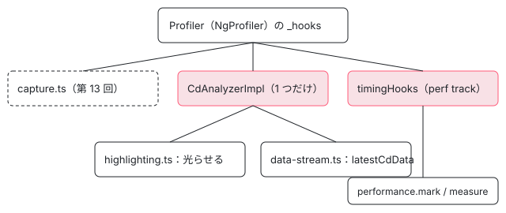

[目次](../README.md) › [Angular DevTools の内側](README.md) › 第 15 回 / 全 20 回

# 変更検知を見張る：CD analyzer と Performance パネル

> cd-analyzer（analyzer.ts・highlighting.ts・data-stream.ts）が、テンプレートが実行されたコンポーネントを数えて光らせ、パネルの木に回数を流す仕組み（07605ba793b）と、performance-track.ts が performance.measure で Chrome の Performance パネルに段を出す仕組み、core の enableProfiling（console.timeStamp）と Performance パネルからのリンク（95f56d33fe6）。

angular/angular · 読了 約 13 分 · 発展 · [サイトで読む（デモが動きます）](https://angular-deep-dive-cyan.vercel.app/chapter/devtools-cd-analyzer)

---

DevTools の設定には「変更検知で確かめられたコンポーネントを光らせる」「コンポーネントの木に変更検知の回数を出す」の 2 つのスイッチがあります。どちらも 2026 年 8 月に入った CD analyzer（07605ba793b）が、[第 13 回](13-devtools-profiler-capture.md)と同じ Profiler のフックで数えています。この章ではその数え方・光らせ方・パネルへの流し方と、同じフックを Chrome の Performance パネルの段に変える `performance-track.ts`、さらに core 自身が Performance パネルに出す段と、そこから DevTools へ飛ぶ仕組み（95f56d33fe6）を読みます。

読む対象は `ng-devtools-backend/src/lib/profiling/` の `cd-analyzer/analyzer.ts`・`highlighting.ts`・`data-stream.ts`・`performance-track.ts` と、core の `render3/debug/chrome_dev_tools_performance.ts` です。

1. [1. 全体像](01-devtools-overview.md)
2. [2. Angular を見つける](02-devtools-detect.md)
3. [3. メッセージの道](03-devtools-messaging.md)
4. [4. プロトコル](04-devtools-protocol.md)
5. [5. コンポーネントの木](05-devtools-component-tree.md)
6. [6. 制御フローの塊](06-devtools-control-flow.md)
7. [7. 同じノードを見分ける](07-devtools-identity.md)
8. [8. パネルの木](08-devtools-forest-ui.md)
9. [9. プロパティの直列化](09-devtools-state-serializer.md)
10. [10. 入れ子を開く](10-devtools-property-resolver.md)
11. [11. 値を書き換える](11-devtools-property-mutation.md)
12. [12. 選ぶ・光らせる](12-devtools-inspector-highlight.md)
13. [13. プロファイラーの記録](13-devtools-profiler-capture.md)
14. [14. 記録を描く](14-devtools-profiler-formatters.md)
15. **15. 変更検知を見張る**（この章）
16. [16. 注入器の木](16-devtools-injector-tree.md)
17. [17. signal のグラフ](17-devtools-signal-graph.md)
18. [18. ルーター・TransferState](18-devtools-router-transfer.md)
19. [19. テストとビルド](19-devtools-test-build.md)
20. [20. issue と PR を読む](20-devtools-issues.md)



*1 つの Profiler に 3 組のフックがぶら下がる。CD analyzer は 2 つの使い手で共有される*

## 1. CdData：コンポーネントごとの「回数と時間」

📄 `angular/devtools/projects/ng-devtools-backend/src/lib/profiling/cd-analyzer/analyzer.ts` L16–47 （▶ の行: 17, 20, 28, 31, 38, 41, 46）

```ts
16 │ // Current analyzer instance
17 ▶ let analyzer: CdAnalyzerImpl | null = null;
18 │ 
19 │ // A set of analyzer consumers
20 ▶ const consumers = new Set<Symbol>();
21 │ 
22 │ /**
23 │  * Data emitted from the `CDAnalyzer` for a specific component
24 │  * on each change detection cycle.
25 │  */
26 │ export interface CdData {
27 │   /** A weak ref to the target component. */
28 ▶   component: WeakRef<ComponentInstance>;
29 │ 
30 │   /** Position of the component element in the directive forest. */
31 ▶   elementPosition: ElementPosition;
32 │ 
33 │   /**
34 │    * Contains the processing times of the component
35 │    * for each CD cycle it was part of. The last value
36 │    * represents the latest time.
37 │    */
38 ▶   cdPassDurations: number[];
39 │ }
40 │ 
41 ▶ type CdDataListener = (current: CdData[], all: CdData[]) => void;
42 │ 
43 │ /** Collects component instances change detection data. */
44 │ export interface CdAnalyzer {
45 │   /** Emits the latest cycle data along with all of the data collected by the analyzer. */
46 ▶   onCycle(listener: CdDataListener): () => void;
47 │ }
```

記録の単位は 26〜39 行目の `CdData` で、コンポーネント 1 つにつき 1 つです。28 行目でインスタンスを `WeakRef`（弱い参照。GC がインスタンスを回収するのを止めない参照）で持ち、31 行目に木の中の位置、38 行目に**変更検知 1 回ごとの処理時間の配列**を持ちます。配列の長さが「何回確かめられたか」です。41 行目の listener は「今回の変更検知で確かめられたもの（`current`）」と「これまでの全部（`all`）」の 2 つを受け取ります。

📄 `angular/devtools/projects/ng-devtools-backend/src/lib/profiling/cd-analyzer/analyzer.ts` L49–74 （▶ の行: 55–56, 58–59, 63, 70–72）

```ts
49 │ /**
50 │  * Get the current `CDAnalyzer` (existing or new).
51 │  * @returns An object with the analyzer and a dispose function.
52 │  * The analyzer will be disposed only when there are no remaining consumers.
53 │  */
54 │ export function getCdAnalyzer(): {analyzer: CdAnalyzer; disposeFn: () => void} {
55 ▶   if (!analyzer) {
56 ▶     analyzer = new CdAnalyzerImpl(getProfiler());
57 │   }
58 ▶   const consumer = Symbol('consumer');
59 ▶   consumers.add(consumer);
60 │ 
61 │   return {
62 │     analyzer,
63 ▶     disposeFn: () => gracefullyDisposeAnalyzer(consumer),
64 │   };
65 │ }
66 │ 
67 │ function gracefullyDisposeAnalyzer(consumer: Symbol) {
68 │   consumers.delete(consumer);
69 │ 
70 ▶   if (!consumers.size) {
71 ▶     analyzer?.destroy();
72 ▶     analyzer = null;
73 │   }
74 │ }
```

17 行目の `analyzer` はページの中に 1 つだけです。55〜56 行目で最初に頼まれたときに作り、58〜59 行目で頼んだ側ごとに `Symbol` を 1 つ配ります。光らせる側と木に出す側の 2 つが同じ analyzer を使い、70〜72 行目で**最後の 1 人が手放したときだけ**壊します。片方のスイッチを切っても、もう片方の数は途切れません。

## 2. 数える：CdAnalyzerImpl の 2 つのフック

📄 `angular/devtools/projects/ng-devtools-backend/src/lib/profiling/cd-analyzer/analyzer.ts` L76–91 （▶ の行: 77, 79, 81, 87–88, 90）

```ts
76 │ export class CdAnalyzerImpl implements CdAnalyzer {
77 ▶   private readonly data = new Map<number, CdData>(); // Map<CMP_ID, CdData>
78 │   private readonly listeners: CdDataListener[] = [];
79 ▶   private readonly cleanUpRegistry = new FinalizationRegistry((cmpId: number) => {
80 │     // Clean up the components from the data map that have been GC-ed
81 ▶     this.data.delete(cmpId);
82 │   });
83 │ 
84 │   // Keeps track of component processing times during the current CD cycle.
85 │   // A component can have multiple `CdStart` and `CdEnd` events during a single cycle
86 │   // due to embedded view.
87 ▶   private currCycleStartTimes = new Map<number, number>(); // Map<CMP_ID, start>
88 ▶   private currCycleAccumProcessingTimes = new Map<number, number>(); // Map<CMP_ID, duration>
89 │ 
90 ▶   private inCd: boolean = false;
91 │ 
```

77 行目の `data` はコンポーネントの id（IdentityTracker の番号）から `CdData` への Map です。79〜82 行目の `FinalizationRegistry` は、インスタンスが GC されたら Map から消すための仕掛けです（1 節の `WeakRef` と組みで、壊れたコンポーネントを抱え続けないようにしています）。87〜88 行目は「今回の変更検知」の作業用の 2 つの Map で、開始の時刻と、足し込んだ時間です。

📄 `angular/devtools/projects/ng-devtools-backend/src/lib/profiling/cd-analyzer/analyzer.ts` L92–116 （▶ の行: 93–95, 101, 104–105, 108–109, 111–112）

```ts
 92 │   private readonly profilerConfig: Partial<Hooks> = {
 93 ▶     onChangeDetectionStart: (cmp: ComponentInstance, _, __, position) => {
 94 ▶       if (!this.inCd) {
 95 ▶         this.inCd = true;
 96 │ 
 97 │         runOutsideAngular(() => {
 98 │           // The queued microtask quarantees that it will
 99 │           // be executed right after the current synchronous CD cycle
100 │           // completes, marking its end.
101 ▶           queueMicrotask(() => {
102 │             this.inCd = false;
103 │ 
104 ▶             for (const [cmpId, time] of this.currCycleAccumProcessingTimes) {
105 ▶               this.data.get(cmpId)?.cdPassDurations.push(time);
106 │             }
107 │ 
108 ▶             const {current, all} = this.processDataForEmission();
109 ▶             this.emit(current, all);
110 │ 
111 ▶             this.currCycleStartTimes = new Map();
112 ▶             this.currCycleAccumProcessingTimes = new Map();
113 │           });
114 │         });
115 │       }
116 │ 
```

1. **93 行目：フックは onChangeDetectionStart**

   [第 13 回](13-devtools-profiler-capture.md)の native.ts のとおり、これはコンポーネントの**テンプレート関数が動く直前**（`TemplateUpdateStart`）に呼ばれます。ビューを訪ねただけでテンプレートを動かさなかった OnPush のコンポーネントでは呼ばれません。だから CD analyzer の「確かめられた」は「テンプレートが実行された」の意味です。
2. **94〜101 行目：変更検知の終わりを 1 回だけ予約**

   第 13 回の capture.ts と同じ考えで、最初の開始でだけ `queueMicrotask` を予約します（98〜100 行目のコメント）。
3. **104〜106 行目：今回の時間を配列に 1 つ足す**

   今回確かめられたコンポーネントごとに、足し込んだ時間を `cdPassDurations` に `push` します。1 回の変更検知で同じコンポーネントのテンプレートが何度動いても（埋め込みビューの分など）、足すのは 1 つです。
4. **108〜112 行目：listener に配って、作業用の Map を空にする**

   配り方は 3 節です。

📄 `angular/devtools/projects/ng-devtools-backend/src/lib/profiling/cd-analyzer/analyzer.ts` L117–135 （▶ の行: 117–119, 122, 125, 127, 134）

```ts
117 ▶       const id = getCmpId(cmp);
118 ▶       if (id === null) {
119 ▶         return;
120 │       }
121 │ 
122 ▶       if (!this.data.has(id)) {
123 │         const cmpRef = new WeakRef(cmp);
124 │         // Register the component instance for clean up
125 ▶         this.cleanUpRegistry.register(cmp, id);
126 │ 
127 ▶         this.data.set(id, {
128 │           cdPassDurations: [],
129 │           elementPosition: position,
130 │           component: cmpRef,
131 │         });
132 │       }
133 │ 
134 ▶       this.currCycleStartTimes.set(id, performance.now());
135 │     },
```

117〜119 行目で、IdentityTracker が id を振っていないコンポーネント（木をまだ索引していないもの）は数えません。122〜132 行目で初めて見たコンポーネントの `CdData` を作り、125 行目で GC の見張りに登録します。134 行目で今回の開始の時刻を覚えます（同じコンポーネントがもう一度始まれば上書き）。

📄 `angular/devtools/projects/ng-devtools-backend/src/lib/profiling/cd-analyzer/analyzer.ts` L137–162 （▶ の行: 143, 145, 150–152, 157, 161）

```ts
137 │     onChangeDetectionEnd: (cmp: ComponentInstance) => {
138 │       const id = getCmpId(cmp);
139 │       if (id === null) {
140 │         return;
141 │       }
142 │       const cmpData = this.data.get(id);
143 ▶       const cmpCurrCycleStartTime = this.currCycleStartTimes.get(id);
144 │ 
145 ▶       if (!cmpData || cmpCurrCycleStartTime === undefined) {
146 │         debugLog.warn('Unable to find corresponding CD start data for', cmp);
147 │         return;
148 │       }
149 │ 
150 ▶       let totalTime = this.currCycleAccumProcessingTimes.get(id) ?? 0;
151 ▶       totalTime += performance.now() - cmpCurrCycleStartTime;
152 ▶       this.currCycleAccumProcessingTimes.set(id, totalTime);
153 │     },
154 │   };
155 │ 
156 │   constructor(private readonly profiler: Profiler) {
157 ▶     this.profiler.subscribe(this.profilerConfig);
158 │   }
159 │ 
160 │   destroy() {
161 ▶     this.profiler.unsubscribe(this.profilerConfig);
162 │   }
```

143 行目で開始の時刻を引き、150〜152 行目で差を**足し込みます**（spec の `should accumulate CD data into a single duration` が確かめているのはこの足し込みです）。157 行目で Profiler に subscribe し、161 行目で外します。

## 3. 配る：processDataForEmission と 2 つの使い手

📄 `angular/devtools/projects/ng-devtools-backend/src/lib/profiling/cd-analyzer/analyzer.ts` L175–192 （▶ の行: 177–178, 184, 191）

```ts
175 │   private processDataForEmission(): {current: CdData[]; all: CdData[]} {
176 │     return {
177 ▶       current: Array.from(this.currCycleStartTimes.entries()).map(([cmp]) => this.data.get(cmp)!),
178 ▶       all: Array.from(this.data.values()),
179 │     };
180 │   }
181 │ 
182 │   private emit(current: CdData[], all: CdData[]) {
183 │     for (const listener of this.listeners) {
184 ▶       listener(current, all);
185 │     }
186 │   }
187 │ }
188 │ 
189 │ /** Returns a component ID. */
190 │ function getCmpId(cmp: ComponentInstance): number | null {
191 ▶   return IdentityTracker.getInstance().getDirectiveId(cmp) ?? null;
192 │ }
```

177 行目の `current` は、今回開始の時刻を記録したコンポーネント（今回テンプレートが動いたもの）だけ、178 行目の `all` は今までに一度でも動いたもの全部です。

### パネルの木に流す：data-stream.ts

📄 `angular/devtools/projects/ng-devtools-backend/src/lib/profiling/cd-analyzer/data-stream.ts` L18–53 （▶ の行: 25–26, 28, 30, 35–36, 41, 43, 49–51）

```ts
18 │ // State of change detection data streaming
19 │ let isCdDataStreamEnabled = false;
20 │ let cdAnalyzerUnsubscriber: (() => void) | undefined;
21 │ let cdAnalyzerDispose: (() => void) | undefined;
22 │ 
23 │ export function enableCdDataStream(messageBus: MessageBus<Events>) {
24 │   return () => {
25 ▶     if (!isCdDataStreamEnabled) {
26 ▶       const {analyzer, disposeFn} = getCdAnalyzer();
27 │       cdAnalyzerDispose = disposeFn;
28 ▶       emitLatestCdData(analyzer, messageBus);
29 │     }
30 ▶     isCdDataStreamEnabled = true;
31 │   };
32 │ }
33 │ 
34 │ export function disableCdDataStream() {
35 ▶   cdAnalyzerUnsubscriber?.();
36 ▶   cdAnalyzerDispose?.();
37 │   isCdDataStreamEnabled = false;
38 │ }
39 │ 
40 │ function emitLatestCdData(cdAnalyzer: CdAnalyzer, messageBus: MessageBus<Events>) {
41 ▶   cdAnalyzerUnsubscriber = cdAnalyzer.onCycle((_, all) => {
42 │     const serializedData = serializeCdData(all);
43 ▶     messageBus.emit('latestCdData', [serializedData]);
44 │   });
45 │ }
46 │ 
47 │ function serializeCdData(data: CdData[]): CdElementData[] {
48 │   return data.map((value) => ({
49 ▶     element: value.elementPosition,
50 ▶     cdCount: value.cdPassDurations.length,
51 ▶     lastCdPassDuration: value.cdPassDurations[value.cdPassDurations.length - 1] ?? 0,
52 │   }));
53 │ }
```

パネルの設定で「木に変更検知の回数を出す」を入れると、パネルが `enableCdDataStream` を送ります。25〜30 行目で 1 回だけ analyzer をもらい、41〜43 行目で**変更検知のたびに `all` を全部**`latestCdData` として送ります。中身は 49〜51 行目の 3 つで、位置・回数（配列の長さ）・最後の 1 回の時間です。パネルはこれを位置で木のノードに結びつけて表示します（パネルの木は [第 8 回](08-devtools-forest-ui.md)）。35〜36 行目で止めるときは、自分の購読を外してから analyzer を手放します。

### ページの上で光らせる：highlighting.ts

📄 `angular/devtools/projects/ng-devtools-backend/src/lib/profiling/cd-analyzer/highlighting.ts` L24–44 （▶ の行: 31–32, 34, 40–42）

```ts
24 │ // State of change detection highlighting
25 │ let isCdHighlightingEnabled = false;
26 │ 
27 │ let cdAnalyzerUnsubscriber: (() => void) | undefined;
28 │ let cdAnalyzerDispose: (() => void) | undefined;
29 │ 
30 │ export function enableCdHighlighting() {
31 ▶   if (!isCdHighlightingEnabled) {
32 ▶     const {analyzer, disposeFn} = getCdAnalyzer();
33 │     cdAnalyzerDispose = disposeFn;
34 ▶     initCdHighlighting(analyzer);
35 │   }
36 │   isCdHighlightingEnabled = true;
37 │ }
38 │ 
39 │ export function disableCdHighlighting() {
40 ▶   cdAnalyzerUnsubscriber?.();
41 ▶   cdAnalyzerDispose?.();
42 ▶   removeHighlightsByType(HighlightType.ChangeDetection);
43 │   isCdHighlightingEnabled = false;
44 │ }
```

📄 `angular/devtools/projects/ng-devtools-backend/src/lib/profiling/cd-analyzer/highlighting.ts` L46–83 （▶ の行: 47, 50, 52, 56, 61, 67–68, 71–73）

```ts
46 │ function initCdHighlighting(cdAnalyzer: CdAnalyzer) {
47 ▶   const activeHighlights = new WeakMap<Element, WeakRef<Highlight>>();
48 │   const ng = ngDebugClient();
49 │ 
50 ▶   cdAnalyzerUnsubscriber = cdAnalyzer.onCycle((current) => {
51 │     for (const data of current) {
52 ▶       const cmp = data.component.deref();
53 │       if (!cmp) {
54 │         continue;
55 │       }
56 ▶       const element = ng.getHostElement?.(cmp);
57 │       if (!element) {
58 │         continue;
59 │       }
60 │ 
61 ▶       const currentHighlight = activeHighlights.get(element)?.deref();
62 │ 
63 │       // We check if the highlight is already detroyed, before attempting to destroy it.
64 │       // This is needed in order to avoid warning messages for already destroyed instance.
65 │       // In the case of CD highlighting, this can occur due to WeakRef<Highlight> not being
66 │       // immediately cleared by GC after all references had been removed.
67 ▶       if (!currentHighlight?.isDestroyed) {
68 ▶         currentHighlight?.destroy();
69 │       }
70 │ 
71 ▶       const newHighlight = highlightElement(element, changeDetectionHighlightTemplate, {
72 ▶         'component-name': [getDirectiveName(cmp)],
73 ▶         'cycles-count': [data.cdPassDurations.length],
74 │       });
75 │ 
76 │       if (newHighlight) {
77 │         activeHighlights.set(element, new WeakRef(newHighlight));
78 │       } else {
79 │         activeHighlights.delete(element);
80 │       }
81 │     }
82 │   });
83 │ }
```

1. **50 行目：使うのは `current`（今回の分）だけ**

   今回テンプレートが動いたコンポーネントだけを光らせます。
2. **52・56 行目：インスタンスからホスト要素へ**

   `WeakRef` を戻し、`ng.getHostElement` でコンポーネントのホスト要素を引きます。
3. **61〜69 行目：前の光を消す**

   47 行目の `WeakMap` に、要素ごとに前の光を持っています。まだ消えていなければ 68 行目で消します。
4. **71〜74 行目：新しく光らせる**

   ラベルは名前（72 行目）と回数（73 行目、`cdPassDurations.length`）です。`changeDetectionHighlightTemplate` は緑の枠線で、左に `<Name>`、右に `x回数` を出し、**1000 ms で自分で消えます**。この自動で消える仕組み（TTL）と枠線の形は、同じ PR の 2 つめのコミット 82882fae51d が光の部品に足したものです。光の部品そのものは [第 12 回](12-devtools-inspector-highlight.md)で読みます。

> [!NOTE]
> **ポイント**
>
> 07605ba793b（feat、#70254、#59057 を閉じた）は、この章の 4 つのファイルを新しく足し、`client-event-subscribers.ts` に `enableCdHighlighting`・`disableCdHighlighting`・`enableCdDataStream`・`disableCdDataStream` の 4 つの topic を足し、パネルの設定（`highlightChangeDetection`・`showCdInExplorer`）と木のノードの表示を足しました。spec は `analyzer.spec.ts`（243 行）が新しく足されています。82882fae51d は光の部品に TTL・枠線・`prefer-inset`（ラベルを内側に寄せる）を足すコミットで、`highlights.spec.ts` に 15 行足しています。

## 4. Chrome の Performance パネルに段を出す：performance-track.ts

Chrome の DevTools の Performance パネルは、ページの JavaScript が `performance.measure` に特別な `detail` を付けると、それを自分の段（track）として描きます（Chrome の「extensibility API」）。DevTools のバックエンドは、同じ Profiler のフックをこれに変えます。

📄 `angular/devtools/projects/ng-devtools-backend/src/lib/profiling/performance-track.ts` L16–33 （▶ の行: 17, 21–23, 29–30）

```ts
16 │ // Performance track global flag.
17 ▶ let chromeDevToolsPerformanceTrackEnabled = false;
18 │ 
19 │ /** Enable Angular's performance track in the Chrome DevTools profiler. */
20 │ export function enablePerformanceTrack(): void {
21 ▶   if (!chromeDevToolsPerformanceTrackEnabled) {
22 ▶     getProfiler().subscribe(timingHooks);
23 ▶     chromeDevToolsPerformanceTrackEnabled = true;
24 │   }
25 │ }
26 │ 
27 │ /** Disable Angular's performance track in the Chrome DevTools profiler. */
28 │ export function disablePerformanceTrack() {
29 ▶   getProfiler().unsubscribe(timingHooks);
30 ▶   chromeDevToolsPerformanceTrackEnabled = false;
31 │ }
32 │ 
33 │ const performanceTrackEnabled = () => chromeDevToolsPerformanceTrackEnabled;
```

パネルが `enablePerformanceTrack` を送ると 22 行目で `timingHooks` を subscribe し、`disablePerformanceTrack` で 29 行目で外します。

> [!NOTE]
> **さらに深く**
>
> この形になったのは 2 つの修正の後です。1a2bcb2295c（2026-07-27）より前は、ファイルを読み込んだだけで `getProfiler().subscribe(…)` が走っていました（本番モードのアプリでもプロファイラーが作られる原因。[第 2 回](02-devtools-detect.md)）。1a2bcb2295c は subscribe を最初の `enable` まで遅らせましたが、`disable` は旗を下ろすだけでフックを外しませんでした。023a63df8c1（2026-08-19、refactor）が `disable` で 29 行目の `unsubscribe` をするように直し、2 つめの旗 `performanceTrackInitialized` を消しました（コミットの文は「Avoid the leak」）。spec の変更はありません。いまはフックが subscribe されているあいだは 17 行目の旗も必ず `true` なので、後で見る各フックの中の旗の確かめ（77 行目など）は、結果を変えない確かめとして残っています。

📄 `angular/devtools/projects/ng-devtools-backend/src/lib/profiling/performance-track.ts` L35–73 （▶ の行: 35, 43, 52, 54, 60–63, 67, 69–71）

```ts
35 ▶ const markName = (s: string, method: Method) => `🅰️ ${s}#${method}`;
36 │ 
37 │ const supportsPerformance =
38 │   globalThis.performance && typeof globalThis.performance.getEntriesByName === 'function';
39 │ 
40 │ const recordMark = (s: string, method: Method) => {
41 │   if (supportsPerformance) {
42 │     // tslint:disable-next-line:ban
43 ▶     performance.mark(`${markName(s, method)}_start`);
44 │   }
45 │ };
46 │ 
47 │ const endMark = (nodeName: string, method: Method) => {
48 │   if (supportsPerformance) {
49 │     const name = markName(nodeName, method);
50 │     const start = `${name}_start`;
51 │     const end = `${name}_end`;
52 ▶     if (performance.getEntriesByName(start).length > 0) {
53 │       // tslint:disable-next-line:ban
54 ▶       performance.mark(end);
55 │ 
56 │       const measureOptions = {
57 │         start,
58 │         end,
59 │         detail: {
60 ▶           devtools: {
61 ▶             dataType: 'track-entry',
62 ▶             color: 'primary',
63 ▶             track: '🅰️ Angular DevTools',
64 │           },
65 │         },
66 │       };
67 ▶       performance.measure(name, measureOptions);
68 │     }
69 ▶     performance.clearMarks(start);
70 ▶     performance.clearMarks(end);
71 ▶     performance.clearMeasures(name);
72 │   }
73 │ };
```

📄 `angular/devtools/projects/ng-devtools-backend/src/lib/profiling/performance-track.ts` L75–99 （▶ の行: 77, 80, 86, 92, 98）

```ts
75 │ const timingHooks = {
76 │   onChangeDetectionStart(component: ComponentInstance): void {
77 ▶     if (!performanceTrackEnabled()) {
78 │       return;
79 │     }
80 ▶     recordMark(getDirectiveName(component), 'changeDetection');
81 │   },
82 │   onChangeDetectionEnd(component: ComponentInstance): void {
83 │     if (!performanceTrackEnabled()) {
84 │       return;
85 │     }
86 ▶     endMark(getDirectiveName(component), 'changeDetection');
87 │   },
88 │   onLifecycleHookStart(component: DirectiveInstance, lifecyle: keyof LifecycleProfile): void {
89 │     if (!performanceTrackEnabled()) {
90 │       return;
91 │     }
92 ▶     recordMark(getDirectiveName(component), lifecyle);
93 │   },
94 │   onLifecycleHookEnd(component: DirectiveInstance, lifecyle: keyof LifecycleProfile): void {
95 │     if (!performanceTrackEnabled()) {
96 │       return;
97 │     }
98 ▶     endMark(getDirectiveName(component), lifecyle);
99 │   },
```

1. **35・43 行目：開始は `performance.mark`**

   名前は `🅰️ クラスの名前#changeDetection`（フックなら `#ngDoCheck`、listener なら `#listener の関数の名前`）に `_start` を付けたものです。
2. **52〜54 行目：開始の mark があれば、終わりの mark**
3. **56〜67 行目：detail を付けた measure**

   60〜64 行目の `detail.devtools` が、Chrome に「この measure を `🅰️ Angular DevTools` という段に、`primary` の色の帯として描いて」と頼む部分です。
4. **69〜71 行目：すぐに消す**

   mark と measure はページの性能の記録のバッファに残り続けるので、作った直後に消します。Performance パネルの記録中なら、パネルはその時点で受け取っています。

### core 自身の段：enableProfiling と console.timeStamp

Performance パネルに Angular の段を出すものは、もう 1 つあります。core の公開 API `enableProfiling()` です。こちらは DevTools の拡張が無くても動きます。

📄 `angular/packages/core/src/render3/debug/chrome_dev_tools_performance.ts` L364–387 （▶ の行: 368, 370, 375, 377–379, 382–383）

```ts
364 │ /**
365 │  * Start listening to the Angular's internal performance-related events and route those to the Chrome DevTools performance panel.
366 │  * This enables Angular-specific data visualization when recording a performance profile directly in the Chrome DevTools.
367 │  *
368 ▶  * NOTE: Integration is enabled in the development mode only, this operation is noop in the production mode.
369 │  *
370 ▶  * @publicApi v21.0
371 │  *
372 │  * @returns a function that can be invoked to stop sending profiling data.
373 │  * @see [Profiling with the Chrome DevTools](best-practices/profiling-with-chrome-devtools#recording-a-profile)
374 │  */
375 ▶ export function enableProfiling() {
376 │   performanceMarkFeature('Chrome DevTools profiling');
377 ▶   if (typeof ngDevMode !== 'undefined' && ngDevMode) {
378 ▶     const removeInjectorProfiler = setInjectorProfiler(chromeDevToolsInjectorProfiler);
379 ▶     const removeProfiler = setProfiler(devToolsProfiler);
380 │ 
381 │     return () => {
382 ▶       removeInjectorProfiler();
383 ▶       removeProfiler();
384 │     };
385 │   }
386 │   return () => {};
387 │ }
```

📄 `angular/packages/core/src/render3/debug/chrome_dev_tools_performance.ts` L194–225 （▶ の行: 195–196, 209, 211, 216–218, 220, 222–223）

```ts
194 │ function measureStart(startEvent: ProfilerEvent | ProfilerDIEvent) {
195 ▶   eventsStack.push([startEvent, counter]);
196 ▶   console.timeStamp('Event_' + startEvent + '_' + counter++);
197 │ }
198 │ 
199 │ function measureEnd(
200 │   startEvent: ProfilerEvent | ProfilerDIEvent,
201 │   entryName: string,
202 │   color: DevToolsColor,
203 │   detail?: {url?: string; description?: string},
204 │ ) {
205 │   let top: stackEntry | undefined;
206 │   // The stack may be asymmetric when an end event for a prior start event is missing (e.g. when an exception
207 │   // has occurred), unroll the stack until a matching item has been found in that case.
208 │   do {
209 ▶     top = eventsStack.pop();
210 │     assertDefined(top, 'Profiling error: could not find start event entry ' + startEvent);
211 ▶   } while (top[0] !== startEvent);
212 │ 
213 │   const docUrl = getProfilerEventDocUrl(startEvent, entryName);
214 │   const resolvedDetail = resolveTimestampDetail(detail, docUrl);
215 │ 
216 ▶   console.timeStamp(
217 ▶     entryName,
218 ▶     'Event_' + top[0] + '_' + top[1],
219 │     undefined,
220 ▶     '\u{1F170}\uFE0F Angular',
221 │     undefined,
222 ▶     color,
223 ▶     resolvedDetail,
224 │   );
225 │ }
```

- 377 行目のとおり開発モードのときだけ、379 行目で [第 13 回](13-devtools-profiler-capture.md)の `setProfiler` に自分のコールバックを足し、378 行目で DI のプロファイラー（[di-debug の章](../di/16-di-debug.md)）にも足します。DevTools の拡張の Profiler と同時に登録されても、両方に届きます。
- 使うのは `performance.measure` ではなく `console.timeStamp` です。196 行目で開始の印を付け、216〜224 行目で「名前・開始の印・段の名前（220 行目の `🅰️ Angular`）・色・detail」を渡します。209〜211 行目は、例外で End が来なかった Start を積み残さないための巻き戻しです。
- 段の名前が違う（`🅰️ Angular` と `🅰️ Angular DevTools`）ので、両方を有効にすると Performance パネルには 2 つの段が並びます。

### Performance パネルから DevTools へ飛ぶ：95f56d33fe6

📄 `angular/packages/core/src/render3/debug/chrome_dev_tools_performance.ts` L294–303 （▶ の行: 295, 300）

```ts
294 │     case ProfilerEvent.ComponentEnd: {
295 ▶       const typeName = getComponentMeasureName(instance!);
296 │       measureEnd(
297 │         ProfilerEvent.ComponentStart,
298 │         typeName,
299 │         'primary-light',
300 ▶         getDeepLinkProperties(instance!),
301 │       );
302 │       break;
303 │     }
```

📄 `angular/packages/core/src/render3/debug/chrome_dev_tools_performance.ts` L107–118 （▶ の行: 107, 110, 112–113, 115）

```ts
107 ▶ const DEEP_LINK_SCHEME = 'angular-devtools';
108 │ 
109 │ function getDeepLinkProperties(instance: {}): {url: string; description: string} | undefined {
110 ▶   if (typeof __NG_DEVTOOLS_CONNECTED__ === 'undefined' || !__NG_DEVTOOLS_CONNECTED__)
111 │     return undefined;
112 ▶   const instanceId =
113 ▶     getComponentInstanceDeepLinkId(instance) ?? assignComponentInstanceDeepLinkId(instance);
114 │   return {
115 ▶     url: `${DEEP_LINK_SCHEME}://component/${instanceId}`,
116 │     description: 'Component',
117 │   };
118 │ }
```

1. **300 行目：コンポーネントの帯に detail を付ける**

   core の段の `ComponentEnd` の帯にだけ、`getDeepLinkProperties` の結果を detail として渡します。
2. **110 行目：拡張がいるときだけ**

   `__NG_DEVTOOLS_CONNECTED__` は、拡張の content script（`shell-browser/src/app/devtools-connected-flag.ts`、95f56d33fe6 で新しく足された）がページのスクリプトより先に `true` にしておく旗です（同じファイルの `declare const __NG_DEVTOOLS_CONNECTED__` の上のコメント）。拡張が無ければ detail を付けません。
3. **112〜115 行目：インスタンスに番号を振り、URL にする**

   番号は `WeakMap` に入れた連番で、URL は `angular-devtools://component/番号` です。
4. **拡張の側（引用はしません）**

   95f56d33fe6 は、拡張の `shell-browser/src/devtools.ts` で Chrome の `chrome.devtools.panels.setOpenResourceHandler` に `angular-devtools` の URL を受け取る関数を登録し、Performance パネルで帯をクリックされたら Angular のパネルを開いて番号を `postMessage` で渡すようにしました。バックエンドはコンポーネントの木を送るとき、各コンポーネントに `ng.ɵgetComponentInstanceDeepLinkId` の番号を `instanceId` として付けるので（プロトコルに `instanceId?: number` が足された）、パネルは番号から木のノードを探して選びます。コミットの注記のとおり、Chrome 140 以降で `chrome://flags/#enable-devtools-deep-link-via-extensibility-api` を入れたときだけ動きます。#63960 を閉じたコミットで、spec は `devtools-tabs.spec.ts` に 63 行足されています（2 行削除）。

## 5. DEMO：Eager と OnPush の子で数え方を見る

> **🧪 DEMO — latestCdData と、performance-track が呼んだ Performance API（記録の再生）**
>
> これは記録です。本物の devtools のソース（angular/angular の devtools/、8576f161ae4）を、本物の @angular/core 22.1.6（開発モード）のアプリにつないで Node で動かした結果です。アプリは `Root`（v22 の既定の OnPush。`count`・`el`・`pl` の 3 つの signal）の下に、`EagerChild`（`ChangeDetectionStrategy.Eager`、v22 で `Default` から改名されたもの）と `OnPushChild`（ボタンつき）を置いたものです。記録のスクリプトは木を 1 回索引させてから `enableCdDataStream` と `enablePerformanceTrack` を送り、`performance.mark`・`measure`・`clearMarks`・`clearMeasures` を包んで（本物も呼ぶ）呼ばれた順に記録しました。光らせる側（`enableCdHighlighting`）は DOM の重ね表示を作るので、この記録では動かしていません。共通の部品（harness）は [第 1 回](01-devtools-overview.md)に全文があります。
>
> 「記録を再生する」を押してください。
>
> ▶ [このデモはサイトで動かせます](https://angular-deep-dive-cyan.vercel.app/chapter/devtools-cd-analyzer)

記録から読み取れることです。

1. **1. Root の signal だけを変える：Root と EagerChild が数えられ、OnPushChild は出てこない**

   `Root` のテンプレートは signal で更新され、その子のうち `EagerChild`（Eager）は毎回確かめられ、`OnPushChild` は入力が変わっていないのでテンプレートが動きません（[cd-targeted-traversal の章](../cd/06-cd-targeted-traversal.md)）。`latestCdData` は `all` を送るので、まだ一度も動いていない `OnPushChild` は表に行がありません。
2. **2. Eager の子の入力を変える：OnPushChild はまだ 0 回**

   回数は `Root` と `EagerChild` が 2 になります。
3. **3. OnPush の子の入力を変える：OnPushChild が初めて出る**

   入力の変化が OnPush の子に印を付け（[cd-onpush-markforcheck の章](../cd/04-cd-onpush-markforcheck.md)）、`[0, 1]` の行が `cdCount` 1 で加わります。`EagerChild` は 3 回目です。
4. **4. OnPush の子の中でクリック：listener の measure が先に出る**

   measure の 1 つめは `🅰️ OnPushChild#OnPushChild_Template_button_click_2_listener` で、そのあとに 3 つのコンポーネントの `#changeDetection` が続きます。listener は自分のビューと祖先に印を付けるので、`Root` と `OnPushChild` の両方が更新されます。
5. **5. 何も変えずに tick：何も起きない**

   zoneless のアプリで印の無いまま `appRef.tick()` を呼んでも、どのビューも更新しないので、`onChangeDetectionStart` が 1 回も呼ばれず、`latestCdData` も measure も出ません（[zoneless-tick の章](../zoneless/05-zoneless-tick.md)）。
6. **6. 止めたあとの tick：何も届かない**

   `disableCdDataStream` で購読を外して analyzer を手放し、`disablePerformanceTrack` でフックを外したので、変更検知が起きても何も送られず、Performance API も呼ばれません（4 節の 29 行目）。

> [!WARNING]
> **ハマりどころ**
>
> 記録の `lastCdPassDuration` は Node の `performance.now()` で測った小さな値（0.008〜0.07 ms ほど）で、描画やレイアウトの無い domino の上の値です。ブラウザの値とは比べられません。また Node の `performance.measure` は `detail` を受け取りますが、段として描く画面はありません。記録で確かめられるのは「何という名前で、どの順に、どの detail を付けて呼ばれたか」までです。

📄 `scratchpad の記録スクリプト（cd.ts。共通の部品で束ねて node で実行）`

```
// 第 15 回 devtools-cd-analyzer の記録。
// Eager（v22 で Default から改名。毎回確かめる）と OnPush（v22 の既定）の子を持つアプリに本物の devtools のバックエンドをつなぎ、
// enableCdDataStream と enablePerformanceTrack を送ってから変更検知を何回か起こし、
// 流れてきた latestCdData と、performance-track.ts が呼んだ performance.mark / measure を段ごとに記録する。
import { ChangeDetectionStrategy, Component, Input, signal } from '@angular/core';
import { bootApp, makeBus, loadBackend, tick, writeJson } from '../_shared/harness';

@Component({
  selector: 'app-eager',
  changeDetection: ChangeDetectionStrategy.Eager,
  template: '<i>{{ label }}</i>',
})
class EagerChild { @Input() label = ''; }

@Component({
  selector: 'app-onpush',
  changeDetection: ChangeDetectionStrategy.OnPush,
  template: '<b>{{ label }}</b><button (click)="n = n + 1">{{ n }}</button>',
})
class OnPushChild { @Input() label = ''; n = 0; }

@Component({
  selector: 'app-root',
  imports: [EagerChild, OnPushChild],
  template: '<p>{{ count() }}</p><app-eager [label]="el()" /><app-onpush [label]="pl()" />',
})
class Root {
  count = signal(0);
  el = signal('e0');
  pl = signal('p0');
}

const { appRef, doc } = await bootApp(Root);
const { initializeMessageBus } = await loadBackend();
const { bus, send, take } = makeBus();
initializeMessageBus(bus as any);

// performance-track.ts が呼ぶ Performance API を包んで、呼ばれた順に記録する（本物の API も呼ぶ）
const perfCalls: any[] = [];
for (const name of ['mark', 'measure', 'clearMarks', 'clearMeasures'] as const) {
  const orig = (performance as any)[name].bind(performance);
  (performance as any)[name] = (...args: any[]) => {
    perfCalls.push({ fn: name, args: JSON.parse(JSON.stringify(args)) });
    return orig(...args);
  };
}

send('getLatestComponentExplorerView', [undefined]); // 木を索引させる（IdentityTracker が id を振る）
await tick(10);
const forest = take().find((m) => m.topic === 'latestComponentExplorerView')!.args[0];

send('enableCdDataStream');
send('enablePerformanceTrack');
take();

const root = appRef.components[0].instance as Root;
const steps: any[] = [];
async function step(name: string, action: () => void) {
  perfCalls.length = 0;
  action();
  appRef.tick();
  await tick(5);
  steps.push({ name, messages: take(), perf: [...perfCalls] });
}
await step('Root の signal だけを変える', () => root.count.update((n) => n + 1));
await step('Eager の子の入力を変える', () => root.el.set('e1'));
await step('OnPush の子の入力を変える', () => root.pl.set('p1'));
await step('OnPush の子の中でクリック', () => {
  doc.querySelector('app-onpush button')!.dispatchEvent(new (doc.defaultView as any).Event('click'));
});
await step('何も変えずに tick', () => {});

send('disablePerformanceTrack');
send('disableCdDataStream');
perfCalls.length = 0;
await step('止めたあとの tick', () => root.count.update((n) => n + 1));

await writeJson(process.argv[2] ?? 'cd.json', { core: '22.1.6', forest, steps });
process.exit(0);

```

## ここまでの呼び出し

- 👤 設定のスイッチ（showCdInExplorer） — パネル devtools.component.ts — *enableCdDataStream を送る*
  - `enableCdDataStream(messageBus)()` — cd-analyzer/data-stream.ts
    - `getCdAnalyzer()` → `new CdAnalyzerImpl(getProfiler())` — cd-analyzer/analyzer.ts — *Profiler に subscribe*
- 👤 変更検知 — アプリ
  - `profiler(TemplateUpdateStart)` → `NgProfiler` — core → profiling/profiler/native.ts — *第 13 回*
    - `onChangeDetectionStart` / `onChangeDetectionEnd` — analyzer.ts — *開始の時刻・足し込み*
  - マイクロタスク → `emit(current, all)` — analyzer.ts
    - `messageBus.emit('latestCdData', [all を直列化])` — data-stream.ts — *位置・回数・最後の時間*
    - `highlightElement(host, changeDetectionHighlightTemplate, …)` — highlighting.ts — *current だけ。1000 ms で消える*
  - `timingHooks.onChangeDetectionStart` → `performance.mark` / `measure` — performance-track.ts — *🅰️ Angular DevTools の段*

## テストと直し方

### spec と describe

| spec（profiling/ の下） | describe / it | bazel のターゲット |
| --- | --- | --- |
| cd-analyzer/analyzer.spec.ts | describe `CD analyzer`（22 行目）の中の `CdAnalyzerImpl`（23）6 件：`should subscribe to the profiler on init and unsubscribe the same hooks on destroy`（56）・`should stop notifying a listener after it unsubscribes without affecting other listeners`（64）・`should emit current and all collected change detection data`（90）・`should accumulate CD data into a single duration`（111）・`should track multiple components within the same cycle`（128）・`should track multiple components with some not being part in the latest CD`（147）。`getCdAnalyzer`（184）3 件：`should reuse the same analyzer instance for multiple consumers`（216）・`should dispose the analyzer, if there is a single consumer`（224）・`should keep the analyzer after a disposal attempt when there are multiple consumers`（233） | `//devtools/projects/ng-devtools-backend/src/lib/profiling/cd-analyzer:test`（9 件） |
| performance-track.spec.ts | describe `performance track`（9 行目）。it `does not throw an error when initialized in development mode`（26）。1a2bcb2295c で足された 1 件で、読み込みと `enablePerformanceTrack()` が例外を投げないことだけを確かめます | `//devtools/projects/ng-devtools-backend/src/lib/profiling:performance_track_test`（1 件） |

📄 `angular/devtools/projects/ng-devtools-backend/src/lib/profiling/cd-analyzer/analyzer.spec.ts` L147–181 （▶ の行: 148, 156, 160, 163, 165, 170, 172, 180）

```ts
147 │     it('should track multiple components with some not being part in the latest CD', async () => {
148 ▶       spyOn(performance, 'now').and.returnValues(0, 10, 20, 50, 60, 75);
149 │       const listener = jasmine.createSpy('listener');
150 │       analyzer.onCycle(listener);
151 │ 
152 │       const foo = registerCmp(new CmpFoo());
153 │       const bar = registerCmp(new CmpBar());
154 │ 
155 │       // Cycle 1: Both components run
156 ▶       startCdEvent(foo, [0]);
157 │       endCdEvent(foo, [0]);
158 │       startCdEvent(bar, [1]);
159 │       endCdEvent(bar, [1]);
160 ▶       await Promise.resolve();
161 │ 
162 │       // Cycle 2: Only `Foo` runs
163 ▶       startCdEvent(foo, [0]);
164 │       endCdEvent(foo, [0]);
165 ▶       await Promise.resolve();
166 │ 
167 │       expect(listener).toHaveBeenCalledTimes(2);
168 │       const [current, all] = listener.calls.mostRecent().args as [CdData[], CdData[]];
169 │ 
170 ▶       expect(current.length).toBe(1);
171 │       expect(current[0].elementPosition).toEqual([0]);
172 ▶       expect(current[0].cdPassDurations).toEqual([10, 15]); // (10 - 0), (75 - 60)
173 │ 
174 │       expect(all.length).toBe(2);
175 │ 
176 │       const fooData = all.find((d) => d.elementPosition[0] === 0)!;
177 │       expect(fooData.cdPassDurations).toEqual([10, 15]); // (10 - 0), (75 - 60)
178 │ 
179 │       const barData = all.find((d) => d.elementPosition[0] === 1)!;
180 ▶       expect(barData.cdPassDurations).toEqual([30]); // 50 - 20
181 │     });
```

analyzer の spec の形です。148 行目で `performance.now` が返す値を 0, 10, 20, 50, 60, 75 と決め、156〜160 行目で 1 回目の変更検知（2 つとも）、163〜165 行目で 2 回目（`Foo` だけ）のフックを手で呼び、`await Promise.resolve()` でマイクロタスクを流します。170〜172 行目で `current` が `Foo` だけで `[10, 15]`、180 行目で `Bar` は 1 回目の `[30]` のままであることを確かめます。デモの 1〜2 段の `OnPushChild` と同じ「今回は確かめられなかった」形です。IdentityTracker の id は、同じ describe の先頭にある `registerCmp` が tracker の中の Map に直接入れて作っています（本物の木の索引を使わないため）。

### 手元で走らせた結果

📄 `ターミナル（../angular で）`

```
cd ~/angular-research/angular
pnpm bazel test //devtools/projects/ng-devtools-backend/src/lib/profiling/cd-analyzer:test \
  //devtools/projects/ng-devtools-backend/src/lib/profiling:performance_track_test \
  --nocache_test_results --test_output=all
```

📄 `出力（2026-11-05 に実行。抜粋。ログは scratchpad/devtools-logs/d-bazel.log）`

```
//devtools/projects/ng-devtools-backend/src/lib/profiling:performance_track_test_chromium PASSED in 2.0s   1 passed
//devtools/projects/ng-devtools-backend/src/lib/profiling:performance_track_test_firefox  PASSED in 6.5s   1 passed
//devtools/projects/ng-devtools-backend/src/lib/profiling/cd-analyzer:test_chromium      PASSED in 2.1s   9 passed
//devtools/projects/ng-devtools-backend/src/lib/profiling/cd-analyzer:test_firefox       PASSED in 7.7s   9 passed
（第 14・16 回のターゲットと一緒に 16 ターゲットを走らせて INFO: Elapsed time: 10.812s）
```

ターゲット全体を走らせました（絞り込みは使っていません）。

### 直すとしたら

- 数え方（何を「確かめられた」とするか）は `analyzer.ts` の `profilerConfig` の 2 つのフックです。いまはテンプレートの実行が基準なので、「訪ねたが更新しなかった」ビューは数えません。それを変えるなら、Profiler に `ComponentStart` のフックが要り、[第 13 回](13-devtools-profiler-capture.md)の native.ts の「todo: implement」の側から手を入れることになります。spec は `analyzer.spec.ts` の形で、フックを手で呼んで `cdPassDurations` を比べます。
- パネルへ送る形は `data-stream.ts` の `serializeCdData` で、protocol の `CdElementData` と組です（[第 4 回](04-devtools-protocol.md)）。
- Performance パネルの段は `performance-track.ts` で、spec は読み込みと有効化が例外を投げないことしか確かめていません。`performance.measure` の呼ばれ方を確かめるなら、このデモのように `performance` を spy して、`getProfiler` の `depsForTestOnly` に偽物の Profiler を入れる形になります。
- 本家に PR を出すことは勧めません。issue を読むときに「光る・光らない」の報告なら、まずそのコンポーネントのテンプレートがその回に動いたか（OnPush・signal・入力の変化）を確かめると、analyzer の問題か、変更検知そのものの話かを分けられます（[第 20 回](20-devtools-issues.md)）。

## 聞かれそうな質問

**Q. OnPush のコンポーネントが光らないのは不具合ですか？**

多くは不具合ではありません。CD analyzer は 2 節の 93 行目の `onChangeDetectionStart`、つまりテンプレート関数が動いたときだけ数えます。OnPush のコンポーネントは、入力の変化・`markForCheck`・テンプレートの signal・中のイベントが無ければ、変更検知で訪ねられてもテンプレートが動かないので数えられません（デモの 1〜2 段）。

**Q. 光らせるのと木に回数を出すのを両方入れると、2 回数えますか？**

数えません。1 節の 17 行目の analyzer はページに 1 つで、55〜56 行目で最初の 1 回だけ作られ、2 つの使い手は同じ `CdData` を見ます。片方を切っても、70〜72 行目のとおり最後の 1 人が手放すまで壊されません。

**Q. 回数はいつからの回数ですか？**

analyzer が作られてから（どちらかのスイッチを入れてから）の回数です。`cdPassDurations` の長さで、2 節の 104〜106 行目で変更検知 1 回につき 1 つ増えます。両方のスイッチを切ると analyzer が壊されるので、入れ直すと 0 から数え直します。

**Q. Performance パネルに Angular の段が 2 つ出ます。**

1 つは DevTools の拡張の `performance-track.ts`（`🅰️ Angular DevTools`、4 節の 60〜64 行目の `performance.measure`）、もう 1 つは core の `enableProfiling()`（`🅰️ Angular`、220 行目の `console.timeStamp`）です。core の `setProfiler` は複数のコールバックを持てるので、両方が同じ出来事を受け取ります。

**Q. Performance パネルの帯から DevTools のコンポーネントに飛べないのですが。**

飛べるのは core の段（`enableProfiling()`）のコンポーネントの帯だけで（300 行目）、拡張が `__NG_DEVTOOLS_CONNECTED__` を立てているとき（110 行目）に限ります。さらに Chrome 140 以降で `enable-devtools-deep-link-via-extensibility-api` のフラグが要ります（95f56d33fe6）。

## 読み終えて

- CD analyzer は Profiler のフックで「テンプレートが動いた」コンポーネントを数え、変更検知 1 回ごとの時間を `cdPassDurations` に貯めます。ページに 1 つで、2 つの使い手が共有します。
- 木の表示には `all` を `latestCdData` で送り、光らせるのは `current` だけで、光は 1000 ms で消えます。
- `performance-track.ts` は同じフックを `performance.measure` の `detail.devtools` に変え、`🅰️ Angular DevTools` の段にします。023a63df8c1 で、止めるとフックも外れるようになりました。
- core の `enableProfiling()` は `console.timeStamp` で `🅰️ Angular` の段を作り、拡張がいればコンポーネントの帯に `angular-devtools://` の URL を付けます。

---

← 前: [記録を描く：フレームのグラフとフレームグラフ・ツリーマップ](14-devtools-profiler-formatters.md)  
次: [注入器の木：resolutionPath と provider の一覧](16-devtools-injector-tree.md) →
