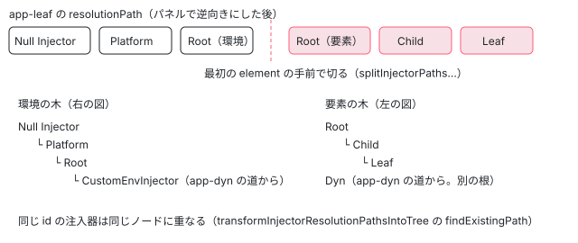

[目次](../README.md) › [Angular DevTools の内側](README.md) › 第 16 回 / 全 20 回

# 注入器の木：resolutionPath と provider の一覧

> バックエンドが ɵgetInjectorResolutionPath・ɵgetInjectorProviders で集める注入器の道筋と provider（logProvider の #55570 も再現）、パネルの injector-tree-fns.ts が道筋を逆にして要素の注入器と環境の注入器の 2 つの木に分けて重ねる行と、ɵgetDependenciesFromInjectable の依存が要素の注入器の分だけ落ちる理由。core の側（di-debug）はリンク。

angular/angular · 読了 約 13 分 · 発展 · [サイトで読む（デモが動きます）](https://angular-deep-dive-cyan.vercel.app/chapter/devtools-injector-tree)

---

DevTools の Injector Tree タブには、左に「要素の注入器（element injector）の木」、右に「環境の注入器（environment injector）の木」の 2 つが並びます。この章では、その 2 つの木がどこから来るかを追います。バックエンドがノードごとに core の `ɵgetInjectorResolutionPath` で「注入器の道筋（resolutionPath）」を集め、パネルの `injector-tree-fns.ts` がそれを 2 つに分けて木にし、注入器を選ぶと `ɵgetInjectorProviders` で provider の一覧を取りに行くまでです。

読む対象は `ng-devtools-backend/src/lib/client-event-subscribers.ts` の `getNodeDIResolutionPath`・`getInjectorProvidersCallback`・`logProvider` と、パネルの `devtools-tabs/injector-tree/` の `injector-tree-fns.ts`・`injector-tree.component.ts` です。core の側（`ɵgetInjectorResolutionPath` などの作り）は [di-debug の章](../di/16-di-debug.md)で読んだので、ここでは 1 か所だけ引きます。

1. [1. 全体像](01-devtools-overview.md)
2. [2. Angular を見つける](02-devtools-detect.md)
3. [3. メッセージの道](03-devtools-messaging.md)
4. [4. プロトコル](04-devtools-protocol.md)
5. [5. コンポーネントの木](05-devtools-component-tree.md)
6. [6. 制御フローの塊](06-devtools-control-flow.md)
7. [7. 同じノードを見分ける](07-devtools-identity.md)
8. [8. パネルの木](08-devtools-forest-ui.md)
9. [9. プロパティの直列化](09-devtools-state-serializer.md)
10. [10. 入れ子を開く](10-devtools-property-resolver.md)
11. [11. 値を書き換える](11-devtools-property-mutation.md)
12. [12. 選ぶ・光らせる](12-devtools-inspector-highlight.md)
13. [13. プロファイラーの記録](13-devtools-profiler-capture.md)
14. [14. 記録を描く](14-devtools-profiler-formatters.md)
15. [15. 変更検知を見張る](15-devtools-cd-analyzer.md)
16. **16. 注入器の木**（この章）
17. [17. signal のグラフ](17-devtools-signal-graph.md)
18. [18. ルーター・TransferState](18-devtools-router-transfer.md)
19. [19. テストとビルド](19-devtools-test-build.md)
20. [20. issue と PR を読む](20-devtools-issues.md)



*ノードごとの道筋を、要素の部分と環境の部分に切って、それぞれ 1 本の木に重ねる*

## 1. ノードごとの道筋：getNodeDIResolutionPath

パネルがコンポーネントの木を頼むと（[第 5 回](05-devtools-component-tree.md)）、バックエンドは DI の窓口が揃っている版なら、ノードごとに次の関数で道筋を付けて送ります。

📄 `angular/devtools/projects/ng-devtools-backend/src/lib/client-event-subscribers.ts` L493–519 （▶ の行: 495–496, 499–501, 507–508, 511, 513–515, 518）

```ts
493 │ function getNodeDIResolutionPath(node: ComponentTreeNode): SerializedInjector[] | undefined {
494 │   // Some nodes are not linked to HTMLElements, for example @defer blocks
495 ▶   if (!node.nativeElement) {
496 ▶     return undefined;
497 │   }
498 │ 
499 ▶   const nodeInjector = getInjectorFromElementNode(node.nativeElement);
500 ▶   if (!nodeInjector) {
501 ▶     return [];
502 │   }
503 │   // There are legit cases where an angular node will have non-ElementInjector injectors.
504 │   // For example, components created with createComponent require the API consumer to
505 │   // pass in an element injector, else it sets the element injector of the component
506 │   // to the NullInjector
507 ▶   if (!isElementInjector(nodeInjector)) {
508 ▶     return [];
509 │   }
510 │ 
511 ▶   const element = getElementInjectorElement(nodeInjector);
512 │ 
513 ▶   if (!nodeInjectorToResolutionPath.has(element)) {
514 ▶     const resolutionPaths = getInjectorResolutionPath(nodeInjector);
515 ▶     nodeInjectorToResolutionPath.set(element, serializeResolutionPath(resolutionPaths));
516 │   }
517 │ 
518 ▶   return nodeInjectorToResolutionPath.get(element)!;
519 │ }
```

1. **495〜496 行目：要素の無いノードは無し**

   `@defer` の塊のように DOM の要素を持たないノード（[第 6 回](06-devtools-control-flow.md)）には道筋を付けません（`undefined`）。
2. **499〜501 行目：要素から注入器**

   `getInjectorFromElementNode` は `ng.getInjector(element)` を呼ぶだけで、その要素の `NodeInjector` を返します。
3. **507〜508 行目：要素の注入器でなければ空**

   503〜506 行目のコメントのとおり、要素の注入器を渡さずに `createComponent` で作ったコンポーネントでは、ここが NullInjector になります。
4. **511〜515 行目：要素ごとに 1 回だけ計算して覚える**

   514 行目で `ɵgetInjectorResolutionPath`（[di-debug の章](../di/16-di-debug.md)）を呼び、注入器のオブジェクトの配列をもらいます。**自分 → 親 → … → 環境の注入器 → NullInjector** の順です。515 行目の `serializeResolutionPath` が、各注入器を `{id, name, type, providers}` の `SerializedInjector` にします（要素の注入器は名前がディレクティブのクラスの名前、環境の注入器は `Platform`・`Root` か `createEnvironmentInjector` に付けた名前、`providers` は provider の数）。513 行目の Map のキーは要素なので、2 回目からは同じ配列を返します。

> [!NOTE]
> **ポイント**
>
> 注入器の `id` は、要素の注入器なら**要素**を、環境の注入器ならそのオブジェクトをキーにして振られます（`component-tree.ts` の `getOrCreateInjectorId`。id から注入器を引く `idToInjector` が `WeakRef` になった経緯は [第 7 回](07-devtools-identity.md)）。要素をキーにするのは、次の core の行のとおり、`NodeInjector` のオブジェクトが道筋を求めるたびに作り直されるからです。

📄 `angular/packages/core/src/render3/util/injector_discovery_utils.ts` L638–668 （▶ の行: 643, 648, 653, 661, 663–664, 668）

```ts
638 │   const parentLocation = getParentInjectorLocation(
639 │     tNode as TElementNode | TContainerNode | TElementContainerNode,
640 │     lView,
641 │   );
642 │ 
643 ▶   if (hasParentInjector(parentLocation)) {
644 │     const parentInjectorIndex = getParentInjectorIndex(parentLocation);
645 │     const parentLView = getParentInjectorView(parentLocation, lView);
646 │     const parentTView = parentLView[TVIEW];
647 │     const parentTNode = parentTView.data[parentInjectorIndex + NodeInjectorOffset.TNODE] as TNode;
648 ▶     return new NodeInjector(
649 │       parentTNode as TElementNode | TContainerNode | TElementContainerNode,
650 │       parentLView,
651 │     );
652 │   } else {
653 ▶     const chainedInjector = lView[INJECTOR] as ChainedInjector;
654 │ 
655 │     // Case where chainedInjector.injector is an OutletInjector and chainedInjector.injector.parent
656 │     // is a NodeInjector.
657 │     // todo(aleksanderbodurri): ideally nothing in packages/core should deal
658 │     // directly with router concerns. Refactor this so that we can make the jump from
659 │     // NodeInjector -> OutletInjector -> NodeInjector
660 │     // without explicitly relying on types contracts from packages/router
661 ▶     const injectorParent = (chainedInjector.injector as any)?.parent as Injector;
662 │ 
663 ▶     if (injectorParent instanceof NodeInjector) {
664 ▶       return injectorParent;
665 │     }
666 │   }
667 │ 
668 ▶   return null;
```

親の要素の注入器があれば、648 行目で**新しい `NodeInjector`** を作って返します。同じ要素でも呼ぶたびに別のオブジェクトです。親の要素が無い（そのビューの根の要素）ときは 653 行目で `lView[INJECTOR]` を見て、663〜664 行目で、その先が `NodeInjector` のときだけ（コメントのとおりルーターの `OutletInjector` の場合）要素の注入器の木を上へ続けます。それ以外は 668 行目で `null` を返し、呼び出し側が環境の注入器へ飛びます（[di-debug の章](../di/16-di-debug.md)の `getInjectorResolutionPath`）。

## 2. 2 つに分けて木にする：injector-tree-fns.ts

📄 `angular/devtools/projects/ng-devtools/src/lib/devtools-tabs/injector-tree/injector-tree.component.ts` L242–273 （▶ の行: 249, 251–252, 255–256, 261–262, 266–267）

```ts
242 │   private updateInjectorTreeVisualization(forestWithInjectorPaths: DevToolsNode[]): void {
243 │     // At this point we have a forest of directive trees where each node has a resolution path.
244 │     // We want to convert this nested forest into an array of resolution paths.
245 │     // Our ultimate goal is to convert this array of resolution paths into a tree structure.
246 │     // Directive forest -> Array of resolution paths -> Tree of resolution paths
247 │ 
248 │     // First, pick out the resolution paths.
249 ▶     let injectorPaths = grabInjectorPathsFromDirectiveForest(forestWithInjectorPaths);
250 │ 
251 ▶     if (this.hideFrameworkInjectors) {
252 ▶       injectorPaths = filterOutAngularInjectors(injectorPaths);
253 │     }
254 │ 
255 ▶     if (this.hideInjectorsWithNoProviders) {
256 ▶       injectorPaths = filterOutInjectorsWithNoProviders(injectorPaths);
257 │     }
258 │ 
259 │     // In Angular we have two types of injectors, element injectors and environment injectors.
260 │     // We want to split the resolution paths into two groups, one for each type of injector.
261 ▶     const {elementPaths, environmentPaths, startingElementToEnvironmentPath} =
262 ▶       splitInjectorPathsIntoElementAndEnvironmentPaths(injectorPaths);
263 │     this.elementToEnvironmentPath = startingElementToEnvironmentPath;
264 │ 
265 │     // Here for our 2 groups of resolution paths, we want to convert them into a tree structure.
266 ▶     const elementInjectorTree = transformInjectorResolutionPathsIntoTree(elementPaths);
267 ▶     const environmentInjectorTree = transformInjectorResolutionPathsIntoTree(environmentPaths);
268 │ 
269 │     this.elementInjectorTree.set(elementInjectorTree);
270 │     this.environmentInjectorTree.set(environmentInjectorTree);
271 │ 
272 │     this.highlightPathFromSelectedInjector();
273 │   }
```

パネルの `updateInjectorTreeVisualization` が、4 つの関数を順に呼びます。コメントの「Directive forest -&gt; Array of resolution paths -&gt; Tree of resolution paths」（246 行目）がこの章の全部です。

### (1) 道筋を集めて、向きを変える

📄 `angular/devtools/projects/ng-devtools/src/lib/devtools-tabs/injector-tree/injector-tree-fns.ts` L176–194 （▶ の行: 182–183, 186）

```ts
176 │ export function grabInjectorPathsFromDirectiveForest(
177 │   directiveForest: DevToolsNode[],
178 │ ): InjectorPath[] {
179 │   const injectorPaths: InjectorPath[] = [];
180 │ 
181 │   const grabInjectorPaths = (node: DevToolsNode) => {
182 ▶     if (node.resolutionPath) {
183 ▶       injectorPaths.push({node, path: node.resolutionPath.slice().reverse()});
184 │     }
185 │ 
186 ▶     node.children.forEach((child) => grabInjectorPaths(child));
187 │   };
188 │ 
189 │   for (const directive of directiveForest) {
190 │     grabInjectorPaths(directive);
191 │   }
192 │ 
193 │   return injectorPaths;
194 │ }
```

木をたどって道筋のあるノードを集め、183 行目で **`reverse()`** します。バックエンドの道筋は「自分 → … → NullInjector」なので、逆にすると「NullInjector → Platform → Root → … → 自分」と**根から葉への順**になります。木に重ねるにはこの向きが要ります。

### (2) 要らない注入器を外す（スイッチを入れたとき）

📄 `angular/devtools/projects/ng-devtools/src/lib/devtools-tabs/injector-tree/injector-tree-fns.ts` L247–261 （▶ の行: 249–250, 259）

```ts
247 │ export function filterOutInjectorsWithNoProviders(injectorPaths: InjectorPath[]): InjectorPath[] {
248 │   for (const injectorPath of injectorPaths) {
249 ▶     injectorPath.path = injectorPath.path.filter(
250 ▶       ({providers}) => providers === undefined || providers > 0,
251 │     );
252 │   }
253 │ 
254 │   return injectorPaths;
255 │ }
256 │ 
257 │ export function filterOutAngularInjectors(injectorPaths: InjectorPath[]): InjectorPath[] {
258 │   return injectorPaths.map(({node, path}) => {
259 ▶     return {node, path: path.filter((injector) => !IGNORED_ANGULAR_INJECTORS.has(injector.name))};
260 │   });
261 │ }
```

📄 `angular/devtools/projects/ng-devtools/src/lib/devtools-tabs/injector-tree/injector-tree-fns.ts` L84–95 （▶ の行: 85–87）

```ts
84 │ const IGNORED_ANGULAR_INJECTORS = new Set([
85 ▶   'Null Injector',
86 ▶   ...ANGULAR_DIRECTIVES,
87 ▶   ...ANGULAR_DIRECTIVES.map((directive) => `_${directive}`),
88 │ ]);
89 │ 
90 │ const INJECTOR_TYPE_CLASS_MAP = new Map<SerializedInjector['type'], string>([
91 │   ['imported-module', 'node-imported-module'],
92 │   ['environment', 'node-environment'],
93 │   ['element', 'node-element'],
94 │   ['null', 'node-null'],
95 │ ]);
```

パネルの「provider の無い注入器を隠す」は 249〜250 行目で `providers` が 0 の注入器を道筋から抜き、「フレームワークの注入器を隠す」は 259 行目で、名前が 85〜87 行目の集合（`Null Injector` と、`NgIf`・`RouterOutlet` など Angular の組み込みのディレクティブの名前、その先頭に `_` を付けたもの）にある注入器を抜きます。名前で比べているので、自分のコンポーネントに `NgIf` という名前を付けると隠れます。

### (3) 要素の部分と環境の部分に切る

📄 `angular/devtools/projects/ng-devtools/src/lib/devtools-tabs/injector-tree/injector-tree-fns.ts` L196–217 （▶ の行: 210–212, 215–216）

```ts
196 │ export function splitInjectorPathsIntoElementAndEnvironmentPaths(injectorPaths: InjectorPath[]): {
197 │   elementPaths: InjectorPath[];
198 │   environmentPaths: InjectorPath[];
199 │   startingElementToEnvironmentPath: Map<string, SerializedInjector[]>;
200 │ } {
201 │   const elementPaths: InjectorPath[] = [];
202 │   const environmentPaths: InjectorPath[] = [];
203 │   const startingElementToEnvironmentPath = new Map<string, SerializedInjector[]>();
204 │ 
205 │   injectorPaths.forEach(({node, path}) => {
206 │     // split the path into two paths,
207 │     // one for the element injector and one for the environment injector
208 │     let environmentPath: SerializedInjector[] = [];
209 │     let elementPath: SerializedInjector[] = [];
210 ▶     const firstElementIndex = path.findIndex((injector) => injector.type === 'element');
211 ▶     if (firstElementIndex === -1) {
212 ▶       environmentPath = path;
213 │       elementPath = [];
214 │     } else {
215 ▶       environmentPath = path.slice(0, firstElementIndex);
216 ▶       elementPath = path.slice(firstElementIndex);
217 │     }
```

📄 `angular/devtools/projects/ng-devtools/src/lib/devtools-tabs/injector-tree/injector-tree-fns.ts` L219–245 （▶ の行: 229, 231–233, 239–240）

```ts
219 │     elementPaths.push({
220 │       node,
221 │       path: elementPath,
222 │     });
223 │ 
224 │     environmentPaths.push({
225 │       node,
226 │       path: environmentPath,
227 │     });
228 │ 
229 ▶     if (elementPath[elementPath.length - 1]) {
230 │       // reverse each path to get the paths starting from the starting element
231 ▶       startingElementToEnvironmentPath.set(
232 ▶         elementPath[elementPath.length - 1].id,
233 ▶         environmentPath.slice().reverse(),
234 │       );
235 │     }
236 │   });
237 │ 
238 │   return {
239 ▶     elementPaths: elementPaths.filter(({path}) =>
240 ▶       path.every((injector) => injector.type === 'element'),
241 │     ),
242 │     environmentPaths,
243 │     startingElementToEnvironmentPath,
244 │   };
245 │ }
```

1. **210 行目：最初の要素の注入器を探す**

   根からの順なので、ここより前が環境の注入器の部分、ここから後が要素の注入器の部分です。
2. **211〜212 行目：要素の注入器が 1 つも無ければ、全部を環境の側へ**
3. **215〜216 行目：その位置で 2 つに切る**
4. **229〜235 行目：葉の要素の注入器から、その環境の道筋を引けるようにする**

   要素の木でノードを選んだとき、右の環境の木のどこを光らせるかに使います（232 行目のキーは葉の要素の注入器の id、233 行目の値は逆向きにした環境の道筋）。
5. **239〜240 行目：要素の道筋は、全部が要素の注入器のものだけを残す**

   要素の注入器の後に環境の注入器が来る形（ルーターの outlet など）は、ここで要素の木から外れます。

### (4) 重ねて木にする

📄 `angular/devtools/projects/ng-devtools/src/lib/devtools-tabs/injector-tree/injector-tree-fns.ts` L132–167 （▶ の行: 139, 142–143, 145, 147–148, 152, 159–160, 163–165）

```ts
132 │ export function transformInjectorResolutionPathsIntoTree(
133 │   injectorPaths: InjectorPath[],
134 │ ): InjectorTreeNode {
135 │   const injectorTree: InjectorTreeNode[] = [];
136 │   const injectorIdToNode = new Map<string, DevToolsNode>();
137 │ 
138 │   for (const {path: injectorPath, node} of injectorPaths) {
139 ▶     let currentLevel = injectorTree;
140 │ 
141 │     for (const [index, injector] of injectorPath.entries()) {
142 ▶       if (injector.type === 'element' && index === injectorPath.length - 1) {
143 ▶         injectorIdToNode.set(injector.id, node);
144 │       }
145 ▶       let existingPath = findExistingPath(currentLevel, injector);
146 │ 
147 ▶       if (existingPath) {
148 ▶         currentLevel = existingPath.children;
149 │         continue;
150 │       }
151 │ 
152 ▶       const next: InjectorTreeNode = {
153 │         label: injector.name || '',
154 │         injector,
155 │         children: [],
156 │       };
157 │ 
158 │       if (injector.providers !== undefined) {
159 ▶         const providerText = injector.providers === 1 ? 'Provider' : 'Providers';
160 ▶         next.subLabel = `${injector.providers} ${providerText}`;
161 │       }
162 │ 
163 ▶       next.injector.node = injectorIdToNode.get(next.injector.id);
164 ▶       currentLevel.push(next);
165 ▶       currentLevel = next.children;
166 │     }
167 │   }
```

1. **139・145〜150 行目：根から 1 段ずつ、同じ id の子があればそこへ進む**

   道筋を根から順に見て、今の段に同じ `id` の注入器（`findExistingPath`、比べ方は `equalInjector` の `a.id === b.id`）があれば、新しく作らずにその子の段へ進みます。だから、同じ `Root` を通る道筋は 1 本の幹に重なります。
2. **152〜165 行目：無ければノードを作る**

   ラベルは注入器の名前、159〜160 行目のサブラベルは `3 Providers` のような provider の数です。
3. **142〜143・163 行目：要素の注入器と木のノードを結ぶ**

   道筋の最後（葉）の要素の注入器に、その道筋を持っていたコンポーネントの木のノードを結びます。これでコンポーネントの id から注入器のノードを探せます（次の節の `highlightComponent`）。

📄 `angular/devtools/projects/ng-devtools/src/lib/devtools-tabs/injector-tree/injector-tree-fns.ts` L348–358 （▶ の行: 351, 357）

```ts
348 │ /** Checks whether an injector belongs to the element tree. */
349 │ export function isElementTreeInjector(injector: SerializedInjector | undefined): boolean {
350 │   const type = injector?.type;
351 ▶   return type === 'element';
352 │ }
353 │ 
354 │ /** Checks whether an injector belongs to the environment tree. */
355 │ export function isEnvironmentTreeInjector(injector: SerializedInjector | undefined): boolean {
356 │   const type = injector?.type;
357 ▶   return type === 'environment' || type === 'null' || type === 'imported-module';
358 │ }
```

どちらの木に属するかは型だけで決まります。`element` は左、`environment`・`null`・`imported-module`（NgModule の import の道筋で足される見かけの段）は右です。

## 3. 注入器を選ぶ：getInjectorProviders

📄 `angular/devtools/projects/ng-devtools/src/lib/devtools-tabs/injector-tree/injector-tree.component.ts` L421–430 （▶ の行: 423, 425–427）

```ts
421 │   private getProviders(node: InjectorTreeD3Node) {
422 │     const injector = node.data.injector;
423 ▶     this.messageBus.emit('getInjectorProviders', [
424 │       {
425 ▶         id: injector.id,
426 ▶         type: injector.type,
427 ▶         name: injector.name,
428 │       },
429 │     ]);
430 │   }
```

木のノードを選ぶと、パネルは `id`・`type`・`name` だけを送ります（注入器のオブジェクトはページの中にしか無いので）。

📄 `angular/devtools/projects/ng-devtools-backend/src/lib/client-event-subscribers.ts` L521–545 （▶ の行: 523, 528, 533–534, 537, 542–544）

```ts
521 │ const getInjectorProvidersCallback =
522 │   (messageBus: MessageBus<Events>) => (injector: SerializedInjector) => {
523 ▶     const resolvedInjector = idToInjector.get(injector.id)?.deref();
524 │     if (!resolvedInjector) {
525 │       return;
526 │     }
527 │ 
528 ▶     const providerRecords = getInjectorProviders(resolvedInjector);
529 │     const allProviderRecords: SerializedProviderRecord[] = [];
530 │ 
531 │     const tokenToRecords: Map<any, SerializedProviderRecord[]> = new Map();
532 │ 
533 ▶     for (const [index, providerRecord] of providerRecords.entries()) {
534 ▶       const record = serializeProviderRecord(
535 │         providerRecord,
536 │         index,
537 ▶         injector.type === 'environment',
538 │       );
539 │ 
540 │       allProviderRecords.push(record);
541 │ 
542 ▶       const records = tokenToRecords.get(providerRecord.token) ?? [];
543 ▶       records.push(record);
544 ▶       tokenToRecords.set(providerRecord.token, records);
545 │     }
```

📄 `angular/devtools/projects/ng-devtools-backend/src/lib/client-event-subscribers.ts` L547–573 （▶ の行: 550–551, 553–554, 557, 560, 562, 567, 572）

```ts
547 │     const serializedProviderRecords: SerializedProviderRecord[] = [];
548 │ 
549 │     for (const records of tokenToRecords.values()) {
550 ▶       const multiRecords = records.filter((record) => record.multi);
551 ▶       const nonMultiRecords = records.filter((record) => !record.multi);
552 │ 
553 ▶       for (const record of nonMultiRecords) {
554 ▶         serializedProviderRecords.push(record);
555 │       }
556 │ 
557 ▶       const [firstMultiRecord] = multiRecords;
558 │       if (firstMultiRecord !== undefined) {
559 │         // All multi providers will have the same token, so we can just use the first one.
560 ▶         serializedProviderRecords.push({
561 │           token: firstMultiRecord.token,
562 ▶           type: 'multi',
563 │           multi: true,
564 │           // todo(aleksanderbodurri): implememnt way to differentiate multi providers that
565 │           // provided as viewProviders
566 │           isViewProvider: firstMultiRecord.isViewProvider,
567 ▶           index: records.map((record) => record.index as number),
568 │         });
569 │       }
570 │     }
571 │ 
572 ▶     messageBus.emit('latestInjectorProviders', [injector, serializedProviderRecords]);
573 │   };
```

1. **523 行目：id から注入器を引く**

   1 節で振った id の `WeakRef` を戻します。GC されていれば何も返しません（524〜526 行目）。
2. **528 行目：`ɵgetInjectorProviders`**

   core の窓口です。core の注入器のプロファイラーが、provider が設定されたときに覚えておいた記録を返します（[di-debug の章](../di/16-di-debug.md)の `framework_injector_profiler.ts`）。
3. **533〜538 行目：1 つずつ直列化**

   `serializeProviderRecord` が、provider の形（`useClass` なら `class`、`useValue` なら `value` など）、`multi`、`isViewProvider`、配列の中の番号（`index`）を付けます。537 行目で環境の注入器のときだけ `importPath`（どの import の道でその provider が入ったか）を付けます。
4. **542〜544 行目・549〜570 行目：multi の provider を 1 行にまとめる**

   同じトークンの記録を集め、`multi` でないものはそのまま、`multi` のものは 560〜568 行目で 1 行にし、567 行目の `index` を番号の配列にします。564〜565 行目のコメントのとおり、`multi` の中で `viewProviders` から来たものかどうかは区別していません。
5. **572 行目：`latestInjectorProviders` で返す**

### コンソールに出す：logProvider と #55570

📄 `angular/devtools/projects/ng-devtools-backend/src/lib/client-event-subscribers.ts` L575–612 （▶ の行: 584, 586, 589, 595–596, 599, 601–602, 608）

```ts
575 │ const logProvider = (
576 │   serializedInjector: SerializedInjector,
577 │   serializedProvider: SerializedProviderRecord,
578 │ ): void => {
579 │   const injector = idToInjector.get(serializedInjector.id)?.deref();
580 │   if (!injector) {
581 │     return;
582 │   }
583 │ 
584 ▶   const providerRecords = getInjectorProviders(injector);
585 │ 
586 ▶   console.group(
587 │     `%c${serializedInjector.name}`,
588 │     `color: ${
589 ▶       serializedInjector.type === 'element' ? '#a7d5a9' : '#f05057'
590 │     }; font-size: 1.25rem; font-weight: bold;`,
591 │   );
592 │   // tslint:disable-next-line:no-console
593 │   console.log('injector: ', injector);
594 │ 
595 ▶   if (typeof serializedProvider.index === 'number') {
596 ▶     const provider = providerRecords[serializedProvider.index];
597 │ 
598 │     // tslint:disable-next-line:no-console
599 ▶     console.log('provider: ', provider);
600 │     // tslint:disable-next-line:no-console
601 ▶     console.log(`value: `, injector.get(provider.token, null, {optional: true}));
602 ▶   } else if (Array.isArray(serializedProvider.index)) {
603 │     const providers = serializedProvider.index.map((index) => providerRecords[index]);
604 │ 
605 │     // tslint:disable-next-line:no-console
606 │     console.log('providers: ', providers);
607 │     // tslint:disable-next-line:no-console
608 ▶     console.log(`value: `, injector.get(providers[0].token, null, {optional: true}));
609 │   }
610 │ 
611 │   console.groupEnd();
612 │ };
```

provider の行の「コンソールに出す」ボタンは `logProvider` を送り、584 行目でもう一度 `ɵgetInjectorProviders` を呼んで、596 行目で番号の記録を取り出し、599 行目でその記録を出します。ところが 601 行目の `value` は、**その記録の値ではなく、`injector.get(provider.token)` でトークンを解決し直した値**です。同じ要素に、同じトークンを `providers` と `viewProviders` の両方で置くと、どちらの記録を選んでも同じ値（DI がその注入器から解決する方）が出ます。これが開いている issue #55570（「View provider/provider info that's logged in the console is incorrect」、area: core・core: di・area: devtools）の中身で、5 節のデモの (5) で再現します。

## 4. 木のノードとコンポーネントの木を結ぶ：a3a77649754

📄 `angular/devtools/projects/ng-devtools/src/lib/devtools-tabs/injector-tree/injector-tree.component.ts` L204–221 （▶ の行: 205, 210, 215, 218–219）

```ts
204 │   private subscribeToBackendEvents(): void {
205 ▶     const unregisterHighlight = this.messageBus.on('highlightComponent', (id: number) => {
206 │       const elementTree = this.elementTree();
207 │       if (!elementTree) {
208 │         return;
209 │       }
210 ▶       const injectorNode = this.getNodeByComponentId(elementTree, id);
211 │       if (injectorNode === null) {
212 │         return;
213 │       }
214 │ 
215 ▶       this.selectInjectorByNode(injectorNode);
216 │     });
217 │ 
218 ▶     inject(DestroyRef).onDestroy(() => {
219 ▶       unregisterHighlight();
220 │     });
221 │   }
```

コンポーネントの木でノードにマウスを乗せると、パネルの中で `highlightComponent` が流れます。205 行目でそれを購読し、210 行目で 2 節の 142〜143 行目で結んだノードを探して、215 行目でそのノードを選びます。

a3a77649754（fix、2026-08-17）より前は、この購読が `afterRenderEffect` の中の `init()` にあり、**コンポーネントの木が届くたびに購読が 1 つ増え**、外されませんでした。修正で購読を constructor から呼ぶ `subscribeToBackendEvents` に移し、218〜219 行目で `DestroyRef` により外すようにしました。差分は `injector-tree.component.ts` の 1 ファイルだけで、spec は足されていません。

## 5. DEMO：providers・viewProviders・createEnvironmentInjector のアプリ

> **🧪 DEMO — resolutionPath・2 つの木・provider の一覧（記録の再生）**
>
> これは記録です。本物の devtools のソース（angular/angular の devtools/、8576f161ae4）を、本物の @angular/core 22.1.6（開発モード）のアプリにつないで Node で動かした結果です。アプリは、`Root`（`providers: [ParentService]`）の下に `Child`（`FLOWER` を `providers` で 🌺、`viewProviders` で 🌻）、その中に `Leaf`（`FLOWER` と `providedIn: 'root'` の `RootService` を inject）、さらに `Root` の `ViewContainerRef` から `createEnvironmentInjector([EnvService], …, 'CustomEnvInjector')` を環境の注入器にして作った `Dyn` です。記録のスクリプトは、本物のバックエンドに `getLatestComponentExplorerView`・`getInjectorProviders`・`logProvider` を送り、返ってきた木をパネルの本物の `injector-tree-fns` の関数に、2 節と同じ順で通しました。core は platform を作るときに `window` があるときだけ注入器のプロファイラーを始めるので（[di-debug の章](../di/16-di-debug.md)の `publishDefaultGlobalUtils`）、この記録では起動の前に `window` を置いています（置かないと provider の一覧が空になります。環境の違いで、devtools の振る舞いではありません）。
>
> 「記録を再生する」を押してください。
>
> ▶ [このデモはサイトで動かせます](https://angular-deep-dive-cyan.vercel.app/chapter/devtools-injector-tree)

記録から読み取れることです。

1. **(1) 道筋は根から葉へ、要素の注入器はコンポーネントの名前**

   `app-leaf` の道筋は `Null Injector → Platform → Root（環境）→ Root（要素）→ Child → Leaf` です。`Root` が 2 回出るのは、環境の注入器の名前（scope が root）と、ルートのコンポーネントの要素の注入器の名前（クラスの名前）がたまたま同じだからで、id は 3 と 2 で別です。
2. **(2)(3) createEnvironmentInjector の注入器は、そこを通るコンポーネントがあるときだけ出る**

   `CustomEnvInjector` は `Dyn` の道筋に入っているので、環境の木の `Root` の子として出ます。開いている issue #57286（「createEnvironmentInjector で作った注入器を木に出したい」）の報告と違うのは、パネルが知っている注入器が「どれかのノードの道筋に入っているもの」だけだからです。`createEnvironmentInjector` で作っても、そこから作ったコンポーネントが木に無ければ、どの道筋にも入らず、木にも出ません。
3. **(3) Dyn は要素の木の別の根になる**

   `Dyn` は `Root` の `ViewContainerRef` から作ったのに、道筋に `Root` の要素の注入器がありません。1 節の 663〜668 行目のとおり、core の `getInjectorParent` が動的に作ったビューの根から親の要素の注入器へ進まないからです。ところが記録の 6 段の最後の行のとおり、`Dyn` は `inject(ParentService, {optional: true})` で `Root` の `providers` の `ParentService` を**実際に受け取っています**（記録の `gotParentService: true`）。木の道筋と、実際の解決の道がずれている例です。
4. **(4) 環境の注入器にだけ importPath がある**

   `Root`（環境）の行には `importPath` が付き、要素の注入器の行には付きません（3 節の 537 行目）。`EventManagerPlugins` などの `multi` は 1 行にまとまり、`index` が配列です。要素の注入器の行の `ElementRef`・`Renderer2` などは `type: internal` です（`serializeProviderRecord` が名前で判定）。
5. **(5) #55570 の再現**

   `Child` の `FLOWER` の 2 行（`isViewProvider` が `true` と `false`）のどちらを出しても、`provider: ` の行は 🌻 と 🌺 で正しく違うのに、`value: ` の行は 2 回とも `🌻 viewProviders` です。3 節の 601 行目の `injector.get(provider.token)` が、コンポーネントのホストの注入器から `FLOWER` を解決し直すと `viewProviders` の側が見つかるからです。
6. **(6) 要素の注入器が置いたサービスは、注入されたサービスの一覧から落ちる**

   バックエンドが送った `app-child` の依存は空、`app-leaf` は `RootService` だけ、`app-dyn` は `EnvService` だけです。core を直接呼ぶと `ParentService`（`Root` の要素）と `FLOWER`（`Child` の要素）も返ってきますが、その `providedIn` は別に求めた道筋のどのオブジェクトとも同じではありません（番号 -1）。1 節の 648 行目で `NodeInjector` が呼ぶたびに作り直されるためで（2 回呼んだ比べの `false`）、バックエンドの `getDependenciesForDirective` はオブジェクトの同一性（`node.injector === providedIn`）で道筋の中を探すので、見つからない依存を飛ばします。環境の注入器（`R3Injector`）は同じオブジェクトなので見つかります。

> [!WARNING]
> **ハマりどころ**
>
> (6) は、このページの記録（Node・domino・@angular/core 22.1.6）で起きたことですが、原因の 2 か所（core の 648 行目の `new NodeInjector` と、バックエンドの同一性での比べ）は環境に関係しないコードです。2026-11-05 の main でも、`getInjectorParent` は `new NodeInjector(…)` を返し、バックエンドの比べ（main では `injector-tree/injector-tree.ts` に移った）は `node.injector === providedIn` のままでした（gh api で読んだだけで、手元のブラウザでは確かめていません）。

📄 `scratchpad の記録スクリプト（injector.ts。共通の部品で束ねて node で実行）`

```
// 第 16 回 devtools-injector-tree の記録。
// providers・viewProviders・providedIn の違うサービスと、createEnvironmentInjector で作った環境の注入器を持つアプリで、
// getLatestComponentExplorerView の resolutionPath、getInjectorProviders の結果、logProvider がコンソールに出すものを記録し、
// パネルの本物の injector-tree-fns の関数に通した 2 つの木も記録する。
import {
  AfterViewInit, Component, EnvironmentInjector, Injectable, InjectionToken, ViewChild, ViewContainerRef,
  createEnvironmentInjector, inject,
} from '@angular/core';
import { bootApp, makeBus, loadBackend, tick, writeJson, clone } from '../_shared/harness';
import {
  grabInjectorPathsFromDirectiveForest, splitInjectorPathsIntoElementAndEnvironmentPaths,
  transformInjectorResolutionPathsIntoTree, filterOutInjectorsWithNoProviders,
} from '~/angular-research/angular/devtools/projects/ng-devtools/src/lib/devtools-tabs/injector-tree/injector-tree-fns';

@Injectable({ providedIn: 'root' }) class RootService {}
@Injectable() class ParentService {}
@Injectable() class EnvService {}
const FLOWER = new InjectionToken<string>('FLOWER');

@Component({ selector: 'app-leaf', template: 'leaf' })
class Leaf { flower = inject(FLOWER); root = inject(RootService); }

@Component({
  selector: 'app-child',
  imports: [Leaf],
  providers: [{ provide: FLOWER, useValue: '🌺 providers' }],
  viewProviders: [{ provide: FLOWER, useValue: '🌻 viewProviders' }],
  template: '<app-leaf />',
})
class Child { parent = inject(ParentService); }

@Component({ selector: 'app-dyn', template: 'dyn' })
class Dyn { env = inject(EnvService); parent = inject(ParentService, { optional: true }); }

@Component({
  selector: 'app-root',
  imports: [Child],
  providers: [ParentService],
  template: '<app-child /><ng-container #host />',
})
class Root implements AfterViewInit {
  @ViewChild('host', { read: ViewContainerRef }) host!: ViewContainerRef;
  private env = inject(EnvironmentInjector);
  ngAfterViewInit() {
    const custom = createEnvironmentInjector([EnvService], this.env, 'CustomEnvInjector');
    this.host.createComponent(Dyn, { environmentInjector: custom });
  }
}

// core は platform を作るときに typeof window !== 'undefined' のときだけ注入器のプロファイラー
// （setupFrameworkInjectorProfiler。provider の一覧を集める）を始める（global_utils.ts の publishDefaultGlobalUtils）。
// 共通の部品は window を bootApp のあとに置くので、この記録では先に window だけを置いておく。
(globalThis as any).window ??= globalThis;
const { appRef } = await bootApp(Root);
await appRef.whenStable();
const { initializeMessageBus } = await loadBackend();
const { bus, send } = makeBus();
// 共通の部品の clone は、同じオブジェクトが 2 回目に出ると '[circular]' に置き換える。
// resolutionPath の注入器のオブジェクトは木の中で共有されるので、この記録では JSON.stringify で写す
// （本物の拡張でもメッセージは直列化されて写しになる）。
const sent: { topic: string; args: any[] }[] = [];
const emit0 = bus.emit;
bus.emit = (t: string, args: unknown[] = []) => { sent.push({ topic: t, args: JSON.parse(JSON.stringify(args)) }); return emit0(t, args); };
const take = () => sent.splice(0, sent.length);
initializeMessageBus(bus as any);

send('getLatestComponentExplorerView', [undefined]);
await tick(10);
const view = take().find((m) => m.topic === 'latestComponentExplorerView')!.args[0] as any;
const forest = view.forest;

// パネルの updateInjectorTreeVisualization と同じ順で、本物の関数に通す
const injectorPaths = grabInjectorPathsFromDirectiveForest(JSON.parse(JSON.stringify(forest)));
const pathsSnapshot = JSON.parse(JSON.stringify(injectorPaths.map((p) => ({ node: p.node.tagName, path: p.path }))));
const split = splitInjectorPathsIntoElementAndEnvironmentPaths(JSON.parse(JSON.stringify(injectorPaths)));
const elementTree = transformInjectorResolutionPathsIntoTree(split.elementPaths);
const environmentTree = transformInjectorResolutionPathsIntoTree(split.environmentPaths);
const filteredEnvTree = transformInjectorResolutionPathsIntoTree(
  splitInjectorPathsIntoElementAndEnvironmentPaths(filterOutInjectorsWithNoProviders(JSON.parse(JSON.stringify(injectorPaths)))).environmentPaths,
);
const strip = (n: any): any => ({ label: n.label, subLabel: n.subLabel, id: n.injector.id, type: n.injector.type, children: n.children.map(strip) });

// コンポーネントを選んだときのプロパティ。metadata.dependencies が ɵgetDependenciesFromInjectable から作られる
// 位置 [0, 0] は app-child、[0, 0, 0] は app-leaf、[0, 1] は app-dyn
const dependencies: any[] = [];
for (const pos of [[0, 0], [0, 0, 0], [0, 1]]) {
  send('getLatestComponentExplorerView', [{ selectedElement: pos, propertyQuery: { type: 0 } }]);
  await tick(10);
  const v = take().find((m) => m.topic === 'latestComponentExplorerView')!.args[0] as any;
  for (const [name, d] of Object.entries(v.properties ?? {}) as any) dependencies.push({ position: pos, directive: name, dependencies: d.metadata?.dependencies });
}
// 同じ要素で core の関数を直接呼んだときの答え（比べるため）
const ngApi = (globalThis as any).ng;
const direct: any[] = [];
for (const sel of ['app-child', 'app-leaf', 'app-dyn']) {
  const el = (globalThis as any).document.querySelector(sel);
  const cmp = ngApi.getComponent(el);
  const injector = ngApi.getInjector(el);
  const r = ngApi.ɵgetDependenciesFromInjectable(injector, cmp.constructor);
  const path = ngApi.ɵgetInjectorResolutionPath(injector);
  const path2 = ngApi.ɵgetInjectorResolutionPath(injector);
  direct.push({
    element: sel,
    dependencies: r.dependencies.map((d: any) => ({
      token: d.token?.name ?? String(d.token),
      providedInIndexInPath: path.indexOf(d.providedIn),
      providedInIsElementInjector: d.providedIn?.constructor?.name,
    })),
    samePathObjects: path.map((x: any, i: number) => x === path2[i]),
    // Dyn は ViewContainerRef から作ったので、Root の要素の注入器の ParentService が実際に届くかも記録する
    gotParentService: sel === 'app-dyn' ? cmp.parent !== null : undefined,
  });
}

// 注入器ごとに getInjectorProviders を頼む
const allInjectors = new Map<string, any>();
for (const p of injectorPaths) for (const i of p.path) allInjectors.set(i.id, { id: i.id, type: i.type, name: i.name });
const providers: any[] = [];
for (const inj of allInjectors.values()) {
  send('getInjectorProviders', [inj]);
  const m = take().find((x) => x.topic === 'latestInjectorProviders');
  providers.push({ injector: inj, providers: m ? (m.args[1] as any[]) : null });
}

// logProvider: app-child の注入器の FLOWER を 2 つ（providers と viewProviders）コンソールに出させる
const childEntry = providers.find((p) => p.injector.name === 'Child');
const logs: any[] = [];
const orig = { group: console.group, log: console.log, groupEnd: console.groupEnd };
const fmt = (a: any) => (typeof a === 'string' ? a : a && typeof a === 'object' ? (a.constructor?.name ?? 'Object') + ' ' + JSON.stringify(clone(a)).slice(0, 160) : String(a));
console.group = (...a: any[]) => { logs.push({ fn: 'group', args: a.map(fmt) }); };
console.log = (...a: any[]) => { logs.push({ fn: 'log', args: a.map(fmt) }); };
console.groupEnd = () => { logs.push({ fn: 'groupEnd', args: [] }); };
const logProviderRuns: any[] = [];
for (const rec of (childEntry?.providers ?? []).filter((r: any) => r.token.includes('FLOWER'))) {
  logs.length = 0;
  send('logProvider', [childEntry.injector, rec]);
  logProviderRuns.push({ record: rec, logs: [...logs] });
}
Object.assign(console, orig);

await writeJson(process.argv[2] ?? 'injector.json', {
  core: '22.1.6',
  forest,
  injectorPaths: pathsSnapshot,
  split: { elementPaths: split.elementPaths.map((p: any) => ({ node: p.node.tagName, path: p.path.map((i: any) => i.name) })),
           environmentPaths: split.environmentPaths.map((p: any) => ({ node: p.node.tagName, path: p.path.map((i: any) => i.name) })) },
  elementTree: strip(elementTree),
  environmentTree: strip(environmentTree),
  filteredEnvTree: strip(filteredEnvTree),
  providers,
  dependencies,
  direct,
  logProviderRuns,
});
process.exit(0);

```

## ここまでの呼び出し

- パネル → `getLatestComponentExplorerView` — protocol
  - `prepareForestForSerialization(forest, true)` — client-event-subscribers.ts — *DI の窓口があれば道筋も*
    - `getNodeDIResolutionPath(node)` — 同上 493 行目
      - `ng.ɵgetInjectorResolutionPath(nodeInjector)` — core: injector\_discovery\_utils.ts — *親ごとに new NodeInjector*
      - `serializeResolutionPath()` — component-tree.ts — *id は要素か注入器をキーに*
- パネル `updateInjectorTreeVisualization(forest)` — injector-tree.component.ts
  - `grabInjectorPathsFromDirectiveForest` → （filter）→ `split…` → `transform…` × 2 — injector-tree-fns.ts — *要素の木と環境の木*
- 👤 注入器のノードを選ぶ → `getInjectorProviders({id, type, name})` — injector-tree.component.ts 423 行目
  - `getInjectorProvidersCallback()` — client-event-subscribers.ts — *ɵgetInjectorProviders → multi をまとめる*
    - `messageBus.emit('latestInjectorProviders', …)` — 同上 572 行目

## テストと直し方

### spec と describe

`injector-tree-fns.spec.ts`（11679 行。ほとんどが本物のアプリから写した大きな木の定数）に 10 個の describe・18 件の it があります。`getInjectorIdsToRootFromNode`（27 行目）・`generateEdgeIdsFromNodeIds`（82）・`equalInjector`（93）・`transformInjectorResolutionPathsIntoTree`（122）・`splitInjectorPathsIntoElementAndEnvironmentPaths`（3468）・`grabInjectorPathsFromDirectiveForest`（9119）・`areInjectorTreeNodesEqual`（11522）・`areInjectorTreesEqual`（11567）・`isElementTreeInjector`（11653）・`isEnvironmentTreeInjector`（11666）です。バックエンドの `getNodeDIResolutionPath`・`getInjectorProvidersCallback`・`logProvider` には spec がありません。

📄 `angular/devtools/projects/ng-devtools/src/lib/devtools-tabs/injector-tree/injector-tree-fns.spec.ts` L3468–3475 （▶ の行: 3468–3470）

```ts
3468 ▶ describe('splitInjectorPathsIntoElementAndEnvironmentPaths', () => {
3469 ▶   it("should be able to split injector paths into element and environment paths, and expose the mapping from each element to it's environment path", () => {
3470 ▶     const injectorPaths: InjectorPath[] = [
3471 │       {
3472 │         'node': {
3473 │           'tagName': 'app-root',
3474 │           'controlFlowBlock': null,
3475 │           'static': false,
```

📄 `angular/devtools/projects/ng-devtools/src/lib/devtools-tabs/injector-tree/injector-tree-fns.spec.ts` L9100–9117 （▶ の行: 9112–9116）

```ts
9100 │       ],
9101 │       [
9102 │         '24',
9103 │         [
9104 │           {'id': '7', 'type': 'environment', 'name': '_DemoAppModule'},
9105 │           {'id': '2', 'type': 'environment', 'name': '_AppModule'},
9106 │         ],
9107 │       ],
9108 │     ]);
9109 │ 
9110 │     const {elementPaths, environmentPaths, startingElementToEnvironmentPath} =
9111 │       splitInjectorPathsIntoElementAndEnvironmentPaths(injectorPaths);
9112 ▶ 
9113 ▶     expect(elementPaths).toEqual(expectedElementPaths);
9114 ▶     expect(environmentPaths).toEqual(expectedEnvironmentPaths);
9115 ▶     expect(startingElementToEnvironmentPath).toEqual(expectedStartingElementToEnvironmentPath);
9116 ▶   });
9117 │ });
```

`splitInjectorPathsIntoElementAndEnvironmentPaths` の spec は、3470 行目から始まる道筋の定数（`_AppModule`・`_DemoAppModule` のような NgModule の環境の注入器を含む）を関数に渡し、9113〜9115 行目で 3 つの戻り値を、手で書いた期待の値と比べます。このデモの記録も同じ関数を通したもので、spec の定数を自分のアプリの記録に置き換えれば、同じ形の it を手元で書けます。

### 手元で走らせた結果

📄 `ターミナル（../angular で）`

```
cd ~/angular-research/angular
pnpm bazel test //devtools/projects/ng-devtools/src/lib/devtools-tabs/injector-tree:test \
  --nocache_test_results --test_output=all
```

📄 `出力（2026-11-05 に実行。抜粋。ログは scratchpad/devtools-logs/d-bazel.log）`

```
//devtools/projects/ng-devtools/src/lib/devtools-tabs/injector-tree:test_chromium PASSED in 2.1s   18 passed
//devtools/projects/ng-devtools/src/lib/devtools-tabs/injector-tree:test_firefox  PASSED in 6.2s   18 passed
（第 14・15 回のターゲットと一緒に 16 ターゲットを走らせて INFO: Elapsed time: 10.812s）
```

ターゲット全体を走らせました（絞り込みは使っていません）。injector-tree の 18 件は、ほぼ定数の比べなので Chromium で 2.1 秒でした。

### 直すとしたら

- **#55570**（provider の値が違う）の入口は `logProvider` の 601・608 行目です。トークンを解決し直す代わりに、その記録の値を出すには、記録（`ProviderRecord`）から値を引く手段が core の側に要るかを先に調べることになります（core: di のラベルが付いているのはそのためです）。バックエンドに spec が無いので、確かめるなら、このデモのように `console.log` を包んで出力を比べる形になります。
- **(6) 注入されたサービスが落ちる**件の入口は、バックエンドの `getDependenciesForDirective`（8576f161ae4 では `component-tree.ts`、main では `injector-tree/injector-tree.ts`）の、`providedIn` を道筋の中から探す比べです。要素の注入器はオブジェクトが毎回作り直されるので、1 節の id と同じく要素で比べるなどの形が考えられます。これは記録で見つけたことで、issue は gh search で見つかりませんでした。
- **#57516**（Components タブの注入器のプレビューが、NgModule の注入器を root より上に出す）は、Components タブで依存を選んだときの道筋の並べ方の報告です。手がかりは、`getDependenciesForDirective` が「自分から provider を持つ注入器まで」の道筋のあとに import の道（`importPath`）を足して 1 本にする並べ方です（このデモでは NgModule を使っていないので、確かめていません）。
- **#57286**（`createEnvironmentInjector` の注入器を出したい）は、5 節の (2) のとおり、木がノードの道筋からしか作られないことが根にあります。道筋に入っていない注入器を見つける窓口は、今の core にはありません。
- パネルの関数を直すなら `injector-tree-fns.ts` と `injector-tree-fns.spec.ts` で、ターゲットは `//devtools/projects/ng-devtools/src/lib/devtools-tabs/injector-tree:test` です。
- 本家に PR を出すことは勧めません。上の件は、spec の形にして手元で確かめ、issue を読むときの手がかりにするところまでにします（[第 20 回](20-devtools-issues.md)）。

## 聞かれそうな質問

**Q. Injector Tree が 2 つに分かれているのはなぜですか？**

Angular の DI が「要素の注入器の木」と「環境の注入器の木」の 2 段だからです（[di-node-injector-lookup の章](../di/11-di-node-injector-lookup.md)）。パネルはノードの道筋を、2 節の 210 行目で最初の要素の注入器の手前で切り、前半を環境の木、後半を要素の木に重ねます（215〜216 行目）。

**Q. 同じ注入器が 2 つの木の両方に出ることはありますか？**

ありません。切る位置は型（`element` かどうか）で決まり、木の中では同じ `id` が 1 つのノードに重なります（2 節の 145〜150 行目）。名前が同じ別の注入器（デモの環境の `Root` と要素の `Root`）は id が違うので、別のノードです。

**Q. provider の数が 0 の注入器が出ます。**

環境の注入器の provider の一覧は、core の注入器のプロファイラーが provider を設定したときに記録したものです（3 節の 528 行目）。プロファイラーが始まる前に作られた注入器や、記録が無い注入器は 0 になります。パネルの「provider の無い注入器を隠す」は、2 節の 249〜250 行目でそれらを外すだけです。

**Q. providers と viewProviders で同じトークンを置くと、DevTools ではどう見えますか？**

一覧には 2 行出て、`isViewProvider` で区別できます（3 節の 533〜538 行目）。ただし「コンソールに出す」の `value` は 601 行目でトークンを解決し直すので、どちらの行でも同じ値になります（#55570、デモの (5)）。

**Q. ViewContainerRef で作ったコンポーネントが、要素の木で親とつながっていません。**

core の `getInjectorParent` が、動的に作ったビューの根からは、親の要素の注入器へ進まないからです（1 節の 653〜668 行目。進むのは先が `NodeInjector` のときだけ）。デモの `Dyn` のとおり、実際の DI は親の要素の provider を見つけるので、木の見た目と実際の解決はずれています。

## 読み終えて

- バックエンドはノードごとに `ɵgetInjectorResolutionPath` の道筋を `SerializedInjector`（id・名前・型・provider の数）の列にして送ります。id は要素の注入器なら要素をキーに振ります。
- パネルは道筋を逆にして根からの順にし、最初の要素の注入器で 2 つに切り、同じ id を重ねて 2 つの木にします。
- 注入器を選ぶと id だけを送り、バックエンドが `ɵgetInjectorProviders` の記録を直列化し、multi をまとめて返します。
- `logProvider` の `value` はトークンを解決し直した値で、#55570 の原因です。
- core の `NodeInjector` は道筋を求めるたびに作り直されるので、オブジェクトの同一性で比べる処理（注入されたサービスの一覧）では要素の注入器の依存が落ちます。

---

← 前: [変更検知を見張る：CD analyzer と Performance パネル](15-devtools-cd-analyzer.md)  
次: [signal のグラフ：ɵgetSignalGraph から絵まで](17-devtools-signal-graph.md) →
