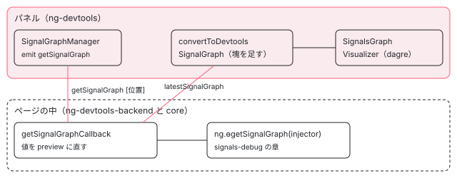

[目次](../README.md) › [Angular DevTools の内側](README.md) › 第 17 回 / 全 20 回

# signal のグラフ：ɵgetSignalGraph から絵まで

> パネルの SignalGraphManager が要素の位置で getSignalGraph を頼み、バックエンドの getSignalGraphCallback が ng.ɵgetSignalGraph の値を preview に直して返す行、値を後から開く getSignalNestedProperties と SignalGraphRef の控え、パネルの convertToDevtoolsSignalGraph が resource の塊（cluster）と塊どうしの辺を足す行、signals-visualizer が dagre-d3-es で並べる行、computed・effect にブレークポイントを置く BreakpointManager（CDP）。core の側（signals-debug）はリンク。

angular/angular · 読了 約 13 分 · 発展 · [サイトで読む（デモが動きます）](https://angular-deep-dive-cyan.vercel.app/chapter/devtools-signal-graph)

---

DevTools の Components タブでコンポーネントを選び、signal のグラフを開くと、そのコンポーネントの signal・computed・effect とテンプレートが、矢印でつながった絵になります。この章では、パネルが `getSignalGraph` を頼み、バックエンドが core の `ng.ɵgetSignalGraph` の結果を送れる形に直し、パネルが resource の「塊」を足して dagre で並べるまでを、行で追います。最後に、computed や effect にブレークポイントを置く `BreakpointManager`（Chrome DevTools Protocol を使う）を読みます。

読む対象は、バックエンドの `client-event-subscribers.ts`（`getSignalGraphCallback` と `getSignalNestedPropertiesCallback`）・`shared/utils/signal-graph-ref.ts`、パネルの `signal-graph-manager.ts`・`shared/signal-graph/devtools-signal-graph.ts`・`utils.ts`・`shared/signals-visualizer/signals-visualizer.ts`・`signal-graph-pane.component.ts`、拡張の殻の `shell-browser/src/app/breakpoint_manager.ts` です。core の側（`ɵgetSignalGraph` がノードと辺をどう集めるか）は [signals-debug](../signals/18-signals-debug.md) で読みました。

1. [1. 全体像](01-devtools-overview.md)
2. [2. Angular を見つける](02-devtools-detect.md)
3. [3. メッセージの道](03-devtools-messaging.md)
4. [4. プロトコル](04-devtools-protocol.md)
5. [5. コンポーネントの木](05-devtools-component-tree.md)
6. [6. 制御フローの塊](06-devtools-control-flow.md)
7. [7. 同じノードを見分ける](07-devtools-identity.md)
8. [8. パネルの木](08-devtools-forest-ui.md)
9. [9. プロパティの直列化](09-devtools-state-serializer.md)
10. [10. 入れ子を開く](10-devtools-property-resolver.md)
11. [11. 値を書き換える](11-devtools-property-mutation.md)
12. [12. 選ぶ・光らせる](12-devtools-inspector-highlight.md)
13. [13. プロファイラーの記録](13-devtools-profiler-capture.md)
14. [14. 記録を描く](14-devtools-profiler-formatters.md)
15. [15. 変更検知を見張る](15-devtools-cd-analyzer.md)
16. [16. 注入器の木](16-devtools-injector-tree.md)
17. **17. signal のグラフ**（この章）
18. [18. ルーター・TransferState](18-devtools-router-transfer.md)
19. [19. テストとビルド](19-devtools-test-build.md)
20. [20. issue と PR を読む](20-devtools-issues.md)

## 1. 全体の流れ



*signal のグラフが絵になるまで。上がパネル（DevTools の中）、下がページの中のバックエンド。メッセージは第 3 回の道を通る*

「位置」は `ElementPosition`（`number[]`）で、コンポーネントの木の中の道筋です（`[0]` は 1 つめのルート、`[0, 0]` はその 1 つめの子）。木の集め方は[第 5 回](05-devtools-component-tree.md)、メッセージの型は[第 4 回](04-devtools-protocol.md)で読みました。バックエンドは `subscribeToClientEvents` の中で `getSignalGraph`・`getSignalNestedProperties`・`toggleWatchSignal` の 3 つの topic にこの章のコールバックを登録しています。

## 2. パネルが頼む：SignalGraphManager

📄 `angular/devtools/projects/ng-devtools/src/lib/devtools-tabs/directive-explorer/signal-graph-manager/signal-graph-manager.ts` L31–64 （▶ の行: 32–33, 35–36, 46, 50, 53, 56–57, 60–61）

```ts
31 │   constructor() {
32 ▶     this.lastesSignalGraphMessageUnlistenFn = this.messageBus.on(
33 ▶       'latestSignalGraph',
34 │       (graph: DebugSignalGraph | null) => {
35 ▶         const converted = convertToDevtoolsSignalGraph(graph);
36 ▶         this.signalGraph.set(converted);
37 │       },
38 │     );
39 │   }
40 │ 
41 │   /**
42 │    * Listen for element/component change by a provided signal
43 │    * and update the signal graph according to it.
44 │    * @param element
45 │    */
46 ▶   listen(element: Signal<ElementPosition | undefined>) {
47 │     this.unlisten();
48 │ 
49 │     this.element = element;
50 ▶     const refreshSignalGraph = () => {
51 │       const el = element();
52 │       if (el) {
53 ▶         this.messageBus.emit('getSignalGraph', [el]);
54 │       }
55 │     };
56 ▶     const effectRef = effect(refreshSignalGraph, {injector: this.injector});
57 ▶     const unlistenBusEvent = this.messageBus.on('componentTreeDirty', refreshSignalGraph);
58 │ 
59 │     this.unlistenFn = () => {
60 ▶       effectRef.destroy();
61 ▶       unlistenBusEvent();
62 │       this.element = signal(undefined);
63 │     };
64 │   }
```

1. **32〜38 行目：返事を待つ口は 1 つ**

   作られたときに `latestSignalGraph` を 1 回だけ購読し、届いたグラフを 35 行目で `convertToDevtoolsSignalGraph`（5 節）に通して、36 行目で signal に入れます。どの要素への返事かは確かめません。いつも「最後に届いたもの」が今のグラフです。
2. **46〜56 行目：選んだ要素が変わるたびに頼む**

   `listen(element)` は要素の位置の signal を受け取り、56 行目の `effect` の中で 53 行目の `emit('getSignalGraph', [el])` を送ります。パネルの側も signal と effect で動いています。
3. **57 行目：ページで変更検知が走ったら、頼み直す**

   `componentTreeDirty` はバックエンドがページの変化を知らせる topic です（[第 5 回](05-devtools-component-tree.md)）。値が変わると epoch（版）が変わるので、頼み直したグラフでは数が進みます（6 節で、変わったノードだけを光らせる）。

## 3. バックエンドが答える：getSignalGraphCallback

📄 `angular/devtools/projects/ng-devtools-backend/src/lib/client-event-subscribers.ts` L643–669 （▶ の行: 643, 646, 649, 654, 658–659, 663, 665）

```ts
643 ▶ let lastSignalGraphElement: ElementPosition | null = null;
644 │ 
645 │ const getSignalGraphCallback = (messageBus: MessageBus<Events>) => (element: ElementPosition) => {
646 ▶   lastSignalGraphElement = element;
647 │   // We assume that a new request for a signal graph
648 │   // should invalidate the current ref cache.
649 ▶   componentSignalGraphRef.clear();
650 │ 
651 │   const ng = ngDebugClient();
652 │ 
653 │   // get injector from position
654 ▶   const node = queryDirectiveForest(
655 │     element,
656 │     getDirectiveForestManager().getIndexedDirectiveForest(),
657 │   );
658 ▶   if (!node) {
659 ▶     messageBus.emit('latestSignalGraph', [null]);
660 │     return;
661 │   }
662 │ 
663 ▶   const injector = node.injector ?? getInjectorFromElementNode(node.nativeElement!);
664 │ 
665 ▶   if (!injector) {
666 │     messageBus.emit('latestSignalGraph', [null]);
667 │     return;
668 │   }
669 │ 
```

📄 `angular/devtools/projects/ng-devtools-backend/src/lib/client-event-subscribers.ts` L670–693 （▶ の行: 670–672, 678–680, 683, 689–691）

```ts
670 ▶   const graph = ng.ɵgetSignalGraph?.(injector);
671 ▶   if (graph) {
672 ▶     const nodes = graph.nodes.map<DebugSignalGraphNode>((node) => {
673 │       return {
674 │         id: node.id,
675 │         kind: node.kind,
676 │         label: node.label,
677 │         epoch: node.epoch,
678 ▶         preview: serializeValue(node.value),
679 ▶         debuggable: !!node.debuggableFn,
680 ▶         watched: node.watched ?? false,
681 │       };
682 │     });
683 ▶     messageBus.emit('latestSignalGraph', [{nodes, edges: graph.edges}]);
684 │   }
685 │ };
686 │ 
687 │ const toggleWatchSignal = (messageBus: MessageBus<Events>) => (id: string) => {
688 │   const ng = ngDebugClient();
689 ▶   ng.toggleWatchSignal?.(id);
690 ▶   if (lastSignalGraphElement) {
691 ▶     getSignalGraphCallback(messageBus)(lastSignalGraphElement);
692 │   }
693 │ };
```

1. **646 行目：最後に頼まれた位置を覚える**

   643 行目のモジュールの変数です。687〜693 行目の `toggleWatchSignal` が、見張りを切り替えたあと 691 行目で同じ位置のグラフを送り直すために使います。
2. **649 行目：値を開くための控え（4 節）を捨てる**
3. **654〜661 行目：位置から木のノードを引く。無ければ `null` を返す**

   デモの「存在しない位置」の場面では、`[9]` を頼むと `latestSignalGraph` に `[null]` が返りました。
4. **663 行目：ノードの注入器を使う**

   core の `ɵgetSignalGraph` は注入器を入口にして、その要素の LView のテンプレートと、その注入器で作られた effect から producer をたどります（[signals-debug](../signals/18-signals-debug.md) の 2〜5 節）。
5. **670〜682 行目：値は送らず、preview（見出し）に直す**

   678 行目の `serializeValue` は[第 9 回](09-devtools-state-serializer.md)の直列化で、オブジェクトなら中身ではなく `{...}` と「開ける」の印だけを作ります。679 行目、関数（`debuggableFn`）そのものは送れないので「あるか」の真偽値に。680 行目の `watched` は、core に見張りの仕組みが無い版では `undefined` なので `false` にそろえます。
6. **671 行目：`ɵgetSignalGraph` が無い版では何も返さない**

   670 行目は `?.` で呼ぶので、古い Angular では `graph` が `undefined` になり、`emit` まで行きません。パネルは前のグラフのままです。

> [!WARNING]
> **ハマりどころ**
>
> 689 行目の `ng.toggleWatchSignal` は、手元の木（22.2.0-next.7）の core にはあり、このサイトのデモが動かす @angular/core 22.1.6 にはありません（記録では `typeof ng.toggleWatchSignal === 'function'` が `false`）。無い版では 689 行目は何もしません。main では「無い版ではボタンを隠す」直しが入っています（ad548b9c008、#70948。手元の木にはまだ無い）。

## 4. 値は後から開く：SignalGraphRef

3 節で値を preview にしたので、パネルでオブジェクトの signal を開くと、その中身を別に頼みます（`getSignalNestedProperties`）。そのたびに `ɵgetSignalGraph` を呼び直さないための控えが `SignalGraphRef` です。

📄 `angular/devtools/projects/ng-devtools-backend/src/lib/shared/utils/signal-graph-ref.ts` L11–37 （▶ の行: 16, 20, 24–25, 30, 35）

```ts
11 │ /**
12 │  * Keeps a `ɵDebugSignalGraph` reference tied to a weak-referenced key.
13 │  * If the key is garbage collected, the graph is also cleared.
14 │  */
15 │ export class SignalGraphRef<T extends object> {
16 ▶   private ref: WeakMap<T, InternalDebugSignalGraph> = new WeakMap();
17 │ 
18 │   /** Gets the key-bound signal graph reference. */
19 │   deref(key: T): InternalDebugSignalGraph | undefined {
20 ▶     return this.ref.get(key);
21 │   }
22 │ 
23 │   /** Sets the signal graph. */
24 ▶   set(key: T, graph: InternalDebugSignalGraph) {
25 ▶     this.ref = new WeakMap([[key, graph]]);
26 │   }
27 │ 
28 │   /** Checks if the key-bound signal graph exists. */
29 │   exists(key: T) {
30 ▶     return !!this.ref.get(key);
31 │   }
32 │ 
33 │   /** Clears the reference. */
34 │   clear() {
35 ▶     this.ref = new WeakMap();
36 │   }
37 │ }
```

📄 `angular/devtools/projects/ng-devtools-backend/src/lib/client-event-subscribers.ts` L708–716 （▶ の行: 716）

```ts
708 │ /**
709 │  * Keeps a reference to the last requested signal graph.
710 │  * This should save us from needlessly calling `ng.ɵgetSignalGraph`
711 │  * when we are still managing the same/last graph (e.g. inspecting
712 │  * signal value nested properties). The ref is tied to the host element.
713 │  *
714 │  * Note: If the element is destroyed, the graph is garbage collected.
715 │  */
716 ▶ const componentSignalGraphRef = new SignalGraphRef<Node>();
```

鍵は要素（716 行目の `Node`）で、16 行目の `WeakMap` に入れるので、要素が消えればグラフも一緒に回収されます。25 行目の `set` は既存の `WeakMap` に足すのではなく、**1 組だけを持つ新しい `WeakMap` に入れ替えます**。控えはいつも「最後の 1 つ」です。

📄 `angular/devtools/projects/ng-devtools-backend/src/lib/client-event-subscribers.ts` L283–319 （▶ の行: 284, 291, 295, 308–309, 311, 313）

```ts
283 │ const getSignalNestedPropertiesCallback =
284 ▶   (messageBus: MessageBus<Events>) => (position: SignalNodePosition, propPath: string[]) => {
285 │     const emitEmpty = () =>
286 │       messageBus.emit('signalNestedProperties', [position, {props: {}}, propPath]);
287 │     const node = queryDirectiveForest(
288 │       position.element,
289 │       getDirectiveForestManager().getIndexedDirectiveForest(),
290 │     );
291 ▶     if (!node || !node.nativeElement) {
292 │       return emitEmpty();
293 │     }
294 │ 
295 ▶     const injector = getInjectorFromElementNode(node.nativeElement);
296 │     if (!injector) {
297 │       return emitEmpty();
298 │     }
299 │ 
300 │     const ng = ngDebugClient();
301 │ 
302 │     let signalGraph: InternalDebugSignalGraph | undefined;
303 │ 
304 │     // Considering that the inspection of signal value nested properties
305 │     // usually involves multiple requests, we store the signal graph
306 │     // during the first call. We keep only the last requested signal graph
307 │     // to avoid filling the heap with graphs that may not be needed.
308 ▶     if (componentSignalGraphRef.exists(node.nativeElement)) {
309 ▶       signalGraph = componentSignalGraphRef.deref(node.nativeElement);
310 │     } else {
311 ▶       signalGraph = ng.ɵgetSignalGraph?.(injector);
312 │       if (signalGraph) {
313 ▶         componentSignalGraphRef.set(node.nativeElement, signalGraph);
314 │       }
315 │     }
316 │ 
317 │     if (!signalGraph) {
318 │       return emitEmpty();
319 │     }
```

📄 `angular/devtools/projects/ng-devtools-backend/src/lib/client-event-subscribers.ts` L320–339 （▶ の行: 321, 326–328, 335）

```ts
320 │ 
321 ▶     const current = signalGraph.nodes.find((n) => n.id === position.signalId);
322 │     if (!current) {
323 │       return emitEmpty();
324 │     }
325 │ 
326 ▶     let data = current.value as object;
327 ▶     for (const prop of propPath) {
328 ▶       data = (data as Record<string, object>)[prop];
329 │       if (!data) {
330 │         log.error('Cannot access the properties', propPath, 'of', node);
331 │       }
332 │     }
333 │     messageBus.emit('signalNestedProperties', [
334 │       position,
335 ▶       {props: serializeDirectiveState(data)},
336 │       propPath,
337 │     ]);
338 │     return;
339 │   };
```

1. **284 行目：位置（要素と signal の id）と、開いた道筋（`propPath`）を受け取る**
2. **308〜315 行目：同じ要素の控えがあればそれを、無ければ `ɵgetSignalGraph` を呼んで控える**
3. **321 行目：id で signal のノードを探し、326 行目でその `value`（生の値）を取る**
4. **327〜332 行目：道筋をたどり、335 行目でその場所だけを直列化して返す**

   デモでは `user`（`{ id: 1, tags: ['a', 'b'] }`）の `tags` を開き、`0`・`1`・`length` の 3 つが返りました。

この控えは fe50a7ea947（2026-06-08、perf）で入りました。前は 311 行目の `ɵgetSignalGraph` を、入れ子を 1 段開くたびに呼んでいました。649 行目で「新しいグラフを頼まれたら控えを捨てる」ので、ページの値が変わって 2 節の 57 行目で頼み直したあとに開けば、新しい値が見えます。

📄 `angular/packages/core/src/render3/util/signal_debug.ts` L177–190 （▶ の行: 177, 184, 187）

```ts
177 ▶     } else if (isLinkedSignalNode(consumer)) {
178 │       if (!signalDebugNodeMap.has(id)) {
179 │         signalDebugNodeMap.set(id, {node: new WeakRef(consumer)});
180 │         watchCleanupRegistry.register(consumer, {id});
181 │       }
182 │       debugSignalGraphNodes.push({
183 │         label: consumer.debugName,
184 ▶         value: consumer.value,
185 │         kind: consumer.kind,
186 │         epoch: consumer.version,
187 ▶         debuggableFn: consumer.computation as (() => unknown) | undefined,
188 │         watched: isWatched(id),
189 │         id,
190 │       });
```

> [!NOTE]
> **ポイント**
>
> core の側の、`linkedSignal` のノードに値を入れる枝です（177〜190 行目）。これは d45bd2f53d8（2026-07-20、`toggleWatchSignal` を足した refactor）で入り、@angular/core 22.1.6 にはありません。22.1.6 では `linkedSignal` は「どれにも当たらない種類」の枝（[signals-debug](../signals/18-signals-debug.md) の 6 節、207〜215 行目）に落ちて値を持たないので、デモの `draft` の preview は `undefined` です。これは版の違いで、devtools の不具合ではありません。

## 5. パネルで塊を作る：convertToDevtoolsSignalGraph

`resource()` は中で `value`・`state`・`status`・`loadEffect` などいくつもの signal を作ります。開発モードでは、その名前は `Resource#<resource の名前>.<中の signal の名前>` の形です（core の `resource.ts` の `createDebugNameObject`）。パネルはこの名前の形を見て、同じ resource の signal を 1 つの「塊」（cluster）にまとめます。

📄 `angular/devtools/projects/ng-devtools/src/lib/shared/signal-graph/utils.ts` L26–62 （▶ の行: 29, 42–43, 45–46, 49–51, 53–54）

```ts
26 │ // Intended for format: <Cluster_Type>#<Cluster_Name>.<Compound_Node_Name>
27 │ export type ClusterLabelFormatType = 'resource';
28 │ 
29 ▶ const CLUSTERS = ['Resource'];
30 │ 
31 │ /**
32 │  * Returns signal node and cluster node names (if part of a cluster).
33 │  *
34 │  * Intended for format: <Cluster_Type>#<Cluster_Name>.<Compound_Node_Name>
35 │  */
36 │ export function getNodeNames(n: DebugSignalGraphNode | DevtoolsSignalGraphNode): {
37 │   signalName: string;
38 │   clusterName?: string;
39 │   clusterType?: ClusterLabelFormatType;
40 │ } {
41 │   const label = n.label ?? '';
42 ▶   const hashIdx = label.indexOf('#');
43 ▶   const dotIdx = label.indexOf('.');
44 │ 
45 ▶   if (hashIdx === -1 || dotIdx === -1) {
46 ▶     return {signalName: label};
47 │   }
48 │ 
49 ▶   const clusterType = label.substring(0, hashIdx);
50 ▶   const clusterName = label.substring(hashIdx + 1, dotIdx);
51 ▶   const signalName = label.substring(dotIdx + 1, label.length);
52 │ 
53 ▶   if (!CLUSTERS.includes(clusterType)) {
54 ▶     return {signalName: label};
55 │   }
56 │ 
57 │   return {
58 │     clusterType: clusterType.toLowerCase() as ClusterLabelFormatType,
59 │     clusterName,
60 │     signalName,
61 │   };
62 │ }
```

42〜43 行目で `#` と `.` の位置を探し、どちらかが無ければ 46 行目で「塊ではない」とします。49〜51 行目で 3 つに切り、53 行目、種類が 29 行目の `'Resource'` でなければやはり塊ではありません。つまり **`debugName` を付けていない resource**（名前が `Resource.value` になる）は、`#` が無いので塊になりません。デモの 2 つの resource には `debugName: 'account'`・`'profile'` を付けました。

📄 `angular/devtools/projects/ng-devtools/src/lib/shared/signal-graph/devtools-signal-graph.ts` L41–69 （▶ の行: 49, 51–52, 57, 60, 67）

```ts
41 │ function identifyClusters(graph: DebugSignalGraph): Cluster[] {
42 │   const clusters: Map<string, Cluster> = new Map();
43 │ 
44 │   const isNodePartOfCluster = (n: DebugSignalGraphNode, name: string) => {
45 │     const match = checkClusterMatch(n);
46 │     return match && match.clusterName === name;
47 │   };
48 │ 
49 ▶   for (let i = 0; i < graph.nodes.length; i++) {
50 │     const node = graph.nodes[i];
51 ▶     const match = checkClusterMatch(node);
52 ▶     if (!match) {
53 │       continue;
54 │     }
55 │ 
56 │     const name = match.clusterName;
57 ▶     let cluster = clusters.get(name);
58 │     if (!cluster) {
59 │       cluster = {
60 ▶         id: `cl_${name}`, // `cl_` prefix acts purely as a visual cue
61 │         type: match.clusterType,
62 │         name,
63 │         consumers: new Set(),
64 │         producers: new Set(),
65 │         nodes: new Set(),
66 │       };
67 ▶       clusters.set(name, cluster);
68 │     }
69 │ 
```

📄 `angular/devtools/projects/ng-devtools/src/lib/shared/signal-graph/devtools-signal-graph.ts` L70–91 （▶ の行: 70, 72, 75–76, 80–81, 85–86）

```ts
70 ▶     cluster.nodes.add(node.id);
71 │ 
72 ▶     for (const edge of graph.edges) {
73 │       // Note that we have to make sure that the consumer is not part of the
74 │       // same cluster since we'll end up with a circular dependency.
75 ▶       if (edge.producer === i && !isNodePartOfCluster(graph.nodes[edge.consumer], name)) {
76 ▶         cluster.consumers.add(edge.consumer);
77 │       }
78 │ 
79 │       // Same for producers
80 ▶       if (edge.consumer === i && !isNodePartOfCluster(graph.nodes[edge.producer], name)) {
81 ▶         cluster.producers.add(edge.producer);
82 │       }
83 │     }
84 │ 
85 ▶     if (match.signalName === PREVIEW_NODES[match.clusterType]) {
86 ▶       cluster.previewNode = i;
87 │     }
88 │   }
89 │ 
90 │   return Array.from(clusters.values());
91 │ }
```

1. **49〜68 行目：ノードを順に見て、塊の名前ごとに 1 つの塊を作る**

   60 行目、塊の id は `cl_` を付けた名前です（デモでは `cl_account`・`cl_profile`）。
2. **72〜83 行目：塊の外とつながる辺を集める**

   75 行目、自分が producer で相手（consumer）が同じ塊でなければ「塊の consumer」。80 行目はその逆で「塊の producer」です。塊の中どうしの辺は数えません。
3. **85〜87 行目：`value` という名前のノードを、塊の見本（preview）にする**

   塊を閉じたときに、そのノードの値が塊の箱に出ます（6 節の 745〜751 行目）。

📄 `angular/devtools/projects/ng-devtools/src/lib/shared/signal-graph/devtools-signal-graph.ts` L148–183 （▶ の行: 157–158, 162, 165, 170, 175–177, 182）

```ts
148 │ export function convertToDevtoolsSignalGraph(
149 │   debugSignalGraph: DebugSignalGraph | null,
150 │ ): DevtoolsSignalGraph {
151 │   const signalGraph: DevtoolsSignalGraph = {
152 │     nodes: [],
153 │     edges: [],
154 │     clusters: {},
155 │   };
156 │ 
157 ▶   if (!debugSignalGraph) {
158 ▶     return signalGraph;
159 │   }
160 │ 
161 │   // Identify clusters
162 ▶   const clusters = identifyClusters(debugSignalGraph);
163 │ 
164 │   // Add clusters
165 ▶   signalGraph.clusters = clusters
166 │     .map((g) => ({id: g.id, name: g.name, type: g.type}))
167 │     .reduce((acc, g) => ({...acc, [g.id]: g}), {});
168 │ 
169 │   // Map nodes
170 ▶   signalGraph.nodes = debugSignalGraph.nodes.map((n) => {
171 │     const cluster = clusters.find((g) => g.nodes.has(n.id));
172 │ 
173 │     return {
174 │       ...n,
175 ▶       nodeType: 'signal',
176 ▶       clusterId: cluster ? cluster.id : undefined,
177 ▶       ...(n.label ? {label: getNodeNames(n).signalName} : {}), // We keep only the node name
178 │     } satisfies DevtoolsSignalGraphNode;
179 │   });
180 │ 
181 │   // Set edges
182 ▶   signalGraph.edges = [...debugSignalGraph.edges];
183 │ 
```

📄 `angular/devtools/projects/ng-devtools/src/lib/shared/signal-graph/devtools-signal-graph.ts` L184–220 （▶ の行: 189, 191, 196, 201–202, 208–209, 217）

```ts
184 │   // A map needed for cluster-to-cluster deps processing
185 │   const clusterIdxMap = new Map<string, number>();
186 │ 
187 │   // Add cluster nodes and edges
188 │   for (const cluster of clusters) {
189 ▶     signalGraph.nodes.push({
190 │       id: cluster.id,
191 ▶       nodeType: 'cluster',
192 │       clusterType: cluster.type,
193 │       label: cluster.name,
194 │       previewNode: cluster.previewNode,
195 │     });
196 ▶     clusterIdxMap.set(cluster.id, signalGraph.nodes.length - 1);
197 │ 
198 │     // Start from the last node index
199 │     const clusterIdx = signalGraph.nodes.length - 1;
200 │ 
201 ▶     for (const consumerIdx of cluster.consumers) {
202 ▶       signalGraph.edges.push({
203 │         producer: clusterIdx,
204 │         consumer: consumerIdx,
205 │       });
206 │     }
207 │ 
208 ▶     for (const producerIdx of cluster.producers) {
209 ▶       signalGraph.edges.push({
210 │         producer: producerIdx,
211 │         consumer: clusterIdx,
212 │       });
213 │     }
214 │   }
215 │ 
216 │   // We process cluster-to-cluster deps in the end
217 ▶   processClusterToClusterDependencies(signalGraph, clusters, clusterIdxMap);
218 │ 
219 │   return signalGraph;
220 │ }
```

1. **157〜159 行目：`null` なら空のグラフ**

   3 節で位置が見つからないと `null` が届くので、パネルの絵は空になります。
2. **170〜179 行目：元のノードに `nodeType: 'signal'` と塊の id を足し、名前を短くする**

   177 行目で `Resource#account.value` は `value` になります。元の配列の並び（＝辺の番号）は変えません。
3. **182 行目：元の辺をそのまま写す**
4. **188〜214 行目：塊ごとに、合成のノード（`nodeType: 'cluster'`）を配列の後ろに足し、辺をつなぐ**

   201〜206 行目で「塊 → 塊の consumer」、208〜213 行目で「塊の producer → 塊」の辺を足します。
5. **217 行目：最後に、塊から塊への辺を足す**

📄 `angular/devtools/projects/ng-devtools/src/lib/shared/signal-graph/devtools-signal-graph.ts` L106–143 （▶ の行: 110, 112, 115, 123–124, 127, 134–138）

```ts
106 │   // Creates a map of consumer index to cluster IDs.
107 │   // We don't care about the producers since we are
108 │   // interested only in cluster-to-cluster relationships,
109 │   // so using either the consumers or the producers works.
110 ▶   const consumerToClustersMap = new Map<number, string[]>();
111 │   for (const cluster of clusters) {
112 ▶     for (const consumerIdx of cluster.consumers) {
113 │       const existingClusters = consumerToClustersMap.get(consumerIdx);
114 │       const clusters = existingClusters ?? [];
115 ▶       clusters.push(cluster.id);
116 │ 
117 │       if (!existingClusters) {
118 │         consumerToClustersMap.set(consumerIdx, clusters);
119 │       }
120 │     }
121 │   }
122 │ 
123 ▶   for (const [i, node] of graph.nodes.entries()) {
124 ▶     if (!isSignalNode(node) || !node.clusterId) {
125 │       continue;
126 │     }
127 ▶     const producerClusterIds = consumerToClustersMap.get(i);
128 │     if (!producerClusterIds?.length) {
129 │       continue;
130 │     }
131 │ 
132 │     // Add an edge for all nodes that are part of a cluster
133 │     // which are produced by nodes in other clusters.
134 ▶     for (const producerClusterId of producerClusterIds) {
135 ▶       if (node.clusterId !== producerClusterId) {
136 ▶         graph.edges.push({
137 ▶           producer: clusterIdxMap.get(producerClusterId)!,
138 ▶           consumer: clusterIdxMap.get(node.clusterId)!,
139 │         });
140 │       }
141 │     }
142 │   }
143 │ }
```

110〜121 行目で「どのノードが、どの塊の consumer か」の表を作り、123 行目から塊に入っているノードを 1 つずつ見ます。そのノードが別の塊の consumer なら（135 行目）、136〜139 行目で「producer の塊 → このノードの塊」の辺を足します。これが 116b4cd936c（2026-05-19、fix）で入った関数です。前は 201〜213 行目の辺しか無く、**2 つの塊が両方閉じていると、その間に線が 1 本も無かった**のです（塊の外とつながる辺の相手は、閉じた塊の中に隠れたノードなので）。デモの図で「塊から塊への辺」を外すと、その前の姿が見えます。

## 6. 描く：SignalsGraphVisualizer

📄 `angular/devtools/projects/ng-devtools/src/lib/shared/signals-visualizer/signals-visualizer.ts` L106–128 （▶ の行: 107, 109–111, 115, 122）

```ts
106 │   constructor(private svg: SVGSVGElement) {
107 ▶     this.graph = new graphlib.Graph({directed: true, compound: true});
108 │     this.graph.setGraph({});
109 ▶     this.graph.graph().rankdir = 'TB';
110 ▶     this.graph.graph().ranksep = 50;
111 ▶     this.graph.graph().nodesep = 15;
112 │ 
113 │     this.graph.setDefaultEdgeLabel(() => ({}));
114 │ 
115 ▶     this.drender = dagreRender();
116 │ 
117 │     const d3svg = d3.select(this.svg);
118 │     d3svg.attr('height', '100%').attr('width', '100%');
119 │ 
120 │     const g = d3svg.append('g');
121 │ 
122 ▶     this.zoomController = d3.zoom<SVGSVGElement, unknown>().scaleExtent([0.1, 2]);
123 │     this.zoomController.on('start zoom end', (e: {transform: number}) => {
124 │       g.attr('transform', e.transform);
125 │     });
126 │ 
127 │     d3svg.call(this.zoomController);
128 │   }
```

並べ方は自前ではなく、`dagre-d3-es`（グラフの段組みをする dagre を d3 で描くライブラリ）です。107 行目、向きのある（`directed`）・入れ子を持てる（`compound`、開いた塊がノードを中に持つ）グラフを作り、109 行目で上から下へ（`TB`）、110〜111 行目で段の間を 50、横の間を 15 にします。122 行目は d3 の拡大縮小（0.1〜2 倍）です。

📄 `angular/devtools/projects/ng-devtools/src/lib/shared/signals-visualizer/signals-visualizer.ts` L205–218 （▶ の行: 206–208, 212）

```ts
205 │   render(signalGraph: DevtoolsSignalGraph): void {
206 ▶     this.updateClusters(signalGraph);
207 ▶     this.updateNodes(signalGraph);
208 ▶     this.updateEdges(signalGraph);
209 │ 
210 │     const g = d3.select(this.svg).select('g');
211 │ 
212 ▶     this.drender(g, this.graph);
213 │ 
214 │     this.addCloseButtonsToClusters(g);
215 │     this.reinforceNodeDimensions();
216 │ 
217 │     this.inputGraph = signalGraph;
218 │   }
```

📄 `angular/devtools/projects/ng-devtools/src/lib/shared/signals-visualizer/signals-visualizer.ts` L345–354 （▶ の行: 351–352）

```ts
345 │   private isNodeVisible(node: DevtoolsSignalGraphNode): boolean {
346 │     // Checks whether it's a:
347 │     // 1. Standard signal node that's not part of a cluster
348 │     // 2. Standard signal node that's part of an expanded cluster
349 │     // 3. Standard cluster node that represents a currently collapsed cluster
350 │     return (
351 ▶       (isSignalNode(node) && (!node.clusterId || this.expandedClustersIds.has(node.clusterId))) ||
352 ▶       (isClusterNode(node) && !this.expandedClustersIds.has(node.id))
353 │     );
354 │   }
```

描くたびに、塊・ノード・辺の順に dagre のグラフを今の入力に合わせ（206〜208 行目）、212 行目で dagre に段組みと描画を任せます。何を見せるかは 351〜352 行目の 2 行で決まります。ふつうのノードは「塊に入っていない」か「その塊が開いている」とき、塊のノードは「その塊が閉じている」ときだけ見えます。

📄 `angular/devtools/projects/ng-devtools/src/lib/shared/signals-visualizer/signals-visualizer.ts` L414–452 （▶ の行: 419–422, 432–434, 444–445, 448–449）

```ts
414 │     // Add new/update existing nodes
415 │     for (const n of signalGraph.nodes) {
416 │       const isSignal = isSignalNode(n);
417 │       const existingNode = this.graph.node(n.id) as DagreRegularNode | undefined;
418 │ 
419 ▶       if (existingNode) {
420 ▶         if (isSignal && n.epoch !== existingNode.epoch) {
421 ▶           this.updateDagreNode(n, existingNode, signalGraph);
422 ▶           updatedNodes.push(n.id);
423 │         } else if (isClusterNode(n) && !this.expandedClustersIds.has(n.id)) {
424 │           const previewNode = signalGraph.nodes[n.previewNode ?? -1] as
425 │             DevtoolsSignalNode | undefined;
426 │ 
427 │           if (previewNode && previewNode.epoch !== existingNode.epoch) {
428 │             this.updateDagreNode(previewNode, existingNode, signalGraph);
429 │             updatedNodes.push(n.id);
430 │           }
431 │         }
432 ▶       } else if (this.isNodeVisible(n)) {
433 ▶         this.graph.setNode(n.id, {
434 ▶           label: this.createNodeHtml(n, signalGraph),
435 │           labelType: 'html',
436 │           shape: 'rect',
437 │           padding: 0,
438 │           style: 'fill: none;',
439 │           epoch: isSignal
440 │             ? n.epoch
441 │             : isClusterNode(n) && n.previewNode
442 │               ? (signalGraph.nodes[n.previewNode] as DevtoolsSignalNode).epoch
443 │               : undefined,
444 ▶           width: NODE_WIDTH,
445 ▶           height: NODE_HEIGHT,
446 │         });
447 │         // Add to the expanded cluster node, if the node is part of a visible cluster
448 ▶         if (isSignal && this.expandedClustersIds.has(n.clusterId || '')) {
449 ▶           this.graph.setParent(n.id, n.clusterId);
450 │         }
451 │       }
452 │     }
```

📄 `angular/devtools/projects/ng-devtools/src/lib/shared/signals-visualizer/signals-visualizer.ts` L475–505 （▶ の行: 478, 484, 488–490, 492, 500）

```ts
475 │   private updateEdges(signalGraph: DevtoolsSignalGraph) {
476 │     const newEdgeIds = new Set();
477 │ 
478 ▶     for (const edge of signalGraph.edges) {
479 │       const producerNode = signalGraph.nodes[edge.producer];
480 │       const consumerNode = signalGraph.nodes[edge.consumer];
481 │       const producerId = producerNode.id;
482 │       const consumerId = consumerNode.id;
483 │ 
484 ▶       const edgeId = getEdgeId(producerId, consumerId);
485 │       newEdgeIds.add(edgeId);
486 │ 
487 │       if (
488 ▶         !this.graph.hasEdge(producerId, consumerId, undefined) &&
489 ▶         this.isNodeVisible(producerNode) &&
490 ▶         this.isNodeVisible(consumerNode)
491 │       ) {
492 ▶         const isClusterEdge = signalGraph.nodes.some(
493 │           (node) =>
494 │             isSignalNode(node) &&
495 │             node.clusterId &&
496 │             (node.id === producerId || node.id === consumerId),
497 │         );
498 │         const classes = EDGE_CLASS + (isClusterEdge ? ` ${CLUSTER_EDGE_CLASS}` : '');
499 │ 
500 ▶         this.graph.setEdge(producerId, consumerId, {
501 │           curve: d3.curveBasis,
502 │           class: classes,
503 │         });
504 │       }
505 │     }
```

📄 `angular/devtools/projects/ng-devtools/src/lib/shared/signals-visualizer/signals-visualizer.ts` L744–771 （▶ の行: 746, 748, 754, 759, 762–763, 766–767）

```ts
744 │ function getBodyText(node: DevtoolsSignalGraphNode, graph: DevtoolsSignalGraph): string {
745 │   if (isClusterNode(node)) {
746 ▶     const previewNode = graph.nodes[node.previewNode ?? -1] as DevtoolsSignalNode | undefined;
747 │     if (previewNode) {
748 ▶       return previewNode.preview.preview;
749 │     }
750 │     return '[nodes]';
751 │   }
752 │ 
753 │   if (
754 ▶     node.kind === 'signal' ||
755 │     node.kind === 'computed' ||
756 │     node.kind === 'linkedSignal' ||
757 │     node.kind === 'childSignalProp'
758 │   ) {
759 ▶     return node.preview.preview;
760 │   }
761 │ 
762 ▶   if (node.kind === 'template') {
763 ▶     return '</>';
764 │   }
765 │ 
766 ▶   if (node.kind === 'effect' || node.kind === 'afterRenderEffectPhase') {
767 ▶     return '() => {}';
768 │   }
769 │ 
770 │   return '';
771 │ }
```

- **419〜422 行目：**もうあるノードは作り直さず、epoch が変わったときだけ中身の文字を差し替えて光らせます（2 節の 57 行目で頼み直したときの「変わったところだけ光る」）。
- **432〜446 行目：**新しく見えるノードは HTML の箱（`labelType: 'html'`）で、大きさは 444〜445 行目の 100 × 60 に固定です。448〜449 行目、開いた塊のノードは `setParent` で塊の箱の中に入れます。
- **488〜490 行目：**辺は両端が見えるときだけ足します。だから閉じた塊の中のノードへの辺は消え、5 節の塊のノードへの辺が代わりに見えます。
- **744〜771 行目：**箱の 2 行目は、値を持つ種類なら preview、テンプレートなら `</>`、effect なら `() => {}` です。`linkedSignal` は 756 行目で値を持つ種類に入っているので、22.1.6 のアプリでは 4 節のとおり `undefined` と出ます。

## 7. DEMO：本物のバックエンドとパネルの関数にグラフを通す

> **🧪 DEMO — getSignalGraph → latestSignalGraph → convertToDevtoolsSignalGraph（記録の再生）**
>
> これは記録です。本物の devtools のソース（angular/angular の devtools/、8576f161ae4）を、本物の @angular/core 22.1.6（開発モード）のアプリにつないで Node で動かした結果です。バックエンドには手で作った MessageBus から `getSignalGraph` を送り、返ってきた `latestSignalGraph` をパネルの `convertToDevtoolsSignalGraph`（本物）に通しました。下の図の並べ方はこの章が書いた簡単なもの（producer を上、consumer を下に段を分けるだけ）で、devtools の dagre ではありません。見える・見えないの判定だけは 6 節の 351〜352 行目を**移植**しました。
>
> 場面のボタンを押してください。
>
> ▶ [このデモはサイトで動かせます](https://angular-deep-dive-cyan.vercel.app/chapter/devtools-signal-graph)

記録から読み取れることです。

1. **グラフに出るのは「テンプレートか effect から、producer をたどって届く」ものだけ**

   最初の試しでは、テンプレートが読まない `draft`・`user` と resource が出ませんでした。core がテンプレートの consumer と effect から producer をたどって集めるからです（[signals-debug](../signals/18-signals-debug.md) の 5 節）。記録のスクリプトでは、テンプレートで読むようにしました。名前の無い signal（`noName`）は effect が読むので出ていて、`label` がありません（パネルでは `Unnamed` と出る。`utils.ts` の `getNodeLabel`）。
2. **resource 1 つが 7 つのノードになり、2 つの塊に分かれる**

   `value`・`state`・`extRequest`・`stream`・`loadEffect` などが `Resource#account.…` の名前で並び、パネルで `cl_account` と `cl_profile` になりました。`profile` の params は `account.value()` を読むので、`cl_account → cl_profile` の辺が 136〜139 行目で足されています。
3. **値が変わると epoch が進む**

   `count.set(5)` のあと、`count` の epoch は 0 → 1、`double` は 1 → 2 になりました。`stream` の signal は読み込みのたびに作り直されるので、新しい id のノードが現れます。
4. **子のコンポーネントは別のグラフ**

   `[0, 0]`（app-badge）のグラフには、`input()` の `label`（kind は `signal`）と `shown` と、子のテンプレートだけが出ます。親の `name` から子の `label` への矢印はありません。入力は変更検知の中で値を写すもので、signal の producer と consumer の関係ではないからです。

記録のときの環境の都合を 2 つ書いておきます。core は `window` があるときだけ effect を記録する注入器プロファイラを入れる（`publishDefaultGlobalUtils`）ので、Node では描画の前に `globalThis.window` を置きました。また JIT では `input()` を入力として知らせるために、AOT のコンパイラが JIT 向けに足すのと同じ `@Input({isSignal: true, …})` を手で付けました。記録のスクリプトの全文です（共通の部品 harness.ts は[第 1 回](01-devtools-overview.md)に全文があります）。

📄 `scratchpad の記録スクリプト（signal-graph.ts、共通の build.mjs で束ねて node で実行）`

```
// 第 17 回 devtools-signal-graph の記録。
// signal・computed・linkedSignal・effect・input()・resource を持つアプリを描画し、
// 本物のバックエンドに getSignalGraph を送って返ってきた latestSignalGraph と、
// それを本物のパネルの convertToDevtoolsSignalGraph に通した結果を残す。
import { Component, Input, computed, effect, input, linkedSignal, resource, signal, ɵglobal as g } from '@angular/core';
import { bootApp, makeBus, loadBackend, tick, writeJson, clone } from '../_shared/harness';
import { convertToDevtoolsSignalGraph } from '~/angular-research/angular/devtools/projects/ng-devtools/src/lib/shared/signal-graph/devtools-signal-graph';

const OUT = process.argv[2] ?? 'signal-graph.json';

@Component({ selector: 'app-badge', template: '<b>{{ label() }}: {{ shown() }}</b>' })
class Badge {
  // JIT では、AOT のコンパイラ（JIT 向けの変換 input_function.ts）が足すのと同じ @Input({isSignal: true, ...}) を手で付ける
  @Input({ isSignal: true, alias: 'label', required: false, transform: undefined } as any)
  label = input('', { debugName: 'label' });
  shown = computed(() => this.label().toUpperCase(), { debugName: 'shown' });
}

@Component({
  selector: 'app-root',
  imports: [Badge],
  template:
    '<p>{{ count() }} × 2 = {{ double() }}</p><p>{{ draft() }} #{{ user().id }}</p>' +
    '<p>{{ profile.value()?.of?.n }}</p><app-badge [label]="name()" />',
})
class Root {
  count = signal(1, { debugName: 'count' });
  double = computed(() => this.count() * 2, { debugName: 'double' });
  name = signal('ada', { debugName: 'name' });
  draft = linkedSignal({ source: this.name, computation: (n) => n + '!', debugName: 'draft' });
  user = signal({ id: 1, tags: ['a', 'b'] }, { debugName: 'user' });
  noName = signal(0); // debugName を付けない
  // resource を 2 つ。profile の params は account の value を読む（塊どうしの辺）
  account = resource({ params: () => this.count(), loader: async ({ params }) => ({ n: params }), debugName: 'account' });
  profile = resource({ params: () => this.account.value(), loader: async ({ params }) => ({ of: params }), debugName: 'profile' });
  log: string[] = [];
  constructor() {
    effect(() => this.log.push('count=' + this.count() + ' noName=' + this.noName()), { debugName: 'logCount' });
  }
}

// core の publishDefaultGlobalUtils は typeof window !== 'undefined' のときだけ注入器プロファイラを入れる（effect の記録に要る）。
// Node には window が無いので、描画の前に置いておく（環境の代わり）。
(globalThis as any).window ??= globalThis;
const { appRef } = await bootApp(Root);
await tick(20);
const { initializeMessageBus } = await loadBackend();
const { bus, send, take } = makeBus();
initializeMessageBus(bus as any);
send('queryNgAvailability');
send('getLatestComponentExplorerView', [undefined]);
await tick(20);
const availability = take().find((m) => m.topic === 'ngAvailability')?.args[0] as any;

const ng = (g as any).ng;
const rootEl = (globalThis as any).document.querySelector('app-root');
const badgeEl = (globalThis as any).document.querySelector('app-badge');

/** ɵgetSignalGraph がそのまま返すもの（バックエンドが削る前）の形を短く残す */
function rawShape(el: any) {
  const raw = ng.ɵgetSignalGraph(ng.getInjector(el));
  return {
    keys: [...new Set(raw.nodes.flatMap((n: any) => Object.keys(n)))],
    nodes: raw.nodes.map((n: any) => ({
      id: n.id, kind: n.kind, label: n.label ?? null, epoch: n.epoch,
      valueType: n.value === undefined ? 'undefined' : n.value === null ? 'null' : typeof n.value,
      debuggableFn: typeof n.debuggableFn === 'function' ? `[function ${n.debuggableFn.name || 'anonymous'}]` : null,
    })),
    edges: raw.edges,
  };
}

function ask(position: number[]) {
  let error: string | null = null;
  try {
    send('getSignalGraph', [position]);
  } catch (e) {
    error = String(e);
  }
  const all = take();
  if (error) console.error('ASK', position, error, all.map((m) => m.topic));
  const msg = all.find((m) => m.topic === 'latestSignalGraph');
  const graph = (msg?.args[0] ?? null) as any;
  return { graph, devtools: clone(convertToDevtoolsSignalGraph(graph)) };
}

const scenes: any[] = [];

// 場面 1: ルートのコンポーネント（描画の直後）
scenes.push({ id: 'root', title: 'app-root（描画の直後）', position: [0], raw: rawShape(rootEl), ...ask([0]) });

// 場面 2: 子のコンポーネント（input() と computed）
scenes.push({ id: 'badge', title: 'app-badge（input と computed）', position: [0, 0], raw: rawShape(badgeEl), ...ask([0, 0]) });

// 場面 3: count を 5 にして変更検知とマイクロタスクを回したあと
const root = ng.getComponent(rootEl);
root.count.set(5);
appRef.tick();
await tick(20);
scenes.push({ id: 'after', title: 'count.set(5) のあと', position: [0], raw: rawShape(rootEl), ...ask([0]), log: [...root.log] });

// user の入れ子を開く（getSignalNestedProperties）
const userNode = scenes[2].graph?.nodes.find((n: any) => n.label === 'user');
let nested: unknown = null;
if (userNode) {
  send('getSignalNestedProperties', [{ element: [0], signalId: userNode.id }, ['tags']]);
  nested = take().find((m) => m.topic === 'signalNestedProperties')?.args ?? null;
}

// 存在しない位置
send('getSignalGraph', [[9]]);
const missing = take().map((m) => ({ topic: m.topic, args: m.args }));

await writeJson(OUT, {
  core: availability?.version,
  supportedApis: availability?.supportedApis,
  hasToggleWatchSignal: typeof ng.toggleWatchSignal === 'function',
  scenes,
  nested,
  missing,
});
process.exit(0);

```

## 8. computed と effect にブレークポイントを置く

パネルでノードを選ぶと、詳しい欄に「ソースを開く」と「ブレークポイント」のボタンがあります。どちらも 3 節で `debuggable` が真のノード、つまり core が `debuggableFn` を持たせたノード（computed の計算の関数、effect の関数、テンプレートならコンポーネントのクラス）だけで意味を持ちます。ブレークポイントは 12b0acd498b（2026-08-06、feat）で入りました。

📄 `angular/devtools/projects/ng-devtools/src/lib/devtools-tabs/directive-explorer/signal-graph-pane/signal-graph-pane.component.ts` L149–171 （▶ の行: 155, 158, 162–163, 165）

```ts
149 │   async setBreakpoint(node: DevtoolsSignalGraphNode) {
150 │     const frame = this.frameManager.selectedFrame();
151 │     if (!frame) {
152 │       console.warn('[Angular DevTools]: No frame selected for signal operation.');
153 │       return;
154 │     }
155 ▶     const success = await this.appOperations.setSignalBreakpoint(
156 │       {
157 │         element: this.signalGraph.element()!,
158 ▶         signalId: node.id,
159 │       },
160 │       frame,
161 │     );
162 ▶     if (success) {
163 ▶       this.activeBreakpoints.value.update((set) => new Set(set).add(node.id));
164 │     } else {
165 ▶       this.snackBar.open(
166 │         'Failed to set signal breakpoint. Try refreshing the page or reopening DevTools.',
167 │         'Dismiss',
168 │         {duration: 3000},
169 │       );
170 │     }
171 │   }
```

155 行目の `setSignalBreakpoint` は、Chrome 版の `ChromeApplicationOperations`（shell-browser）が `chrome.runtime.sendMessage` で拡張の background に `{ action: 'setSignalBreakpoint', tabId, position }` を送ります。うまくいけば 163 行目でボタンの状態を足し、だめなら 165 行目でスナックバーを出します。

📄 `angular/devtools/projects/shell-browser/src/app/breakpoint_manager.ts` L77–113 （▶ の行: 77, 84, 98–99, 107, 110）

```ts
 77 ▶   private readonly activeBreakpoints = new Map<number, Map<SignalKey, ActiveBreakpointEntry>>();
 78 │ 
 79 │   /**
 80 │    * Maps CDP scriptId to script URL.
 81 │    * - Key: scriptId (string) — Internal script identifier assigned by V8/CDP (from `Debugger.scriptParsed`).
 82 │    * - Value: url (string) — Source URL of the parsed script file.
 83 │    */
 84 ▶   private readonly scriptMap = new Map<string, string>();
 85 │ 
 86 │   private constructor(
 87 │     private readonly debuggerApi: typeof chrome.debugger = chrome.debugger,
 88 │     private readonly runtimeApi: typeof chrome.runtime = chrome.runtime,
 89 │   ) {}
 90 │ 
 91 │   static initialize(): BreakpointManager {
 92 │     const manager = new BreakpointManager();
 93 │     manager.initialize();
 94 │     return manager;
 95 │   }
 96 │ 
 97 │   private initialize(): void {
 98 ▶     this.debuggerApi.onEvent.addListener(this.handleDebuggerEvent);
 99 ▶     this.runtimeApi.onMessage.addListener(this.handleRuntimeMessage);
100 │   }
101 │ 
102 │   private readonly handleDebuggerEvent = (
103 │     _source: chrome.debugger.Debuggee,
104 │     method: string,
105 │     params?: unknown,
106 │   ): void => {
107 ▶     if (method === 'Debugger.scriptParsed' && params) {
108 │       const {scriptId, url} = params as ScriptParsedParams;
109 │       if (scriptId && url) {
110 ▶         this.scriptMap.set(scriptId, url);
111 │       }
112 │     }
113 │   };
```

📄 `angular/devtools/projects/shell-browser/src/app/breakpoint_manager.ts` L115–145 （▶ の行: 117, 120, 122, 128, 138, 140）

```ts
115 │   private readonly handleRuntimeMessage = (
116 │     message: any,
117 ▶     _sender: chrome.runtime.MessageSender,
118 │     sendResponse: (response?: any) => void,
119 │   ): boolean => {
120 ▶     if (message.action === 'setSignalBreakpoint') {
121 │       const {tabId, position} = message;
122 ▶       this.setBreakpoint(tabId, position)
123 │         .then((result) => sendResponse({success: true, result}))
124 │         .catch((err) => {
125 │           console.error('CDP Error:', err);
126 │           sendResponse({success: false, error: err.message || err});
127 │         });
128 ▶       return true;
129 │     } else if (message.action === 'removeSignalBreakpoint') {
130 │       const {tabId, position} = message;
131 │       this.removeBreakpoint(tabId, position)
132 │         .then((result) => sendResponse({success: true, result}))
133 │         .catch((err) => {
134 │           console.error('CDP Error:', err);
135 │           sendResponse({success: false, error: err.message || err});
136 │         });
137 │       return true;
138 ▶     } else if (message.action === 'getActiveSignalBreakpoints') {
139 │       const {tabId} = message;
140 ▶       const activePositions = this.getActiveBreakpoints(tabId);
141 │       sendResponse({success: true, activePositions});
142 │       return true;
143 │     }
144 │     return false;
145 │   };
```

📄 `angular/devtools/projects/shell-browser/src/app/breakpoint_manager.ts` L163–200 （▶ の行: 164, 169, 171, 173–174, 188, 193–194）

```ts
163 │   async setBreakpoint(tabId: number, position: SignalNodePosition): Promise<SetBreakpointResult> {
164 ▶     if (!isValidPosition(position)) {
165 │       throw new Error('Invalid signal position payload');
166 │     }
167 │ 
168 │     const target = {tabId};
169 ▶     await this.ensureAttached(target);
170 │ 
171 ▶     await this.debuggerApi.sendCommand(target, 'Debugger.enable');
172 │ 
173 ▶     const expression = `inspectedApplication.findSignalNodeByPosition(${stringifyAndEscape(position)})`;
174 ▶     const evalResult: any = await this.debuggerApi.sendCommand(target, 'Runtime.evaluate', {
175 │       expression,
176 │       objectGroup: 'angular-devtools',
177 │     });
178 │ 
179 │     if (evalResult?.exceptionDetails) {
180 │       throw new Error('Evaluation failed: ' + evalResult.exceptionDetails.exception.description);
181 │     }
182 │ 
183 │     const objectId = evalResult?.result?.objectId;
184 │     if (!objectId) {
185 │       throw new Error('Could not find function object');
186 │     }
187 │ 
188 ▶     const propsResult: any = await this.debuggerApi.sendCommand(target, 'Runtime.getProperties', {
189 │       objectId,
190 │     });
191 │ 
192 │     const internalProps: InternalProperty[] = propsResult?.internalProperties ?? [];
193 ▶     const locationProp = internalProps.find((p) => p.name === '[[FunctionLocation]]');
194 ▶     const location = locationProp?.value?.value;
195 │ 
196 │     if (!location) {
197 │       throw new Error('Could not find [[FunctionLocation]]');
198 │     }
199 │ 
200 │     const {scriptId, lineNumber, columnNumber} = location;
```

📄 `angular/devtools/projects/shell-browser/src/app/breakpoint_manager.ts` L201–232 （▶ の行: 203, 207, 211, 225–226）

```ts
201 │ 
202 │     let bpResult: SetBreakpointResult | undefined;
203 ▶     const url = this.scriptMap.get(scriptId);
204 │ 
205 │     if (!url) {
206 │       console.warn('Could not find URL for scriptId:', scriptId, 'falling back to scriptId');
207 ▶       bpResult = (await this.debuggerApi.sendCommand(target, 'Debugger.setBreakpoint', {
208 │         location: {scriptId, lineNumber, columnNumber},
209 │       })) as SetBreakpointResult;
210 │     } else {
211 ▶       bpResult = (await this.debuggerApi.sendCommand(target, 'Debugger.setBreakpointByUrl', {
212 │         url,
213 │         lineNumber,
214 │         columnNumber,
215 │       })) as SetBreakpointResult;
216 │     }
217 │ 
218 │     if (!bpResult?.breakpointId) {
219 │       throw new Error('Failed to set breakpoint via CDP: no breakpoint ID was returned.');
220 │     }
221 │ 
222 │     if (!this.activeBreakpoints.has(tabId)) {
223 │       this.activeBreakpoints.set(tabId, new Map());
224 │     }
225 ▶     const posKey = serializePosition(position);
226 ▶     this.activeBreakpoints.get(tabId)!.set(posKey, {
227 │       position,
228 │       breakpointId: bpResult.breakpointId,
229 │     });
230 │ 
231 │     return bpResult;
232 │   }
```

1. **98〜99 行目：background で 2 つの口を開く**

   `chrome.debugger.onEvent`（CDP の出来事）と `chrome.runtime.onMessage`（パネルからの頼み）です。107〜110 行目、ページのスクリプトが読み込まれるたびに届く `Debugger.scriptParsed` で、スクリプトの id と URL の対応を 84 行目の表に貯めます。
2. **120〜128 行目：頼みを受けて、非同期で答える**

   128 行目で `true` を返すのは、「`sendResponse` を後で呼ぶ」という `chrome.runtime` の約束です。
3. **169〜171 行目：タブにデバッガーをつなぐ（CDP 1.3）**

   つなぐと Chrome はページの上に「デバッグ中」の帯を出します。12b0acd498b で manifest に `debugger` の権限が足されました。
4. **173〜177 行目：ページの中で関数そのものを取り出す**

   `Runtime.evaluate` で `inspectedApplication.findSignalNodeByPosition(…)` を評価します。この関数は shell-browser の `chrome-window-extensions.ts` がページの `globalThis` に置いたもので、木から要素を引き、`ɵgetSignalGraph` を呼び直して、id の合うノードの `debuggableFn` を返します。返るのは値ではなく CDP の「オブジェクトの id」です。
5. **188〜194 行目：関数の定義の場所を聞く**

   `Runtime.getProperties` の内部の欄 `[[FunctionLocation]]` に、スクリプトの id・行・列が入っています。
6. **203〜215 行目：URL で置く（無ければスクリプトの id で）**

   84 行目の表で URL が分かれば `Debugger.setBreakpointByUrl`（再読み込みしても残る）、分からなければ 207 行目の `Debugger.setBreakpoint` です。225〜229 行目で、タブごと・位置ごとに CDP のブレークポイントの id を覚えます。

> [!WARNING]
> **ハマりどころ**
>
> 手元の木（8576f161ae4）の `handleRuntimeMessage` は、117 行目の送り手（`_sender`）を見ずに頼みを受けます。また 84 行目の表はタブで分かれていません。main では 11838e481a0（2026-09-08、fix）が「送り手が拡張の DevTools のページか」を確かめ、表をタブごとにし、ブレークポイントが無くなったらデバッガーを外すように直し、`breakpoint_manager.spec.ts`（382 行）を足しました。36a0ab6ed8d（2026-09-25、#70949 を閉じた）は、利用者が Chrome の帯を閉じてデバッガーが外れたときにパネルのボタンの状態を戻します。どちらも手元の木にはまだありません。

## ここまでの呼び出し

- 👤 `SignalGraphManager.listen(element)` — signal-graph-manager.ts 46 — *コンポーネントを選ぶ*
  - `messageBus.emit('getSignalGraph', [el])` — signal-graph-manager.ts 53
    - `getSignalGraphCallback(messageBus)(element)` — client-event-subscribers.ts 645 — *ページの中*
      - `queryDirectiveForest(element, …)` — 654 — *第 5 回*
      - `ng.ɵgetSignalGraph(injector)` — 670 — *signals-debug*
      - `serializeValue(node.value)` — 678 — *第 9 回*
      - `messageBus.emit('latestSignalGraph', …)` — 683
  - `convertToDevtoolsSignalGraph(graph)` — devtools-signal-graph.ts 148
    - `identifyClusters` ＋ `processClusterToClusterDependencies` — 41・101
  - `SignalsGraphVisualizer.render(graph)` — signals-visualizer.ts 205 — *dagre-d3-es*
- 👤 `getSignalNestedPropertiesCallback` — client-event-subscribers.ts 283 — *値を開く。SignalGraphRef の控え*
- 👤 `BreakpointManager.setBreakpoint(tabId, position)` — breakpoint\_manager.ts 163 — *CDP: Runtime.evaluate → getProperties → setBreakpointByUrl*

## テストと直し方

### spec と describe

| spec | describe / it | bazel のターゲット |
| --- | --- | --- |
| ng-devtools/src/lib/shared/signal-graph/devtools-signal-graph.spec.ts | describe `convertToDevtoolsSignalGraph`（20 行目）の it 8 件。塊は `should convert a signal graph with a resource cluster`（96）・`… multiple resource clusters`（190）、塊から塊は `should handle cluster-to-cluster dependencies (unidirectional)`（359）・`(multidirectional)`（468）・`with one-to-many relationship (1:N)`（625） | `//devtools/projects/ng-devtools/src/lib/shared/signal-graph:test`（26 件） |
| 同じディレクトリの utils.spec.ts | describe `getNodeNames`（63 行目、it 7 件。`#` で始まる private の名前・`$` で始まる名前・知らない種類・形の違う名前）・`checkClusterMatch`（147）・`getNodeLabel`（161）ほか、合わせて 18 件 |   |
| shared/signals-visualizer/signal-node-filter-fn-generator.spec.ts | グラフの絞り込みの字句の分け方・読み方・当てはめ（21 件）。**`signals-visualizer.ts`（dagre で描く 802 行）そのものの spec はありません** | `…/shared/signals-visualizer:test`（21 件） |
| devtools-tabs/directive-explorer/signal-graph-manager/signal-graph-manager.spec.ts | describe `SignalGraphManager`（46 行目）の it 3 件（要素で頼み直す・やめる・後片付け） | `…/signal-graph-manager:test`（3 件） |
| ng-devtools-backend/src/lib/shared/utils/signal-graph-ref.spec.ts | describe `SignalGraphRef`（12 行目）の it 3 件（控える・捨てる・あるか） | `//devtools/projects/ng-devtools-backend/src/lib/shared/utils:test`（log・serialization と合わせて 25 件） |

📄 `angular/devtools/projects/ng-devtools/src/lib/shared/signal-graph/devtools-signal-graph.spec.ts` L389–394 （▶ の行: 390–391, 394）

```ts
389 │       edges: [
390 ▶         {producer: 0, consumer: 1},
391 ▶         {producer: 1, consumer: 2},
392 │       ],
393 │     };
394 ▶     const graph = convertToDevtoolsSignalGraph(debugGraph);
```

📄 `angular/devtools/projects/ng-devtools/src/lib/shared/signal-graph/devtools-signal-graph.spec.ts` L445–452 （▶ の行: 448–451）

```ts
445 │       edges: [
446 │         {producer: 0, consumer: 1}, // Pre-existing (signalFoo->computedBar)
447 │         {producer: 1, consumer: 2}, // Pre-existing (computedBar->template)
448 ▶         {producer: 3, consumer: 1}, // Cluster-to-signal (foo->computedBar)
449 ▶         {producer: 4, consumer: 2}, // Cluster-to-template (bar->template)
450 ▶         {producer: 0, consumer: 4}, // Signal-to-cluster (signalFoo->bar)
451 ▶         {producer: 3, consumer: 4}, // Cluster-to-cluster (foo->bar)
452 │       ],
```

パネルの変換の spec は、DevTools も Angular のアプリも使わず、`DebugSignalGraph` の形のオブジェクトを手で書いて（390〜391 行目の辺 2 本）、394 行目で変換し、結果の配列を丸ごと比べます。446〜451 行目の辺の並びは、デモの表の「どこで足されたか」と同じ順です（元の辺 → 201〜213 行目の辺 → 451 行目の塊から塊の辺）。116b4cd936c が足したのは、この 451 行目を確かめる it 3 つ（+391 行）でした。

### 手元で走らせた結果

📄 `ターミナル（../angular で）`

```
cd ~/angular-research/angular
pnpm bazel test //devtools/projects/ng-devtools/src/lib/shared/signal-graph:test \
  //devtools/projects/ng-devtools/src/lib/shared/signals-visualizer:test \
  //devtools/projects/ng-devtools/src/lib/devtools-tabs/directive-explorer/signal-graph-manager:test \
  //devtools/projects/ng-devtools-backend/src/lib/shared/utils:test \
  --nocache_test_results --test_output=all
```

📄 `出力（2026-11-05 に実行。抜粋。ログは scratchpad/devtools-logs/e-signal-graph.log）`

```
signal-graph:test_chromium            26 passed, 0 failed   PASSED in 2.2s
signal-graph:test_firefox             26 passed, 0 failed   PASSED in 4.7s
signals-visualizer:test_chromium      21 passed, 0 failed   PASSED in 1.6s
signals-visualizer:test_firefox       21 passed, 0 failed   PASSED in 2.9s
signal-graph-manager:test_chromium     3 passed, 0 failed   PASSED in 2.8s
signal-graph-manager:test_firefox      3 passed, 0 failed   PASSED in 4.6s
shared/utils:test_chromium            25 passed, 0 failed   PASSED in 1.7s
shared/utils:test_firefox             25 passed, 0 failed   PASSED in 4.4s
Executed 8 out of 8 tests: 8 tests pass.
INFO: Elapsed time: 14.071s
```

- 1 つの `:test` が `_chromium` と `_firefox` の 2 つになるので、4 つのターゲットで 8 つのテストです（理由は[第 19 回](19-devtools-test-build.md)）。Firefox の方が毎回 2〜3 秒長くかかりました。
- `--test_arg=--grep=…` で it を絞れるか試しましたが、件数は 26 のまま変わりませんでした（第 19 回）。ターゲット全体を走らせています。

### 直すとしたら

- 「グラフの線が足りない・多い」「塊の名前がおかしい」は、パネルの `devtools-signal-graph.ts`（`identifyClusters`・`processClusterToClusterDependencies`）と `utils.ts`（`getNodeNames`）です。it は devtools-signal-graph.spec.ts の形で、`DebugSignalGraph` を手で書いて足します。ブラウザも Angular も要りません。
- 「値が出ない・古い」は、まずどの版の core かを見ます。4 節の `linkedSignal` のように、core の `signal_debug.ts` の版で決まることがあります。バックエンドの側なら `getSignalGraphCallback` と `getSignalNestedPropertiesCallback` で、`SignalGraphRef` の振る舞いは signal-graph-ref.spec.ts に足します。
- 描き方（dagre・d3）には spec がありません。直すなら手で確かめることになり、本家では[第 19 回](19-devtools-test-build.md)の cypress の e2e が画面を見ています。
- 開いている issue では #65894（フレームワークの中の signal がグラフを埋めてしまう）がこの章の話です。メンバー（hawkgs）は「内部のノードを隠すか目立たなくする方向。設定で見られるようにする」とコメントしています。「内部の signal を隠す」PR（#65982）と試作（#66099）は、マージされずに閉じています。一覧は[第 20 回](20-devtools-issues.md)。
- 本家に PR を出すことは勧めません。issue を読むときは、まずデモと同じ形で `ɵgetSignalGraph` の生の結果と `convertToDevtoolsSignalGraph` の結果を手元で見比べ、どちらの側の話かを決めます。

## 聞かれそうな質問

**Q. signal の値はパネルにまるごと送られているのですか？**

送られていません。`getSignalGraphCallback` は 678 行目で値を `serializeValue` の preview（オブジェクトなら `{...}` と「開ける」の印）に直します。中身は開いたときに `getSignalNestedPropertiesCallback` が、327〜332 行目で道筋をたどったところだけを直列化して返します。そのためのグラフの控えが `SignalGraphRef`（25 行目で最後の 1 つだけ）です。

**Q. resource が 1 つの箱にまとまるのはなぜですか？まとまらないこともありますか？**

パネルの `getNodeNames` が、`Resource#名前.中の名前` の形の `debugName` を見て塊を作るからです（42〜55 行目）。`debugName` の無い resource は名前が `Resource.value` になり、`#` が無いので塊になりません。core は resource の中の signal にこの形の名前を開発モードでだけ付けます。

**Q. 塊を 2 つとも閉じたら、線が消えたことがあると聞きました。**

116b4cd936c より前の動きです。前は「塊 → 外のノード」「外のノード → 塊」の辺（201〜213 行目）しか無く、相手が閉じた塊の中にいると 488〜490 行目で辺が描かれませんでした。いまは `processClusterToClusterDependencies` が 136〜139 行目で塊どうしの辺を足します。デモの「塊から塊への辺を外す」で前の姿を見られます。

**Q. グラフの並べ方は Angular が決めているのですか？**

パネルが使う `dagre-d3-es` です。`SignalsGraphVisualizer` の 107〜111 行目で、向きと入れ子のあるグラフ・上から下・段の間 50・横の間 15 を指定し、212 行目で dagre に任せます。ノードの箱は 100 × 60 の固定です。

**Q. どのノードにでもブレークポイントを置けますか？**

関数を持つノード（computed・effect・linkedSignal の計算、テンプレートならクラス）だけです。`BreakpointManager` は 173 行目でページの中の `debuggableFn` を取り出し、193 行目の `[[FunctionLocation]]` で場所を知って 211 行目で置きます。ふつうの `signal()` には関数が無いので、3 節の 679 行目で `debuggable` が偽になります。

## 読み終えて

- パネルの `SignalGraphManager` が要素の位置で `getSignalGraph` を頼み、変更検知のたびに頼み直します。
- バックエンドは `ng.ɵgetSignalGraph` の値を preview に、関数を真偽値に直して返し、中身は `SignalGraphRef` の控えから後で開きます。
- resource の塊はパネルが `debugName` の形から作る合成のノードで、塊どうしの辺は 116b4cd936c で足されました。
- 並べ方は dagre で、見える・見えないは `isNodeVisible` の 2 行で決まります。
- ブレークポイントは background の `BreakpointManager` が CDP で置きます。送り手の確かめと spec は main で足されたところです。

---

← 前: [注入器の木：resolutionPath と provider の一覧](16-devtools-injector-tree.md)  
次: [ルーターの木・TransferState・ハイドレーションの重ね表示](18-devtools-router-transfer.md) →
