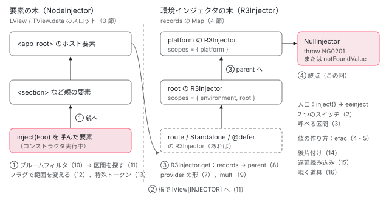

[目次](../README.md) › [DI の内側](README.md) › 第 1 回 / 全 16 回

# DI の概観：NodeInjector と環境インジェクタ、2 つの木と 1 本の探索順

> Injector 抽象クラスの get の形、NodeInjector（要素ごと、LView に埋め込まれた配列）と R3Injector（records の Map）の違い、トークンの 3 種類（クラス / InjectionToken / HostAttributeToken）、inject(Foo) が要素の木 → 環境インジェクタの木 → NullInjector の順に探す全体図。シリーズ全体の地図。

angular/angular · 読了 約 12 分 · 基礎 · [サイトで読む（デモが動きます）](https://angular-deep-dive-cyan.vercel.app/chapter/di-overview)

---

Angular の DI（依存性注入。必要なオブジェクトを自分で `new` せず、注入器に「これをください」と頼む仕組み）には、**注入器が 2 種類**あります。要素ごとの `NodeInjector` と、要素の木の外にある `R3Injector`（環境インジェクタ）です。この章では、両者に共通する `Injector` の形、それぞれの実体がどこにどう置かれているか、トークン（「何をください」の名札）の種類、そして `inject(Foo)` が**要素の木 → 環境インジェクタの木 → NullInjector** の順に探す 1 本の道を、ソースの行で確認します。シリーズ全 16 回の地図でもあります。

読む対象は `packages/core/src/di/injector.ts`、`injector_marker.ts`、`provider_token.ts`、`host_attribute_token.ts`、`r3_injector.ts`、`packages/core/primitives/di/src/` の 2 ファイル、`packages/core/src/render3/di.ts` と `render3/interfaces/injector.ts` です。

1. **1. 概観**（この章）
2. [2. inject() の実装](02-di-inject-function.md)
3. [3. 注入コンテキスト](03-di-injection-context.md)
4. [4. ɵfac の生成](04-di-factory.md)
5. [5. @Injectable と @Service](05-di-injectable-compile.md)
6. [6. InjectionToken と特殊トークン](06-di-injection-token.md)
7. [7. provider の 4 つの形](07-di-provider-to-factory.md)
8. [8. R3Injector.get の全手順](08-di-r3-injector-get.md)
9. [9. multi: true](09-di-multi-providers.md)
10. [10. ブルームフィルタ](10-di.md)
11. [11. NodeInjector の探索](11-di-node-injector-lookup.md)
12. [12. self・skipSelf・host・optional](12-di-resolution-flags.md)
13. [13. provider 無しで取れるトークン](13-di-special-tokens.md)
14. [14. DestroyRef と破棄](14-di-destroy.md)
15. [15. injectAsync と onIdle](15-di-inject-async.md)
16. [16. DevTools と injector profiler](16-di-debug.md)

## 1. Injector は「get を持つもの」という約束だけ

コンストラクタの型に書く `Injector` は、実装を持たない抽象クラスです。

📄 `angular/packages/core/src/di/injector.ts` L46–61 （▶ の行: 46–48, 53, 55–58）

```ts
46 ▶ export abstract class Injector {
47 ▶   static THROW_IF_NOT_FOUND = THROW_IF_NOT_FOUND;
48 ▶   static NULL: Injector = /* @__PURE__ */ new NullInjector();
49 │ 
50 │   /**
51 │    * Retrieves an instance from the injector based on the provided token.
52 │    * @returns The instance from the injector if defined, otherwise the `notFoundValue`.
53 ▶    * @throws When the `notFoundValue` is `undefined` or `Injector.THROW_IF_NOT_FOUND`.
54 │    */
55 ▶   abstract get<T>(
56 ▶     token: ProviderToken<T>,
57 ▶     notFoundValue: undefined,
58 ▶     options: InjectOptions & {
59 │       optional?: false;
60 │     },
61 │   ): T;
```

46 行目が `abstract class Injector`。中身は 55〜61 行目の `get` の宣言だけで、本体はありません（この下にさらに 3 つの overload が続きます）。`get` の引数は 3 つです。56 行目の `token`（何が欲しいか）、57 行目の `notFoundValue`（見つからなかったときに返す値）、58 行目の `options`（`self` や `optional`。[第 12 回](12-di-resolution-flags.md)）。53 行目の doc が決まりを書いています。「`notFoundValue` が `undefined` か `Injector.THROW_IF_NOT_FOUND` なら throw する」。その `THROW_IF_NOT_FOUND` が 47 行目で、48 行目の `Injector.NULL` は何も持たない `NullInjector` です（4 節）。

Angular 内部には、これとは別に、もっと小さい約束があります。`@angular/core/primitives/di` の `Injector` です。

📄 `angular/packages/core/primitives/di/src/injector.ts` L9–14 （▶ の行: 12–13）

```ts
 9 │ import {Constructor, InjectionToken} from './injection_token';
10 │ import {NotFound} from './not_found';
11 │ 
12 ▶ export interface Injector {
13 ▶   retrieve<T>(token: InjectionToken<T>, options?: unknown): T | NotFound;
14 │ }
```

13 行目、メソッドは `retrieve` の 1 つだけで、戻り値は `T | NotFound`。見つからないことを**例外ではなく値で返せる**形です。`NotFound` の中身はこうです。

📄 `angular/packages/core/primitives/di/src/not_found.ts` L9–36 （▶ の行: 13, 19–20, 29–30, 36）

```ts
 9 │ /**
10 │  * Value returned if the key-value pair couldn't be found in the context
11 │  * hierarchy.
12 │  */
13 ▶ export const NOT_FOUND: unique symbol = Symbol('NotFound');
14 │ 
15 │ /**
16 │  * Error thrown when the key-value pair couldn't be found in the context
17 │  * hierarchy. Context can be attached below.
18 │  */
19 ▶ export class NotFoundError extends Error {
20 ▶   override readonly name: string = 'ɵNotFound';
21 │   constructor(message: string) {
22 │     super(message);
23 │   }
24 │ }
25 │ 
26 │ /**
27 │  * Type guard for checking if an unknown value is a NotFound.
28 │  */
29 ▶ export function isNotFound(e: unknown): e is NotFound {
30 ▶   return e === NOT_FOUND || (e as NotFoundError)?.name === 'ɵNotFound';
31 │ }
32 │ 
33 │ /**
34 │  * Type union of NotFound and NotFoundError.
35 │  */
36 ▶ export type NotFound = typeof NOT_FOUND | NotFoundError;
```

13 行目の `NOT_FOUND` という Symbol か、19〜20 行目の `name` が `'ɵNotFound'` のエラー。29〜30 行目の `isNotFound` はその 2 つを同じものとして扱います。`inject()` は最終的にこの `retrieve` を呼びます。その道筋は [第 2 回](02-di-inject-function.md)で追います。この章で押さえるのは、**公開の `Injector`（get）と primitives の `Injector`（retrieve）の 2 つの約束がある**ことです。

## 2. トークンは 3 種類

📄 `angular/packages/core/src/di/provider_token.ts` L9–19 （▶ の行: 19）

```ts
 9 │ import {AbstractType, Type} from '../interface/type';
10 │ import {InjectionToken} from './injection_token';
11 │ 
12 │ /**
13 │  * @description
14 │  *
15 │  * Token that can be used to retrieve an instance from an injector or through a query.
16 │  *
17 │  * @publicApi
18 │  */
19 ▶ export type ProviderToken<T> = Type<T> | AbstractType<T> | InjectionToken<T>;
```

19 行目、`get` に渡せるトークンの型 `ProviderToken` は、クラス（`Type`）、抽象クラス（`AbstractType`）、`InjectionToken` の 3 つです。`InjectionToken` は [第 6 回](06-di-injection-token.md)で読みます。もう 1 つ、`inject()` だけが受け付けるトークンがあります。

📄 `angular/packages/core/src/di/host_attribute_token.ts` L33–42 （▶ の行: 33, 37）

```ts
33 ▶ export class HostAttributeToken {
34 │   constructor(private attributeName: string) {}
35 │ 
36 │   /** @internal */
37 ▶   __NG_ELEMENT_ID__ = () => ɵɵinjectAttribute(this.attributeName);
38 │ 
39 │   toString(): string {
40 │     return `HostAttributeToken ${this.attributeName}`;
41 │   }
42 │ }
```

33 行目の `HostAttributeToken` は、ホスト要素の静的な属性（`<input type="text">` の `type` など）を読むトークンです。`ProviderToken` には含まれていません。代わりに 37 行目で `__NG_ELEMENT_ID__` に関数を持ちます。この `__NG_ELEMENT_ID__` は `NodeInjector` だけが読むフィールドで、3 節で見ます。`Injector` クラス自身もこのフィールドを持っています。

📄 `angular/packages/core/src/di/injector.ts` L128–138 （▶ の行: 132）

```ts
128 │   /**
129 │    * @internal
130 │    * @nocollapse
131 │    */
132 ▶   static __NG_ELEMENT_ID__ = InjectorMarkers.Injector;
133 │ }
134 │ 
135 │ if (typeof ngDevMode === 'undefined' || ngDevMode) {
136 │   // tslint:disable-next-line: no-toplevel-property-access
137 │   registerSpecialProvider(Injector);
138 │ }
```

📄 `angular/packages/core/src/di/injector_marker.ts` L9–24 （▶ の行: 16–17, 23）

```ts
 9 │ /**
10 │  * Special markers which can be left on `Type.__NG_ELEMENT_ID__` which are used by the Ivy's
11 │  * `NodeInjector`. Usually these markers contain factory functions. But in case of this special
12 │  * marker we can't leave behind a function because it would create tree shaking problem.
13 │  *
14 │  * Currently only `Injector` is special.
15 │  *
16 ▶  * NOTE: the numbers here must be negative, because positive numbers are used as IDs for bloom
17 ▶  * filter.
18 │  */
19 │ export const enum InjectorMarkers {
20 │   /**
21 │    * Marks that the current type is `Injector`
22 │    */
23 ▶   Injector = -1,
24 │ }
```

injector.ts 132 行目、`Injector.__NG_ELEMENT_ID__` は `InjectorMarkers.Injector`、つまり injector\_marker.ts 23 行目の `-1` です。16〜17 行目のとおり、正の数はブルームフィルタ（[第 10 回](10-di.md)）の ID に使うので、特別扱いの印は負の数にしています。

## 3. NodeInjector：要素ごと、実体は LView の中の数スロット

📄 `angular/packages/core/src/render3/di.ts` L890–910 （▶ の行: 890, 892–893, 896–897, 908–909）

```ts
890 ▶ export class NodeInjector implements Injector {
891 │   constructor(
892 ▶     private _tNode: TElementNode | TContainerNode | TElementContainerNode | null,
893 ▶     private _lView: LView,
894 │   ) {}
895 │ 
896 ▶   get(token: any, notFoundValue?: any, flags?: InternalInjectFlags | InjectOptions): any {
897 ▶     return getOrCreateInjectable(
898 │       this._tNode,
899 │       this._lView,
900 │       token,
901 │       convertToBitFlags(flags),
902 │       notFoundValue,
903 │     );
904 │   }
905 │ }
906 │ 
907 │ /** Creates a `NodeInjector` for the current node. */
908 ▶ export function createNodeInjector(): Injector {
909 ▶   return new NodeInjector(getCurrentTNode()! as TDirectiveHostNode, getLView()) as any;
910 │ }
```

890 行目、`NodeInjector` は `implements Injector` です。`extends` ではないので、`instanceof Injector` は `false` になります（デモで確かめます）。892〜893 行目、持っているのは `_tNode`（どの要素か）と `_lView`（どのビューの実行時データか）の 2 つだけ。896〜897 行目の `get` は、その 2 つを `getOrCreateInjectable` に渡すだけです。つまり **`NodeInjector` オブジェクトは「この要素の DI データはここ」という指し示しに過ぎず、トークンも値も持っていません**。908〜909 行目の `createNodeInjector` は、今の要素と今の LView で毎回 `new` します。

では値はどこにあるか。[LView](../ivy/06-ivy-lview.md)（ビュー 1 つぶんの実行時データを入れた配列）と [TView.data](../ivy/05-ivy-tview.md)（同じテンプレートで共有する型情報の配列）の中です。

📄 `angular/packages/core/src/render3/interfaces/injector.ts` L16–37 （▶ の行: 19–21, 26, 35）

````ts
16 │ /**
17 │  * Offsets of the `NodeInjector` data structure in the expando.
18 │  *
19 ▶  * `NodeInjector` is stored in both `LView` as well as `TView.data`. All storage requires 9 words.
20 ▶  * First 8 are reserved for bloom filter and the 9th is reserved for the associated `TNode` as well
21 ▶  * as parent `NodeInjector` pointer. All indexes are starting with `index` and have an offset as
22 │  * shown.
23 │  *
24 │  * `LView` layout:
25 │  * ```
26 ▶  * index + 0: cumulative bloom filter
27 │  * index + 1: cumulative bloom filter
28 │  * index + 2: cumulative bloom filter
29 │  * index + 3: cumulative bloom filter
30 │  * index + 4: cumulative bloom filter
31 │  * index + 5: cumulative bloom filter
32 │  * index + 6: cumulative bloom filter
33 │  * index + 7: cumulative bloom filter
34 │  * index + 8: cumulative bloom filter
35 ▶  * index + PARENT: Index to the parent injector. See `RelativeInjectorLocation`
36 │  *                 `const parent = lView[index + NodeInjectorOffset.PARENT]`
37 │  * ```
````

19 行目、`NodeInjector` のデータは `LView` と `TView.data` の両方に 9 スロットずつ置かれます。20〜21 行目、最初の 8 個がブルームフィルタ、9 個目が `LView` 側では親の注入器の位置（35 行目）です。provider の factory やインスタンスは、このブロックとは別に、要素ごとの区間に並びます（[standalone 第 8 回](../standalone/08-standalone-providers-two-injectors.md) 3 節）。`inject(Injector)` の `Injector` トークンがここでどう扱われるかを、トークンからビットを求める関数で確認します。

📄 `angular/packages/core/src/render3/di.ts` L825–844 （▶ の行: 832, 834, 836–838, 840, 842, 844）

```ts
825 │ export function bloomHashBitOrFactory(
826 │   token: ProviderToken<any> | string,
827 │ ): number | Function | undefined {
828 │   ngDevMode && assertDefined(token, 'token must be defined');
829 │   if (typeof token === 'string') {
830 │     return token.charCodeAt(0) || 0;
831 │   }
832 ▶   const tokenId: number | undefined =
833 │     // First check with `Object.hasOwn` so we don't get an inherited ID.
834 ▶     Object.hasOwn(token, NG_ELEMENT_ID) ? (token as any)[NG_ELEMENT_ID] : undefined;
835 │   // Negative token IDs are used for special objects such as `Injector`
836 ▶   if (typeof tokenId === 'number') {
837 ▶     if (tokenId >= 0) {
838 ▶       return tokenId & BLOOM_MASK;
839 │     } else {
840 ▶       ngDevMode &&
841 │         assertEqual(tokenId, InjectorMarkers.Injector, 'Expecting to get Special Injector Id');
842 ▶       return createNodeInjector;
843 │     }
844 ▶   } else {
```

1. **832〜834 行目：トークン自身の `__NG_ELEMENT_ID__` を読む**

   `Object.hasOwn` なので、親クラスから継承した ID は拾いません。
2. **836〜838 行目：0 以上なら、ブルームフィルタのビット番号**

   要素に置かれたディレクティブ・コンポーネント・providers のトークンに付く ID です（[第 10 回](10-di.md)）。
3. **840〜842 行目：負なら `createNodeInjector` 関数を返す**

   2 節の `-1`（`Injector`）はここに来ます。呼び出し元はこの関数を実行するので、`inject(Injector)` の答えは**その場で作った新しい `NodeInjector`** です。
4. **844 行目以降：数値でなければそのまま返す**

   `HostAttributeToken` なら host\_attribute\_token.ts 37 行目の関数、どの要素の providers にも置かれたことのないクラスなら `undefined` です（要素に置かれたトークンには、最初の作成パスで `bloomAdd` が番号を書き込みます。[第 10 回](10-di.md)）。

## 4. R3Injector：環境インジェクタ、実体は records という Map

要素の木の外にある注入器はすべて `R3Injector` です。まず公開の型 `EnvironmentInjector` を見ます。

📄 `angular/packages/core/src/di/r3_injector.ts` L122–142 （▶ の行: 123–124, 130, 136）

```ts
122 │ /**
123 ▶  * An `Injector` that's part of the environment injector hierarchy, which exists outside of the
124 ▶  * component tree.
125 │  *
126 │  * @see [Types of injector hierarchies](guide/di/hierarchical-dependency-injection#types-of-injector-hierarchies)
127 │  *
128 │  * @publicApi
129 │  */
130 ▶ export abstract class EnvironmentInjector implements Injector {
131 │   /**
132 │    * Retrieves an instance from the injector based on the provided token.
133 │    * @returns The instance from the injector if defined, otherwise the `notFoundValue`.
134 │    * @throws When the `notFoundValue` is `undefined` or `Injector.THROW_IF_NOT_FOUND`.
135 │    */
136 ▶   abstract get<T>(
137 │     token: ProviderToken<T>,
138 │     notFoundValue: undefined,
139 │     options: InjectOptions & {
140 │       optional?: false;
141 │     },
142 │   ): T;
```

123〜124 行目のコメントが定義です。「コンポーネントの木の外にある、環境インジェクタの階層の一部」。130 行目、これも `implements Injector` の抽象クラスで、136 行目から同じ形の `get` を宣言します。実装は 1 つだけです。

📄 `angular/packages/core/src/di/r3_injector.ts` L191–214 （▶ の行: 191, 197, 202, 204, 212）

```ts
191 ▶ export class R3Injector extends EnvironmentInjector implements PrimitivesInjector {
192 │   /**
193 │    * Map of tokens to records which contain the instances of those tokens.
194 │    * - `null` value implies that we don't have the record. Used by tree-shakable injectors
195 │    * to prevent further searches.
196 │    */
197 ▶   private records = new Map<ProviderToken<any>, Record<any> | null>();
198 │ 
199 │   /**
200 │    * Set of values instantiated by this injector which contain `ngOnDestroy` lifecycle hooks.
201 │    */
202 ▶   private _ngOnDestroyHooks = new Set<OnDestroy>();
203 │ 
204 ▶   private _onDestroyHooks: Array<() => void> = [];
205 │ 
206 │   /**
207 │    * Flag indicating that this injector was previously destroyed.
208 │    */
209 │   override get destroyed(): boolean {
210 │     return this._destroyed;
211 │   }
212 ▶   private _destroyed = false;
213 │ 
214 │   private injectorDefTypes: Set<Type<unknown>>;
```

191 行目、`R3Injector` は `EnvironmentInjector` を継承し、さらに primitives の `Injector`（1 節の `retrieve`）も実装します。197 行目の `records` が本体で、**トークン → Record の `Map`** です。202・204 行目は破棄のときに呼ぶフックの入れ物（[第 14 回](14-di-destroy.md)）、212 行目は破棄済みの印です。コンストラクタで providers を `records` に積む手順は [boot-injectors](../boot/08-boot-injectors.md) と [NgModule シリーズ](../ngmodule/08-ngmodule-walk-provider-tree.md)で読みました。Record の形と、木の終点はこうです。

📄 `angular/packages/core/src/di/r3_injector.ts` L100–120 （▶ の行: 103, 105–107, 116–119）

```ts
100 │ /**
101 │  * A lazily initialized NullInjector.
102 │  */
103 ▶ let NULL_INJECTOR: Injector | undefined = undefined;
104 │ 
105 ▶ export function getNullInjector(): Injector {
106 ▶   if (NULL_INJECTOR === undefined) {
107 ▶     NULL_INJECTOR = new NullInjector();
108 │   }
109 │   return NULL_INJECTOR;
110 │ }
111 │ 
112 │ /**
113 │  * An entry in the injector which tracks information about the given token, including a possible
114 │  * current value.
115 │  */
116 ▶ interface Record<T> {
117 ▶   factory: ((_: undefined, flags?: InternalInjectFlags) => T) | undefined;
118 ▶   value: T | {};
119 ▶   multi: any[] | undefined;
120 │ }
```

116〜119 行目、Record は `factory`（値の作り方）、`value`（作った値。未作成なら `NOT_YET` という印）、`multi`（[第 9 回](09-di-multi-providers.md)）の 3 つ。`NodeInjector` が LView の配列スロットにデータを散らしていたのに対し、`R3Injector` は自分の `Map` に持っています。103〜107 行目の `getNullInjector` は、最初に呼ばれたとき 1 回だけ `NullInjector` を作って使い回します。親を指定されずに作られた `R3Injector` は、この `NullInjector` を親にします（[boot-injectors](../boot/08-boot-injectors.md) の `createInjector`）。`NullInjector.get` は `notFoundValue` が無ければ NG0201 を投げ、あればそれを返すだけです（同じく boot-injectors で引用）。

📄 `angular/packages/core/src/di/r3_injector.ts` L457–468 （▶ の行: 458, 461–462, 464, 467）

```ts
457 │   override toString() {
458 ▶     if (ngDevMode) {
459 │       const tokens: string[] = [];
460 │       const records = this.records;
461 ▶       for (const token of records.keys()) {
462 ▶         tokens.push(stringify(token));
463 │       }
464 ▶       return `R3Injector[${tokens.join(', ')}]`;
465 │     }
466 │ 
467 ▶     return 'R3Injector[...]';
468 │   }
```

デモで使う `toString` です。458〜464 行目、開発ビルドでは `records` のキーを並べて `R3Injector[トークン, ...]`。467 行目、本番ビルドでは固定の `R3Injector[...]`。本番でクラス名が短縮されても、この文字列は残ります。

## 5. 2 つの木と 1 本の探索順

コンポーネントのコンストラクタで `inject(Foo)` と書いたときに探す順番を、1 枚にまとめます。丸数字の区間を、どの回が扱うかも書きました。



*inject(Foo) の探索順。① 呼んだ要素から親要素へ NodeInjector を登る → ② 木の根で lView\[INJECTOR\] へ移る → ③ R3Injector の parent を登る → ④ NullInjector で throw か notFoundValue。括弧の数字はシリーズの回。*

① と ② をつないでいるのが、3 節の `NodeInjector.get` が呼ぶ `getOrCreateInjectable` です。この関数は「まず `lookupTokenUsingNodeInjector`、見つからなければ `lookupTokenUsingModuleInjector` で `lView[INJECTOR]`」という 2 段になっています （行は [standalone 第 8 回](../standalone/08-standalone-providers-two-injectors.md) 4 節で引用済み）。③ の「records に無ければ parent へ」は [NgModule シリーズ第 10 回](../ngmodule/10-ngmodule-provided-in.md)で読んだ `R3Injector.get` の後半で、[第 8 回](08-di-r3-injector-get.md)で全手順を追います。サービスの中で `inject()` したときは ① と ② を飛ばし、③ の R3Injector から始まります。なぜそうなるかが [第 2 回](02-di-inject-function.md)です。

## 6. 2 種類の注入器の比較

|   | `NodeInjector` | `R3Injector`（環境インジェクタ） |
| --- | --- | --- |
| どこにあるか | 要素 1 つごと。データは LView と TView.data の 9 スロット（interfaces/injector.ts 19〜21 行目）。オブジェクトは指し示しだけ（di.ts 892〜893 行目） | 要素の木の外。オブジェクト自身が `records` の Map を持つ（r3\_injector.ts 197 行目） |
| 何が入るか | その要素のディレクティブ・コンポーネント自身と、`@Component / @Directive` の `providers`・`viewProviders` | `bootstrapApplication` の providers、`providedIn: 'root'`、NgModule の providers、Route の `providers`、`INJECTOR` と `EnvironmentInjector` 自身 |
| 作られる時期 | 要素を作る最初の作成パス（[ivy-first-create-pass](../ivy/08-ivy-first-create-pass.md)）。`NodeInjector` オブジェクトは `inject(Injector)` のたびに新しく作る（di.ts 908〜909 行目） | 起動時（platform・root、[boot-injectors](../boot/08-boot-injectors.md)）、遅延ルートや standalone、`@defer` の読み込み時 |
| 探す関数 | `getOrCreateInjectable` → `lookupTokenUsingNodeInjector`（di.ts 896〜897 行目から） | `R3Injector.get` → `records.get` → `hydrate` |
| 親 | 親要素の注入器（35 行目の PARENT スロット）。木の根まで来たら `lView[INJECTOR]` | コンストラクタで渡された `parent`。最後は `NullInjector`（r3\_injector.ts 103〜107 行目） |
| トークンの見分け方 | `__NG_ELEMENT_ID__`（di.ts 832〜844 行目） | `records` のキーそのもの |

## 7. DEMO：この章のコンポーネントから 2 種類を取り出す

> **🧪 DEMO 1 — inject(Injector) と inject(EnvironmentInjector)**
>
> 章コンポーネントのフィールド初期化子で取った値です。本番ビルドではクラス名が短縮されるので、名前ではなく `instanceof` と `toString` で判定しています。`ɵR3Injector` は `@angular/core` が内部向けに export しているクラスで、ここでは学習用に使っています。
>
> ▶ [このデモはサイトで動かせます](https://angular-deep-dive-cyan.vercel.app/chapter/di-overview)

> **🧪 DEMO 2 — 環境インジェクタの parent を終点まで辿る**
>
> `inject(EnvironmentInjector)` から `parent` を、`R3Injector` でなくなるまで辿ります（`parent` と `scopes` は内部のフィールドを学習用に覗いています）。最後の 1 つにはどこにも provide していない `PROBE` トークンを頼み、`NullInjector` の振る舞い（notFoundValue を返す / NG0201 を投げる）を確かめます。この章を `/chapter/di-overview` で開いたときと、シリーズを 1 ページで読む画面（`@defer` の中）とで、1 段目が変わることがあります。
>
> ▶ [このデモはサイトで動かせます](https://angular-deep-dive-cyan.vercel.app/chapter/di-overview)

## 聞かれそうな質問

**Q. Injector と EnvironmentInjector は何が違うのですか？**

どちらも抽象クラスで、`Injector`（injector.ts 46 行目）は「`get` を持つ」という約束だけです。`EnvironmentInjector`（r3\_injector.ts 130 行目）は同じ `get` に加えて `runInContext`・`destroy`・`onDestroy` を持つ、要素の木の外の注入器の型で、実装は `R3Injector`（191 行目）だけです。コンポーネントで `inject(Injector)` すると `NodeInjector` が、`inject(EnvironmentInjector)` すると `R3Injector` が返ります（DEMO 1）。前者はその要素から探し始め、後者は要素を飛ばして環境の木から探し始めます。

**Q. なぜ注入器が 2 種類もあるのですか？**

置き場所の事情が違うからです。要素は数が多く、同じテンプレートから何度も作られます。`NodeInjector` は自分では何も持たず（di.ts 892〜893 行目）、データを LView と TView.data のスロットに置くので（interfaces/injector.ts 19〜21 行目）、要素ごとにオブジェクトや Map を作らずに済みます。トークンの判定も `__NG_ELEMENT_ID__` のビットで済ませます（di.ts 836〜838 行目）。一方、アプリ全体やルートの単位で作られる注入器は数が少ないので、`R3Injector` は素直に `Map`（r3\_injector.ts 197 行目）を持ちます。

**Q. NullInjector はいつ出てきますか？**

環境インジェクタの木の最後です。`getNullInjector`（r3\_injector.ts 103〜107 行目）が 1 つだけ作り、親を持たない `R3Injector`（platform の注入器など）の親になります。`R3Injector` が records にも parent にも見つけられないと、最後にこの `NullInjector.get` が呼ばれ、`notFoundValue` が無ければ NG0201 を投げ、あればそれを返します（DEMO 2 の最後の行）。`inject(Foo, {self: true})` で自分に無かったときも、親ではなく `NullInjector` に回されます（[第 12 回](12-di-resolution-flags.md)）。

**Q. inject(Injector) を 2 回呼ぶと同じオブジェクトが返りますか？**

コンポーネントやディレクティブの中では返りません。`Injector.__NG_ELEMENT_ID__` が `-1`（injector.ts 132 行目）なので、di.ts 840〜842 行目で `createNodeInjector` が選ばれ、908〜909 行目で毎回 `new NodeInjector` します（DEMO 1 で `false`）。どれも同じ `tNode` と `lView` を指すので、`get` の結果は同じです。

**Q. HostAttributeToken は R3Injector に渡すとどうなりますか？**

`HostAttributeToken` は `ProviderToken`（provider\_token.ts 19 行目）に入っておらず、値を返す手段は 37 行目の `__NG_ELEMENT_ID__` だけです。これを読むのは `NodeInjector` 側の `bloomHashBitOrFactory`（di.ts 834 行目）なので、ホスト要素のある場所、つまりディレクティブやコンポーネントの中で使うトークンです。

## 読み終えて

- `Injector` は `get(token, notFoundValue, options)` の約束だけの抽象クラス（injector.ts 46・55〜61 行目）。内部にはもう 1 つ、`retrieve` が `T | NotFound` を返す primitives の約束がある
- `NodeInjector` は `tNode` と `lView` の 2 つだけを持つ指し示し（di.ts 890〜894 行目）。データは LView / TView.data の 9 スロットと要素の区間にある
- `R3Injector` は `EnvironmentInjector` の唯一の実装で、`records` という Map を持つ（r3\_injector.ts 191・197 行目）。木の終点は `NullInjector`
- トークンはクラス・`InjectionToken`・`HostAttributeToken`。`__NG_ELEMENT_ID__` が負なら特殊（`Injector` は `-1`）
- 探索順は ① 要素を親へ → ② `lView[INJECTOR]` → ③ R3Injector を parent へ → ④ NullInjector。残り 15 回はこの道のどこかを 1 区間ずつ読む

---

← 前: [foreignImports（内部向け）：他フレームワークのコンポーネントを standalone の依存に並べる](../standalone/14-standalone-foreign-imports.md)  
次: [inject() の実装：ɵɵinject と 2 つのスイッチ（\_currentInjector と \_injectImplementation）](02-di-inject-function.md) →
